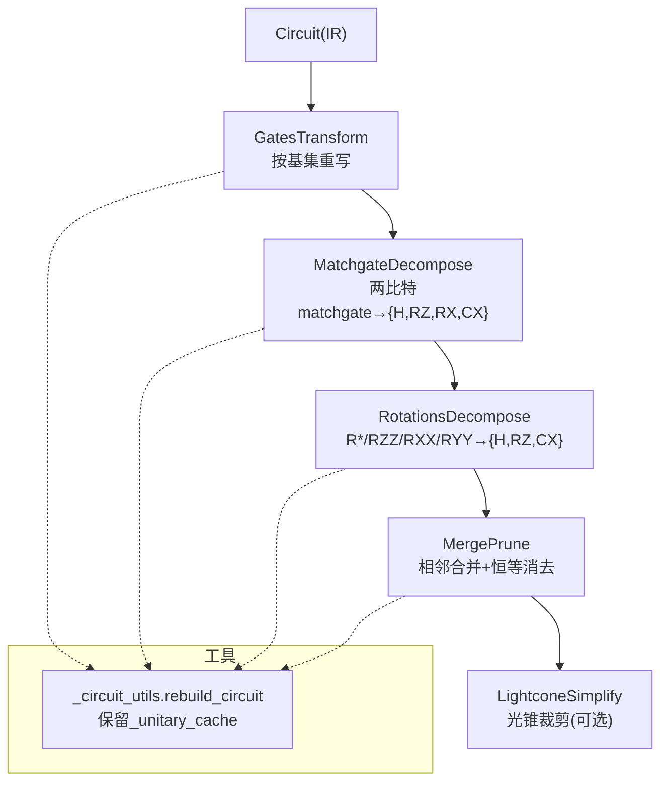
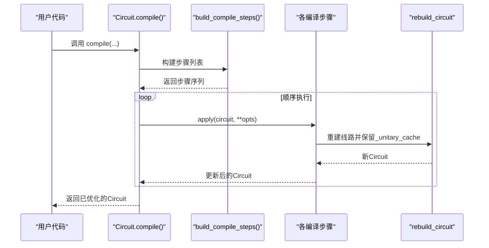
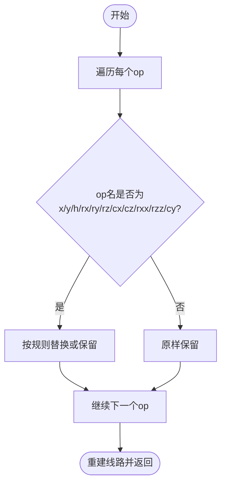
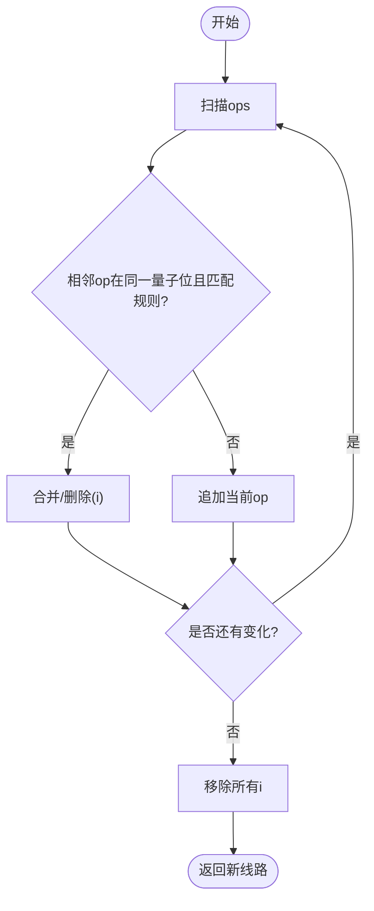
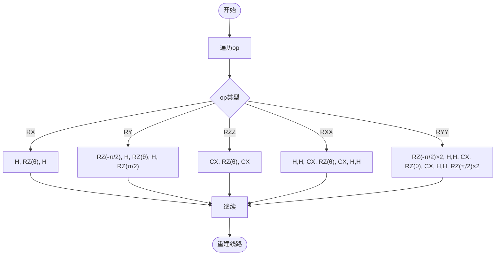
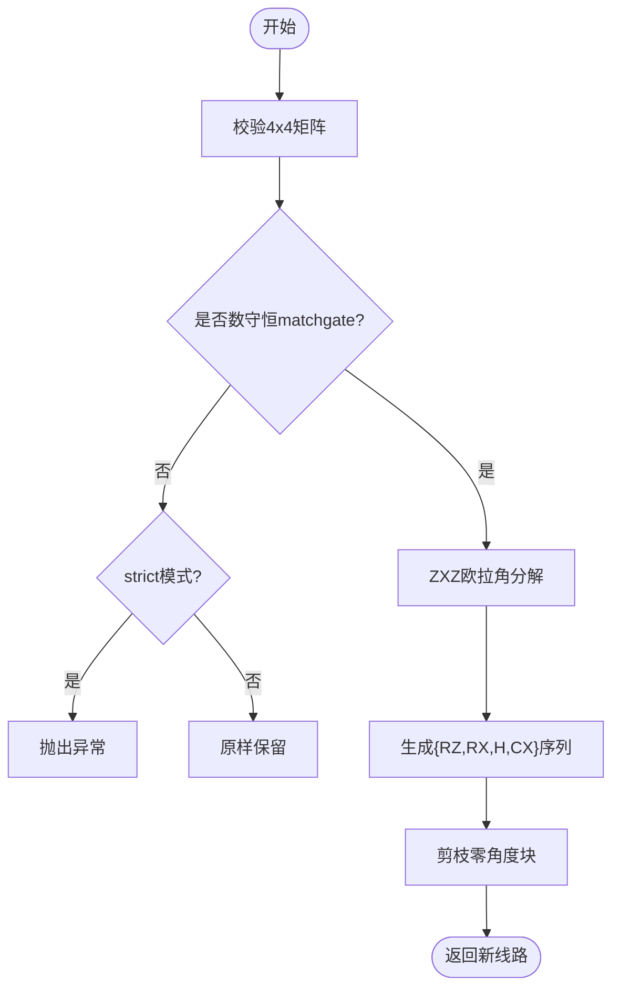
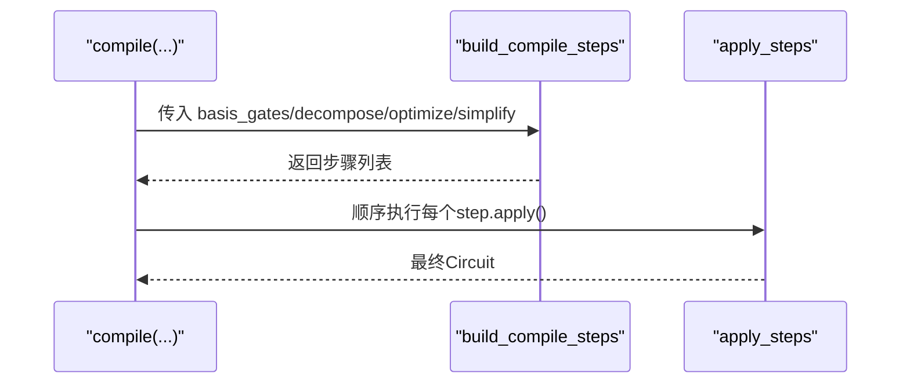
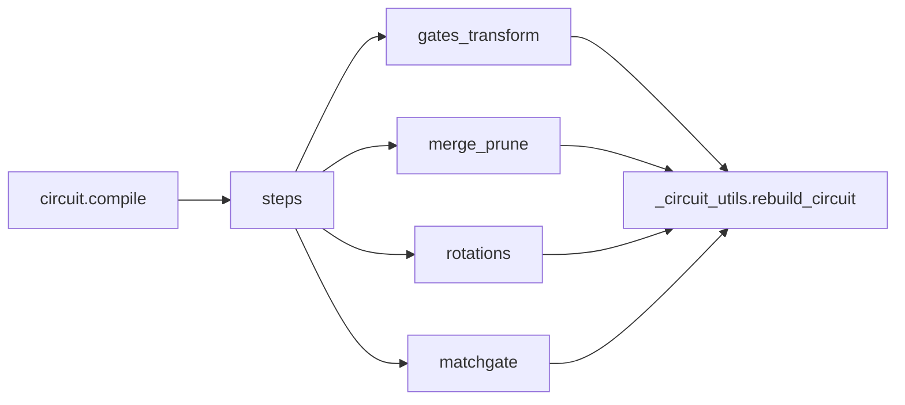

# 门变换优化

<cite>
**本文引用的文件**
- [gates_transform.py](file://src/tyxonq/compiler/gate_compiler/stages/rewrite/gates_transform.py)
- [merge_prune.py](file://src/tyxonq/compiler/gate_compiler/stages/rewrite/merge_prune.py)
- [rotations.py](file://src/tyxonq/compiler/gate_compiler/stages/decompose/rotations.py)
- [matchgate.py](file://src/tyxonq/compiler/gate_compiler/stages/decompose/matchgate.py)
- [_circuit_utils.py](file://src/tyxonq/compiler/gate_compiler/_circuit_utils.py)
- [steps.py](file://src/tyxonq/compiler/gate_compiler/steps.py)
- [circuit.py](file://src/tyxonq/core/ir/circuit.py)
- [compiler_lightcone_optimization.py](file://examples/compiler_lightcone_optimization.py)
</cite>

## 目录
1. [简介](#简介)
2. [项目结构](#项目结构)
3. [核心组件](#核心组件)
4. [架构总览](#架构总览)
5. [详细组件分析](#详细组件分析)
6. [依赖关系分析](#依赖关系分析)
7. [性能考量](#性能考量)
8. [故障排查指南](#故障排查指南)
9. [结论](#结论)
10. [附录](#附录)

## 简介
本文件系统性阐述 TyxonQ 编译器中的“门变换优化”技术，覆盖等价门替换、相邻门合并与消去、参数化旋转门的分解、以及数守恒两比特匹配门（matchgate）到原生基门的精确分解。文档同时说明不同门操作的等价性判断规则、合并算法与角度参数优化策略、无效操作识别与消除机制，并给出在编译管线中如何添加自定义门变换规则的方法。最后对门变换对电路深度和宽度的影响进行分析，并讨论与其他优化技术的协同作用。

## 项目结构
TyxonQ 的门变换优化集中在 gate_compiler 子系统中，按阶段组织：
- rewrite（重写）：GatesTransform（按目标基集重写）、MergePrune（相邻门合并与恒等消去）
- decompose（分解）：RotationsDecompose（旋转门分解为 H/RZ/CX）、MatchgateDecompose（两比特 matchgate 分解为 {H,RZ,RX,CX}）
- 通用工具：_circuit_utils.rebuild_circuit（重建线路并保留 _unitary_cache）
- 装配器：steps.build_compile_steps（组装编译步骤序列）
- IR 层：core.ir.circuit.Circuit（IR 表示与编译入口）

图表来源
- [steps.py:27-91](file://src/tyxonq/compiler/gate_compiler/steps.py#L27-L91)
- [gates_transform.py:12-50](file://src/tyxonq/compiler/gate_compiler/stages/rewrite/gates_transform.py#L12-L50)
- [matchgate.py:152-197](file://src/tyxonq/compiler/gate_compiler/stages/decompose/matchgate.py#L152-L197)
- [rotations.py:13-73](file://src/tyxonq/compiler/gate_compiler/stages/decompose/rotations.py#L13-L73)
- [merge_prune.py:27-85](file://src/tyxonq/compiler/gate_compiler/stages/rewrite/merge_prune.py#L27-L85)
- [_circuit_utils.py:28-72](file://src/tyxonq/compiler/gate_compiler/_circuit_utils.py#L28-L72)

章节来源
- [steps.py:27-91](file://src/tyxonq/compiler/gate_compiler/steps.py#L27-L91)
- [circuit.py:780-800](file://src/tyxonq/core/ir/circuit.py#L780-L800)

## 核心组件
- GatesTransform：将非基门映射到指定基集（如 x→rx(π)、y→ry(π)），并在必要时原样保留受控或特定双比特门；通过 rebuild_circuit 重建线路以保留矩阵缓存。
- MergePrune：基于等价规则表合并相邻同线门，支持角度相加（rz/rx/ry）与恒等操作消去（i）。
- RotationsDecompose：用标准恒等式将 R*/RZZ/RXX/RYY 分解为 H/RZ/CX 组合。
- MatchgateDecompose：检测并分解数守恒的 2-qubit matchgate 为 {H,RZ,RX,CX} 序列，严格模式下对非 matchgate 报错。
- rebuild_circuit：统一重建 Circuit 并复制 _unitary_cache，避免后续分解因缺失矩阵缓存而失败。
- steps.build_compile_steps：按固定顺序装配编译步骤（规范化→分解→路由→优化→化简）。

章节来源
- [gates_transform.py:12-50](file://src/tyxonq/compiler/gate_compiler/stages/rewrite/gates_transform.py#L12-L50)
- [merge_prune.py:12-85](file://src/tyxonq/compiler/gate_compiler/stages/rewrite/merge_prune.py#L12-L85)
- [rotations.py:13-73](file://src/tyxonq/compiler/gate_compiler/stages/decompose/rotations.py#L13-L73)
- [matchgate.py:46-149](file://src/tyxonq/compiler/gate_compiler/stages/decompose/matchgate.py#L46-L149)
- [_circuit_utils.py:28-72](file://src/tyxonq/compiler/gate_compiler/_circuit_utils.py#L28-L72)
- [steps.py:27-91](file://src/tyxonq/compiler/gate_compiler/steps.py#L27-L91)

## 架构总览
门变换优化在编译管线中以“可插拔步骤”的形式串联执行。默认顺序为：
1) AutoMeasure（补测量）→ GatesTransform（基集重写）
2) MatchgateDecompose / RotationsDecompose（分解）
3) Routing（可选）
4) MergePrune（合并与消去）
5) LightconeSimplify（可选）

图表来源
- [steps.py:27-91](file://src/tyxonq/compiler/gate_compiler/steps.py#L27-L91)
- [_circuit_utils.py:28-72](file://src/tyxonq/compiler/gate_compiler/_circuit_utils.py#L28-L72)
- [circuit.py:780-800](file://src/tyxonq/core/ir/circuit.py#L780-L800)

## 详细组件分析

### 等价门替换（GatesTransform）
- 目标：将输入电路中的门映射到目标基集（basis_gates），未显式包含的门交由后续分解或 lowering 处理。
- 关键规则：
  - x → rx(π)，y → ry(π)（当对应旋转门在基集中）
  - cx、cz、h、rx、ry、rz 原样保留
  - rxx、rzz、cy 仅在基集中显式请求时原样保留
- 实现要点：遍历 ops，按名称匹配并替换；使用 rebuild_circuit 重建线路以保留 _unitary_cache。

图表来源
- [gates_transform.py:29-50](file://src/tyxonq/compiler/gate_compiler/stages/rewrite/gates_transform.py#L29-L50)
- [_circuit_utils.py:28-72](file://src/tyxonq/compiler/gate_compiler/_circuit_utils.py#L28-L72)

章节来源
- [gates_transform.py:12-50](file://src/tyxonq/compiler/gate_compiler/stages/rewrite/gates_transform.py#L12-L50)

### 相邻门合并与恒等消去（MergePrune）
- 合并规则：
  - 相同门连续作用于同一量子位时可合并：例如 s·s→z、t·t→s、x·x→i、y·y→i、z·z→i、h·h→i
  - 旋转门 rz/rx/ry 相邻可合并为单门，角度相加
- 恒等操作 i 会被剪枝移除
- 算法流程：
  - 扫描 ops，若相邻 op 作用于同一量子位且匹配规则表，则合并或删除
  - 重复直到无变化，再清理所有 i

图表来源
- [merge_prune.py:27-85](file://src/tyxonq/compiler/gate_compiler/stages/rewrite/merge_prune.py#L27-L85)

章节来源
- [merge_prune.py:12-85](file://src/tyxonq/compiler/gate_compiler/stages/rewrite/merge_prune.py#L12-L85)

### 旋转门分解（RotationsDecompose）
- 目标：将参数化旋转门与双比特旋转门分解为标准集合 {H, RZ, CX}
- 规则：
  - RX(θ) = H · RZ(θ) · H
  - RY(θ) = S† · H · RZ(θ) · H · S（其中 S=RZ(π/2)）
  - RZZ(θ) = CX · RZ(θ) · CX
  - RXX(θ) = H⊗H · CX · RZ(θ) · CX · H⊗H
  - RYY(θ) = (S†H)⊗(S†H) · CX · RZ(θ) · CX · (HS)⊗(HS)
- 实现要点：逐 op 检查名称并展开为基本门序列；使用 rebuild_circuit 保持 _unitary_cache

图表来源
- [rotations.py:13-73](file://src/tyxonq/compiler/gate_compiler/stages/decompose/rotations.py#L13-L73)
- [_circuit_utils.py:28-72](file://src/tyxonq/compiler/gate_compiler/_circuit_utils.py#L28-L72)

章节来源
- [rotations.py:13-73](file://src/tyxonq/compiler/gate_compiler/stages/decompose/rotations.py#L13-L73)

### 两比特数守恒匹配门分解（MatchgateDecompose）
- 数学基础：fSim 家族可分解为 iSWAP 型相互作用 + CPhase；two_mode_fock(v) 属于该家族，可在忽略全局相位下精确降到 {RZ, RX, H, CX}
- 判定：is_number_conserving_matchgate 检查跨粒子数子空间耦合是否为零
- 分解步骤（忽略全局相位）：
  1) |11> 相位由 e^{iμN} 承载，即 q0/q1 各一个 RZ(μ)
  2) 去掉相位后 W∈SU(2)，按 ZXZ 欧拉角分解为 RZ(a)·Rx(b)·Rz(c)
  3) 子空间 RZ 表达为两比特 RZ 之差；子空间 Rx(b) 通过 RYY(b/2)·RXX(b/2) 落到 RZZ 并用 CX·RZ·CX 实现
  4) 零角度块被剪枝以减少门数
- 严格模式：若非 matchgate 且开启 strict，直接抛出异常

图表来源
- [matchgate.py:46-149](file://src/tyxonq/compiler/gate_compiler/stages/decompose/matchgate.py#L46-L149)
- [matchgate.py:152-197](file://src/tyxonq/compiler/gate_compiler/stages/decompose/matchgate.py#L152-L197)

章节来源
- [matchgate.py:46-149](file://src/tyxonq/compiler/gate_compiler/stages/decompose/matchgate.py#L46-L149)
- [matchgate.py:152-197](file://src/tyxonq/compiler/gate_compiler/stages/decompose/matchgate.py#L152-L197)

### 编译步骤装配与执行（steps）
- 固定顺序：AutoMeasure → GatesTransform → MatchgateDecompose/RotationsDecompose → Routing（可选）→ MergePrune（optimize≥1）→ LightconeSimplify（可选）
- 通过 build_compile_steps 根据参数动态装配步骤；apply_steps 顺序执行

图表来源
- [steps.py:27-91](file://src/tyxonq/compiler/gate_compiler/steps.py#L27-L91)
- [steps.py:94-105](file://src/tyxonq/compiler/gate_compiler/steps.py#L94-L105)

章节来源
- [steps.py:27-91](file://src/tyxonq/compiler/gate_compiler/steps.py#L27-L91)
- [steps.py:94-105](file://src/tyxonq/compiler/gate_compiler/steps.py#L94-L105)

### 自定义门变换规则的添加方法
- 在 MergePrune 中扩展 DEFAULT_MERGE_RULES 字典，新增相邻门合并规则（键为 (门A, 门B)，值为合并结果门名）
- 在 GatesTransform 中添加新的等价替换逻辑（如新增基集映射）
- 在 RotationsDecompose 中添加新的分解恒等式
- 在 MatchgateDecompose 中扩展 is_number_conserving_matchgate 判定或分解路径
- 所有修改需确保使用 rebuild_circuit 重建线路以保留 _unitary_cache

章节来源
- [merge_prune.py:12-39](file://src/tyxonq/compiler/gate_compiler/stages/rewrite/merge_prune.py#L12-L39)
- [gates_transform.py:29-50](file://src/tyxonq/compiler/gate_compiler/stages/rewrite/gates_transform.py#L29-L50)
- [rotations.py:29-73](file://src/tyxonq/compiler/gate_compiler/stages/decompose/rotations.py#L29-L73)
- [matchgate.py:46-149](file://src/tyxonq/compiler/gate_compiler/stages/decompose/matchgate.py#L46-L149)
- [_circuit_utils.py:28-72](file://src/tyxonq/compiler/gate_compiler/_circuit_utils.py#L28-L72)

## 依赖关系分析
- 模块内依赖：
  - gates_transform、merge_prune、rotations、matchgate 均依赖 _circuit_utils.rebuild_circuit 以安全重建线路并保留 _unitary_cache
  - steps 装配上述阶段，形成编译流水线
  - circuit.compile 委托 compiler.api.compile，进而触发步骤执行
- 外部依赖：
  - 路由阶段可能依赖 qiskit.transpile（延迟导入）
  - 数值计算依赖 numpy（matchgate 分解）

图表来源
- [steps.py:27-91](file://src/tyxonq/compiler/gate_compiler/steps.py#L27-L91)
- [_circuit_utils.py:28-72](file://src/tyxonq/compiler/gate_compiler/_circuit_utils.py#L28-L72)
- [circuit.py:780-800](file://src/tyxonq/core/ir/circuit.py#L780-L800)

章节来源
- [steps.py:27-91](file://src/tyxonq/compiler/gate_compiler/steps.py#L27-L91)
- [_circuit_utils.py:28-72](file://src/tyxonq/compiler/gate_compiler/_circuit_utils.py#L28-L72)
- [circuit.py:780-800](file://src/tyxonq/core/ir/circuit.py#L780-L800)

## 性能考量
- 门数量与深度：
  - GatesTransform 通常不增加门数，仅做等价替换
  - RotationsDecompose 会增加门数（如 RY→5个门），但换来更小的基集
  - MatchgateDecompose 将复杂两比特门分解为多个基本门，可能显著增加门数，但能利用硬件原生门集
  - MergePrune 减少冗余门，降低深度与门计数
- 宽度（qubits）：变换不改变 qubit 数，除非引入额外辅助位（本实现未引入）
- 与光锥简化（LightconeSimplify）协同：
  - 在期望值计算中，仅保留影响测量位的门，可大幅减少模拟成本
  - 示例展示了在不同问题规模下的加速效果

章节来源
- [rotations.py:13-73](file://src/tyxonq/compiler/gate_compiler/stages/decompose/rotations.py#L13-L73)
- [matchgate.py:152-197](file://src/tyxonq/compiler/gate_compiler/stages/decompose/matchgate.py#L152-L197)
- [merge_prune.py:27-85](file://src/tyxonq/compiler/gate_compiler/stages/rewrite/merge_prune.py#L27-L85)
- [compiler_lightcone_optimization.py:1-282](file://examples/compiler_lightcone_optimization.py#L1-L282)

## 故障排查指南
- “matchgate 分解缺少矩阵缓存”错误：
  - 原因：某编译步骤重建线路时未保留 _unitary_cache
  - 解决：确保使用 rebuild_circuit 重建线路
- 非 matchgate 的两比特 unitary 无法分解：
  - 关闭 strict 模式会原样保留；开启 strict 会抛错
  - 建议：确认上游生成的两比特 unitary 是否属于 fSim/two_mode_fock 家族
- 合并规则不生效：
  - 检查相邻门是否作用于同一量子位
  - 确认规则表中存在相应键
- 旋转门分解后角度异常：
  - 检查浮点精度与角度归一化（如 ±2π）
  - 确认分解恒等式与目标基集一致

章节来源
- [_circuit_utils.py:28-72](file://src/tyxonq/compiler/gate_compiler/_circuit_utils.py#L28-L72)
- [matchgate.py:152-197](file://src/tyxonq/compiler/gate_compiler/stages/decompose/matchgate.py#L152-L197)
- [merge_prune.py:27-85](file://src/tyxonq/compiler/gate_compiler/stages/rewrite/merge_prune.py#L27-L85)
- [rotations.py:29-73](file://src/tyxonq/compiler/gate_compiler/stages/decompose/rotations.py#L29-L73)

## 结论
TyxonQ 的门变换优化通过模块化、可插拔的编译步骤实现了从高层抽象到低层基集的精确转换。其核心能力包括：
- 等价门替换与基集规范化
- 相邻门合并与恒等操作消去
- 参数化旋转门的标准分解
- 数守恒两比特匹配门的精确分解
- 与光锥简化等其它优化技术的协同，显著提升仿真与执行效率

这些优化在保证数学正确性的前提下，有效降低了电路深度与门计数，并为不同硬件平台提供了灵活的适配能力。

## 附录
- 使用示例参考：
  - 光锥优化示例展示了如何在期望值计算中启用 LightconeSimplify，获得显著加速并保持数值一致性
  - 可通过 steps.build_compile_steps 配置 optimize=1 启用 MergePrune，或在 decompose 中启用 matchgate/rotations 分解

章节来源
- [compiler_lightcone_optimization.py:1-282](file://examples/compiler_lightcone_optimization.py#L1-L282)
- [steps.py:27-91](file://src/tyxonq/compiler/gate_compiler/steps.py#L27-L91)