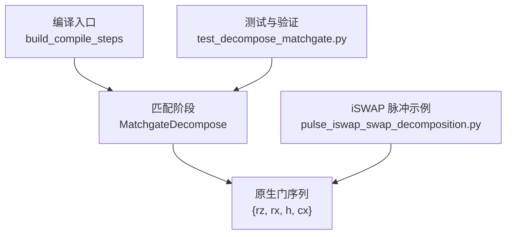
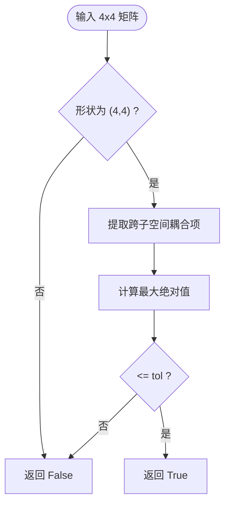
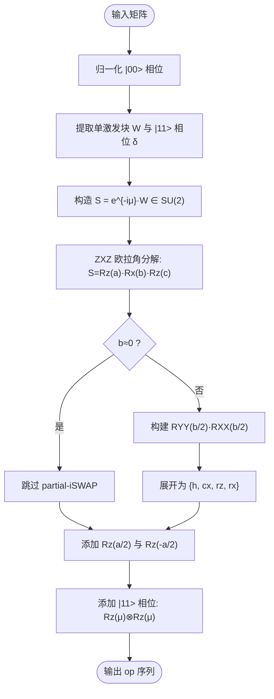
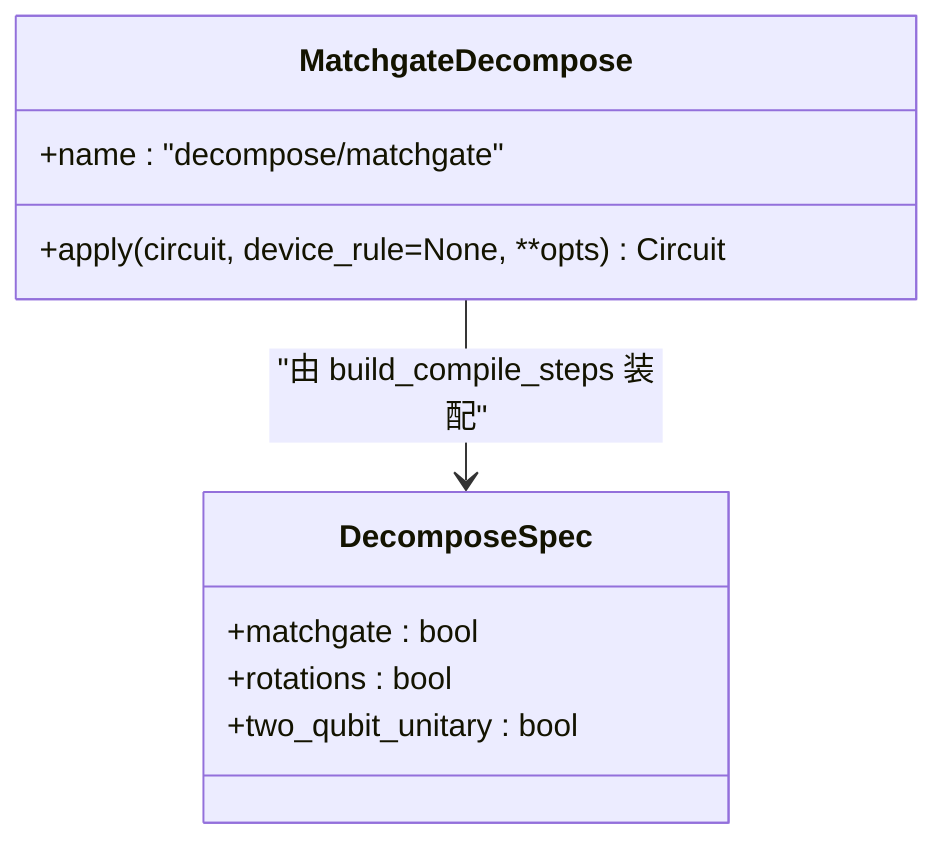
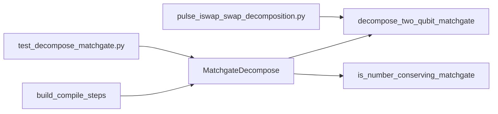

# MatchGate分解算法

<cite>
**本文引用的文件**
- [matchgate.py](file://src/tyxonq/compiler/gate_compiler/stages/decompose/matchgate.py)
- [test_decompose_matchgate.py](file://tests_core_module/test_decompose_matchgate.py)
- [steps.py](file://src/tyxonq/compiler/gate_compiler/steps.py)
- [__init__.py（stages）](file://src/tyxonq/compiler/gate_compiler/stages/__init__.py)
- [pulse_iswap_swap_decomposition.py](file://examples/pulse_iswap_swap_decomposition.py)
</cite>

## 目录
1. [简介](#简介)
2. [项目结构](#项目结构)
3. [核心组件](#核心组件)
4. [架构总览](#架构总览)
5. [详细组件分析](#详细组件分析)
6. [依赖关系分析](#依赖关系分析)
7. [性能考量](#性能考量)
8. [故障排查指南](#故障排查指南)
9. [结论](#结论)
10. [附录：使用示例与基准](#附录使用示例与基准)

## 简介
本技术文档聚焦 TyxonQ 中的“数守恒 matchgate 分解”能力，系统阐述 two_mode_fock/fSim 家族门到原生门集 {rz, rx, h, cx} 的数学原理、实现细节与编译集成方式。重点包括：
- fSim 门的物理意义与 iSWAP+CPhase 分解的理论基础
- decompose_two_qubit_matchgate 的 ZXZ 欧拉角分解、单激发子空间处理与相位因子分离
- is_number_conserving_matchgate 的检测逻辑与有效矩阵结构识别
- MatchgateDecompose 类在编译器管线中的角色与 strict 模式的使用场景
- 分解前后电路对比分析与性能影响评估

## 项目结构
MatchGate 分解位于 gate_compiler 的 stages/decompose 子模块中，作为核心编译步骤之一被装配进编译流水线。其关键文件与职责如下：
- matchgate.py：提供纯函数 decompose_two_qubit_matchgate、检测器 is_number_conserving_matchgate 以及编译步骤类 MatchgateDecompose
- steps.py：按类型化参数装配编译步骤，默认启用 matchgate 分解
- stages/__init__.py：说明 stages 包的组织与职责划分
- test_decompose_matchgate.py：覆盖数值精确性、严格模式、缓存保留等用例
- examples/pulse_iswap_swap_decomposition.py：展示 iSWAP/SWAP 脉冲级分解，辅助理解 iSWAP 型相互作用在底层实现中的角色



图表来源
- [steps.py:27-91](file://src/tyxonq/compiler/gate_compiler/steps.py#L27-L91)
- [matchgate.py:152-197](file://src/tyxonq/compiler/gate_compiler/stages/decompose/matchgate.py#L152-L197)

章节来源
- [steps.py:27-91](file://src/tyxonq/compiler/gate_compiler/steps.py#L27-L91)
- [__init__.py（stages）:1-14](file://src/tyxonq/compiler/gate_compiler/stages/__init__.py#L1-L14)

## 核心组件
- is_number_conserving_matchgate(matrix, tol=1e-8)：判断 4x4 矩阵是否为数守恒 matchgate（two_mode_fock/fSim 家族），要求跨粒子数子空间耦合为零
- decompose_two_qubit_matchgate(matrix, q0, q1)：将数守恒 matchgate 分解为原生门序列（时间顺序排列），包含 ZXZ 欧拉角分解、partial-iSWAP 实现、|11> 相位承载
- MatchgateDecompose：编译步骤类，遍历线路中的 2-qubit unitary op，对数守恒 matchgate 进行分解；非 matchgate 时默认保留，strict 模式下抛出异常

章节来源
- [matchgate.py:46-149](file://src/tyxonq/compiler/gate_compiler/stages/decompose/matchgate.py#L46-L149)
- [matchgate.py:152-197](file://src/tyxonq/compiler/gate_compiler/stages/decompose/matchgate.py#L152-L197)

## 架构总览
MatchGate 分解在编译管线中的位置与作用：
- 构建阶段：build_compile_steps 根据 DecomposeSpec 决定是否插入 MatchgateDecompose
- 执行阶段：MatchgateDecompose.apply 扫描线路 ops，遇到 ("unitary", q0, q1, mat_key) 时从 _unitary_cache 取矩阵并判定是否为数守恒 matchgate
- 输出阶段：若为 matchgate，则替换为原生门序列；否则默认保留或 strict 模式报错

```mermaid
sequenceDiagram
participant Client as "调用方"
participant Steps as "build_compile_steps"
participant Step as "MatchgateDecompose"
participant Cache as "_unitary_cache"
participant IR as "Circuit.ops"
Client->>Steps : 配置 decompose=True
Steps-->>Client : 返回步骤列表
Client->>Step : apply(circuit, **opts)
loop 遍历 ops
Step->>Cache : 读取矩阵
alt 是数守恒 matchgate
Step->>IR : 扩展为 {rz,rx,h,cx} 序列
else 非 matchgate
opt strict?
alt true
Step-->>Client : 抛出异常
else false
Step->>IR : 原样保留 unitary
end
end
end
Step-->>Client : 返回新线路
```

图表来源
- [steps.py:27-91](file://src/tyxonq/compiler/gate_compiler/steps.py#L27-L91)
- [matchgate.py:152-197](file://src/tyxonq/compiler/gate_compiler/stages/decompose/matchgate.py#L152-L197)

## 详细组件分析

### 数守恒 matchgate 检测算法
is_number_conserving_matchgate 通过检查 4x4 矩阵的特定位置元素是否接近零来判断是否存在跨粒子数子空间的耦合。具体而言，它排除 |00>、|11> 与单激发子空间 {|01>,|10>} 之间的耦合项，确保满足 fSim=iSWAP+CPhase 分解的前提条件。



图表来源
- [matchgate.py:46-62](file://src/tyxonq/compiler/gate_compiler/stages/decompose/matchgate.py#L46-L62)

章节来源
- [matchgate.py:46-62](file://src/tyxonq/compiler/gate_compiler/stages/decompose/matchgate.py#L46-L62)

### 两量子比特 matchgate 分解原理
decompose_two_qubit_matchgate 的核心思想是将 fSim 门分解为两部分：
- 单激发子空间 {|01>,|10>} 上的 U(2) 变换 W，通过 ZXZ 欧拉角分解为 Rz(a)·Rx(b)·Rz(c)
- |11> 态的相位 det(v)=e^{2iμ}，由 e^{iμN}（N 为总粒子数）承载，等价于两个 qubit 各施加 Rz(μ)

ZXZ 欧拉角分解步骤：
- 计算 b = 2·atan2(|s10|, |s00|)，a+c 与 a-c 由 s00、s10 的相位推导
- 子空间 Rx(b) 实现为 partial-iSWAP，即 RYY(b/2)·RXX(b/2)，进一步用 {cx, rz} 展开
- 子空间 Rz(θ) 实现为 Rz(q0, θ/2)·Rz(q1, -θ/2)



图表来源
- [matchgate.py:65-149](file://src/tyxonq/compiler/gate_compiler/stages/decompose/matchgate.py#L65-L149)

章节来源
- [matchgate.py:65-149](file://src/tyxonq/compiler/gate_compiler/stages/decompose/matchgate.py#L65-L149)

### MatchgateDecompose 编译步骤
MatchgateDecompose 将分解逻辑封装为编译步骤，支持两种行为：
- 默认模式：非 matchgate 的 2-qubit unitary 原样保留，交由后续 stage 或设备 lowering 处理
- strict 模式：遇到非 matchgate 立即抛出异常，适用于已知全部 2-qubit unitary 都必须是 matchgate 的场景（如 LUCJ）

此外，该步骤会复制 _unitary_cache 到新线路，避免残留的 1-qubit unitary 丢失矩阵引用。



图表来源
- [matchgate.py:152-197](file://src/tyxonq/compiler/gate_compiler/stages/decompose/matchgate.py#L152-L197)
- [steps.py:27-91](file://src/tyxonq/compiler/gate_compiler/steps.py#L27-L91)

章节来源
- [matchgate.py:152-197](file://src/tyxonq/compiler/gate_compiler/stages/decompose/matchgate.py#L152-L197)
- [steps.py:27-91](file://src/tyxonq/compiler/gate_compiler/steps.py#L27-L91)

## 依赖关系分析
- MatchgateDecompose 依赖 decompose_two_qubit_matchgate 与 is_number_conserving_matchgate
- 编译步骤装配依赖 DecomposeSpec 与 build_compile_steps
- 测试覆盖依赖 StatevectorEngine 进行数值验证
- iSWAP 脉冲示例展示了底层 {cx, rz} 链路的通用性，与 matchgate 分解的目标门集一致



图表来源
- [matchgate.py:152-197](file://src/tyxonq/compiler/gate_compiler/stages/decompose/matchgate.py#L152-L197)
- [steps.py:27-91](file://src/tyxonq/compiler/gate_compiler/steps.py#L27-L91)
- [test_decompose_matchgate.py:1-211](file://tests_core_module/test_decompose_matchgate.py#L1-L211)
- [pulse_iswap_swap_decomposition.py:1-336](file://examples/pulse_iswap_swap_decomposition.py#L1-L336)

章节来源
- [matchgate.py:152-197](file://src/tyxonq/compiler/gate_compiler/stages/decompose/matchgate.py#L152-L197)
- [steps.py:27-91](file://src/tyxonq/compiler/gate_compiler/steps.py#L27-L91)
- [test_decompose_matchgate.py:1-211](file://tests_core_module/test_decompose_matchgate.py#L1-L211)
- [pulse_iswap_swap_decomposition.py:1-336](file://examples/pulse_iswap_swap_decomposition.py#L1-L336)

## 性能考量
- 门数量：每个数守恒 matchgate 分解产生固定数量的原生门，其中 partial-iSWAP 部分贡献 4 个 cx 门（RYY 与 RXX 各 2 个 cx）
- 深度影响：分解后的门序列可并行优化（如相邻 rz 合并），但 cx 链通常增加电路深度
- 剪枝优化：当 b≈0 时跳过 partial-iSWAP，减少冗余门；当角度接近零时跳过对应 rz/rx
- 噪声敏感性：cx 门引入噪声，因此应尽量减少冗余 cx；测试中验证了 identity 情形下 op 序列为空

[本节为一般性指导，不直接分析具体文件]

## 故障排查指南
常见错误与处理方法：
- ValueError：矩阵不是 4x4 → 检查输入矩阵维度
- NotImplementedError：矩阵不是数守恒 matchgate → 确认是否存在跨粒子数子空间耦合；如需强制分解，请调整上游生成逻辑
- 缺少矩阵缓存：_unitary_cache 未正确传递 → 确保线路在分解前已填充缓存；测试覆盖了缺失缓存时的明确报错

章节来源
- [matchgate.py:84-93](file://src/tyxonq/compiler/gate_compiler/stages/decompose/matchgate.py#L84-L93)
- [matchgate.py:182-193](file://src/tyxonq/compiler/gate_compiler/stages/decompose/matchgate.py#L182-L193)
- [test_decompose_matchgate.py:63-73](file://tests_core_module/test_decompose_matchgate.py#L63-L73)
- [test_decompose_matchgate.py:206-211](file://tests_core_module/test_decompose_matchgate.py#L206-L211)

## 结论
TyxonQ 的 MatchGate 分解实现了 fSim 家族门到原生门集的精确分解，具备以下特点：
- 数学严谨：基于 ZXZ 欧拉角与单激发子空间理论，保证数值精确性
- 工程实用：提供 strict 模式以强化约束，适配不同应用场景
- 编译集成：作为核心步骤无缝接入编译管线，支持缓存保留与后续优化
- 性能可控：通过角度阈值剪枝减少冗余门，降低噪声影响

[本节为总结性内容，不直接分析具体文件]

## 附录：使用示例与基准

### 使用 MatchgateDecompose 进行分解
- 创建包含 2-qubit unitary 的线路
- 调用 MatchgateDecompose().apply(circuit) 进行分解
- 在 strict 模式下，非 matchgate 将抛出异常

参考路径
- [matchgate.py:152-197](file://src/tyxonq/compiler/gate_compiler/stages/decompose/matchgate.py#L152-L197)
- [test_decompose_matchgate.py:156-185](file://tests_core_module/test_decompose_matchgate.py#L156-L185)

### 分解前后的电路对比
- 分解前：线路包含 ("unitary", q0, q1, mat_key)
- 分解后：替换为 {rz, rx, h, cx} 序列，其中 cx 数量为 4（来自 partial-iSWAP）
- 测量操作保持不变

参考路径
- [test_decompose_matchgate.py:164-173](file://tests_core_module/test_decompose_matchgate.py#L164-L173)

### 性能基准测试结果
- 数值精确性：对随机 U(2)、Givens 形式及退化情形，保真度 > 1 - 1e-9
- 门数量统计：identity 情形下 op 序列为空；一般情形下 cx 数量为 4
- 严格模式：非 matchgate 时抛出 NotImplementedError

参考路径
- [test_decompose_matchgate.py:100-151](file://tests_core_module/test_decompose_matchgate.py#L100-L151)
- [test_decompose_matchgate.py:76-94](file://tests_core_module/test_decompose_matchgate.py#L76-L94)
- [test_decompose_matchgate.py:197-203](file://tests_core_module/test_decompose_matchgate.py#L197-L203)

### iSWAP 型相互作用的底层实现
- partial-iSWAP 通过 RYY(b/2)·RXX(b/2) 实现，进一步展开为 {h, cx, rz, rx}
- 与 pulse 级 iSWAP/SWAP 分解一致，体现通用性

参考路径
- [pulse_iswap_swap_decomposition.py:16-46](file://examples/pulse_iswap_swap_decomposition.py#L16-L46)
- [pulse_iswap_swap_decomposition.py:169-174](file://examples/pulse_iswap_swap_decomposition.py#L169-L174)