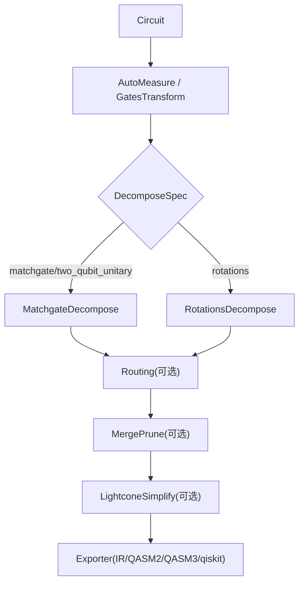
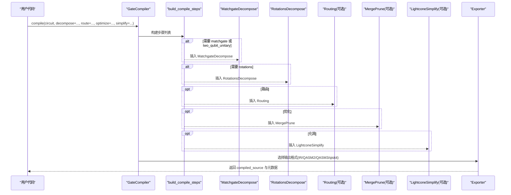
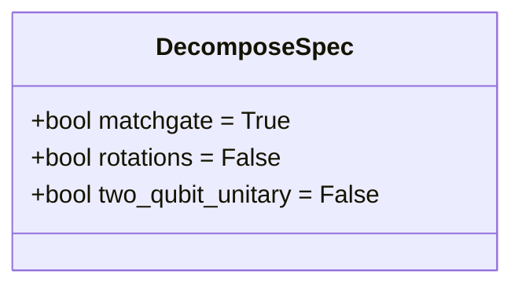
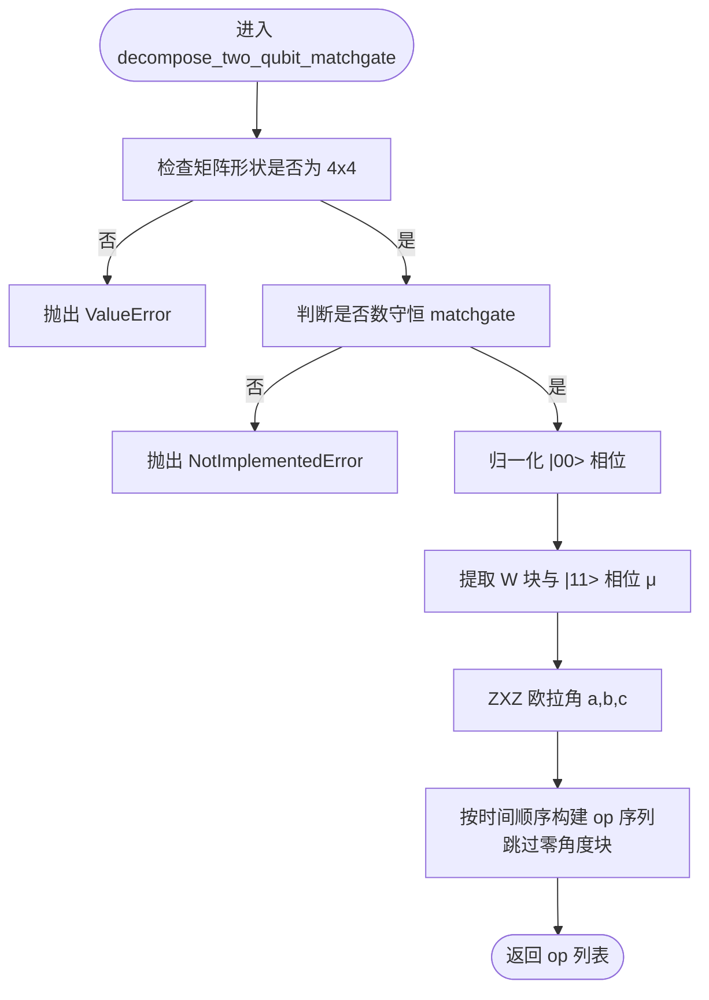
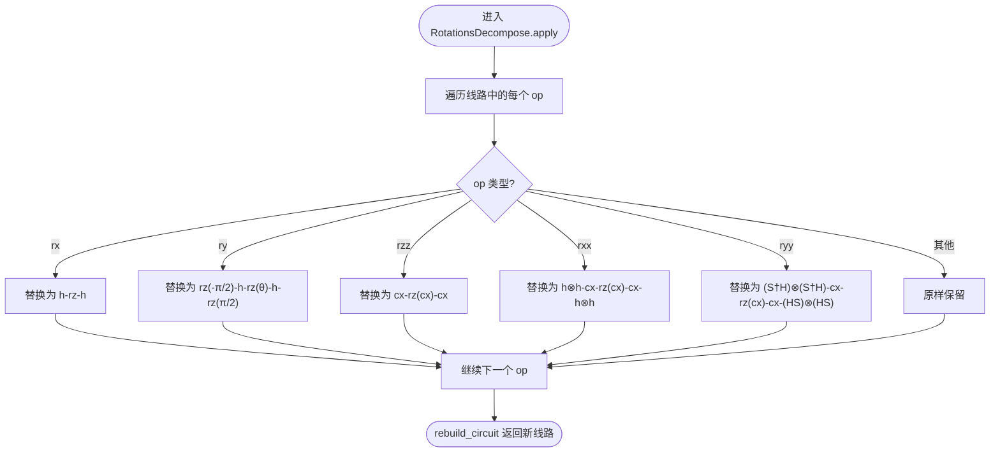
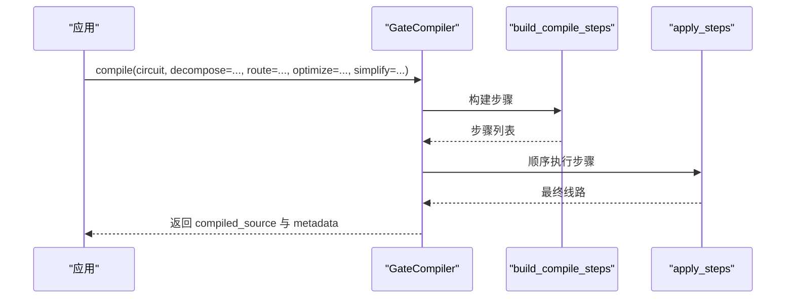
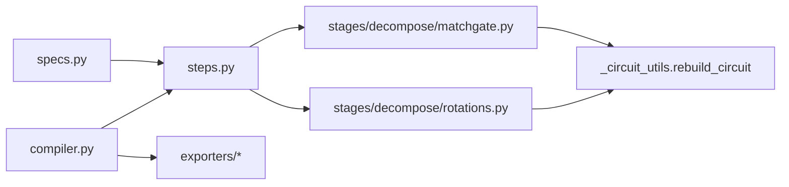

# 分解策略

<cite>
**本文引用的文件**
- [src/tyxonq/compiler/gate_compiler/stages/decompose/__init__.py](file://src/tyxonq/compiler/gate_compiler/stages/decompose/__init__.py)
- [src/tyxonq/compiler/gate_compiler/stages/decompose/matchgate.py](file://src/tyxonq/compiler/gate_compiler/stages/decompose/matchgate.py)
- [src/tyxonq/compiler/gate_compiler/stages/decompose/rotations.py](file://src/tyxonq/compiler/gate_compiler/stages/decompose/rotations.py)
- [src/tyxonq/compiler/gate_compiler/specs.py](file://src/tyxonq/compiler/gate_compiler/specs.py)
- [src/tyxonq/compiler/gate_compiler/steps.py](file://src/tyxonq/compiler/gate_compiler/steps.py)
- [src/tyxonq/compiler/gate_compiler/compiler.py](file://src/tyxonq/compiler/gate_compiler/compiler.py)
- [tests_core_module/test_decompose_matchgate.py](file://tests_core_module/test_decompose_matchgate.py)
- [tests_core_module/test_decompose_rotations.py](file://tests_core_module/test_decompose_rotations.py)
- [examples/circuit_compiler.py](file://examples/circuit_compiler.py)
</cite>

## 目录
1. [简介](#简介)
2. [项目结构](#项目结构)
3. [核心组件](#核心组件)
4. [架构总览](#架构总览)
5. [详细组件分析](#详细组件分析)
6. [依赖关系分析](#依赖关系分析)
7. [性能考量](#性能考量)
8. [故障排查指南](#故障排查指南)
9. [结论](#结论)
10. [附录：使用示例与基准](#附录使用示例与基准)

## 简介
本文件系统性阐述 TyxonQ 门级编译器的“分解策略”，聚焦以下目标：
- 解释 DecomposeSpec 类型化规格的使用方法，包括布尔值开关与详细规格对象的区别。
- 深入讲解 matchgate 分解算法的原理与应用场景，说明如何将复杂两量子比特数守恒酉矩阵（two_mode_fock/fSim 家族）精确分解为原生门集合 {rz, rx, h, cx}。
- 说明旋转门分解（rotations）的工作机制，包括单量子比特旋转门的标准化处理与双量子比特旋转的降门策略。
- 对比不同分解策略的选择标准与性能影响，涵盖分解后的电路深度、门数量与质量指标。
- 提供配置与使用示例，展示如何启用/关闭特定分解、组合多步分解，以及如何编写自定义分解规则。
- 给出分解前后电路对比分析与性能基准测试方法。

## 项目结构
TyxonQ 的门级编译器将“分解”作为独立编译阶段，位于 gate_compiler/stages/decompose 下，包含两类步骤：
- matchgate：针对 2-qubit 数守恒 matchgate 的精确分解。
- rotations：将参数化旋转门统一到 {h, rz, cx}。

这些步骤由 steps.build_compile_steps 根据类型化参数（DecomposeSpec/RoutingSpec/optimize/simplify）装配，GateCompiler 统一编排并输出 IR/QASM/qiskit 等格式。

图表来源
- [src/tyxonq/compiler/gate_compiler/steps.py:27-91](file://src/tyxonq/compiler/gate_compiler/steps.py#L27-L91)
- [src/tyxonq/compiler/gate_compiler/compiler.py:27-109](file://src/tyxonq/compiler/gate_compiler/compiler.py#L27-L109)

章节来源
- [src/tyxonq/compiler/gate_compiler/stages/decompose/__init__.py:1-12](file://src/tyxonq/compiler/gate_compiler/stages/decompose/__init__.py#L1-L12)
- [src/tyxonq/compiler/gate_compiler/steps.py:27-91](file://src/tyxonq/compiler/gate_compiler/steps.py#L27-L91)
- [src/tyxonq/compiler/gate_compiler/compiler.py:27-109](file://src/tyxonq/compiler/gate_compiler/compiler.py#L27-L109)

## 核心组件
- DecomposeSpec：类型化分解规格，字段包括 matchgate、rotations、two_qubit_unitary；支持 bool 自动升级为默认实例，便于“一键开关”。
- MatchgateDecompose：对 2-qubit unitary（匹配数守恒 matchgate）进行精确分解到 {rz, rx, h, cx}；非 matchgate 默认保留，strict 模式可强制报错。
- RotationsDecompose：将 rx/ry/rxx/ryy/rzz 分解到 {h, rz, cx}；保持数值等价（允许全局相位差）。
- build_compile_steps：按顺序装配编译步骤（规范化→分解→路由→优化→化简），未启用的能力不追加占位步骤。
- GateCompiler：统一入口，收集并执行步骤，支持多种输出格式。

章节来源
- [src/tyxonq/compiler/gate_compiler/specs.py:15-31](file://src/tyxonq/compiler/gate_compiler/specs.py#L15-L31)
- [src/tyxonq/compiler/gate_compiler/stages/decompose/matchgate.py:152-197](file://src/tyxonq/compiler/gate_compiler/stages/decompose/matchgate.py#L152-L197)
- [src/tyxonq/compiler/gate_compiler/stages/decompose/rotations.py:13-73](file://src/tyxonq/compiler/gate_compiler/stages/decompose/rotations.py#L13-L73)
- [src/tyxonq/compiler/gate_compiler/steps.py:27-91](file://src/tyxonq/compiler/gate_compiler/steps.py#L27-L91)
- [src/tyxonq/compiler/gate_compiler/compiler.py:27-109](file://src/tyxonq/compiler/gate_compiler/compiler.py#L27-L109)

## 架构总览
下图展示了从 Circuit 输入到最终输出的完整编译流程，重点标注了分解阶段的触发条件与顺序。

图表来源
- [src/tyxonq/compiler/gate_compiler/steps.py:27-91](file://src/tyxonq/compiler/gate_compiler/steps.py#L27-L91)
- [src/tyxonq/compiler/gate_compiler/compiler.py:27-109](file://src/tyxonq/compiler/gate_compiler/compiler.py#L27-L109)

## 详细组件分析

### DecomposeSpec 类型化规格
- 作用：以强类型描述分解行为，避免字符串 DSL 的不一致性与歧义。
- 字段与默认值：
  - matchgate: True（默认开启，覆盖数守恒 2-qubit unitary）
  - rotations: False（默认关闭，许多平台原生支持旋转门，展开会增加门数）
  - two_qubit_unitary: False（当前经 matchgate 覆盖数守恒子集；通用 KAK 分解后续增量）
- 布尔值升级：decompose=True 会被 coerce_decompose 转换为默认 DecomposeSpec()；decompose=False/None 表示不追加任何分解步骤。

图表来源
- [src/tyxonq/compiler/gate_compiler/specs.py:15-31](file://src/tyxonq/compiler/gate_compiler/specs.py#L15-L31)

章节来源
- [src/tyxonq/compiler/gate_compiler/specs.py:15-31](file://src/tyxonq/compiler/gate_compiler/specs.py#L15-L31)
- [src/tyxonq/compiler/gate_compiler/specs.py:61-76](file://src/tyxonq/compiler/gate_compiler/specs.py#L61-L76)

### Matchgate 分解算法
- 物理依据：fSim 门可分解为 iSWAP 型相互作用 + CPhase；two_mode_fock(v) 是 fSim 家族的 2-qubit matchgate，在单激发子空间上作用任意 U(2)，|11> 相位绑定为 det(v)。
- 分解原理（忽略全局相位）：
  - |11> 相位由 e^{iμN} 承载，即两比特各一个 Rz(μ)。
  - 去掉该相位后 S∈SU(2)，在单激发子空间按 ZXZ 欧拉角分解为 Rz(a)·Rx(b)·Rz(c)。
  - 子空间 Rx(b) 通过 partial-iSWAP = RYY(b/2)·RXX(b/2) 实现，再落到 {cx, rz}。
  - 零角度块被剪枝，减少冗余门。
- 行为：
  - 数守恒 matchgate → 展开为原生门序列（精确，保真度≈1）。
  - 非 matchgate → 默认原样保留；matchgate_strict=True 时抛出异常。
  - 1-qubit unitary 及其他 op 原样保留；_unitary_cache 复制到新线路，避免后续 lowering 丢失矩阵引用。

图表来源
- [src/tyxonq/compiler/gate_compiler/stages/decompose/matchgate.py:46-149](file://src/tyxonq/compiler/gate_compiler/stages/decompose/matchgate.py#L46-L149)

章节来源
- [src/tyxonq/compiler/gate_compiler/stages/decompose/matchgate.py:1-30](file://src/tyxonq/compiler/gate_compiler/stages/decompose/matchgate.py#L1-L30)
- [src/tyxonq/compiler/gate_compiler/stages/decompose/matchgate.py:46-149](file://src/tyxonq/compiler/gate_compiler/stages/decompose/matchgate.py#L46-L149)
- [src/tyxonq/compiler/gate_compiler/stages/decompose/matchgate.py:152-197](file://src/tyxonq/compiler/gate_compiler/stages/decompose/matchgate.py#L152-L197)

### 旋转门分解（rotations）
- 支持的模式与恒等式：
  - RX(θ) => H · RZ(θ) · H
  - RY(θ) => S† · H · RZ(θ) · H · S（其中 S=RZ(π/2)）
  - RZZ(θ) => CX · RZ(θ on target) · CX
  - RXX(θ) => H⊗H · CX · RZ(θ on target) · CX · H⊗H
  - RYY(θ) => (S†H)⊗(S†H) · CX · RZ(θ on target) · CX · (HS)⊗(HS)
- 特点：
  - 结果落在核心原生集 {h, rz, cx}。
  - 数值等价（允许全局相位差）。
  - 重建走 rebuild_circuit，保留 _unitary_cache，避免残留 1-qubit 自定义酉丢失矩阵引用。

图表来源
- [src/tyxonq/compiler/gate_compiler/stages/decompose/rotations.py:13-73](file://src/tyxonq/compiler/gate_compiler/stages/decompose/rotations.py#L13-L73)

章节来源
- [src/tyxonq/compiler/gate_compiler/stages/decompose/rotations.py:13-73](file://src/tyxonq/compiler/gate_compiler/stages/decompose/rotations.py#L13-L73)

### 步骤装配与执行
- build_compile_steps：
  - 固定顺序：AutoMeasure → GatesTransform → 分解（matchgate/rotations）→ Routing（可选）→ MergePrune（可选）→ LightconeSimplify（可选）。
  - 未启用的能力不追加占位步骤，避免无谓开销。
- apply_steps：顺序对线路施加每个 CompileStep，返回最终线路。
- GateCompiler.compile：
  - 统一收集参数，装配步骤并执行。
  - 支持输出 IR、QASM2、QASM3、qiskit 等格式；QASM2 会默认降级到 qelib1 兼容基。

图表来源
- [src/tyxonq/compiler/gate_compiler/steps.py:27-105](file://src/tyxonq/compiler/gate_compiler/steps.py#L27-L105)
- [src/tyxonq/compiler/gate_compiler/compiler.py:27-109](file://src/tyxonq/compiler/gate_compiler/compiler.py#L27-L109)

章节来源
- [src/tyxonq/compiler/gate_compiler/steps.py:27-105](file://src/tyxonq/compiler/gate_compiler/steps.py#L27-L105)
- [src/tyxonq/compiler/gate_compiler/compiler.py:27-109](file://src/tyxonq/compiler/gate_compiler/compiler.py#L27-L109)

## 依赖关系分析
- 模块耦合：
  - steps.py 依赖 specs.py 的类型化规格，动态导入 stages.decompose.* 以避免不必要的依赖。
  - matchgate.py 与 rotations.py 均依赖 _circuit_utils.rebuild_circuit 以保持 _unitary_cache。
  - compiler.py 统一调用 steps.py 装配与执行，并通过 exporters 输出不同格式。
- 外部依赖：
  - 路由步骤延迟导入 qiskit.transpile（仅在 route=True 时触发）。
  - QASM2/3 导出器与 qiskit 互操作按需加载。

图表来源
- [src/tyxonq/compiler/gate_compiler/steps.py:14-19](file://src/tyxonq/compiler/gate_compiler/steps.py#L14-L19)
- [src/tyxonq/compiler/gate_compiler/compiler.py:1-10](file://src/tyxonq/compiler/gate_compiler/compiler.py#L1-L10)

章节来源
- [src/tyxonq/compiler/gate_compiler/steps.py:14-19](file://src/tyxonq/compiler/gate_compiler/steps.py#L14-L19)
- [src/tyxonq/compiler/gate_compiler/compiler.py:1-10](file://src/tyxonq/compiler/gate_compiler/compiler.py#L1-L10)

## 性能考量
- 门数量与深度：
  - matchgate 分解将 2-qubit unitary 展开为 {rz, rx, h, cx}，典型实现包含 4 个 cx（partial-iSWAP 的 RXX·RYY 分解）。
  - rotations 分解将 rx/ry/rxx/ryy/rzz 映射到 {h, rz, cx}，可能增加门数但保证数值等价。
- 零角度剪枝：
  - matchgate 分解中 b≈0 时跳过整段 partial-iSWAP，减少冗余门与噪声。
- 路由与优化：
  - 路由步骤（可选）引入 SWAP 以适配耦合图；optimize>=1 时追加 MergePrune 合并/剪枝相邻门。
  - LightconeSimplify（可选）进一步化简。
- 质量指标：
  - 数值保真度：matchgate 分解在随机 U(2)、Givens 形式及退化情形下保真度≈1（见测试）。
  - 门集一致性：rotations 分解结果严格落在 {h, rz, cx}。

[本节为一般性讨论，无需具体文件引用]

## 故障排查指南
- 常见错误与定位：
  - 缺少矩阵缓存：当 circuit.ops 中存在 ("unitary", q0, q1, mat_key) 但 _unitary_cache 缺失时，MatchgateDecompose 会抛出清晰错误。
  - 非数守恒 matchgate：若传入矩阵存在跨粒子数子空间耦合，decompose_two_qubit_matchgate 抛出 NotImplementedError；可在 strict 模式下提前失败。
  - 非 4x4 矩阵：直接抛出 ValueError。
- 调试建议：
  - 确认 circuit 构造时正确设置 _unitary_cache（例如通过 unitary(q0, q1, matrix=...)）。
  - 使用 strict 模式快速发现不符合预期的 2-qubit unitary。
  - 检查分解后的 op 名称集合是否符合预期（matchgate→{rz, rx, h, cx}；rotations→{h, rz, cx}）。

章节来源
- [src/tyxonq/compiler/gate_compiler/stages/decompose/matchgate.py:84-93](file://src/tyxonq/compiler/gate_compiler/stages/decompose/matchgate.py#L84-L93)
- [src/tyxonq/compiler/gate_compiler/stages/decompose/matchgate.py:182-193](file://src/tyxonq/compiler/gate_compiler/stages/decompose/matchgate.py#L182-L193)
- [tests_core_module/test_decompose_matchgate.py:187-210](file://tests_core_module/test_decompose_matchgate.py#L187-L210)

## 结论
TyxonQ 的门级编译器通过类型化规格（DecomposeSpec）与模块化分解步骤，提供了灵活且高效的分解策略：
- matchgate 分解针对数守恒 2-qubit unitary 提供精确、低噪声的原生门展开。
- rotations 分解将参数化旋转统一到核心原生集，确保数值等价与平台兼容性。
- 步骤装配遵循固定顺序，未启用能力不追加占位步骤，兼顾性能与可维护性。
- 通过测试覆盖与严格校验，保障分解的正确性与鲁棒性。

[本节为总结性内容，无需具体文件引用]

## 附录：使用示例与基准

### 配置与使用示例
- 使用布尔开关：
  - decompose=True：启用默认 matchgate 分解。
  - decompose=False/None：不执行任何分解。
- 使用详细规格：
  - 仅启用 rotations：decompose=DecomposeSpec(rotations=True)
  - 同时启用 matchgate 与 rotations：decompose=DecomposeSpec(matchgate=True, rotations=True)
- 组合路由与优化：
  - route=RoutingSpec(...)：启用布局与 SWAP 插入。
  - optimize=1：追加 MergePrune。
  - simplify=True：追加 LightconeSimplify。
- 输出格式：
  - output="ir"/"tyxonq"：返回 IR。
  - output="qasm2"/"qasm"：返回 QASM2（默认降级到 qelib1 兼容基）。
  - output="qasm3"/"openqasm3"：返回 QASM3。
  - output="qiskit"：返回 qiskit.QuantumCircuit。

章节来源
- [src/tyxonq/compiler/gate_compiler/specs.py:15-31](file://src/tyxonq/compiler/gate_compiler/specs.py#L15-L31)
- [src/tyxonq/compiler/gate_compiler/steps.py:27-91](file://src/tyxonq/compiler/gate_compiler/steps.py#L27-L91)
- [src/tyxonq/compiler/gate_compiler/compiler.py:27-109](file://src/tyxonq/compiler/gate_compiler/compiler.py#L27-L109)
- [examples/circuit_compiler.py:20-51](file://examples/circuit_compiler.py#L20-L51)

### 分解前后电路对比分析
- 结构变化：
  - matchgate：2-qubit unitary 被展开为 {rz, rx, h, cx}，典型包含 4 个 cx。
  - rotations：rx/ry/rxx/ryy/rzz 被替换为 {h, rz, cx} 的组合。
- 数值验证：
  - matchgate：保真度≈1（随机 U(2)、Givens、退化情形）。
  - rotations：分解后与原门等价（允许全局相位差）。
- 门集与深度：
  - 分解后门集严格受限，便于后续 lowering 与硬件执行。
  - 深度可能因分解而增加，但可通过优化步骤（MergePrune/LightconeSimplify）缓解。

章节来源
- [tests_core_module/test_decompose_matchgate.py:76-150](file://tests_core_module/test_decompose_matchgate.py#L76-L150)
- [tests_core_module/test_decompose_rotations.py:75-113](file://tests_core_module/test_decompose_rotations.py#L75-L113)

### 性能基准测试方法
- 测量指标：
  - 原始与编译后的电路深度与门数量。
  - 编译时间与运行时间（如适用）。
- 参考示例：
  - 文档中提供了获取电路统计与优化级别基准的方法（depth、size、time）。
  - 可通过循环不同 optimization_level 观察性能变化。

章节来源
- [docs/source/api/compiler/index.rst:602-651](file://docs/source/api/compiler/index.rst#L602-L651)