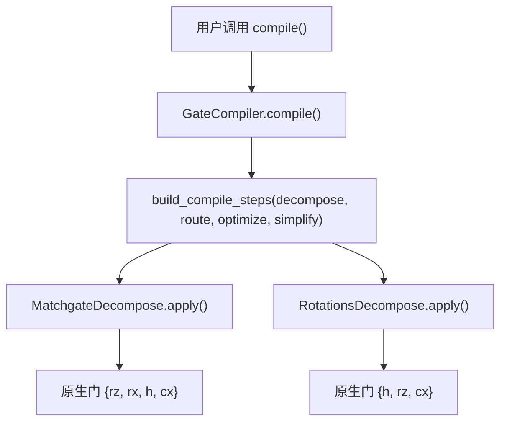
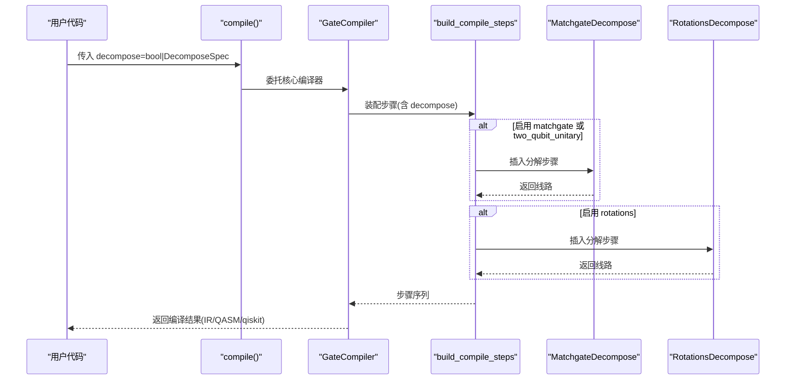
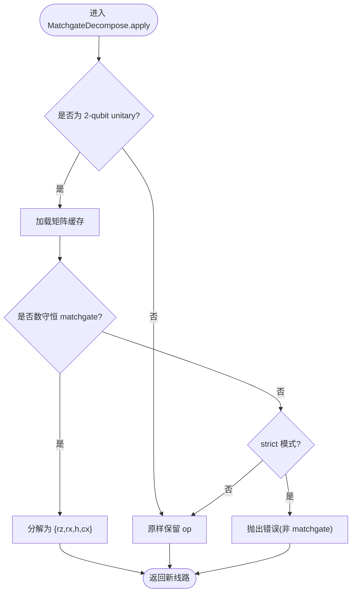
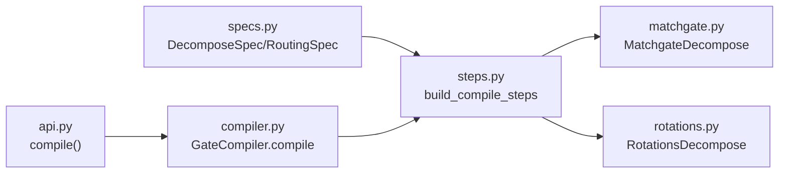

# 分解规格配置

<cite>
**本文引用的文件**
- [specs.py](file://src/tyxonq/compiler/gate_compiler/specs.py)
- [steps.py](file://src/tyxonq/compiler/gate_compiler/steps.py)
- [compiler.py](file://src/tyxonq/compiler/gate_compiler/compiler.py)
- [api.py](file://src/tyxonq/compiler/api.py)
- [matchgate.py](file://src/tyxonq/compiler/gate_compiler/stages/decompose/matchgate.py)
- [rotations.py](file://src/tyxonq/compiler/gate_compiler/stages/decompose/rotations.py)
- [test_decompose_matchgate.py](file://tests_core_module/test_decompose_matchgate.py)
- [test_decompose_rotations.py](file://tests_core_module/test_decompose_rotations.py)
- [test_compiler_pipeline.py](file://tests_core_module/test_compiler_pipeline.py)
</cite>

## 目录
1. [简介](#简介)
2. [项目结构](#项目结构)
3. [核心组件](#核心组件)
4. [架构总览](#架构总览)
5. [详细组件分析](#详细组件分析)
6. [依赖关系分析](#依赖关系分析)
7. [性能考虑](#性能考虑)
8. [故障排除指南](#故障排除指南)
9. [结论](#结论)
10. [附录：配置示例与场景](#附录配置示例与场景)

## 简介
本指南面向需要在 TyxonQ 中精确控制“门分解”行为的开发者，系统讲解 DecomposeSpec 类型化规格的设计理念、布尔值开关与详细对象的区别、各分解策略（matchgate、旋转门）的配置项与默认值、参数验证机制与错误诊断信息，并给出在不同编译场景下的推荐组合与性能调优建议。通过阅读本指南，你将能够根据硬件特性与算法需求选择最优的分解配置，并在遇到问题时快速定位与修复。

## 项目结构
TyxonQ 的门分解能力由“规格定义—步骤装配—具体实现”三层构成：
- 规格定义：DecomposeSpec/RoutingSpec 提供类型化的配置入口，支持 bool 与对象两种形式。
- 步骤装配：build_compile_steps 根据规格动态组装编译步骤序列（规范化→分解→路由→优化→化简）。
- 具体实现：MatchgateDecompose 与 RotationsDecompose 分别负责 matchgate 与旋转门的分解逻辑。

图表来源
- [compiler.py:27-73](file://src/tyxonq/compiler/gate_compiler/compiler.py#L27-L73)
- [steps.py:27-91](file://src/tyxonq/compiler/gate_compiler/steps.py#L27-L91)
- [matchgate.py:152-197](file://src/tyxonq/compiler/gate_compiler/stages/decompose/matchgate.py#L152-L197)
- [rotations.py:13-73](file://src/tyxonq/compiler/gate_compiler/stages/decompose/rotations.py#L13-L73)

章节来源
- [compiler.py:27-73](file://src/tyxonq/compiler/gate_compiler/compiler.py#L27-L73)
- [steps.py:27-91](file://src/tyxonq/compiler/gate_compiler/steps.py#L27-L91)

## 核心组件
- DecomposeSpec：描述是否启用 matchgate、rotations、two_qubit_unitary 分解，并提供默认值与类型约束。
- MatchgateDecompose：将数守恒 2-qubit matchgate（two_mode_fock/fSim 家族）分解为原生门集合；支持 strict 模式以在非 matchgate 时抛出明确错误。
- RotationsDecompose：将 rx/ry/rxx/ryy/rzz 等参数化旋转门分解到 {h, rz, cx}。
- build_compile_steps：按顺序装配步骤，未启用的能力不追加占位步骤，避免无谓开销。
- GateCompiler.compile：统一入口，收集并执行步骤，输出 IR/QASM/qiskit 等格式。

章节来源
- [specs.py:15-31](file://src/tyxonq/compiler/gate_compiler/specs.py#L15-L31)
- [matchgate.py:152-197](file://src/tyxonq/compiler/gate_compiler/stages/decompose/matchgate.py#L152-L197)
- [rotations.py:13-73](file://src/tyxonq/compiler/gate_compiler/stages/decompose/rotations.py#L13-L73)
- [steps.py:27-91](file://src/tyxonq/compiler/gate_compiler/steps.py#L27-L91)
- [compiler.py:27-73](file://src/tyxonq/compiler/gate_compiler/compiler.py#L27-L73)

## 架构总览
下图展示了从高层 API 到具体分解步骤的完整调用链，以及不同分解策略如何被装配和执行。

图表来源
- [api.py:39-75](file://src/tyxonq/compiler/api.py#L39-L75)
- [compiler.py:27-73](file://src/tyxonq/compiler/gate_compiler/compiler.py#L27-L73)
- [steps.py:27-91](file://src/tyxonq/compiler/gate_compiler/steps.py#L27-L91)

## 详细组件分析

### DecomposeSpec：类型化规格设计
- 设计理念：用 dataclass 表达分解策略，既保留 bool 一键开关的简洁性，又提供细粒度控制。coerce_decompose 将 bool/None/DecomposeSpec 归一化为 DecomposeSpec 或 None，便于后续装配。
- 字段与默认值：
  - matchgate: True（默认开启，针对数守恒 2-qubit matchgate）
  - rotations: False（默认关闭，许多平台原生支持旋转门，展开会增加门数）
  - two_qubit_unitary: False（当前经 matchgate 覆盖数守恒子集，通用 KAK 分解后续增量）
- 验证机制：coerce_decompose 对非法类型抛出 TypeError，确保输入可预期。

章节来源
- [specs.py:15-31](file://src/tyxonq/compiler/gate_compiler/specs.py#L15-L31)
- [specs.py:61-76](file://src/tyxonq/compiler/gate_compiler/specs.py#L61-L76)

### MatchgateDecompose：matchgate 分解与 strict 模式
- 目标：将 fSim/two_mode_fock 等数守恒 2-qubit unitary 分解为 {rz, rx, h, cx}。
- 行为：
  - 数守恒 matchgate：精确分解，零角度块剪枝以减少门数。
  - 非 matchgate：默认原样保留（交由后续 stage 或引擎 lowering 处理）。
  - strict 模式：当 matchgate_strict=True 时，遇到非 matchgate 会抛出清晰错误，适用于已知全部 2-qubit unitary 都必须是 matchgate 的场景（如 LUCJ）。
- 错误诊断：
  - 矩阵不是 4x4：抛出 ValueError。
  - 非数守恒 matchgate：抛出 NotImplementedError，提示跨粒子数子空间耦合导致无法按 fSim=iSWAP+CPhase 分解。
  - 缺少矩阵缓存：抛出 ValueError，提示匹配失败。

图表来源
- [matchgate.py:169-197](file://src/tyxonq/compiler/gate_compiler/stages/decompose/matchgate.py#L169-L197)
- [matchgate.py:65-93](file://src/tyxonq/compiler/gate_compiler/stages/decompose/matchgate.py#L65-L93)

章节来源
- [matchgate.py:65-93](file://src/tyxonq/compiler/gate_compiler/stages/decompose/matchgate.py#L65-L93)
- [matchgate.py:152-197](file://src/tyxonq/compiler/gate_compiler/stages/decompose/matchgate.py#L152-L197)
- [test_decompose_matchgate.py:60-74](file://tests_core_module/test_decompose_matchgate.py#L60-L74)
- [test_decompose_matchgate.py:187-200](file://tests_core_module/test_decompose_matchgate.py#L187-L200)

### RotationsDecompose：旋转门分解
- 目标：将 rx/ry/rxx/ryy/rzz 等参数化旋转门分解到 {h, rz, cx}。
- 行为：使用标准恒等式进行分解，保持数值等价（允许全局相位差），并通过 rebuild_circuit 保留 _unitary_cache，避免后续 lowering 丢失矩阵引用。
- 适用场景：当目标平台不支持这些旋转门，或需要统一基集以便导出 QASM2 等格式时启用。

章节来源
- [rotations.py:13-73](file://src/tyxonq/compiler/gate_compiler/stages/decompose/rotations.py#L13-L73)
- [test_decompose_rotations.py:75-114](file://tests_core_module/test_decompose_rotations.py#L75-L114)

### 步骤装配与执行：build_compile_steps 与 apply_steps
- 固定顺序：规范化（AutoMeasure、GatesTransform）→ 分解（MatchgateDecompose、RotationsDecompose）→ 路由（可选）→ 优化（MergePrune，optimize>=1）→ 化简（LightconeSimplify，simplify=True）。
- 未启用能力不追加占位步骤，减少无谓开销。
- 路由步骤延迟导入，仅在需要时触发，降低默认依赖。

章节来源
- [steps.py:27-91](file://src/tyxonq/compiler/gate_compiler/steps.py#L27-L91)
- [steps.py:94-105](file://src/tyxonq/compiler/gate_compiler/steps.py#L94-L105)

### 统一入口：GateCompiler.compile
- 收集 options 中的 basis_gates、optimization_level 等，并根据 output 格式调整默认基集（例如 qasm2 输出时降级到 qelib1 兼容基）。
- 调用 build_compile_steps 装配步骤，apply_steps 顺序执行，最后按 output 返回 IR/QASM/qiskit。

章节来源
- [compiler.py:27-109](file://src/tyxonq/compiler/gate_compiler/compiler.py#L27-L109)

## 依赖关系分析
- 规格层：DecomposeSpec/RoutingSpec 提供类型化配置，coerce_* 函数负责归一化与校验。
- 装配层：build_compile_steps 依赖 specs 决定插入哪些步骤。
- 实现层：MatchgateDecompose 与 RotationsDecompose 各自实现分解逻辑，依赖电路工具重建线路并保留缓存。
- 入口层：GateCompiler.compile 整合上述模块，对外暴露统一接口。

图表来源
- [specs.py:15-31](file://src/tyxonq/compiler/gate_compiler/specs.py#L15-L31)
- [steps.py:27-91](file://src/tyxonq/compiler/gate_compiler/steps.py#L27-L91)
- [matchgate.py:152-197](file://src/tyxonq/compiler/gate_compiler/stages/decompose/matchgate.py#L152-L197)
- [rotations.py:13-73](file://src/tyxonq/compiler/gate_compiler/stages/decompose/rotations.py#L13-L73)
- [compiler.py:27-73](file://src/tyxonq/compiler/gate_compiler/compiler.py#L27-L73)
- [api.py:39-75](file://src/tyxonq/compiler/api.py#L39-L75)

章节来源
- [specs.py:15-31](file://src/tyxonq/compiler/gate_compiler/specs.py#L15-L31)
- [steps.py:27-91](file://src/tyxonq/compiler/gate_compiler/steps.py#L27-L91)
- [compiler.py:27-73](file://src/tyxonq/compiler/gate_compiler/compiler.py#L27-L73)
- [api.py:39-75](file://src/tyxonq/compiler/api.py#L39-L75)

## 性能考虑
- 默认策略权衡：
  - matchgate 默认开启：对化学算法（LUCJ/SQD）常用 two_mode_fock/fSim 非常高效，能精确降到原生门并剪枝零角度块。
  - rotations 默认关闭：若目标平台原生支持旋转门，关闭可减少门数；否则在导出 QASM2 或平台不支持时再开启。
- 严格模式：
  - 在已知所有 2-qubit unitary 均为 matchgate 的场景（如 LUCJ），启用 strict 模式可在错误早期捕获异常，避免静默保留非 matchgate 导致后续失败。
- 输出格式影响：
  - 输出 qasm2 时，编译器会自动设置兼容基集，确保导出器不会遇到平台不支持的门。
- 优化与化简：
  - optimize>=1 启用相邻门合并与恒等剪枝；simplify=True 启用光锥化简，裁剪不影响测量的算符。

[本节为通用指导，无需特定文件引用]

## 故障排除指南
- 错误：非 4x4 矩阵
  - 现象：ValueError，提示必须为 4x4 矩阵。
  - 原因：传入的 2-qubit unitary 维度不正确。
  - 处理：检查构造 unitary 的代码路径，确保矩阵维度正确。
- 错误：非数守恒 matchgate
  - 现象：NotImplementedError，提示检测到跨粒子数子空间耦合，无法按 fSim=iSWAP+CPhase 分解。
  - 原因：矩阵包含 |00>↔|11> 等跨子空间耦合，不符合 matchgate 结构。
  - 处理：确认算法生成的 2-qubit unitary 是否属于 fSim/two_mode_fock 家族；若非，需调整算法或关闭 matchgate 分解。
- 错误：缺少矩阵缓存
  - 现象：ValueError，提示缺少矩阵缓存键。
  - 原因：unitary 操作未携带矩阵缓存，导致分解无法读取矩阵。
  - 处理：确保线路在分解前已填充 _unitary_cache（通常由上层构建逻辑保证）。
- 行为：非 matchgate 被原样保留
  - 现象：默认模式下，非 matchgate 的 2-qubit unitary 不会被分解。
  - 处理：如需强制报错，启用 strict 模式；或调整上游生成逻辑确保为 matchgate。
- 行为：旋转门未被分解
  - 现象：rotations=False 时，rx/ry/rxx/ryy/rzz 保持原样。
  - 处理：若目标平台或导出格式需要，显式设置 rotations=True。

章节来源
- [matchgate.py:65-93](file://src/tyxonq/compiler/gate_compiler/stages/decompose/matchgate.py#L65-L93)
- [matchgate.py:169-197](file://src/tyxonq/compiler/gate_compiler/stages/decompose/matchgate.py#L169-L197)
- [test_decompose_matchgate.py:60-74](file://tests_core_module/test_decompose_matchgate.py#L60-L74)
- [test_decompose_matchgate.py:187-200](file://tests_core_module/test_decompose_matchgate.py#L187-L200)

## 结论
TyxonQ 的分解规格配置通过 DecomposeSpec 提供了灵活且类型安全的控制方式：布尔值适合快速开关，详细对象则用于精细调节 matchgate、rotations、two_qubit_unitary 的行为。结合 strict 模式与清晰的错误诊断，开发者可以在不同硬件与算法场景下选择最优分解策略，获得更稳定、高效的编译结果。配合优化与化简步骤，可进一步减少门数与噪声影响。

[本节为总结性内容，无需特定文件引用]

## 附录：配置示例与场景
以下为常见场景的配置思路与推荐组合（以文字说明为主，避免直接粘贴代码）：

- 化学算法（LUCJ/SQD）
  - 推荐：decompose=True（默认 matchgate 开，rotations 关），optimize>=1，simplify=True。
  - 理由：two_mode_fock/fSim 广泛出现，matchgate 分解高效且精确；优化与化简减少门数。
  - 参考：测试用例覆盖了 matchgate 分解的数值精确性与结构不变量。

- 导出 QASM2
  - 推荐：output="qasm2"，必要时 decompose=DecomposeSpec(rotations=True)，basis_gates 设为 qelib1 兼容集。
  - 理由：QASM2 导出器要求基集兼容；旋转门分解到 {h, rz, cx} 可确保兼容性。

- 平台原生支持旋转门
  - 推荐：decompose=False 或 DecomposeSpec(rotations=False)，仅开启 matchgate（若需要）。
  - 理由：避免不必要的展开，减少门数与噪声。

- 严格模式（已知全为 matchgate）
  - 推荐：在 MatchgateDecompose.apply 中传入 matchgate_strict=True。
  - 理由：遇到非 matchgate 立即报错，便于早期发现上游问题。

- 路由与布局
  - 推荐：route=RoutingSpec(coupling_map=..., initial_layout=..., seed=0)。
  - 理由：seed 默认 0 保证可复现；initial_layout 可指定初始映射，提升路由质量。

章节来源
- [test_decompose_matchgate.py:100-151](file://tests_core_module/test_decompose_matchgate.py#L100-L151)
- [test_decompose_rotations.py:75-114](file://tests_core_module/test_decompose_rotations.py#L75-L114)
- [test_compiler_pipeline.py:74-82](file://tests_core_module/test_compiler_pipeline.py#L74-L82)
- [compiler.py:51-59](file://src/tyxonq/compiler/gate_compiler/compiler.py#L51-L59)
- [specs.py:33-58](file://src/tyxonq/compiler/gate_compiler/specs.py#L33-L58)