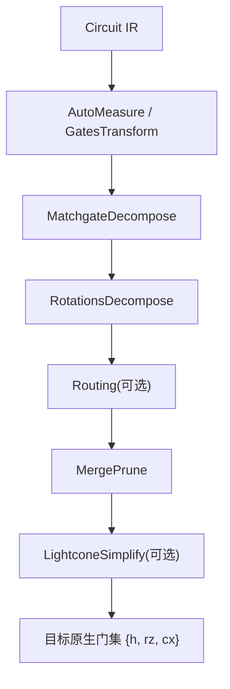
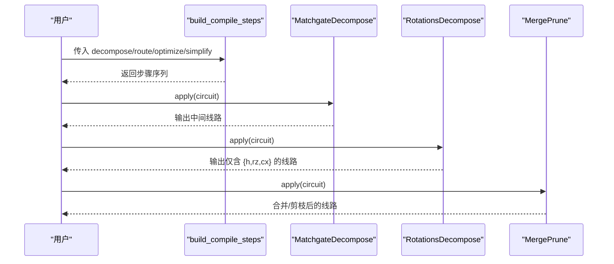
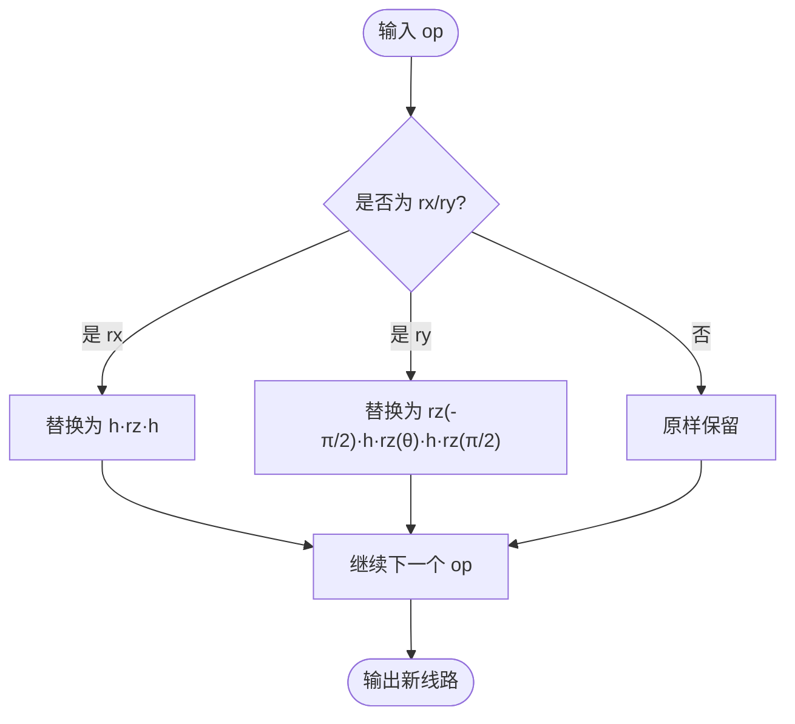
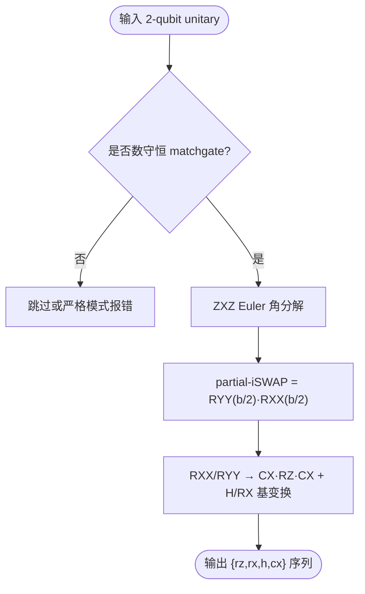
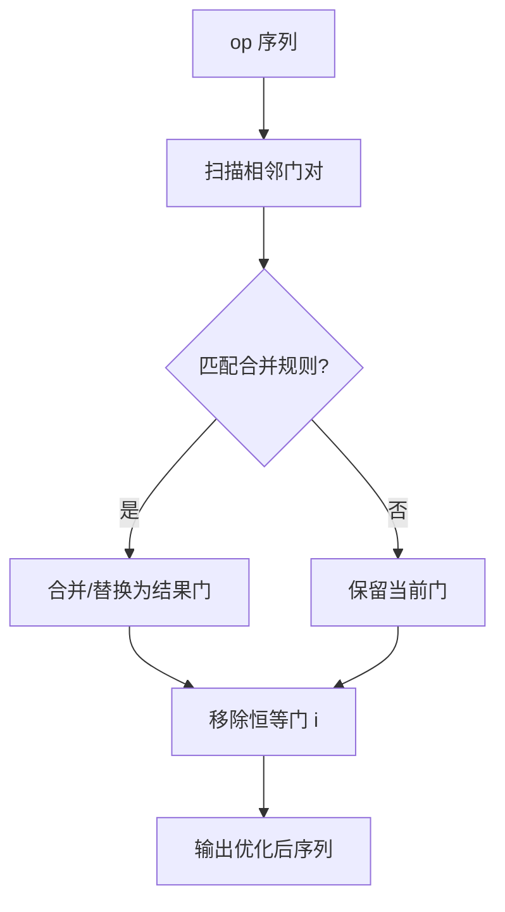
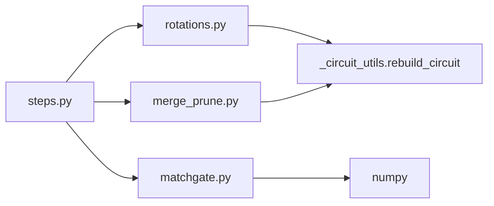

# 旋转门分解

<cite>
**本文引用的文件**
- [rotations.py](file://src/tyxonq/compiler/gate_compiler/stages/decompose/rotations.py)
- [matchgate.py](file://src/tyxonq/compiler/gate_compiler/stages/decompose/matchgate.py)
- [steps.py](file://src/tyxonq/compiler/gate_compiler/steps.py)
- [merge_prune.py](file://src/tyxonq/compiler/gate_compiler/stages/rewrite/merge_prune.py)
- [test_decompose_rotations.py](file://tests_core_module/test_decompose_rotations.py)
</cite>

## 目录
1. [简介](#简介)
2. [项目结构](#项目结构)
3. [核心组件](#核心组件)
4. [架构总览](#架构总览)
5. [详细组件分析](#详细组件分析)
6. [依赖关系分析](#依赖关系分析)
7. [性能考量](#性能考量)
8. [故障排查指南](#故障排查指南)
9. [结论](#结论)
10. [附录](#附录)

## 简介
本文件系统性说明 TyxonQ 中“旋转门分解”策略的实现与使用，覆盖以下内容：
- 单量子比特旋转门的标准化分解流程（将 RX、RY 等旋转到基本门集 {H, RZ, CX}）。
- Euler 角分解方法在匹配门（matchgate）中的角色与参数化选择。
- 旋转门合并与优化策略（相邻门合并、恒等门剪枝），以及编译阶段如何减少冗余操作。
- 配置选项与使用示例，展示如何自定义分解规则与优先级。
- 分解质量评估指标（保真度、电路深度/门数优化效果）及与其他分解策略的协作关系。

## 项目结构
TyxonQ 的旋转门分解位于编译器“门编译”阶段的“分解”子模块中，并与“重写/优化”、“路由”等步骤协同工作。关键位置如下：
- 旋转门分解：stages/decompose/rotations.py
- 两量子比特匹配门分解：stages/decompose/matchgate.py
- 编译步骤装配与执行：steps.py
- 相邻门合并与恒等门剪枝：stages/rewrite/merge_prune.py
- 数值等价回归测试：tests_core_module/test_decompose_rotations.py

图表来源
- [steps.py:27-91](file://src/tyxonq/compiler/gate_compiler/steps.py#L27-L91)
- [rotations.py:13-73](file://src/tyxonq/compiler/gate_compiler/stages/decompose/rotations.py#L13-L73)
- [matchgate.py:152-197](file://src/tyxonq/compiler/gate_compiler/stages/decompose/matchgate.py#L152-L197)
- [merge_prune.py:27-46](file://src/tyxonq/compiler/gate_compiler/stages/rewrite/merge_prune.py#L27-L46)

章节来源
- [steps.py:27-91](file://src/tyxonq/compiler/gate_compiler/steps.py#L27-L91)

## 核心组件
- RotationsDecompose：将 RX、RY、RXX、RYY、RZZ 等旋转门按标准恒等式分解到 {H, RZ, CX}；RZ 作为原生门透传。
- MatchgateDecompose：对两量子比特数守恒 matchgate（fSim 家族）进行 ZXZ Euler 角分解，并进一步落到 {RZ, RX, H, CX}。
- MergePrune：相邻同线门合并与恒等门剪枝，用于减少冗余门。
- 编译步骤装配：通过 steps.build_compile_steps 按类型化参数顺序装配分解、路由、优化、化简步骤。

章节来源
- [rotations.py:13-73](file://src/tyxonq/compiler/gate_compiler/stages/decompose/rotations.py#L13-L73)
- [matchgate.py:152-197](file://src/tyxonq/compiler/gate_compiler/stages/decompose/matchgate.py#L152-L197)
- [merge_prune.py:27-46](file://src/tyxonq/compiler/gate_compiler/stages/rewrite/merge_prune.py#L27-L46)
- [steps.py:27-91](file://src/tyxonq/compiler/gate_compiler/steps.py#L27-L91)

## 架构总览
旋转门分解在编译管线中的位置与职责：
- 前置：AutoMeasure（无测量时补 Z 测量）、GatesTransform（按 basis_gates 重写门）。
- 分解：先 MatchgateDecompose（处理两量子比特数守恒 unitary），再 RotationsDecompose（将剩余旋转门降到 {H, RZ, CX}）。
- 后续：Routing（可选，委托 qiskit.transpile）、MergePrune（相邻门合并与恒等门剪枝）、LightconeSimplify（可选）。

图表来源
- [steps.py:27-91](file://src/tyxonq/compiler/gate_compiler/steps.py#L27-L91)
- [matchgate.py:152-197](file://src/tyxonq/compiler/gate_compiler/stages/decompose/matchgate.py#L152-L197)
- [rotations.py:13-73](file://src/tyxonq/compiler/gate_compiler/stages/decompose/rotations.py#L13-L73)
- [merge_prune.py:27-46](file://src/tyxonq/compiler/gate_compiler/stages/rewrite/merge_prune.py#L27-L46)

## 详细组件分析

### 单量子比特旋转门标准化分解（RX/RY → H·RZ·H）
- 目标：将任意单量子比特旋转门用 {H, RZ} 表示，便于统一降到底层硬件可执行集合。
- 实现要点：
  - RX(θ) 分解为 H·RZ(θ)·H。
  - RY(θ) 分解为 S†·H·RZ(θ)·H·S（其中 S=RZ(π/2)，S†=RZ(-π/2)）。
  - RZ 作为原生门直接透传，不展开。
- 数据结构与复杂度：
  - 线性扫描 ops 列表，常数时间判断与替换，整体 O(N)。
- 错误处理与边界：
  - 非 op 元组或空 op 直接透传。
  - 角度以浮点数传递，保持精度。
- 性能影响：
  - 引入固定开销（每个 RX/RY 增加若干 H/RZ），但换来统一的底层门集，利于后续优化与映射。

图表来源
- [rotations.py:29-73](file://src/tyxonq/compiler/gate_compiler/stages/decompose/rotations.py#L29-L73)

章节来源
- [rotations.py:13-73](file://src/tyxonq/compiler/gate_compiler/stages/decompose/rotations.py#L13-L73)

### 两量子比特旋转门与匹配门分解（RXX/RYY/RZZ 与 fSim）
- RXX/RYY/RZZ 分解：
  - 通过 H⊗H 或 Rx±π/2 等基变换，将 RXX/RYY/RZZ 转换为 CX·RZ·CX 形式，从而落入 {H, RZ, CX}。
- 匹配门（fSim 家族）Euler 角分解：
  - 将两量子比特数守恒 unitary 分解为 ZXZ Euler 角形式，并在单激发子空间实现部分 iSWAP（RXX/RYY 组合），最终落到 {RZ, RX, H, CX}。
  - 零角度块会被剪枝，减少不必要的 CX 门。
- 复杂度与正确性：
  - 矩阵维度固定（4×4），计算欧拉角与生成 op 序列为常数时间。
  - 数值等价由测试用例保证（允许全局相位差）。

图表来源
- [matchgate.py:46-149](file://src/tyxonq/compiler/gate_compiler/stages/decompose/matchgate.py#L46-L149)
- [rotations.py:47-68](file://src/tyxonq/compiler/gate_compiler/stages/decompose/rotations.py#L47-L68)

章节来源
- [matchgate.py:46-149](file://src/tyxonq/compiler/gate_compiler/stages/decompose/matchgate.py#L46-L149)
- [rotations.py:47-68](file://src/tyxonq/compiler/gate_compiler/stages/decompose/rotations.py#L47-L68)

### Euler 角分解方法与参数化方案
- 在匹配门分解中采用 ZXZ 欧拉角分解，将 SU(2) 子空间变换表达为 Rz(a)·Rx(b)·Rz(c)。
- 参数化选择标准：
  - ZXZ 形式便于将子空间 σ_z^sub 映射为两比特 RZ 之差，从而用 RZ 实现。
  - Rx(b) 对应于 partial-iSWAP，可用 RXX/RYY 组合实现，再通过 RXX/RYY→RZZ 的基变换落到 CX·RZ·CX。
- 适用场景：
  - 适用于数守恒的两量子比特门（如 fSim/two_mode_fock），能精确还原原始幺正（允许全局相位差）。

章节来源
- [matchgate.py:65-149](file://src/tyxonq/compiler/gate_compiler/stages/decompose/matchgate.py#L65-L149)

### 旋转门合并与优化策略
- MergePrune 提供相邻门合并与恒等门剪枝：
  - 支持常见门对的合并规则（如 s·s→z、t·t→s、h·h→i 等）。
  - 对 rz/rx 相邻门进行角度相加合并。
  - 自动移除恒等门 i。
- 在编译管线中的位置：
  - 位于分解之后，用于消除分解产生的冗余门，降低电路深度与门数。
- 自定义规则：
  - 可通过 rules 参数注入自定义合并规则，扩展默认行为。

图表来源
- [merge_prune.py:27-88](file://src/tyxonq/compiler/gate_compiler/stages/rewrite/merge_prune.py#L27-L88)

章节来源
- [merge_prune.py:27-88](file://src/tyxonq/compiler/gate_compiler/stages/rewrite/merge_prune.py#L27-L88)

### 配置选项与使用示例
- 启用分解：
  - 通过 steps.build_compile_steps 的 decompose 参数控制：
    - True：默认开启 matchgate 分解。
    - DecomposeSpec：可分别设置 matchgate、two_qubit_unitary、rotations 开关。
- 启用优化：
  - optimize>=1 时追加 MergePrune 步骤。
- 路由与化简：
  - route=True 或 RoutingSpec 启用路由；simplify=True 启用 LightconeSimplify。
- 示例用法（概念性描述）：
  - 构建 Circuit，调用 build_compile_steps(decompose=True, optimize=1)，然后 apply_steps 执行。
  - 若需自定义合并规则，可在 MergePrune(rules=...) 中注入。

章节来源
- [steps.py:27-91](file://src/tyxonq/compiler/gate_compiler/steps.py#L27-L91)
- [merge_prune.py:35-46](file://src/tyxonq/compiler/gate_compiler/stages/rewrite/merge_prune.py#L35-L46)

### 分解质量评估指标
- 保真度：
  - 通过比较分解前后 unitary 矩阵（允许全局相位差）来验证数值等价。
  - 测试用例覆盖单量子比特（RX、RY）与两量子比特（RXX、RYY、RZZ）旋转门，确保分解正确性。
- 电路深度与门数优化：
  - 分解后由 MergePrune 合并相邻门、剪枝恒等门，减少 CX 数量与电路深度。
  - 匹配门分解中对零角度块进行剪枝，避免多余 CX 引入噪声。
- 评估方式：
  - 使用测试工具构造单个 op 的 Circuit，经 RotationsDecompose 分解后，计算总 unitary 与原门 unitary 的等价性。

章节来源
- [test_decompose_rotations.py:32-73](file://tests_core_module/test_decompose_rotations.py#L32-L73)
- [test_decompose_rotations.py:75-114](file://tests_core_module/test_decompose_rotations.py#L75-L114)
- [matchgate.py:115-149](file://src/tyxonq/compiler/gate_compiler/stages/decompose/matchgate.py#L115-L149)

### 与其他分解策略的协作关系与优先级
- 优先级顺序：
  - MatchgateDecompose 先于 RotationsDecompose，优先处理两量子比特数守恒 unitary。
  - 随后 RotationsDecompose 将剩余旋转门降到 {H, RZ, CX}。
  - 最后 MergePrune 合并与剪枝，进一步优化。
- 协作机制：
  - 两者共同确保所有旋转语义被统一到基础门集，便于后续路由与硬件 lowering。
  - 若 matchgate_strict=True，遇到非 matchgate 的 2-qubit unitary 会抛出异常，适合已知全部 2-qubit unitary 必须为 matchgate 的场景（如 LUCJ）。

章节来源
- [steps.py:61-72](file://src/tyxonq/compiler/gate_compiler/steps.py#L61-L72)
- [matchgate.py:152-197](file://src/tyxonq/compiler/gate_compiler/stages/decompose/matchgate.py#L152-L197)

## 依赖关系分析
- 模块内依赖：
  - rotations.py 依赖 _circuit_utils.rebuild_circuit 重建线路，保留 _unitary_cache。
  - matchgate.py 依赖 numpy 进行矩阵运算与欧拉角计算。
  - merge_prune.py 依赖 _circuit_utils.rebuild_circuit 重建线路。
- 外部依赖：
  - routing 步骤延迟导入，仅在启用时加载，避免额外依赖。
- 耦合与内聚：
  - 各分解步骤职责单一，内聚度高；通过 steps.py 装配形成松耦合流水线。

图表来源
- [rotations.py:6-73](file://src/tyxonq/compiler/gate_compiler/stages/decompose/rotations.py#L6-L73)
- [matchgate.py:32-149](file://src/tyxonq/compiler/gate_compiler/stages/decompose/matchgate.py#L32-L149)
- [merge_prune.py:1-46](file://src/tyxonq/compiler/gate_compiler/stages/rewrite/merge_prune.py#L1-L46)
- [steps.py:27-91](file://src/tyxonq/compiler/gate_compiler/steps.py#L27-L91)

章节来源
- [rotations.py:6-73](file://src/tyxonq/compiler/gate_compiler/stages/decompose/rotations.py#L6-L73)
- [matchgate.py:32-149](file://src/tyxonq/compiler/gate_compiler/stages/decompose/matchgate.py#L32-L149)
- [merge_prune.py:1-46](file://src/tyxonq/compiler/gate_compiler/stages/rewrite/merge_prune.py#L1-L46)
- [steps.py:27-91](file://src/tyxonq/compiler/gate_compiler/steps.py#L27-L91)

## 性能考量
- 门数与深度：
  - 分解引入固定开销（RX/RY→多个 H/RZ），但通过 MergePrune 合并与剪枝可显著减少冗余。
  - 匹配门分解对零角度块剪枝，避免多余 CX。
- 数值稳定性：
  - Euler 角分解使用 atan2 与角度归一化，保证数值稳定。
  - 测试用例覆盖多组角度，确保分解精度。
- 可扩展性：
  - 通过 DecomposeSpec 与 MergePrune.rules 灵活定制，适应不同硬件与算法需求。

[本节为通用指导，无需具体文件引用]

## 故障排查指南
- 常见问题：
  - 非数守恒 matchgate 无法分解：检查两量子比特 unitary 是否满足数守恒条件；必要时关闭 matchgate 分解或调整上游生成逻辑。
  - 分解后仍含非原生门：确认 RotationsDecompose 已启用且未被后续步骤覆盖；检查 basis_gates 设置。
  - 性能退化：检查 MergePrune 是否启用，或自定义合并规则以提升合并效率。
- 调试建议：
  - 使用测试工具对比分解前后 unitary，定位数值不等价问题。
  - 逐步禁用步骤（如关闭路由、化简）以隔离问题来源。

章节来源
- [matchgate.py:46-93](file://src/tyxonq/compiler/gate_compiler/stages/decompose/matchgate.py#L46-L93)
- [test_decompose_rotations.py:75-114](file://tests_core_module/test_decompose_rotations.py#L75-L114)

## 结论
TyxonQ 的旋转门分解策略通过标准化的单量子比特旋转门分解与匹配门的 Euler 角分解，将复杂旋转语义统一到 {H, RZ, CX} 基础门集，并结合相邻门合并与恒等门剪枝优化电路。该策略在编译管线中优先级明确、协作清晰，并通过数值等价测试保障正确性。用户可通过 DecomposeSpec 与 MergePrune.rules 灵活定制分解与优化规则，适配不同硬件与应用场景。

[本节为总结性内容，无需具体文件引用]

## 附录
- 快速参考：
  - 单量子比特旋转门分解：RX→H·RZ·H；RY→S†·H·RZ·H·S。
  - 两量子比特旋转门分解：RXX/RYY/RZZ→CX·RZ·CX + 基变换。
  - 匹配门分解：ZXZ Euler 角→partial-iSWAP→{RZ, RX, H, CX}。
  - 优化：MergePrune 合并相邻门、剪枝恒等门。
- 相关测试：
  - 数值等价测试覆盖 RX、RY、RXX、RYY、RZZ，确保分解正确性。

[本节为补充信息，无需具体文件引用]