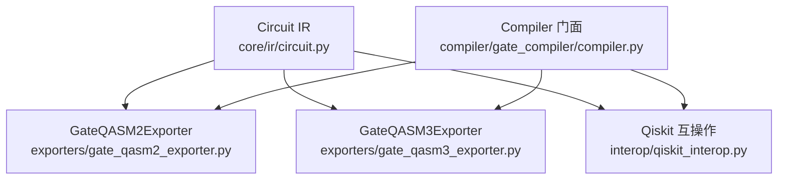
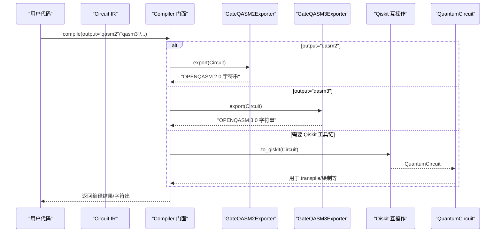
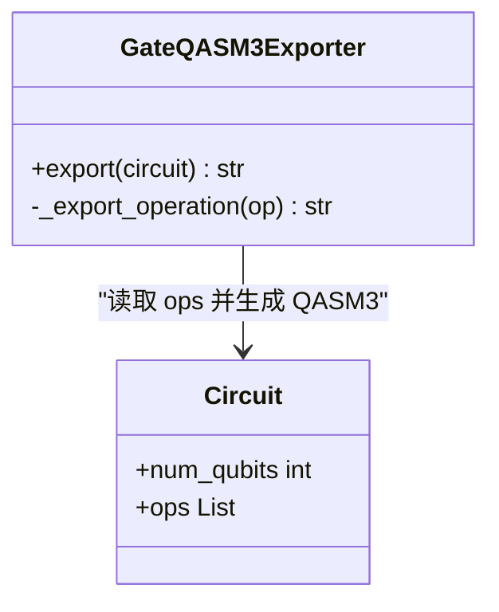
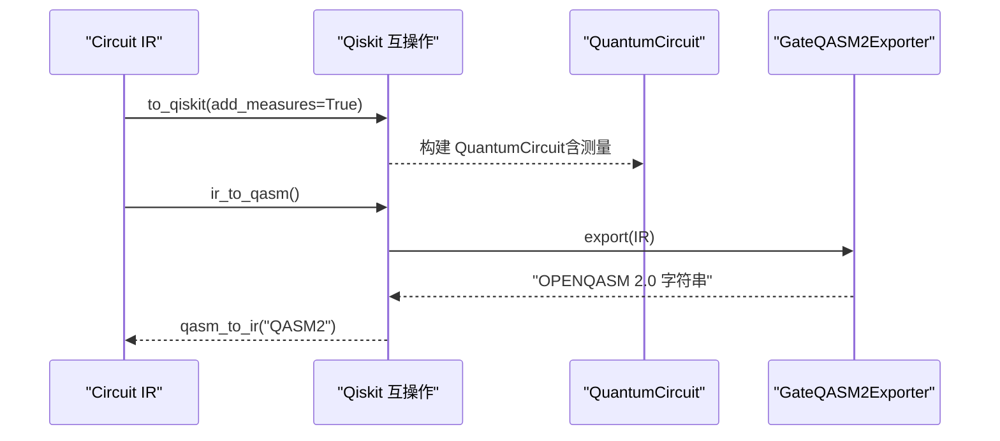
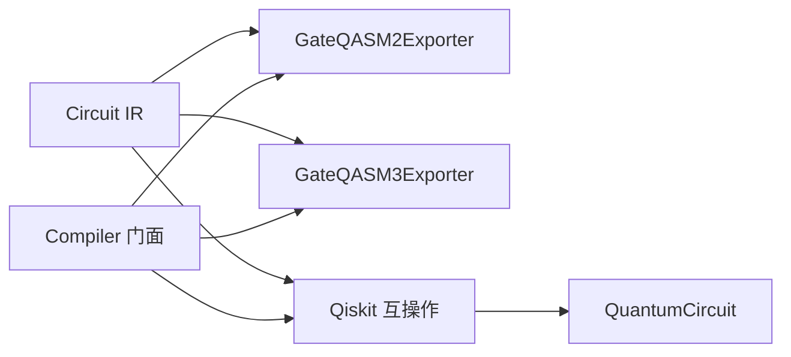

# 导出器和互操作

<cite>
**本文引用的文件**
- [gate_qasm2_exporter.py](file://src/tyxonq/compiler/gate_compiler/exporters/gate_qasm2_exporter.py)
- [gate_qasm3_exporter.py](file://src/tyxonq/compiler/gate_compiler/exporters/gate_qasm3_exporter.py)
- [qiskit_interop.py](file://src/tyxonq/compiler/gate_compiler/interop/qiskit_interop.py)
- [circuit.py](file://src/tyxonq/core/ir/circuit.py)
- [__init__.py（exporters）](file://src/tyxonq/compiler/gate_compiler/exporters/__init__.py)
- [__init__.py（interop）](file://src/tyxonq/compiler/gate_compiler/interop/__init__.py)
- [compiler.py](file://src/tyxonq/compiler/gate_compiler/compiler.py)
- [test_gate_qasm2_exporter.py](file://tests_core_module/test_gate_qasm2_exporter.py)
- [qasm3_complete_workflow.py](file://examples/qasm3_complete_workflow.py)
</cite>

## 目录
1. [简介](#简介)
2. [项目结构](#项目结构)
3. [核心组件](#核心组件)
4. [架构总览](#架构总览)
5. [详细组件分析](#详细组件分析)
6. [依赖关系分析](#依赖关系分析)
7. [性能与兼容性考量](#性能与兼容性考量)
8. [故障排查指南](#故障排查指南)
9. [结论](#结论)
10. [附录：使用示例与验证方法](#附录使用示例与验证方法)

## 简介
本文件聚焦 TyxonQ 门级编译器的“导出器”和“互操作”能力，系统性说明如何将内部 IR（Circuit）导出为 OpenQASM 2.0/3.0 文本，以及与 Qiskit 框架的双向转换机制。文档覆盖 GateQASM2Exporter、GateQASM3Exporter 的设计与差异、OpenQASM 格式生成规则与兼容性处理、IR↔QuantumCircuit 的适配策略、不同导出格式的适用场景，以及可复用的代码路径与质量评估方法。

## 项目结构
TyxonQ 的门级导出与互操作位于 compiler/gate_compiler 子模块中：
- exporters：纯 IR→字符串的导出器（零外部依赖），分别实现 QASM2 与 QASM3 输出。
- interop：与外部框架/格式互操作的适配器，提供 IR↔Qiskit 双向转换及 QASM2 解析。
- core/ir/circuit.py：定义 Circuit IR 数据结构与高层 API（如 to_openqasm、compile）。
- compiler/gate_compiler/compiler.py：编译器门面，根据 output 参数选择具体导出器或互操作路径。



图表来源
- [circuit.py:771-778](file://src/tyxonq/core/ir/circuit.py#L771-L778)
- [gate_qasm2_exporter.py:19-105](file://src/tyxonq/compiler/gate_compiler/exporters/gate_qasm2_exporter.py#L19-L105)
- [gate_qasm3_exporter.py:18-56](file://src/tyxonq/compiler/gate_compiler/exporters/gate_qasm3_exporter.py#L18-L56)
- [qiskit_interop.py:165-318](file://src/tyxonq/compiler/gate_compiler/interop/qiskit_interop.py#L165-L318)
- [compiler.py:52-106](file://src/tyxonq/compiler/gate_compiler/compiler.py#L52-L106)

章节来源
- [circuit.py:771-778](file://src/tyxonq/core/ir/circuit.py#L771-L778)
- [__init__.py（exporters）:1-9](file://src/tyxonq/compiler/gate_compiler/exporters/__init__.py#L1-L9)
- [__init__.py（interop）:1-51](file://src/tyxonq/compiler/gate_compiler/interop/__init__.py#L1-L51)

## 核心组件
- GateQASM2Exporter：将门级 IR 直接翻译为 OpenQASM 2.0（基于 qelib1.inc），零外部依赖；遇到非 qelib1 门（如 iswap/rxx/ryy/rzz）会抛出异常，要求先分解到兼容基。
- GateQASM3Exporter：将门级 IR 直接翻译为 OpenQASM 3.0，语法更现代，支持更多原生门（如 iswap）。
- Qiskit 互操作：to_qiskit/from_qiskit 实现 IR↔QuantumCircuit 双向转换；ir_to_qasm 委托 GateQASM2Exporter；qasm_to_ir 借助 Qiskit 解析 QASM2 文本。
- Compiler 门面：根据 output 参数选择 QASM2/QASM3 导出或走 Qiskit 路径；默认 basis_gates 保证 QASM2 输出稳定。

章节来源
- [gate_qasm2_exporter.py:19-204](file://src/tyxonq/compiler/gate_compiler/exporters/gate_qasm2_exporter.py#L19-L204)
- [gate_qasm3_exporter.py:18-135](file://src/tyxonq/compiler/gate_compiler/exporters/gate_qasm3_exporter.py#L18-L135)
- [qiskit_interop.py:165-318](file://src/tyxonq/compiler/gate_compiler/interop/qiskit_interop.py#L165-L318)
- [compiler.py:52-106](file://src/tyxonq/compiler/gate_compiler/compiler.py#L52-L106)

## 架构总览
下图展示从 IR 到不同目标格式的关键流程与组件交互。



图表来源
- [compiler.py:52-106](file://src/tyxonq/compiler/gate_compiler/compiler.py#L52-L106)
- [gate_qasm2_exporter.py:65-105](file://src/tyxonq/compiler/gate_compiler/exporters/gate_qasm2_exporter.py#L65-L105)
- [gate_qasm3_exporter.py:25-56](file://src/tyxonq/compiler/gate_compiler/exporters/gate_qasm3_exporter.py#L25-L56)
- [qiskit_interop.py:165-242](file://src/tyxonq/compiler/gate_compiler/interop/qiskit_interop.py#L165-L242)

## 详细组件分析

### GateQASM2Exporter（OpenQASM 2.0）
- 职责：将门级 IR 直译为 qelib1.inc 兼容的 QASM2 文本，零外部依赖。
- 支持的门集合：
  - 单比特无参：h, x, y, z, s, sdg, t, tdg, sx, sxdg, id
  - 单比特一参：rx, ry, rz, p, u1
  - 单比特二参：u2
  - 单比特三参：u3, u
  - 双比特无参：cx, cy, cz, ch, swap
  - 双比特一参：crx, cry, crz, cu1, cp
  - 双比特三参：cu3
  - 三比特无参：ccx, cswap
  - 其他：reset, barrier, measure/measure_z
- 名称归一：cnot→cx, toffoli→ccx, fredkin→cswap, i→id, phase→p, cphase→cp。
- 不支持门：iswap, rxx, ryy, rzz（遇到即抛 ValueError，需先分解到 qelib1 兼容基）。
- 测量顺序约定：经典寄存器大小等于 measure 算子数，按出现顺序映射 c[0..M-1]，与旧 to_qiskit(add_measures=True) 一致。
- 脉冲算子：在门级电路不应出现，若出现则跳过。

```mermaid
flowchart TD
S["开始 export()"] --> H["写入 OPENQASM 2.0; 与 include \"qelib1.inc\";"]
H --> R["声明 qreg q[n]; 若有测量则声明 creg c[m];"]
R --> L{"遍历 ops"}
L --> |measure/measure_z| M["写入 measure q[q]->c[i];"]
L --> |门操作| G["_export_gate(op)"]
G --> N{"是否 qelib1 支持?"}
N --> |是| W["按 arity 生成门语句"]
N --> |否| E["抛出 ValueError 并终止"]
M --> L
W --> L
L --> |结束| F["返回拼接后的字符串"]
```

图表来源
- [gate_qasm2_exporter.py:65-105](file://src/tyxonq/compiler/gate_compiler/exporters/gate_qasm2_exporter.py#L65-L105)
- [gate_qasm2_exporter.py:107-204](file://src/tyxonq/compiler/gate_compiler/exporters/gate_qasm2_exporter.py#L107-L204)

章节来源
- [gate_qasm2_exporter.py:19-204](file://src/tyxonq/compiler/gate_compiler/exporters/gate_qasm2_exporter.py#L19-L204)
- [test_gate_qasm2_exporter.py:21-90](file://tests_core_module/test_gate_qasm2_exporter.py#L21-L90)

### GateQASM3Exporter（OpenQASM 3.0）
- 职责：将门级 IR 直译为 OpenQASM 3.0 文本，语法更现代，不依赖 qelib1.inc。
- 支持范围：
  - 单比特无参：h, x, y, z, s, t, sdg, tdg
  - 单比特一参：rx, ry, rz, p, u1
  - 单比特三参：u3, u（输出为 u(theta, phi, lambda)）
  - 双比特：cx/cnot, cz, cy, ch, swap, iswap
  - 三比特：ccx/toffoli, cswap/fredkin
  - 测量：measure/measure_z（输出 measure 指令）
  - 屏障：barrier
- 特点：
  - 直接生成 qubit[n] q; 标准 QASM3 量子寄存器声明。
  - 对 iswap 等门原生支持，无需额外分解。
  - 未列出的门会抛出 ValueError。



图表来源
- [gate_qasm3_exporter.py:18-135](file://src/tyxonq/compiler/gate_compiler/exporters/gate_qasm3_exporter.py#L18-L135)

章节来源
- [gate_qasm3_exporter.py:18-135](file://src/tyxonq/compiler/gate_compiler/exporters/gate_qasm3_exporter.py#L18-L135)

### Qiskit 互操作（IR ↔ QuantumCircuit）
- to_qiskit：将 IR 转换为 QuantumCircuit，支持 h/x/y/z/s/sdg/t/tdg/rx/ry/rz/cx/cy/cz/swap/iswap/rxx/ryy/rzz/crx/cry/crz/barrier/measure_z；可选添加测量寄存器并按顺序映射。
- from_qiskit：将 QuantumCircuit 解析为 IR，识别上述门集合并构造 ops。
- ir_to_qasm：直接委托 GateQASM2Exporter，避免经 Qiskit 中转带来的开销与精度损失。
- qasm_to_ir：使用 Qiskit 解析 QASM2 文本后转为 IR（可选依赖，未安装时抛错）。
- 默认基与优化：DEFAULT_BASIS_GATES=["cx","h","rz","rx","cz"]，DEFAULT_OPT_LEVEL=2，normalize_transpile_options 统一 opt_level/optimization_level 并补全 basis_gates。



图表来源
- [qiskit_interop.py:165-318](file://src/tyxonq/compiler/gate_compiler/interop/qiskit_interop.py#L165-L318)
- [gate_qasm2_exporter.py:65-105](file://src/tyxonq/compiler/gate_compiler/exporters/gate_qasm2_exporter.py#L65-L105)

章节来源
- [qiskit_interop.py:29-69](file://src/tyxonq/compiler/gate_compiler/interop/qiskit_interop.py#L29-L69)
- [qiskit_interop.py:165-318](file://src/tyxonq/compiler/gate_compiler/interop/qiskit_interop.py#L165-L318)

### Compiler 门面与输出路由
- 当 output="qasm2"：默认降级到兼容基 ["cx","h","rz","rx","cz"]，确保 GateQASM2Exporter 不会遇到非 qelib1 门。
- 当 output="qasm3"：直接使用 GateQASM3Exporter。
- 当需要 Qiskit 工具链（如布局布线、transpile）：通过 to_qiskit 转换。

章节来源
- [compiler.py:52-106](file://src/tyxonq/compiler/gate_compiler/compiler.py#L52-L106)

## 依赖关系分析
- 导出器与 IR：GateQASM2Exporter/GateQASM3Exporter 仅依赖 Circuit IR 的 ops 列表，零外部依赖，便于快速、稳定地生成 QASM 文本。
- 互操作与 Qiskit：qiskit_interop 在 to_qiskit/from_qiskit/qasm_to_ir 中引入 Qiskit；ir_to_qasm 已改为委托 GateQASM2Exporter，降低耦合。
- 编译器门面：根据 output 动态选择导出器或互操作路径，并在必要时注入默认基与优化级别。



图表来源
- [circuit.py:771-778](file://src/tyxonq/core/ir/circuit.py#L771-L778)
- [gate_qasm2_exporter.py:19-105](file://src/tyxonq/compiler/gate_compiler/exporters/gate_qasm2_exporter.py#L19-L105)
- [gate_qasm3_exporter.py:18-56](file://src/tyxonq/compiler/gate_compiler/exporters/gate_qasm3_exporter.py#L18-L56)
- [qiskit_interop.py:165-318](file://src/tyxonq/compiler/gate_compiler/interop/qiskit_interop.py#L165-L318)
- [compiler.py:52-106](file://src/tyxonq/compiler/gate_compiler/compiler.py#L52-L106)

章节来源
- [__init__.py（exporters）:1-9](file://src/tyxonq/compiler/gate_compiler/exporters/__init__.py#L1-L9)
- [__init__.py（interop）:1-51](file://src/tyxonq/compiler/gate_compiler/interop/__init__.py#L1-L51)

## 性能与兼容性考量
- 零依赖导出：GateQASM2Exporter/GateQASM3Exporter 直接生成字符串，避免 IR→Qiskit→transpile→QASM 的额外开销，提升性能与稳定性。
- 兼容性：
  - QASM2：严格遵循 qelib1.inc 支持集；遇到 iswap/rxx/ryy/rzz 必须分解。
  - QASM3：原生支持更多门（如 iswap），适合现代工具链。
  - Qiskit 互操作：默认基与优化级别可配置，便于与下游 transpile 流程对接。
- 测量顺序：QASM2 的经典寄存器映射与旧 to_qiskit(add_measures=True) 保持一致，保障下游计数还原正确性。

[本节为通用指导，不直接分析具体文件]

## 故障排查指南
- 遇到“非 qelib1 门”错误（QASM2）：检查是否在编译前已将 iswap/rxx/ryy/rzz 分解到兼容基；确认 output="qasm2" 路径默认降级到 ["cx","h","rz","rx","cz"]。
- Qiskit 未安装：to_qiskit/qasm_to_ir 会抛出运行时错误；如需互操作功能，请安装 qiskit。
- 测量顺序不一致：确保使用 GateQASM2Exporter 或 to_qiskit(add_measures=True) 的约定；自定义测量顺序可能导致下游计数错位。
- 未知操作：QASM3 导出器对未列出的门会抛错；检查 IR 中的 op 名称是否在支持集中。

章节来源
- [gate_qasm2_exporter.py:131-136](file://src/tyxonq/compiler/gate_compiler/exporters/gate_qasm2_exporter.py#L131-L136)
- [gate_qasm3_exporter.py:132-135](file://src/tyxonq/compiler/gate_compiler/exporters/gate_qasm3_exporter.py#L132-L135)
- [qiskit_interop.py:172-173](file://src/tyxonq/compiler/gate_compiler/interop/qiskit_interop.py#L172-L173)
- [qiskit_interop.py:298-308](file://src/tyxonq/compiler/gate_compiler/interop/qiskit_interop.py#L298-L308)

## 结论
TyxonQ 的门级导出器采用“零依赖直译”的策略，显著提升了 QASM 生成的性能与可靠性；GateQASM2Exporter 面向 qelib1.inc 兼容生态，GateQASM3Exporter 面向现代 QASM3 工具链。Qiskit 互操作提供了灵活的 IR↔QuantumCircuit 转换与 QASM2 解析能力，满足与第三方工具链的集成需求。通过 Compiler 门面统一调度，用户可按需选择输出格式与后端流程。

[本节为总结性内容，不直接分析具体文件]

## 附录：使用示例与验证方法

### 使用不同导出器生成目标格式
- 生成 QASM2：
  - 通过 Compiler 门面：调用 compile(..., output="qasm2")，返回包含 compiled_source 的结果字典。
  - 直接调用导出器：GateQASM2Exporter().export(Circuit(...))。
- 生成 QASM3：
  - 通过 Compiler 门面：调用 compile(..., output="qasm3")。
  - 直接调用导出器：GateQASM3Exporter().export(Circuit(...))。
- 与 Qiskit 互操作：
  - IR→QuantumCircuit：to_qiskit(Circuit(...), add_measures=True)。
  - QuantumCircuit→IR：from_qiskit(QuantumCircuit)。
  - IR→QASM2：ir_to_qasm(Circuit(...))（委托 GateQASM2Exporter）。
  - QASM2→IR：qasm_to_ir("QASM2 字符串")（需安装 qiskit）。

章节来源
- [compiler.py:52-106](file://src/tyxonq/compiler/gate_compiler/compiler.py#L52-L106)
- [gate_qasm2_exporter.py:65-105](file://src/tyxonq/compiler/gate_compiler/exporters/gate_qasm2_exporter.py#L65-L105)
- [gate_qasm3_exporter.py:25-56](file://src/tyxonq/compiler/gate_compiler/exporters/gate_qasm3_exporter.py#L25-L56)
- [qiskit_interop.py:165-318](file://src/tyxonq/compiler/gate_compiler/interop/qiskit_interop.py#L165-L318)

### 与外部工具链对接
- 使用 Qiskit transpile：通过 to_qiskit 获取 QuantumCircuit，设置 basis_gates 与 optimization_level，再执行 transpile。
- 提交到云端：部分平台（如 qcos）原生接收 QuantumCircuit；可通过 to_qiskit 转换后提交。
- 模拟器驱动：解析 QASM2 字符串回 IR 进行仿真（qasm_to_ir）。

章节来源
- [qiskit_interop.py:29-69](file://src/tyxonq/compiler/gate_compiler/interop/qiskit_interop.py#L29-L69)
- [qiskit_interop.py:165-318](file://src/tyxonq/compiler/gate_compiler/interop/qiskit_interop.py#L165-L318)

### 导出结果的验证与质量评估
- 结构一致性：比较原始 Circuit 与导入后的 IR（ops 数量、门名、参数）是否一致。
- 可解析性：用 Qiskit 的 QASM2 加载器验证 QASM2 输出是否可被解析（可选，需安装 qiskit）。
- 门集合覆盖：确保输出包含预期门集；对于 QASM2，检查是否仅包含 qelib1.inc 支持门。
- 测量顺序：验证经典寄存器映射与测量顺序是否符合约定。

章节来源
- [test_gate_qasm2_exporter.py:21-90](file://tests_core_module/test_gate_qasm2_exporter.py#L21-L90)
- [qasm3_complete_workflow.py:37-76](file://examples/qasm3_complete_workflow.py#L37-L76)
- [qasm3_complete_workflow.py:206-270](file://examples/qasm3_complete_workflow.py#L206-L270)