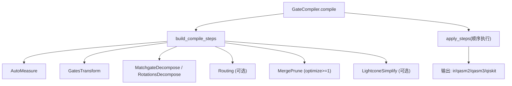
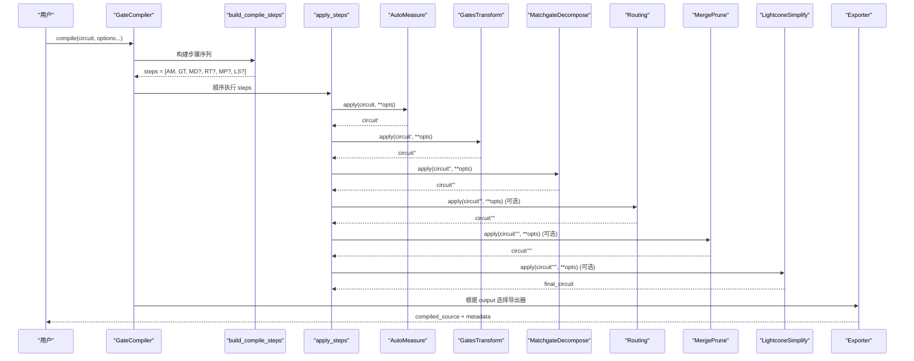
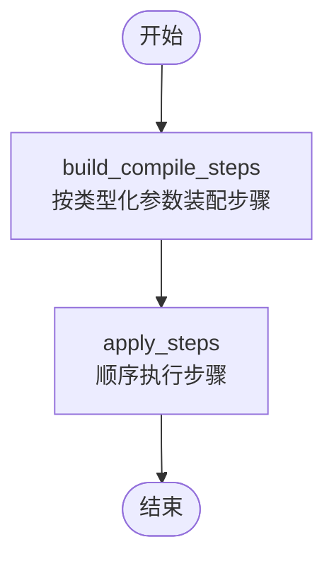
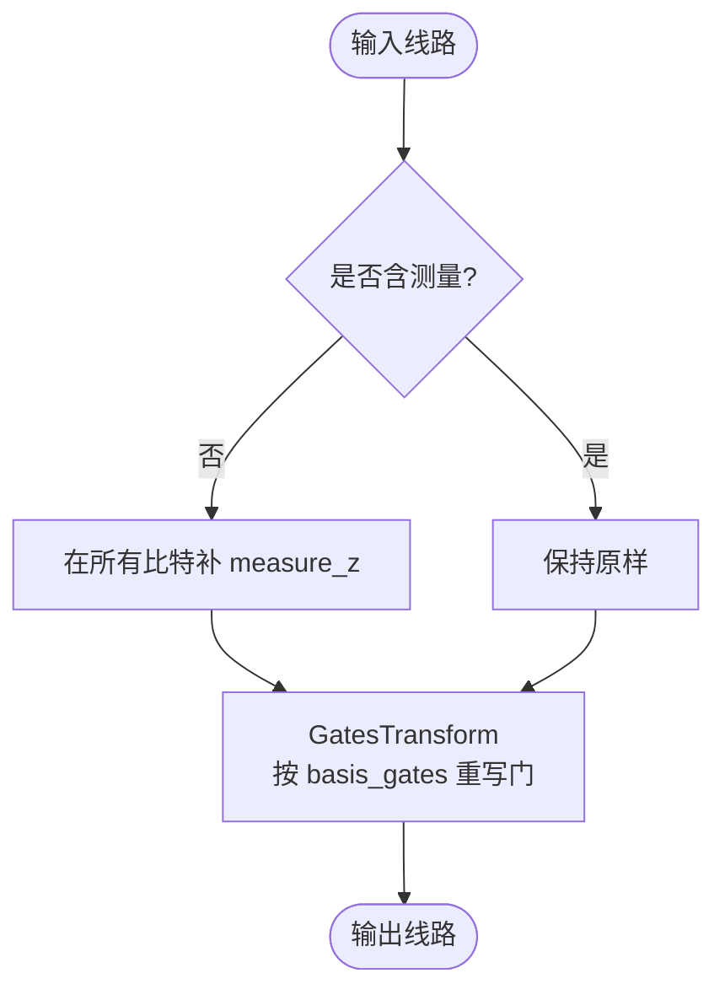
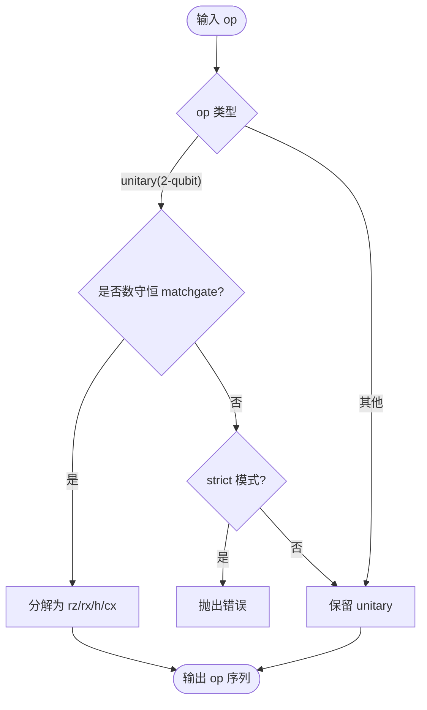
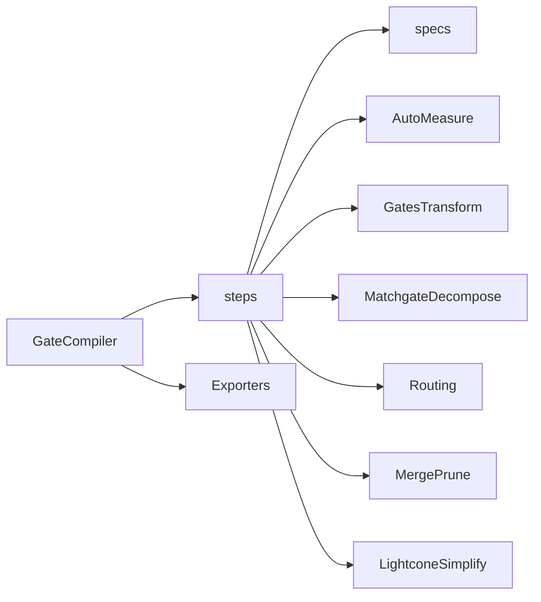

# 编译器核心架构

<cite>
**本文引用的文件**
- [compiler.py](file://src/tyxonq/compiler/gate_compiler/compiler.py)
- [steps.py](file://src/tyxonq/compiler/gate_compiler/steps.py)
- [specs.py](file://src/tyxonq/compiler/gate_compiler/specs.py)
- [api.py](file://src/tyxonq/compiler/api.py)
- [auto_measure.py](file://src/tyxonq/compiler/gate_compiler/stages/rewrite/auto_measure.py)
- [gates_transform.py](file://src/tyxonq/compiler/gate_compiler/stages/rewrite/gates_transform.py)
- [matchgate.py](file://src/tyxonq/compiler/gate_compiler/stages/decompose/matchgate.py)
- [gate_qasm2_exporter.py](file://src/tyxonq/compiler/gate_compiler/exporters/gate_qasm2_exporter.py)
- [circuit_compiler.py](file://examples/circuit_compiler.py)
</cite>

## 目录
1. [简介](#简介)
2. [项目结构](#项目结构)
3. [核心组件](#核心组件)
4. [架构总览](#架构总览)
5. [详细组件分析](#详细组件分析)
6. [依赖关系分析](#依赖关系分析)
7. [性能考量](#性能考量)
8. [故障排查指南](#故障排查指南)
9. [结论](#结论)
10. [附录：使用示例与配置对比](#附录使用示例与配置对比)

## 简介
本文件系统性阐述 TyxonQ 门级编译器的核心架构，聚焦 GateCompiler 类的设计理念与实现机制。文档围绕编译流程的四个主要阶段展开：标准化、分解、路由、优化与简化；详解 compile 方法的参数配置（basis_gates、decompose、route、optimize、simplify）及其默认行为；解释编译步骤系统（CompileStep 协议）如何工作，build_compile_steps 如何按类型化参数装配步骤序列，apply_steps 如何顺序执行；并说明编译元数据（metadata）的结构与作用。最后提供具体使用示例与不同配置的效果对比，帮助读者快速上手与调优。

## 项目结构
TyxonQ 的门级编译器位于 gate_compiler 子模块中，采用“核心 + 阶段”的分层设计：
- 核心编排：GateCompiler.compile 负责统一入口、参数归一化、输出格式选择与元数据收集。
- 步骤装配与执行：steps.build_compile_steps 根据类型化参数生成步骤列表；steps.apply_steps 顺序执行。
- 规格定义：specs.DecomposeSpec/RoutingSpec 提供细粒度控制开关。
- 阶段实现：stages/* 包含标准化（AutoMeasure、GatesTransform）、分解（MatchgateDecompose、RotationsDecompose）、路由（Routing）、优化（MergePrune）、简化（LightconeSimplify）。
- 导出器：exporters/* 将 IR 转换为 QASM2/QASM3 等目标格式。
- 统一 API：compiler.api.compile 作为顶层入口，支持多平台与脉冲编译的智能分发。

图表来源
- [compiler.py:27-109](file://src/tyxonq/compiler/gate_compiler/compiler.py#L27-L109)
- [steps.py:27-91](file://src/tyxonq/compiler/gate_compiler/steps.py#L27-L91)

章节来源
- [compiler.py:14-109](file://src/tyxonq/compiler/gate_compiler/compiler.py#L14-L109)
- [steps.py:1-109](file://src/tyxonq/compiler/gate_compiler/steps.py#L1-L109)

## 核心组件
- GateCompiler：设备无关的门电路核心编译器，统一收集分解、重写、布局/路由、化简等功能，并通过类型化参数驱动编译步骤装配与执行。
- CompileStep 协议：每个步骤实现 apply(circuit, **opts) -> Circuit，从 opts 自取所需参数（如 basis_gates、device_rule），返回新线路。
- build_compile_steps：按固定顺序装配步骤：标准化（AutoMeasure、GatesTransform）→ 分解（MatchgateDecompose、RotationsDecompose）→ 路由（Routing，可选）→ 优化（MergePrune，optimize>=1）→ 简化（LightconeSimplify，可选）。
- apply_steps：朴素顺序执行步骤列表，返回最终线路。
- specs：DecomposeSpec 与 RoutingSpec 提供布尔或结构化配置，coerce_* 函数将 bool/None 归一为 spec 或 None。

章节来源
- [compiler.py:14-109](file://src/tyxonq/compiler/gate_compiler/compiler.py#L14-L109)
- [steps.py:27-105](file://src/tyxonq/compiler/gate_compiler/steps.py#L27-L105)
- [specs.py:15-103](file://src/tyxonq/compiler/gate_compiler/specs.py#L15-L103)
- [api.py:28-37](file://src/tyxonq/compiler/api.py#L28-L37)

## 架构总览
下图展示 GateCompiler 的编译流水线与关键交互点：

图表来源
- [compiler.py:27-109](file://src/tyxonq/compiler/gate_compiler/compiler.py#L27-L109)
- [steps.py:27-105](file://src/tyxonq/compiler/gate_compiler/steps.py#L27-L105)

## 详细组件分析

### GateCompiler 与 compile 方法
- 职责：统一入口，处理参数归一化（basis_gates、optimization_level、output），装配步骤并执行，收集元数据，按 output 选择导出器。
- 关键参数：
  - basis_gates：目标原生门集合；若未显式指定且 output 为 qasm/qasm2，则自动降级到 qelib1 兼容基 ["cx","h","rz","rx","cz"]。
  - decompose：bool|DecomposeSpec；True 启用默认 matchgate 分解。
  - route：bool|RoutingSpec；False 默认不路由。
  - optimize：int；>=1 时启用 MergePrune。
  - simplify：bool；为真时启用 LightconeSimplify。
  - device_rule：设备能力描述（耦合图等），供路由与步骤消费。
  - options：附加选项（如 output、optimization_level、add_measures 等）。
- 输出：
  - ir/tyxonq：返回 IR 对象与 lowered 代码。
  - qasm3/openqasm3：通过 GateQASM3Exporter 导出。
  - qasm/qasm2：通过 GateQASM2Exporter 导出（已保证 qelib1 兼容基）。
  - qiskit：通过 to_qiskit 转换 IR 为 QuantumCircuit。

章节来源
- [compiler.py:27-109](file://src/tyxonq/compiler/gate_compiler/compiler.py#L27-L109)

### 编译步骤系统（CompileStep 协议）
- 协议：每个步骤实现 apply(circuit, **opts) -> Circuit，从 opts 自取参数，互不干扰。
- 装配：build_compile_steps 按固定顺序追加步骤，未启用的能力不插入占位步骤。
- 执行：apply_steps 顺序对线路施加每个步骤，返回最终线路。

图表来源
- [steps.py:27-105](file://src/tyxonq/compiler/gate_compiler/steps.py#L27-L105)

章节来源
- [steps.py:27-105](file://src/tyxonq/compiler/gate_compiler/steps.py#L27-L105)
- [api.py:28-37](file://src/tyxonq/compiler/api.py#L28-L37)

### 标准化阶段
- AutoMeasure：无显式测量时在所有比特上补 Z 测量，避免后续步骤缺失测量上下文；检测 ops 与 instructions 中的测量，避免重复。
- GatesTransform：按 basis_gates 重写门（x->rx(pi)、y->ry(pi) 等），保留基础门集；重建时保留 _unitary_cache，确保后续分解可用。

图表来源
- [auto_measure.py:13-53](file://src/tyxonq/compiler/gate_compiler/stages/rewrite/auto_measure.py#L13-L53)
- [gates_transform.py:12-53](file://src/tyxonq/compiler/gate_compiler/stages/rewrite/gates_transform.py#L12-L53)

章节来源
- [auto_measure.py:13-53](file://src/tyxonq/compiler/gate_compiler/stages/rewrite/auto_measure.py#L13-L53)
- [gates_transform.py:12-53](file://src/tyxonq/compiler/gate_compiler/stages/rewrite/gates_transform.py#L12-L53)

### 分解阶段
- MatchgateDecompose：将 2-qubit 数守恒 matchgate（fSim/two_mode_fock）精确分解到 {rz, rx, h, cx}；非 matchgate 的 unitary 默认保留，strict 模式可强制报错。
- RotationsDecompose：将旋转门（rxx/ryy/rzz 等）进一步分解到基础门集（当 DecomposeSpec.rotations=True 时启用）。

图表来源
- [matchgate.py:46-149](file://src/tyxonq/compiler/gate_compiler/stages/decompose/matchgate.py#L46-L149)
- [matchgate.py:152-197](file://src/tyxonq/compiler/gate_compiler/stages/decompose/matchgate.py#L152-L197)

章节来源
- [matchgate.py:46-197](file://src/tyxonq/compiler/gate_compiler/stages/decompose/matchgate.py#L46-L197)

### 路由阶段（可选）
- Routing：当 route=True 或提供 RoutingSpec 时启用，委托 qiskit.transpile 进行布局与 SWAP 插入；可从 device_rule 读取耦合图。
- 注意：qiskit 的 optimization_level 在路由步骤中默认为 0，以避免引入 IR 词汇表外的门。

章节来源
- [specs.py:33-59](file://src/tyxonq/compiler/gate_compiler/specs.py#L33-L59)
- [steps.py:74-79](file://src/tyxonq/compiler/gate_compiler/steps.py#L74-L79)

### 优化阶段（可选）
- MergePrune：当 optimize>=1 时启用，合并相邻门、剪枝恒等操作，减少门数与噪声累积。

章节来源
- [steps.py:81-84](file://src/tyxonq/compiler/gate_compiler/steps.py#L81-L84)

### 简化阶段（可选）
- LightconeSimplify：当 simplify=True 时启用，裁剪不影响测量结果的算符，降低电路复杂度。

章节来源
- [steps.py:86-89](file://src/tyxonq/compiler/gate_compiler/steps.py#L86-L89)

### 导出器与输出格式
- GateQASM2Exporter：将 IR 直译为 OpenQASM 2.0（qelib1.inc），遇到不支持门（iswap/rxx/ryy/rzz）时报错，要求先分解到兼容基。
- GateQASM3Exporter：将 IR 导出为 OpenQASM 3.0。
- qiskit 互操作：to_qiskit 将 IR 转换为 QuantumCircuit，不做 transpile（布局布线由 routing 步骤负责）。

章节来源
- [gate_qasm2_exporter.py:19-204](file://src/tyxonq/compiler/gate_compiler/exporters/gate_qasm2_exporter.py#L19-L204)
- [compiler.py:87-107](file://src/tyxonq/compiler/gate_compiler/compiler.py#L87-L107)

## 依赖关系分析
- GateCompiler 依赖 steps 模块装配与执行步骤，依赖 specs 解析类型化参数。
- 各阶段模块按需延迟导入，避免默认路径的额外依赖（如路由仅在启用时导入）。
- 导出器与互操作模块在输出分支中按需加载，保持核心轻量。

图表来源
- [compiler.py:27-109](file://src/tyxonq/compiler/gate_compiler/compiler.py#L27-L109)
- [steps.py:27-91](file://src/tyxonq/compiler/gate_compiler/steps.py#L27-L91)

章节来源
- [compiler.py:27-109](file://src/tyxonq/compiler/gate_compiler/compiler.py#L27-L109)
- [steps.py:27-91](file://src/tyxonq/compiler/gate_compiler/steps.py#L27-L91)

## 性能考量
- 分解优先于路由：确保 to_qiskit 等下游工具能正确识别单元操作。
- 零角度块剪枝：matchgate 分解中跳过近似单位元的段，减少冗余门。
- 路由优化级别限制：路由步骤默认 optimization_level=0，避免引入不可读回的门。
- 按需导入：路由与导出器仅在需要时加载，降低启动开销。
- 元数据缓存：编译后缓存 compiled_source，避免重复编译。

[本节为通用指导，无需特定文件引用]

## 故障排查指南
- 缺少矩阵缓存：MatchgateDecompose 需要 _unitary_cache；确保 GatesTransform 使用 rebuild_circuit 保留缓存。
- QASM2 不支持门：若输出 qasm2 但存在 iswap/rxx/ryy/rzz，需先分解到 qelib1 兼容基（compiler 已自动降级）。
- 路由随机性：RoutingSpec.seed 默认 0 以保证复现；如需对比多次路由质量，可显式传 None。
- 脉冲编译误判：compile 会检测脉冲操作或模式并自动切换；建议显式 use_pulse() 明确意图。

章节来源
- [matchgate.py:169-197](file://src/tyxonq/compiler/gate_compiler/stages/decompose/matchgate.py#L169-L197)
- [gate_qasm2_exporter.py:131-136](file://src/tyxonq/compiler/gate_compiler/exporters/gate_qasm2_exporter.py#L131-L136)
- [specs.py:44-51](file://src/tyxonq/compiler/gate_compiler/specs.py#L44-L51)
- [api.py:149-217](file://src/tyxonq/compiler/api.py#L149-L217)

## 结论
TyxonQ 门级编译器以 GateCompiler 为核心，通过类型化参数驱动的可插拔步骤系统，实现了标准化、分解、路由、优化与简化的完整流水线。其设计强调设备无关性、可组合性与可观测性（元数据），并通过按需导入与严格输出约束保障性能与稳定性。结合 specs 的细粒度控制与 export 的多格式支持，用户可在不同硬件与后端间灵活迁移与优化电路。

[本节为总结，无需特定文件引用]

## 附录：使用示例与配置对比
以下示例展示如何使用 GateCompiler 进行电路编译，并对比不同配置的效果。为避免直接粘贴代码，提供文件路径与行号参考。

- 基本编译（默认配置）
  - 参考：[circuit_compiler.py:20-40](file://examples/circuit_compiler.py#L20-L40)
  - 说明：调用 c.compile(...) 获取不同优化级别的 IR，便于可视化与比较。

- 输出 QASM2 并指定基门集
  - 参考：[circuit_compiler.py:43-53](file://examples/circuit_compiler.py#L43-L53)
  - 说明：设置 output="qasm2" 与 basis_gates，确保兼容 qelib1.inc。

- 启用路由与设备规则
  - 参考：[api.py:83-90](file://src/tyxonq/compiler/api.py#L83-L90)
  - 说明：传入 device_rule={"coupling_map": [...]} 与 route=True，使编译器按拓扑插入 SWAP。

- 分解与优化对比
  - 参考：[specs.py:15-31](file://src/tyxonq/compiler/gate_compiler/specs.py#L15-L31)
  - 说明：DecomposeSpec(matchgate=True, rotations=False) 为默认；开启 rotations 可进一步分解旋转门。

- 元数据检查
  - 参考：[compiler.py:76-83](file://src/tyxonq/compiler/gate_compiler/compiler.py#L76-L83)
  - 说明：metadata 包含 output、options、device_rule、steps、basis_gates、optimization_level，便于审计与调试。

章节来源
- [circuit_compiler.py:20-53](file://examples/circuit_compiler.py#L20-L53)
- [api.py:83-90](file://src/tyxonq/compiler/api.py#L83-L90)
- [specs.py:15-31](file://src/tyxonq/compiler/gate_compiler/specs.py#L15-L31)
- [compiler.py:76-83](file://src/tyxonq/compiler/gate_compiler/compiler.py#L76-L83)