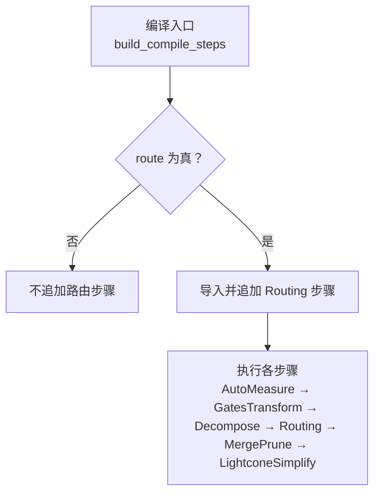
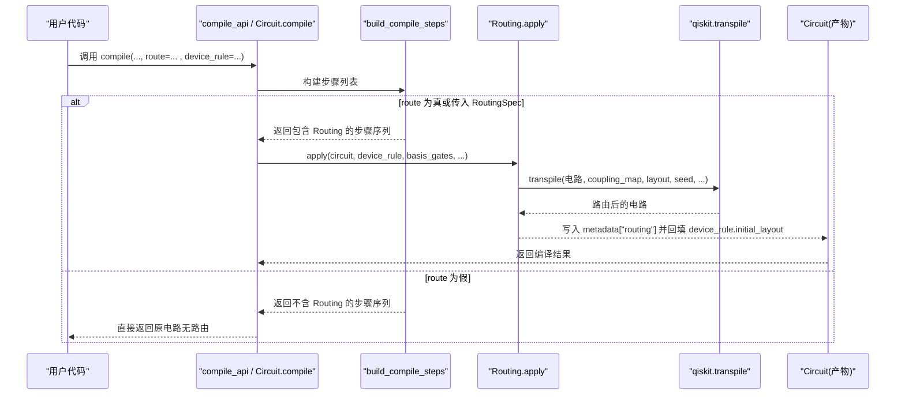
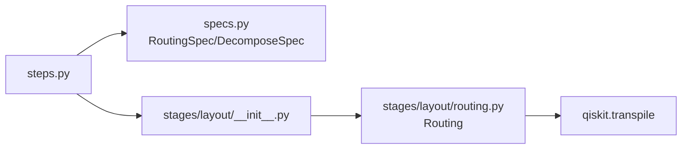

# 路由算法

<cite>
**本文引用的文件**
- [src/tyxonq/compiler/gate_compiler/stages/layout/__init__.py](file://src/tyxonq/compiler/gate_compiler/stages/layout/__init__.py)
- [src/tyxonq/compiler/gate_compiler/steps.py](file://src/tyxonq/compiler/gate_compiler/steps.py)
- [tests_core_module/test_compiler_routing.py](file://tests_core_module/test_compiler_routing.py)
</cite>

## 目录
1. [简介](#简介)
2. [项目结构](#项目结构)
3. [核心组件](#核心组件)
4. [架构总览](#架构总览)
5. [详细组件分析](#详细组件分析)
6. [依赖关系分析](#依赖关系分析)
7. [性能考量](#性能考量)
8. [故障排查指南](#故障排查指南)
9. [结论](#结论)
10. [附录：配置与示例路径](#附录：配置与示例路径)

## 简介
本文件面向 TyxonQ 门级编译器中的“路由（Layout/Routing）”能力，系统性说明 RoutingSpec 类型化规格、布局挑选与 SWAP 插入策略、拓扑适配方案以及编译流水线集成方式。内容基于仓库中已实现的测试与装配逻辑进行归纳，帮助读者在不深入源码细节的前提下掌握如何正确配置和使用路由功能，并理解其在不同硬件拓扑下的行为与约束。

## 项目结构
TyxonQ 的门级编译器将“路由”作为独立编译步骤，按类型化参数装配到编译管线中。相关要点如下：
- 路由步骤位于 stages/layout 包，对外暴露 Routing 类。
- 编译步骤的装配由 steps.build_compile_steps 完成，仅在 route=True 或传入 RoutingSpec 时追加路由步骤。
- 路由实现委托 qiskit.transpile 完成布局与 SWAP 插入，并在产物中记录路由元数据（如 initial_layout、final_layout、swaps_inserted、local_coupling_map 等）。
- 测试覆盖了路由触发条件、测量顺序保持、可复现性、拓扑选择与失败降级等关键场景。

图表来源
- [src/tyxonq/compiler/gate_compiler/steps.py:27-91](file://src/tyxonq/compiler/gate_compiler/steps.py#L27-L91)

章节来源
- [src/tyxonq/compiler/gate_compiler/stages/layout/__init__.py:1-15](file://src/tyxonq/compiler/gate_compiler/stages/layout/__init__.py#L1-L15)
- [src/tyxonq/compiler/gate_compiler/steps.py:27-91](file://src/tyxonq/compiler/gate_compiler/steps.py#L27-L91)

## 核心组件
- RoutingSpec（类型化规格）
  - 控制是否启用路由、目标耦合图、优化级别、随机种子、基础门集合等。
  - 当未显式提供耦合图时，可从 device_rule 中读取；若显式提供则优先使用。
- Routing（路由步骤）
  - 负责在需要时将逻辑比特映射到物理比特，并按设备耦合图插入 SWAP 门以满足相邻约束。
  - 通过 qiskit.transpile 完成具体路由；在产物 Circuit 的 metadata["routing"] 中记录算法、初始/最终布局、SWAP 计数、本地耦合图等。
- 编译步骤装配器 build_compile_steps
  - 根据 decompose/route/optimize/simplify 等参数动态组装步骤序列，确保分解先于路由，避免不可识别的高层算子进入路由阶段。

章节来源
- [src/tyxonq/compiler/gate_compiler/steps.py:27-91](file://src/tyxonq/compiler/gate_compiler/steps.py#L27-L91)
- [tests_core_module/test_compiler_routing.py:416-464](file://tests_core_module/test_compiler_routing.py#L416-L464)

## 架构总览
下图展示了从编译入口到路由执行的端到端流程，包括何时触发路由、如何与分解步骤协作、以及路由产物如何回填设备规则供运行期使用。

图表来源
- [src/tyxonq/compiler/gate_compiler/steps.py:27-91](file://src/tyxonq/compiler/gate_compiler/steps.py#L27-L91)
- [tests_core_module/test_compiler_routing.py:416-464](file://tests_core_module/test_compiler_routing.py#L416-L464)

## 详细组件分析

### RoutingSpec 类型化规格与工作原理
- 作用域
  - 控制是否启用路由（bool | RoutingSpec），默认 False 不追加路由步骤。
  - 支持指定 algorithm、optimization_level、seed、basis_gates、coupling_map 等。
- 优先级
  - 若 RoutingSpec.coupling_map 显式给出，则优先于 device_rule 中的耦合图。
- 工作流
  - 当 route=True 或传入 RoutingSpec 时，build_compile_steps 会延迟导入并追加 Routing 步骤。
  - 路由前必须完成分解（MatchgateDecompose/RotationsDecompose），以避免高层矩阵算子无法被下游处理。
- 产物与回填
  - 路由完成后，Circuit.metadata["routing"] 记录算法、优化级别、initial_layout、final_layout、num_physical_qubits、swaps_inserted、local_coupling_map、seed、basis_gates 等。
  - device_rule.initial_layout 会被回填，供后续运行期下发。

章节来源
- [src/tyxonq/compiler/gate_compiler/steps.py:27-91](file://src/tyxonq/compiler/gate_compiler/steps.py#L27-L91)
- [tests_core_module/test_compiler_routing.py:92-105](file://tests_core_module/test_compiler_routing.py#L92-L105)
- [tests_core_module/test_compiler_routing.py:265-274](file://tests_core_module/test_compiler_routing.py#L265-L274)

### 量子比特布局（layout）算法与物理拓扑约束
- 触发条件
  - 无耦合图视为全连接，直接跳过路由。
  - 单比特电路或已满足相邻约束的电路，直接返回原对象，零回归。
- 布局挑选
  - 若提供的 initial_layout 导致诱导子图不连通或下标异常，会自动挑选合适的连通子图。
  - 对星型拓扑等，倾向于选择高中心度节点作为种子，保证可复现性与连通性。
- 拓扑校验
  - 若设备拓扑拆分为多个互不相连的块，而两比特门跨块，则抛出明确错误，提示拓扑不可路由。
- 本地索引空间
  - 路由产物保持在「本地下标空间」，不会膨胀到设备比特数；物理映射仅体现在 metadata 与 device_rule 中。

章节来源
- [tests_core_module/test_compiler_routing.py:50-69](file://tests_core_module/test_compiler_routing.py#L50-L69)
- [tests_core_module/test_compiler_routing.py:195-233](file://tests_core_module/test_compiler_routing.py#L195-L233)
- [tests_core_module/test_compiler_routing.py:236-243](file://tests_core_module/test_compiler_routing.py#L236-L243)

### SWAP 插入策略与优化技术
- 基本策略
  - 通过 qiskit.transpile 在满足耦合图约束的前提下插入 SWAP 门，使所有两比特门落在相邻比特对上。
  - 对于缺少方向规则的 gates（如 iswap），在 lvl=0 自由路由模式下仍可通过插入 SWAP 绕开方向限制。
- 失败降级
  - 未显式指定 basis_gates 的自由路由失败时，自动回退到保守门集合重试一次并发出告警。
  - 若连保守门集合也失败，则抛出运行时错误，保留最后一次失败原因。
- 优化平衡
  - 通过 optimization_level 与 seed 控制搜索策略与可复现性；默认 seed=0 保证逐 op 一致。
  - 路由后合并/剪枝（MergePrune）与光锥化简（LightconeSimplify）可在后续步骤进一步压缩电路。

章节来源
- [tests_core_module/test_compiler_routing.py:174-192](file://tests_core_module/test_compiler_routing.py#L174-L192)
- [tests_core_module/test_compiler_routing.py:284-331](file://tests_core_module/test_compiler_routing.py#L284-L331)
- [src/tyxonq/compiler/gate_compiler/steps.py:74-89](file://src/tyxonq/compiler/gate_compiler/steps.py#L74-L89)

### 不同硬件拓扑结构下的路由适配
- 线性链
  - 低比特区常见形态：以相邻边为主，跨度较大的两比特门需通过 SWAP 逐步搬运。
  - 路由后 local_coupling_map 应反映所选子图的相邻关系。
- 网格/星型
  - 星型拓扑中，中心节点度数最高，布局挑选倾向将其纳入初始布局，提高连通性。
  - 网格拓扑下，路由会根据实际耦合边决定 SWAP 路径，保持两比特门相邻。
- 非连通拓扑
  - 若设备拓扑存在多个互不相连的块，且两比特门跨块，则直接报错，避免静默失败。

章节来源
- [tests_core_module/test_compiler_routing.py:209-233](file://tests_core_module/test_compiler_routing.py#L209-L233)
- [tests_core_module/test_compiler_routing.py:388-396](file://tests_core_module/test_compiler_routing.py#L388-L396)
- [tests_core_module/test_compiler_routing.py:236-243](file://tests_core_module/test_compiler_routing.py#L236-L243)

### 测量逻辑序保持与等价性验证
- 逻辑序保持
  - 第 i 个经典比特必须测「持有逻辑比特 i 的物理比特」，即 routed_meas[i] == final_layout[i]。
  - 即使只测量部分比特，经典比特序仍须跟随逻辑比特，而非物理下标升序。
- 物理等价性
  - 通过 StatevectorEngine 对比路由前后概率分布，按「物理→逻辑」置换后统计，偏差应在阈值内。

章节来源
- [tests_core_module/test_compiler_routing.py:110-160](file://tests_core_module/test_compiler_routing.py#L110-L160)

### 编译流水线集成与顺序约束
- 固定顺序
  - AutoMeasure → GatesTransform → Decompose → Routing → MergePrune → LightconeSimplify。
  - 分解必须先于路由，否则 unitary 等矩阵算子无法进入 qiskit 路由。
- 开关控制
  - route=False（默认）不追加路由步骤；route=True 或传入 RoutingSpec 才追加。
  - optimize>=1 追加 MergePrune；simplify=True 追加 LightconeSimplify。

章节来源
- [src/tyxonq/compiler/gate_compiler/steps.py:27-91](file://src/tyxonq/compiler/gate_compiler/steps.py#L27-L91)
- [tests_core_module/test_compiler_routing.py:416-464](file://tests_core_module/test_compiler_routing.py#L416-L464)

## 依赖关系分析
- 模块耦合
  - steps.py 依赖 specs（RoutingSpec/DecomposeSpec）与 stages.layout.routing.Routing。
  - routing 模块依赖 qiskit.transpile 完成具体路由。
- 外部依赖
  - qiskit.transpile：负责布局选择与 SWAP 插入。
  - 模拟器（StatevectorEngine）：用于端到端等价性验证。
- 潜在循环
  - 通过延迟导入避免在装配阶段引入不必要的依赖。

图表来源
- [src/tyxonq/compiler/gate_compiler/steps.py:27-91](file://src/tyxonq/compiler/gate_compiler/steps.py#L27-L91)
- [src/tyxonq/compiler/gate_compiler/stages/layout/__init__.py:1-15](file://src/tyxonq/compiler/gate_compiler/stages/layout/__init__.py#L1-L15)

章节来源
- [src/tyxonq/compiler/gate_compiler/steps.py:27-91](file://src/tyxonq/compiler/gate_compiler/steps.py#L27-L91)
- [src/tyxonq/compiler/gate_compiler/stages/layout/__init__.py:1-15](file://src/tyxonq/compiler/gate_compiler/stages/layout/__init__.py#L1-L15)

## 性能考量
- 路由开销
  - 路由过程依赖 qiskit.transpile，复杂度与电路规模、耦合图密度、两比特门数量相关。
  - 合理设置 seed 可获得稳定结果，便于基准比较与回归测试。
- SWAP 最小化
  - 通过选择合适的 initial_layout 与 topology 子图，减少不必要的 SWAP 插入。
  - 在后续步骤中使用 MergePrune 与 LightconeSimplify 进一步压缩电路。
- 失败回退
  - 自由路由失败时自动回退到保守门集合，提升鲁棒性；但可能增加 SWAP 数量。
- 测量与等价性
  - 保持测量逻辑序与物理等价性，避免后端执行时的额外校正成本。

[本节为通用指导，不直接分析具体文件]

## 故障排查指南
- 常见问题与定位
  - 未触发路由：检查 route 是否为 True 或是否传入了 RoutingSpec。
  - 路由失败：查看 metadata["routing"]["algorithm"] 与 basis_gates；必要时切换到保守门集合。
  - 拓扑不可路由：确认设备拓扑是否连通，是否存在跨块的两比特门。
  - 测量顺序错乱：核对 final_layout 与 routed_meas 的关系，确保逻辑序保持。
- 建议操作
  - 显式设置 seed 以获得可复现结果。
  - 在 device_rule 中提供合理的 coupling_map 与 num_qubits。
  - 若 circuit 大于设备可用比特数，需调整线路规模或选择合适子图。

章节来源
- [tests_core_module/test_compiler_routing.py:245-351](file://tests_core_module/test_compiler_routing.py#L245-L351)

## 结论
TyxonQ 的路由能力以类型化规格 RoutingSpec 为核心，结合编译步骤装配器实现灵活可控的布局与 SWAP 插入。其设计强调：
- 只在真正需要时路由，避免不必要的开销；
- 严格保持测量逻辑序与物理等价性；
- 对不同拓扑结构具备良好适配与健壮的错误提示；
- 通过失败回退与后续优化步骤提升整体质量与稳定性。

[本节为总结性内容，不直接分析具体文件]

## 附录：配置与示例路径
- 如何在编译流水线中启用路由
  - 参考路径：[编译步骤装配与路由触发:27-91](file://src/tyxonq/compiler/gate_compiler/steps.py#L27-L91)
  - 参考路径：[编译 API 集成与步骤顺序:416-464](file://tests_core_module/test_compiler_routing.py#L416-L464)
- 如何配置 RoutingSpec
  - 参考路径：[RoutingSpec 参数与优先级:265-274](file://tests_core_module/test_compiler_routing.py#L265-L274)
  - 参考路径：[seed 与可复现性:174-192](file://tests_core_module/test_compiler_routing.py#L174-L192)
- 如何处理复杂连接约束
  - 参考路径：[线性链拓扑路由:209-218](file://tests_core_module/test_compiler_routing.py#L209-L218)
  - 参考路径：[星型拓扑布局挑选:388-396](file://tests_core_module/test_compiler_routing.py#L388-L396)
  - 参考路径：[非连通拓扑报错:236-243](file://tests_core_module/test_compiler_routing.py#L236-L243)
- 路由前后映射对比与性能分析
  - 参考路径：[metadata 记录与设备规则回填:92-105](file://tests_core_module/test_compiler_routing.py#L92-L105)
  - 参考路径：[物理等价性验证:129-160](file://tests_core_module/test_compiler_routing.py#L129-L160)