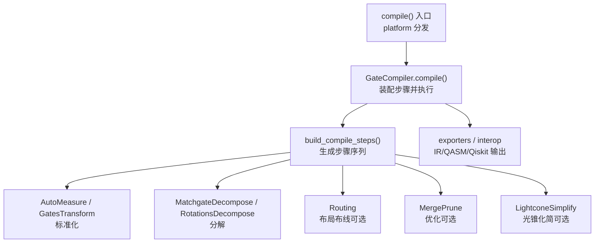
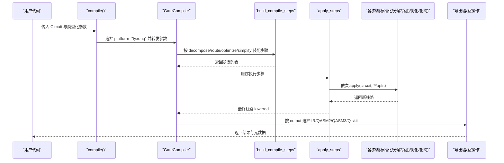
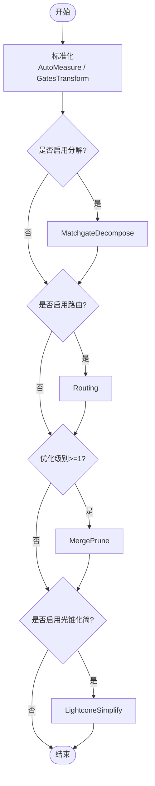
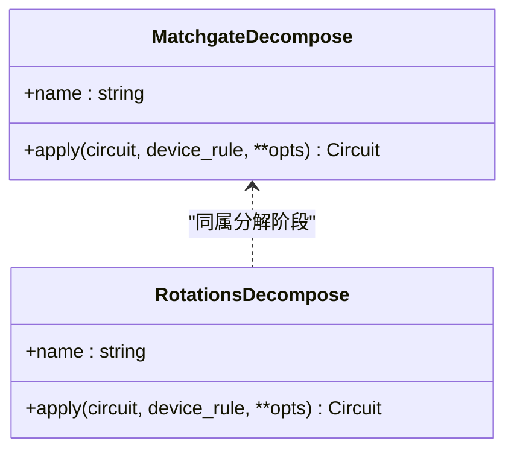
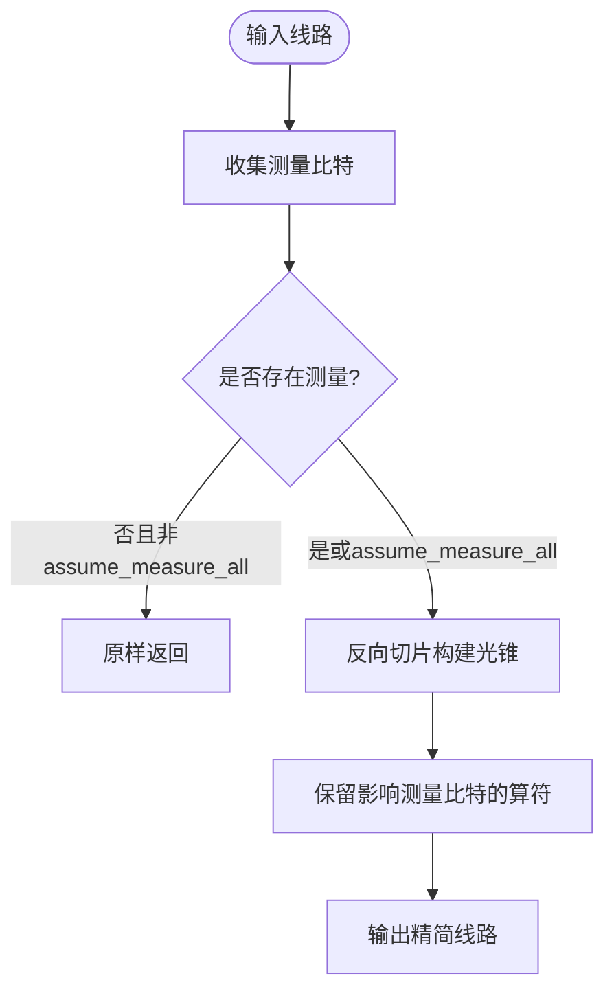
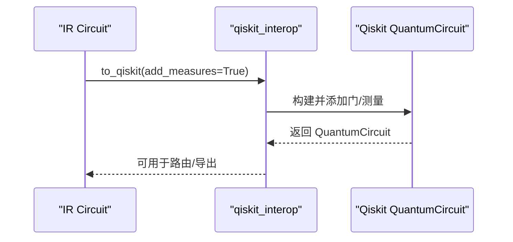
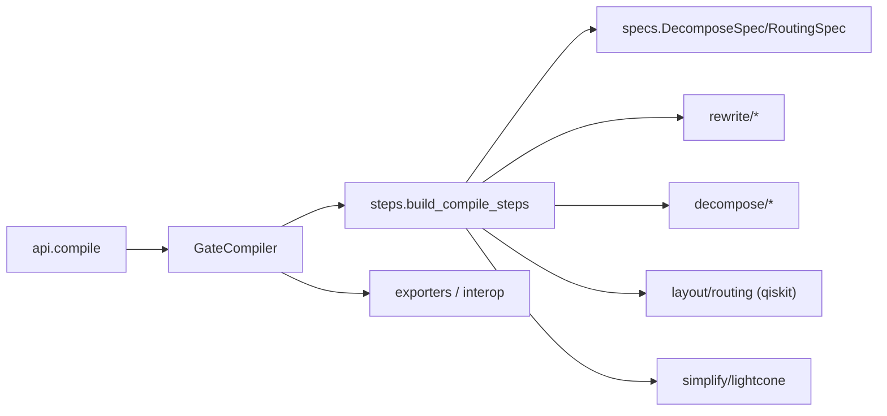

# 门级编译器

<cite>
**本文引用的文件**
- [src/tyxonq/compiler/api.py](file://src/tyxonq/compiler/api.py)
- [src/tyxonq/compiler/gate_compiler/compiler.py](file://src/tyxonq/compiler/gate_compiler/compiler.py)
- [src/tyxonq/compiler/gate_compiler/steps.py](file://src/tyxonq/compiler/gate_compiler/steps.py)
- [src/tyxonq/compiler/gate_compiler/specs.py](file://src/tyxonq/compiler/gate_compiler/specs.py)
- [src/tyxonq/compiler/gate_compiler/stages/decompose/matchgate.py](file://src/tyxonq/compiler/gate_compiler/stages/decompose/matchgate.py)
- [src/tyxonq/compiler/gate_compiler/stages/decompose/rotations.py](file://src/tyxonq/compiler/gate_compiler/stages/decompose/rotations.py)
- [src/tyxonq/compiler/gate_compiler/stages/simplify/lightcone.py](file://src/tyxonq/compiler/gate_compiler/stages/simplify/lightcone.py)
- [src/tyxonq/compiler/gate_compiler/stages/rewrite/auto_measure.py](file://src/tyxonq/compiler/gate_compiler/stages/rewrite/auto_measure.py)
- [src/tyxonq/compiler/gate_compiler/stages/rewrite/gates_transform.py](file://src/tyxonq/compiler/gate_compiler/stages/rewrite/gates_transform.py)
- [src/tyxonq/compiler/gate_compiler/stages/layout/__init__.py](file://src/tyxonq/compiler/gate_compiler/stages/layout/__init__.py)
- [src/tyxonq/compiler/gate_compiler/interop/qiskit_interop.py](file://src/tyxonq/compiler/gate_compiler/interop/qiskit_interop.py)
- [examples/compiler_lightcone_optimization.py](file://examples/compiler_lightcone_optimization.py)
</cite>

## 目录
1. [简介](#简介)
2. [项目结构](#项目结构)
3. [核心组件](#核心组件)
4. [架构总览](#架构总览)
5. [详细组件分析](#详细组件分析)
6. [依赖关系分析](#依赖关系分析)
7. [性能考虑](#性能考虑)
8. [故障排查指南](#故障排查指南)
9. [结论](#结论)
10. [附录](#附录)

## 简介
本文件系统性阐述 TyxonQ 门级编译器的核心架构与编译流程，重点解释“编译步骤系统（CompileStep 协议）”的实现机制，覆盖标准化、分解、路由、优化、简化等阶段；说明类型化规格 DecomposeSpec 与 RoutingSpec 的使用方法；介绍光锥简化（LightconeSimplify）的工作原理与优化效果；并给出与 Qiskit 的互操作方式、自定义编译步骤与优化策略的实践建议，以及性能调优与常见问题解决方案。

## 项目结构
TyxonQ 的门级编译器位于 gate_compiler 子模块中，采用“步骤装配 + 顺序执行”的设计：
- 入口与平台分发：api.compile 统一入口，GateCompiler 负责按类型化参数装配步骤并输出多种格式。
- 步骤装配与执行：steps.build_compile_steps 根据 DecomposeSpec/RoutingSpec/optimize/simplify 生成步骤列表；apply_steps 顺序执行。
- 各阶段实现：stages/* 下包含 rewrite（标准化）、decompose（分解）、layout（路由）、simplify（化简）等具体步骤。
- 互操作：interop/qiskit_interop.py 提供 IR 与 Qiskit 的双向转换，支撑路由与导出。

**图表来源**
- [src/tyxonq/compiler/api.py:39-340](file://src/tyxonq/compiler/api.py#L39-L340)
- [src/tyxonq/compiler/gate_compiler/compiler.py:14-110](file://src/tyxonq/compiler/gate_compiler/compiler.py#L14-L110)
- [src/tyxonq/compiler/gate_compiler/steps.py:27-91](file://src/tyxonq/compiler/gate_compiler/steps.py#L27-L91)

**章节来源**
- [src/tyxonq/compiler/api.py:39-340](file://src/tyxonq/compiler/api.py#L39-L340)
- [src/tyxonq/compiler/gate_compiler/compiler.py:14-110](file://src/tyxonq/compiler/gate_compiler/compiler.py#L14-L110)
- [src/tyxonq/compiler/gate_compiler/steps.py:27-91](file://src/tyxonq/compiler/gate_compiler/steps.py#L27-L91)

## 核心组件
- CompileStep 协议：每个步骤实现 apply(circuit, **opts) -> Circuit，从 opts 自取参数，保证步骤间解耦与可组合性。
- GateCompiler：设备无关的核心编译器，统一收集分解、重写、布局/路由、化简等功能，并按类型化参数驱动步骤装配与执行。
- 步骤装配器 build_compile_steps：固定顺序装配步骤（标准化→分解→路由→优化→化简），未启用能力不追加占位步骤。
- 类型化规格：
  - DecomposeSpec：控制 matchgate、rotations、two_qubit_unitary 的开关与粒度。
  - RoutingSpec：控制 coupling_map、initial_layout、algorithm、optimization_level、seed 等路由细节。
- 互操作：to_qiskit/from_qiskit 支持 IR 与 Qiskit 双向转换，支撑路由与导出。

**章节来源**
- [src/tyxonq/compiler/api.py:28-98](file://src/tyxonq/compiler/api.py#L28-L98)
- [src/tyxonq/compiler/gate_compiler/compiler.py:14-110](file://src/tyxonq/compiler/gate_compiler/compiler.py#L14-L110)
- [src/tyxonq/compiler/gate_compiler/steps.py:27-105](file://src/tyxonq/compiler/gate_compiler/steps.py#L27-L105)
- [src/tyxonq/compiler/gate_compiler/specs.py:15-94](file://src/tyxonq/compiler/gate_compiler/specs.py#L15-L94)
- [src/tyxonq/compiler/gate_compiler/interop/qiskit_interop.py:165-318](file://src/tyxonq/compiler/gate_compiler/interop/qiskit_interop.py#L165-L318)

## 架构总览
下图展示从 compile 入口到各编译阶段的完整调用链与数据流。

**图表来源**
- [src/tyxonq/compiler/api.py:39-340](file://src/tyxonq/compiler/api.py#L39-L340)
- [src/tyxonq/compiler/gate_compiler/compiler.py:27-110](file://src/tyxonq/compiler/gate_compiler/compiler.py#L27-L110)
- [src/tyxonq/compiler/gate_compiler/steps.py:27-105](file://src/tyxonq/compiler/gate_compiler/steps.py#L27-L105)

## 详细组件分析

### 编译步骤系统与执行模型
- 步骤协议 CompileStep：定义统一的 apply 接口，使步骤可插拔、可组合。
- 装配规则 build_compile_steps：
  - 标准化：AutoMeasure（无测量时补 Z 测量）、GatesTransform（按 basis_gates 重写）。
  - 分解：MatchgateDecompose（数守恒 2-qubit unitary → {rz,rx,h,cx}）、RotationsDecompose（旋转门标准恒等式展开）。
  - 路由：Routing（可选，委托 qiskit.transpile 完成布局与 SWAP 插入）。
  - 优化：MergePrune（合并相邻门、剪枝恒等）。
  - 化简：LightconeSimplify（基于测量反向切片裁剪不影响结果的算符）。
- 执行模型 apply_steps：顺序对线路施加每个步骤，逐步逼近目标平台/原生门集合。

**图表来源**
- [src/tyxonq/compiler/gate_compiler/steps.py:27-91](file://src/tyxonq/compiler/gate_compiler/steps.py#L27-L91)

**章节来源**
- [src/tyxonq/compiler/gate_compiler/steps.py:27-105](file://src/tyxonq/compiler/gate_compiler/steps.py#L27-L105)
- [src/tyxonq/compiler/gate_compiler/stages/rewrite/auto_measure.py:13-50](file://src/tyxonq/compiler/gate_compiler/stages/rewrite/auto_measure.py#L13-L50)
- [src/tyxonq/compiler/gate_compiler/stages/rewrite/gates_transform.py:12-50](file://src/tyxonq/compiler/gate_compiler/stages/rewrite/gates_transform.py#L12-L50)

### 标准化阶段
- AutoMeasure：检测线路是否含显式测量，若无则在所有比特上补 Z 测量，避免后续步骤误判。
- GatesTransform：按 basis_gates 进行最小重写（如 x→rx(pi)、y→ry(pi)），保留兼容门集，其余交由后续步骤处理。

**章节来源**
- [src/tyxonq/compiler/gate_compiler/stages/rewrite/auto_measure.py:13-50](file://src/tyxonq/compiler/gate_compiler/stages/rewrite/auto_measure.py#L13-L50)
- [src/tyxonq/compiler/gate_compiler/stages/rewrite/gates_transform.py:12-50](file://src/tyxonq/compiler/gate_compiler/stages/rewrite/gates_transform.py#L12-L50)

### 分解阶段
- MatchgateDecompose：将 2-qubit 数守恒 matchgate（fSim/two_mode_fock 家族）精确分解为原生门 {rz, rx, h, cx}，利用 ZXZ 欧拉角与 iSWAP/CPhase 分解，零角度块剪枝以减少门数。
- RotationsDecompose：用标准恒等式将 RX/RY/RXX/RYY/RZZ 分解到 {H, RZ, CX}，便于在仅支持少量原门的设备上运行。

**图表来源**
- [src/tyxonq/compiler/gate_compiler/stages/decompose/matchgate.py:152-197](file://src/tyxonq/compiler/gate_compiler/stages/decompose/matchgate.py#L152-L197)
- [src/tyxonq/compiler/gate_compiler/stages/decompose/rotations.py:13-73](file://src/tyxonq/compiler/gate_compiler/stages/decompose/rotations.py#L13-L73)

**章节来源**
- [src/tyxonq/compiler/gate_compiler/stages/decompose/matchgate.py:46-149](file://src/tyxonq/compiler/gate_compiler/stages/decompose/matchgate.py#L46-L149)
- [src/tyxonq/compiler/gate_compiler/stages/decompose/matchgate.py:152-197](file://src/tyxonq/compiler/gate_compiler/stages/decompose/matchgate.py#L152-L197)
- [src/tyxonq/compiler/gate_compiler/stages/decompose/rotations.py:13-73](file://src/tyxonq/compiler/gate_compiler/stages/decompose/rotations.py#L13-L73)

### 路由阶段
- Routing：当 route=True 或提供 RoutingSpec 时，使用 qiskit.transpile 完成逻辑比特到物理比特的映射与 SWAP 插入。默认 optimization_level=0，避免引入额外门集合重写；seed=0 保证可复现。
- 耦合图来源：优先使用 RoutingSpec.coupling_map，否则从 device_rule["coupling_map"] 读取。

**章节来源**
- [src/tyxonq/compiler/gate_compiler/specs.py:33-58](file://src/tyxonq/compiler/gate_compiler/specs.py#L33-L58)
- [src/tyxonq/compiler/gate_compiler/steps.py:74-79](file://src/tyxonq/compiler/gate_compiler/steps.py#L74-L79)
- [src/tyxonq/compiler/gate_compiler/stages/layout/__init__.py:1-15](file://src/tyxonq/compiler/gate_compiler/stages/layout/__init__.py#L1-L15)

### 优化阶段
- MergePrune：合并相邻门、剪枝恒等操作，减少门深度与噪声累积。由 optimize>=1 触发。

**章节来源**
- [src/tyxonq/compiler/gate_compiler/steps.py:81-84](file://src/tyxonq/compiler/gate_compiler/steps.py#L81-L84)

### 简化阶段（光锥简化）
- LightconeSimplify：从测量比特出发反向切片，构建“光锥”，仅保留影响测量结果的算符，从而大幅降低仿真/执行成本。支持 assume_measure_all 模式用于全测量场景验证等价性。
- 示例演示了在不同量子位数与层数下的加速效果，以及在部分测量场景中的显著收益。

**图表来源**
- [src/tyxonq/compiler/gate_compiler/stages/simplify/lightcone.py:12-97](file://src/tyxonq/compiler/gate_compiler/stages/simplify/lightcone.py#L12-L97)
- [examples/compiler_lightcone_optimization.py:61-94](file://examples/compiler_lightcone_optimization.py#L61-L94)

**章节来源**
- [src/tyxonq/compiler/gate_compiler/stages/simplify/lightcone.py:12-97](file://src/tyxonq/compiler/gate_compiler/stages/simplify/lightcone.py#L12-L97)
- [examples/compiler_lightcone_optimization.py:61-94](file://examples/compiler_lightcone_optimization.py#L61-L94)

### 与 Qiskit 的互操作
- to_qiskit：将 IR Circuit 转换为 Qiskit QuantumCircuit，支持常见单/双比特门、受控旋转、barrier、measure_z 等；若 add_measures=True 且无显式测量则自动 measure_all。
- from_qiskit：将 Qiskit 电路解析回 IR，识别常用门与测量。
- ir_to_qasm：通过纯 QASM2 导出器序列化 IR，无需 qiskit。
- 路由引擎：routing 阶段借助 qiskit.transpile 完成布局与 SWAP 插入。

**图表来源**
- [src/tyxonq/compiler/gate_compiler/interop/qiskit_interop.py:165-242](file://src/tyxonq/compiler/gate_compiler/interop/qiskit_interop.py#L165-L242)
- [src/tyxonq/compiler/gate_compiler/interop/qiskit_interop.py:245-318](file://src/tyxonq/compiler/gate_compiler/interop/qiskit_interop.py#L245-L318)

**章节来源**
- [src/tyxonq/compiler/gate_compiler/interop/qiskit_interop.py:165-318](file://src/tyxonq/compiler/gate_compiler/interop/qiskit_interop.py#L165-L318)

### 类型化规格的使用
- DecomposeSpec：
  - matchgate=True（默认）：开启数守恒 2-qubit unitary 分解。
  - rotations=False（默认）：关闭旋转门展开，避免不必要的门膨胀。
  - two_qubit_unitary=False（默认）：通用 KAK 分解为后续增量。
- RoutingSpec：
  - coupling_map：物理耦合图，缺省时从 device_rule 读取。
  - initial_layout：初始布局，缺省时优先恒等布局，必要时 BFS 挑选连通子图。
  - algorithm="qiskit"：当前委托 qiskit.transpile。
  - optimization_level=0：仅做布局与 SWAP，不做门集合重写。
  - seed=0：确保路由过程可复现。

**章节来源**
- [src/tyxonq/compiler/gate_compiler/specs.py:15-94](file://src/tyxonq/compiler/gate_compiler/specs.py#L15-L94)

### 配置不同的分解策略与路由算法
- 分解策略：
  - 仅 matchgate：decompose=True（默认）或 DecomposeSpec(matchgate=True)。
  - 同时展开旋转门：DecomposeSpec(matchgate=True, rotations=True)。
  - 严格模式：在 opts 中设置 matchgate_strict=True，遇到非 matchgate 的 2-qubit unitary 会抛出明确错误。
- 路由算法：
  - 启用路由：route=True 或 RoutingSpec(...)。
  - 指定耦合图与初始布局：在 RoutingSpec 中设置 coupling_map、initial_layout。
  - 控制优化级别与随机种子：optimization_level、seed。

**章节来源**
- [src/tyxonq/compiler/gate_compiler/steps.py:61-79](file://src/tyxonq/compiler/gate_compiler/steps.py#L61-L79)
- [src/tyxonq/compiler/gate_compiler/specs.py:33-94](file://src/tyxonq/compiler/gate_compiler/specs.py#L33-L94)

### 自定义编译步骤与优化策略
- 自定义步骤：实现 CompileStep 协议的 apply 方法，并在 build_compile_steps 前后插入（或通过扩展 steps 装配逻辑）。
- 优化策略：
  - 调整 optimize 级别以启用 MergePrune。
  - 启用 simplify 以应用 LightconeSimplify。
  - 结合 decompose 与 route 的组合，平衡门集与拓扑约束。

**章节来源**
- [src/tyxonq/compiler/api.py:28-98](file://src/tyxonq/compiler/api.py#L28-L98)
- [src/tyxonq/compiler/gate_compiler/steps.py:27-91](file://src/tyxonq/compiler/gate_compiler/steps.py#L27-L91)

## 依赖关系分析
- GateCompiler 依赖 steps 装配器与 specs 规格；步骤之间通过 Apply 接口松耦合。
- 路由阶段依赖 qiskit（可选导入），仅在启用路由时加载。
- 导出器与互操作模块按需加载，保持核心装配零额外依赖。

**图表来源**
- [src/tyxonq/compiler/api.py:39-340](file://src/tyxonq/compiler/api.py#L39-L340)
- [src/tyxonq/compiler/gate_compiler/compiler.py:27-110](file://src/tyxonq/compiler/gate_compiler/compiler.py#L27-L110)
- [src/tyxonq/compiler/gate_compiler/steps.py:27-91](file://src/tyxonq/compiler/gate_compiler/steps.py#L27-L91)
- [src/tyxonq/compiler/gate_compiler/specs.py:15-94](file://src/tyxonq/compiler/gate_compiler/specs.py#L15-L94)

**章节来源**
- [src/tyxonq/compiler/gate_compiler/compiler.py:27-110](file://src/tyxonq/compiler/gate_compiler/compiler.py#L27-L110)
- [src/tyxonq/compiler/gate_compiler/steps.py:27-91](file://src/tyxonq/compiler/gate_compiler/steps.py#L27-L91)

## 性能考虑
- 光锥简化：在部分测量场景下可带来数量级加速，且数学等价；全测量时作为恒等变换不损失精度。
- 分解策略：matchgate 分解能精确降到原生门并剪枝零角度块；rotations 展开会增加门数，仅在目标设备不支持旋转门时启用。
- 路由优化级别：保持 optimization_level=0 以避免引入不可读回的门集合；如需更复杂优化，谨慎评估 with/from_qiskit 兼容性。
- 测量补全：AutoMeasure 在无显式测量时补测，避免后续步骤误判导致的不必要开销。

[本节为通用指导，不直接分析具体文件]

## 故障排查指南
- 缺少矩阵缓存：MatchgateDecompose 需要 _unitary_cache；确保 GatesTransform 与 AutoMeasure 使用 rebuild_circuit 重建以保持缓存。
- Qiskit 未安装：to_qiskit/from_qiskit 在未安装 qiskit 时会抛出清晰错误；路由与 QASM 解析需安装 qiskit。
- 路由结果不稳定：设置 RoutingSpec.seed=0 保证可复现；如需对比多次路由质量，可显式传 None 恢复随机搜索。
- 输出格式不匹配：qasm2 输出时若未指定 basis_gates，GateCompiler 会降级到 qelib1 兼容基，避免导出器遇到不支持的门。

**章节来源**
- [src/tyxonq/compiler/gate_compiler/stages/decompose/matchgate.py:169-197](file://src/tyxonq/compiler/gate_compiler/stages/decompose/matchgate.py#L169-L197)
- [src/tyxonq/compiler/gate_compiler/interop/qiskit_interop.py:165-173](file://src/tyxonq/compiler/gate_compiler/interop/qiskit_interop.py#L165-L173)
- [src/tyxonq/compiler/gate_compiler/specs.py:44-58](file://src/tyxonq/compiler/gate_compiler/specs.py#L44-L58)
- [src/tyxonq/compiler/gate_compiler/compiler.py:51-55](file://src/tyxonq/compiler/gate_compiler/compiler.py#L51-L55)

## 结论
TyxonQ 门级编译器通过“类型化规格 + 步骤协议”实现了高度模块化与可扩展的编译流程。标准化、分解、路由、优化、简化各阶段职责清晰、顺序可控；光锥简化在期望值计算中提供显著加速；与 Qiskit 的互操作使得路由与导出更加灵活。通过合理配置 DecomposeSpec 与 RoutingSpec，并结合 optimize/simplify 选项，可在不同硬件平台上获得稳定、高效且可复现的编译结果。

[本节为总结，不直接分析具体文件]

## 附录
- 示例参考：光锥优化的端到端示例展示了如何在不同问题规模下启用 LightconeSimplify，并验证正确性与性能提升。
- 最佳实践：
  - 明确目标设备门集，必要时在 GatesTransform 中指定 basis_gates。
  - 在需要拓扑感知的场景启用路由，并固定 seed 以保证可复现。
  - 在期望值计算中启用光锥简化，尤其是部分测量场景。
  - 谨慎使用 rotations 展开，避免不必要门膨胀。

**章节来源**
- [examples/compiler_lightcone_optimization.py:61-94](file://examples/compiler_lightcone_optimization.py#L61-L94)