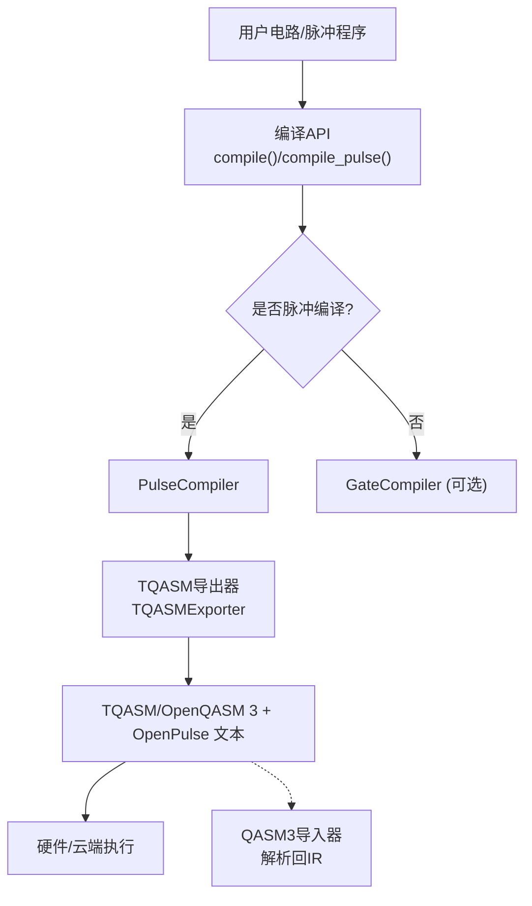
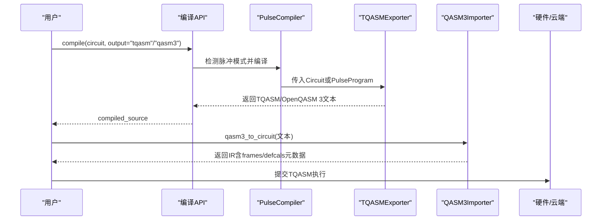
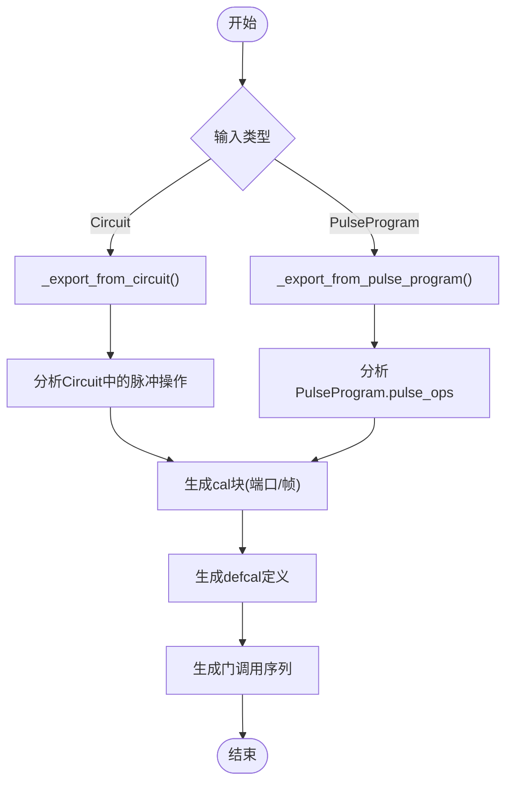
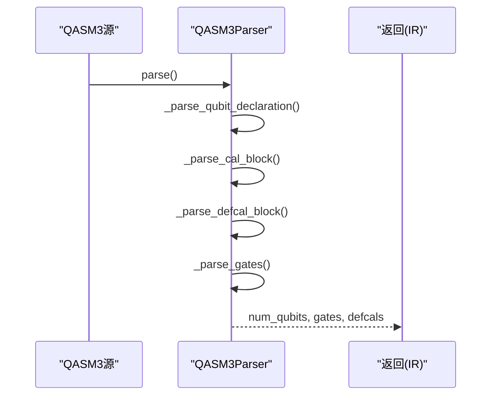
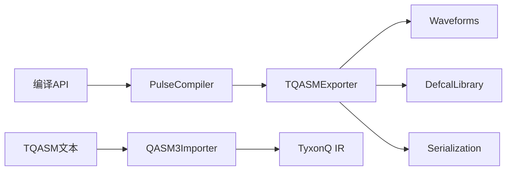

# TQASM导出和格式规范

<cite>
**本文引用的文件**
- [tqasm_exporter.py](file://src/tyxonq/compiler/pulse_compiler/native/tqasm_exporter.py)
- [qasm3_importer.py](file://src/tyxonq/compiler/pulse_compiler/native/qasm3_importer.py)
- [defcal_library.py](file://src/tyxonq/compiler/pulse_compiler/defcal_library.py)
- [serialization.py](file://src/tyxonq/compiler/pulse_compiler/serialization.py)
- [waveforms.py](file://src/tyxonq/waveforms.py)
- [api.py](file://src/tyxonq/compiler/api.py)
- [test_tqasm_defcal_export.py](file://tests_core_module/test_tqasm_defcal_export.py)
- [test_tqasm_version_declaration.py](file://tests_core_module/test_tqasm_version_declaration.py)
</cite>

## 目录
1. [简介](#简介)
2. [项目结构](#项目结构)
3. [核心组件](#核心组件)
4. [架构总览](#架构总览)
5. [详细组件分析](#详细组件分析)
6. [依赖关系分析](#依赖关系分析)
7. [性能考虑](#性能考虑)
8. [故障排查指南](#故障排查指南)
9. [结论](#结论)
10. [附录](#附录)

## 简介
本文件面向TyxonQ的TQASM导出能力，系统性说明TQASM 0.2与OpenQASM 3 + OpenPulse格式的规范、实现与使用方式。内容涵盖：
- TQASM文件结构与语法：版本声明、脉冲定义、测量指令、帧与端口等
- TyxonQ脉冲程序到标准格式的转换流程（含PulseProgram与Circuit双路径）
- OpenPulse扩展的使用方法与波形支持
- 完整的导出工作流示例与跨平台互操作建议
- TQASM解析与验证工具链
- 自定义指令扩展机制
- 调试与优化实践

## 项目结构
围绕TQASM导出，关键代码分布在编译器与脉冲编译子系统中：
- 导出器：将TyxonQ IR（Circuit或PulseProgram）转换为TQASM/OpenQASM 3 + OpenPulse文本
- 导入器：反向解析QASM3 + OpenPulse文本为TyxonQ IR
- 校准库：管理门级脉冲校准数据
- 序列化：保存/加载脉冲IR（JSON/Pickle），便于调试与传输
- 波形定义：DRAG、Gaussian、Constant等波形类型及其参数
- 编译API：统一入口，自动选择输出格式与平台策略

图表来源
- [api.py:139-340](file://src/tyxonq/compiler/api.py#L139-L340)
- [tqasm_exporter.py:129-295](file://src/tyxonq/compiler/pulse_compiler/native/tqasm_exporter.py#L129-L295)
- [qasm3_importer.py:123-143](file://src/tyxonq/compiler/pulse_compiler/native/qasm3_importer.py#L123-L143)

章节来源
- [api.py:39-340](file://src/tyxonq/compiler/api.py#L39-L340)
- [tqasm_exporter.py:24-128](file://src/tyxonq/compiler/pulse_compiler/native/tqasm_exporter.py#L24-L128)
- [qasm3_importer.py:1-50](file://src/tyxonq/compiler/pulse_compiler/native/qasm3_importer.py#L1-L50)

## 核心组件
- TQASM导出器：负责生成符合OpenQASM 3 + OpenPulse语法的文本，包括版本声明、端口/帧、defcal、波形、play/shift_phase等指令，以及门调用序列
- QASM3导入器：解析QASM3 + OpenPulse文本，提取量子比特数、cal块、defcal定义与门操作，构建TyxonQ IR
- 校准库：集中管理门级脉冲校准数据，支持增删查改、校验、JSON持久化
- 序列化：提供JSON/Pickle两种格式保存/恢复脉冲IR，便于调试、版本控制与跨进程通信
- 波形模块：定义多种波形类型（如Drag、Gaussian、Constant等），并暴露qasm_name/to_args接口用于导出
- 编译API：统一入口，智能识别脉冲模式、目标设备与输出格式，自动设置inline_pulses与supported_waveforms等选项

章节来源
- [tqasm_exporter.py:24-128](file://src/tyxonq/compiler/pulse_compiler/native/tqasm_exporter.py#L24-L128)
- [qasm3_importer.py:57-143](file://src/tyxonq/compiler/pulse_compiler/native/qasm3_importer.py#L57-L143)
- [defcal_library.py:39-166](file://src/tyxonq/compiler/pulse_compiler/defcal_library.py#L39-L166)
- [serialization.py:26-191](file://src/tyxonq/compiler/pulse_compiler/serialization.py#L26-L191)
- [waveforms.py:19-157](file://src/tyxonq/waveforms.py#L19-L157)
- [api.py:39-340](file://src/tyxonq/compiler/api.py#L39-L340)

## 架构总览
TQASM导出遵循“IR → 导出器 → 文本”的单向流水线；同时提供“文本 → 导入器 → IR”的反向通道，形成可逆的中间表示交换。

图表来源
- [api.py:139-340](file://src/tyxonq/compiler/api.py#L139-L340)
- [tqasm_exporter.py:129-295](file://src/tyxonq/compiler/pulse_compiler/native/tqasm_exporter.py#L129-L295)
- [qasm3_importer.py:123-143](file://src/tyxonq/compiler/pulse_compiler/native/qasm3_importer.py#L123-L143)

## 详细组件分析

### TQASM导出器（TQASMExporter）
- 功能要点
  - 支持两种版本风格：openqasm3（标准OpenQASM 3.0 + OpenPulse）与tyxonq_homebrew_tqasm（TQASM 0.2，兼容Qiskit风格的qreg声明）
  - 输入兼容Circuit与PulseProgram两类IR
  - 自动生成cal块（端口与帧）、defcal门校准、波形定义、play/shift_phase指令
  - 支持从pulse_key或params推断门类型，生成对应defcal签名
  - 输出标准门调用序列（h、rx、cx等）或纯脉冲模式下的gate调用再生成
- 关键流程
  - export：根据输入类型分派到_circuit或_pulse_program路径
  - _analyze_pulse_operations/_analyze_pulse_program_operations：分组脉冲并构建defcal
  - _generate_cal_block：按设备参数生成端口与帧
  - _export_waveform_openpulse/_export_waveform_dict_openpulse：波形对象或字典转OpenPulse语法
  - _export_gate_operation：标准门映射到TQASM语句
- 复杂度与性能
  - 主要开销在遍历ops与波形序列化，时间复杂度近似O(N)（N为操作数）
  - 通过缓存frame映射与ports集合减少重复计算

图表来源
- [tqasm_exporter.py:129-295](file://src/tyxonq/compiler/pulse_compiler/native/tqasm_exporter.py#L129-L295)
- [tqasm_exporter.py:344-591](file://src/tyxonq/compiler/pulse_compiler/native/tqasm_exporter.py#L344-L591)
- [tqasm_exporter.py:593-733](file://src/tyxonq/compiler/pulse_compiler/native/tqasm_exporter.py#L593-L733)

章节来源
- [tqasm_exporter.py:24-128](file://src/tyxonq/compiler/pulse_compiler/native/tqasm_exporter.py#L24-L128)
- [tqasm_exporter.py:129-295](file://src/tyxonq/compiler/pulse_compiler/native/tqasm_exporter.py#L129-L295)
- [tqasm_exporter.py:344-591](file://src/tyxonq/compiler/pulse_compiler/native/tqasm_exporter.py#L344-L591)
- [tqasm_exporter.py:593-733](file://src/tyxonq/compiler/pulse_compiler/native/tqasm_exporter.py#L593-L733)

### QASM3导入器（QASM3Importer）
- 功能要点
  - 解析qubit声明、cal块（端口与帧）、defcal定义与门操作
  - 支持单/多量子比特门、测量、参数化旋转门
  - 将解析结果转为TyxonQ Circuit IR，并在metadata中保留frames与defcals信息
- 关键流程
  - parse：顺序执行qubit计数、cal块、defcal块、门操作解析
  - _parse_cal_block：正则匹配extern port与newframe
  - _parse_defcal_block：提取defcal签名、波形定义与body
  - _parse_gates：移除cal/defcal后解析剩余门指令
- 错误处理
  - 未找到qubit声明时报错
  - 角度解析失败抛出异常
  - 越界量子比特索引检查

图表来源
- [qasm3_importer.py:123-143](file://src/tyxonq/compiler/pulse_compiler/native/qasm3_importer.py#L123-L143)
- [qasm3_importer.py:145-187](file://src/tyxonq/compiler/pulse_compiler/native/qasm3_importer.py#L145-L187)
- [qasm3_importer.py:188-226](file://src/tyxonq/compiler/pulse_compiler/native/qasm3_importer.py#L188-L226)
- [qasm3_importer.py:227-330](file://src/tyxonq/compiler/pulse_compiler/native/qasm3_importer.py#L227-L330)

章节来源
- [qasm3_importer.py:1-50](file://src/tyxonq/compiler/pulse_compiler/native/qasm3_importer.py#L1-L50)
- [qasm3_importer.py:123-143](file://src/tyxonq/compiler/pulse_compiler/native/qasm3_importer.py#L123-L143)
- [qasm3_importer.py:145-330](file://src/tyxonq/compiler/pulse_compiler/native/qasm3_importer.py#L145-L330)
- [qasm3_importer.py:333-396](file://src/tyxonq/compiler/pulse_compiler/native/qasm3_importer.py#L333-L396)

### 校准库（DefcalLibrary）
- 功能要点
  - 存储与查询门级脉冲校准数据（单/双量子比特）
  - 支持添加、删除、列表过滤、存在性检查与完整性校验
  - JSON持久化（含版本、硬件标识、创建时间等元数据）
- 数据结构
  - CalibrationData：包含gate、qubits、pulse、params、timestamp、description、hardware
  - DefcalLibrary：内部以(gate, qubits)为键的字典管理
- 复杂度
  - 查找/插入/删除平均O(1)，列表过滤O(K)（K为候选数量）

章节来源
- [defcal_library.py:39-166](file://src/tyxonq/compiler/pulse_compiler/defcal_library.py#L39-L166)
- [defcal_library.py:153-565](file://src/tyxonq/compiler/pulse_compiler/defcal_library.py#L153-L565)

### 序列化（Serialization）
- 功能要点
  - JSON：人类可读，适合配置与调试；需inline_pulses=True以完整序列化波形
  - Pickle：二进制，保留Python对象类型，适合同版本Python间快速传输
- 关键点
  - metadata中的pulse_library会被序列化为{type, args, class}形式
  - 提供save/load便捷函数

章节来源
- [serialization.py:26-191](file://src/tyxonq/compiler/pulse_compiler/serialization.py#L26-L191)
- [serialization.py:194-240](file://src/tyxonq/compiler/pulse_compiler/serialization.py#L194-L240)

### 波形（Waveforms）
- 支持的波形类型
  - Gaussian、GaussianSquare、Drag、Constant、Sine、Cosine、CosineDrag、Flattop、Hermite、BlackmanSquare
- 导出适配
  - 每个波形类提供qasm_name与to_args，供导出器生成OpenPulse波形定义
  - 导出器将amp转为复数形式，duration/sigma等附加dt单位

章节来源
- [waveforms.py:19-157](file://src/tyxonq/waveforms.py#L19-L157)
- [tqasm_exporter.py:593-681](file://src/tyxonq/compiler/pulse_compiler/native/tqasm_exporter.py#L593-L681)

### 编译API（统一入口）
- 功能要点
  - compile：统一入口，自动识别脉冲模式、目标设备与输出格式
  - compile_pulse：专为PulseProgram设计的平级入口，默认补齐device_params
  - 规则：homebrew_s2 + 脉冲 → tyxonq_homebrew_tqasm；其他设备 + 脉冲 → openqasm3
  - 自动启用inline_pulses与supported_waveforms约束
- 关键逻辑
  - _has_pulse_ops：检测Circuit或PulseProgram中的脉冲操作
  - 平台分发：tyxonq/pulse/guodun/lqcloud等分支
  - 缓存compiled_source避免重复编译

章节来源
- [api.py:39-340](file://src/tyxonq/compiler/api.py#L39-L340)
- [api.py:343-465](file://src/tyxonq/compiler/api.py#L343-L465)

## 依赖关系分析
- 组件耦合
  - 编译API依赖PulseCompiler与TQASMExporter；导出器依赖波形模块与设备参数
  - 导入器独立于导出器，但语义上互为逆过程
  - 校准库与序列化模块为辅助支撑，不直接参与导出主流程
- 外部依赖
  - OpenQASM 3 + OpenPulse语法约定（版本声明、defcalgrammar、cal块、波形与帧）
  - 目标硬件对TQASM/OpenQASM 3的支持程度决定最终执行兼容性

图表来源
- [api.py:139-340](file://src/tyxonq/compiler/api.py#L139-L340)
- [tqasm_exporter.py:129-295](file://src/tyxonq/compiler/pulse_compiler/native/tqasm_exporter.py#L129-L295)
- [qasm3_importer.py:123-143](file://src/tyxonq/compiler/pulse_compiler/native/qasm3_importer.py#L123-L143)

章节来源
- [api.py:139-340](file://src/tyxonq/compiler/api.py#L139-L340)
- [tqasm_exporter.py:129-295](file://src/tyxonq/compiler/pulse_compiler/native/tqasm_exporter.py#L129-L295)
- [qasm3_importer.py:123-143](file://src/tyxonq/compiler/pulse_compiler/native/qasm3_importer.py#L123-L143)

## 性能考虑
- 导出阶段
  - 线性扫描ops，尽量复用frame映射与ports集合
  - 波形序列化时仅构造必要字段，避免冗余
- 导入阶段
  - 正则表达式解析，注意避免回溯灾难；当前实现针对常见模式
- 内存占用
  - 大型电路下，建议开启inline_pulses以减少外部依赖引用
  - 使用JSON序列化进行版本控制时，注意文件大小增长

[本节为通用指导，无需特定文件引用]

## 故障排查指南
- 常见问题
  - 未声明qubit：导入器会报错，需确保源文件包含qubit或qreg声明
  - 角度解析失败：检查参数表达式是否合法（pi、三角函数等）
  - 量子比特越界：确认qubit索引不超过num_qubits
  - 缺失device_params：编译API会自动补全默认值并警告，建议显式提供真实设备参数
- 调试建议
  - 使用序列化保存中间IR（JSON/Pickle）定位问题
  - 查看生成的TQASM文本，核对版本声明、cal块、defcal与波形定义
  - 利用测试用例断言关键语法片段，快速验证输出合规性

章节来源
- [qasm3_importer.py:145-330](file://src/tyxonq/compiler/pulse_compiler/native/qasm3_importer.py#L145-L330)
- [api.py:247-267](file://src/tyxonq/compiler/api.py#L247-L267)
- [serialization.py:26-191](file://src/tyxonq/compiler/pulse_compiler/serialization.py#L26-L191)

## 结论
TyxonQ的TQASM导出能力基于OpenQASM 3 + OpenPulse规范，提供了从Circuit与PulseProgram到标准文本的双路径导出，并配套导入器实现双向互通。通过校准库与序列化机制，用户可高效管理门级脉冲校准与中间IR。结合编译API的智能策略，可在不同目标设备间迁移脉冲程序，满足跨平台互操作需求。

[本节为总结性内容，无需特定文件引用]

## 附录

### TQASM文件格式与语法要点
- 版本声明
  - OPENQASM 3.0（标准）或TQASM 0.2（homebrew_s2专用）
- 脉冲语法
  - defcalgrammar "openpulse"
  - cal块：extern port、frame = newframe(port, frequency, phase)
- 波形定义
  - drag、gaussian、constant、gaussian_square等，幅度为复数，时长带dt单位
- 指令
  - play(frame, waveform)、shift_phase(frame, angle)
- 门调用
  - h、rx、ry、rz、cx、cz等标准门，物理量子比特用$前缀在defcal中

章节来源
- [tqasm_exporter.py:171-233](file://src/tyxonq/compiler/pulse_compiler/native/tqasm_exporter.py#L171-L233)
- [tqasm_exporter.py:465-499](file://src/tyxonq/compiler/pulse_compiler/native/tqasm_exporter.py#L465-L499)
- [tqasm_exporter.py:593-681](file://src/tyxonq/compiler/pulse_compiler/native/tqasm_exporter.py#L593-L681)
- [tqasm_exporter.py:683-733](file://src/tyxonq/compiler/pulse_compiler/native/tqasm_exporter.py#L683-L733)

### 导出工作流程示例
- 基础流程
  - 构建Circuit或PulseProgram
  - 指定device_params（频率、非谐性等）
  - 调用compile或compile_pulse，选择output为tqasm或qasm3
  - 获取compiled_source并保存到文件
- 验证与回读
  - 使用qasm3_to_circuit将文本解析回IR，检查frames与defcals元数据
  - 运行单元测试断言关键语法片段

章节来源
- [api.py:39-340](file://src/tyxonq/compiler/api.py#L39-L340)
- [api.py:343-465](file://src/tyxonq/compiler/api.py#L343-L465)
- [qasm3_importer.py:333-396](file://src/tyxonq/compiler/pulse_compiler/native/qasm3_importer.py#L333-L396)
- [test_tqasm_defcal_export.py:4-77](file://tests_core_module/test_tqasm_defcal_export.py#L4-L77)
- [test_tqasm_defcal_export.py:80-150](file://tests_core_module/test_tqasm_defcal_export.py#L80-L150)
- [test_tqasm_defcal_export.py:153-222](file://tests_core_module/test_tqasm_defcal_export.py#L153-L222)

### 与其他框架的互操作性
- homebrew_s2设备使用TQASM 0.2（qreg风格），便于与Qiskit/TensorCircuit生态对接
- 其他设备使用OpenQASM 3.0（qubit风格），兼容IBM/Rigetti等平台
- 通过统一的compile入口与输出格式选择，实现跨平台迁移

章节来源
- [test_tqasm_version_declaration.py:13-50](file://tests_core_module/test_tqasm_version_declaration.py#L13-L50)
- [test_tqasm_version_declaration.py:53-91](file://tests_core_module/test_tqasm_version_declaration.py#L53-L91)
- [test_tqasm_version_declaration.py:94-143](file://tests_core_module/test_tqasm_version_declaration.py#L94-L143)
- [api.py:169-186](file://src/tyxonq/compiler/api.py#L169-L186)

### 自定义指令扩展机制
- 在defcal中扩展新门：通过新增defcal签名与body，绑定到具体脉冲序列
- 在导入器中扩展解析：增加正则匹配与门映射逻辑，使新指令可被解析为IR
- 在导出器中扩展生成：为新指令添加对应的波形与指令生成逻辑

章节来源
- [tqasm_exporter.py:501-591](file://src/tyxonq/compiler/pulse_compiler/native/tqasm_exporter.py#L501-L591)
- [qasm3_importer.py:188-226](file://src/tyxonq/compiler/pulse_compiler/native/qasm3_importer.py#L188-L226)
- [qasm3_importer.py:227-330](file://src/tyxonq/compiler/pulse_compiler/native/qasm3_importer.py#L227-L330)

### 调试与优化建议
- 调试
  - 打印并检查TQASM文本的关键部分（版本、cal、defcal、波形、play）
  - 使用序列化保存IR，对比前后差异
  - 借助测试用例断言关键语法片段
- 优化
  - 合理设置supported_waveforms限制，减少不必要波形
  - 使用inline_pulses=True降低外部依赖，提升可移植性
  - 校准库维护最佳参数，减少运行时调参成本

章节来源
- [test_tqasm_defcal_export.py:153-222](file://tests_core_module/test_tqasm_defcal_export.py#L153-L222)
- [api.py:264-267](file://src/tyxonq/compiler/api.py#L264-L267)
- [defcal_library.py:382-420](file://src/tyxonq/compiler/pulse_compiler/defcal_library.py#L382-L420)