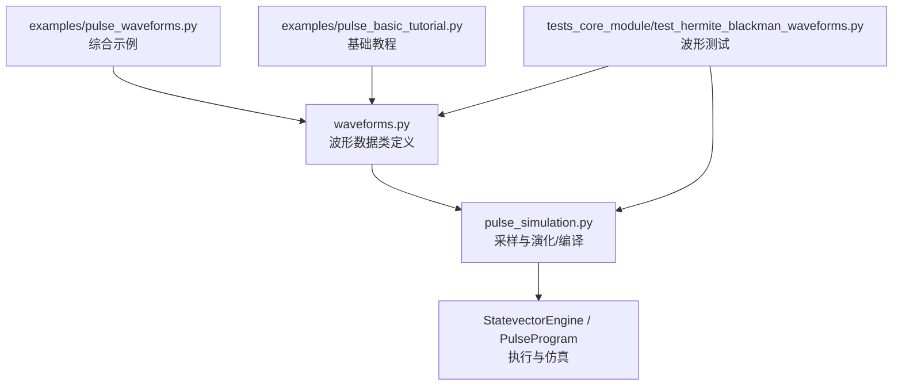
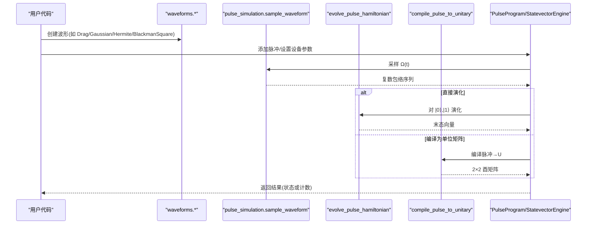
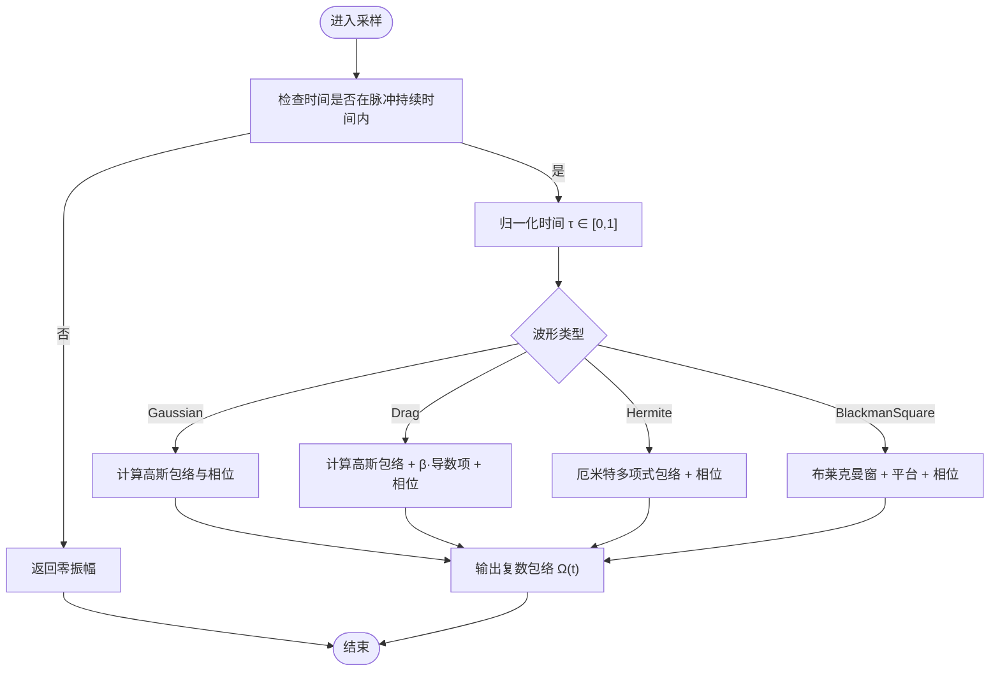
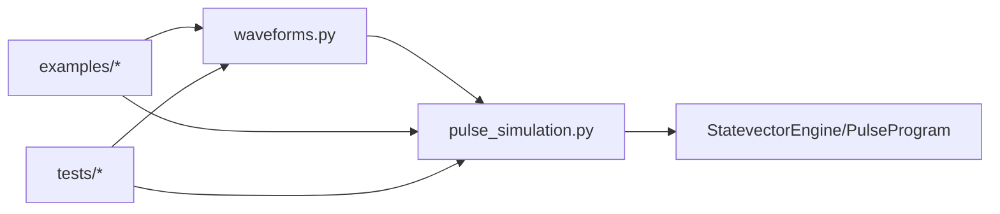

# 波形库和波形设计

<cite>
**本文引用的文件**
- [waveforms.py](file://src/tyxonq/waveforms.py)
- [pulse_simulation.py](file://src/tyxonq/libs/quantum_library/pulse_simulation.py)
- [test_hermite_blackman_waveforms.py](file://tests_core_module/test_hermite_blackman_waveforms.py)
- [pulse_waveforms.py](file://examples/pulse_waveforms.py)
- [pulse_basic_tutorial.py](file://examples/pulse_basic_tutorial.py)
- [step_1_hardware_basics.py](file://examples/pulse_calibration_tutorial/step_1_hardware_basics.py)
</cite>

## 目录
1. [简介](#简介)
2. [项目结构](#项目结构)
3. [核心组件](#核心组件)
4. [架构总览](#架构总览)
5. [详细组件分析](#详细组件分析)
6. [依赖关系分析](#依赖关系分析)
7. [性能考量](#性能考量)
8. [故障排查指南](#故障排查指南)
9. [结论](#结论)
10. [附录](#附录)

## 简介
本文件系统性介绍 TyxonQ 的脉冲波形库，覆盖内置波形的数学原理、物理意义、参数配置、应用场景与性能特点，并提供完整的代码示例路径、可视化方法与调试技巧。重点解释 Gaussian、Drag、Hermite、BlackmanSquare 等波形的实现细节与优化策略，帮助读者在高保真量子门控制中选择合适的包络函数并调优参数。

## 项目结构
TyxonQ 的波形定义位于统一的模块中，数值采样与仿真在独立的脉冲仿真模块中实现；示例与测试提供了使用方式与验证用例。

图表来源
- [waveforms.py:1-157](file://src/tyxonq/waveforms.py#L1-L157)
- [pulse_simulation.py:44-273](file://src/tyxonq/libs/quantum_library/pulse_simulation.py#L44-L273)

章节来源
- [waveforms.py:1-157](file://src/tyxonq/waveforms.py#L1-L157)
- [pulse_simulation.py:1-200](file://src/tyxonq/libs/quantum_library/pulse_simulation.py#L1-L200)

## 核心组件
- 波形数据类：Gaussian、GaussianSquare、Drag、Constant、Sine、Cosine、CosineDrag、Flattop、Hermite、BlackmanSquare。每个类提供统一接口 qasm_name() 与 to_args()，便于序列化与后端分发。
- 采样与仿真：sample_waveform() 将波形对象按时间采样为复数包络；compile_pulse_to_unitary() 将脉冲编译为酉矩阵；evolve_pulse_hamiltonian() 进行含时哈密顿量演化。
- 示例与测试：提供多场景使用、参数扫描、保真度对比与物理性质验证。

章节来源
- [waveforms.py:19-157](file://src/tyxonq/waveforms.py#L19-L157)
- [pulse_simulation.py:44-200](file://src/tyxonq/libs/quantum_library/pulse_simulation.py#L44-L200)
- [pulse_waveforms.py:40-170](file://examples/pulse_waveforms.py#L40-L170)

## 架构总览
下图展示从波形定义到仿真执行的端到端流程，包括采样、演化与单位矩阵编译两条路径。

图表来源
- [pulse_simulation.py:44-200](file://src/tyxonq/libs/quantum_library/pulse_simulation.py#L44-L200)
- [pulse_simulation.py:527-630](file://src/tyxonq/libs/quantum_library/pulse_simulation.py#L527-L630)

## 详细组件分析

### 高斯波形（Gaussian）
- 数学原理：以高斯包络作为幅度调制，中心对称，频谱旁瓣较低，适合平滑上升/下降沿，减少高频谐波。
- 物理意义：通过平滑边缘降低泄漏到更高能级的概率，常用于单比特旋转门的基线包络。
- 参数说明：
  - amp：幅度
  - duration：持续时间（纳秒）
  - sigma：标准差（控制包络宽度）
  - phase：相位偏移（弧度）
- 典型应用：X/Y 旋转门的基础包络；与 DRAG 结合可进一步提升保真度。
- 性能特点：计算简单，频谱较干净；若未加导数修正，可能仍有少量泄漏。

章节来源
- [waveforms.py:19-28](file://src/tyxonq/waveforms.py#L19-L28)
- [pulse_simulation.py:147-169](file://src/tyxonq/libs/quantum_library/pulse_simulation.py#L147-L169)

### 高斯方波（GaussianSquare）
- 数学原理：高斯包络配合平顶区域，兼顾快速翻转与低泄漏。
- 参数说明：amp、duration、sigma、width（平顶宽度）。
- 应用场景：需要较长有效作用时间的门操作，同时保持平滑边缘。

章节来源
- [waveforms.py:30-39](file://src/tyxonq/waveforms.py#L30-L39)

### 导数去除绝热门（DRAG）
- 数学原理：在 I/Q 通道中加入包络导数项，抵消非对角跃迁导致的泄漏（尤其向 |2⟩），显著提升单比特门保真度。
- 物理意义：通过正交分量 Q(t) 引入导数修正，抑制高阶能级布居。
- 参数说明：
  - amp：幅度
  - duration：持续时间
  - sigma：标准差
  - beta：DRAG 系数（导数权重）
  - phase：相位偏移
- 典型应用：高精度单比特门（X/Y/H/T 等）；常作为默认选择。
- 性能特点：泄漏显著降低；beta 需根据非谐性校准，过大可能引入额外误差。

章节来源
- [waveforms.py:41-51](file://src/tyxonq/waveforms.py#L41-L51)
- [pulse_simulation.py:116-145](file://src/tyxonq/libs/quantum_library/pulse_simulation.py#L116-L145)
- [pulse_basic_tutorial.py:52-66](file://examples/pulse_basic_tutorial.py#L52-L66)

### 余弦 DRAG（CosineDrag）
- 数学原理：以余弦包络为基础，叠加导数项与相位调制，适用于特定硬件特性与相位控制需求。
- 参数说明：amp、duration、phase、alpha（导数权重）。
- 应用场景：需要精细相位控制或硬件响应匹配的场景。

章节来源
- [waveforms.py:82-91](file://src/tyxonq/waveforms.py#L82-L91)
- [pulse_simulation.py:96-114](file://src/tyxonq/libs/quantum_library/pulse_simulation.py#L96-L114)

### 平顶波形（Flattop）
- 数学原理：利用误差函数组合形成平滑上升/下降与恒定平台，适合需要稳定幅度的门操作。
- 参数说明：amp、width（平台宽度）、duration。
- 应用场景：对幅度稳定性要求较高的操作。

章节来源
- [waveforms.py:93-101](file://src/tyxonq/waveforms.py#L93-L101)
- [pulse_simulation.py:171-191](file://src/tyxonq/libs/quantum_library/pulse_simulation.py#L171-L191)

### 正弦/余弦波形（Sine/Cosine）
- 数学原理：周期振荡包络，用于特定驱动或谱学实验。
- 参数说明：amp、frequency、duration、phase（部分实现支持）。
- 应用场景：频率扫描、谱测量等。

章节来源
- [waveforms.py:62-80](file://src/tyxonq/waveforms.py#L62-L80)
- [pulse_simulation.py:193-200](file://src/tyxonq/libs/quantum_library/pulse_simulation.py#L193-L200)

### 厄米特多项式包络（Hermite）
- 数学原理：采用概率论厄米特多项式构造平滑包络，最小化频谱泄漏，适合高保真量子门。
- 物理意义：通过高阶多项式修正提升包络光滑性与频谱纯度，降低旁瓣。
- 参数说明：
  - amp：幅度
  - duration：持续时间
  - order：厄米特多项式阶数（常用 2 或 3）
  - phase：相位偏移
- 典型应用：高精度单比特门；与硬件非谐性匹配后效果更佳。
- 性能特点：计算复杂度略高；保真度潜力优于普通高斯。

章节来源
- [waveforms.py:103-126](file://src/tyxonq/waveforms.py#L103-L126)
- [pulse_simulation.py:241-252](file://src/tyxonq/libs/quantum_library/pulse_simulation.py#L241-L252)
- [test_hermite_blackman_waveforms.py:27-120](file://tests_core_module/test_hermite_blackman_waveforms.py#L27-L120)

### 布莱克曼方波（BlackmanSquare）
- 数学原理：布莱克曼窗（极低旁瓣）与平顶组合，形成“上升—平台—下降”形状，频谱泄漏极低。
- 物理意义：通过窗函数抑制高频成分，降低串扰与泄漏，提高门保真度。
- 参数说明：
  - amp：幅度
  - duration：持续时间
  - width：平台宽度（必须小于 duration）
  - phase：相位偏移
- 典型应用：对频谱纯净度要求高的门；跨比特串扰敏感场景。
- 性能特点：计算开销适中；参数 width 需与 duration 合理搭配。

章节来源
- [waveforms.py:128-156](file://src/tyxonq/waveforms.py#L128-L156)
- [pulse_simulation.py:254-273](file://src/tyxonq/libs/quantum_library/pulse_simulation.py#L254-L273)
- [test_hermite_blackman_waveforms.py:122-246](file://tests_core_module/test_hermite_blackman_waveforms.py#L122-L246)

### 波形采样与演化流程图

图表来源
- [pulse_simulation.py:44-200](file://src/tyxonq/libs/quantum_library/pulse_simulation.py#L44-L200)
- [pulse_simulation.py:241-273](file://src/tyxonq/libs/quantum_library/pulse_simulation.py#L241-L273)

## 依赖关系分析
- 波形模块仅定义数据结构与元信息，不依赖具体数值后端。
- 采样与演化模块依赖数值后端（NumPy/PyTorch）与 scipy 积分器，提供两种路径：
  - 直接演化：对 |0⟩、|1⟩ 分别求解含时薛定谔方程得到末态。
  - 编译为单位矩阵：先演化基矢再堆叠成酉矩阵，便于链式 API 复用。
- 示例与测试依赖上述模块，验证波形正确性与物理性质。

图表来源
- [waveforms.py:1-157](file://src/tyxonq/waveforms.py#L1-L157)
- [pulse_simulation.py:527-630](file://src/tyxonq/libs/quantum_library/pulse_simulation.py#L527-L630)

章节来源
- [pulse_simulation.py:527-630](file://src/tyxonq/libs/quantum_library/pulse_simulation.py#L527-L630)

## 性能考量
- 包络选择：
  - Constant：边沿陡峭，频谱宽，泄漏大，一般不推荐用于高保真门。
  - Gaussian：平滑、计算快，适合基线；建议配合 DRAG。
  - DRAG：显著抑制泄漏；beta 需按非谐性校准。
  - Hermite：高阶修正，频谱更纯，保真度高；计算稍复杂。
  - BlackmanSquare：极低旁瓣，适合串扰敏感场景；width 需合理设置。
- 参数调优：
  - 幅度 amp 控制旋转角；需通过 Rabi 扫描确定 π 旋转。
  - 持续时间 duration 影响速度与相干损耗；越短越快但噪声更敏感。
  - sigma 控制包络宽度；过小导致高频成分增多。
  - beta/alpha 控制导数修正强度；过大可能引入额外误差。
  - width（BlackmanSquare）决定平台长度；通常取 0.5–0.8 × duration。
- 仿真与编译：
  - 直接演化适合快速评估；编译为单位矩阵便于链式复用与梯度优化（PyTorch 后端支持自动微分）。

[本节为通用指导，无需特定文件引用]

## 故障排查指南
- 常见问题
  - 波形采样越界：确保 t 在 [0, duration] 内；否则返回零。
  - 保真度偏低：检查 amp/duration/sigma/beta 是否合理；进行 Rabi 扫描与 beta 扫描。
  - 频谱泄漏：尝试 DRAG/Hermite/BlackmanSquare；调整 sigma 与 width。
  - 相位异常：确认 phase 设置与期望旋转轴一致。
- 调试技巧
  - 使用 sample_waveform 密集采样绘制时域包络，观察上升/下降沿与平台。
  - 使用 compile_pulse_to_unitary 获取 U，并与目标门比较（允许全局相位差异）。
  - 在 StatevectorEngine 中运行电路，统计计数并估算保真度。
  - 参考测试用例中的边界与对称性断言，定位实现问题。

章节来源
- [test_hermite_blackman_waveforms.py:27-246](file://tests_core_module/test_hermite_blackman_waveforms.py#L27-L246)
- [pulse_simulation.py:44-200](file://src/tyxonq/libs/quantum_library/pulse_simulation.py#L44-L200)

## 结论
TyxonQ 波形库提供丰富的包络函数，覆盖从基础到高精度的多种需求。对于大多数场景，DRAG 是首选；追求更高保真度时可考虑 Hermite 或 BlackmanSquare。合理设置幅度、持续时间、标准差与导数修正参数，并结合仿真与测试进行校准，是实现高保真量子门的关键。

[本节为总结性内容，无需特定文件引用]

## 附录

### 参数速查表
- Gaussian：amp、duration、sigma、phase
- GaussianSquare：amp、duration、sigma、width
- Drag：amp、duration、sigma、beta、phase
- CosineDrag：amp、duration、phase、alpha
- Flattop：amp、width、duration
- Hermite：amp、duration、order、phase
- BlackmanSquare：amp、duration、width、phase

章节来源
- [waveforms.py:19-156](file://src/tyxonq/waveforms.py#L19-L156)

### 代码示例路径
- 综合示例（波形类型、包络对比、单/双比特门、优化与高级技术）
  - [examples/pulse_waveforms.py](file://examples/pulse_waveforms.py)
- 基础教程（Hello World、参数扫描、门到脉冲转换）
  - [examples/pulse_basic_tutorial.py](file://examples/pulse_basic_tutorial.py)
- 硬件基础与包络选择（I/Q 表示、包络类型对比）
  - [examples/pulse_calibration_tutorial/step_1_hardware_basics.py](file://examples/pulse_calibration_tutorial/step_1_hardware_basics.py)
- 波形测试（Hermite/Blackman 的实例化、采样、集成与保真度对比）
  - [tests_core_module/test_hermite_blackman_waveforms.py](file://tests_core_module/test_hermite_blackman_waveforms.py)

章节来源
- [pulse_waveforms.py:40-170](file://examples/pulse_waveforms.py#L40-L170)
- [pulse_basic_tutorial.py:52-66](file://examples/pulse_basic_tutorial.py#L52-L66)
- [step_1_hardware_basics.py:80-113](file://examples/pulse_calibration_tutorial/step_1_hardware_basics.py#L80-L113)
- [test_hermite_blackman_waveforms.py:27-246](file://tests_core_module/test_hermite_blackman_waveforms.py#L27-L246)

### 可视化与调试建议
- 时域可视化：使用 sample_waveform 密集采样，绘制实部/虚部或幅度-相位轨迹。
- 频域分析：对包络做 FFT，观察主瓣与旁瓣；BlackmanSquare 应显示更低旁瓣。
- 保真度评估：compile_pulse_to_unitary 得到 U，与目标门比较；或在 StatevectorEngine 中统计计数。
- 参数扫描：对 amp、duration、sigma、beta、width 进行网格搜索，绘制保真度曲面。

[本节为通用指导，无需特定文件引用]