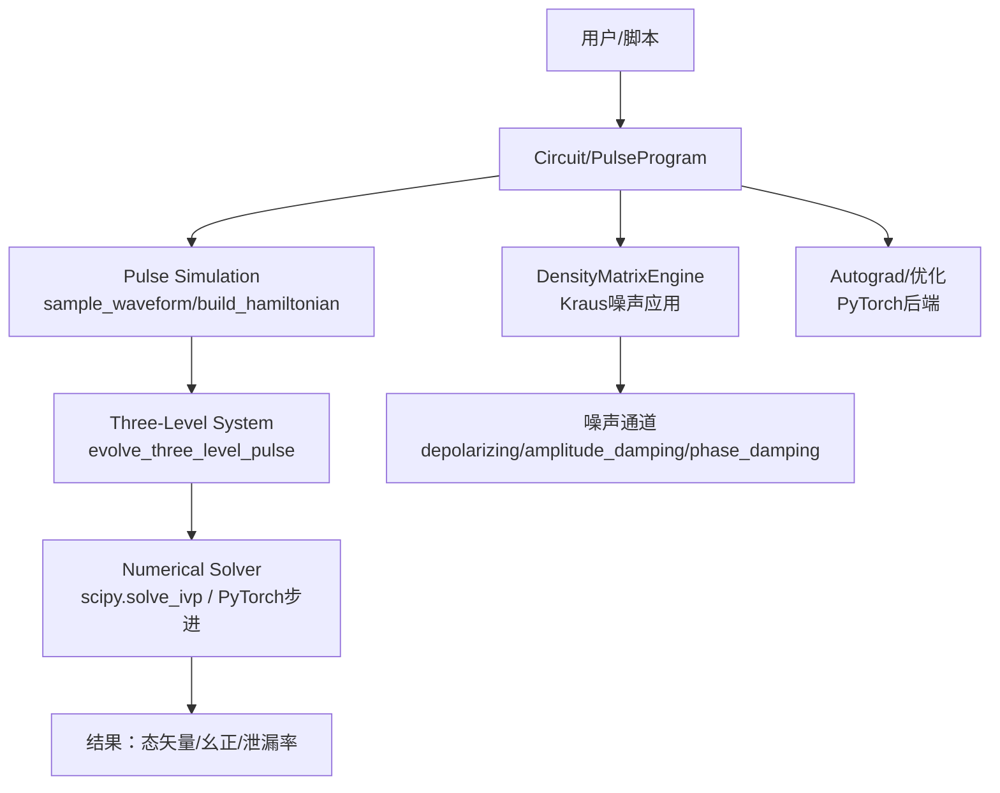
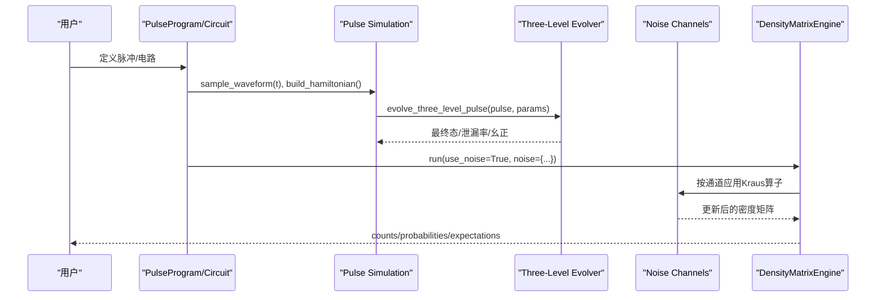
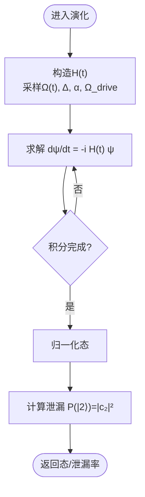
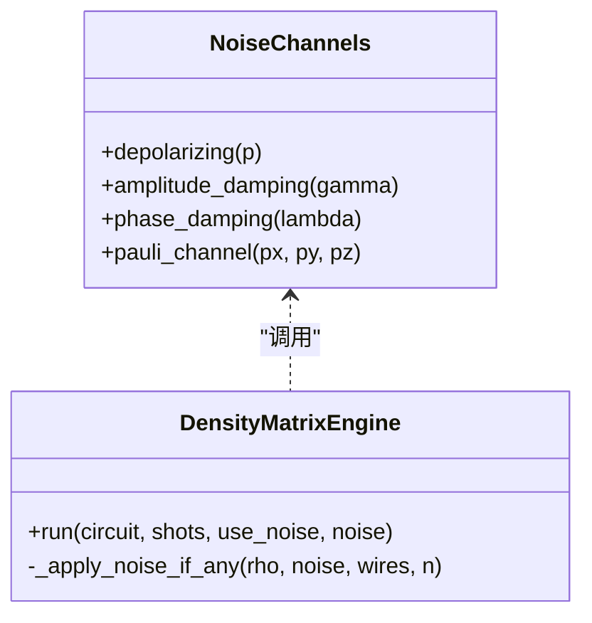
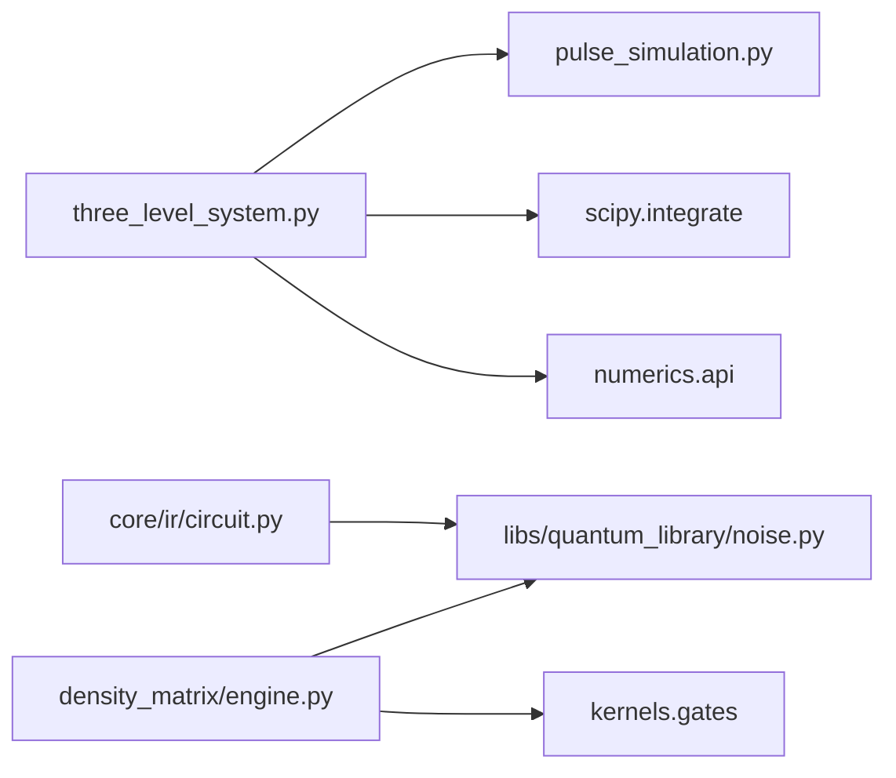

# 物理模型和噪声建模

<cite>
**本文引用的文件**
- [three_level_system.py](file://src/tyxonq/libs/quantum_library/three_level_system.py)
- [pulse_simulation.py](file://src/tyxonq/libs/quantum_library/pulse_simulation.py)
- [noise.py](file://src/tyxonq/libs/quantum_library/noise.py)
- [engine.py](file://src/tyxonq/devices/simulators/density_matrix/engine.py)
- [circuit.py](file://src/tyxonq/core/ir/circuit.py)
- [pytorch_backend.py](file://src/tyxonq/numerics/backends/pytorch_backend.py)
- [pulse_three_level.py](file://examples/pulse_three_level.py)
- [noise_t1_t2_calibration.py](file://examples/noise_t1_t2_calibration.py)
- [test_pulse_autograd.py](file://tests_core_module/test_pulse_autograd.py)
</cite>

## 目录
1. [引言](#引言)
2. [项目结构](#项目结构)
3. [核心组件](#核心组件)
4. [架构总览](#架构总览)
5. [详细组件分析](#详细组件分析)
6. [依赖关系分析](#依赖关系分析)
7. [性能考量](#性能考量)
8. [故障排查指南](#故障排查指南)
9. [结论](#结论)
10. [附录](#附录)

## 引言
本文件面向TyxonQ中三能级系统的物理模型与噪声建模，聚焦以下目标：
- 量子比特的哈密顿量描述、能级结构与跃迁过程（|0⟩↔|1⟩、|1⟩↔|2⟩）
- T1弛豫、T2退相干等噪声渠道的实现原理
- 脉冲演化方程的数值求解方法（含DRAG修正）
- 基于物理模型的脉冲性能评估与优化流程
- 噪声模拟配置选项与参数调优指南
- 实际案例：从脉冲设计到验证的工作流
- 与真实硬件特性的对比分析方法

## 项目结构
围绕三能级系统与噪声建模的关键代码分布在如下模块：
- 三能级系统演化：three_level_system.py
- 脉冲采样与哈密顿量构建：pulse_simulation.py
- 标准噪声通道（Kraus算子）：noise.py
- 密度矩阵引擎（混合态与噪声）：density_matrix/engine.py
- 电路层Kraus接口：core/ir/circuit.py
- 可微后端与梯度支持：numerics/backends/pytorch_backend.py
- 示例与教程：examples/pulse_three_level.py、examples/noise_t1_t2_calibration.py
- 自动微分测试：tests_core_module/test_pulse_autograd.py

图表来源
- [three_level_system.py:72-284](file://src/tyxonq/libs/quantum_library/three_level_system.py#L72-L284)
- [pulse_simulation.py:757-852](file://src/tyxonq/libs/quantum_library/pulse_simulation.py#L757-L852)
- [noise.py:29-200](file://src/tyxonq/libs/quantum_library/noise.py#L29-L200)
- [engine.py:43-167](file://src/tyxonq/devices/simulators/density_matrix/engine.py#L43-L167)

章节来源
- [three_level_system.py:1-65](file://src/tyxonq/libs/quantum_library/three_level_system.py#L1-L65)
- [pulse_simulation.py:757-852](file://src/tyxonq/libs/quantum_library/pulse_simulation.py#L757-L852)
- [noise.py:1-200](file://src/tyxonq/libs/quantum_library/noise.py#L1-L200)
- [engine.py:1-200](file://src/tyxonq/devices/simulators/density_matrix/engine.py#L1-L200)

## 核心组件
- 三能级系统演化：提供时间相关哈密顿量的构造与Schrödinger方程数值求解，支持泄漏到|2⟩的精确建模与DRAG抑制。
- 脉冲采样与哈密顿量：将波形包络转换为瞬时Rabi驱动项，并在旋转波近似下构建3×3哈密顿量。
- 噪声通道：以Kraus算子形式实现退极化、振幅阻尼（T1）、相位阻尼（T2）等，支持密度矩阵精确演化。
- 密度矩阵引擎：统一门操作分发与噪声注入，支持shots采样与期望值计算。
- 可微仿真与优化：通过PyTorch后端保持计算图，支持端到端脉冲参数优化。

章节来源
- [three_level_system.py:72-284](file://src/tyxonq/libs/quantum_library/three_level_system.py#L72-L284)
- [pulse_simulation.py:757-852](file://src/tyxonq/libs/quantum_library/pulse_simulation.py#L757-L852)
- [noise.py:29-200](file://src/tyxonq/libs/quantum_library/noise.py#L29-L200)
- [engine.py:43-167](file://src/tyxonq/devices/simulators/density_matrix/engine.py#L43-L167)
- [pytorch_backend.py:489-522](file://src/tyxonq/numerics/backends/pytorch_backend.py#L489-L522)

## 架构总览
下图展示了从脉冲到三能级演化的完整数据流，以及噪声在密度矩阵路径中的注入点。

图表来源
- [three_level_system.py:184-284](file://src/tyxonq/libs/quantum_library/three_level_system.py#L184-L284)
- [engine.py:43-167](file://src/tyxonq/devices/simulators/density_matrix/engine.py#L43-L167)
- [noise.py:29-200](file://src/tyxonq/libs/quantum_library/noise.py#L29-L200)

## 详细组件分析

### 三能级系统物理模型
- 能级与跃迁：|0⟩为基态，|1⟩为计算态，|2⟩为泄漏态；|0⟩↔|1⟩频率ω₀₁，|1⟩↔|2⟩频率由失谐α决定（通常负失谐）。
- 哈密顿量（旋转框架，RWA）：
  - 对角项：Δ=ω₀₁−ω_d（失谐），Δ+α（|2⟩能级相对|1⟩）
  - 非对角项：Ω(t)/2耦合|0⟩↔|1⟩与|1⟩↔|2⟩（两者均被驱动，导致泄漏路径）
- DRAG修正：对包络添加导数项iβ·dΩ/dt，抑制|1⟩→|2⟩跃迁；最优β≈−1/(2α)。
- 数值求解：
  - scipy.integrate.solve_ivp（RK45自适应步长）
  - PyTorch步进（保留autograd链，用于优化）

图表来源
- [three_level_system.py:184-284](file://src/tyxonq/libs/quantum_library/three_level_system.py#L184-L284)

章节来源
- [three_level_system.py:72-284](file://src/tyxonq/libs/quantum_library/three_level_system.py#L72-L284)
- [three_level_system.py:287-472](file://src/tyxonq/libs/quantum_library/three_level_system.py#L287-L472)
- [three_level_system.py:525-552](file://src/tyxonq/libs/quantum_library/three_level_system.py#L525-L552)

### 脉冲演化与数值方法
- 采样与缩放：
  - 采样波形包络Ω(t)，结合rabi_freq换算为角频率Ω_drive
  - 同时驱动|0⟩↔|1⟩与|1⟩↔|2⟩，体现泄漏路径
- 积分器选择：
  - solve_ivp(RK45)：高精度、自适应步长，适合离线仿真
  - PyTorch步进：可微，便于梯度下降优化
- 输出：
  - 末态向量或3×3幺正矩阵（用于链式调用）
  - 泄漏概率（|2⟩布居）

章节来源
- [three_level_system.py:184-284](file://src/tyxonq/libs/quantum_library/three_level_system.py#L184-L284)
- [three_level_system.py:358-472](file://src/tyxonq/libs/quantum_library/three_level_system.py#L358-L472)

### 噪声渠道与T1/T2建模
- Kraus算子：
  - 退极化：均匀随机Pauli误差
  - 振幅阻尼（T1）：能量耗散|1⟩→|0⟩
  - 相位阻尼（T2）：纯退相干，保持布居但破坏相干性
- 密度矩阵引擎：
  - 在每个门后按需注入噪声通道
  - 支持shots采样与读取校准矩阵
- 近似退相干（态矢量模式）：
  - 将态转密度矩阵，依次应用Kraus算子，再提取近似态矢量（仅弱耦合近似）

图表来源
- [noise.py:29-200](file://src/tyxonq/libs/quantum_library/noise.py#L29-L200)
- [engine.py:196-223](file://src/tyxonq/devices/simulators/density_matrix/engine.py#L196-L223)

章节来源
- [noise.py:29-200](file://src/tyxonq/libs/quantum_library/noise.py#L29-L200)
- [engine.py:43-167](file://src/tyxonq/devices/simulators/density_matrix/engine.py#L43-L167)
- [pulse_simulation.py:757-852](file://src/tyxonq/libs/quantum_library/pulse_simulation.py#L757-L852)

### 可微仿真与脉冲优化
- DifferentiablePulseSimulation封装：
  - 将脉冲参数作为可微张量输入
  - compute_fidelity(target_unitary)返回可微目标函数
- 梯度验证：
  - 自动微分与有限差分一致性检验
- 优化建议：
  - 使用DRAG β参数抑制泄漏
  - 调整幅度、持续时间、σ以平衡速度与保真度

章节来源
- [test_pulse_autograd.py:47-116](file://tests_core_module/test_pulse_autograd.py#L47-L116)
- [pytorch_backend.py:489-522](file://src/tyxonq/numerics/backends/pytorch_backend.py#L489-L522)

### 实际案例与工作流
- 三能级基础与泄漏效应：
  - 比较不同脉冲形状（Constant/Gaussian/DRAG）的泄漏与保真度
- DRAG有效性：
  - 扫描β寻找最小泄漏对应的最优值
- 设备对比：
  - 2-level理想 vs 3-level现实（包含泄漏）
- 多量子比特扩展：
  - 每个量子比特独立参数，泄漏累积效应

章节来源
- [pulse_three_level.py:49-444](file://examples/pulse_three_level.py#L49-L444)

### 噪声校准与参数调优
- T1校准：
  - 制备|1⟩，施加振幅阻尼，拟合指数衰减得到T1
- T2校准：
  - Ramsey序列（H-noise-H），拟合相位衰减得到T2
- 典型参数范围：
  - T1~几十至百微秒，T2≤2T1
  - 门时长与噪声强度关联：γ≈1−exp(−t_gate/T1)

章节来源
- [noise_t1_t2_calibration.py:1-169](file://examples/noise_t1_t2_calibration.py#L1-L169)

### 与真实硬件特性对比分析
- 参数映射：
  - qubit_freq、anharmonicity、T1、T2从标定测量获取
- 工作流：
  - 在仿真中使用标定参数进行三能级演化
  - 对比仿真与实测计数分布/期望值
  - 迭代优化脉冲参数（如β、幅度、时长）直至匹配硬件行为

章节来源
- [pulse_three_level.py:124-235](file://examples/pulse_three_level.py#L124-L235)
- [noise_t1_t2_calibration.py:75-169](file://examples/noise_t1_t2_calibration.py#L75-L169)

## 依赖关系分析
- three_level_system依赖：
  - pulse_simulation.sample_waveform（波形采样）
  - scipy.integrate.solve_ivp（数值积分）
  - numerics.get_backend（数组后端）
- density_matrix.engine依赖：
  - noise.channels（Kraus通道）
  - kernels.gates（门矩阵解析与应用）
- circuit.kraus接口：
  - 提供通用Kraus通道注入能力

图表来源
- [three_level_system.py:161-192](file://src/tyxonq/libs/quantum_library/three_level_system.py#L161-L192)
- [engine.py:17-30](file://src/tyxonq/devices/simulators/density_matrix/engine.py#L17-L30)
- [circuit.py:1279-1304](file://src/tyxonq/core/ir/circuit.py#L1279-L1304)

章节来源
- [three_level_system.py:161-192](file://src/tyxonq/libs/quantum_library/three_level_system.py#L161-L192)
- [engine.py:17-30](file://src/tyxonq/devices/simulators/density_matrix/engine.py#L17-L30)
- [circuit.py:1279-1304](file://src/tyxonq/core/ir/circuit.py#L1279-L1304)

## 性能考量
- 数值积分：
  - RK45自适应步长在精度与速度间平衡；对于快速变化包络需收紧容差
- 维度增长：
  - 3-level系统状态空间更大；多量子比特时3^n维迅速膨胀
- 噪声模拟：
  - 密度矩阵内存O(4^n)，适合中小规模；大规模可用态矢量+近似退相干
- 可微优化：
  - PyTorch后端支持GPU加速与批处理；注意计算图断裂时的回退策略

[本节为一般性指导，不直接分析具体文件]

## 故障排查指南
- 常见错误：
  - 密度矩阵引擎不支持脉冲级op：需改用statevector引擎或将脉冲编译为幺正门
  - 梯度为None：检查计算图是否断裂，必要时回退到有限差分
- 调试建议：
  - 逐步打印中间态范数与泄漏率，确认守恒律
  - 对比不同噪声强度下的结果，定位异常来源

章节来源
- [engine.py:97-102](file://src/tyxonq/devices/simulators/density_matrix/engine.py#L97-L102)
- [pytorch_backend.py:489-522](file://src/tyxonq/numerics/backends/pytorch_backend.py#L489-L522)

## 结论
TyxonQ在三能级系统上提供了完整的物理模型与噪声建模能力：
- 精确刻画|0⟩↔|1⟩与|1⟩↔|2⟩跃迁及泄漏路径
- 支持DRAG等脉冲整形抑制泄漏
- 提供多种噪声渠道与密度矩阵引擎进行混合态演化
- 通过可微仿真实现端到端脉冲优化
- 结合标定参数可与真实硬件行为对齐，形成闭环设计与验证流程

[本节为总结性内容，不直接分析具体文件]

## 附录

### 关键API与用法要点
- 三能级演化：
  - evolve_three_level_pulse：输入波形与物理参数，返回末态与泄漏率
  - compile_three_level_unitary：生成3×3幺正，用于链式调用
- 噪声通道：
  - amplitude_damping_channel、phase_damping_channel、depolarizing_channel
- 密度矩阵引擎：
  - run(circuit, shots, use_noise, noise)：支持噪声注入与采样

章节来源
- [three_level_system.py:72-284](file://src/tyxonq/libs/quantum_library/three_level_system.py#L72-L284)
- [noise.py:29-200](file://src/tyxonq/libs/quantum_library/noise.py#L29-L200)
- [engine.py:43-167](file://src/tyxonq/devices/simulators/density_matrix/engine.py#L43-L167)