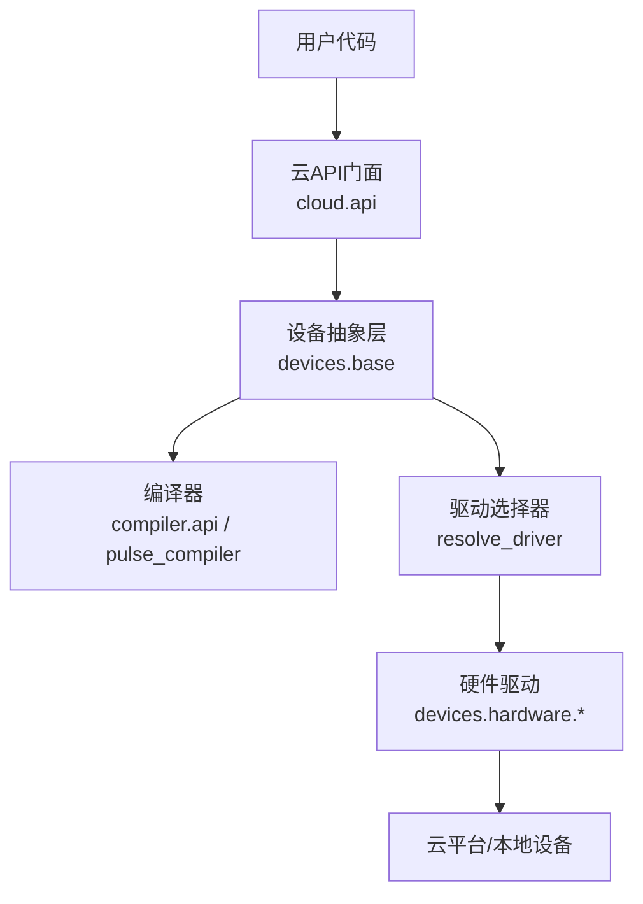
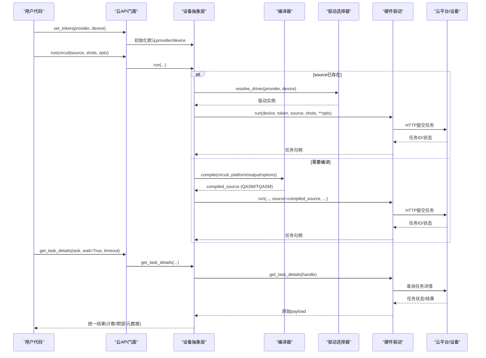
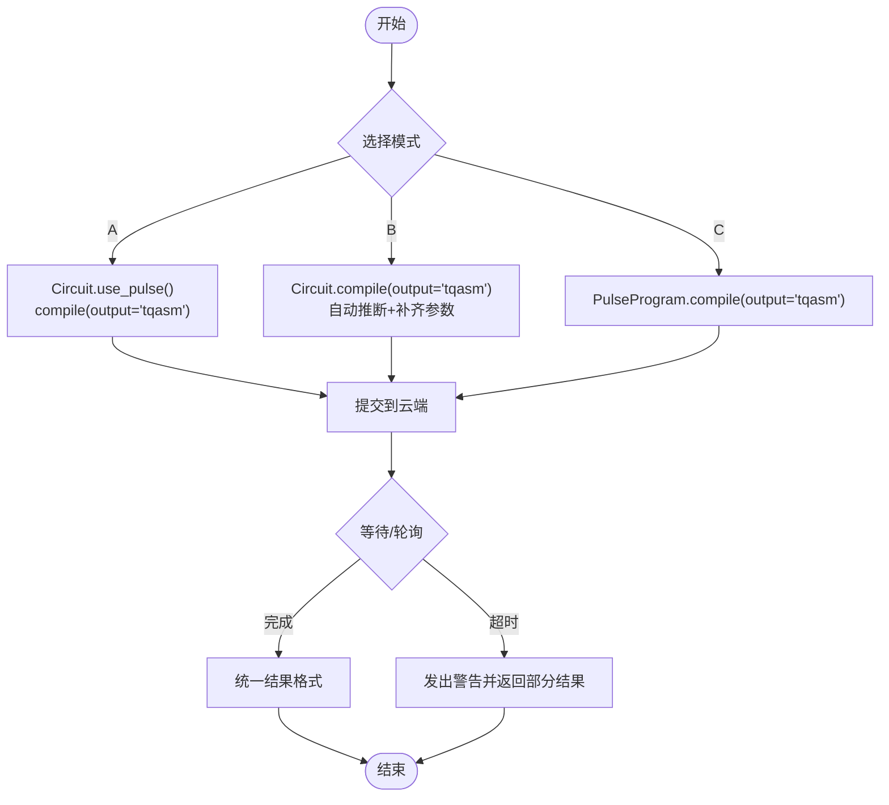
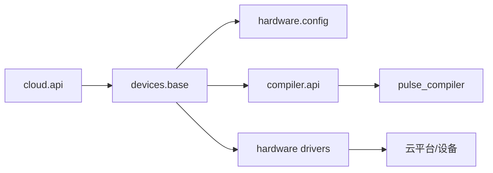

# 硬件部署和执行

<cite>
**本文引用的文件**
- [src/tyxonq/cloud/api.py](file://src/tyxonq/cloud/api.py)
- [src/tyxonq/devices/base.py](file://src/tyxonq/devices/base.py)
- [src/tyxonq/devices/hardware/config.py](file://src/tyxonq/devices/hardware/config.py)
- [src/tyxonq/compiler/api.py](file://src/tyxonq/compiler/api.py)
- [src/tyxonq/compiler/pulse_compiler/__init__.py](file://src/tyxonq/compiler/pulse_compiler/__init__.py)
- [examples/pulse_cloud_submission_e2e.py](file://examples/pulse_cloud_submission_e2e.py)
- [examples/cloud_api_task.py](file://examples/cloud_api_task.py)
- [docs/tyxonq_cloud_api.md](file://docs/tyxonq_cloud_api.md)
- [src/tyxonq/core/errors.py](file://src/tyxonq/core/errors.py)
- [docs/source/cloud_services/task_submission.rst](file://docs/source/cloud_services/task_submission.rst)
- [docs/source/user_guide/core/index.rst](file://docs/source/user_guide/core/index.rst)
- [docs/source/technical_references/performance_optimization.rst](file://docs/source/technical_references/performance_optimization.rst)
- [examples/pulse_calibration_tutorial/step_1_hardware_basics.py](file://examples/pulse_calibration_tutorial/step_1_hardware_basics.py)
</cite>

## 目录
1. [简介](#简介)
2. [项目结构](#项目结构)
3. [核心组件](#核心组件)
4. [架构总览](#架构总览)
5. [详细组件分析](#详细组件分析)
6. [依赖关系分析](#依赖关系分析)
7. [性能考量](#性能考量)
8. [故障排查指南](#故障排查指南)
9. [结论](#结论)
10. [附录](#附录)

## 简介
本文件面向需要在不同量子硬件平台上部署与执行 TyxonQ 脉冲程序的工程师与研究人员，系统说明：
- 云平台 API 的使用方法与认证配置
- 脉冲程序从设计到提交的完整流程与状态监控
- 不同硬件平台的特性与限制
- 结果数据的获取与处理
- 端到端部署示例（门电路→TQASM→云端；直接脉冲→TQASM→云端）
- 硬件特定校准数据与参数的处理
- 错误处理与重试最佳实践
- 批量执行与并行优化策略
- 硬件性能评估与基准测试方法

## 项目结构
TyxonQ 将“云 API 门面”“设备抽象与驱动选择”“编译流水线（含脉冲编译）”“硬件平台驱动”分层组织，便于跨平台统一调用。关键路径如下：
- 云 API 门面：提供 set_token、list_devices、submit_task、get_task_details、run、result、cancel 等统一接口
- 设备抽象：DeviceTask、resolve_driver、run、get_task_details 等统一任务封装与轮询
- 编译器：compile/compile_pulse 负责门级/脉冲级编译输出 QASM/TQASM
- 硬件驱动：按 provider/device 解析并调用具体后端（如 tyxonq、quafu、lqcloud、guodun、ibm 等）

图表来源
- [src/tyxonq/cloud/api.py:22-145](file://src/tyxonq/cloud/api.py#L22-L145)
- [src/tyxonq/devices/base.py:112-258](file://src/tyxonq/devices/base.py#L112-L258)
- [src/tyxonq/compiler/api.py:39-340](file://src/tyxonq/compiler/api.py#L39-L340)
- [src/tyxonq/compiler/pulse_compiler/__init__.py:1-51](file://src/tyxonq/compiler/pulse_compiler/__init__.py#L1-L51)

章节来源
- [src/tyxonq/cloud/api.py:22-145](file://src/tyxonq/cloud/api.py#L22-L145)
- [src/tyxonq/devices/base.py:112-258](file://src/tyxonq/devices/base.py#L112-L258)
- [src/tyxonq/compiler/api.py:39-340](file://src/tyxonq/compiler/api.py#L39-L340)
- [src/tyxonq/compiler/pulse_compiler/__init__.py:1-51](file://src/tyxonq/compiler/pulse_compiler/__init__.py#L1-L51)

## 核心组件
- 云 API 门面
  - 统一入口：set_token、set_default、device、list_devices、submit_task、get_task_details、run、result、cancel
  - 内部委托至 devices.base.run 与 get_task_details，屏蔽底层差异
- 设备抽象与任务封装
  - DeviceTask：统一包装异步/同步任务句柄，提供 get_result/cancel
  - run：统一选择驱动、注入噪声（仅模拟器）、标准化 shots、返回统一任务列表
  - get_task_details：统一轮询与结果格式归一化，支持 wait/timeout/poll_interval
- 编译器
  - compile：门级/脉冲级统一编译入口，自动推断脉冲模式、补齐 device_params、设置 inline_pulses
  - compile_pulse：PulseProgram 专用编译入口，输出 TQASM/OpenQASM3/Pulse IR
- 硬件配置与认证
  - config.set_token/get_token：内存令牌管理，支持 provider/device 粒度与环境变量回退
  - ENDPOINTS：云平台基础地址与版本

章节来源
- [src/tyxonq/cloud/api.py:22-145](file://src/tyxonq/cloud/api.py#L22-L145)
- [src/tyxonq/devices/base.py:12-57](file://src/tyxonq/devices/base.py#L12-L57)
- [src/tyxonq/devices/base.py:294-445](file://src/tyxonq/devices/base.py#L294-L445)
- [src/tyxonq/devices/base.py:497-557](file://src/tyxonq/devices/base.py#L497-L557)
- [src/tyxonq/compiler/api.py:39-340](file://src/tyxonq/compiler/api.py#L39-L340)
- [src/tyxonq/compiler/api.py:343-463](file://src/tyxonq/compiler/api.py#L343-L463)
- [src/tyxonq/devices/hardware/config.py:24-50](file://src/tyxonq/devices/hardware/config.py#L24-L50)
- [src/tyxonq/devices/hardware/config.py:11-19](file://src/tyxonq/devices/hardware/config.py#L11-L19)

## 架构总览
下图展示从用户代码到硬件执行的端到端数据流与控制流，包括认证、编译、提交、轮询与结果归一化。

图表来源
- [src/tyxonq/cloud/api.py:42-131](file://src/tyxonq/cloud/api.py#L42-L131)
- [src/tyxonq/devices/base.py:294-445](file://src/tyxonq/devices/base.py#L294-L445)
- [src/tyxonq/devices/base.py:497-557](file://src/tyxonq/devices/base.py#L497-L557)
- [src/tyxonq/compiler/api.py:39-340](file://src/tyxonq/compiler/api.py#L39-L340)
- [docs/tyxonq_cloud_api.md:91-258](file://docs/tyxonq_cloud_api.md#L91-L258)

## 详细组件分析

### 云平台 API 与认证配置
- 认证方式
  - 通过 set_token 设置 provider/device 粒度的令牌；也可通过环境变量 TYXONQ_API_KEY 回退
  - 默认 provider 为 tyxonq，默认设备为 tyxonq::simulator:mps
- 设备发现
  - list_devices 聚合模拟器与硬件设备列表，供上层选择
- 任务提交与查询
  - submit_task/run 统一委托 devices.base.run
  - get_task_details 支持 wait/timeout/poll_interval，并统一结果格式

章节来源
- [src/tyxonq/devices/hardware/config.py:24-50](file://src/tyxonq/devices/hardware/config.py#L24-L50)
- [src/tyxonq/devices/hardware/config.py:53-65](file://src/tyxonq/devices/hardware/config.py#L53-L65)
- [src/tyxonq/devices/base.py:475-493](file://src/tyxonq/devices/base.py#L475-L493)
- [src/tyxonq/cloud/api.py:22-72](file://src/tyxonq/cloud/api.py#L22-L72)

### 脉冲程序提交流程与状态监控
- 三种典型模式
  - 模式A：门电路 + use_pulse() → 显式启用脉冲编译 → 编译为 TQASM → 提交
  - 模式B：门电路 → 智能推断 output="tqasm" → 自动启用脉冲编译并补齐 device_params → 提交
  - 模式C：PulseProgram → compile(output="tqasm") → 提交
- 关键选项
  - inline_pulses：云端提交建议开启以生成完整 defcal 定义
  - supported_waveforms：限制波形集合（如 drag/gaussian/constant）
- 状态监控
  - get_task_details 支持 wait=True 轮询直至完成或超时，返回统一结构（result/result_meta/uni_status/error）

图表来源
- [examples/pulse_cloud_submission_e2e.py:99-279](file://examples/pulse_cloud_submission_e2e.py#L99-L279)
- [examples/pulse_cloud_submission_e2e.py:286-420](file://examples/pulse_cloud_submission_e2e.py#L286-L420)
- [examples/pulse_cloud_submission_e2e.py:427-635](file://examples/pulse_cloud_submission_e2e.py#L427-L635)
- [src/tyxonq/compiler/api.py:207-291](file://src/tyxonq/compiler/api.py#L207-L291)
- [src/tyxonq/devices/base.py:497-557](file://src/tyxonq/devices/base.py#L497-L557)

章节来源
- [examples/pulse_cloud_submission_e2e.py:99-279](file://examples/pulse_cloud_submission_e2e.py#L99-L279)
- [examples/pulse_cloud_submission_e2e.py:286-420](file://examples/pulse_cloud_submission_e2e.py#L286-L420)
- [examples/pulse_cloud_submission_e2e.py:427-635](file://examples/pulse_cloud_submission_e2e.py#L427-L635)
- [src/tyxonq/compiler/api.py:207-291](file://src/tyxonq/compiler/api.py#L207-L291)
- [src/tyxonq/devices/base.py:497-557](file://src/tyxonq/devices/base.py#L497-L557)

### 不同硬件平台的特性与限制
- 平台支持
  - 通过 resolve_driver 支持 simulator/local、tyxonq、ibm、qcos、quafu、lqcloud、guodun
- 平台方言与输出
  - homebrew_s2：门电路强制 qasm2；脉冲电路强制 tyxonq_homebrew_tqasm
  - lqcloud：IR→SDK QuantumCircuit（无文本中间层）
  - guodun：QCIS 原生基固定，内部强制 matchgate+rotations 分解
- 拓扑与路由
  - DeviceRule 携带 coupling_map/initial_layout/num_qubits 供编译器路由使用
- 当前硬件限制（示例）
  - 单比特 defcal 可自定义；双比特门由硬件预定义，用户不可自定义

章节来源
- [src/tyxonq/devices/base.py:146-258](file://src/tyxonq/devices/base.py#L146-L258)
- [src/tyxonq/compiler/api.py:169-186](file://src/tyxonq/compiler/api.py#L169-L186)
- [src/tyxonq/compiler/api.py:292-323](file://src/tyxonq/compiler/api.py#L292-L323)
- [src/tyxonq/devices/base.py:60-83](file://src/tyxonq/devices/base.py#L60-L83)
- [examples/pulse_cloud_submission_e2e.py:33-38](file://examples/pulse_cloud_submission_e2e.py#L33-L38)

### 结果数据的获取与处理
- 统一任务句柄
  - DeviceTask.get_result 会提升嵌套 metadata 字段，确保 probabilities/expectations 键存在
- 统一结果格式
  - result：计数字典
  - result_meta：原始驱动 payload
  - uni_status：统一状态字符串
  - error：错误信息
- 云端 API 文档
  - 任务提交/详情/列表的 JSON 结构与字段说明

章节来源
- [src/tyxonq/devices/base.py:12-57](file://src/tyxonq/devices/base.py#L12-L57)
- [src/tyxonq/devices/base.py:497-557](file://src/tyxonq/devices/base.py#L497-L557)
- [docs/tyxonq_cloud_api.md:91-258](file://docs/tyxonq_cloud_api.md#L91-L258)

### 端到端部署示例（从脉冲设计到硬件执行）
- 模式A（推荐）：Circuit.h(0).use_pulse(...).device(...).run(...)
- 模式B（便捷）：Circuit.h(0).device(...).run(...) 自动推断
- 模式C（底层）：PulseProgram.drag(...).device(...).run(...)
- 云端验证：set_token → list_devices → submit_task → get_task_details

章节来源
- [examples/pulse_cloud_submission_e2e.py:99-279](file://examples/pulse_cloud_submission_e2e.py#L99-L279)
- [examples/pulse_cloud_submission_e2e.py:286-420](file://examples/pulse_cloud_submission_e2e.py#L286-L420)
- [examples/pulse_cloud_submission_e2e.py:427-635](file://examples/pulse_cloud_submission_e2e.py#L427-L635)
- [examples/cloud_api_task.py:30-59](file://examples/cloud_api_task.py#L30-L59)

### 硬件特定的校准数据与参数处理
- 关键参数
  - qubit_freq、anharmonicity、T1、T2、coupling_map
- 自动补齐与提示
  - 未提供 device_params 时自动补齐默认测试值并告警
  - 建议通过 use_pulse(device_params={...}) 传入真实设备参数
- 校准工作流参考
  - 教程 step_1_hardware_basics.py 展示了三能级模型、Rabi 旋转、脉冲类型对比与第一个脉冲程序构建

章节来源
- [src/tyxonq/compiler/api.py:247-262](file://src/tyxonq/compiler/api.py#L247-L262)
- [examples/pulse_cloud_submission_e2e.py:137-150](file://examples/pulse_cloud_submission_e2e.py#L137-L150)
- [examples/pulse_calibration_tutorial/step_1_hardware_basics.py:163-192](file://examples/pulse_calibration_tutorial/step_1_hardware_basics.py#L163-L192)
- [examples/pulse_calibration_tutorial/step_1_hardware_basics.py:333-356](file://examples/pulse_calibration_tutorial/step_1_hardware_basics.py#L333-L356)

### 错误处理与重试机制最佳实践
- 异常体系
  - TyxonQError 及其子类（CompilationError、DeviceExecutionError、ValidationError 等）
- 任务轮询与超时
  - get_task_details 在等待超时时发出 RuntimeWarning，返回可能不完整结果，便于区分网络/排队问题与编译错误
- 云端提交重试
  - 建议封装重试逻辑：捕获异常、检查任务状态、指数退避重试、最终失败抛出明确错误

章节来源
- [src/tyxonq/core/errors.py:1-17](file://src/tyxonq/core/errors.py#L1-L17)
- [src/tyxonq/devices/base.py:531-551](file://src/tyxonq/devices/base.py#L531-L551)
- [docs/source/cloud_services/task_submission.rst:447-547](file://docs/source/cloud_services/task_submission.rst#L447-L547)
- [docs/source/user_guide/core/index.rst:261-308](file://docs/source/user_guide/core/index.rst#L261-L308)

### 批量执行与并行处理优化策略
- 批量化
  - run 支持 circuit 列表与 shots 列表对齐，顺序保持提交与收集
- 并行策略
  - 线程池并行多初始点搜索
  - 批处理梯度计算（分块）
  - 模拟器 shot 级多线程（OMP_NUM_THREADS）
- 内存与缓存
  - 批次间清理内存；化学模块缓存清除

章节来源
- [src/tyxonq/devices/base.py:392-434](file://src/tyxonq/devices/base.py#L392-L434)
- [docs/source/technical_references/performance_optimization.rst:300-360](file://docs/source/technical_references/performance_optimization.rst#L300-L360)
- [docs/source/examples/optimization_examples.rst:478-536](file://docs/source/examples/optimization_examples.rst#L478-L536)

### 硬件性能评估与基准测试
- 指标
  - 单次运行时间、平均运行时间、标准差、结果一致性
- 方法
  - 首次运行包含编译开销，后续运行仅执行；多次试验取均值与方差
  - 对比不同优化级别/后端/批大小对性能的影响
- 回归测试
  - 定期运行基准用例，保证性能退化不超过阈值

章节来源
- [examples/performance_layerwise_optimization.py:187-299](file://examples/performance_layerwise_optimization.py#L187-L299)
- [docs/source/technical_references/performance_leadership.rst:546-582](file://docs/source/technical_references/performance_leadership.rst#L546-L582)

## 依赖关系分析
- 组件耦合
  - cloud.api 依赖 devices.base 与 hardware.config
  - devices.base 依赖 compiler.api（当需要编译时）与各硬件驱动
  - compiler.api 依赖 pulse_compiler 与平台编译器（tyxonq/lqcloud/guodun）
- 外部依赖
  - 云平台 HTTP 接口（认证头、JSON 请求/响应）
  - 可选第三方 SDK（如 IBM、Quafu、LQCloud）

图表来源
- [src/tyxonq/cloud/api.py:22-145](file://src/tyxonq/cloud/api.py#L22-L145)
- [src/tyxonq/devices/base.py:146-258](file://src/tyxonq/devices/base.py#L146-L258)
- [src/tyxonq/compiler/api.py:39-340](file://src/tyxonq/compiler/api.py#L39-L340)
- [src/tyxonq/compiler/pulse_compiler/__init__.py:1-51](file://src/tyxonq/compiler/pulse_compiler/__init__.py#L1-L51)

章节来源
- [src/tyxonq/cloud/api.py:22-145](file://src/tyxonq/cloud/api.py#L22-L145)
- [src/tyxonq/devices/base.py:146-258](file://src/tyxonq/devices/base.py#L146-L258)
- [src/tyxonq/compiler/api.py:39-340](file://src/tyxonq/compiler/api.py#L39-L340)
- [src/tyxonq/compiler/pulse_compiler/__init__.py:1-51](file://src/tyxonq/compiler/pulse_compiler/__init__.py#L1-L51)

## 性能考量
- 编译阶段
  - 合理设置 optimization_level、simplify、route、basis_gates
  - 脉冲编译时选择合适的 supported_waveforms 与 inline_pulses
- 执行阶段
  - 批处理与并行：batch_run、线程池、shot 级多线程
  - 内存管理：批次间清理、缓存清除
- 云平台
  - 使用设备优化标志（如 o=7）减少深度与映射开销
  - 合理设置 prior、group、remarks 便于队列管理与追踪

[本节为通用指导，不直接分析具体文件]

## 故障排查指南
- 常见问题定位
  - 提交失败：检查设备状态、电路合法性、优化标志组合
  - 执行失败：根据错误信息判断是否 qubits/depth/timeout 问题
  - 超时：增大 timeout、简化电路或提高优化等级
- 诊断步骤
  - 使用 list_devices 确认设备可用
  - 使用 get_task_details 查看 uni_status 与 error
  - 结合异常层次捕获具体错误类型

章节来源
- [docs/source/cloud_services/task_submission.rst:447-547](file://docs/source/cloud_services/task_submission.rst#L447-L547)
- [src/tyxonq/devices/base.py:531-557](file://src/tyxonq/devices/base.py#L531-L557)
- [docs/source/user_guide/core/index.rst:261-308](file://docs/source/user_guide/core/index.rst#L261-L308)

## 结论
TyxonQ 提供了从门级到脉冲级的统一编译与执行框架，配合云平台 API 与设备抽象层，实现跨硬件平台的无缝部署。通过智能推断、参数补齐、统一任务轮询与结果归一化，显著降低多平台集成复杂度。结合批处理、并行与性能基准工具，可在保证正确性的同时获得高效执行。

[本节为总结性内容，不直接分析具体文件]

## 附录
- 快速上手清单
  - 设置令牌：export TYXONQ_API_KEY=... 或 tq.set_token(...)
  - 列出设备：tq.api.list_devices(provider="tyxonq")
  - 提交任务：c.device(provider="tyxonq", device="homebrew_s2").run(shots=...)
  - 查询结果：tq.api.get_task_details(task, wait=True, timeout=...)
- 参考示例
  - 云端任务示例：examples/cloud_api_task.py
  - 端到端脉冲提交：examples/pulse_cloud_submission_e2e.py
  - 硬件基础与校准：examples/pulse_calibration_tutorial/step_1_hardware_basics.py

章节来源
- [examples/cloud_api_task.py:30-59](file://examples/cloud_api_task.py#L30-L59)
- [examples/pulse_cloud_submission_e2e.py:99-279](file://examples/pulse_cloud_submission_e2e.py#L99-L279)
- [examples/pulse_calibration_tutorial/step_1_hardware_basics.py:163-192](file://examples/pulse_calibration_tutorial/step_1_hardware_basics.py#L163-L192)