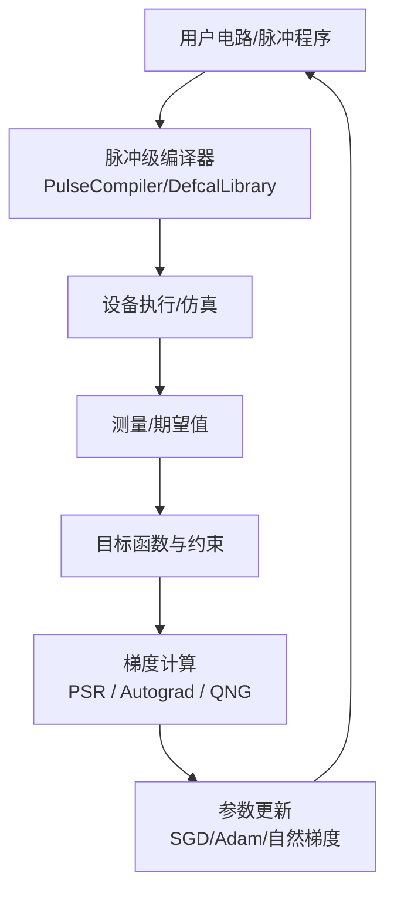
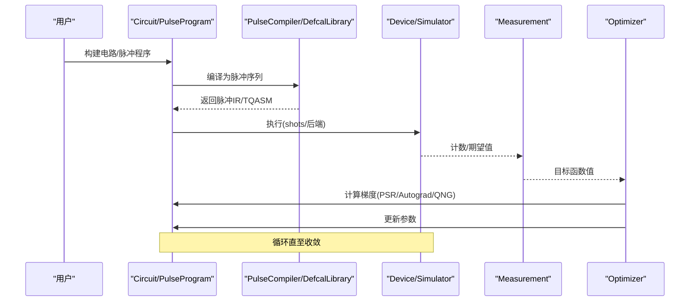
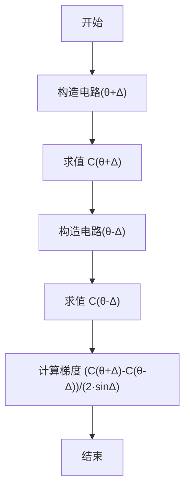
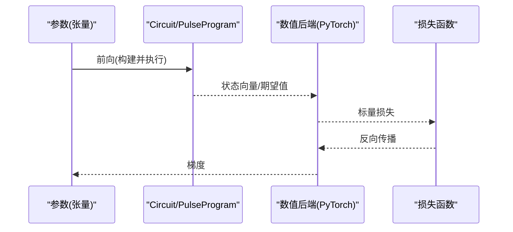
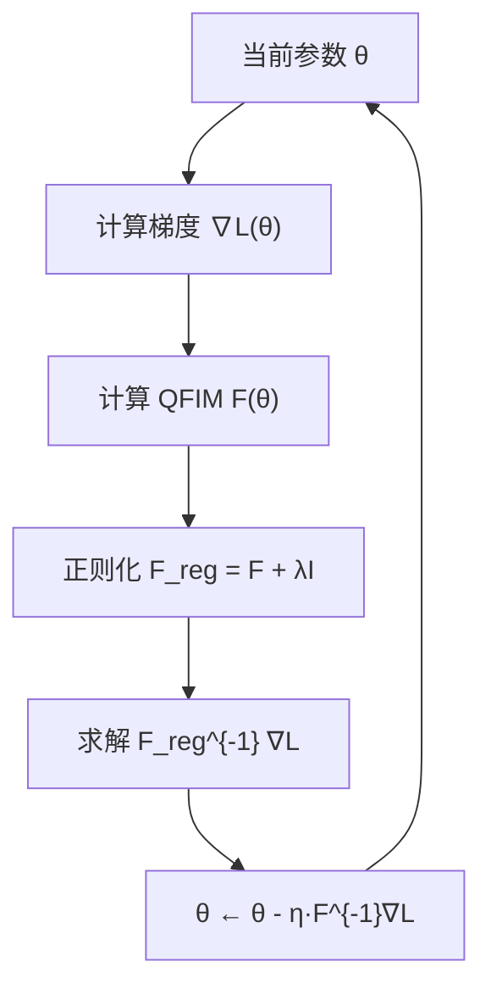
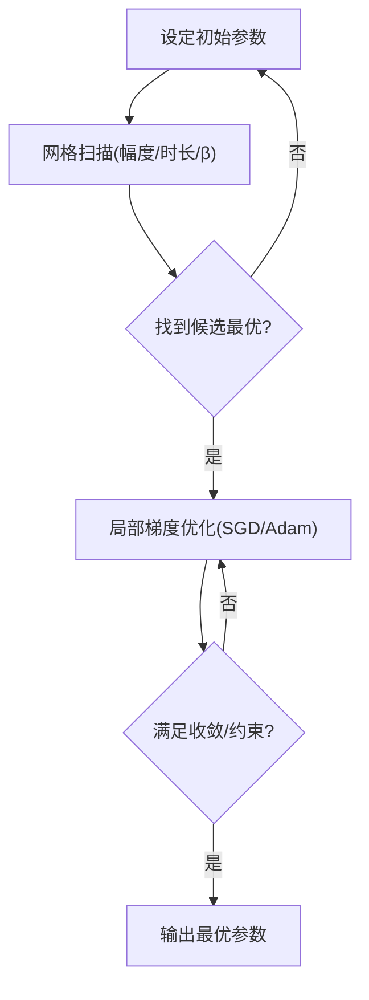
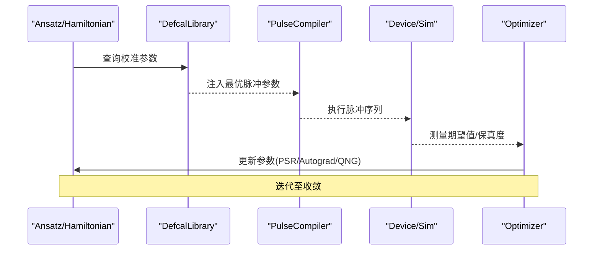
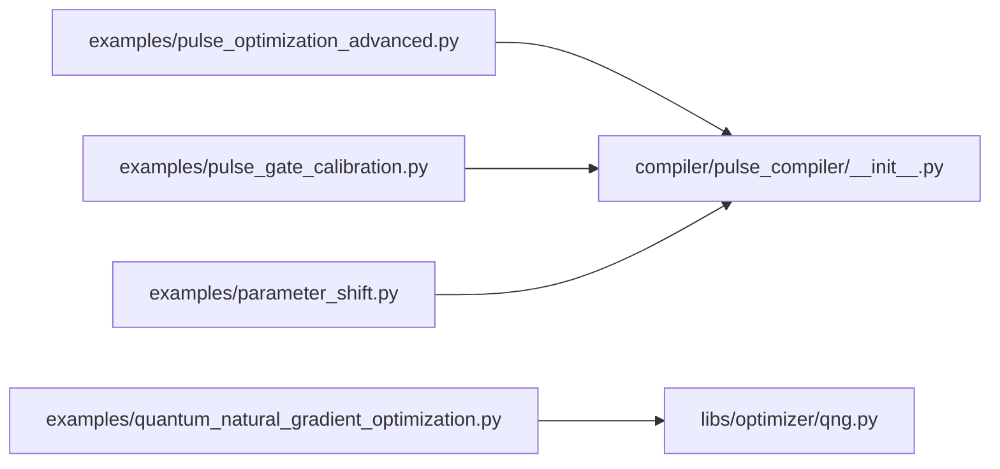

# 脉冲优化和变分算法

<cite>
**本文引用的文件**
- [examples/pulse_optimization_advanced.py](file://examples/pulse_optimization_advanced.py)
- [examples/pulse_variational_algorithms.py](file://examples/pulse_variational_algorithms.py)
- [examples/pulse_gate_calibration.py](file://examples/pulse_gate_calibration.py)
- [examples/parameter_shift.py](file://examples/parameter_shift.py)
- [examples/quantum_natural_gradient_optimization.py](file://examples/quantum_natural_gradient_optimization.py)
- [src/tyxonq/compiler/pulse_compiler/__init__.py](file://src/tyxonq/compiler/pulse_compiler/__init__.py)
- [src/tyxonq/libs/optimizer/qng.py](file://src/tyxonq/libs/optimizer/qng.py)
</cite>

## 目录
1. [简介](#简介)
2. [项目结构](#项目结构)
3. [核心组件](#核心组件)
4. [架构总览](#架构总览)
5. [详细组件分析](#详细组件分析)
6. [依赖关系分析](#依赖关系分析)
7. [性能考量](#性能考量)
8. [故障排查指南](#故障排查指南)
9. [结论](#结论)
10. [附录](#附录)

## 简介
本文件面向希望在 TyxonQ 中开展“基于 PyTorch 自动微分的变分脉冲优化”的读者，系统阐述：
- 梯度计算与优化算法选择（参数平移法、自动微分、量子自然梯度）
- 脉冲参数的初始化与搜索策略（网格扫描、局部优化、约束处理）
- 目标函数设计与约束设置（保真度、泄漏抑制、物理边界）
- 完整的变分优化工作流示例（从电路到脉冲再到硬件执行）
- 与量子化学应用的结合方式（VQE/QAOA 等）
- 性能基准测试与结果分析方法
- 常见优化问题的诊断与解决方案
- 真实硬件上的校准与优化流程
- 可视化与报告生成建议

## 项目结构
围绕脉冲优化与变分算法，仓库提供了从示例到编译器的完整链路：
- 示例层：涵盖参数平移、自动微分、单/双量子比特门优化、变分算法（VQE/QAOA）、量子自然梯度等
- 编译器层：脉冲级编译入口与 DefcalLibrary 支持，将逻辑门映射为可执行的脉冲序列
- 优化器层：提供 QNG 等高级优化方法

图表来源
- [src/tyxonq/compiler/pulse_compiler/__init__.py:1-51](file://src/tyxonq/compiler/pulse_compiler/__init__.py#L1-L51)
- [examples/pulse_gate_calibration.py:102-160](file://examples/pulse_gate_calibration.py#L102-L160)
- [examples/parameter_shift.py:23-76](file://examples/parameter_shift.py#L23-L76)
- [examples/quantum_natural_gradient_optimization.py:168-316](file://examples/quantum_natural_gradient_optimization.py#L168-L316)

章节来源
- [src/tyxonq/compiler/pulse_compiler/__init__.py:1-51](file://src/tyxonq/compiler/pulse_compiler/__init__.py#L1-L51)

## 核心组件
- 脉冲级编译与 Defcal 库：将逻辑门转换为具体脉冲序列，并支持按硬件校准的参数注入
- 梯度计算工具：参数平移法（PSR）、PyTorch 自动微分、量子自然梯度（QNG）
- 变分算法集成：VQE/QAOA 与脉冲级优化的结合，提升保真度与收敛速度
- 校准与优化示例：DRAG 参数调优、Virtual-Z 优化、CX 门 Cross-Resonance 参数优化、参数扫描

章节来源
- [examples/pulse_optimization_advanced.py:42-114](file://examples/pulse_optimization_advanced.py#L42-L114)
- [examples/pulse_gate_calibration.py:43-99](file://examples/pulse_gate_calibration.py#L43-L99)
- [examples/pulse_gate_calibration.py:102-160](file://examples/pulse_gate_calibration.py#L102-L160)
- [examples/pulse_gate_calibration.py:163-222](file://examples/pulse_gate_calibration.py#L163-L222)
- [examples/pulse_variational_algorithms.py:316-387](file://examples/pulse_variational_algorithms.py#L316-L387)
- [examples/quantum_natural_gradient_optimization.py:168-316](file://examples/quantum_natural_gradient_optimization.py#L168-L316)

## 架构总览
TyxonQ 的变分脉冲优化采用“电路→脉冲→执行→测量→梯度→更新”的闭环。关键路径如下：
- 构建电路或脉冲程序，定义目标函数（如保真度、能量期望）
- 通过 PulseCompiler/DefcalLibrary 将逻辑门映射为脉冲序列
- 在仿真或真实设备上执行，获取测量结果
- 使用 PSR/Autograd/QNG 计算梯度
- 用 SGD/Adam/自然梯度更新参数，迭代至收敛

图表来源
- [src/tyxonq/compiler/pulse_compiler/__init__.py:1-51](file://src/tyxonq/compiler/pulse_compiler/__init__.py#L1-L51)
- [examples/pulse_gate_calibration.py:102-160](file://examples/pulse_gate_calibration.py#L102-L160)
- [examples/parameter_shift.py:23-76](file://examples/parameter_shift.py#L23-L76)
- [examples/quantum_natural_gradient_optimization.py:168-316](file://examples/quantum_natural_gradient_optimization.py#L168-L316)

## 详细组件分析

### 梯度计算：参数平移法（PSR）
- 原理：对含参旋转门，利用对称偏移评估代价函数差商得到解析梯度
- 适用性：通用、无需模型假设、可与硬件兼容
- 复杂度：每个参数需两次电路求值，整体 O(n)
- 实现要点：选择合适的偏移量（如 π/2），注意噪声影响

图表来源
- [examples/pulse_optimization_advanced.py:46-114](file://examples/pulse_optimization_advanced.py#L46-L114)
- [examples/parameter_shift.py:23-76](file://examples/parameter_shift.py#L23-L76)

章节来源
- [examples/pulse_optimization_advanced.py:46-114](file://examples/pulse_optimization_advanced.py#L46-L114)
- [examples/parameter_shift.py:23-76](file://examples/parameter_shift.py#L23-L76)

### 梯度计算：PyTorch 自动微分（Autograd）
- 优势：一次反向传播获得全部参数梯度，数值精度高，代码简洁
- 集成方式：将脉冲参数作为可微张量，通过 TyxonQ 的数值后端与 PyTorch 对接
- 注意事项：确保后端支持自动微分；注意复数与实部提取

图表来源
- [examples/pulse_optimization_advanced.py:121-203](file://examples/pulse_optimization_advanced.py#L121-L203)

章节来源
- [examples/pulse_optimization_advanced.py:121-203](file://examples/pulse_optimization_advanced.py#L121-L203)

### 梯度计算：量子自然梯度（QNG）
- 思想：用量子 Fisher 信息矩阵（QFIM）预条件梯度，考虑量子态空间几何
- 效果：通常更快收敛、对参数化不敏感
- 成本：QFI 矩阵求逆 O(P^3)，适合中小规模参数

图表来源
- [examples/quantum_natural_gradient_optimization.py:230-316](file://examples/quantum_natural_gradient_optimization.py#L230-L316)
- [src/tyxonq/libs/optimizer/qng.py](file://src/tyxonq/libs/optimizer/qng.py)

章节来源
- [examples/quantum_natural_gradient_optimization.py:168-316](file://examples/quantum_natural_gradient_optimization.py#L168-L316)
- [src/tyxonq/libs/optimizer/qng.py](file://src/tyxonq/libs/optimizer/qng.py)

### 脉冲参数初始化与搜索策略
- 初始化：基于先验经验（如 DRAG β≈0.2）、Rabi 表征、频率失谐估计
- 粗搜：网格扫描幅度/持续时间/β，快速定位高保真区域
- 细调：梯度下降/Adam 进行局部优化
- 约束：物理边界（幅度上限、时长限制）、泄漏抑制（β 范围）、耦合强度限制

图表来源
- [examples/pulse_optimization_advanced.py:384-453](file://examples/pulse_optimization_advanced.py#L384-L453)
- [examples/pulse_gate_calibration.py:225-277](file://examples/pulse_gate_calibration.py#L225-L277)

章节来源
- [examples/pulse_optimization_advanced.py:384-453](file://examples/pulse_optimization_advanced.py#L384-L453)
- [examples/pulse_gate_calibration.py:225-277](file://examples/pulse_gate_calibration.py#L225-L277)

### 目标函数设计与约束设置
- 目标函数：常用保真度（|⟨ψ_target|ψ⟩|^2）、能量期望 ⟨H⟩、泄漏率惩罚项
- 约束：幅度/时长/相位边界、DRAG β 范围、耦合强度上限、时间预算
- 多目标：保真度与泄漏的权衡、速度与精度的折中

章节来源
- [examples/pulse_optimization_advanced.py:460-548](file://examples/pulse_optimization_advanced.py#L460-L548)
- [examples/pulse_gate_calibration.py:43-99](file://examples/pulse_gate_calibration.py#L43-L99)
- [examples/pulse_gate_calibration.py:163-222](file://examples/pulse_gate_calibration.py#L163-L222)

### 完整变分优化工作流示例（VQE/QAOA + 脉冲优化）
- 步骤概览：
  1) 设计 Ansatz（HEA/UCC/QAOA 层）
  2) 构建 Hamiltonian（分子/问题哈密顿量）
  3) 编译为脉冲（GateToPulsePass + DefcalLibrary）
  4) 执行测量，计算期望值
  5) 梯度更新（PSR/Autograd/QNG）
  6) 收敛判定与结果分析
- 收益：脉冲级优化可显著提升门保真度，加速收敛，降低最终误差

图表来源
- [examples/pulse_variational_algorithms.py:316-387](file://examples/pulse_variational_algorithms.py#L316-L387)
- [src/tyxonq/compiler/pulse_compiler/__init__.py:1-51](file://src/tyxonq/compiler/pulse_compiler/__init__.py#L1-L51)

章节来源
- [examples/pulse_variational_algorithms.py:316-387](file://examples/pulse_variational_algorithms.py#L316-L387)

### 与量子化学应用的结合
- VQE：用于分子基态能量求解，结合脉冲优化提升 H/CX 门保真度
- QAOA：组合优化问题近似解，浅层电路更易在 NISQ 上实现
- 混合策略：仅对关键双量子比特门进行脉冲优化，平衡性能与成本

章节来源
- [examples/pulse_variational_algorithms.py:43-112](file://examples/pulse_variational_algorithms.py#L43-L112)
- [examples/pulse_variational_algorithms.py:229-309](file://examples/pulse_variational_algorithms.py#L229-L309)
- [examples/pulse_variational_algorithms.py:391-465](file://examples/pulse_variational_algorithms.py#L391-L465)

### 性能基准测试与结果分析
- 指标：每步耗时、收敛迭代次数、最终能量误差、近似比（QAOA）
- 对比：标准梯度 vs 量子自然梯度；无 Defcal vs 有 Defcal
- 方法：记录能量历史、参数历史、时间统计，绘制收敛曲线

章节来源
- [examples/quantum_natural_gradient_optimization.py:321-390](file://examples/quantum_natural_gradient_optimization.py#L321-L390)
- [examples/pulse_variational_algorithms.py:469-536](file://examples/pulse_variational_algorithms.py#L469-L536)

### 真实硬件上的校准与优化
- 单比特门：DRAG β 调优，抑制泄漏
- Virtual-Z：零时间 Z 旋转，减少门时间
- 双比特门：Cross-Resonance 参数优化（幅度、时长、耦合强度）
- 导出校准：将优化后的 defcal 导出为 TQASM，供设备直接使用

章节来源
- [examples/pulse_gate_calibration.py:43-99](file://examples/pulse_gate_calibration.py#L43-L99)
- [examples/pulse_gate_calibration.py:102-160](file://examples/pulse_gate_calibration.py#L102-L160)
- [examples/pulse_gate_calibration.py:163-222](file://examples/pulse_gate_calibration.py#L163-L222)
- [examples/pulse_gate_calibration.py:280-327](file://examples/pulse_gate_calibration.py#L280-L327)

### 可视化与报告生成
- 可视化建议：
  - 收敛曲线（能量/保真度 vs 迭代）
  - 参数轨迹（幅度/β/时长演化）
  - 脉冲波形（DRAG/Gaussian/Constant 对比）
  - 保真度热力图（网格搜索结果）
- 报告内容：
  - 实验配置（后端、shots、设备参数）
  - 优化过程（方法、学习率、正则化）
  - 结果分析（收敛性、稳定性、硬件差异）
  - 可复现实验脚本与数据

[本节为概念性指导，不直接分析具体文件]

## 依赖关系分析
- 脉冲编译器模块提供 PulseCompiler 与 DefcalLibrary 的懒加载入口，避免循环依赖
- 优化器模块暴露 QNG 等接口，供示例调用
- 示例文件通过 TyxonQ 的 Circuit/PulseProgram 与后端交互，完成端到端流程

图表来源
- [src/tyxonq/compiler/pulse_compiler/__init__.py:1-51](file://src/tyxonq/compiler/pulse_compiler/__init__.py#L1-L51)
- [examples/pulse_optimization_advanced.py:42-114](file://examples/pulse_optimization_advanced.py#L42-L114)
- [examples/pulse_gate_calibration.py:102-160](file://examples/pulse_gate_calibration.py#L102-L160)
- [examples/quantum_natural_gradient_optimization.py:168-316](file://examples/quantum_natural_gradient_optimization.py#L168-L316)
- [examples/parameter_shift.py:23-76](file://examples/parameter_shift.py#L23-L76)

章节来源
- [src/tyxonq/compiler/pulse_compiler/__init__.py:1-51](file://src/tyxonq/compiler/pulse_compiler/__init__.py#L1-L51)

## 性能考量
- 梯度方法选择：
  - PSR：通用但开销大（每参数两次求值）
  - Autograd：高效且数值稳定，需后端支持
  - QNG：收敛快但 QFI 求逆成本高，适合中小参数规模
- 脉冲优化收益：
  - 单/双比特门保真度提升，显著降低算法误差累积
  - 虚拟 Z 节省门时间，提高吞吐
- 资源管理：
  - 合理设置 shots 与后端（仿真/硬件）
  - 批量化求值与缓存策略（若可用）

[本节提供一般性指导，不直接分析具体文件]

## 故障排查指南
- 常见问题：
  - 梯度为零或极小：检查参数化是否可微、是否处于平台区
  - 发散或不收敛：调整学习率、引入正则化、改用 QNG
  - 保真度低：检查脉冲参数范围、泄漏抑制（β）、设备噪声
  - 硬件不一致：确认 Defcal 库与设备拓扑匹配
- 诊断步骤：
  - 先用仿真验证（statevector/density matrix）
  - 逐步缩小参数空间，观察响应
  - 导出 TQASM 检查脉冲序列与 Virtual-Z 是否正确
  - 对比有无 Defcal 的结果，定位校准缺失

章节来源
- [examples/pulse_optimization_advanced.py:460-548](file://examples/pulse_optimization_advanced.py#L460-L548)
- [examples/pulse_gate_calibration.py:280-327](file://examples/pulse_gate_calibration.py#L280-L327)

## 结论
TyxonQ 提供了从脉冲级编译、校准到变分优化的完整工具链。通过参数平移、自动微分与量子自然梯度的灵活组合，配合 Defcal 库与 Virtual-Z 等技术，可在仿真与真实硬件上实现高保真、高效率的脉冲优化。建议在工程实践中：
- 以网格扫描+梯度下降的两阶段策略进行参数寻优
- 优先对关键双量子比特门进行脉冲优化
- 结合 QNG 改善收敛性与鲁棒性
- 严格记录与可视化优化过程，便于复现与复盘

[本节总结性内容，不直接分析具体文件]

## 附录
- 推荐实践清单：
  - 明确目标函数与约束边界
  - 选择合适的梯度方法与优化器
  - 使用 Defcal 库注入硬件校准参数
  - 在仿真中充分验证后再上机
  - 记录并可视化收敛曲线与脉冲波形
  - 对比不同方法（PSR/Autograd/QNG）的性能与稳定性

[本节为补充建议，不直接分析具体文件]