# 脉冲级编程

<cite>
**本文引用的文件**
- [waveforms.py](file://src/tyxonq/waveforms.py)
- [gate_to_pulse.py](file://src/tyxonq/compiler/pulse_compiler/native/gate_to_pulse.py)
- [pulse_compiler.py](file://src/tyxonq/compiler/pulse_compiler/native/pulse_compiler.py)
- [tqasm_exporter.py](file://src/tyxonq/compiler/pulse_compiler/native/tqasm_exporter.py)
- [autograd.py](file://src/tyxonq/libs/quantum_library/pulse/autograd.py)
- [pulse_waveforms.py](file://examples/pulse_waveforms.py)
- [pulse_three_level.py](file://examples/pulse_three_level.py)
- [pulse_optimization_advanced.py](file://examples/pulse_optimization_advanced.py)
- [step_1_hardware_basics.py](file://examples/pulse_calibration_tutorial/step_1_hardware_basics.py)
</cite>

## 目录
1. [简介](#简介)
2. [项目结构](#项目结构)
3. [核心组件](#核心组件)
4. [架构总览](#架构总览)
5. [详细组件分析](#详细组件分析)
6. [依赖关系分析](#依赖关系分析)
7. [性能考量](#性能考量)
8. [故障排查指南](#故障排查指南)
9. [结论](#结论)
10. [附录](#附录)

## 简介
本文件系统性阐述 TyxonQ 的脉冲级编程能力，覆盖从门级算法到真实量子硬件执行的完整链路。重点包括：
- 双模式架构：链式编译（Gate → Pulse → TQASM）与直接哈密顿演化
- 波形库：DRAG、Gaussian、Hermite、BlackmanSquare 等十余种波形类型
- 三能级物理模型与噪声建模
- 门到脉冲的转换流程与物理验证
- TQASM 0.2 + OpenPulse 导出
- 虚拟 Z 门优化与交叉共振 CX 实现
- 基于 PyTorch 自动微分的变分脉冲优化工作流
- 本地模拟器与真实硬件的无缝部署
- 校准与性能调优最佳实践

## 项目结构
TyxonQ 将脉冲级能力集中在编译器与波形库中，并通过示例与教程提供端到端使用路径：
- 波形定义：waveforms.py
- 门到脉冲分解：gate_to_pulse.py
- 脉冲编译管线：pulse_compiler.py
- TQASM/OpenPulse 导出：tqasm_exporter.py
- 可微仿真与优化：autograd.py
- 示例与教程：pulse_waveforms.py、pulse_three_level.py、pulse_optimization_advanced.py、step_1_hardware_basics.py

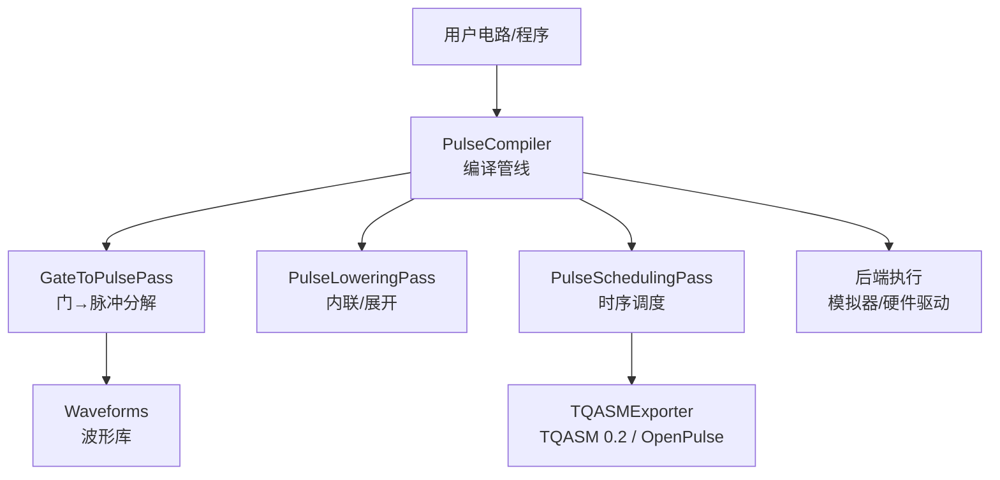

图表来源
- [pulse_compiler.py:24-197](file://src/tyxonq/compiler/pulse_compiler/native/pulse_compiler.py#L24-L197)
- [gate_to_pulse.py:38-115](file://src/tyxonq/compiler/pulse_compiler/native/gate_to_pulse.py#L38-L115)
- [tqasm_exporter.py:24-158](file://src/tyxonq/compiler/pulse_compiler/native/tqasm_exporter.py#L24-L158)

章节来源
- [pulse_compiler.py:24-197](file://src/tyxonq/compiler/pulse_compiler/native/pulse_compiler.py#L24-L197)
- [gate_to_pulse.py:38-115](file://src/tyxonq/compiler/pulse_compiler/native/gate_to_pulse.py#L38-L115)
- [tqasm_exporter.py:24-158](file://src/tyxonq/compiler/pulse_compiler/native/tqasm_exporter.py#L24-L158)

## 核心组件
- 波形库 waveforms.py：提供 Constant、Gaussian、Drag、Cosine、Flattop、Hermite、BlackmanSquare、CosineDrag 等波形数据类，统一 qasm_name 与 to_args 接口，便于序列化与导出。
- 门到脉冲分解 gate_to_pulse.py：将标准门（X/Y/Z/H/CX/CZ/iSWAP/SWAP）映射为脉冲序列；支持 defcal 优先、默认物理分解、虚拟 Z 合并优化。
- 脉冲编译器 pulse_compiler.py：编排 Gate→Pulse→调度→导出的流水线，支持输出格式选择（pulse_ir、TQASM 0.2、OpenQASM 3 + OpenPulse）。
- TQASM 导出 tqasm_exporter.py：生成 OPENQASM 3.0 + OpenPulse 或 TQASM 0.2 代码，包含 cal 块、defcal、frame/play/shift_phase 等。
- 可微仿真 autograd.py：封装 DifferentiablePulseSimulation，支持 PyTorch 自动微分进行保真度优化。
- 示例与教程：演示波形对比、三能级泄漏抑制、参数扫描、梯度优化与校准流程。

章节来源
- [waveforms.py:19-157](file://src/tyxonq/waveforms.py#L19-L157)
- [gate_to_pulse.py:137-192](file://src/tyxonq/compiler/pulse_compiler/native/gate_to_pulse.py#L137-L192)
- [pulse_compiler.py:81-197](file://src/tyxonq/compiler/pulse_compiler/native/pulse_compiler.py#L81-L197)
- [tqasm_exporter.py:129-233](file://src/tyxonq/compiler/pulse_compiler/native/tqasm_exporter.py#L129-L233)
- [autograd.py:42-188](file://src/tyxonq/libs/quantum_library/pulse/autograd.py#L42-L188)

## 架构总览
TyxonQ 的脉冲级架构采用“双模式”设计：
- 链式编译模式（Gate → Pulse → TQASM）：通过 GateToPulsePass 将抽象门分解为具体脉冲，再经调度与导出形成可执行代码。
- 直接哈密顿演化模式：在仿真层直接对脉冲作用下的哈密顿量进行时间演化，适用于快速原型与物理验证。

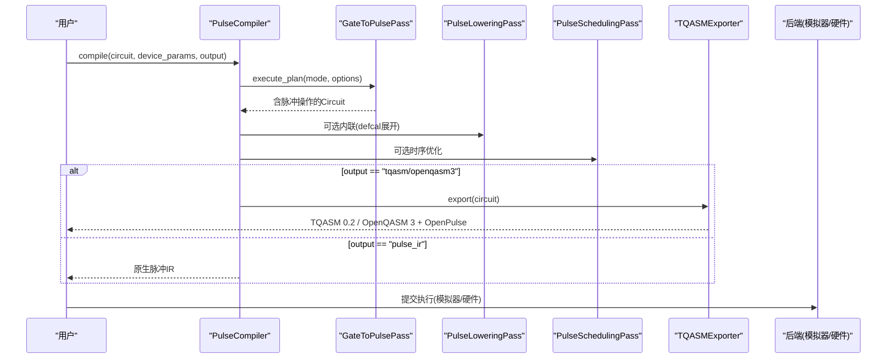

图表来源
- [pulse_compiler.py:81-197](file://src/tyxonq/compiler/pulse_compiler/native/pulse_compiler.py#L81-L197)
- [gate_to_pulse.py:64-115](file://src/tyxonq/compiler/pulse_compiler/native/gate_to_pulse.py#L64-L115)
- [tqasm_exporter.py:129-233](file://src/tyxonq/compiler/pulse_compiler/native/tqasm_exporter.py#L129-L233)

## 详细组件分析

### 波形库与波形类型
- 支持的波形类型（节选）：Constant、Gaussian、Drag、Cosine、Flattop、Hermite、BlackmanSquare、CosineDrag 等，均提供 qasm_name 与 to_args，便于导出与跨平台兼容。
- DRAG：通过导数项抑制向 |2⟩ 的泄漏，典型参数 β ∈ [0.1, 0.4]。
- Hermite：高阶多项式包络，频谱旁瓣更低，适合高保真门。
- BlackmanSquare：Blackman 窗+平顶，降低频谱泄漏与串扰。

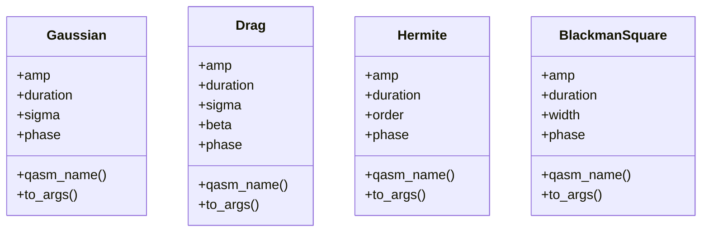

图表来源
- [waveforms.py:19-157](file://src/tyxonq/waveforms.py#L19-L157)

章节来源
- [waveforms.py:19-157](file://src/tyxonq/waveforms.py#L19-L157)
- [pulse_waveforms.py:40-108](file://examples/pulse_waveforms.py#L40-L108)

### 门到脉冲的转换与物理验证
- X/Y 旋转：使用 DRAG 脉冲，Y 旋转通过 π/2 相位偏移实现。
- Z/RZ：虚拟 Z（frame update），零物理时间开销，后续脉冲累积相位。
- H：分解为 RY(π/2) + RX(π)，分别以不同相位 DRAG 脉冲实现。
- CX：交叉共振（CR）序列，控制比特在目标频率上驱动，配合回波抑制非期望项。
- CZ：H_target · CX · H_target 分解。
- iSWAP/SWAP：通过 CX 链实现（iSWAP 相对相位由软件处理）。

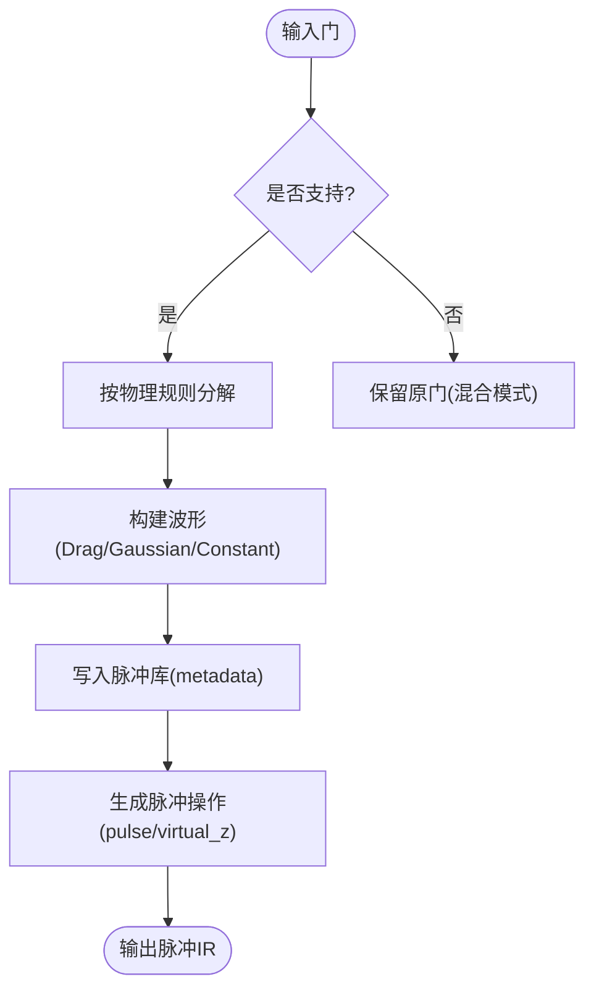

图表来源
- [gate_to_pulse.py:137-192](file://src/tyxonq/compiler/pulse_compiler/native/gate_to_pulse.py#L137-L192)
- [gate_to_pulse.py:194-379](file://src/tyxonq/compiler/pulse_compiler/native/gate_to_pulse.py#L194-L379)
- [gate_to_pulse.py:381-577](file://src/tyxonq/compiler/pulse_compiler/native/gate_to_pulse.py#L381-L577)

章节来源
- [gate_to_pulse.py:194-379](file://src/tyxonq/compiler/pulse_compiler/native/gate_to_pulse.py#L194-L379)
- [gate_to_pulse.py:381-577](file://src/tyxonq/compiler/pulse_compiler/native/gate_to_pulse.py#L381-L577)

### 虚拟 Z 门优化
- 原理：RZ 与后续旋转在旋转框架下可交换，因此可用 frame phase 更新代替物理脉冲。
- 优化策略：相邻同比特 virtual_z 合并，角度归一化至 [0, 2π)。
- 效果：减少实际脉冲数量，缩短总时长，提升保真度。

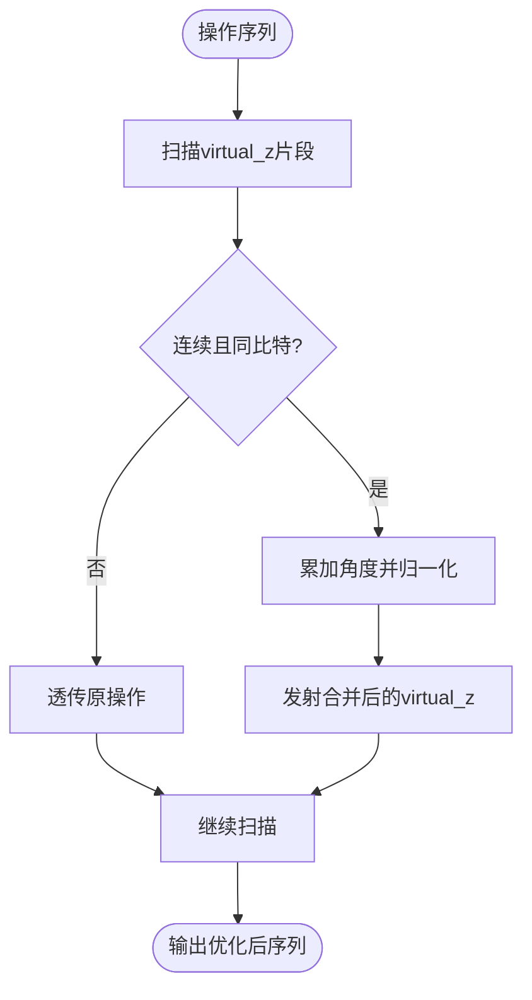

图表来源
- [gate_to_pulse.py:278-312](file://src/tyxonq/compiler/pulse_compiler/native/gate_to_pulse.py#L278-L312)
- [gate_to_pulse.py:896-907](file://src/tyxonq/compiler/pulse_compiler/native/gate_to_pulse.py#L896-L907)

章节来源
- [gate_to_pulse.py:278-312](file://src/tyxonq/compiler/pulse_compiler/native/gate_to_pulse.py#L278-L312)
- [gate_to_pulse.py:896-907](file://src/tyxonq/compiler/pulse_compiler/native/gate_to_pulse.py#L896-L907)

### 交叉共振 CX 门实现
- 物理机制：控制比特在目标比特频率上施加 CR 驱动，产生 ZX 相互作用。
- 序列：预旋转 RX(-π/2) → CR 驱动（高斯包络）→ 目标比特回波（常数脉冲）→ 后旋转 RX(π/2)。
- 参数：cr_amplitude、cx_duration、echo_amplitude 等可通过设备参数配置。

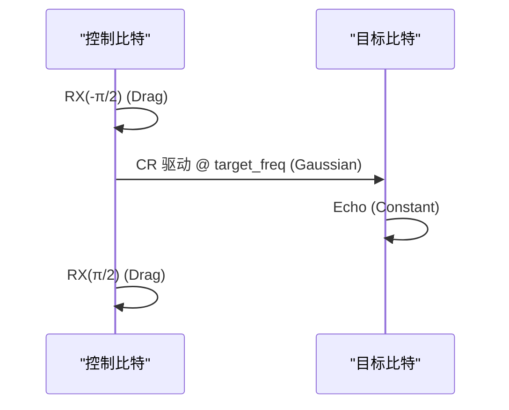

图表来源
- [gate_to_pulse.py:381-495](file://src/tyxonq/compiler/pulse_compiler/native/gate_to_pulse.py#L381-L495)

章节来源
- [gate_to_pulse.py:381-495](file://src/tyxonq/compiler/pulse_compiler/native/gate_to_pulse.py#L381-L495)

### TQASM 0.2 + OpenPulse 导出
- 支持两种版本：
  - TQASM 0.2（homebrew_s2 特殊格式）
  - OpenQASM 3.0 + OpenPulse（标准格式）
- 关键元素：
  - cal 块声明端口与帧（port/frame）
  - defcal 定义门的脉冲序列
  - waveform 定义（drag/gaussian/constant/gaussian_square）
  - play/shift_phase/set_frequency 等操作
- 同时支持 Circuit 与 PulseProgram 输入，自动推断门签名并生成调用。

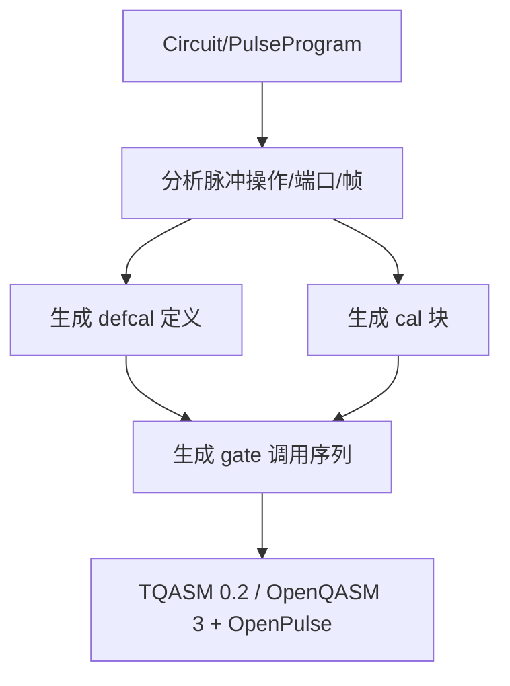

图表来源
- [tqasm_exporter.py:129-233](file://src/tyxonq/compiler/pulse_compiler/native/tqasm_exporter.py#L129-L233)
- [tqasm_exporter.py:465-598](file://src/tyxonq/compiler/pulse_compiler/native/tqasm_exporter.py#L465-L598)
- [tqasm_exporter.py:593-681](file://src/tyxonq/compiler/pulse_compiler/native/tqasm_exporter.py#L593-L681)

章节来源
- [tqasm_exporter.py:129-233](file://src/tyxonq/compiler/pulse_compiler/native/tqasm_exporter.py#L129-L233)
- [tqasm_exporter.py:465-598](file://src/tyxonq/compiler/pulse_compiler/native/tqasm_exporter.py#L465-L598)
- [tqasm_exporter.py:593-681](file://src/tyxonq/compiler/pulse_compiler/native/tqasm_exporter.py#L593-L681)

### 三能级系统与噪声建模
- 能级图：|0⟩、|1⟩、|2⟩，α 为非谐性（通常为负值），防止过度激发到 |2⟩。
- 泄漏抑制：DRAG 通过导数项降低 |0⟩→|2⟩ 跃迁概率。
- 仿真：支持两能级与三能级演化，比较理想与真实行为差异。
- 噪声：T1/T2 衰减影响保真度，需在优化中考虑。

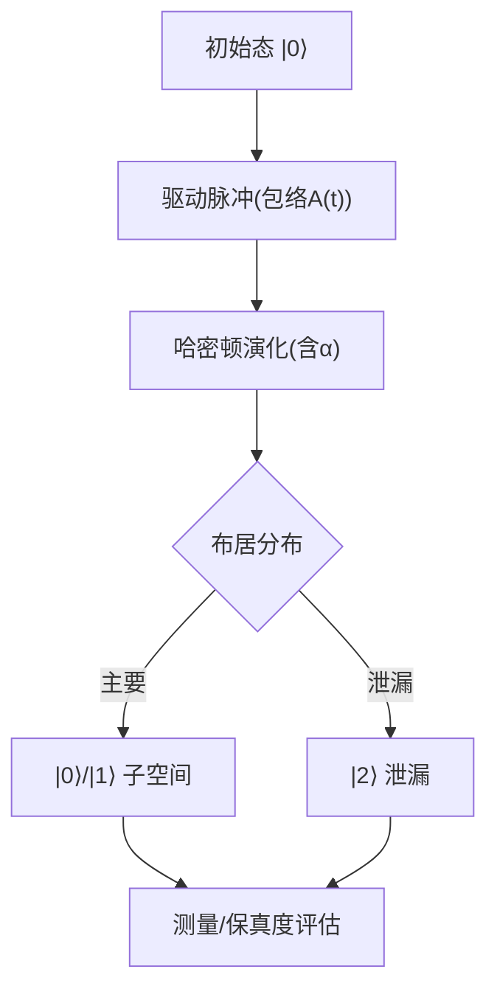

图表来源
- [pulse_three_level.py:49-107](file://examples/pulse_three_level.py#L49-L107)
- [pulse_three_level.py:115-172](file://examples/pulse_three_level.py#L115-L172)

章节来源
- [pulse_three_level.py:49-107](file://examples/pulse_three_level.py#L49-L107)
- [pulse_three_level.py:115-172](file://examples/pulse_three_level.py#L115-L172)

### 基于 PyTorch 自动微分的变分优化
- DifferentiablePulseSimulation：桥接 TyxonQ 脉冲仿真与 PyTorch 自动微分，支持端到端优化。
- compute_fidelity：计算目标门与实现门之间的保真度，支持两/三能级。
- optimize_to_target：Adam 优化器迭代更新参数，收敛阈值可配置。
- 适用场景：DRAG β、幅度、持续时间、失谐等参数的联合优化。

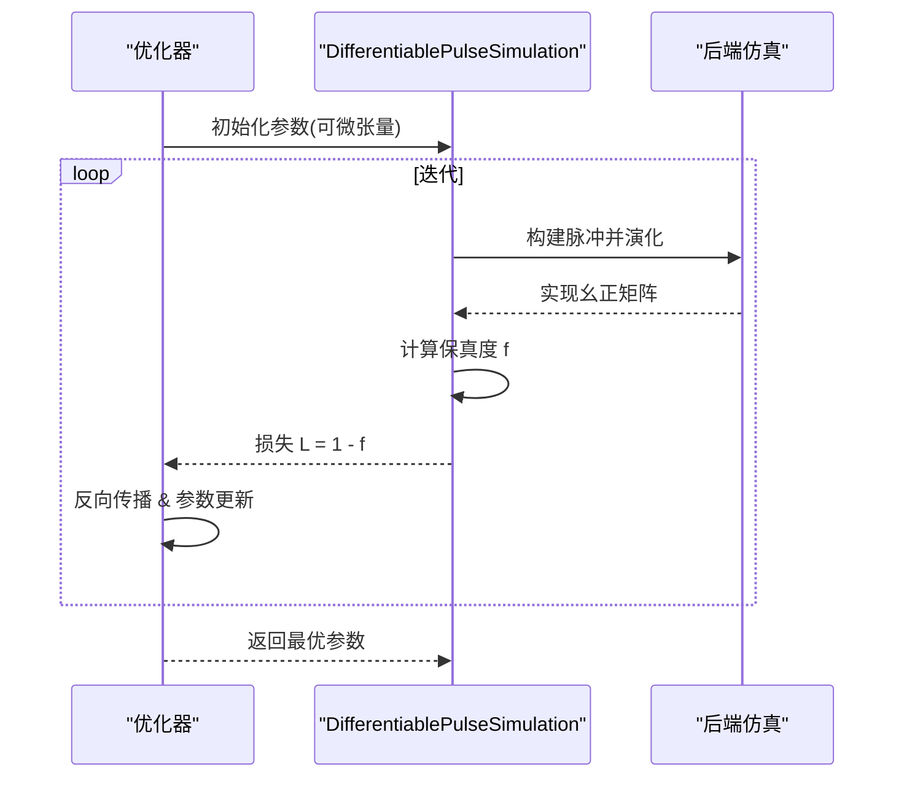

图表来源
- [autograd.py:42-188](file://src/tyxonq/libs/quantum_library/pulse/autograd.py#L42-L188)
- [autograd.py:190-307](file://src/tyxonq/libs/quantum_library/pulse/autograd.py#L190-L307)

章节来源
- [autograd.py:42-188](file://src/tyxonq/libs/quantum_library/pulse/autograd.py#L42-L188)
- [autograd.py:190-307](file://src/tyxonq/libs/quantum_library/pulse/autograd.py#L190-L307)

### 校准与性能调优工作流
- 步骤概览：
  1) 获取硬件基础参数（qubit_freq、anharmonicity、T1、T2）
  2) 单比特粗调（振幅扫描、β 扫描）
  3) 单比特细调（结合自动微分优化）
  4) 两比特表征（CX 序列参数优化）
  5) 高级优化（形状搜索、多参数联合优化）
- 指标：保真度、泄漏率、门时间、相干时间约束。

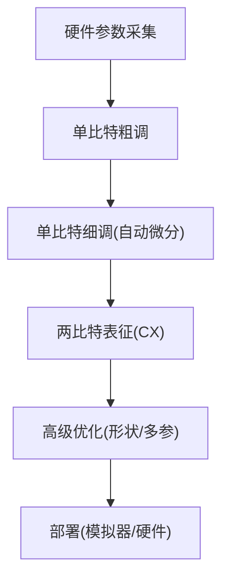

图表来源
- [step_1_hardware_basics.py:157-192](file://examples/pulse_calibration_tutorial/step_1_hardware_basics.py#L157-L192)
- [pulse_waveforms.py:329-399](file://examples/pulse_waveforms.py#L329-L399)
- [pulse_optimization_advanced.py:210-270](file://examples/pulse_optimization_advanced.py#L210-L270)

章节来源
- [step_1_hardware_basics.py:157-192](file://examples/pulse_calibration_tutorial/step_1_hardware_basics.py#L157-L192)
- [pulse_waveforms.py:329-399](file://examples/pulse_waveforms.py#L329-L399)
- [pulse_optimization_advanced.py:210-270](file://examples/pulse_optimization_advanced.py#L210-L270)

## 依赖关系分析
- 模块耦合：
  - PulseCompiler 依赖 GateToPulsePass、PulseLoweringPass、PulseSchedulingPass
  - GateToPulsePass 依赖 waveforms 与设备参数
  - TQASMExporter 依赖 Circuit/PulseProgram 元数据与波形对象
  - DifferentiablePulseSimulation 依赖后端仿真与 PyTorch
- 外部依赖：
  - PyTorch（自动微分）
  - 硬件驱动（通过 devices 层接入）

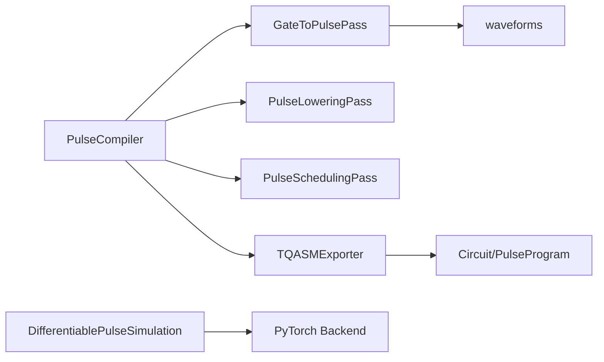

图表来源
- [pulse_compiler.py:24-80](file://src/tyxonq/compiler/pulse_compiler/native/pulse_compiler.py#L24-L80)
- [tqasm_exporter.py:24-108](file://src/tyxonq/compiler/pulse_compiler/native/tqasm_exporter.py#L24-L108)
- [autograd.py:70-103](file://src/tyxonq/libs/quantum_library/pulse/autograd.py#L70-L103)

章节来源
- [pulse_compiler.py:24-80](file://src/tyxonq/compiler/pulse_compiler/native/pulse_compiler.py#L24-L80)
- [tqasm_exporter.py:24-108](file://src/tyxonq/compiler/pulse_compiler/native/tqasm_exporter.py#L24-L108)
- [autograd.py:70-103](file://src/tyxonq/libs/quantum_library/pulse/autograd.py#L70-L103)

## 性能考量
- 波形选择：DRAG 通常优于 Gaussian，Hermite/BlackmanSquare 在特定硬件上更优。
- 门时间 vs 泄漏：更短的门更快但更易泄漏；需平衡速度与保真度。
- 虚拟 Z 合并：减少实际脉冲，降低误差累积。
- 三能级仿真：用于预测泄漏与优化 β；注意计算成本随比特数增长。
- 自动微分优化：Adam 高效收敛，但需合理学习率与迭代次数。

## 故障排查指南
- 波形不支持：检查 supported_waveforms 过滤与设备能力；使用 validate_waveforms 诊断。
- 导出失败：确认 circuit.metadata 中的 pulse_library 与端口/帧信息完整。
- 优化不收敛：调整学习率、目标保真度、参数边界；先网格搜索再梯度下降。
- 泄漏过高：增大 |α| 或使用 DRAG β 优化；检查驱动频率与失谐。
- 时序冲突：启用 PulseSchedulingPass 或手动调整脉冲重叠。

章节来源
- [pulse_compiler.py:250-317](file://src/tyxonq/compiler/pulse_compiler/native/pulse_compiler.py#L250-L317)
- [tqasm_exporter.py:465-598](file://src/tyxonq/compiler/pulse_compiler/native/tqasm_exporter.py#L465-L598)
- [autograd.py:190-307](file://src/tyxonq/libs/quantum_library/pulse/autograd.py#L190-L307)

## 结论
TyxonQ 提供了从门级到脉冲级的完整工具链，支持多种波形、三能级物理模型、TQASM 0.2/OpenPulse 导出以及基于自动微分的变分优化。通过合理的校准与优化流程，可在本地模拟器与真实硬件之间无缝部署高性能脉冲程序。

## 附录
- 快速开始：参考 step_1_hardware_basics.py 建立硬件参数认知与第一个脉冲程序。
- 波形对比：参考 pulse_waveforms.py 了解不同包络对保真度与泄漏的影响。
- 三能级仿真：参考 pulse_three_level.py 理解泄漏与 α 的作用。
- 高级优化：参考 pulse_optimization_advanced.py 掌握梯度优化与形状搜索。