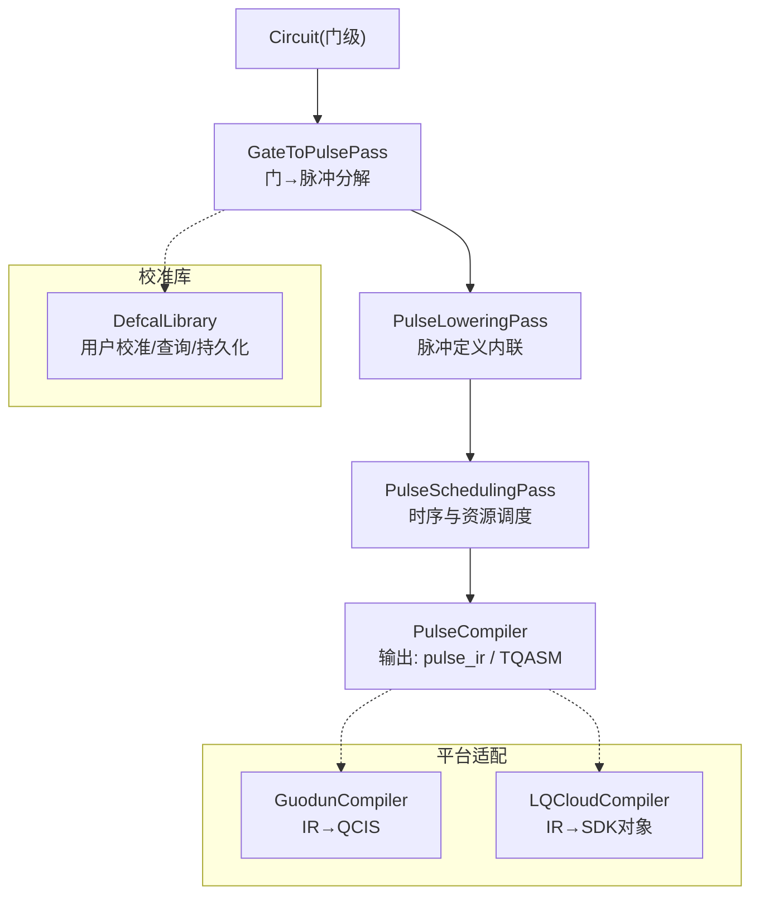
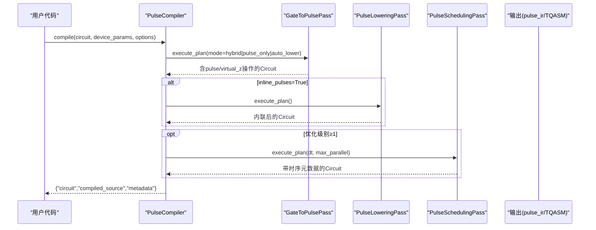
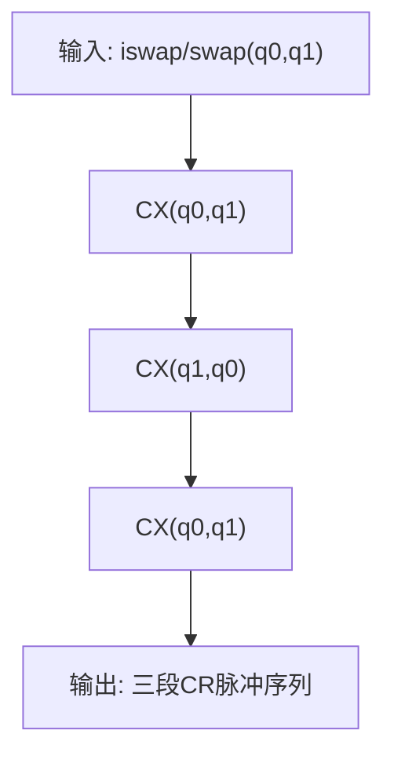
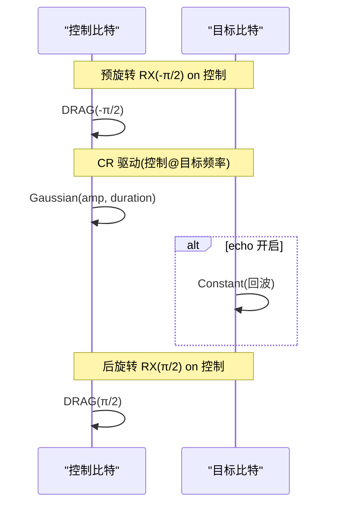
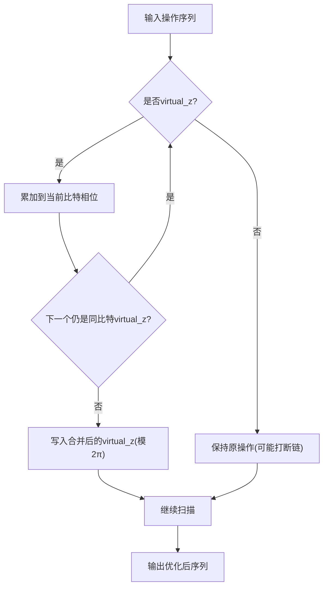
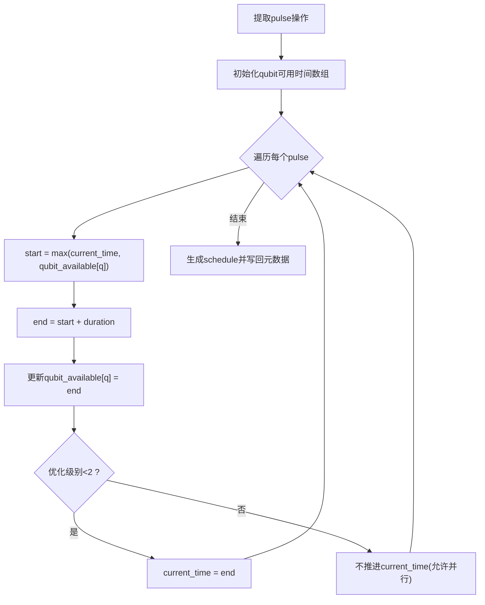
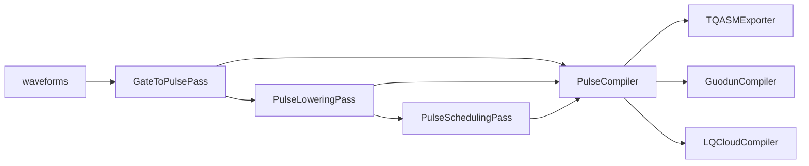

# 脉冲编译和优化

<cite>
**本文引用的文件**
- [src/tyxonq/compiler/pulse_compiler/native/gate_to_pulse.py](file://src/tyxonq/compiler/pulse_compiler/native/gate_to_pulse.py)
- [src/tyxonq/compiler/pulse_compiler/native/pulse_scheduling.py](file://src/tyxonq/compiler/pulse_compiler/native/pulse_scheduling.py)
- [src/tyxonq/compiler/pulse_compiler/native/pulse_lowering.py](file://src/tyxonq/compiler/pulse_compiler/native/pulse_lowering.py)
- [src/tyxonq/compiler/pulse_compiler/native/pulse_compiler.py](file://src/tyxonq/compiler/pulse_compiler/native/pulse_compiler.py)
- [src/tyxonq/compiler/pulse_compiler/defcal_library.py](file://src/tyxonq/compiler/pulse_compiler/defcal_library.py)
- [examples/pulse_iswap_swap_decomposition.py](file://examples/pulse_iswap_swap_decomposition.py)
- [examples/pulse_compilation_modes.py](file://examples/pulse_compilation_modes.py)
- [docs/source/tutorials/advanced/pulse_virtual_z_optimization.rst](file://docs/source/tutorials/advanced/pulse_virtual_z_optimization.rst)
- [tests_core_module/test_virtual_z_optimization.py](file://tests_core_module/test_virtual_z_optimization.py)
- [tests_core_module/test_multi_qubit_pulse_simulation.py](file://tests_core_module/test_multi_qubit_pulse_simulation.py)
- [src/tyxonq/compiler/platforms/guodun/compiler.py](file://src/tyxonq/compiler/platforms/guodun/compiler.py)
- [src/tyxonq/compiler/platforms/lqcloud/compiler.py](file://src/tyxonq/compiler/platforms/lqcloud/compiler.py)
</cite>

## 目录
1. [简介](#简介)
2. [项目结构](#项目结构)
3. [核心组件](#核心组件)
4. [架构总览](#架构总览)
5. [详细组件分析](#详细组件分析)
6. [依赖关系分析](#依赖关系分析)
7. [性能考量](#性能考量)
8. [故障排查指南](#故障排查指南)
9. [结论](#结论)
10. [附录](#附录)

## 简介
本文件系统性阐述 TyxonQ 的脉冲编译与优化体系，聚焦从量子门到脉冲序列的转换流程、关键分解算法（ISWAP/SWAP）、交叉共振 CX 门的脉冲实现、虚拟 Z 门优化原理与效果、脉冲调度策略与时间优化、不同编译模式的选择与性能对比、编译结果分析与调试方法、自定义脉冲原语开发流程，以及在不同硬件平台上的适配方式。目标是帮助读者在不深入源码细节的前提下，掌握端到端的脉冲编译工作流与最佳实践。

## 项目结构
TyxonQ 的脉冲编译位于 compiler/pulse_compiler/native 子模块，包含“门→脉冲”分解、脉冲内联降阶、脉冲调度三大 Pass，并由 PulseCompiler 统一编排。DefcalLibrary 提供用户校准库管理；platforms 下为各硬件平台的编译器适配器（如 Guodun、LQCloud），负责将通用 IR 翻译为目标方言。

图表来源
- [src/tyxonq/compiler/pulse_compiler/native/pulse_compiler.py:24-197](file://src/tyxonq/compiler/pulse_compiler/native/pulse_compiler.py#L24-L197)
- [src/tyxonq/compiler/pulse_compiler/native/gate_to_pulse.py:38-115](file://src/tyxonq/compiler/pulse_compiler/native/gate_to_pulse.py#L38-L115)
- [src/tyxonq/compiler/pulse_compiler/native/pulse_lowering.py:22-75](file://src/tyxonq/compiler/pulse_compiler/native/pulse_lowering.py#L22-L75)
- [src/tyxonq/compiler/pulse_compiler/native/pulse_scheduling.py:24-86](file://src/tyxonq/compiler/pulse_compiler/native/pulse_scheduling.py#L24-L86)
- [src/tyxonq/compiler/platforms/guodun/compiler.py:88-173](file://src/tyxonq/compiler/platforms/guodun/compiler.py#L88-L173)
- [src/tyxonq/compiler/platforms/lqcloud/compiler.py:50-109](file://src/tyxonq/compiler/platforms/lqcloud/compiler.py#L50-L109)

章节来源
- [src/tyxonq/compiler/pulse_compiler/native/pulse_compiler.py:24-197](file://src/tyxonq/compiler/pulse_compiler/native/pulse_compiler.py#L24-L197)
- [src/tyxonq/compiler/pulse_compiler/native/gate_to_pulse.py:38-115](file://src/tyxonq/compiler/pulse_compiler/native/gate_to_pulse.py#L38-L115)
- [src/tyxonq/compiler/pulse_compiler/native/pulse_lowering.py:22-75](file://src/tyxonq/compiler/pulse_compiler/native/pulse_lowering.py#L22-L75)
- [src/tyxonq/compiler/pulse_compiler/native/pulse_scheduling.py:24-86](file://src/tyxonq/compiler/pulse_compiler/native/pulse_scheduling.py#L24-L86)

## 核心组件
- GateToPulsePass：将标准门（单比特 RX/RY/RZ/H/CX/CZ/iSWAP/SWAP）转换为脉冲操作或虚拟 Z 更新，优先使用用户提供的 defcal 校准，否则回退到默认物理分解。
- PulseLoweringPass：将符号化的脉冲引用展开为内联波形表示，便于序列化与云端执行。
- PulseSchedulingPass：进行脉冲级时序分配、冲突消解与并行度提升，并维护相位跟踪元数据。
- DefcalLibrary：集中管理硬件相关的门校准（波形、参数、元信息），支持导入导出与校验。
- PulseCompiler：编排上述 Pass，支持多输出格式（pulse_ir、TQASM 等），并提供波形类型校验能力。

章节来源
- [src/tyxonq/compiler/pulse_compiler/native/gate_to_pulse.py:38-115](file://src/tyxonq/compiler/pulse_compiler/native/gate_to_pulse.py#L38-L115)
- [src/tyxonq/compiler/pulse_compiler/native/pulse_lowering.py:22-75](file://src/tyxonq/compiler/pulse_compiler/native/pulse_lowering.py#L22-L75)
- [src/tyxonq/compiler/pulse_compiler/native/pulse_scheduling.py:24-86](file://src/tyxonq/compiler/pulse_compiler/native/pulse_scheduling.py#L24-L86)
- [src/tyxonq/compiler/pulse_compiler/defcal_library.py:153-166](file://src/tyxonq/compiler/pulse_compiler/defcal_library.py#L153-L166)
- [src/tyxonq/compiler/pulse_compiler/native/pulse_compiler.py:24-197](file://src/tyxonq/compiler/pulse_compiler/native/pulse_compiler.py#L24-L197)

## 架构总览
下图展示从门电路到可执行脉冲序列的完整流水线，包括三种中间表示形式（门级、带引用的脉冲级、完全内联的脉冲级）。

图表来源
- [src/tyxonq/compiler/pulse_compiler/native/pulse_compiler.py:81-197](file://src/tyxonq/compiler/pulse_compiler/native/pulse_compiler.py#L81-L197)
- [src/tyxonq/compiler/pulse_compiler/native/gate_to_pulse.py:64-115](file://src/tyxonq/compiler/pulse_compiler/native/gate_to_pulse.py#L64-L115)
- [src/tyxonq/compiler/pulse_compiler/native/pulse_lowering.py:37-75](file://src/tyxonq/compiler/pulse_compiler/native/pulse_lowering.py#L37-L75)
- [src/tyxonq/compiler/pulse_compiler/native/pulse_scheduling.py:43-86](file://src/tyxonq/compiler/pulse_compiler/native/pulse_scheduling.py#L43-L86)

## 详细组件分析

### 门到脉冲分解：ISWAP 与 SWAP
- iSWAP 与 SWAP 均通过三段 CX 链实现：CX(q0,q1)·CX(q1,q0)·CX(q0,q1)。两者在软件层面处理相对相位差异，脉冲级结构相同，兼容任意拓扑。
- 若设备具备可调 XX 耦合，未来可直接以参量脉冲实现更高效 iSWAP。

图表来源
- [src/tyxonq/compiler/pulse_compiler/native/gate_to_pulse.py:579-659](file://src/tyxonq/compiler/pulse_compiler/native/gate_to_pulse.py#L579-L659)
- [src/tyxonq/compiler/pulse_compiler/native/gate_to_pulse.py:661-730](file://src/tyxonq/compiler/pulse_compiler/native/gate_to_pulse.py#L661-L730)
- [examples/pulse_iswap_swap_decomposition.py:56-96](file://examples/pulse_iswap_swap_decomposition.py#L56-L96)
- [examples/pulse_iswap_swap_decomposition.py:98-136](file://examples/pulse_iswap_swap_decomposition.py#L98-L136)

章节来源
- [src/tyxonq/compiler/pulse_compiler/native/gate_to_pulse.py:579-730](file://src/tyxonq/compiler/pulse_compiler/native/gate_to_pulse.py#L579-L730)
- [examples/pulse_iswap_swap_decomposition.py:56-136](file://examples/pulse_iswap_swap_decomposition.py#L56-L136)

### 交叉共振 CX 门的脉冲级实现
- 物理模型：控制比特在目标比特频率上驱动，产生 ZX 相互作用项。
- 典型序列：预旋转 RX(-π/2) → CR 驱动（高斯包络）→ 可选的回波脉冲抑制非期望项 → 后旋转 RX(π/2)。
- 参数：耦合强度决定门时长；echo 开启时可进一步降低误差。

图表来源
- [src/tyxonq/compiler/pulse_compiler/native/gate_to_pulse.py:381-495](file://src/tyxonq/compiler/pulse_compiler/native/gate_to_pulse.py#L381-L495)
- [tests_core_module/test_multi_qubit_pulse_simulation.py:146-183](file://tests_core_module/test_multi_qubit_pulse_simulation.py#L146-L183)

章节来源
- [src/tyxonq/compiler/pulse_compiler/native/gate_to_pulse.py:381-495](file://src/tyxonq/compiler/pulse_compiler/native/gate_to_pulse.py#L381-L495)
- [tests_core_module/test_multi_qubit_pulse_simulation.py:146-183](file://tests_core_module/test_multi_qubit_pulse_simulation.py#L146-L183)

### 虚拟 Z 门优化：原理与效果
- 原理：RZ 在旋转框架中表现为相位帧更新，无需物理脉冲，且相邻 RZ 可合并。
- 优化策略：扫描操作序列，对同一比特上连续的 virtual_z 累加角度并归一化到 [0, 2π)，遇到非 virtual_z 操作则断开链。
- 效果：显著减少相位跟踪操作数量，提高仿真与硬件执行效率。

图表来源
- [src/tyxonq/compiler/pulse_compiler/native/gate_to_pulse.py:111-115](file://src/tyxonq/compiler/pulse_compiler/native/gate_to_pulse.py#L111-L115)
- [docs/source/tutorials/advanced/pulse_virtual_z_optimization.rst:96-185](file://docs/source/tutorials/advanced/pulse_virtual_z_optimization.rst#L96-L185)
- [docs/source/tutorials/advanced/pulse_virtual_z_optimization.rst:312-359](file://docs/source/tutorials/advanced/pulse_virtual_z_optimization.rst#L312-L359)
- [tests_core_module/test_virtual_z_optimization.py:21-58](file://tests_core_module/test_virtual_z_optimization.py#L21-L58)

章节来源
- [docs/source/tutorials/advanced/pulse_virtual_z_optimization.rst:96-359](file://docs/source/tutorials/advanced/pulse_virtual_z_optimization.rst#L96-L359)
- [tests_core_module/test_virtual_z_optimization.py:21-58](file://tests_core_module/test_virtual_z_optimization.py#L21-L58)

### 脉冲调度策略与时间优化
- 目标：在尊重硬件约束的前提下最大化并行度，分配时隙、解决资源冲突、记录起止时间与总时长。
- 策略：按优化级别递增启用更激进的并行与合并；估计脉冲时长（默认单比特约 160 ns），基于 qubit 可用性计算最早开始时间。
- 输出：在 circuit 元数据中保存调度计划与总时间，便于分析与可视化。

图表来源
- [src/tyxonq/compiler/pulse_compiler/native/pulse_scheduling.py:43-86](file://src/tyxonq/compiler/pulse_compiler/native/pulse_scheduling.py#L43-L86)
- [src/tyxonq/compiler/pulse_compiler/native/pulse_scheduling.py:104-148](file://src/tyxonq/compiler/pulse_compiler/native/pulse_scheduling.py#L104-L148)
- [src/tyxonq/compiler/pulse_compiler/native/pulse_scheduling.py:150-238](file://src/tyxonq/compiler/pulse_compiler/native/pulse_scheduling.py#L150-L238)

章节来源
- [src/tyxonq/compiler/pulse_compiler/native/pulse_scheduling.py:43-238](file://src/tyxonq/compiler/pulse_compiler/native/pulse_scheduling.py#L43-L238)

### 编译模式选择指南与性能对比
- 模式 A（链式）：门电路 → 自动编译 → 执行。适合大多数算法（VQE/QAOA 等），开发效率高。
- 模式 B（直脉冲）：直接构造 PulseProgram 并执行。适合校准、脉冲优化研究，控制粒度最高。
- 混合模式：在同一电路中混用门与脉冲，选择性优化。适合需要局部定制的场景。
- 性能对比：模式 A 抽象度高、自动化强；模式 B 绕过部分开销，有时更快；差异通常不大，但需根据场景权衡。

章节来源
- [examples/pulse_compilation_modes.py:46-94](file://examples/pulse_compilation_modes.py#L46-L94)
- [examples/pulse_compilation_modes.py:100-154](file://examples/pulse_compilation_modes.py#L100-L154)
- [examples/pulse_compilation_modes.py:161-213](file://examples/pulse_compilation_modes.py#L161-L213)
- [examples/pulse_compilation_modes.py:220-292](file://examples/pulse_compilation_modes.py#L220-L292)
- [examples/pulse_compilation_modes.py:299-368](file://examples/pulse_compilation_modes.py#L299-L368)

### 编译结果分析与调试方法
- 检查输出：查看 compiled_source 与 metadata，确认是否已内联、是否生成了 schedule。
- 验证波形：使用 validate_waveforms 检查使用的波形类型是否在设备支持列表中。
- 定位问题：若某门未转成脉冲，检查 mode 与 _should_convert_to_pulse 逻辑；若 virtual_z 未合并，检查是否有非 virtual_z 操作打断。
- 参考测试：利用单元测试断言行为一致性（如 virtual_z 合并、跨比特不合并、CX 序列等）。

章节来源
- [src/tyxonq/compiler/pulse_compiler/native/pulse_compiler.py:250-317](file://src/tyxonq/compiler/pulse_compiler/native/pulse_compiler.py#L250-L317)
- [tests_core_module/test_virtual_z_optimization.py:21-58](file://tests_core_module/test_virtual_z_optimization.py#L21-L58)
- [tests_core_module/test_multi_qubit_pulse_simulation.py:146-183](file://tests_core_module/test_multi_qubit_pulse_simulation.py#L146-L183)

### 自定义脉冲原语的开发流程
- 步骤：
  1) 设计波形对象（如 Drag/Gaussian/Constant），确保具备 to_args/qasm_name 等接口以便序列化。
  2) 通过 DefcalLibrary.add_calibration 注册到特定门与比特集合。
  3) 在 GateToPulsePass 中优先匹配 defcal，若无则回退默认分解。
  4) 如需云端提交，设置 inline_pulses=True 完成内联，再导出 TQASM。
- 注意事项：
  - 校准数据需通过 validate 保证完整性。
  - 导出前建议调用 validate_waveforms 过滤不支持的波形类型。

章节来源
- [src/tyxonq/compiler/pulse_compiler/defcal_library.py:206-260](file://src/tyxonq/compiler/pulse_compiler/defcal_library.py#L206-L260)
- [src/tyxonq/compiler/pulse_compiler/defcal_library.py:382-420](file://src/tyxonq/compiler/pulse_compiler/defcal_library.py#L382-L420)
- [src/tyxonq/compiler/pulse_compiler/native/gate_to_pulse.py:163-171](file://src/tyxonq/compiler/pulse_compiler/native/gate_to_pulse.py#L163-L171)
- [src/tyxonq/compiler/pulse_compiler/native/pulse_lowering.py:77-117](file://src/tyxonq/compiler/pulse_compiler/native/pulse_lowering.py#L77-L117)
- [src/tyxonq/compiler/pulse_compiler/native/pulse_compiler.py:199-248](file://src/tyxonq/compiler/pulse_compiler/native/pulse_compiler.py#L199-L248)

### 不同硬件平台的适配
- Guodun：委托 gate_compiler 核心完成设备无关分解与路由，再将 IR 直译为 QCIS 文本，限制指令集为 {X,H,RZ,CZ,M}，并在编译期烘焙物理比特映射。
- LQCloud：同样委托核心，再将 IR 直译为 SDK 的 QuantumCircuit 对象；physical_qubits 作为运行期 initial_layout，不在编译期消费。
- 共同点：避免重复实现 matchgate/rotations 分解，lowering 退化为纯方言翻译，便于维护与扩展。

章节来源
- [src/tyxonq/compiler/platforms/guodun/compiler.py:88-173](file://src/tyxonq/compiler/platforms/guodun/compiler.py#L88-L173)
- [src/tyxonq/compiler/platforms/lqcloud/compiler.py:50-109](file://src/tyxonq/compiler/platforms/lqcloud/compiler.py#L50-L109)

## 依赖关系分析
- GateToPulsePass 依赖 waveforms 模块生成默认波形；若不可用则返回空列表，由上层回退保留原门。
- PulseLoweringPass 依赖 pulse_library（存储在 circuit.metadata）进行波形查找与序列化。
- PulseSchedulingPass 读取 ops 中的 pulse/pulse_inline 操作，估算时长并生成 schedule。
- PulseCompiler 串联三个 Pass，并根据 output 选择导出器（TQASM 等）。
- 平台编译器（Guodun/LQCloud）依赖 gate_compiler 核心，再进行 IR 到目标方言的直译。

图表来源
- [src/tyxonq/compiler/pulse_compiler/native/gate_to_pulse.py:31-35](file://src/tyxonq/compiler/pulse_compiler/native/gate_to_pulse.py#L31-L35)
- [src/tyxonq/compiler/pulse_compiler/native/pulse_lowering.py:51-75](file://src/tyxonq/compiler/pulse_compiler/native/pulse_lowering.py#L51-L75)
- [src/tyxonq/compiler/pulse_compiler/native/pulse_scheduling.py:88-102](file://src/tyxonq/compiler/pulse_compiler/native/pulse_scheduling.py#L88-L102)
- [src/tyxonq/compiler/pulse_compiler/native/pulse_compiler.py:177-197](file://src/tyxonq/compiler/pulse_compiler/native/pulse_compiler.py#L177-L197)
- [src/tyxonq/compiler/platforms/guodun/compiler.py:123-173](file://src/tyxonq/compiler/platforms/guodun/compiler.py#L123-L173)
- [src/tyxonq/compiler/platforms/lqcloud/compiler.py:74-109](file://src/tyxonq/compiler/platforms/lqcloud/compiler.py#L74-L109)

章节来源
- [src/tyxonq/compiler/pulse_compiler/native/gate_to_pulse.py:31-35](file://src/tyxonq/compiler/pulse_compiler/native/gate_to_pulse.py#L31-L35)
- [src/tyxonq/compiler/pulse_compiler/native/pulse_lowering.py:51-75](file://src/tyxonq/compiler/pulse_compiler/native/pulse_lowering.py#L51-L75)
- [src/tyxonq/compiler/pulse_compiler/native/pulse_scheduling.py:88-102](file://src/tyxonq/compiler/pulse_compiler/native/pulse_scheduling.py#L88-L102)
- [src/tyxonq/compiler/pulse_compiler/native/pulse_compiler.py:177-197](file://src/tyxonq/compiler/pulse_compiler/native/pulse_compiler.py#L177-L197)
- [src/tyxonq/compiler/platforms/guodun/compiler.py:123-173](file://src/tyxonq/compiler/platforms/guodun/compiler.py#L123-L173)
- [src/tyxonq/compiler/platforms/lqcloud/compiler.py:74-109](file://src/tyxonq/compiler/platforms/lqcloud/compiler.py#L74-L109)

## 性能考量
- 虚拟 Z 合并可减少大量相位跟踪操作，典型场景下能显著降低开销。
- 脉冲调度在较高优化级别下可提升并行度，缩短总执行时间。
- 选择合适的编译模式：算法原型阶段推荐模式 A；校准与优化阶段推荐模式 B；混合模式用于局部定制。
- 波形选择：DRAG 保真度高但复杂；Gaussian 平衡速度与泄漏；Constant 简单但泄漏较高。

[本节为通用指导，不直接分析具体文件]

## 故障排查指南
- 门未转为脉冲：检查 mode 与 _should_convert_to_pulse 条件；确认支持的 gates 列表。
- virtual_z 未合并：检查是否存在非 virtual_z 操作打断；确认角度归一化逻辑。
- 波形不支持：使用 validate_waveforms 检测 unsupported_waveforms，调整 supported_waveforms 或替换波形。
- 平台编译失败：Guodun 要求 cqlib 版本匹配；LQCloud 注意 physical_qubits 语义差异。

章节来源
- [src/tyxonq/compiler/pulse_compiler/native/gate_to_pulse.py:117-135](file://src/tyxonq/compiler/pulse_compiler/native/gate_to_pulse.py#L117-L135)
- [docs/source/tutorials/advanced/pulse_virtual_z_optimization.rst:312-359](file://docs/source/tutorials/advanced/pulse_virtual_z_optimization.rst#L312-L359)
- [src/tyxonq/compiler/pulse_compiler/native/pulse_compiler.py:250-317](file://src/tyxonq/compiler/pulse_compiler/native/pulse_compiler.py#L250-L317)
- [src/tyxonq/compiler/platforms/guodun/compiler.py:27-43](file://src/tyxonq/compiler/platforms/guodun/compiler.py#L27-L43)
- [src/tyxonq/compiler/platforms/lqcloud/compiler.py:11-15](file://src/tyxonq/compiler/platforms/lqcloud/compiler.py#L11-L15)

## 结论
TyxonQ 的脉冲编译系统通过清晰的 Pass 分层与灵活的校准机制，实现了从门到脉冲的高效转换与优化。ISWAP/SWAP 的通用 CX 链实现、交叉共振 CX 的物理级实现、虚拟 Z 的自动合并、脉冲调度的并行优化，以及多平台适配，构成了完整的端到端工作流。结合不同的编译模式与波形选择，可在保真度、速度与易用性之间取得良好平衡。

[本节为总结，不直接分析具体文件]

## 附录
- 示例脚本：
  - iSWAP/SWAP 分解与导出：[examples/pulse_iswap_swap_decomposition.py](file://examples/pulse_iswap_swap_decomposition.py)
  - 编译模式对比与实践：[examples/pulse_compilation_modes.py](file://examples/pulse_compilation_modes.py)
- 教程文档：
  - 虚拟 Z 优化详解：[docs/source/tutorials/advanced/pulse_virtual_z_optimization.rst](file://docs/source/tutorials/advanced/pulse_virtual_z_optimization.rst)
- 测试用例：
  - 虚拟 Z 优化测试：[tests_core_module/test_virtual_z_optimization.py](file://tests_core_module/test_virtual_z_optimization.py)
  - 多比特脉冲模拟（含 CX 序列）：[tests_core_module/test_multi_qubit_pulse_simulation.py](file://tests_core_module/test_multi_qubit_pulse_simulation.py)

[本节为索引，不直接分析具体文件]