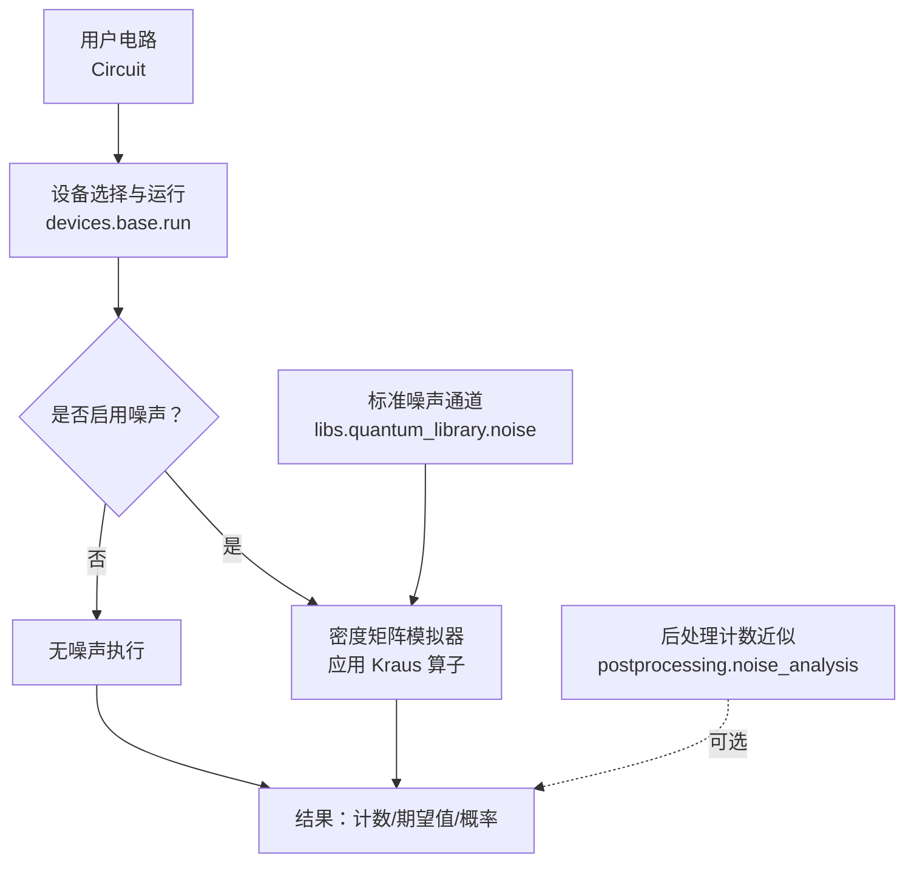
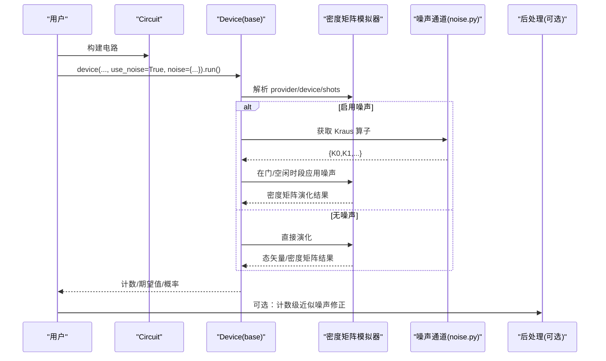
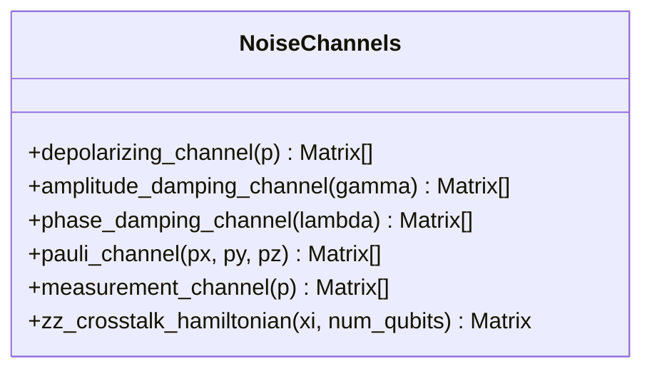
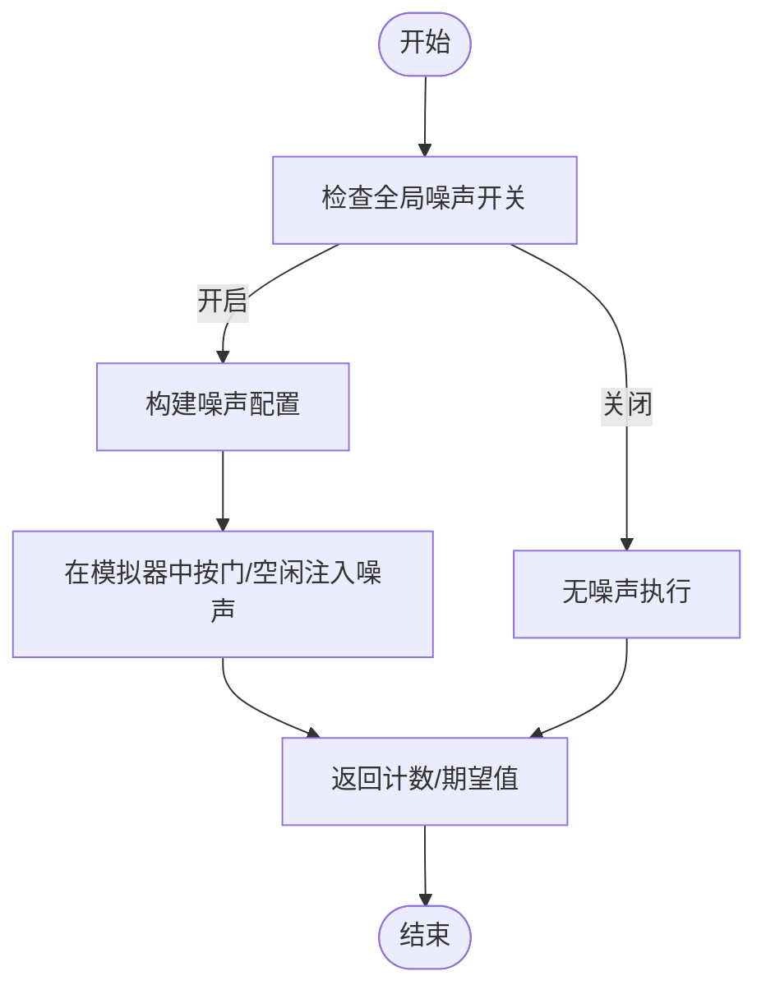
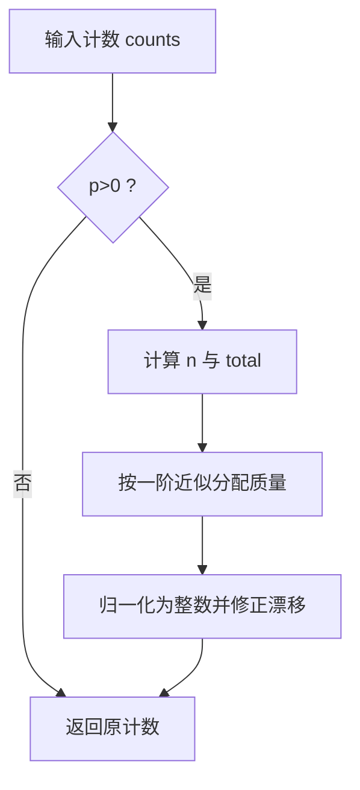
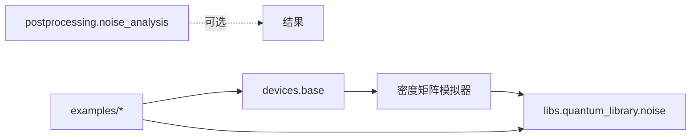

# 噪声模型

<cite>
**本文引用的文件**
- [noise.py](file://src/tyxonq/libs/quantum_library/noise.py)
- [channels.py](file://src/tyxonq/devices/simulators/noise/channels.py)
- [base.py](file://src/tyxonq/devices/base.py)
- [noise_analysis.py](file://src/tyxonq/postprocessing/noise_analysis.py)
- [noise_t1_t2_calibration.py](file://examples/noise_t1_t2_calibration.py)
- [noisy_circuit_demo.py](file://examples/noisy_circuit_demo.py)
- [noise_controls_demo.py](file://examples/noise_controls_demo.py)
- [pulse_noise_modeling.py](file://examples/pulse_noise_modeling.py)
</cite>

## 目录
1. [简介](#简介)
2. [项目结构](#项目结构)
3. [核心组件](#核心组件)
4. [架构总览](#架构总览)
5. [详细组件分析](#详细组件分析)
6. [依赖关系分析](#依赖关系分析)
7. [性能考虑](#性能考虑)
8. [故障排查指南](#故障排查指南)
9. [结论](#结论)
10. [附录](#附录)

## 简介
本文件系统性梳理 TyxonQ 中的噪声建模能力，覆盖 T1 弛豫、T2 退相干、退极化、Pauli 通道、测量通道与 ZZ 串扰等常见噪声源。文档从数学模型、参数物理意义、实现方式、注入时机、组合策略、强度控制、配置选项与性能优化，到基于真实硬件校准数据的导入流程、算法鲁棒性测试与误差分析方法，以及最佳实践进行完整说明。读者可据此在仿真或真机环境中构建可信的噪声模型并开展系统评估。

## 项目结构
TyxonQ 的噪声相关代码主要分布在以下位置：
- 标准噪声通道（Kraus 算子）：src/tyxonq/libs/quantum_library/noise.py
- 旧版兼容接口：src/tyxonq/devices/simulators/noise/channels.py
- 设备层全局噪声开关与运行参数过滤：src/tyxonq/devices/base.py
- 后处理计数级近似噪声：src/tyxonq/postprocessing/noise_analysis.py
- 示例与教程：examples 下的多个演示脚本，涵盖 T1/T2 标定、不同噪声类型对比、脉冲级 ZZ 串扰建模等

图表来源
- [base.py:274-303](file://src/tyxonq/devices/base.py#L274-L303)
- [noise.py:29-205](file://src/tyxonq/libs/quantum_library/noise.py#L29-L205)

章节来源
- [base.py:274-303](file://src/tyxonq/devices/base.py#L274-L303)
- [noise.py:29-205](file://src/tyxonq/libs/quantum_library/noise.py#L29-L205)

## 核心组件
- 标准噪声通道（Kraus 表示）
  - 退极化通道：各向同性 Pauli 错误，参数 p ∈ [0,1]
  - 振幅阻尼通道：T1 能量弛豫 |1⟩→|0⟩，参数 γ ∈ [0,1]
  - 相位阻尼通道：T2 纯退相干，参数 λ ∈ [0,1]
  - Pauli 通道：非对称 X/Y/Z 错误，px+py+pz ≤ 1
  - 测量通道：以概率 p 进行 Z 基投影测量
  - ZZ 串扰哈密顿量：H_ZZ = ξ·σz⊗σz，用于模拟相邻量子比特间的常开耦合
- 设备层噪声控制
  - 全局开关 enable_noise/is_noise_enabled/get_noise_config
  - 运行参数过滤：仅对模拟器生效的 noise/use_noise 键
- 后处理计数近似
  - 位翻转与 n 量子比特去极化的计数级近似，适用于快速“what-if”分析

章节来源
- [noise.py:29-205](file://src/tyxonq/libs/quantum_library/noise.py#L29-L205)
- [noise.py:208-252](file://src/tyxonq/libs/quantum_library/noise.py#L208-L252)
- [noise.py:255-341](file://src/tyxonq/libs/quantum_library/noise.py#L255-L341)
- [base.py:274-303](file://src/tyxonq/devices/base.py#L274-L303)
- [noise_analysis.py:24-100](file://src/tyxonq/postprocessing/noise_analysis.py#L24-L100)

## 架构总览
下图展示从电路到噪声注入再到结果输出的整体流程，以及标准通道与设备层的协作关系。

图表来源
- [base.py:274-303](file://src/tyxonq/devices/base.py#L274-L303)
- [noise.py:29-205](file://src/tyxonq/libs/quantum_library/noise.py#L29-L205)

## 详细组件分析

### 标准噪声通道（Kraus 算子）
- 退极化通道
  - 数学模型：K0=√(1−p)I，K1=√(p/3)X，K2=√(p/3)Y，K3=√(p/3)Z
  - 物理意义：各向同性随机 Pauli 错误；p=0 无噪声，p=1 完全混合
  - 复杂度：单量子比特 4 个 2×2 矩阵，O(1) 构造
- 振幅阻尼通道（T1）
  - 数学模型：K0=[[1,0],[0,√(1−γ)]]，K1=[[0,√γ],[0,0]]
  - 物理意义：能量弛豫 |1⟩→|0⟩；γ≈1−exp(−t_gate/T1)
  - 约束：γ∈[0,1]
- 相位阻尼通道（T2）
  - 数学模型：K0=[[1,0],[0,√(1−λ)]]，K1=[[0,0],[0,√λ]]
  - 物理意义：纯退相干，保持布居数，破坏非对角元；λ≈1−exp(−t_gate/T2)
  - 约束：λ∈[0,1]
- Pauli 通道
  - 数学模型：K0=√(1−px−py−pz)I，K1=√px X，K2=√py Y，K3=√pz Z
  - 物理意义：非对称错误；px+py+pz≤1
- 测量通道
  - 数学模型：K0=√p|0⟩⟨0|，K1=√p|1⟩⟨1|，K2=√(1−p)I
  - 用途：测量诱导相变、监控电路等
- ZZ 串扰哈密顿量
  - 形式：H_ZZ=ξ·σz⊗σz；ξ 为耦合强度（MHz/kHz 量级）
  - 影响：空闲与门期间产生条件相位累积，导致相关退相干与保真度下降

图表来源
- [noise.py:29-205](file://src/tyxonq/libs/quantum_library/noise.py#L29-L205)
- [noise.py:208-252](file://src/tyxonq/libs/quantum_library/noise.py#L208-L252)
- [noise.py:255-341](file://src/tyxonq/libs/quantum_library/noise.py#L255-L341)

章节来源
- [noise.py:29-205](file://src/tyxonq/libs/quantum_library/noise.py#L29-L205)
- [noise.py:208-252](file://src/tyxonq/libs/quantum_library/noise.py#L208-L252)
- [noise.py:255-341](file://src/tyxonq/libs/quantum_library/noise.py#L255-L341)

### 设备层噪声控制与注入时机
- 全局开关
  - enable_noise(enabled, config)：设置全局噪声开关与默认配置
  - is_noise_enabled()/get_noise_config()：查询状态
- 运行参数过滤
  - _SIMULATOR_ONLY_RUN_OPTS={"noise","use_noise"}：仅对模拟器生效，避免将噪声参数下发至真机驱动
- 注入时机
  - 典型在门操作之后或空闲时段应用 Kraus 算子；具体由模拟器引擎决定
  - 可通过 .with_noise(...) 或 device(..., use_noise=True, noise={...}) 指定噪声类型与参数

图表来源
- [base.py:274-303](file://src/tyxonq/devices/base.py#L274-L303)

章节来源
- [base.py:274-303](file://src/tyxonq/devices/base.py#L274-L303)

### 后处理计数级近似噪声
- 位翻转近似：对每个比特独立以概率 p 翻转，保留总数守恒
- n 量子比特去极化近似：以 (1−p)·counts + p·uniform 的方式混合均匀分布
- 适用场景：快速 what-if 分析与基线测试，不替代状态级噪声仿真

图表来源
- [noise_analysis.py:24-100](file://src/tyxonq/postprocessing/noise_analysis.py#L24-L100)

章节来源
- [noise_analysis.py:24-100](file://src/tyxonq/postprocessing/noise_analysis.py#L24-L100)

### 噪声参数物理意义与获取方法
- T1（振幅阻尼 γ）
  - 物理：能量弛豫时间；γ≈1−exp(−t_gate/T1)
  - 获取：通过幅度衰减实验拟合 P₁(γ)=A·exp(−γ·T1)+C，反推 T1
- T2（相位阻尼 λ）
  - 物理：退相干时间；λ≈1−exp(−t_gate/T2)
  - 获取：Ramsey 序列（H-noise-H）拟合 P(λ)=A·exp(−λ·T2)+C，反推 T2
- 退极化 p
  - 物理：各向同性错误概率；常用于粗略表征
- Pauli 通道 px,py,pz
  - 物理：非对称错误率；可由随机基准测试或过程层析估计
- ZZ 串扰 ξ
  - 物理：相邻比特间常开耦合强度；通过控制-探测序列提取频率偏移斜率

章节来源
- [noise_t1_t2_calibration.py:75-223](file://examples/noise_t1_t2_calibration.py#L75-L223)
- [pulse_noise_modeling.py:108-163](file://examples/pulse_noise_modeling.py#L108-L163)

### 噪声注入时机、通道组合与强度控制
- 注入时机
  - 门后注入：在每个逻辑门后叠加噪声通道
  - 空闲注入：在等待/延迟期间施加相位阻尼或 ZZ 演化
- 通道组合
  - 多通道串联：如先振幅阻尼再相位阻尼，模拟 T1 与 T2 共同作用
  - 非对称 Pauli 通道：更贴近实际硬件的错误谱
- 强度控制
  - 通过 p、γ、λ、px/py/pz、ξ 调节噪声强度
  - 全局 enable_noise 配合 device 级 override，灵活切换噪声开关与参数

章节来源
- [noise_controls_demo.py:4-46](file://examples/noise_controls_demo.py#L4-L46)
- [noisy_circuit_demo.py:62-231](file://examples/noisy_circuit_demo.py#L62-L231)

### 使用噪声模型进行算法鲁棒性测试与误差分析
- 对比无噪声与含噪声结果，观察保真度/准确率退化
- 扫描噪声强度，绘制性能曲线，识别阈值与敏感区域
- 结合后处理近似，快速评估不同噪声假设对最终计数的影响

章节来源
- [noisy_circuit_demo.py:62-231](file://examples/noisy_circuit_demo.py#L62-L231)
- [noise_analysis.py:24-100](file://src/tyxonq/postprocessing/noise_analysis.py#L24-L100)

### 噪声参数调优指南与影响评估方法
- 调优步骤
  - 先标定 T1/T2：幅度衰减与 Ramsey 实验
  - 再估计 Pauli 通道：随机基准或过程层析
  - 最后标定 ZZ 串扰：控制-探测序列提取 χ_ZZ
- 影响评估
  - 指标：保真度、误差率、收敛性、梯度稳定性
  - 方法：蒙特卡洛采样、多次重复、置信区间估计

章节来源
- [noise_t1_t2_calibration.py:75-223](file://examples/noise_t1_t2_calibration.py#L75-L223)
- [pulse_noise_modeling.py:108-163](file://examples/pulse_noise_modeling.py#L108-L163)

### 实际应用场景下的噪声建模最佳实践
- 选择合适的噪声模型：根据硬件特性选择 T1/T2/Pauli/ZZ 的组合
- 合理设置注入时机：门后与空闲段分别建模
- 控制噪声强度：从小参数开始，逐步增强，验证稳定性
- 利用后处理近似做快速筛查，再用密度矩阵仿真精修
- 记录与复现实验：保存噪声配置与随机种子

章节来源
- [noisy_circuit_demo.py:62-231](file://examples/noisy_circuit_demo.py#L62-L231)
- [noise_analysis.py:24-100](file://src/tyxonq/postprocessing/noise_analysis.py#L24-L100)

## 依赖关系分析
- 模块耦合
  - devices.base 提供统一入口与全局噪声开关，并将噪声参数限制在模拟器路径
  - libs.quantum_library.noise 提供标准噪声通道，被模拟器内部调用
  - postprocessing.noise_analysis 提供计数级近似，作为轻量补充
  - examples 演示如何组合使用上述能力

图表来源
- [base.py:274-303](file://src/tyxonq/devices/base.py#L274-L303)
- [noise.py:29-205](file://src/tyxonq/libs/quantum_library/noise.py#L29-L205)
- [noise_analysis.py:24-100](file://src/tyxonq/postprocessing/noise_analysis.py#L24-L100)

章节来源
- [base.py:274-303](file://src/tyxonq/devices/base.py#L274-L303)
- [noise.py:29-205](file://src/tyxonq/libs/quantum_library/noise.py#L29-L205)
- [noise_analysis.py:24-100](file://src/tyxonq/postprocessing/noise_analysis.py#L24-L100)

## 性能考虑
- 密度矩阵仿真成本随量子比特数指数增长，建议：
  - 小系统用密度矩阵精确仿真
  - 大系统采用蒙特卡洛采样或 MPS 近似
- 噪声通道数量与维度影响开销：优先使用最小必要通道集
- 后处理计数近似速度快，适合大规模扫描与快速迭代
- 合理设置 shots：平衡统计误差与计算成本

## 故障排查指南
- 噪声未生效
  - 检查全局开关 enable_noise 是否开启
  - 确认 device 调用时 use_noise=True 且传入正确 noise 配置
- 参数越界
  - 确保 p、γ、λ、px/py/pz 在合法范围，满足概率守恒
- 真机不受噪声参数影响
  - 理解 _SIMULATOR_ONLY_RUN_OPTS 的限制，噪声参数仅在模拟器有效
- 结果异常
  - 使用无噪声基线对比
  - 逐步简化电路与噪声通道定位问题

章节来源
- [base.py:274-303](file://src/tyxonq/devices/base.py#L274-L303)
- [noise.py:56-108](file://src/tyxonq/libs/quantum_library/noise.py#L56-L108)
- [noise.py:140-205](file://src/tyxonq/libs/quantum_library/noise.py#L140-L205)

## 结论
TyxonQ 提供了完整的噪声建模工具链：标准 Kraus 通道、设备级噪声控制、后处理近似与丰富的示例。通过 T1/T2 标定、Pauli 通道估计与 ZZ 串扰测量，可在仿真与真机上构建高保真噪声模型，支撑算法鲁棒性测试与误差分析。遵循本文的最佳实践，可有效提升噪声建模的准确性与效率。

## 附录
- 常用噪声类型速查
  - 退极化：p ∈ [0,1]，各向同性 Pauli 错误
  - 振幅阻尼：γ ∈ [0,1]，T1 能量弛豫
  - 相位阻尼：λ ∈ [0,1]，T2 纯退相干
  - Pauli 通道：px+py+pz ≤ 1，非对称错误
  - 测量通道：p ∈ [0,1]，随机投影测量
  - ZZ 串扰：ξ 为耦合强度，产生条件相位累积
- 参考示例
  - T1/T2 标定流程与可视化
  - 不同噪声类型对比与 GHZ/Bell 态保真度分析
  - 脉冲级 ZZ 串扰建模与缓解策略

章节来源
- [noise_t1_t2_calibration.py:75-223](file://examples/noise_t1_t2_calibration.py#L75-L223)
- [noisy_circuit_demo.py:62-231](file://examples/noisy_circuit_demo.py#L62-L231)
- [pulse_noise_modeling.py:108-163](file://examples/pulse_noise_modeling.py#L108-L163)