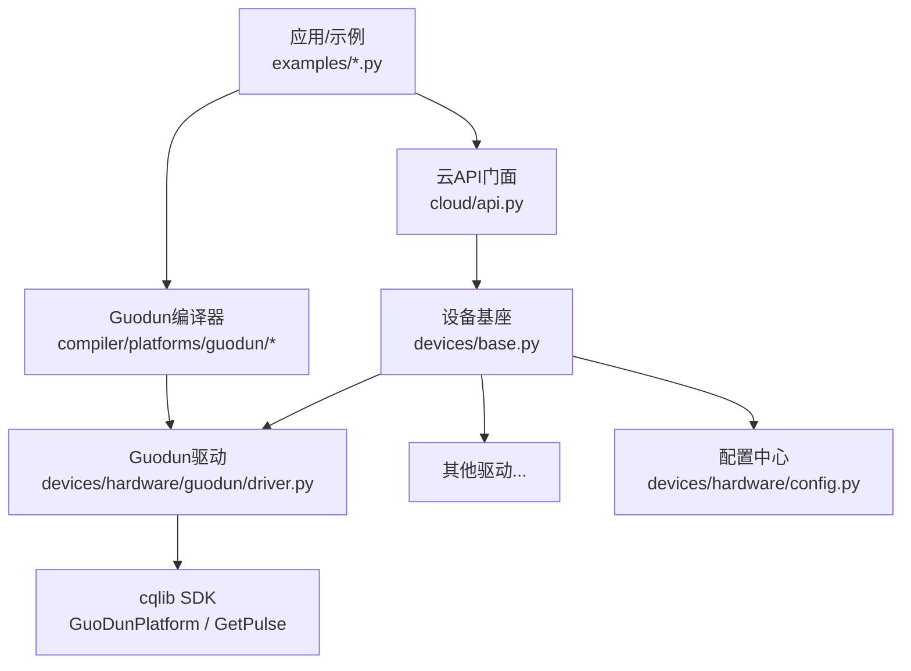
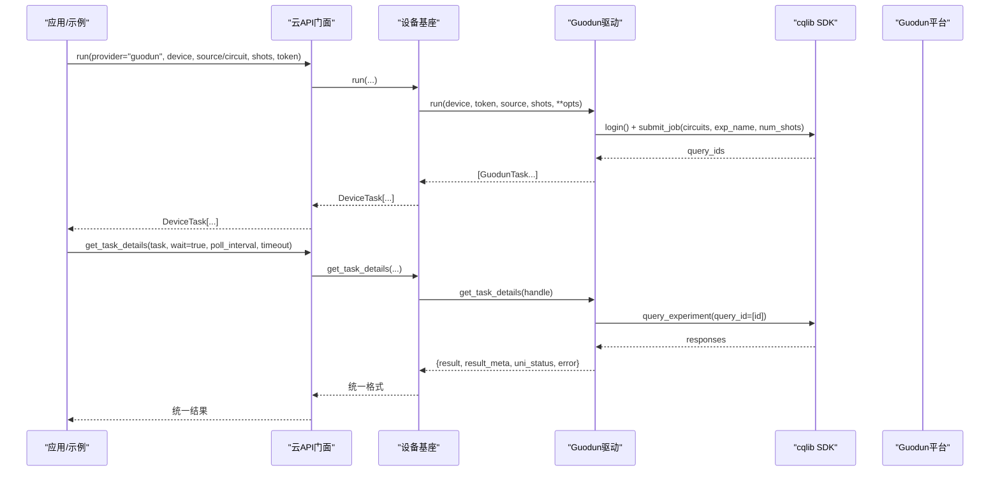
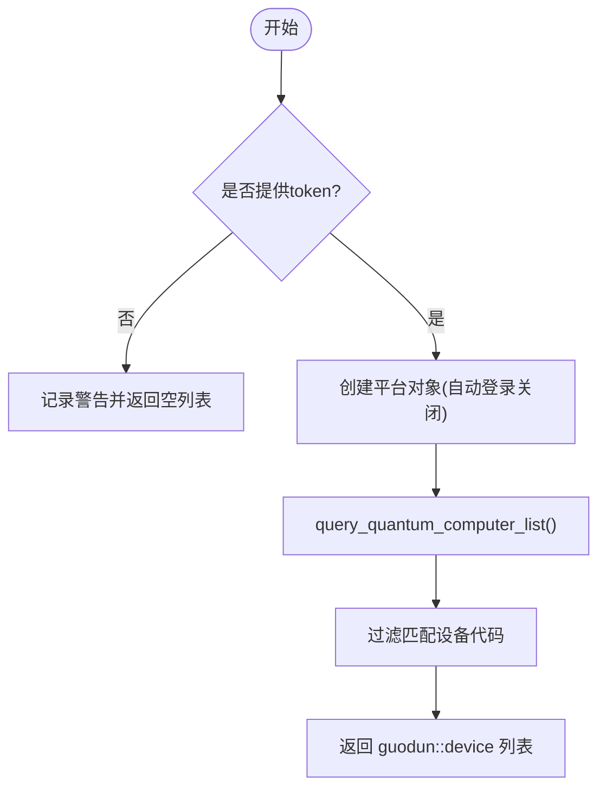
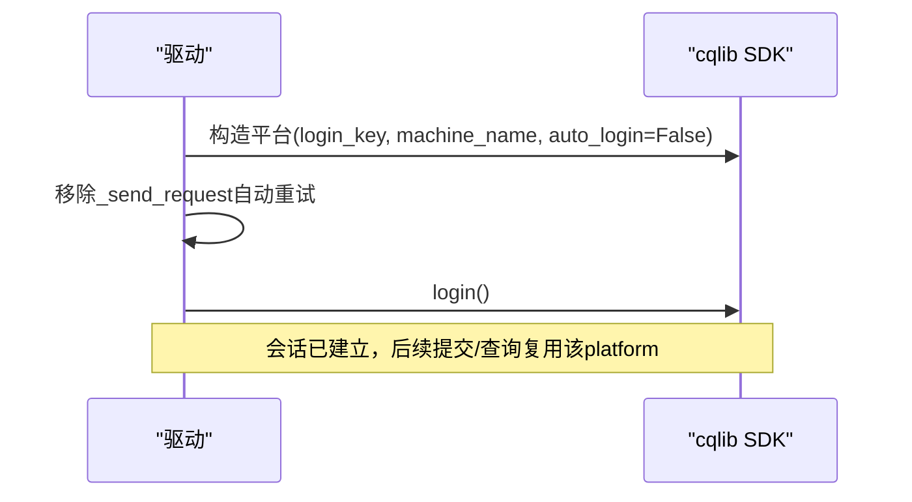
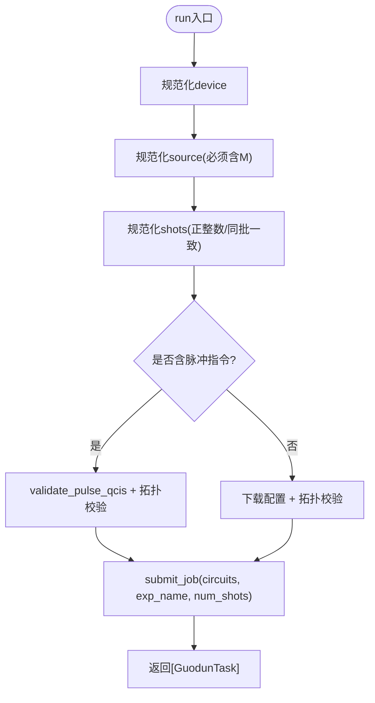
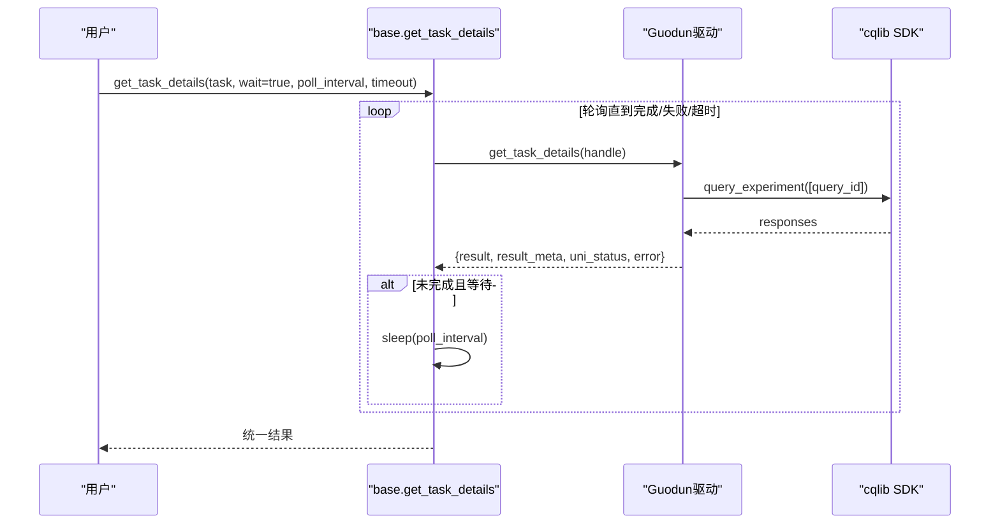
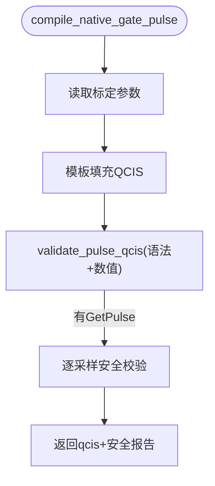
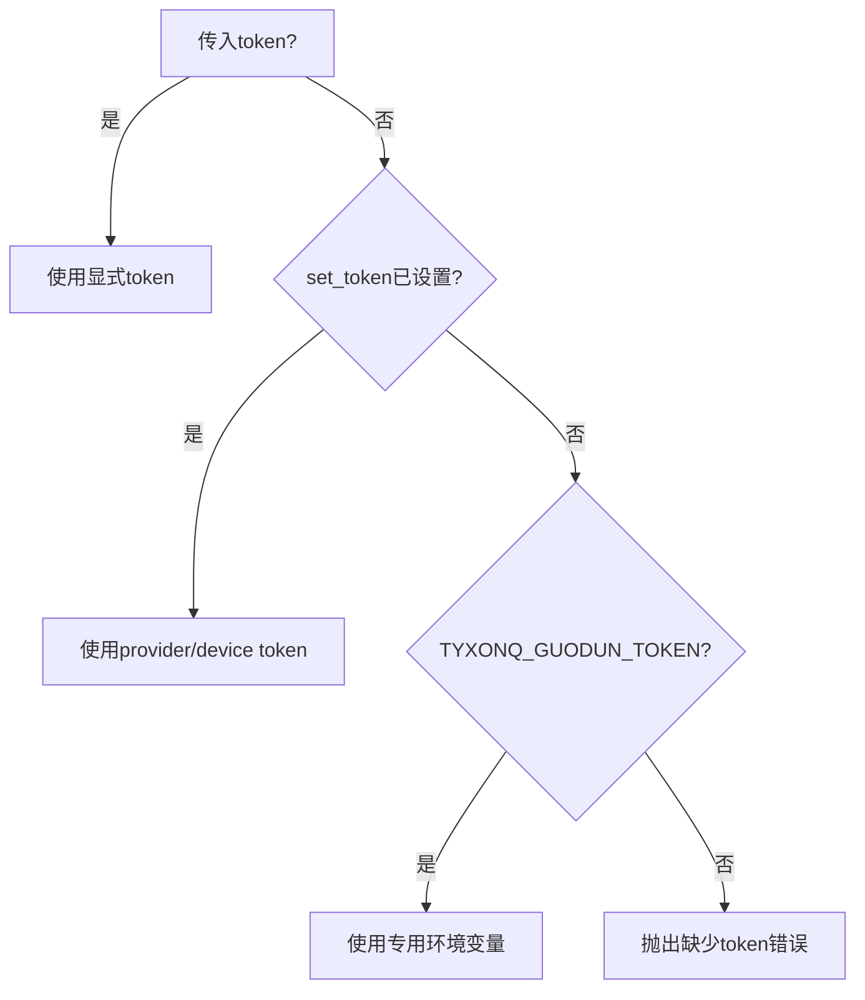
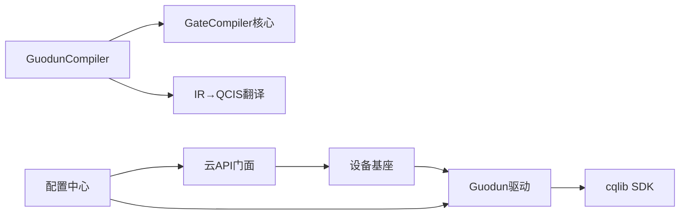
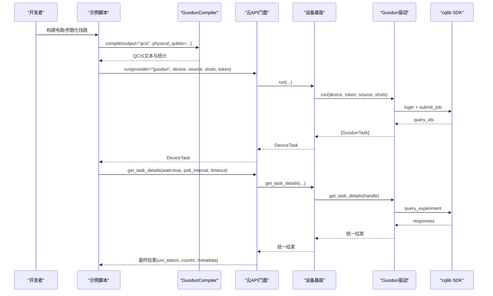

# Guodun云平台驱动

<cite>
**本文引用的文件**
- [driver.py](file://src/tyxonq/devices/hardware/guodun/driver.py)
- [compiler.py](file://src/tyxonq/compiler/platforms/guodun/compiler.py)
- [pulse.py](file://src/tyxonq/compiler/platforms/guodun/pulse.py)
- [base.py](file://src/tyxonq/devices/base.py)
- [api.py](file://src/tyxonq/cloud/api.py)
- [config.py](file://src/tyxonq/devices/hardware/config.py)
- [guodun_provider.md](file://docs/guodun_provider.md)
- [run_circuit_on_guodun.py](file://examples/run_circuit_on_guodun.py)
- [run_guodun_variational.py](file://examples/run_guodun_variational.py)
</cite>

## 目录
1. [简介](#简介)
2. [项目结构](#项目结构)
3. [核心组件](#核心组件)
4. [架构总览](#架构总览)
5. [详细组件分析](#详细组件分析)
6. [依赖关系分析](#依赖关系分析)
7. [性能与优化建议](#性能与优化建议)
8. [故障排查指南](#故障排查指南)
9. [结论](#结论)
10. [附录：端到端工作流](#附录端到端工作流)

## 简介
本文件面向在 TyxonQ 框架下使用 Guodun（国盾）云平台进行量子任务开发与部署的工程师，系统性说明 Guodun 驱动的架构设计、设备发现与连接流程、任务提交与结果解析、脉冲级安全校验、认证与安全通信、错误处理与重试策略，以及端到端开发工作流。文档以代码为依据，提供可追溯的文件与行号引用，帮助读者快速定位实现细节。

## 项目结构
Guodun 相关能力分布在编译器、设备驱动、云 API 门面和配置模块中：
- 编译器层：将 TyxonQ Circuit 编译为 Guodun 平台使用的 QCIS（门级），并支持原生门脉冲模板生成与校验。
- 设备驱动层：封装 cqlib SDK，负责登录、提交任务、查询结果、取消任务、波形任务管理、拓扑与禁用资源校验。
- 云 API 门面：统一入口，屏蔽 provider/device 差异，提供 set_token、list_devices、submit_task、get_task_details 等接口。
- 配置模块：集中管理 token、默认 provider/device、端点信息。

图表来源
- [api.py:42-131](file://src/tyxonq/cloud/api.py#L42-L131)
- [base.py:294-445](file://src/tyxonq/devices/base.py#L294-L445)
- [driver.py:310-478](file://src/tyxonq/devices/hardware/guodun/driver.py#L310-L478)
- [compiler.py:88-173](file://src/tyxonq/compiler/platforms/guodun/compiler.py#L88-L173)
- [config.py:24-50](file://src/tyxonq/devices/hardware/config.py#L24-L50)

章节来源
- [api.py:42-131](file://src/tyxonq/cloud/api.py#L42-L131)
- [base.py:294-445](file://src/tyxonq/devices/base.py#L294-L445)
- [driver.py:310-478](file://src/tyxonq/devices/hardware/guodun/driver.py#L310-L478)
- [compiler.py:88-173](file://src/tyxonq/compiler/platforms/guodun/compiler.py#L88-L173)
- [config.py:24-50](file://src/tyxonq/devices/hardware/config.py#L24-L50)

## 核心组件
- GuodunCompiler：将 TyxonQ Circuit 编译为 Guodun 门级 QCIS（X/H/RZ/CZ/M），强制 matchgate/rotations 分解，物理比特映射在编译期烘焙进 QCIS。
- Guodun 驱动：基于 cqlib SDK 完成登录、提交、查询、取消、波形任务、拓扑与禁用资源校验；对脉冲 QCIS 做逐采样安全校验。
- 云 API 门面：统一 set_token/list_devices/submit_task/get_task_details/run/result/cancel。
- 配置中心：内存 token 存储、默认 provider/device、可选全局环境变量回退。

章节来源
- [compiler.py:88-173](file://src/tyxonq/compiler/platforms/guodun/compiler.py#L88-L173)
- [driver.py:30-97](file://src/tyxonq/devices/hardware/guodun/driver.py#L30-L97)
- [api.py:22-72](file://src/tyxonq/cloud/api.py#L22-L72)
- [config.py:24-50](file://src/tyxonq/devices/hardware/config.py#L24-L50)

## 架构总览
下图展示从用户代码到 Guodun 平台的完整调用链，包括编译、提交、轮询与结果标准化。

图表来源
- [api.py:75-131](file://src/tyxonq/cloud/api.py#L75-L131)
- [base.py:294-445](file://src/tyxonq/devices/base.py#L294-L445)
- [base.py:497-557](file://src/tyxonq/devices/base.py#L497-L557)
- [driver.py:310-478](file://src/tyxonq/devices/hardware/guodun/driver.py#L310-L478)

## 详细组件分析

### 设备发现机制
- 通过驱动提供的 list_devices 调用 SDK 公共查询接口，动态提取机器代码，并以 guodun::code 形式返回。
- 若未提供 token 或网络异常，返回空列表并记录警告日志，不中断上层流程。

图表来源
- [driver.py:493-510](file://src/tyxonq/devices/hardware/guodun/driver.py#L493-L510)

章节来源
- [driver.py:493-510](file://src/tyxonq/devices/hardware/guodun/driver.py#L493-L510)

### 连接建立与会话管理
- 驱动延迟加载 cqlib 并锁定兼容版本，构造平台对象时关闭自动登录，显式执行一次 login。
- 移除 cqlib 内部隐式 HTTP 重试装饰器，避免不可控的重试行为；所有重试由上层统一控制。
- 会话生命周期由驱动维护，任务对象携带 platform 引用，便于后续查询与取消。

图表来源
- [driver.py:30-90](file://src/tyxonq/devices/hardware/guodun/driver.py#L30-L90)

章节来源
- [driver.py:30-90](file://src/tyxonq/devices/hardware/guodun/driver.py#L30-L90)

### 量子任务提交、参数配置与执行模式
- 提交入口：驱动 run(device, token, source, shots, **opts)。
- 输入校验：
  - source 必须包含显式测量指令 M。
  - shots 可为标量或序列；批量时长度需一致且值相同。
  - 含脉冲指令时需走 pulse-QCIS 校验路径，仅允许 gd_qc1。
- 拓扑校验：下载当前配置，检查禁用比特、禁用耦合器、每条 CZ 边有效性。
- 提交：调用 SDK submit_job，返回 query IDs；数量不一致则报错且不重提。
- 执行模式：同步/异步由 DeviceTask.async_result 决定；统一轮询在 base.get_task_details 中实现。

图表来源
- [driver.py:100-140](file://src/tyxonq/devices/hardware/guodun/driver.py#L100-L140)
- [driver.py:152-222](file://src/tyxonq/devices/hardware/guodun/driver.py#L152-L222)
- [driver.py:310-357](file://src/tyxonq/devices/hardware/guodun/driver.py#L310-L357)

章节来源
- [driver.py:100-140](file://src/tyxonq/devices/hardware/guodun/driver.py#L100-L140)
- [driver.py:152-222](file://src/tyxonq/devices/hardware/guodun/driver.py#L152-L222)
- [driver.py:310-357](file://src/tyxonq/devices/hardware/guodun/driver.py#L310-L357)

### 结果数据获取、解析与标准化
- 查询：get_task_details 仅轮询已有 query ID，不新建任务。
- 状态映射：runStatus=2 为 completed，=3 为 failed，其余为 unknown。
- 结果解析：按 resultStatus 第一行保留平台测量顺序，统计后续每 shot 的 bitstring 计数。
- 统一格式：DeviceTask.get_result 将 result_meta 提升为 metadata，确保 keys 存在，便于下游后处理。

图表来源
- [base.py:497-557](file://src/tyxonq/devices/base.py#L497-L557)
- [driver.py:403-471](file://src/tyxonq/devices/hardware/guodun/driver.py#L403-L471)

章节来源
- [base.py:497-557](file://src/tyxonq/devices/base.py#L497-L557)
- [driver.py:403-471](file://src/tyxonq/devices/hardware/guodun/driver.py#L403-L471)

### 脉冲级安全校验与原生门模板
- 原生门模板：支持 X2P/X2M/Y2M/CZ 等模板，读取当前标定参数填充 QCIS。
- 语法与数值校验：严格检查指令字段、频率范围、相位边界、拖拽系数、波形类型与附加参数。
- 逐采样安全：利用 GetPulse 生成包络并映射 AWG 码值，验证幅度范围与 Z 偏置安全区间。
- 提交前二次校验：驱动在提交前再次读取当前标定并逐采样校验，任一失败立即停止，不提交。

图表来源
- [pulse.py:367-420](file://src/tyxonq/compiler/platforms/guodun/pulse.py#L367-L420)
- [pulse.py:233-364](file://src/tyxonq/compiler/platforms/guodun/pulse.py#L233-L364)

章节来源
- [pulse.py:233-364](file://src/tyxonq/compiler/platforms/guodun/pulse.py#L233-L364)
- [pulse.py:367-420](file://src/tyxonq/compiler/platforms/guodun/pulse.py#L367-L420)

### 混合计算模式、实时反馈与优化算法
- 混合计算：TyxonQ 整体框架支持经典-量子协同训练与优化（例如 VQE、QAOA、梯度方法），Guodun 作为后端执行量子线路。
- 实时反馈：驱动在查询阶段识别“排队/校准”导致的临时错误，返回非终态供上层继续轮询，避免重复提交。
- 优化算法：框架内置多种优化器与梯度方法（如 QNG），可在云端任务循环中结合 Guodun 后端迭代更新参数。

章节来源
- [base.py:497-557](file://src/tyxonq/devices/base.py#L497-L557)
- [driver.py:392-430](file://src/tyxonq/devices/hardware/guodun/driver.py#L392-L430)

### 认证配置、密钥管理与安全通信
- 密钥优先级：显式 token > set_token(provider="guodun") > TYXONQ_GUODUN_TOKEN。
- 存储：内存字典 _TOKENS，支持 provider/device 双键；可选全局环境变量回退（仅特定 provider）。
- 安全通信：驱动关闭 SDK 自动重试，避免隐藏的重试逻辑；登录与提交均通过 SDK 的安全通道完成。

图表来源
- [driver.py:56-66](file://src/tyxonq/devices/hardware/guodun/driver.py#L56-L66)
- [config.py:24-50](file://src/tyxonq/devices/hardware/config.py#L24-L50)

章节来源
- [driver.py:56-66](file://src/tyxonq/devices/hardware/guodun/driver.py#L56-L66)
- [config.py:24-50](file://src/tyxonq/devices/hardware/config.py#L24-L50)

### 错误处理策略、重试机制与日志记录
- 临时错误识别：捕获 cqlib 请求异常，标记为 transient，返回未知状态供上层轮询。
- 无自动重提：提交结果数量不一致或拓扑校验失败直接报错，避免重复提交造成资源浪费。
- 日志：list_devices 失败记录警告；关键路径使用 logger.warning 输出诊断信息。
- 统一轮询：base.get_task_details 提供 wait/poll_interval/timeout 控制，超时发出 RuntimeWarning。

章节来源
- [driver.py:392-430](file://src/tyxonq/devices/hardware/guodun/driver.py#L392-L430)
- [driver.py:493-510](file://src/tyxonq/devices/hardware/guodun/driver.py#L493-L510)
- [base.py:497-557](file://src/tyxonq/devices/base.py#L497-L557)

## 依赖关系分析
- 编译器依赖 gate_compiler 核心进行设备无关分解与路由，再将 IR 直译为 QCIS。
- 驱动依赖 cqlib SDK 的 GuoDunPlatform 与 GetPulse，版本锁定为 1.3.11。
- 云 API 门面解耦 provider/device 选择，统一调度 devices.base 与各硬件驱动。
- 配置模块提供 token 与默认值，被驱动与云 API 共同消费。

图表来源
- [compiler.py:88-173](file://src/tyxonq/compiler/platforms/guodun/compiler.py#L88-L173)
- [driver.py:30-90](file://src/tyxonq/devices/hardware/guodun/driver.py#L30-L90)
- [api.py:42-131](file://src/tyxonq/cloud/api.py#L42-L131)
- [config.py:24-50](file://src/tyxonq/devices/hardware/config.py#L24-L50)

章节来源
- [compiler.py:88-173](file://src/tyxonq/compiler/platforms/guodun/compiler.py#L88-L173)
- [driver.py:30-90](file://src/tyxonq/devices/hardware/guodun/driver.py#L30-L90)
- [api.py:42-131](file://src/tyxonq/cloud/api.py#L42-L131)
- [config.py:24-50](file://src/tyxonq/devices/hardware/config.py#L24-L50)

## 性能与优化建议
- 编译期物理比特映射：GuodunCompiler 将 physical_qubits 烘焙进 QCIS，减少运行期布局开销。
- 批次提交：单次 submit_job 提交多个 circuit，降低网络往返；注意 shots 一致性。
- 拓扑预检：提交前校验禁用比特/耦合器与 CZ 边，避免无效任务占用队列。
- 脉冲安全：使用 GetPulse 当前标定生成与校验脉冲，防止因标定漂移导致失败。
- 轮询策略：合理设置 poll_interval 与 timeout，平衡响应速度与资源占用。

章节来源
- [compiler.py:116-173](file://src/tyxonq/compiler/platforms/guodun/compiler.py#L116-L173)
- [driver.py:310-357](file://src/tyxonq/devices/hardware/guodun/driver.py#L310-L357)
- [base.py:497-557](file://src/tyxonq/devices/base.py#L497-L557)

## 故障排查指南
- 缺少 token：检查显式传入、set_token 与 TYXONQ_GUODUN_TOKEN 三者之一是否设置。
- 设备不可用：list_devices 返回空或拓扑校验失败，确认设备名称与当前可用路径。
- 提交失败：检查 source 是否包含 M 指令、shots 是否为正整数、batch shots 是否一致。
- 脉冲失败：validate_pulse_qcis 报字段/数值/范围错误，核对频率、相位、拖拽系数与波形参数。
- 查询异常：识别临时错误（排队/校准），保持轮询；若非临时错误，查看 error 字段。

章节来源
- [driver.py:56-66](file://src/tyxonq/devices/hardware/guodun/driver.py#L56-L66)
- [driver.py:100-140](file://src/tyxonq/devices/hardware/guodun/driver.py#L100-L140)
- [driver.py:152-222](file://src/tyxonq/devices/hardware/guodun/driver.py#L152-L222)
- [pulse.py:233-364](file://src/tyxonq/compiler/platforms/guodun/pulse.py#L233-L364)
- [driver.py:392-430](file://src/tyxonq/devices/hardware/guodun/driver.py#L392-L430)

## 结论
Guodun 驱动在 TyxonQ 中提供了稳定、安全的云端量子任务执行能力：通过严格的编译期与运行期校验、可控的认证与会话管理、统一的轮询与结果标准化，以及与脉冲级标定的深度集成，显著降低了误用风险并提升了任务成功率。配合框架的混合计算与优化算法，用户可在 Guodun 平台上高效开展量子应用开发与部署。

## 附录：端到端工作流
以下流程展示了在 Guodun 平台上开发和部署量子应用的完整步骤，涵盖本地编译、在线提交与结果查看。

图表来源
- [run_guodun_variational.py:92-150](file://examples/run_guodun_variational.py#L92-L150)
- [run_circuit_on_guodun.py:70-120](file://examples/run_circuit_on_guodun.py#L70-L120)
- [compiler.py:102-173](file://src/tyxonq/compiler/platforms/guodun/compiler.py#L102-L173)
- [api.py:75-131](file://src/tyxonq/cloud/api.py#L75-L131)
- [base.py:294-445](file://src/tyxonq/devices/base.py#L294-L445)
- [driver.py:310-478](file://src/tyxonq/devices/hardware/guodun/driver.py#L310-L478)

章节来源
- [run_guodun_variational.py:92-150](file://examples/run_guodun_variational.py#L92-L150)
- [run_circuit_on_guodun.py:70-120](file://examples/run_circuit_on_guodun.py#L70-L120)
- [compiler.py:102-173](file://src/tyxonq/compiler/platforms/guodun/compiler.py#L102-L173)
- [api.py:75-131](file://src/tyxonq/cloud/api.py#L75-L131)
- [base.py:294-445](file://src/tyxonq/devices/base.py#L294-L445)
- [driver.py:310-478](file://src/tyxonq/devices/hardware/guodun/driver.py#L310-L478)