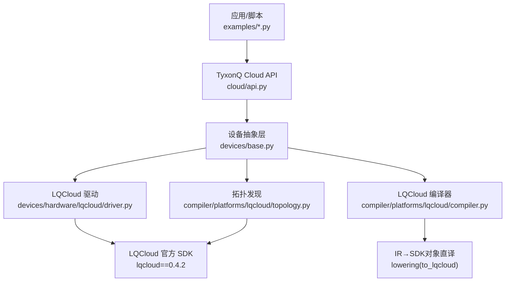
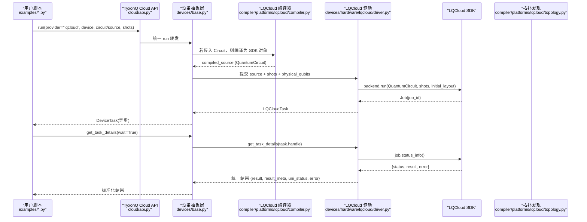
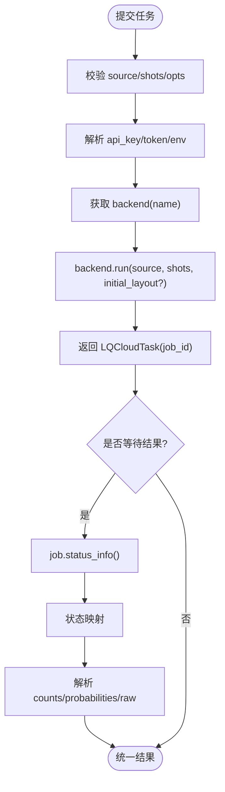
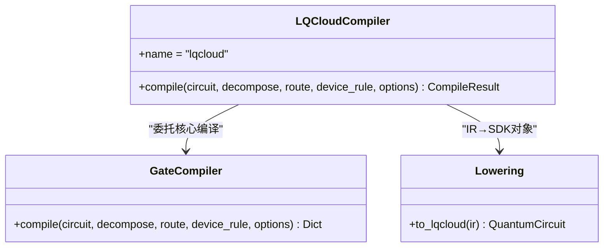
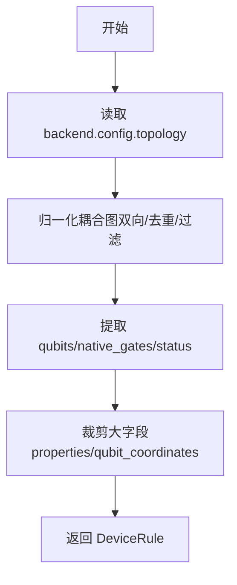
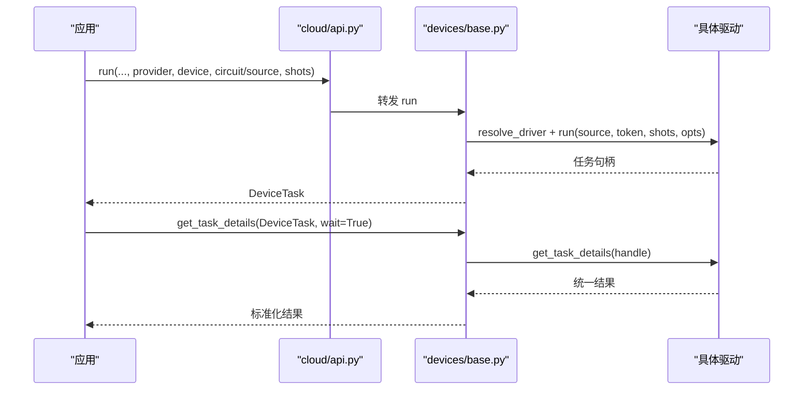
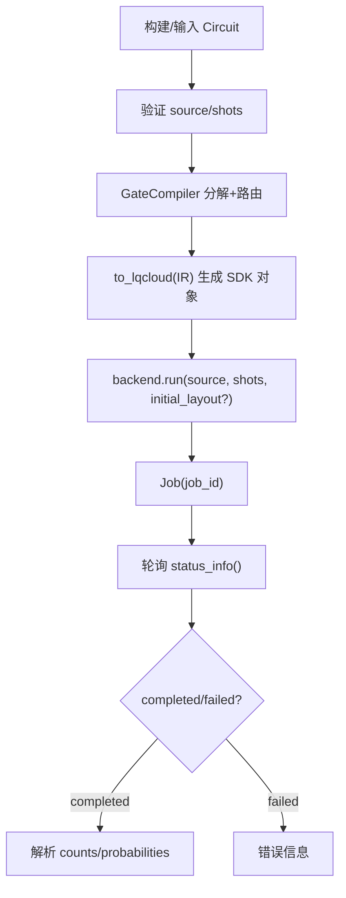
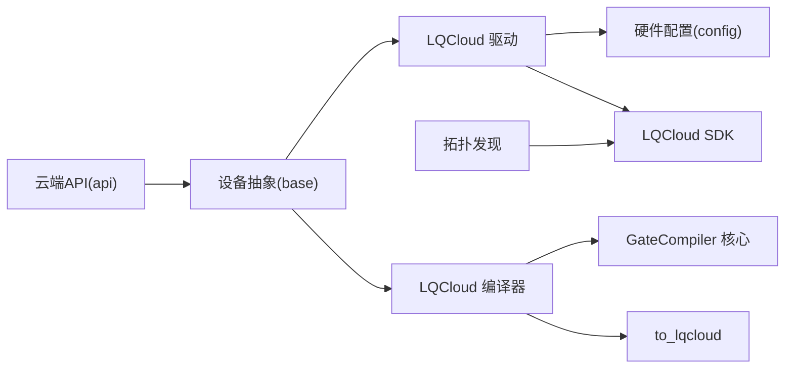

# LQCloud云平台驱动

<cite>
**本文引用的文件**
- [driver.py](file://src/tyxonq/devices/hardware/lqcloud/driver.py)
- [compiler.py](file://src/tyxonq/compiler/platforms/lqcloud/compiler.py)
- [topology.py](file://src/tyxonq/compiler/platforms/lqcloud/topology.py)
- [api.py](file://src/tyxonq/cloud/api.py)
- [base.py](file://src/tyxonq/devices/base.py)
- [config.py](file://src/tyxonq/devices/hardware/config.py)
- [run_circuit_on_lqcloud.py](file://examples/run_circuit_on_lqcloud.py)
- [run_chem_on_lqcloud.py](file://examples/run_chem_on_lqcloud.py)
- [cloud_api_task.py](file://examples/cloud_api_task.py)
- [test_lqcloud_driver.py](file://tests_core_module/test_lqcloud_driver.py)
- [test_lqcloud_topology.py](file://tests_core_module/test_lqcloud_topology.py)
- [tyxonq_cloud_api.md](file://docs/tyxonq_cloud_api.md)
</cite>

## 目录
1. [简介](#简介)
2. [项目结构](#项目结构)
3. [核心组件](#核心组件)
4. [架构总览](#架构总览)
5. [详细组件分析](#详细组件分析)
6. [依赖关系分析](#依赖关系分析)
7. [性能与资源限制](#性能与资源限制)
8. [故障排除指南](#故障排除指南)
9. [结论](#结论)
10. [附录：API与配置速查](#附录api与配置速查)

## 简介
本文件面向使用 TyxonQ 接入 LQCloud 云平台的开发者，系统性说明 LQCloud 平台特性、服务模式、任务提交流程、拓扑与量子比特映射、结果数据格式、安全与权限管理、配置与调优参数，以及分布式大规模模拟与优化实践。文档基于仓库中 LQCloud 驱动、编译器、拓扑发现与示例代码的源码实现进行归纳，确保内容可追溯、可验证。

## 项目结构
LQCloud 相关能力分布在以下模块：
- 设备驱动层：devices/hardware/lqcloud/driver.py（提交、查询、取消、设备列表）
- 编译链路：compiler/platforms/lqcloud/compiler.py（IR→LQCloud SDK对象）、compiler/platforms/lqcloud/topology.py（拓扑抓取与归一化）
- 统一云端入口：cloud/api.py（统一封装 run/submit/get_result/cancel）
- 设备抽象与调度：devices/base.py（DeviceTask、统一轮询、参数过滤、设备解析）
- 认证与默认值：devices/hardware/config.py（token存储、默认provider/device）
- 示例与测试：examples/*、tests_core_module/test_lqcloud_*

图表来源
- [api.py:42-72](file://src/tyxonq/cloud/api.py#L42-L72)
- [base.py:294-445](file://src/tyxonq/devices/base.py#L294-L445)
- [driver.py:56-92](file://src/tyxonq/devices/hardware/lqcloud/driver.py#L56-L92)
- [compiler.py:55-109](file://src/tyxonq/compiler/platforms/lqcloud/compiler.py#L55-L109)
- [topology.py:108-151](file://src/tyxonq/compiler/platforms/lqcloud/topology.py#L108-L151)

章节来源
- [api.py:1-160](file://src/tyxonq/cloud/api.py#L1-L160)
- [base.py:1-578](file://src/tyxonq/devices/base.py#L1-L578)
- [driver.py:1-223](file://src/tyxonq/devices/hardware/lqcloud/driver.py#L1-L223)
- [compiler.py:1-113](file://src/tyxonq/compiler/platforms/lqcloud/compiler.py#L1-L113)
- [topology.py:1-155](file://src/tyxonq/compiler/platforms/lqcloud/topology.py#L1-L155)

## 核心组件
- LQCloud 驱动（driver.py）
  - 提交任务：接收 lqcloud.QuantumCircuit，调用后端 run，返回 LQCloudTask
  - 查询任务：status_info → 统一状态映射 → 计数/概率/元数据
  - 取消任务：cancel()
  - 设备列表：get_backends() → 动态列出可用设备
- LQCloud 编译器（compiler.py）
  - 委托 gate_compiler 完成设备无关分解与路由，得到 IR
  - 将 IR 1:1 直译为 lqcloud.QuantumCircuit 对象（无网络请求）
  - 输出 metadata 包含门统计、步骤序列等
- 拓扑发现（topology.py）
  - 通过 backend.config.topology.coupling_map 获取耦合图
  - 归一化为双向去重边集；裁剪大字段以控制缓存体积
  - 提供 DeviceRule 描述供编译器路由使用
- 统一云端 API（cloud/api.py）
  - set_token/set_default/list_devices/submit_task/get_task_details/run/cancel
  - 透明转发到 devices.base.run，保持跨 provider 一致体验
- 设备抽象与调度（devices/base.py）
  - DeviceTask 统一任务句柄，支持 get_result/cancel
  - run 流程：选择驱动、参数过滤（丢弃模拟器专属噪声参数）、统一返回
  - get_task_details：统一轮询、超时处理、状态标准化

章节来源
- [driver.py:33-92](file://src/tyxonq/devices/hardware/lqcloud/driver.py#L33-L92)
- [driver.py:95-187](file://src/tyxonq/devices/hardware/lqcloud/driver.py#L95-L187)
- [compiler.py:50-109](file://src/tyxonq/compiler/platforms/lqcloud/compiler.py#L50-L109)
- [topology.py:43-151](file://src/tyxonq/compiler/platforms/lqcloud/topology.py#L43-L151)
- [api.py:22-72](file://src/tyxonq/cloud/api.py#L22-L72)
- [base.py:12-57](file://src/tyxonq/devices/base.py#L12-L57)
- [base.py:294-445](file://src/tyxonq/devices/base.py#L294-L445)
- [base.py:496-557](file://src/tyxonq/devices/base.py#L496-L557)

## 架构总览
下图展示从用户脚本到 LQCloud 真机的完整调用链，包括编译、拓扑、提交与结果聚合。

图表来源
- [api.py:75-131](file://src/tyxonq/cloud/api.py#L75-L131)
- [base.py:294-445](file://src/tyxonq/devices/base.py#L294-L445)
- [compiler.py:55-109](file://src/tyxonq/compiler/platforms/lqcloud/compiler.py#L55-L109)
- [driver.py:56-92](file://src/tyxonq/devices/hardware/lqcloud/driver.py#L56-L92)
- [driver.py:119-180](file://src/tyxonq/devices/hardware/lqcloud/driver.py#L119-L180)
- [topology.py:108-151](file://src/tyxonq/compiler/platforms/lqcloud/topology.py#L108-L151)

## 详细组件分析

### LQCloud 驱动（提交、查询、取消、设备列表）
- 提交任务
  - 要求 source 必须是 lqcloud.QuantumCircuit；shots 必须为正整数；不支持批量线路
  - 可选 physical_qubits 映射为 initial_layout
  - 通过 LQCloudProvider(api_key, interactive=False).get_backend(name).run(...) 提交
- 查询任务
  - 调用 job.status_info()，将状态映射为 queued/running/completed/failed/cancelled/unknown
  - 解析 Result.get_counts()/get_probabilities()，构造统一结果与元数据
- 取消任务
  - 调用 job.cancel()
- 设备列表
  - 通过 provider.get_backends() 动态获取当前 API key 可见的设备名，并前缀 lqcloud::

图表来源
- [driver.py:56-92](file://src/tyxonq/devices/hardware/lqcloud/driver.py#L56-L92)
- [driver.py:95-180](file://src/tyxonq/devices/hardware/lqcloud/driver.py#L95-L180)

章节来源
- [driver.py:24-42](file://src/tyxonq/devices/hardware/lqcloud/driver.py#L24-L42)
- [driver.py:56-92](file://src/tyxonq/devices/hardware/lqcloud/driver.py#L56-L92)
- [driver.py:95-187](file://src/tyxonq/devices/hardware/lqcloud/driver.py#L95-L187)
- [driver.py:190-213](file://src/tyxonq/devices/hardware/lqcloud/driver.py#L190-L213)

### LQCloud 编译器（IR→SDK对象）
- 委托 gate_compiler 完成设备无关的分解（matchgate/rotations）与路由，得到 IR
- 将 IR 1:1 转换为 lqcloud.QuantumCircuit 对象（纯本地操作，无网络）
- 输出 metadata 包含目标类型、量子比特数、门统计、转换路径、核心步骤等
- physical_qubits 作为运行期 initial_layout 透传，不在编译期消费

图表来源
- [compiler.py:50-109](file://src/tyxonq/compiler/platforms/lqcloud/compiler.py#L50-L109)

章节来源
- [compiler.py:1-113](file://src/tyxonq/compiler/platforms/lqcloud/compiler.py#L1-L113)

### 拓扑发现（设备拓扑、量子比特映射与连接性）
- 通过 backend.config.topology.coupling_map 获取物理连接
- 归一化为双向去重边集，剔除无效项（自环、负下标、非数值等）
- 提取 num_qubits/native_gates/status，裁剪大字段（properties、qubit_coordinates）以控制缓存体积
- 未声明 coupling_map 时视为全连接（无需路由）

图表来源
- [topology.py:43-105](file://src/tyxonq/compiler/platforms/lqcloud/topology.py#L43-L105)
- [topology.py:108-151](file://src/tyxonq/compiler/platforms/lqcloud/topology.py#L108-L151)

章节来源
- [topology.py:1-155](file://src/tyxonq/compiler/platforms/lqcloud/topology.py#L1-L155)

### 统一云端 API 与设备抽象
- cloud/api.py 提供 set_token/set_default/list_devices/submit_task/get_task_details/run/cancel
- devices/base.py 负责：
  - 选择驱动（resolve_driver）
  - 参数过滤（丢弃 noise/use_noise 等仅模拟器参数）
  - 统一任务包装（DeviceTask）
  - 统一轮询与超时处理（get_task_details）

图表来源
- [api.py:42-72](file://src/tyxonq/cloud/api.py#L42-L72)
- [base.py:294-445](file://src/tyxonq/devices/base.py#L294-L445)
- [base.py:496-557](file://src/tyxonq/devices/base.py#L496-L557)

章节来源
- [api.py:1-160](file://src/tyxonq/cloud/api.py#L1-L160)
- [base.py:12-57](file://src/tyxonq/devices/base.py#L12-L57)
- [base.py:294-445](file://src/tyxonq/devices/base.py#L294-L445)
- [base.py:496-557](file://src/tyxonq/devices/base.py#L496-L557)

### 任务提交流程（电路验证、编译优化、执行调度）
- 电路验证：driver.run 要求 source 为 lqcloud.QuantumCircuit；shots 必须为正整数；不支持批量
- 编译优化：compiler.compile 委托 gate_compiler 完成分解与路由，再直译为 SDK 对象
- 执行调度：通过 backend.run 提交任务，返回 job_id；统一层按异步模式轮询直至完成或失败

图表来源
- [driver.py:56-92](file://src/tyxonq/devices/hardware/lqcloud/driver.py#L56-L92)
- [compiler.py:55-109](file://src/tyxonq/compiler/platforms/lqcloud/compiler.py#L55-L109)
- [driver.py:119-180](file://src/tyxonq/devices/hardware/lqcloud/driver.py#L119-L180)

章节来源
- [driver.py:56-92](file://src/tyxonq/devices/hardware/lqcloud/driver.py#L56-L92)
- [compiler.py:55-109](file://src/tyxonq/compiler/platforms/lqcloud/compiler.py#L55-L109)
- [driver.py:119-180](file://src/tyxonq/devices/hardware/lqcloud/driver.py#L119-L180)

### 结果数据格式、统计信息与元数据管理
- 统一结果结构：
  - result: 计数字典（如 {"00": 51, "11": 49}）
  - result_meta: 原始驱动负载（含 job_id、device、shots、probability、result_format、raw）
  - uni_status: 统一状态字符串
  - error: 错误消息（如有）
- 概率计算：由 counts 汇总求和得到概率分布
- 元数据提升：设备抽象层会将内层 metadata 字段提升到外层，便于下游处理

章节来源
- [driver.py:119-180](file://src/tyxonq/devices/hardware/lqcloud/driver.py#L119-L180)
- [base.py:20-54](file://src/tyxonq/devices/base.py#L20-L54)

### 安全机制、访问控制与权限管理
- API Key 解析优先级：
  - 显式 api_key= 参数
  - 通过 tq.set_token(provider="lqcloud") 设置的命名空间 token
  - 环境变量 TYXONQ_LQCLOUD_API_KEY / LQCLOUD_API_KEY
- 严格隔离：不回退到 TyxonQ 平台全局密钥，避免跨 provider 误用
- 设备列表与拓扑发现仅在需要时发起只读网络请求，且关闭交互式登录

章节来源
- [driver.py:33-42](file://src/tyxonq/devices/hardware/lqcloud/driver.py#L33-L42)
- [config.py:24-50](file://src/tyxonq/devices/hardware/config.py#L24-L50)
- [topology.py:108-151](file://src/tyxonq/compiler/platforms/lqcloud/topology.py#L108-L151)

### 平台特定配置选项、性能调优与资源限制
- 运行期参数：
  - physical_qubits：逻辑比特到物理比特的初始布局（映射为 initial_layout）
  - shots：测量次数，必须为正整数；首版不支持批量线路
- 编译器选项：
  - output：仅支持 "lqcloud"（产物为 SDK 对象）
  - decompose/route：委托 gate_compiler 完成设备无关分解与路由
- 资源限制：
  - 首版 driver 不支持未知运行参数，会抛出 TypeError
  - 拓扑发现裁剪大字段以控制缓存体积

章节来源
- [driver.py:56-92](file://src/tyxonq/devices/hardware/lqcloud/driver.py#L56-L92)
- [compiler.py:64-72](file://src/tyxonq/compiler/platforms/lqcloud/compiler.py#L64-L72)
- [topology.py:97-105](file://src/tyxonq/compiler/platforms/lqcloud/topology.py#L97-L105)

### 分布式计算与大规模量子模拟
- 统一链式 .run() 支持在 simulator 与真机之间无缝切换，调用方代码零分叉
- 通过 gate_compiler 的设备无关分解与路由，可在不同拓扑设备上复用同一份算法电路
- 结合拓扑发现与 initial_layout，可在大规模设备上减少 SWAP 插入，降低深度与误差

章节来源
- [run_chem_on_lqcloud.py:1-183](file://examples/run_chem_on_lqcloud.py#L1-L183)
- [compiler.py:55-109](file://src/tyxonq/compiler/platforms/lqcloud/compiler.py#L55-L109)
- [topology.py:108-151](file://src/tyxonq/compiler/platforms/lqcloud/topology.py#L108-L151)

## 依赖关系分析
- 驱动依赖：
  - lqcloud==0.4.2（延迟导入，缺失时给出安装提示）
  - devices/hardware/config（token 解析）
- 编译器依赖：
  - gate_compiler（核心分解与路由）
  - lowering（IR→SDK对象）
- 拓扑发现依赖：
  - LQCloudProvider.backend.config（只读）
- 统一层依赖：
  - devices/base（设备抽象、轮询、参数过滤）
  - cloud/api（对外接口）

图表来源
- [driver.py:24-42](file://src/tyxonq/devices/hardware/lqcloud/driver.py#L24-L42)
- [compiler.py:74-92](file://src/tyxonq/compiler/platforms/lqcloud/compiler.py#L74-L92)
- [topology.py:127-151](file://src/tyxonq/compiler/platforms/lqcloud/topology.py#L127-L151)
- [base.py:294-445](file://src/tyxonq/devices/base.py#L294-L445)
- [api.py:42-72](file://src/tyxonq/cloud/api.py#L42-L72)

章节来源
- [driver.py:24-42](file://src/tyxonq/devices/hardware/lqcloud/driver.py#L24-L42)
- [compiler.py:74-92](file://src/tyxonq/compiler/platforms/lqcloud/compiler.py#L74-L92)
- [topology.py:127-151](file://src/tyxonq/compiler/platforms/lqcloud/topology.py#L127-L151)
- [base.py:294-445](file://src/tyxonq/devices/base.py#L294-L445)
- [api.py:42-72](file://src/tyxonq/cloud/api.py#L42-L72)

## 性能与资源限制
- 首版 driver 仅支持单条线路与单一 shots 值；批量提交将报错
- 未知运行参数会被拒绝，避免不可控行为
- 拓扑发现裁剪大字段，控制缓存体积，提高缓存命中率
- 统一层对真机提交前丢弃模拟器专属参数（noise/use_noise），避免驱动报错

章节来源
- [driver.py:66-80](file://src/tyxonq/devices/hardware/lqcloud/driver.py#L66-L80)
- [topology.py:97-105](file://src/tyxonq/compiler/platforms/lqcloud/topology.py#L97-L105)
- [base.py:376-382](file://src/tyxonq/devices/base.py#L376-L382)

## 故障排除指南
- 网络问题
  - 拓扑发现或设备列表失败时，驱动记录警告并返回空列表，建议检查网络与 API Key
  - 统一轮询在等待超时时发出 RuntimeWarning，提示可能为空/不完整结果
- 认证错误
  - 缺少 LQCloud API Key 会抛出 RuntimeError，需设置 TYXONQ_LQCLOUD_API_KEY/LQCLOUD_API_KEY 或通过 tq.set_token(provider="lqcloud") 设置
  - 全局 TYXONQ_API_KEY 不会被 LQCloud 驱动使用，避免误用
- 任务执行异常
  - 状态映射：pending/queued/submitted/retrying → queued；running → running；completed/done/success/finished → completed；failed/error → failed；cancelled/canceled → cancelled
  - 失败任务可从 result_meta.raw 中获取服务端错误信息
  - 取消任务：调用 remove_task 或 DeviceTask.cancel()

章节来源
- [driver.py:95-107](file://src/tyxonq/devices/hardware/lqcloud/driver.py#L95-L107)
- [driver.py:119-180](file://src/tyxonq/devices/hardware/lqcloud/driver.py#L119-L180)
- [base.py:529-551](file://src/tyxonq/devices/base.py#L529-L551)
- [test_lqcloud_driver.py:103-127](file://tests_core_module/test_lqcloud_driver.py#L103-L127)

## 结论
TyxonQ 对 LQCloud 的集成采用“驱动+编译器+拓扑发现+统一抽象”的分层设计，既保证了与官方 SDK 的最小适配，又提供了跨 provider 的一致体验。通过 gate_compiler 的设备无关分解与路由，结合 LQCloud 的 initial_layout 与拓扑信息，可在真实设备上高效执行复杂电路。统一轮询与结果标准化使得任务管理与后处理更加稳健。对于大规模量子模拟与优化，建议在算法层面利用匹配门分解与路由优化，并在运行期合理设置 physical_qubits 与 shots，以获得更好的性能与精度。

## 附录：API与配置速查
- 认证
  - 设置 token：tq.set_token(key, provider="lqcloud")
  - 环境变量：TYXONQ_LQCLOUD_API_KEY / LQCLOUD_API_KEY
- 提交任务
  - 统一入口：tyxonq.api.run(provider="lqcloud", device, circuit/source, shots)
  - 运行期参数：physical_qubits（initial_layout）
- 查询与取消
  - 查询：task.get_result(wait=True) 或 base.get_task_details(task, wait=True)
  - 取消：task.cancel() 或 base.remove_task(task)
- 设备与拓扑
  - 设备列表：tyxonq.api.list_devices(provider="lqcloud")
  - 拓扑发现：compiler/platforms/lqcloud/topology.get_topology(device, token)

章节来源
- [api.py:22-72](file://src/tyxonq/cloud/api.py#L22-L72)
- [base.py:294-445](file://src/tyxonq/devices/base.py#L294-L445)
- [base.py:496-557](file://src/tyxonq/devices/base.py#L496-L557)
- [topology.py:108-151](file://src/tyxonq/compiler/platforms/lqcloud/topology.py#L108-L151)
- [tyxonq_cloud_api.md:1-361](file://docs/tyxonq_cloud_api.md#L1-L361)