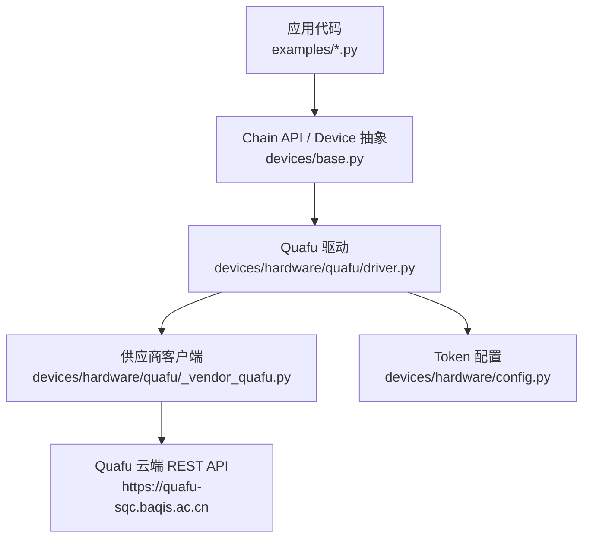
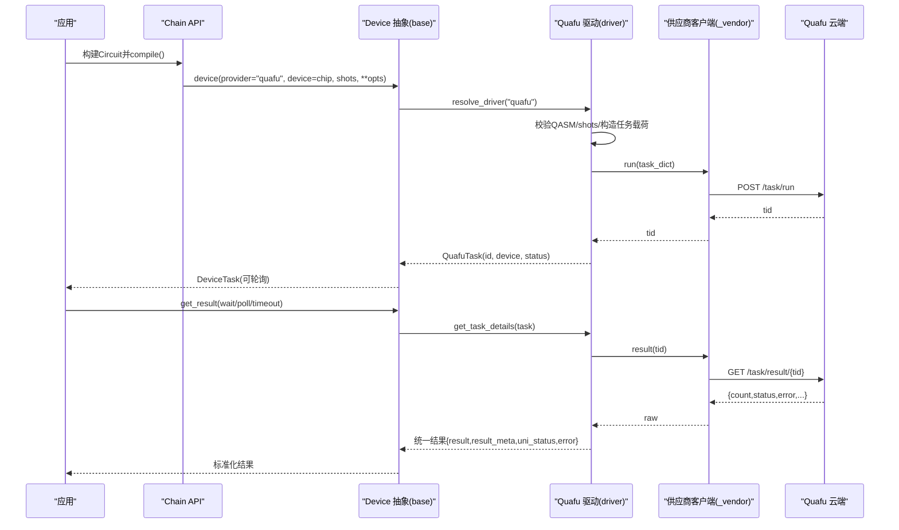
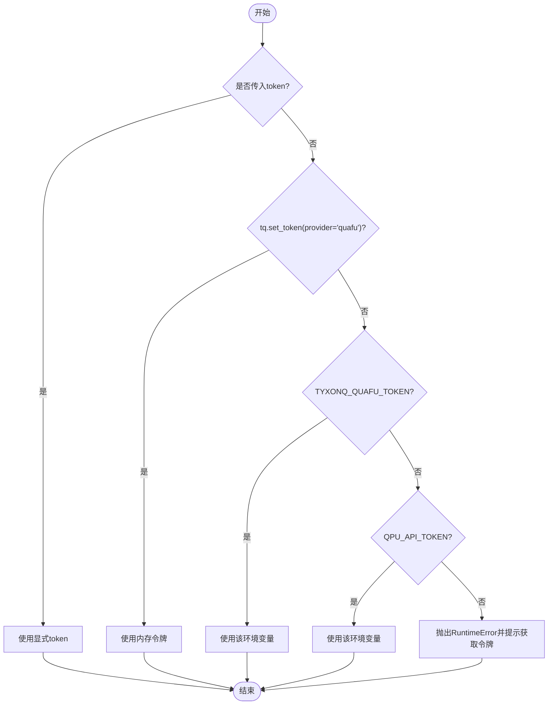
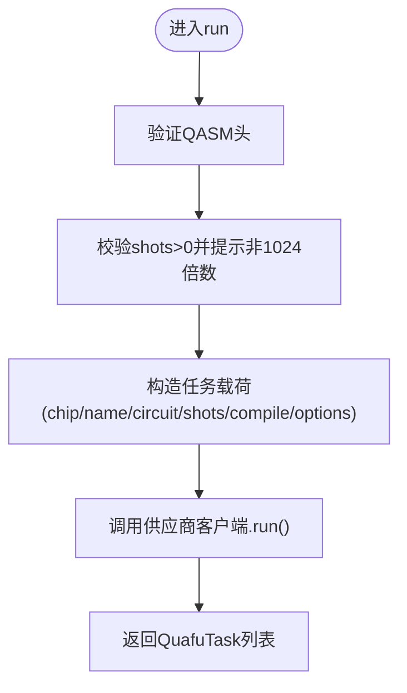
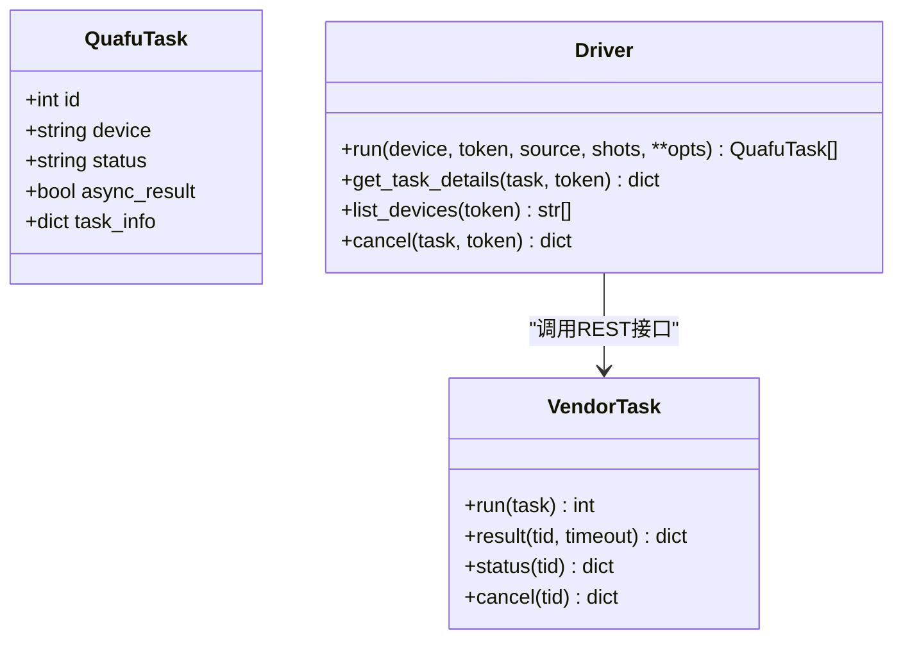
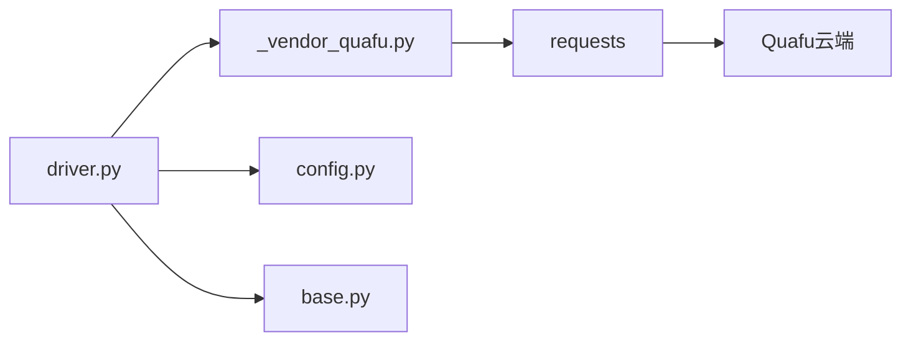

# Quafu云平台驱动

<cite>
**本文引用的文件**
- [driver.py](file://src/tyxonq/devices/hardware/quafu/driver.py)
- [_vendor_quafu.py](file://src/tyxonq/devices/hardware/quafu/_vendor_quafu.py)
- [config.py](file://src/tyxonq/devices/hardware/config.py)
- [base.py](file://src/tyxonq/devices/base.py)
- [quafu_provider.md](file://docs/quafu_provider.md)
- [run_circuit_on_quafu.py](file://examples/run_circuit_on_quafu.py)
- [run_circuit_on_quafu_full.py](file://examples/run_circuit_on_quafu_full.py)
- [test_quafu_driver.py](file://tests_core_module/test_quafu_driver.py)
</cite>

## 目录
1. [简介](#简介)
2. [项目结构](#项目结构)
3. [核心组件](#核心组件)
4. [架构总览](#架构总览)
5. [详细组件分析](#详细组件分析)
6. [依赖关系分析](#依赖关系分析)
7. [性能考虑](#性能考虑)
8. [故障排查指南](#故障排查指南)
9. [结论](#结论)
10. [附录](#附录)

## 简介
本文件面向在 TyxonQ 框架中集成并运行 BAQIS Quafu 超导量子云平台的开发者，系统性说明：
- Quafu 平台与 TyxonQ 的对接方式、认证配置与安全实践
- 设备管理（在线芯片发现、状态监控）
- 量子电路提交格式（OpenQASM 2.0）、编译选项与执行参数
- 结果数据获取、统一化解析与后处理
- Quafu 特有功能：读取错误校正、动态解耦、目标量子比特选择、服务器端重编译
- 常见问题诊断与优化建议

## 项目结构
TyxonQ 对 Quafu 的支持由“驱动层 + 供应商客户端 + 配置与统一设备抽象”组成：
- 驱动层：封装 TyxonQ 的设备契约（run / get_task_details / list_devices / cancel），负责参数校验、任务载荷构造、状态映射与统一结果形状
- 供应商客户端：内嵌的 REST 客户端，直接调用 Quafu 云端接口
- 配置与统一设备抽象：提供 token 存储、默认 provider/device 解析，以及跨设备的统一任务包装与结果规范化

图表来源
- [base.py:112-200](file://src/tyxonq/devices/base.py#L112-L200)
- [driver.py:103-180](file://src/tyxonq/devices/hardware/quafu/driver.py#L103-L180)
- [_vendor_quafu.py:112-202](file://src/tyxonq/devices/hardware/quafu/_vendor_quafu.py#L112-L202)
- [config.py:24-50](file://src/tyxonq/devices/hardware/config.py#L24-L50)

章节来源
- [quafu_provider.md:1-113](file://docs/quafu_provider.md#L1-L113)
- [driver.py:1-276](file://src/tyxonq/devices/hardware/quafu/driver.py#L1-L276)
- [_vendor_quafu.py:1-202](file://src/tyxonq/devices/hardware/quafu/_vendor_quafu.py#L1-L202)
- [config.py:1-78](file://src/tyxonq/devices/hardware/config.py#L1-L78)
- [base.py:1-200](file://src/tyxonq/devices/base.py#L1-L200)

## 核心组件
- QuafuTask：驱动返回的任务句柄，包含任务 ID、设备名、状态、异步标志及内部管理器引用，便于链式轮询
- run：将 OpenQASM 2.0 源串提交到 Quafu 云端，支持单任务与批量提交；自动校验 QASM 头、shots 合法性，并构造任务载荷
- get_task_details：拉取任务结果并标准化为 TyxonQ 统一结果形状（result/result_meta/uni_status/error）
- list_devices：列出在线芯片（过滤离线/校准/维护等状态），返回带 provider 前缀的设备名
- cancel：取消排队中的任务
- _vendor_quafu.Task：内嵌 REST 客户端，封装 verify/query/delete/result/status/cancel/run 等接口

章节来源
- [driver.py:50-180](file://src/tyxonq/devices/hardware/quafu/driver.py#L50-L180)
- [driver.py:203-276](file://src/tyxonq/devices/hardware/quafu/driver.py#L203-L276)
- [_vendor_quafu.py:112-202](file://src/tyxonq/devices/hardware/quafu/_vendor_quafu.py#L112-L202)

## 架构总览
TyxonQ 通过统一的设备抽象将不同后端（含 Quafu）接入。Quafu 驱动遵循该契约，屏蔽底层差异，向上暴露一致的 run/get_task_details/list_devices/cancel 能力。

图表来源
- [base.py:112-200](file://src/tyxonq/devices/base.py#L112-L200)
- [driver.py:103-180](file://src/tyxonq/devices/hardware/quafu/driver.py#L103-L180)
- [_vendor_quafu.py:155-202](file://src/tyxonq/devices/hardware/quafu/_vendor_quafu.py#L155-L202)

## 详细组件分析

### 认证与令牌解析
- 优先级顺序：显式 token 参数 > tq.set_token(provider="quafu") > 环境变量 TYXONQ_QUAFU_TOKEN > 环境变量 QPU_API_TOKEN
- 不兼容全局 TYXONQ_API_KEY（避免误用 TyxonQ 云平台令牌）
- 未配置时抛出明确提示，指向 SQCLab 获取令牌

图表来源
- [driver.py:28-45](file://src/tyxonq/devices/hardware/quafu/driver.py#L28-L45)
- [config.py:24-50](file://src/tyxonq/devices/hardware/config.py#L24-L50)

章节来源
- [driver.py:28-45](file://src/tyxonq/devices/hardware/quafu/driver.py#L28-L45)
- [config.py:24-50](file://src/tyxonq/devices/hardware/config.py#L24-L50)
- [quafu_provider.md:7-36](file://docs/quafu_provider.md#L7-L36)

### 设备管理与状态监控
- list_devices：调用供应商客户端 status(0)，仅返回队列深度为整数的芯片（表示在线且接受任务），并以 quafu:: 前缀返回
- 无 token 或网络异常时，list_devices 防御性返回空列表，避免启动阶段崩溃
- 示例脚本演示了按队列深度挑选空闲芯片的策略

章节来源
- [driver.py:242-266](file://src/tyxonq/devices/hardware/quafu/driver.py#L242-L266)
- [_vendor_quafu.py:170-172](file://src/tyxonq/devices/hardware/quafu/_vendor_quafu.py#L170-L172)
- [run_circuit_on_quafu_full.py:54-79](file://examples/run_circuit_on_quafu_full.py#L54-L79)

### 量子电路提交与编译选项
- 输入要求：OpenQASM 2.0 字符串，必须包含 OPENQASM 2.0 头部；否则拒绝
- shots：必须为正整数；非 1024 倍数会发出警告（服务端可能四舍五入或拒绝）
- 任务载荷字段：
  - chip：芯片名（可从 quafu::xxx 中剥离）
  - name：任务显示名
  - circuit：QASM 2.0 源码
  - shots：采样次数
  - compile：是否允许服务器端重新编译（默认 True，但 options.compiler=None 表示跳过）
  - options：
    - compiler：None | "quarkcircuit" | "qsteed" | "qiskit"
    - correct：读取错误校正开关
    - open_dd：动态解耦策略 None | "XY4" | "CPMG"
    - target_qubits：指定使用的物理量子比特子集
- 支持批量提交：source 可为字符串列表，每份对应一个任务

图表来源
- [driver.py:90-180](file://src/tyxonq/devices/hardware/quafu/driver.py#L90-L180)
- [_vendor_quafu.py:178-202](file://src/tyxonq/devices/hardware/quafu/_vendor_quafu.py#L178-L202)

章节来源
- [driver.py:63-180](file://src/tyxonq/devices/hardware/quafu/driver.py#L63-L180)
- [_vendor_quafu.py:178-202](file://src/tyxonq/devices/hardware/quafu/_vendor_quafu.py#L178-L202)
- [quafu_provider.md:48-98](file://docs/quafu_provider.md#L48-L98)

### 结果获取、解析与后处理
- get_task_details：从供应商客户端拉取原始结果，映射状态到统一状态（completed/running/queued/failed/unknown），并输出统一形状：
  - result：计数字典
  - result_meta：包含 shots、device、tid、raw
  - uni_status：统一状态
  - error：错误信息
- 状态映射覆盖 Finished/Pending/Queued/Running/Submitted/InQueue/Compiling 等
- 若缺少 count 字段，返回空计数与 queued 状态
- 上层 DeviceTask.get_result 会将 provider-specific 元数据提升到 metadata，确保下游后处理一致

图表来源
- [driver.py:50-180](file://src/tyxonq/devices/hardware/quafu/driver.py#L50-L180)
- [driver.py:203-236](file://src/tyxonq/devices/hardware/quafu/driver.py#L203-L236)
- [_vendor_quafu.py:155-202](file://src/tyxonq/devices/hardware/quafu/_vendor_quafu.py#L155-L202)
- [base.py:12-54](file://src/tyxonq/devices/base.py#L12-L54)

章节来源
- [driver.py:203-236](file://src/tyxonq/devices/hardware/quafu/driver.py#L203-L236)
- [base.py:12-54](file://src/tyxonq/devices/base.py#L12-L54)

### Quafu 特有功能
- 读取错误校正：options.correct=True
- 动态解耦：options.open_dd="XY4" 或 "CPMG"
- 目标量子比特选择：options.target_qubits=[...]
- 服务器端重编译：options.compiler="qsteed"/"quarkcircuit"/"qiskit"，用于当电路包含非本机门时让服务端进行分解

章节来源
- [driver.py:72-87](file://src/tyxonq/devices/hardware/quafu/driver.py#L72-L87)
- [quafu_provider.md:77-98](file://docs/quafu_provider.md#L77-L98)

### 端到端使用示例
- 最小示例：先显式编译为 QASM 2.0，再通过 Chain API 指定 provider="quafu" 并提交
- 完整示例：展示令牌配置、在线芯片选择、提交与轮询、结果打印、批量提交

章节来源
- [run_circuit_on_quafu.py:22-51](file://examples/run_circuit_on_quafu.py#L22-L51)
- [run_circuit_on_quafu_full.py:103-173](file://examples/run_circuit_on_quafu_full.py#L103-L173)
- [run_circuit_on_quafu_full.py:202-224](file://examples/run_circuit_on_quafu_full.py#L202-L224)

## 依赖关系分析
- driver.py 依赖：
  - _vendor_quafu.Task：REST 客户端
  - hardware.config.get_token：内存令牌与默认 provider/device
  - base.DeviceTask：统一任务包装与结果规范化
- _vendor_quafu.Task 依赖 requests.Session 访问 Quafu 云端
- 测试用例通过 mock requests.Session 验证提交载荷、状态映射、设备列表过滤等行为

图表来源
- [driver.py:8-16](file://src/tyxonq/devices/hardware/quafu/driver.py#L8-L16)
- [_vendor_quafu.py:31-37](file://src/tyxonq/devices/hardware/quafu/_vendor_quafu.py#L31-L37)
- [config.py:24-50](file://src/tyxonq/devices/hardware/config.py#L24-L50)
- [base.py:12-54](file://src/tyxonq/devices/base.py#L12-L54)

章节来源
- [test_quafu_driver.py:99-180](file://tests_core_module/test_quafu_driver.py#L99-L180)
- [test_quafu_driver.py:230-295](file://tests_core_module/test_quafu_driver.py#L230-L295)
- [test_quafu_driver.py:299-351](file://tests_core_module/test_quafu_driver.py#L299-L351)

## 性能考虑
- 批量化提交：通过 source 列表一次性提交多个电路，减少往返开销
- 合理设置 shots：尽量使用 1024 的倍数以避免服务端舍入或拒绝
- 服务器端重编译：仅在必要时开启（如存在非本机门），否则保持 options.compiler=None 以减少额外编译时间
- 轮询策略：结合超时与退避，避免频繁请求导致限流
- 设备选择：优先选择队列深度为 0 的芯片，降低等待时间

[本节为通用指导，无需特定文件来源]

## 故障排查指南
- 令牌缺失或过期：
  - 现象：运行时抛出 RuntimeError，提示需要 Quafu token
  - 解决：按优先级配置显式 token、tq.set_token、TYXONQ_QUAFU_TOKEN 或 QPU_API_TOKEN；注意令牌每 30 天轮换
- QASM 格式错误：
  - 现象：缺少 OPENQASM 2.0 头部或非字符串类型
  - 解决：确保使用 qiskit 引擎输出 qasm2，并在 Chain API 中先显式 compile
- shots 非法：
  - 现象：非正数或不是 1024 倍数
  - 解决：调整为正整数并使用 1024 的倍数；非倍数会收到警告
- 任务失败：
  - 现象：uni_status=failed，error 字段包含服务端错误信息
  - 解决：检查电路门集、shots、target_qubits 与设备能力；必要时启用服务器端重编译
- 连接超时：
  - 现象：轮询 result 时抛出 TimeoutError
  - 解决：增大超时时间或重试；检查网络与服务端状态
- 设备不可用：
  - 现象：list_devices 返回空列表
  - 解决：稍后重试；确认令牌有效；查看服务端状态

章节来源
- [driver.py:28-45](file://src/tyxonq/devices/hardware/quafu/driver.py#L28-L45)
- [driver.py:90-100](file://src/tyxonq/devices/hardware/quafu/driver.py#L90-L100)
- [driver.py:147-156](file://src/tyxonq/devices/hardware/quafu/driver.py#L147-L156)
- [driver.py:203-236](file://src/tyxonq/devices/hardware/quafu/driver.py#L203-L236)
- [_vendor_quafu.py:155-168](file://src/tyxonq/devices/hardware/quafu/_vendor_quafu.py#L155-L168)
- [run_circuit_on_quafu_full.py:147-173](file://examples/run_circuit_on_quafu_full.py#L147-L173)

## 结论
TyxonQ 的 Quafu 驱动以简洁、稳定的方式将 Quafu 云端能力纳入统一设备抽象，提供：
- 明确的令牌解析与安全边界
- 严格的 QASM 2.0 校验与灵活的编译选项
- 统一的设备发现、任务管理与结果标准化
- 丰富的运行时选项（读取校正、动态解耦、目标量子比特、服务器端重编译）
配合示例与测试，开发者可在 Quafu 平台上高效构建和运行量子应用，并通过批量化、合理 shots 与设备选择实现性能优化。

[本节为总结，无需特定文件来源]

## 附录

### 快速上手清单
- 注册并获取 Quafu 令牌（有效期 30 天）
- 配置令牌（推荐环境变量 TYXONQ_QUAFU_TOKEN）
- 显式编译为 QASM 2.0（compile_engine="qiskit", output="qasm2"）
- 通过 Chain API 指定 provider="quafu" 并提交
- 轮询结果并解析统一形状

章节来源
- [quafu_provider.md:7-36](file://docs/quafu_provider.md#L7-L36)
- [run_circuit_on_quafu.py:22-51](file://examples/run_circuit_on_quafu.py#L22-L51)

### 最佳实践
- 始终显式编译为 QASM 2.0 再提交给 Quafu
- 使用 1024 的倍数作为 shots
- 仅在必要时启用服务器端重编译
- 优先选择空闲芯片（队列深度为 0）
- 使用批量化提交减少网络往返
- 合理设置轮询超时与重试策略

章节来源
- [driver.py:72-87](file://src/tyxonq/devices/hardware/quafu/driver.py#L72-L87)
- [driver.py:147-156](file://src/tyxonq/devices/hardware/quafu/driver.py#L147-L156)
- [run_circuit_on_quafu_full.py:54-79](file://examples/run_circuit_on_quafu_full.py#L54-L79)
- [run_circuit_on_quafu_full.py:103-173](file://examples/run_circuit_on_quafu_full.py#L103-L173)