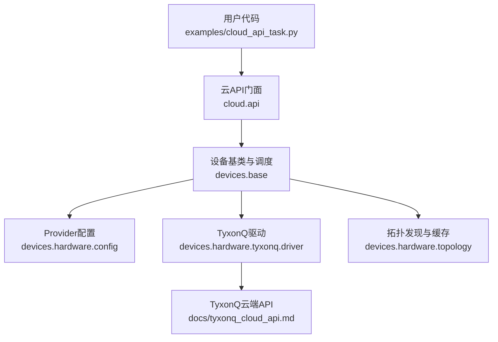
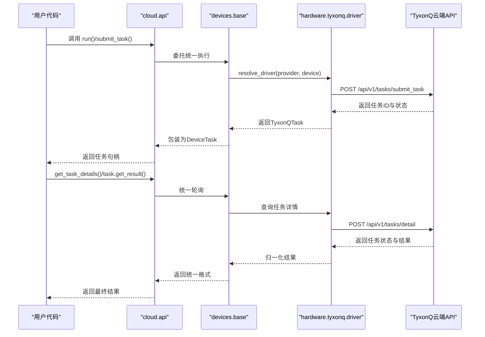
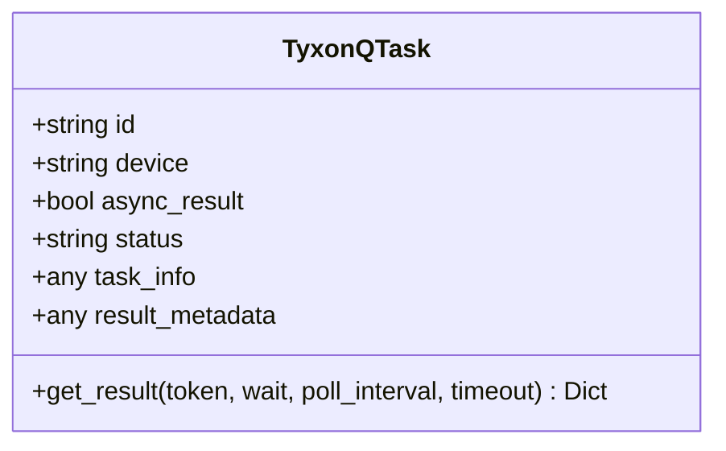
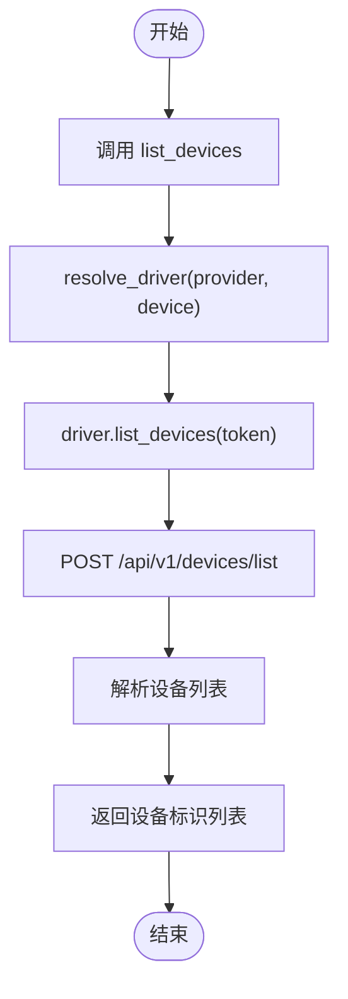
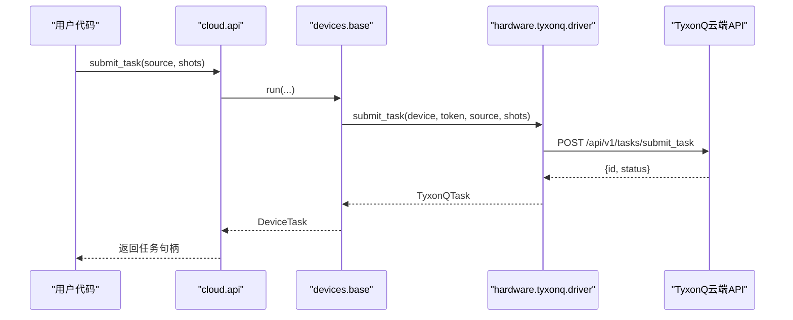
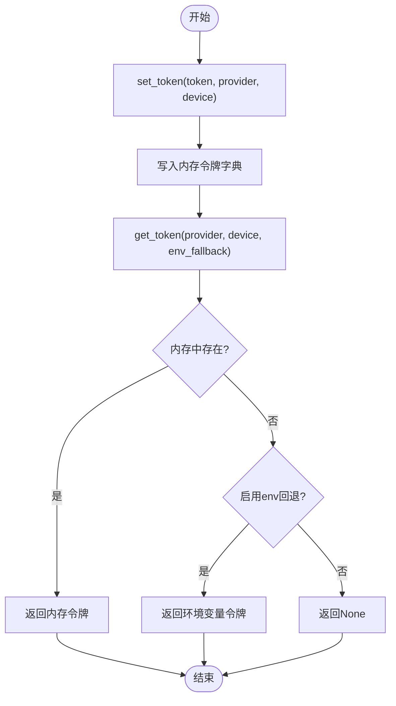
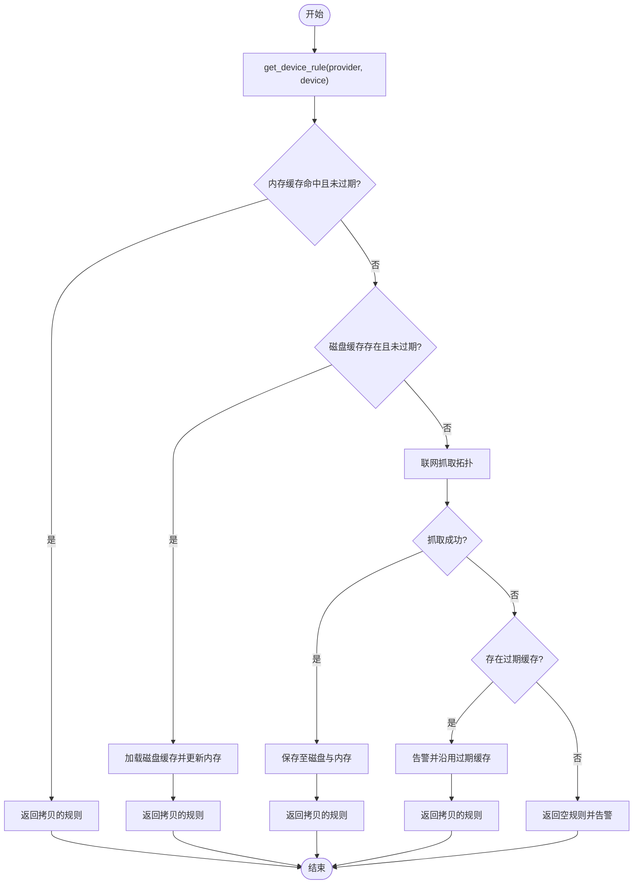
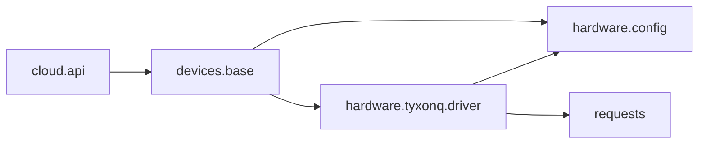

# TyxonQ云平台驱动

<cite>
**本文引用的文件**
- [src/tyxonq/cloud/api.py](file://src/tyxonq/cloud/api.py)
- [src/tyxonq/devices/base.py](file://src/tyxonq/devices/base.py)
- [src/tyxonq/devices/hardware/config.py](file://src/tyxonq/devices/hardware/config.py)
- [src/tyxonq/devices/hardware/topology.py](file://src/tyxonq/devices/hardware/topology.py)
- [src/tyxonq/devices/hardware/tyxonq/driver.py](file://src/tyxonq/devices/hardware/tyxonq/driver.py)
- [examples/cloud_api_task.py](file://examples/cloud_api_task.py)
- [examples/cloud_api_devices.py](file://examples/cloud_api_devices.py)
- [docs/tyxonq_cloud_api.md](file://docs/tyxonq_cloud_api.md)
</cite>

## 目录
1. [简介](#简介)
2. [项目结构](#项目结构)
3. [核心组件](#核心组件)
4. [架构总览](#架构总览)
5. [详细组件分析](#详细组件分析)
6. [依赖关系分析](#依赖关系分析)
7. [性能与优化](#性能与优化)
8. [故障排查指南](#故障排查指南)
9. [结论](#结论)
10. [附录：API参考与最佳实践](#附录api参考与最佳实践)

## 简介
本文件面向TyxonQ云平台驱动的开发者与使用者，系统性说明平台架构、设备列表查询、属性获取、任务提交流程、异步任务处理与结果获取、状态管理、认证机制与令牌管理、安全配置、错误处理策略、超时与重试机制，以及如何在TyxonQ云上高效编写量子应用并充分利用并行处理能力。文档同时提供架构图、时序图与流程图，帮助读者快速理解从电路编译到云端执行的全链路。

## 项目结构
TyxonQ将云执行能力抽象为“统一设备层 + 多Provider驱动”的架构：
- 云API门面（cloud.api）：对外暴露统一的set_token、list_devices、submit_task、get_task_details、run、result、cancel等接口。
- 设备基类与调度（devices.base）：统一设备选择、任务封装DeviceTask、统一轮询与结果归一化、拓扑发现入口。
- Provider配置与端点（devices.hardware.config）：集中管理默认provider/device、令牌存储与读取、各Provider的API端点。
- 设备拓扑缓存（devices.hardware.topology）：跨Provider的设备拓扑发现与TTL缓存（内存+磁盘），保障编译器路由稳定。
- TyxonQ硬件驱动（devices.hardware.tyxonq.driver）：实现TyxonQ云设备的提交、查询、取消、设备列表与属性获取。
- 示例程序（examples/*）：演示设备列表查询、任务提交与轮询、链式调用等典型用法。

图表来源
- [src/tyxonq/cloud/api.py:1-160](file://src/tyxonq/cloud/api.py#L1-L160)
- [src/tyxonq/devices/base.py:294-445](file://src/tyxonq/devices/base.py#L294-L445)
- [src/tyxonq/devices/hardware/config.py:1-78](file://src/tyxonq/devices/hardware/config.py#L1-L78)
- [src/tyxonq/devices/hardware/topology.py:180-258](file://src/tyxonq/devices/hardware/topology.py#L180-L258)
- [src/tyxonq/devices/hardware/tyxonq/driver.py:80-222](file://src/tyxonq/devices/hardware/tyxonq/driver.py#L80-L222)
- [docs/tyxonq_cloud_api.md:1-361](file://docs/tyxonq_cloud_api.md#L1-L361)

章节来源
- [src/tyxonq/cloud/api.py:1-160](file://src/tyxonq/cloud/api.py#L1-L160)
- [src/tyxonq/devices/base.py:1-578](file://src/tyxonq/devices/base.py#L1-L578)
- [src/tyxonq/devices/hardware/config.py:1-78](file://src/tyxonq/devices/hardware/config.py#L1-L78)
- [src/tyxonq/devices/hardware/topology.py:1-302](file://src/tyxonq/devices/hardware/topology.py#L1-L302)
- [src/tyxonq/devices/hardware/tyxonq/driver.py:1-222](file://src/tyxonq/devices/hardware/tyxonq/driver.py#L1-L222)
- [examples/cloud_api_task.py:1-65](file://examples/cloud_api_task.py#L1-L65)
- [examples/cloud_api_devices.py:1-29](file://examples/cloud_api_devices.py#L1-L29)
- [docs/tyxonq_cloud_api.md:1-361](file://docs/tyxonq_cloud_api.md#L1-L361)

## 核心组件
- TyxonQTask：TyxonQ硬件驱动的任务对象，封装任务ID、设备名、状态、元数据，并提供get_result方法支持等待完成与轮询。
- DeviceTask：设备层统一的任务包装，屏蔽不同Provider返回差异，提供统一的get_result与cancel。
- cloud.api：统一云API门面，负责token设置、设备列表查询、任务提交与详情获取、运行入口。
- devices.base：统一设备选择、任务封装、轮询与结果归一化、拓扑发现入口。
- hardware.config：Provider与设备默认值、令牌存取、端点配置。
- hardware.topology：设备拓扑发现与TTL缓存（内存+磁盘），保障编译器路由稳定性。
- hardware.tyxonq.driver：TyxonQ云设备的具体实现，包括设备列表、属性、任务提交、详情查询、任务取消。

章节来源
- [src/tyxonq/devices/hardware/tyxonq/driver.py:12-43](file://src/tyxonq/devices/hardware/tyxonq/driver.py#L12-L43)
- [src/tyxonq/devices/base.py:12-57](file://src/tyxonq/devices/base.py#L12-L57)
- [src/tyxonq/cloud/api.py:22-158](file://src/tyxonq/cloud/api.py#L22-L158)
- [src/tyxonq/devices/base.py:294-578](file://src/tyxonq/devices/base.py#L294-L578)
- [src/tyxonq/devices/hardware/config.py:1-78](file://src/tyxonq/devices/hardware/config.py#L1-L78)
- [src/tyxonq/devices/hardware/topology.py:180-258](file://src/tyxonq/devices/hardware/topology.py#L180-L258)

## 架构总览
TyxonQ云平台驱动采用“门面-调度-驱动-云端API”的分层架构：
- 门面层（cloud.api）：对外暴露简洁API，隐藏底层复杂性。
- 调度层（devices.base）：根据provider/device解析驱动，统一任务封装与结果归一化，提供轮询与取消。
- 驱动层（hardware.tyxonq.driver）：实现具体Provider的HTTP交互，构造请求头、发送请求、解析响应。
- 云端API（docs/tyxonq_cloud_api.md）：定义设备列表、任务提交、详情查询等REST接口规范。

图表来源
- [src/tyxonq/cloud/api.py:42-138](file://src/tyxonq/cloud/api.py#L42-L138)
- [src/tyxonq/devices/base.py:294-578](file://src/tyxonq/devices/base.py#L294-L578)
- [src/tyxonq/devices/hardware/tyxonq/driver.py:80-222](file://src/tyxonq/devices/hardware/tyxonq/driver.py#L80-L222)
- [docs/tyxonq_cloud_api.md:89-258](file://docs/tyxonq_cloud_api.md#L89-L258)

## 详细组件分析

### TyxonQTask类：异步任务处理、结果获取与状态管理
- 功能要点
  - 封装任务ID、设备名、状态、元数据，标记async_result=True表示异步任务。
  - get_result支持wait模式：轮询任务状态直到完成或超时；非wait模式直接返回当前详情。
  - 状态判断兼容多种完成态（done/completed/success/finished）。
- 复杂度与性能
  - 轮询时间复杂度O(N)，N为轮询次数；通过poll_interval控制网络请求频率，避免过度请求。
  - 超时保护防止无限等待，适合长时间排队或执行场景。
- 错误处理
  - 若任务失败，返回包含uni_status与error的统一结构，便于上层判断。
- 使用建议
  - 合理设置timeout与poll_interval，平衡响应速度与资源占用。
  - 在批量任务中可并发轮询多个任务，提升整体吞吐。

图表来源
- [src/tyxonq/devices/hardware/tyxonq/driver.py:12-43](file://src/tyxonq/devices/hardware/tyxonq/driver.py#L12-L43)

章节来源
- [src/tyxonq/devices/hardware/tyxonq/driver.py:12-43](file://src/tyxonq/devices/hardware/tyxonq/driver.py#L12-L43)

### 设备列表查询与属性获取
- 设备列表
  - 通过driver.list_devices调用云端设备列表接口，返回带provider前缀的设备标识。
  - base.list_all_devices聚合模拟器与硬件设备列表，供上层统一展示。
- 设备属性
  - driver.list_properties获取设备详细信息（如qubits、T1/T2、误差等），用于诊断与选择合适设备。
- 工作流程
  - 用户调用cloud.api.list_devices -> base.list_all_devices -> 对应driver.list_devices -> 云端API。

图表来源
- [src/tyxonq/devices/hardware/tyxonq/driver.py:56-63](file://src/tyxonq/devices/hardware/tyxonq/driver.py#L56-L63)
- [src/tyxonq/devices/base.py:475-493](file://src/tyxonq/devices/base.py#L475-L493)
- [docs/tyxonq_cloud_api.md:26-87](file://docs/tyxonq_cloud_api.md#L26-L87)

章节来源
- [src/tyxonq/devices/hardware/tyxonq/driver.py:56-78](file://src/tyxonq/devices/hardware/tyxonq/driver.py#L56-L78)
- [src/tyxonq/devices/base.py:475-493](file://src/tyxonq/devices/base.py#L475-L493)
- [docs/tyxonq_cloud_api.md:26-87](file://docs/tyxonq_cloud_api.md#L26-L87)

### 任务提交流程与状态管理
- 提交流程
  - 用户通过cloud.api.submit_task或base.run提交任务，传入source（OpenQASM）或已编译源。
  - 驱动层校验source格式（如homebrew_s2要求QASM2），构造payload并调用云端提交接口。
  - 云端返回任务ID与初始状态，驱动层封装为TyxonQTask。
- 状态管理
  - 通过get_task_details轮询任务状态，统一为uni_status字段，支持完成、失败、取消等状态。
  - base.get_task_details提供超时与轮询控制，确保结果完整性。
- 批处理支持
  - 支持一次性提交多个source或shots列表，保持顺序一致，返回任务列表。

图表来源
- [src/tyxonq/cloud/api.py:42-64](file://src/tyxonq/cloud/api.py#L42-L64)
- [src/tyxonq/devices/base.py:294-445](file://src/tyxonq/devices/base.py#L294-L445)
- [src/tyxonq/devices/hardware/tyxonq/driver.py:80-141](file://src/tyxonq/devices/hardware/tyxonq/driver.py#L80-L141)
- [docs/tyxonq_cloud_api.md:89-199](file://docs/tyxonq_cloud_api.md#L89-L199)

章节来源
- [src/tyxonq/cloud/api.py:42-64](file://src/tyxonq/cloud/api.py#L42-L64)
- [src/tyxonq/devices/base.py:294-445](file://src/tyxonq/devices/base.py#L294-L445)
- [src/tyxonq/devices/hardware/tyxonq/driver.py:80-141](file://src/tyxonq/devices/hardware/tyxonq/driver.py#L80-L141)
- [docs/tyxonq_cloud_api.md:89-199](file://docs/tyxonq_cloud_api.md#L89-L199)

### 认证机制、令牌管理与安全配置
- 令牌存储
  - hardware.config维护内存中的令牌字典，支持按provider与device维度存储。
  - 支持环境变量TYXONQ_API_KEY作为全局回退，便于快速配置。
- 令牌获取
  - get_token优先使用内存令牌，其次回退环境变量（可配置是否启用回退）。
  - 驱动层通过_headers注入Authorization: Bearer token。
- 安全建议
  - 避免硬编码令牌，推荐使用环境变量或密钥管理服务。
  - 定期轮换令牌，限制最小权限范围。
  - 在生产环境中禁用不必要的回退路径，减少泄露风险。

图表来源
- [src/tyxonq/devices/hardware/config.py:24-50](file://src/tyxonq/devices/hardware/config.py#L24-L50)
- [src/tyxonq/devices/hardware/tyxonq/driver.py:51-53](file://src/tyxonq/devices/hardware/tyxonq/driver.py#L51-L53)

章节来源
- [src/tyxonq/devices/hardware/config.py:1-78](file://src/tyxonq/devices/hardware/config.py#L1-L78)
- [src/tyxonq/devices/hardware/tyxonq/driver.py:51-53](file://src/tyxonq/devices/hardware/tyxonq/driver.py#L51-L53)

### 拓扑发现与编译器路由
- 拓扑发现
  - topology模块提供get_device_rule，按provider/device获取设备拓扑规则（耦合图、原生门集等）。
  - 支持内存缓存与磁盘TTL缓存，避免重复网络请求。
- 离线韧性
  - 抓取失败时，若有过期缓存则降级沿用并告警；若无缓存则返回空规则，不中断编译流程。
- 编译器集成
  - 编译器在布局/路由阶段使用拓扑信息，确保生成的线路符合设备物理连接约束。

图表来源
- [src/tyxonq/devices/hardware/topology.py:180-258](file://src/tyxonq/devices/hardware/topology.py#L180-L258)

章节来源
- [src/tyxonq/devices/hardware/topology.py:1-302](file://src/tyxonq/devices/hardware/topology.py#L1-L302)

## 依赖关系分析
- 模块耦合
  - cloud.api依赖devices.base进行统一调度，devices.base依赖hardware.config与具体driver。
  - hardware.tyxonq.driver依赖config获取端点与令牌，依赖requests进行HTTP通信。
- 外部依赖
  - requests库用于HTTP请求，需确保网络连通性与证书配置正确。
  - 环境变量与内存状态影响令牌获取与默认设备选择。
- 潜在循环依赖
  - 通过延迟导入（from ... import ...）避免循环依赖，如cloud.api在运行时导入devices.base。

图表来源
- [src/tyxonq/cloud/api.py:18-19](file://src/tyxonq/cloud/api.py#L18-L19)
- [src/tyxonq/devices/base.py:146-258](file://src/tyxonq/devices/base.py#L146-L258)
- [src/tyxonq/devices/hardware/tyxonq/driver.py:7-9](file://src/tyxonq/devices/hardware/tyxonq/driver.py#L7-L9)

章节来源
- [src/tyxonq/cloud/api.py:1-160](file://src/tyxonq/cloud/api.py#L1-L160)
- [src/tyxonq/devices/base.py:1-578](file://src/tyxonq/devices/base.py#L1-L578)
- [src/tyxonq/devices/hardware/tyxonq/driver.py:1-222](file://src/tyxonq/devices/hardware/tyxonq/driver.py#L1-L222)

## 性能与优化
- 并行任务处理
  - 支持批量提交多个source或shots，保持顺序一致，提高吞吐量。
  - 建议在客户端并发轮询多个任务，结合线程池或异步IO提升效率。
- 优化选项
  - 设备参数支持优化标志组合（如o=3表示qubit mapping + gate decomposition），可根据电路特性选择合适级别。
  - 对于复杂电路，建议使用更高优化级别以减少深度与门数量。
- 编译要求与限制
  - homebrew_s2/s3要求OpenQASM 2.0格式，必须包含qreg与creg声明。
  - 模拟器仅支持特定后端（statevector、density_matrix、matrix_product_state），真机噪声由硬件决定。
- 最佳实践
  - 合理设置shots数量，平衡精度与耗时。
  - 使用拓扑发现避免非相邻两比特门导致的设备拒绝。
  - 监控任务状态，及时处理失败与超时情况。

章节来源
- [src/tyxonq/devices/hardware/tyxonq/driver.py:95-107](file://src/tyxonq/devices/hardware/tyxonq/driver.py#L95-L107)
- [docs/tyxonq_cloud_api.md:125-146](file://docs/tyxonq_cloud_api.md#L125-L146)
- [src/tyxonq/devices/base.py:368-434](file://src/tyxonq/devices/base.py#L368-L434)

## 故障排查指南
- 常见错误
  - 提交失败：检查device参数与source格式，确认设备状态与令牌有效性。
  - 执行失败：查看任务详情中的error字段，定位具体问题（如qubits不足、depth过大、语法错误）。
  - 超时错误：调整timeout与poll_interval，或简化电路后重试。
- 重试机制
  - 建议在客户端实现指数退避重试，避免瞬时网络波动导致失败。
  - 对于幂等操作（如查询任务详情），可安全重试；提交操作需谨慎。
- 调试技巧
  - 启用日志输出，记录请求与响应内容。
  - 使用list_properties获取设备详细信息，辅助诊断。
  - 清理拓扑缓存（clear_topology_cache）以强制刷新设备信息。

章节来源
- [src/tyxonq/devices/hardware/tyxonq/driver.py:132-141](file://src/tyxonq/devices/hardware/tyxonq/driver.py#L132-L141)
- [src/tyxonq/devices/base.py:497-558](file://src/tyxonq/devices/base.py#L497-L558)
- [docs/tyxonq_cloud_api.md:491-571](file://docs/tyxonq_cloud_api.md#L491-L571)

## 结论
TyxonQ云平台驱动通过分层架构与统一抽象，提供了稳定的设备接入、任务管理与结果获取能力。TyxonQTask类实现了异步任务处理与状态管理，配合base层的轮询与归一化，确保了跨Provider的一致性。认证机制与安全配置保障了访问安全，拓扑发现与缓存提升了编译器路由的稳定性。通过合理的优化选项与最佳实践，用户可以高效利用TyxonQ云的并行处理能力，构建高性能量子应用程序。

## 附录：API参考与最佳实践
- 设备列表查询
  - 使用cloud.api.list_devices或base.list_all_devices获取可用设备。
  - 示例参见examples/cloud_api_devices.py。
- 任务提交与轮询
  - 使用cloud.api.submit_task或base.run提交任务，通过get_task_details或task.get_result轮询结果。
  - 示例参见examples/cloud_api_task.py。
- 认证与安全
  - 使用set_token设置令牌，或通过环境变量TYXONQ_API_KEY配置。
  - 避免硬编码令牌，定期轮换并限制权限。
- 性能调优
  - 选择合适的优化级别（o=1/2/3/4/7），平衡执行时间与资源消耗。
  - 批量提交与并发轮询提升整体吞吐。
- 错误处理
  - 捕获异常并检查任务状态，区分提交错误与执行错误。
  - 实现重试机制与超时控制，增强鲁棒性。

章节来源
- [examples/cloud_api_devices.py:16-21](file://examples/cloud_api_devices.py#L16-L21)
- [examples/cloud_api_task.py:30-59](file://examples/cloud_api_task.py#L30-L59)
- [src/tyxonq/devices/hardware/config.py:24-50](file://src/tyxonq/devices/hardware/config.py#L24-L50)
- [docs/tyxonq_cloud_api.md:125-146](file://docs/tyxonq_cloud_api.md#L125-L146)
- [docs/tyxonq_cloud_api.md:491-571](file://docs/tyxonq_cloud_api.md#L491-L571)