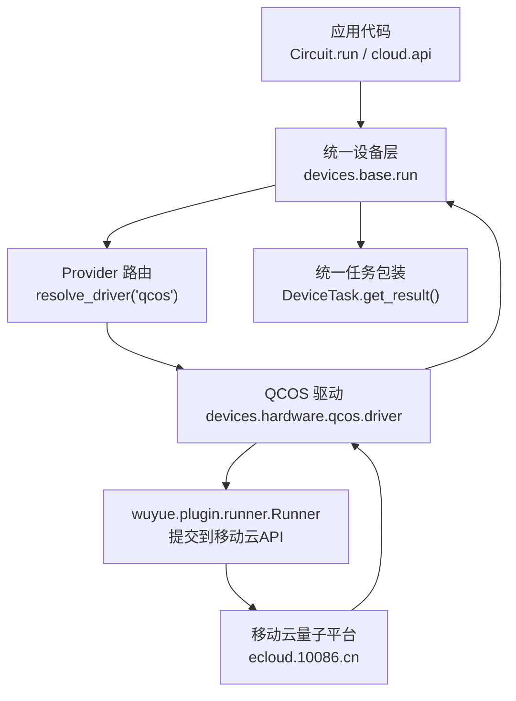
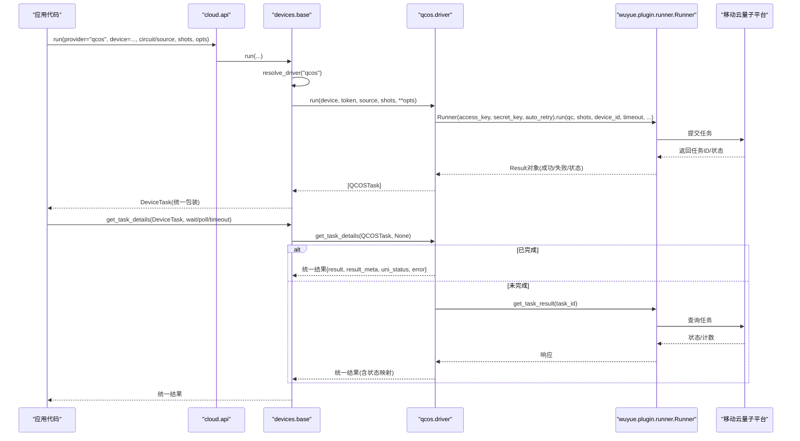
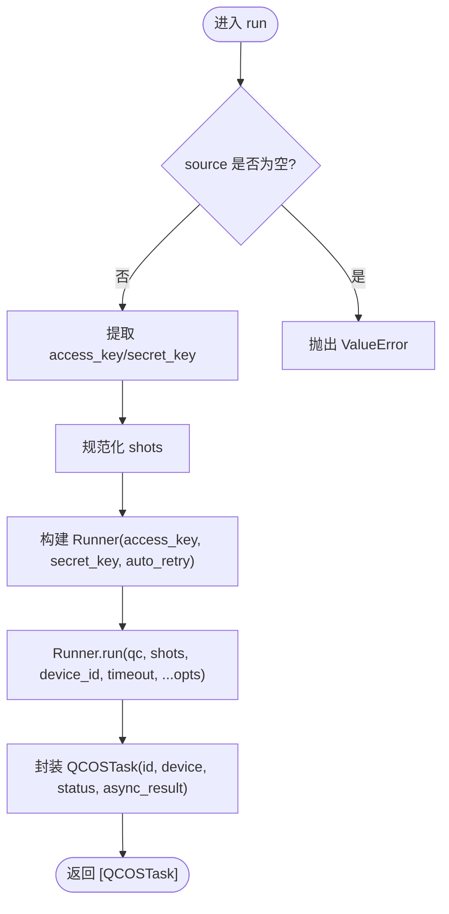
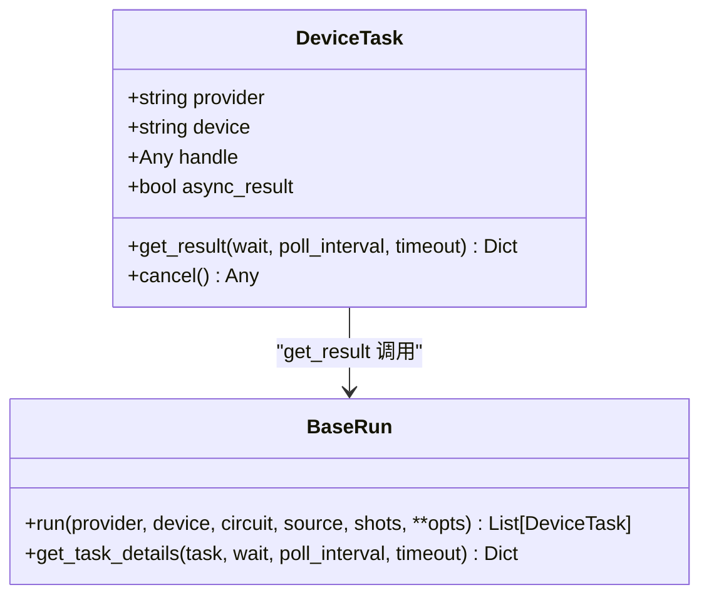
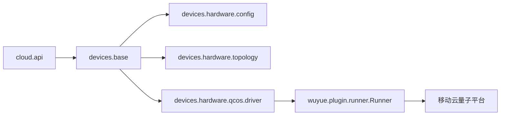

# 中国移动QCOS驱动

<cite>
**本文引用的文件**
- [driver.py](file://src/tyxonq/devices/hardware/qcos/driver.py)
- [api.py](file://src/tyxonq/cloud/api.py)
- [base.py](file://src/tyxonq/devices/base.py)
- [config.py](file://src/tyxonq/devices/hardware/config.py)
- [topology.py](file://src/tyxonq/devices/hardware/topology.py)
- [qcos_provider.md](file://docs/qcos_provider.md)
- [qcos_cloud_task.py](file://examples/qcos_cloud_task.py)
- [QCOS_CHANGES.md](file://QCOS_CHANGES.md)
</cite>

## 目录
1. [简介](#简介)
2. [项目结构](#项目结构)
3. [核心组件](#核心组件)
4. [架构总览](#架构总览)
5. [详细组件分析](#详细组件分析)
6. [依赖关系分析](#依赖关系分析)
7. [性能与资源优化](#性能与资源优化)
8. [故障排除指南](#故障排除指南)
9. [结论](#结论)
10. [附录：运行示例与最佳实践](#附录运行示例与最佳实践)

## 简介
本文件面向需要在 TyxonQ 中接入中国移动 QCOS（五岳）云平台进行量子任务提交、执行与结果处理的工程师与开发者。文档覆盖以下主题：
- 集成方式与连接协议：通过 wuyue SDK 的 Runner 将 Qiskit QuantumCircuit 提交到移动云量子平台，无需本地 Docker。
- 设备发现、认证授权与会话管理：基于 access_key/secret_key 的鉴权流程；设备列表静态清单；统一的任务轮询机制。
- 量子任务提交格式、参数配置与执行模式：支持同步/异步提交、shots 批处理、calculate_type 等关键参数。
- 结果数据解析与处理：统一返回结构 result/result_meta/uni_status/error，兼容不同上游状态码。
- 平台特有优化选项、编译要求与硬件限制：wuyue SDK 版本约束、模拟器必须指定 calculate_type、拓扑缓存策略等。
- 故障排除：网络连接、认证失败、任务执行错误等常见问题的定位与修复建议。
- 在 QCOS 上运行不同类型算法与应用：以 Bell 态为例展示端到端流程，并给出扩展思路。
- 性能优化与资源使用最佳实践：并发与超时设置、shots 选择、缓存与重试策略。

## 项目结构
TyxonQ 对 QCOS 的支持由“统一设备层 + QCOS 专用驱动”组成：
- 统一设备层负责 provider/device 路由、任务封装、统一结果归一化与轮询。
- QCOS 驱动负责与 wuyue SDK 交互，完成认证、任务提交、状态查询与结果提取。
- 云端 API 门面提供高层接口，屏蔽底层差异。
- 配置文件维护各 provider 的端点与默认值。
- 拓扑模块提供跨 provider 的设备拓扑发现与 TTL 缓存（当前未为 qcos 实现抓取，但整体框架已就绪）。

图表来源
- [base.py:294-445](file://src/tyxonq/devices/base.py#L294-L445)
- [base.py:497-557](file://src/tyxonq/devices/base.py#L497-L557)
- [driver.py:80-158](file://src/tyxonq/devices/hardware/qcos/driver.py#L80-L158)
- [driver.py:161-238](file://src/tyxonq/devices/hardware/qcos/driver.py#L161-L238)

章节来源
- [base.py:294-445](file://src/tyxonq/devices/base.py#L294-L445)
- [base.py:497-557](file://src/tyxonq/devices/base.py#L497-L557)
- [driver.py:80-158](file://src/tyxonq/devices/hardware/qcos/driver.py#L80-L158)
- [driver.py:161-238](file://src/tyxonq/devices/hardware/qcos/driver.py#L161-L238)

## 核心组件
- QCOSTask：QCOS 驱动的任务包装，包含任务ID、设备名、状态、上游结果对象及是否异步标志。
- run(device, token, source, shots, **opts)：接收 Qiskit QuantumCircuit，调用 wuyue Runner 提交任务，返回 QCOSTask 列表。
- get_task_details(task, token)：从上游结果或 Runner 轮询获取统一结果字典，映射状态码到 uni_status。
- list_devices(token, **kws)：返回已知设备 ID 列表（带 qcos:: 前缀），因新 SDK 不再暴露设备枚举，采用静态清单。
- 统一设备层 DeviceTask：对多 provider 任务进行统一封装，提供 get_result/cancel 等一致接口。
- 云端 API 门面：set_token/set_default/list_devices/submit_task/get_task_details/run/result/cancel，简化调用。

章节来源
- [driver.py:68-158](file://src/tyxonq/devices/hardware/qcos/driver.py#L68-L158)
- [driver.py:161-238](file://src/tyxonq/devices/hardware/qcos/driver.py#L161-L238)
- [driver.py:241-268](file://src/tyxonq/devices/hardware/qcos/driver.py#L241-L268)
- [base.py:12-57](file://src/tyxonq/devices/base.py#L12-L57)
- [api.py:22-72](file://src/tyxonq/cloud/api.py#L22-L72)

## 架构总览
下图展示了从应用代码到 QCOS 平台的完整调用链，包括认证、任务提交、状态轮询与结果归一化。

图表来源
- [api.py:75-131](file://src/tyxonq/cloud/api.py#L75-L131)
- [base.py:294-445](file://src/tyxonq/devices/base.py#L294-L445)
- [base.py:497-557](file://src/tyxonq/devices/base.py#L497-L557)
- [driver.py:80-158](file://src/tyxonq/devices/hardware/qcos/driver.py#L80-L158)
- [driver.py:161-238](file://src/tyxonq/devices/hardware/qcos/driver.py#L161-L238)

## 详细组件分析

### QCOS 驱动（devices.hardware.qcos.driver）
- 认证与凭据：
  - 优先从 opts 或环境变量读取 access_key/secret_key；若检测到旧版 sdk_code/QCOS_SDK_CODE 则直接报错提示迁移。
  - 缺失凭据时抛出 ValueError，明确提示所需环境变量。
- 任务提交：
  - 接收 Qiskit QuantumCircuit（由上层编译管线转换而来），剥离 provider 前缀后作为 device_id。
  - 支持批量 shots（取首个）、auto_retry、timeout、task_name 等；其余 opts 透传给 Runner（未来参数兼容）。
  - 通过 Runner.run 提交，返回包含任务ID、状态、上游结果的 QCOSTask。
- 任务详情与状态映射：
  - 若已有成功结果，直接构造统一结果（counts/prob/amps/raw）。
  - 否则通过 Runner.get_task_result 轮询，将上游状态码映射为 uni_status（submitted/queued/running/waiting/completed/failed/unknown）。
  - 异常情况下记录警告并返回错误状态。
- 设备发现：
  - 由于新 SDK 移除了设备枚举接口，list_devices 返回静态清单（模拟器与部分真实设备），使用前需确认控制台可用性。

图表来源
- [driver.py:80-158](file://src/tyxonq/devices/hardware/qcos/driver.py#L80-L158)

章节来源
- [driver.py:37-65](file://src/tyxonq/devices/hardware/qcos/driver.py#L37-L65)
- [driver.py:80-158](file://src/tyxonq/devices/hardware/qcos/driver.py#L80-L158)
- [driver.py:161-238](file://src/tyxonq/devices/hardware/qcos/driver.py#L161-L238)
- [driver.py:241-268](file://src/tyxonq/devices/hardware/qcos/driver.py#L241-L268)

### 统一设备层（devices.base）
- Provider 路由：resolve_driver 将 "qcos" 映射到 QCOS 驱动。
- 统一任务包装：DeviceTask 提供 get_result/cancel，内部调用 base.get_task_details 进行轮询与结果归一化。
- 统一结果格式：确保 result/result_meta/uni_status/error 键存在，提升下游处理一致性。
- 任务轮询：get_task_details 支持 wait/poll_interval/timeout，并在超时时发出 RuntimeWarning，避免空结果被误判。

图表来源
- [base.py:12-57](file://src/tyxonq/devices/base.py#L12-L57)
- [base.py:294-445](file://src/tyxonq/devices/base.py#L294-L445)
- [base.py:497-557](file://src/tyxonq/devices/base.py#L497-L557)

章节来源
- [base.py:146-258](file://src/tyxonq/devices/base.py#L146-L258)
- [base.py:294-445](file://src/tyxonq/devices/base.py#L294-L445)
- [base.py:497-557](file://src/tyxonq/devices/base.py#L497-L557)

### 云端 API 门面（cloud.api）
- set_token/set_default：设置全局凭据与默认 provider/device。
- list_devices：聚合模拟器与硬件设备列表（qcos 通过驱动静态清单）。
- submit_task/run：统一入口，最终委托 devices.base.run。
- get_task_details/result/cancel：统一任务查询与取消。

章节来源
- [api.py:22-72](file://src/tyxonq/cloud/api.py#L22-L72)
- [api.py:75-131](file://src/tyxonq/cloud/api.py#L75-L131)
- [api.py:134-145](file://src/tyxonq/cloud/api.py#L134-L145)

### 配置与端点（devices.hardware.config）
- ENDPOINTS：定义 provider 的基础 URL（qcos 指向 ecloud.10086.cn）。
- set_token/get_token：内存级凭据存储与环境变量回退。
- set_default/get_default_*：默认 provider/device 管理。

章节来源
- [config.py:11-19](file://src/tyxonq/devices/hardware/config.py#L11-L19)
- [config.py:24-50](file://src/tyxonq/devices/hardware/config.py#L24-L50)
- [config.py:53-65](file://src/tyxonq/devices/hardware/config.py#L53-L65)

### 拓扑发现与缓存（devices.hardware.topology）
- 提供跨 provider 的统一拓扑发现入口与 TTL 缓存（内存+磁盘）。
- 当前仅 lqcloud 实现了 fetch_topology；qcos 暂未实现，因此编译器不会为 qcos 自动路由，需用户自行保证线路相邻性或使用全连接模拟器。
- 离线韧性：抓取失败时降级沿用过期缓存并告警，不中断编译/提交。

章节来源
- [topology.py:1-29](file://src/tyxonq/devices/hardware/topology.py#L1-L29)
- [topology.py:164-177](file://src/tyxonq/devices/hardware/topology.py#L164-L177)
- [topology.py:180-258](file://src/tyxonq/devices/hardware/topology.py#L180-L258)

## 依赖关系分析
- QCOS 驱动依赖 wuyue.plugin.runner.Runner（>=1.0，统一 whl），不再支持旧的双包布局。
- 统一设备层依赖 config 与 topology，provider 路由将 "qcos" 指向 QCOS 驱动。
- 云端 API 门面依赖 base 与 hardware.config，提供高层接口。
- 拓扑模块目前未为 qcos 实现抓取，但整体框架允许后续增量接入。

图表来源
- [api.py:75-131](file://src/tyxonq/cloud/api.py#L75-L131)
- [base.py:146-258](file://src/tyxonq/devices/base.py#L146-L258)
- [driver.py:80-158](file://src/tyxonq/devices/hardware/qcos/driver.py#L80-L158)

章节来源
- [base.py:146-258](file://src/tyxonq/devices/base.py#L146-L258)
- [driver.py:80-158](file://src/tyxonq/devices/hardware/qcos/driver.py#L80-L158)
- [config.py:11-19](file://src/tyxonq/devices/hardware/config.py#L11-L19)

## 性能与资源优化
- 提交模式与超时：
  - 同步提交：timeout > 0 会等待 Runner 轮询至完成或超时（最大 3600s）。
  - 异步提交：timeout = 0 立即返回任务句柄，后续通过 get_task_details 轮询。
- Shots 与批处理：
  - 支持整数或序列 shots；驱动器内部取首个用于单次提交。
  - 合理设置 shots 平衡精度与耗时。
- 重试与稳定性：
  - auto_retry=True 启用 Runner 内部重试，提高瞬态失败恢复能力。
- 缓存与拓扑：
  - 虽然 qcos 未实现拓扑抓取，但可借助模拟器或全连接线路减少路由复杂度。
  - 其他 provider 可利用拓扑缓存降低网络开销。
- 资源隔离：
  - wuyue==1.0 固定 qiskit 版本，建议在独立环境中安装以避免冲突。

章节来源
- [driver.py:80-158](file://src/tyxonq/devices/hardware/qcos/driver.py#L80-L158)
- [base.py:497-557](file://src/tyxonq/devices/base.py#L497-L557)
- [topology.py:180-258](file://src/tyxonq/devices/hardware/topology.py#L180-L258)

## 故障排除指南
- 认证失败：
  - 现象：ValueError 提示缺少 access_key/secret_key 或环境变量。
  - 排查：检查环境变量 QCOS_ACCESS_KEY/QCOS_SECRET_KEY 或传入 opts；确认已从移动云控制台生成并正确复制。
  - 注意：旧版 sdk_code/QCOS_SDK_CODE 已被弃用，需迁移到新凭据。
- 网络连接问题：
  - 现象：轮询或提交时报错；get_task_details 返回 uni_status=error。
  - 排查：确认网络可达 ecloud.10086.cn；检查防火墙/代理；必要时增大 timeout 与 poll_interval。
- 任务执行错误：
  - 现象：uni_status=failed；result 为空或 counts 不完整。
  - 排查：查看 result_meta 中的原始响应；检查 device_id 是否正确；确认 calculate_type 是否按模拟器要求设置。
- 模拟器拒绝任务：
  - 现象：服务器返回“未设置计算类型”。
  - 排查：为模拟器设备设置 calculate_type（如 1=单点，2=分布式，具体以控制台为准）。
- 设备不可用：
  - 现象：list_devices 返回空或设备不存在。
  - 排查：确认设备在控制台可用；更新静态清单；尝试其他设备。

章节来源
- [driver.py:37-65](file://src/tyxonq/devices/hardware/qcos/driver.py#L37-L65)
- [driver.py:161-238](file://src/tyxonq/devices/hardware/qcos/driver.py#L161-L238)
- [qcos_provider.md:22-63](file://docs/qcos_provider.md#L22-L63)
- [qcos_cloud_task.py:41-55](file://examples/qcos_cloud_task.py#L41-L55)

## 结论
TyxonQ 对 QCOS 的集成通过统一设备层与 QCOS 驱动解耦了平台差异，提供了简洁稳定的 API。借助 wuyue SDK 的 Runner，用户可在无需本地 Docker 的情况下直接提交量子任务到移动云量子平台。通过统一的认证、任务管理与结果归一化，开发者可以专注于算法与业务逻辑，而无需关心底层细节。结合拓扑缓存、重试策略与合理的超时/shots 设置，可获得稳定高效的执行体验。

## 附录：运行示例与最佳实践
- 快速开始（Bell 态）：
  - 准备环境：安装 wuyue SDK（统一 whl），导出 QCOS_ACCESS_KEY/QCOS_SECRET_KEY。
  - 构建电路并提交：使用 Circuit 构建简单电路，调用 c.run(provider="qcos", device="WuYue-QPUSim-FullAmpSim", shots=100, timeout=100, wait_async_result=True, calculate_type=1)。
  - 获取结果：打印 results[0]["result"]，得到计数分布。
- 异步提交与轮询：
  - 使用 timeout=0 提交，随后通过 tq.api.get_task_details(tasks[0]) 轮询 uni_status 与 result。
- 设备列表：
  - 使用 tq.api.list_devices(provider="qcos") 获取已知设备（带 qcos:: 前缀）。
- 最佳实践：
  - 始终设置合理的 timeout 与 poll_interval，避免长时间阻塞。
  - 对模拟器务必设置 calculate_type，避免服务端拒绝。
  - 在独立环境中安装 wuyue SDK，避免 qiskit 版本冲突。
  - 对于复杂线路，尽量保证比特相邻或使用全连接模拟器以减少路由失败。

章节来源
- [qcos_cloud_task.py:28-57](file://examples/qcos_cloud_task.py#L28-L57)
- [qcos_provider.md:65-136](file://docs/qcos_provider.md#L65-L136)
- [QCOS_CHANGES.md:91-114](file://QCOS_CHANGES.md#L91-L114)