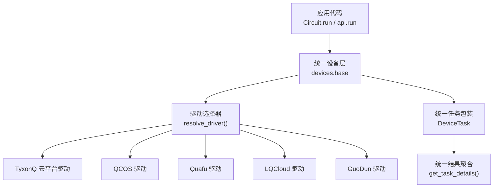
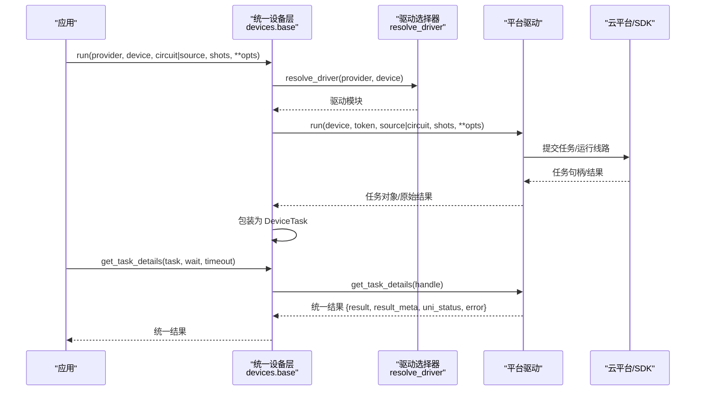
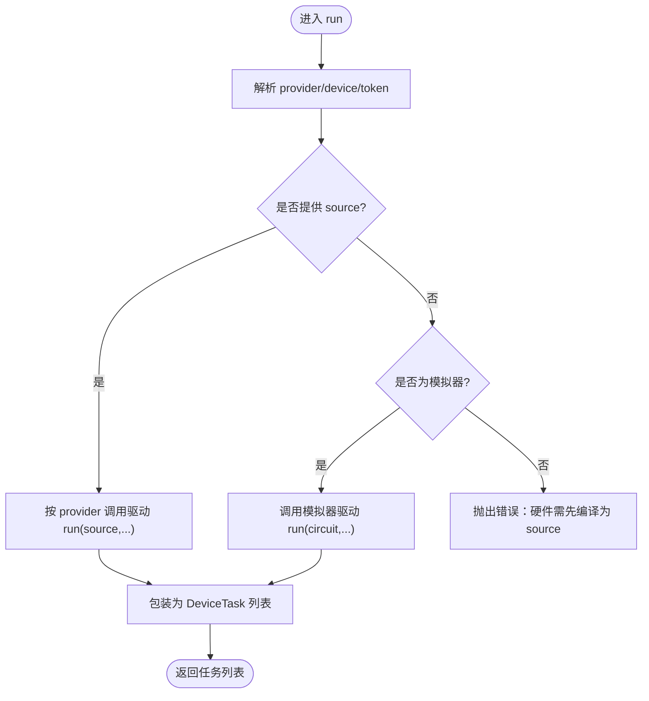
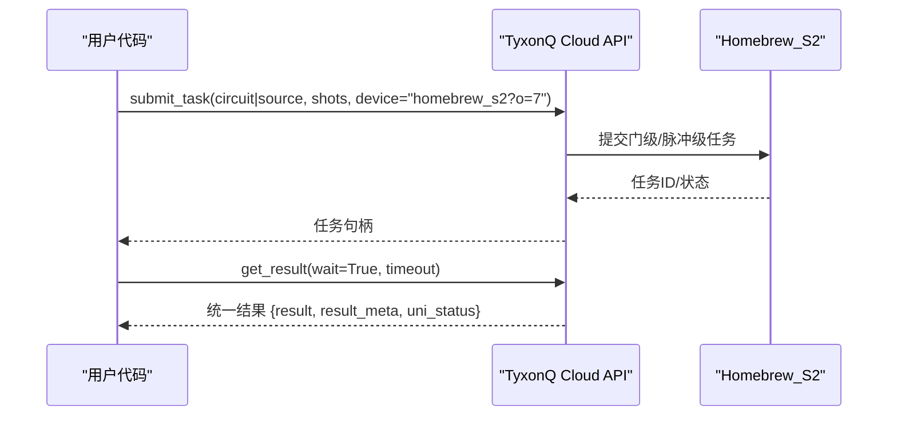
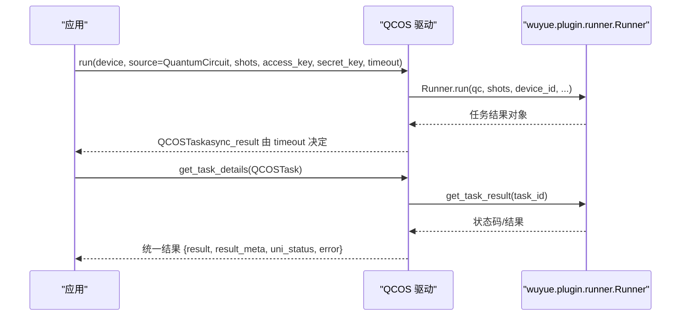
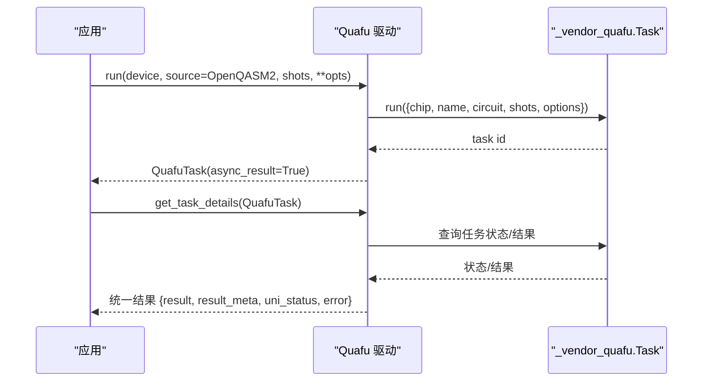
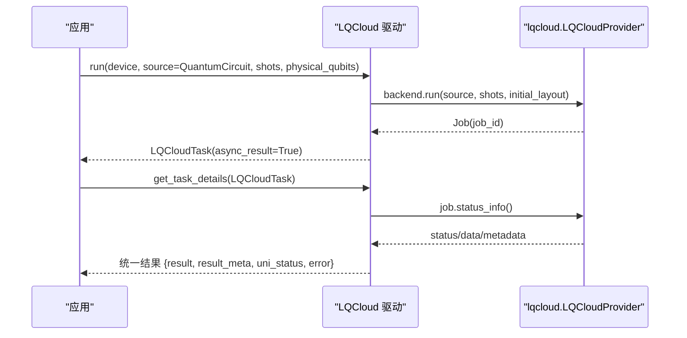
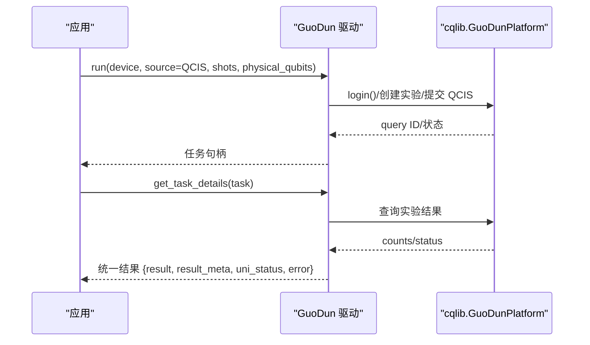
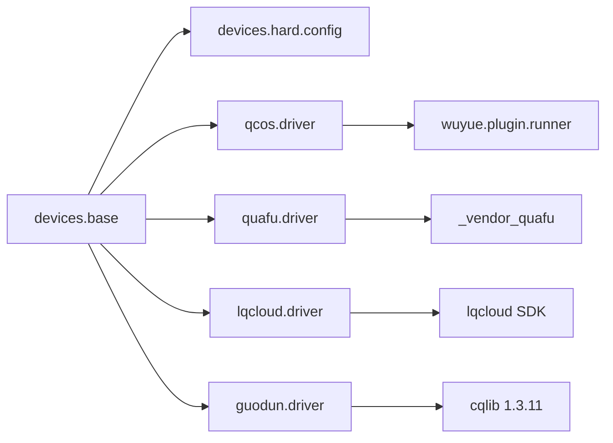

# 硬件驱动

<cite>
**本文引用的文件**
- [devices/base.py](file://src/tyxonq/devices/base.py)
- [cloud/api.py](file://src/tyxonq/cloud/api.py)
- [devices/hardware/config.py](file://src/tyxonq/devices/hardware/config.py)
- [hardware_access.rst](file://docs/source/cloud_services/hardware_access.rst)
- [task_submission.rst](file://docs/source/cloud_services/task_submission.rst)
- [qcos_provider.md](file://docs/qcos_provider.md)
- [quafu_provider.md](file://docs/quafu_provider.md)
- [guodun_provider.md](file://docs/guodun_provider.md)
- [driver.py (qcos)](file://src/tyxonq/devices/hardware/qcos/driver.py)
- [driver.py (quafu)](file://src/tyxonq/devices/hardware/quafu/driver.py)
- [driver.py (guodun)](file://src/tyxonq/devices/hardware/guodun/driver.py)
- [driver.py (lqcloud)](file://src/tyxonq/devices/hardware/lqcloud/driver.py)
- [run_circuit_on_quafu.py](file://examples/run_circuit_on_quafu.py)
- [run_circuit_on_lqcloud.py](file://examples/run_circuit_on_lqcloud.py)
- [run_circuit_on_guodun.py](file://examples/run_circuit_on_guodun.py)
</cite>

## 目录
1. [简介](#简介)
2. [项目结构](#项目结构)
3. [核心组件](#核心组件)
4. [架构总览](#架构总览)
5. [详细组件分析](#详细组件分析)
6. [依赖关系分析](#依赖关系分析)
7. [性能与优化](#性能与优化)
8. [故障排除指南](#故障排除指南)
9. [结论](#结论)
10. [附录](#附录)

## 简介
本文件系统性说明 TyxonQ 的硬件驱动体系，覆盖支持的量子硬件平台与云服务提供商（TyxonQ 云平台、中国移动 QCOS、Quafu、LQCloud、GuoDun），解释各平台的集成方式、API 接口、设备特性、连接认证、任务提交与结果获取流程。文档还给出平台特定的优化选项、编译要求与限制条件，提供跨平台代码移植策略、兼容性考虑、配置与认证设置、故障排除指南，并展示如何编写可移植的量子应用程序以支持多个硬件平台，以及最佳实践与性能优化建议。

## 项目结构
TyxonQ 将“统一设备层”与“各平台驱动”解耦：
- 统一设备层负责：驱动选择、默认 provider/device、令牌管理、统一任务封装、统一结果格式、轮询等待等。
- 各平台驱动实现具体提交、查询、取消、设备发现等能力，并将结果映射到 TyxonQ 统一结构。

图表来源
- [devices/base.py:146-258](file://src/tyxonq/devices/base.py#L146-L258)
- [devices/base.py:294-445](file://src/tyxonq/devices/base.py#L294-L445)
- [devices/base.py:497-557](file://src/tyxonq/devices/base.py#L497-L557)

章节来源
- [devices/base.py:146-258](file://src/tyxonq/devices/base.py#L146-L258)
- [devices/base.py:294-445](file://src/tyxonq/devices/base.py#L294-L445)
- [devices/base.py:497-557](file://src/tyxonq/devices/base.py#L497-L557)

## 核心组件
- 统一设备协议与任务包装
  - DeviceTask：封装 provider、device、handle、async_result，并提供 get_result/cancel。
  - run/expval：统一入口，自动选择驱动、注入噪声（仅模拟器）、标准化 shots、返回统一任务列表。
  - get_task_details：统一轮询与状态归一化，处理超时与错误提示。
- 配置与令牌
  - config：维护默认 provider/device、ENDPOINTS、set_token/get_token。
- 云 API 门面
  - cloud.api：对外暴露 set_token/set_default/device/list_devices/submit_task/run/get_task_details/result/cancel，内部委托至 devices.base。

章节来源
- [devices/base.py:13-57](file://src/tyxonq/devices/base.py#L13-L57)
- [devices/base.py:294-445](file://src/tyxonq/devices/base.py#L294-L445)
- [devices/base.py:497-557](file://src/tyxonq/devices/base.py#L497-L557)
- [devices/hardware/config.py:1-78](file://src/tyxonq/devices/hardware/config.py#L1-L78)
- [cloud/api.py:22-73](file://src/tyxonq/cloud/api.py#L22-L73)
- [cloud/api.py:75-131](file://src/tyxonq/cloud/api.py#L75-L131)

## 架构总览
下图展示了从应用调用到平台驱动的完整调用链，包括统一设备层、驱动选择、平台特定提交与结果聚合。

图表来源
- [devices/base.py:294-445](file://src/tyxonq/devices/base.py#L294-L445)
- [devices/base.py:497-557](file://src/tyxonq/devices/base.py#L497-L557)
- [cloud/api.py:75-131](file://src/tyxonq/cloud/api.py#L75-L131)

## 详细组件分析

### 统一设备层（devices.base）
- 驱动选择：根据 provider 动态导入对应驱动模块；支持 simulator/local、tyxonq、ibm、qcos、quafu、lqcloud、guodun。
- 执行入口 run：
  - 解析 provider/device/token；对模拟器注入噪声参数；对真机丢弃模拟器专属参数。
  - 支持直接提交已编译 source 或传入 Circuit（仅模拟器路径）。
  - 统一返回 DeviceTask 列表，便于后续 get_result 轮询。
- 任务轮询 get_task_details：
  - 循环调用驱动 get_task_details，统一状态字段 uni_status，处理 done/completed/success/finished 等终止态。
  - 支持 wait + timeout，并在超时时发出警告，避免空计数被误判为能量 0。

图表来源
- [devices/base.py:294-445](file://src/tyxonq/devices/base.py#L294-L445)

章节来源
- [devices/base.py:146-258](file://src/tyxonq/devices/base.py#L146-L258)
- [devices/base.py:294-445](file://src/tyxonq/devices/base.py#L294-L445)
- [devices/base.py:497-557](file://src/tyxonq/devices/base.py#L497-L557)

### TyxonQ 云平台（homebrew_s2）
- 访问方式：通过 TyxonQ Cloud API（REST，Bearer Token）访问 Homebrew_S2 处理器，支持门级与脉冲级编程。
- 优化标志：支持 o=1（比特映射）、o=2（门分解）、o=4（初始布局），可叠加使用（如 o=7 全开）。
- 提交方式：既可通过高层 Chain API（Circuit → compile → device → postprocessing → run），也可直接提交 OpenQASM 源。
- 结果格式：统一包含 result（计数）、result_meta（含 raw 任务信息）、uni_status、error。

图表来源
- [hardware_access.rst:114-166](file://docs/source/cloud_services/hardware_access.rst#L114-L166)
- [hardware_access.rst:167-238](file://docs/source/cloud_services/hardware_access.rst#L167-L238)
- [task_submission.rst:13-45](file://docs/source/cloud_services/task_submission.rst#L13-L45)

章节来源
- [hardware_access.rst:114-166](file://docs/source/cloud_services/hardware_access.rst#L114-L166)
- [hardware_access.rst:167-238](file://docs/source/cloud_services/hardware_access.rst#L167-L238)
- [task_submission.rst:13-45](file://docs/source/cloud_services/task_submission.rst#L13-L45)

### 中国移动 QCOS（WuYue）
- 依赖：需要安装 wuyue/wuyue_open/wuyue_plugin（统一 whl >=1.0）。
- 认证：access_key + secret_key（环境变量 QCOS_ACCESS_KEY/QCOS_SECRET_KEY），不再支持 sdk_code。
- 提交：接受 Qiskit QuantumCircuit（由 TyxonQ 编译管线转换），支持异步提交与轮询。
- 结果：统一结构，包含 counts、probabilities/amplitudes（仿真）、raw 响应等。

图表来源
- [driver.py (qcos):80-158](file://src/tyxonq/devices/hardware/qcos/driver.py#L80-L158)
- [driver.py (qcos):161-200](file://src/tyxonq/devices/hardware/qcos/driver.py#L161-L200)
- [qcos_provider.md:22-63](file://docs/qcos_provider.md#L22-L63)
- [qcos_provider.md:77-136](file://docs/qcos_provider.md#L77-L136)

章节来源
- [qcos_provider.md:22-63](file://docs/qcos_provider.md#L22-L63)
- [qcos_provider.md:77-136](file://docs/qcos_provider.md#L77-L136)
- [driver.py (qcos):80-158](file://src/tyxonq/devices/hardware/qcos/driver.py#L80-L158)
- [driver.py (qcos):161-200](file://src/tyxonq/devices/hardware/qcos/driver.py#L161-L200)

### Quafu（BAQIS）
- 认证：四步优先级（显式 token → tq.set_token(provider='quafu') → TYXONQ_QUAFU_TOKEN → QPU_API_TOKEN），不支持回退到全局 TyxonQ 密钥。
- 提交：必须提前编译为 OpenQASM 2.0（compile_engine="qiskit", output="qasm2"），否则驱动会拒绝。
- 服务器端重编译：默认关闭（compile=True 表示让 TyxonQ 已生成的 QASM 直接运行），可按需开启 server-side 编译器。
- 限制：shots 需为 1024 倍数（非倍数时告警）；无脉冲级编程能力。

图表来源
- [driver.py (quafu):28-45](file://src/tyxonq/devices/hardware/quafu/driver.py#L28-L45)
- [driver.py (quafu):103-180](file://src/tyxonq/devices/hardware/quafu/driver.py#L103-L180)
- [quafu_provider.md:14-36](file://docs/quafu_provider.md#L14-L36)
- [quafu_provider.md:48-88](file://docs/quafu_provider.md#L48-L88)

章节来源
- [quafu_provider.md:14-36](file://docs/quafu_provider.md#L14-L36)
- [quafu_provider.md:48-88](file://docs/quafu_provider.md#L48-L88)
- [driver.py (quafu):28-45](file://src/tyxonq/devices/hardware/quafu/driver.py#L28-L45)
- [driver.py (quafu):103-180](file://src/tyxonq/devices/hardware/quafu/driver.py#L103-L180)

### LQCloud
- 依赖：官方 lqcloud SDK（版本锁定在 0.4.2）。
- 认证：api_key 优先级（显式 → tq.set_token(provider='lqcloud') → 环境变量），不回落至 TyxonQ 全局密钥。
- 提交：仅支持单条 QuantumCircuit 与单个 shots；支持 initial_layout（physical_qubits）。
- 结果：统一结构，包含 job_id、counts、probabilities、result_format、raw。

图表来源
- [driver.py (lqcloud):33-92](file://src/tyxonq/devices/hardware/lqcloud/driver.py#L33-L92)
- [driver.py (lqcloud):119-180](file://src/tyxonq/devices/hardware/lqcloud/driver.py#L119-L180)
- [run_circuit_on_lqcloud.py:87-109](file://examples/run_circuit_on_lqcloud.py#L87-L109)

章节来源
- [driver.py (lqcloud):33-92](file://src/tyxonq/devices/hardware/lqcloud/driver.py#L33-L92)
- [driver.py (lqcloud):119-180](file://src/tyxonq/devices/hardware/lqcloud/driver.py#L119-L180)
- [run_circuit_on_lqcloud.py:87-109](file://examples/run_circuit_on_lqcloud.py#L87-L109)

### GuoDun（国盾）
- 依赖：cqlib==1.3.11（可选依赖 tyxonq[guodun]），驱动懒加载并校验版本。
- 认证：显式 token → tq.set_token(provider='guodun') → TYXONQ_GUODUN_TOKEN。
- 提交：必须提交 QCIS 字符串且包含显式测量指令 M；支持物理比特映射；提交前会下载当前配置并校验禁用比特/耦合器/CZ 边。
- 脉冲：支持原生门脉冲模板（X2P/X2M/Y2P/Y2M/CZ），并对 PXY/PZ/PZ0/G/I/B/M/RZ 进行语法与逐采样安全检查。

图表来源
- [driver.py (guodun):30-67](file://src/tyxonq/devices/hardware/guodun/driver.py#L30-L67)
- [driver.py (guodun):100-130](file://src/tyxonq/devices/hardware/guodun/driver.py#L100-L130)
- [driver.py (guodun):152-200](file://src/tyxonq/devices/hardware/guodun/driver.py#L152-L200)
- [guodun_provider.md:14-28](file://docs/guodun_provider.md#L14-L28)
- [guodun_provider.md:30-50](file://docs/guodun_provider.md#L30-L50)
- [guodun_provider.md:130-169](file://docs/guodun_provider.md#L130-L169)

章节来源
- [driver.py (guodun):30-67](file://src/tyxonq/devices/hardware/guodun/driver.py#L30-L67)
- [driver.py (guodun):100-130](file://src/tyxonq/devices/hardware/guodun/driver.py#L100-L130)
- [driver.py (guodun):152-200](file://src/tyxonq/devices/hardware/guodun/driver.py#L152-L200)
- [guodun_provider.md:14-28](file://docs/guodun_provider.md#L14-L28)
- [guodun_provider.md:30-50](file://docs/guodun_provider.md#L30-L50)
- [guodun_provider.md:130-169](file://docs/guodun_provider.md#L130-L169)

## 依赖关系分析
- 统一设备层依赖：
  - 配置模块（config）：默认 provider/device、ENDPOINTS、令牌存取。
  - 各平台驱动：通过 resolve_driver 动态导入。
- 平台驱动依赖：
  - QCOS：wuyue.plugin.runner.Runner。
  - Quafu：_vendor_quafu.Task（内置 REST 客户端）。
  - LQCloud：lqcloud.LQCloudProvider/QuantumCircuit/Result。
  - GuoDun：cqlib.GuoDunPlatform/GetPulse（版本锁定 1.3.11）。

图表来源
- [devices/base.py:146-258](file://src/tyxonq/devices/base.py#L146-L258)
- [driver.py (qcos):106-147](file://src/tyxonq/devices/hardware/qcos/driver.py#L106-L147)
- [driver.py (quafu):15-16](file://src/tyxonq/devices/hardware/quafu/driver.py#L15-L16)
- [driver.py (lqcloud):24-30](file://src/tyxonq/devices/hardware/lqcloud/driver.py#L24-L30)
- [driver.py (guodun):30-53](file://src/tyxonq/devices/hardware/guodun/driver.py#L30-L53)

章节来源
- [devices/base.py:146-258](file://src/tyxonq/devices/base.py#L146-L258)
- [driver.py (qcos):106-147](file://src/tyxonq/devices/hardware/qcos/driver.py#L106-L147)
- [driver.py (quafu):15-16](file://src/tyxonq/devices/hardware/quafu/driver.py#L15-L16)
- [driver.py (lqcloud):24-30](file://src/tyxonq/devices/hardware/lqcloud/driver.py#L24-L30)
- [driver.py (guodun):30-53](file://src/tyxonq/devices/hardware/guodun/driver.py#L30-L53)

## 性能与优化
- TyxonQ 云平台优化标志
  - o=1：比特映射；o=2：门分解；o=4：初始布局；o=7：全部优化。
  - 门级线路建议使用全优化以降低深度与路由开销。
- 脉冲级编程
  - 必须禁用优化（enable_qos_gate_decomposition=False、enable_qos_qubit_mapping=False），否则会破坏 TQASM 波形序列。
- 各平台限制与建议
  - Quafu：shots 需为 1024 倍数；尽量使用预编译 QASM2 以避免服务器重编译开销。
  - LQCloud：首版仅支持单任务与单 shots；合理设置 initial_layout 可减少路由成本。
  - GuoDun：提交前校验禁用比特/耦合器与 CZ 边，确保拓扑合规；脉冲指令需满足标定约束。
  - QCOS：利用 auto_retry 与合适的 timeout 平衡吞吐与稳定性。

章节来源
- [hardware_access.rst:114-166](file://docs/source/cloud_services/hardware_access.rst#L114-L166)
- [hardware_access.rst:670-722](file://docs/source/cloud_services/hardware_access.rst#L670-L722)
- [quafu_provider.md:74-88](file://docs/quafu_provider.md#L74-L88)
- [driver.py (lqcloud):56-92](file://src/tyxonq/devices/hardware/lqcloud/driver.py#L56-L92)
- [driver.py (guodun):152-200](file://src/tyxonq/devices/hardware/guodun/driver.py#L152-L200)
- [driver.py (qcos):122-147](file://src/tyxonq/devices/hardware/qcos/driver.py#L122-L147)

## 故障排除指南
- 认证失败
  - Quafu：检查四步优先级是否正确设置，避免误用 TyxonQ 全局密钥。
  - QCOS：确认 access_key/secret_key 存在，弃用 sdk_code。
  - LQCloud：确保 api_key 正确设置，不回落至 TyxonQ 全局密钥。
  - GuoDun：设置 TYXONQ_GUODUN_TOKEN 或通过 set_token 指定 provider。
- 提交失败
  - Quafu：source 必须为 OpenQASM 2.0 字符串；shots 需为正数且建议为 1024 倍数。
  - LQCloud：source 必须是 lqcloud.QuantumCircuit；一次仅支持一个 shots。
  - GuoDun：QCIS 必须包含显式 M 测量；提交前会校验禁用比特/耦合器与 CZ 边。
- 结果异常
  - 统一轮询 get_task_details：若 uni_status 非终止态且 wait=True 超时，会发出警告；请增大 timeout 或检查排队情况。
  - 检查 result_meta.raw 中的上游错误信息，定位具体平台问题。

章节来源
- [driver.py (quafu):28-45](file://src/tyxonq/devices/hardware/quafu/driver.py#L28-L45)
- [driver.py (qcos):37-65](file://src/tyxonq/devices/hardware/qcos/driver.py#L37-L65)
- [driver.py (lqcloud):33-42](file://src/tyxonq/devices/hardware/lqcloud/driver.py#L33-L42)
- [driver.py (guodun):56-67](file://src/tyxonq/devices/hardware/guodun/driver.py#L56-L67)
- [devices/base.py:497-557](file://src/tyxonq/devices/base.py#L497-L557)

## 结论
TyxonQ 通过统一设备层屏蔽多平台差异，提供一致的提交、轮询与结果聚合体验。各平台驱动遵循相同契约，但具备各自认证、编译与优化约束。开发者应依据目标平台选择合适的编译输出（QASM2/TQASM/QCIS）、优化选项与参数限制，并通过统一的 DeviceTask 接口进行跨平台任务管理。结合本文的最佳实践与故障排除指南，可高效构建可移植的量子应用程序。

## 附录

### 平台选择指南
- 快速开发与测试：优先使用 TyxonQ 云平台的全优化模式（o=7）或本地模拟器。
- 大规模并行与生态兼容：Quafu（需严格遵循 QASM2 与 shots 规则）。
- 国内云资源：QCOS（WuYue）适合使用官方 SDK 的批量与重试机制。
- 官方 SDK 直连：LQCloud 适合已有 SDK 工作流的用户。
- 脉冲级与标定控制：GuoDun 提供原生门脉冲与严格的安全检查。

### 跨平台代码移植策略
- 统一入口：使用 devices.base.run 或 cloud.api.run，避免硬编码平台细节。
- 编译输出适配：
  - Quafu：提前 compile(output="qasm2")。
  - GuoDun：compile(output="qcis") 并确保包含 M 测量。
  - LQCloud：转换为 lqcloud.QuantumCircuit。
  - QCOS：转换为 Qiskit QuantumCircuit。
  - TyxonQ：可直接提交 QASM2 或 TQASM（脉冲）。
- 参数与限制：
  - 针对各平台调整 shots、initial_layout、compiler 等选项。
  - 脉冲级务必禁用优化。

### 最佳实践与性能优化建议
- 门级线路：启用全优化（TyxonQ o=7）以减少深度与路由。
- 脉冲级线路：禁用所有优化，保持 TQASM 原样提交。
- 任务轮询：合理设置 timeout 与 poll_interval，避免过早中断。
- 日志与追踪：记录任务 ID、设备名、状态与耗时，便于复现与分析。

章节来源
- [task_submission.rst:13-45](file://docs/source/cloud_services/task_submission.rst#L13-L45)
- [task_submission.rst:621-758](file://docs/source/cloud_services/task_submission.rst#L621-L758)
- [run_circuit_on_quafu.py:22-51](file://examples/run_circuit_on_quafu.py#L22-L51)
- [run_circuit_on_lqcloud.py:52-109](file://examples/run_circuit_on_lqcloud.py#L52-L109)
- [run_circuit_on_guodun.py:70-120](file://examples/run_circuit_on_guodun.py#L70-L120)