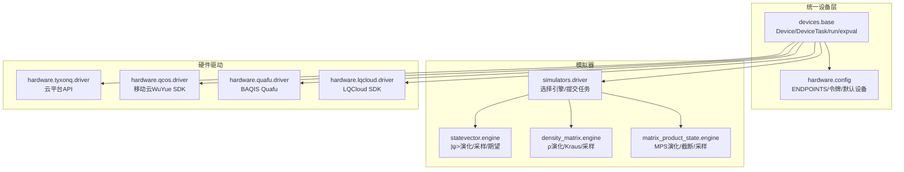
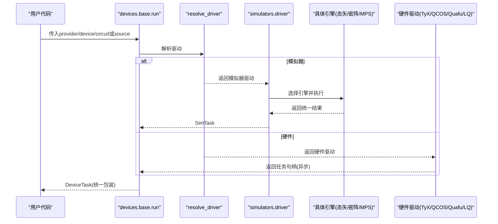
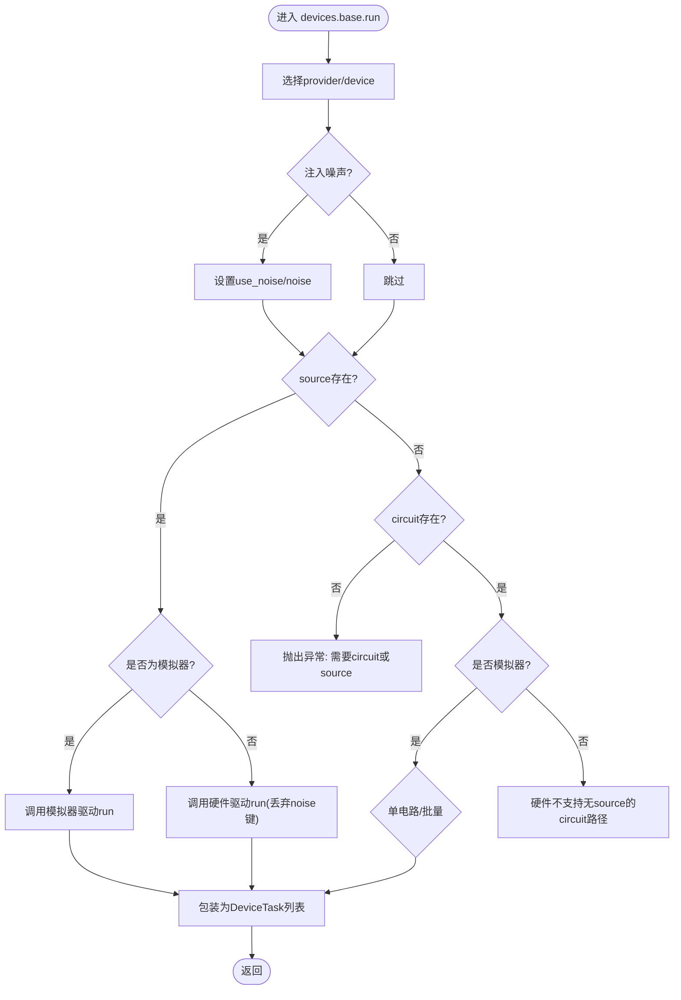
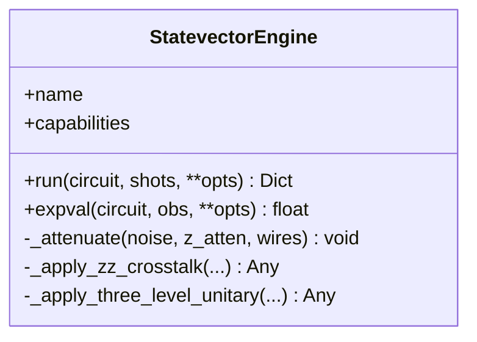
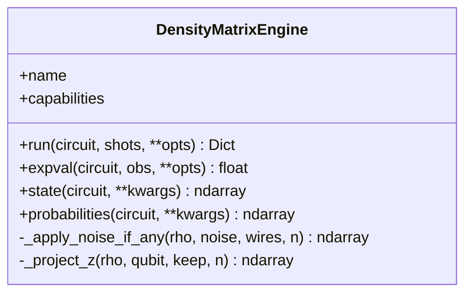
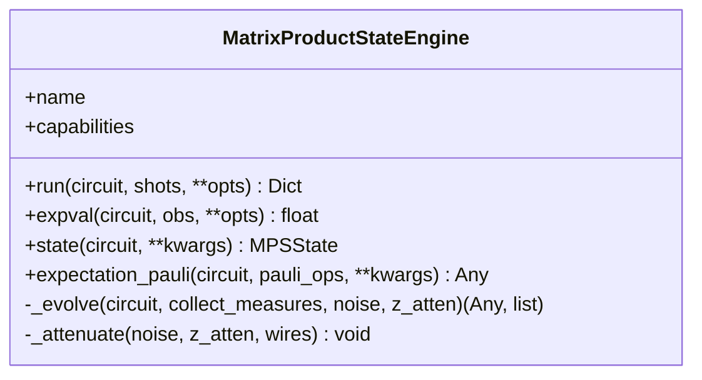
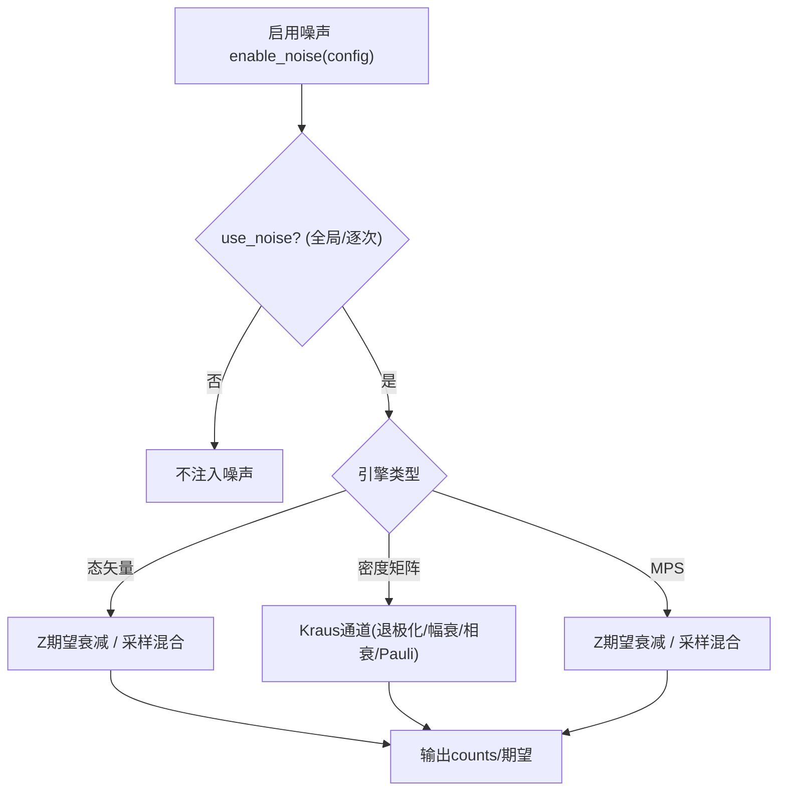
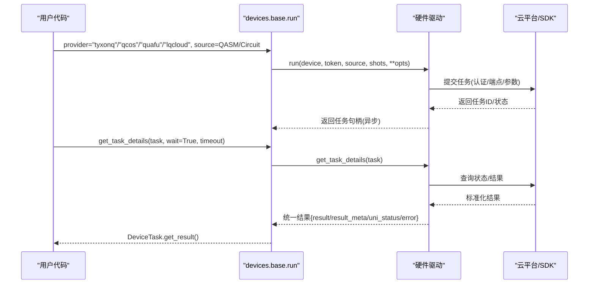
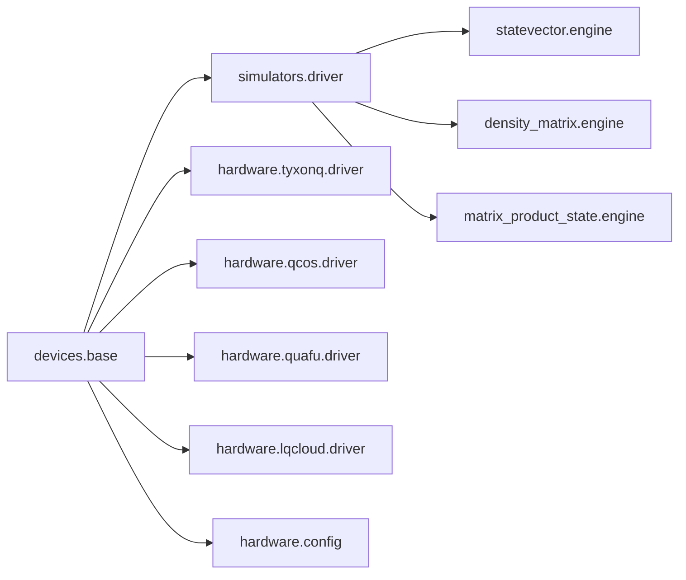

# 设备和模拟器

<cite>
**本文引用的文件**
- [base.py](file://src/tyxonq/devices/base.py)
- [driver.py（模拟器）](file://src/tyxonq/devices/simulators/driver.py)
- [engine.py（态矢量）](file://src/tyxonq/devices/simulators/statevector/engine.py)
- [engine.py（密度矩阵）](file://src/tyxonq/devices/simulators/density_matrix/engine.py)
- [engine.py（矩阵乘积态）](file://src/tyxonq/devices/simulators/matrix_product_state/engine.py)
- [channels.py（噪声通道兼容层）](file://src/tyxonq/devices/simulators/noise/channels.py)
- [config.py（硬件配置与端点）](file://src/tyxonq/devices/hardware/config.py)
- [driver.py（TyxonQ云平台）](file://src/tyxonq/devices/hardware/tyxonq/driver.py)
- [driver.py（中国移动QCOS）](file://src/tyxonq/devices/hardware/qcos/driver.py)
- [driver.py（Quafu）](file://src/tyxonq/devices/hardware/quafu/driver.py)
- [driver.py（LQCloud）](file://src/tyxonq/devices/hardware/lqcloud/driver.py)
- [noise_controls_demo.py（示例）](file://examples/noise_controls_demo.py)
- [numeric_backend_switching.py（示例）](file://examples/numeric_backend_switching.py)
</cite>

## 目录
1. [简介](#简介)
2. [项目结构](#项目结构)
3. [核心组件](#核心组件)
4. [架构总览](#架构总览)
5. [详细组件分析](#详细组件分析)
6. [依赖关系分析](#依赖关系分析)
7. [性能考量](#性能考量)
8. [故障诊断指南](#故障诊断指南)
9. [结论](#结论)
10. [附录](#附录)

## 简介
本文件系统性阐述 TyxonQ 设备与模拟器体系：统一的设备抽象层、多种执行后端（态矢量、密度矩阵、矩阵乘积态）、噪声模型实现（T1/T2弛豫、退极化等）、真实硬件驱动（TyxonQ云平台、中国移动QCOS、Quafu、LQCloud），以及设备配置、参数调优、选择与切换最佳实践、性能比较基准思路、故障诊断与错误处理，并展示如何在不同设备间无缝切换代码。

## 项目结构
TyxonQ 的设备子系统位于 src/tyxonq/devices，分为“统一基座”和“具体实现”两层：
- 统一基座：定义设备协议、任务包装、统一运行入口、默认配置与令牌管理、设备发现与结果归一化。
- 模拟器：提供三种引擎（态矢量、密度矩阵、MPS），共享权威门表与数值后端，支持采样与解析期望值。
- 硬件驱动：对接各云平台/真机，封装提交、轮询、取消、设备列表等能力，并将结果归一化为统一格式。

**图表来源**
- [base.py:97-143](file://src/tyxonq/devices/base.py#L97-L143)
- [driver.py（模拟器）:20-38](file://src/tyxonq/devices/simulators/driver.py#L20-L38)
- [config.py:11-19](file://src/tyxonq/devices/hardware/config.py#L11-L19)

**章节来源**
- [base.py:97-143](file://src/tyxonq/devices/base.py#L97-L143)
- [driver.py（模拟器）:20-38](file://src/tyxonq/devices/simulators/driver.py#L20-L38)
- [config.py:11-19](file://src/tyxonq/devices/hardware/config.py#L11-L19)

## 核心组件
- 设备协议与任务包装：Device 协议定义了 run/expval；DeviceTask 统一封装异步/同步任务，提供 get_result/cancel。
- 统一运行入口：run() 根据 provider/device 选择驱动，注入噪声开关，归一化 shots，支持 source 直传或 circuit 路径（仅模拟器）。
- 解析期望值：expval() 为模拟器提供 shots=0 的快速路径，直接调用引擎 expval。
- 设备发现与默认配置：list_all_devices() 聚合模拟器与硬件设备；config 模块维护 ENDPOINTS、令牌与默认 provider/device。

**章节来源**
- [base.py:13-57](file://src/tyxonq/devices/base.py#L13-L57)
- [base.py:294-445](file://src/tyxonq/devices/base.py#L294-L445)
- [base.py:448-469](file://src/tyxonq/devices/base.py#L448-L469)
- [base.py:475-493](file://src/tyxonq/devices/base.py#L475-L493)
- [config.py:24-65](file://src/tyxonq/devices/hardware/config.py#L24-L65)

## 架构总览
TyxonQ 采用“统一接口 + 多后端”的架构：上层通过 base.run/expval 发起执行，内部 resolve_driver 按 provider 路由到对应驱动；模拟器驱动再选择具体引擎；硬件驱动将请求转发至云平台/真机，并在 get_task_details 中统一结果格式。

**图表来源**
- [base.py:146-258](file://src/tyxonq/devices/base.py#L146-L258)
- [driver.py（模拟器）:86-141](file://src/tyxonq/devices/simulators/driver.py#L86-L141)
- [driver.py（TyxonQ云平台）:83-141](file://src/tyxonq/devices/hardware/tyxonq/driver.py#L83-L141)

## 详细组件分析

### 统一设备抽象层
- 设备协议 Device：声明 name、device_rule、run、expval，屏蔽底层差异。
- 任务包装 DeviceTask：统一 get_result/cancel，自动提升 result_meta 中的 metadata，确保下游后处理稳定。
- 统一入口 run：
  - 注入全局噪声开关 enable_noise/use_noise/noise。
  - 对 hardware 路径丢弃模拟器专属参数（noise/use_noise），避免驱动报错。
  - 支持 source 直传（编译产物或原始程序）与 circuit 路径（仅模拟器）。
  - 统一 shots 语义：hardware 不允许 shots=0。
- 解析期望 expval：仅支持模拟器/local，走引擎 expval 快速路径。
- 设备发现 list_all_devices：聚合模拟器与硬件设备列表。

**图表来源**
- [base.py:294-445](file://src/tyxonq/devices/base.py#L294-L445)

**章节来源**
- [base.py:97-143](file://src/tyxonq/devices/base.py#L97-L143)
- [base.py:294-445](file://src/tyxonq/devices/base.py#L294-L445)
- [base.py:448-469](file://src/tyxonq/devices/base.py#L448-L469)
- [base.py:475-493](file://src/tyxonq/devices/base.py#L475-L493)

### 态矢量模拟器（StatevectorEngine）
- 复杂度与内存：O(2^n)，适合中小规模系统。
- 功能：幺正门（经权威门表 resolve_unitary）、测量 Z 期望、采样计数、可选噪声衰减（Z期望去极化近似）、脉冲级演化（含三能级泄漏模拟与 ZZ 串扰）。
- 噪声：支持 use_noise=True 时按 qubit 衰减 Z 期望；shots>0 时支持 readout/depolarizing 混合。
- 特殊 op：unitary/kraus/pulse/pulse_inline 均受支持；未知 op 会显式报错而非静默跳过。

**图表来源**
- [engine.py（态矢量）:38-451](file://src/tyxonq/devices/simulators/statevector/engine.py#L38-L451)

**章节来源**
- [engine.py（态矢量）:38-451](file://src/tyxonq/devices/simulators/statevector/engine.py#L38-L451)

### 密度矩阵模拟器（DensityMatrixEngine）
- 复杂度与内存：O(4^n)，适合噪声研究。
- 功能：Kraus 通道原生应用（退极化、振幅阻尼、相位阻尼、Pauli 信道），测量 Z 期望，采样计数。
- 限制：不支持脉冲级演化（pulse/pulse_inline 抛出不支持异常），需改用态矢量引擎或将脉冲编译为幺正门。
- 噪声：在每次幺正后按 qubit 应用 Kraus 通道；shots>0 时支持 readout/depolarizing 混合。

**图表来源**
- [engine.py（密度矩阵）:36-242](file://src/tyxonq/devices/simulators/density_matrix/engine.py#L36-L242)

**章节来源**
- [engine.py（密度矩阵）:36-242](file://src/tyxonq/devices/simulators/density_matrix/engine.py#L36-L242)

### 矩阵乘积态模拟器（MatrixProductStateEngine）
- 复杂度与内存：随张量网络键维 χ 缩放，适合低纠缠大系统。
- 功能：1q/2q 幺正门（SWAP 路由）、measure_z/barrier、可选最大键维截断 max_bond。
- 限制：不支持 unitary/kraus/project_z/reset/pulse/pulse_inline 等特殊 op，遇到即抛出不支持异常。
- 噪声：通过 z_atten 衰减 Z 期望；shots>0 时支持 readout/depolarizing 混合。

**图表来源**
- [engine.py（矩阵乘积态）:39-319](file://src/tyxonq/devices/simulators/matrix_product_state/engine.py#L39-L319)

**章节来源**
- [engine.py（矩阵乘积态）:39-319](file://src/tyxonq/devices/simulators/matrix_product_state/engine.py#L39-L319)

### 噪声模型实现
- 全局噪声开关：enable_noise(is_enabled, config) 控制 use_noise/noise 注入；is_noise_enabled/get_noise_config 查询状态。
- 模拟器噪声：
  - 态矢量：Z 期望衰减（退极化近似），shots>0 时支持 readout/depolarizing 混合。
  - 密度矩阵：原生 Kraus 通道（退极化、振幅阻尼、相位阻尼、Pauli 信道）。
  - MPS：Z 期望衰减，shots>0 时支持 readout/depolarizing 混合。
- 兼容层：devices.simulators.noise.channels 提供旧接口桥接到 libs.quantum_library.noise。
- T1/T2 弛松建模建议：可通过 amplitude_damping（T1）与 phase_damping（T2）组合近似；或在态矢量路径使用 Z 衰减近似退极化效果。

**图表来源**
- [base.py:274-292](file://src/tyxonq/devices/base.py#L274-L292)
- [engine.py（态矢量）:344-451](file://src/tyxonq/devices/simulators/statevector/engine.py#L344-L451)
- [engine.py（密度矩阵）:111-167](file://src/tyxonq/devices/simulators/density_matrix/engine.py#L111-L167)
- [engine.py（矩阵乘积态）:137-218](file://src/tyxonq/devices/simulators/matrix_product_state/engine.py#L137-L218)
- [channels.py:1-44](file://src/tyxonq/devices/simulators/noise/channels.py#L1-L44)

**章节来源**
- [base.py:274-292](file://src/tyxonq/devices/base.py#L274-L292)
- [engine.py（态矢量）:344-451](file://src/tyxonq/devices/simulators/statevector/engine.py#L344-L451)
- [engine.py（密度矩阵）:111-167](file://src/tyxonq/devices/simulators/density_matrix/engine.py#L111-L167)
- [engine.py（矩阵乘积态）:137-218](file://src/tyxonq/devices/simulators/matrix_product_state/engine.py#L137-L218)
- [channels.py:1-44](file://src/tyxonq/devices/simulators/noise/channels.py#L1-L44)

### 真实硬件驱动集成
- TyxonQ 云平台：
  - 提交 OpenQASM 2 源，返回异步任务；get_task_details 标准化结果与状态；支持 remove_task。
- 中国移动 QCOS（WuYue SDK）：
  - 使用 wuyue.plugin.runner.Runner 提交 Qiskit QuantumCircuit；支持超时、重试、任务名等；get_task_details 映射状态码。
- Quafu：
  - 要求 OpenQASM 2.0；支持 task_name/compiler/correct/open_dd/target_qubits 等选项；get_task_details 映射服务器状态。
- LQCloud：
  - 官方 SDK 最小适配；支持 initial_layout；get_task_details 解析 Result 对象；remove_task 取消排队任务。

**图表来源**
- [driver.py（TyxonQ云平台）:83-222](file://src/tyxonq/devices/hardware/tyxonq/driver.py#L83-L222)
- [driver.py（中国移动QCOS）:80-238](file://src/tyxonq/devices/hardware/qcos/driver.py#L80-L238)
- [driver.py（Quafu）:103-236](file://src/tyxonq/devices/hardware/quafu/driver.py#L103-L236)
- [driver.py（LQCloud）:56-187](file://src/tyxonq/devices/hardware/lqcloud/driver.py#L56-L187)

**章节来源**
- [driver.py（TyxonQ云平台）:83-222](file://src/tyxonq/devices/hardware/tyxonq/driver.py#L83-L222)
- [driver.py（中国移动QCOS）:80-238](file://src/tyxonq/devices/hardware/qcos/driver.py#L80-L238)
- [driver.py（Quafu）:103-236](file://src/tyxonq/devices/hardware/quafu/driver.py#L103-L236)
- [driver.py（LQCloud）:56-187](file://src/tyxonq/devices/hardware/lqcloud/driver.py#L56-L187)

### 设备配置与参数调优
- 默认 provider/device：config 模块维护默认值，可通过 set_default 修改；list_all_devices 可枚举可用设备。
- 令牌管理：set_token/get_token 支持 provider/device 级别与全局环境变量回退；不同驱动有各自鉴权优先级（如 Quafu 不使用全局 TYXONQ_API_KEY）。
- 运行参数：
  - 模拟器：use_noise/noise、three_level（态矢量脉冲三能级）、zz_topology/zz_mode（ZZ 串扰）、max_bond（MPS 截断）。
  - 硬件：各驱动特有参数（如 Quafu 的 compiler/correct/open_dd/target_qubits；QCOS 的 timeout/auto_retry/task_name；LQCloud 的 initial_layout）。
- 数值后端：通过 tq.set_backend 切换 numpy/pytorch/cupynumeric，影响模拟性能与梯度计算。

**章节来源**
- [config.py:24-65](file://src/tyxonq/devices/hardware/config.py#L24-L65)
- [driver.py（Quafu）:28-45](file://src/tyxonq/devices/hardware/quafu/driver.py#L28-L45)
- [driver.py（LQCloud）:33-42](file://src/tyxonq/devices/hardware/lqcloud/driver.py#L33-L42)
- [engine.py（矩阵乘积态）:43-47](file://src/tyxonq/devices/simulators/matrix_product_state/engine.py#L43-L47)
- [engine.py（态矢量）:137-203](file://src/tyxonq/devices/simulators/statevector/engine.py#L137-L203)
- [numeric_backend_switching.py:84-200](file://examples/numeric_backend_switching.py#L84-L200)

### 设备选择与切换最佳实践
- 开发调试：优先使用 simulator::statevector（速度快、精确），必要时用 density_matrix（噪声研究）或 matrix_product_state（大系统低纠缠）。
- 真实硬件：
  - 先以模拟器验证线路与噪声策略，再切换到目标硬件。
  - 注意各驱动对 source 格式的要求（如 Quafu 必须 OpenQASM 2.0；TyxonQ homebrew 要求 QASM2）。
  - 合理设置 shots（硬件通常要求 >0，且某些平台有倍数约束）。
- 无缝切换：
  - 使用 devices.base.run 或 Circuit.run(provider=device)，保持代码不变即可切换后端。
  - 利用 device_descriptor 与 resolve_driver 进行动态选择。

**章节来源**
- [base.py:112-143](file://src/tyxonq/devices/base.py#L112-L143)
- [base.py:146-258](file://src/tyxonq/devices/base.py#L146-L258)
- [driver.py（Quafu）:90-100](file://src/tyxonq/devices/hardware/quafu/driver.py#L90-L100)
- [driver.py（TyxonQ云平台）:95-107](file://src/tyxonq/devices/hardware/tyxonq/driver.py#L95-L107)

### 性能比较与基准测试思路
- 态矢量：小规模（≤~20 qubits）高精度，时间 O(poly(gates)·2^n)。
- 密度矩阵：噪声研究首选，但内存 O(4^n)，开销显著高于态矢量。
- MPS：大系统低纠缠场景优势明显，时间/内存与键维 χ 相关；可设置 max_bond 控制精度与速度权衡。
- 数值后端：numpy（参考）、pytorch（GPU/自动微分）、cupynumeric（GPU加速）；示例展示了跨后端对比与计时方法。

**章节来源**
- [engine.py（态矢量）:1-10](file://src/tyxonq/devices/simulators/statevector/engine.py#L1-L10)
- [engine.py（密度矩阵）:1-9](file://src/tyxonq/devices/simulators/density_matrix/engine.py#L1-L9)
- [engine.py（矩阵乘积态）:1-12](file://src/tyxonq/devices/simulators/matrix_product_state/engine.py#L1-L12)
- [numeric_backend_switching.py:16-27](file://examples/numeric_backend_switching.py#L16-L27)

### 故障诊断与错误处理
- 任务等待超时：get_task_details 在 wait=True 且超时未结束时发出 RuntimeWarning，提示可能为空/不完整结果。
- 未知操作符：引擎对未知 op 显式 raise，避免静默跳过导致错误结果。
- 驱动校验：
  - TyxonQ homebrew：要求 QASM2（包含 qreg/creg）。
  - Quafu：要求 OpenQASM 2.0 头；shots 需为正数且通常为 1024 倍数。
  - QCOS：需提供 access_key/secret_key；不再支持 sdk_code。
  - LQCloud：必须安装 lqcloud==0.4.2；首版不支持批任务与多余参数。
- 噪声注入：hardware 路径会丢弃 noise/use_noise，避免驱动不认识这些键而报错。

**章节来源**
- [base.py:497-557](file://src/tyxonq/devices/base.py#L497-L557)
- [engine.py（态矢量）:335-342](file://src/tyxonq/devices/simulators/statevector/engine.py#L335-L342)
- [engine.py（密度矩阵）:97-109](file://src/tyxonq/devices/simulators/density_matrix/engine.py#L97-L109)
- [engine.py（矩阵乘积态）:121-134](file://src/tyxonq/devices/simulators/matrix_product_state/engine.py#L121-L134)
- [driver.py（TyxonQ云平台）:95-107](file://src/tyxonq/devices/hardware/tyxonq/driver.py#L95-L107)
- [driver.py（Quafu）:90-100](file://src/tyxonq/devices/hardware/quafu/driver.py#L90-L100)
- [driver.py（中国移动QCOS）:46-65](file://src/tyxonq/devices/hardware/qcos/driver.py#L46-L65)
- [driver.py（LQCloud）:24-42](file://src/tyxonq/devices/hardware/lqcloud/driver.py#L24-L42)

## 依赖关系分析
- 模拟器驱动依赖权威门表与内核（kernels.gates、kernels.statevector/density_matrix/matrix_product_state），保证单一真相源。
- 硬件驱动依赖各自 SDK/REST 客户端，并通过 config.ENDPOINTS 获取端点与版本。
- 统一设备层解耦了上层应用与底层实现，便于扩展新驱动与新引擎。

**图表来源**
- [base.py:146-258](file://src/tyxonq/devices/base.py#L146-L258)
- [driver.py（模拟器）:20-38](file://src/tyxonq/devices/simulators/driver.py#L20-L38)
- [config.py:11-19](file://src/tyxonq/devices/hardware/config.py#L11-L19)

**章节来源**
- [base.py:146-258](file://src/tyxonq/devices/base.py#L146-L258)
- [driver.py（模拟器）:20-38](file://src/tyxonq/devices/simulators/driver.py#L20-L38)
- [config.py:11-19](file://src/tyxonq/devices/hardware/config.py#L11-L19)

## 性能考量
- 选择合适引擎：小系统用态矢量，噪声研究用密度矩阵，大系统低纠缠用 MPS（可设 max_bond）。
- 数值后端：根据硬件资源选择 numpy/pytorch/cupynumeric；GPU 加速可显著提升大规模态矢量运算。
- 噪声模拟：密度矩阵原生 Kraus 更准确但昂贵；态矢量/Z 衰减近似更快但为近似。
- 硬件提交：合理设置 shots、超时与重试；注意平台约束（如 Quafu 的 1024 倍数）。

[本节为通用指导，无需特定文件来源]

## 故障诊断指南
- 检查任务状态：使用 DeviceTask.get_result(wait=True, timeout=...) 并关注 uni_status 与 error 字段。
- 定位噪声问题：确认 use_noise/noise 是否正确注入；hardware 路径会丢弃噪声键，需在模拟器验证。
- 排查驱动错误：查看各驱动抛出的异常信息（如 Quafu 的 OpenQASM 2.0 头缺失、QCOS 的凭据缺失、LQCloud 的 SDK 未安装）。
- 日志与警告：get_task_details 在超时时发出 RuntimeWarning；Quafu 对非 1024 倍 shots 发出 UserWarning。

**章节来源**
- [base.py:497-557](file://src/tyxonq/devices/base.py#L497-L557)
- [driver.py（Quafu）:147-156](file://src/tyxonq/devices/hardware/quafu/driver.py#L147-L156)
- [driver.py（中国移动QCOS）:46-65](file://src/tyxonq/devices/hardware/qcos/driver.py#L46-L65)
- [driver.py（LQCloud）:24-42](file://src/tyxonq/devices/hardware/lqcloud/driver.py#L24-L42)

## 结论
TyxonQ 通过统一设备抽象层与多后端设计，实现了从模拟器到真实硬件的无缝切换。态矢量、密度矩阵、MPS 三种引擎覆盖不同规模与需求；噪声模型支持 T1/T2 弛豫与退极化等常见误差；硬件驱动整合了多个云平台与真机，并提供一致的任务管理与结果格式。结合合理的设备选择、参数调优与故障诊断流程，可在开发与生产环境中高效推进量子算法落地。

[本节为总结性内容，无需特定文件来源]

## 附录
- 示例参考：
  - 噪声控制演示：examples/noise_controls_demo.py
  - 数值后端切换：examples/numeric_backend_switching.py

**章节来源**
- [noise_controls_demo.py:1-53](file://examples/noise_controls_demo.py#L1-L53)
- [numeric_backend_switching.py:1-200](file://examples/numeric_backend_switching.py#L1-L200)