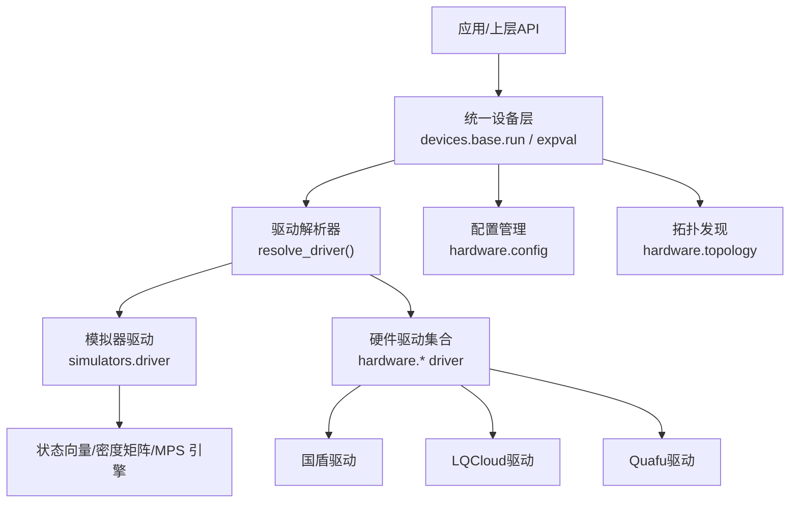
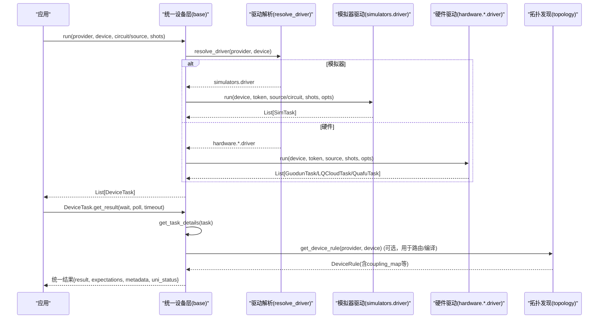
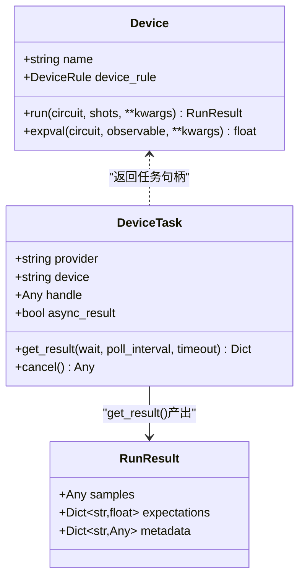
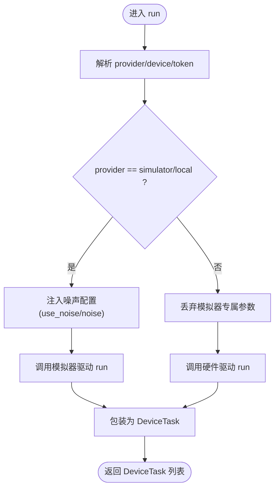
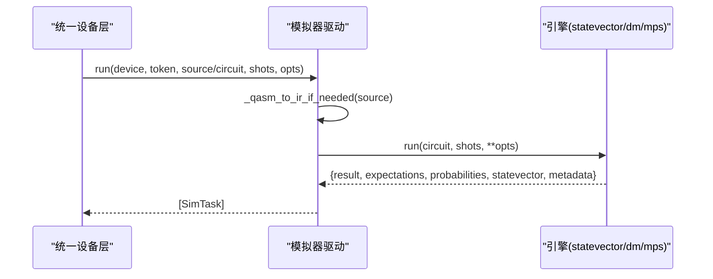
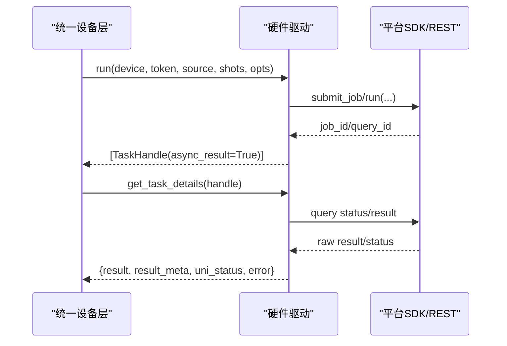
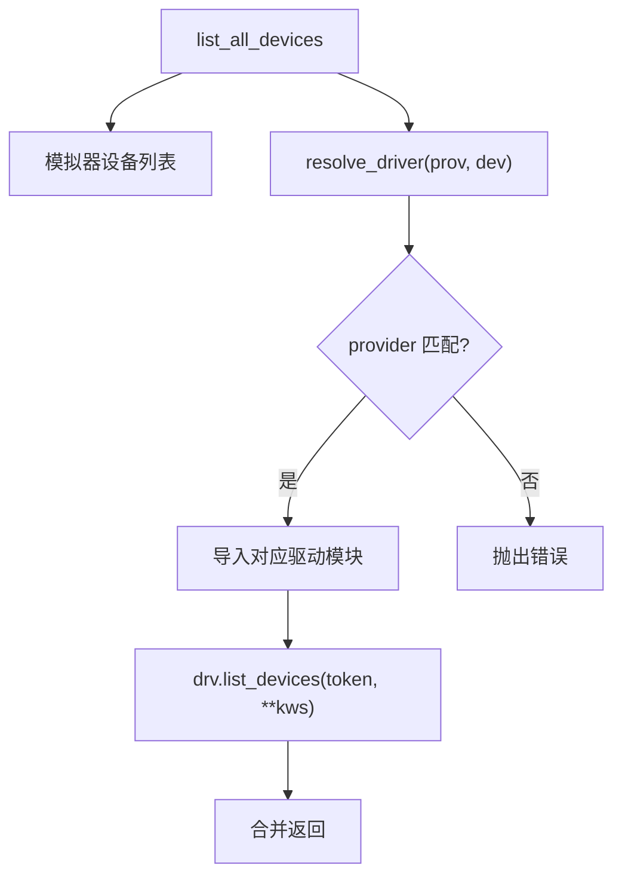
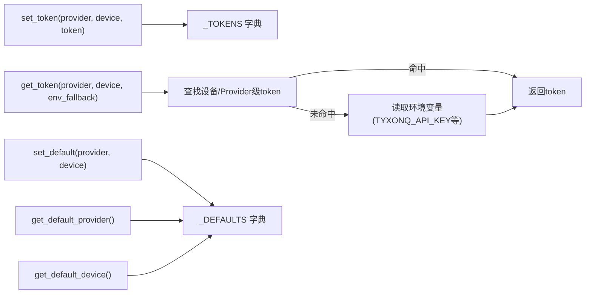
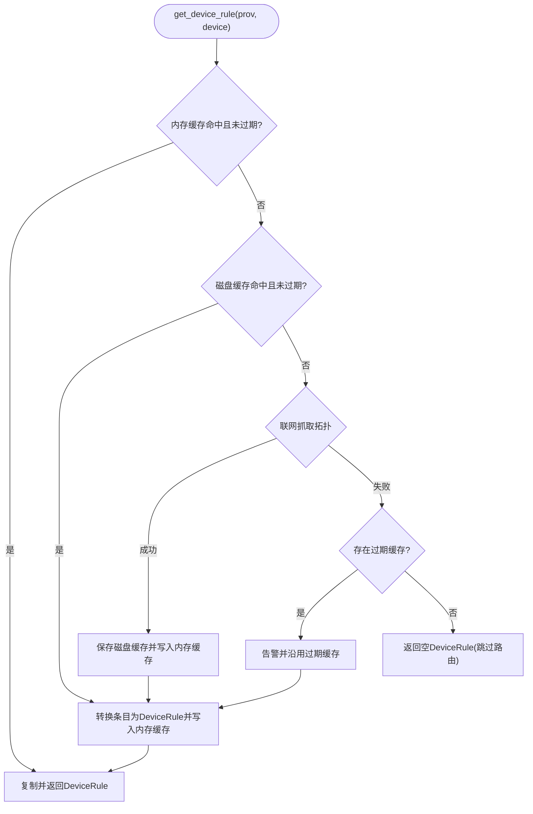
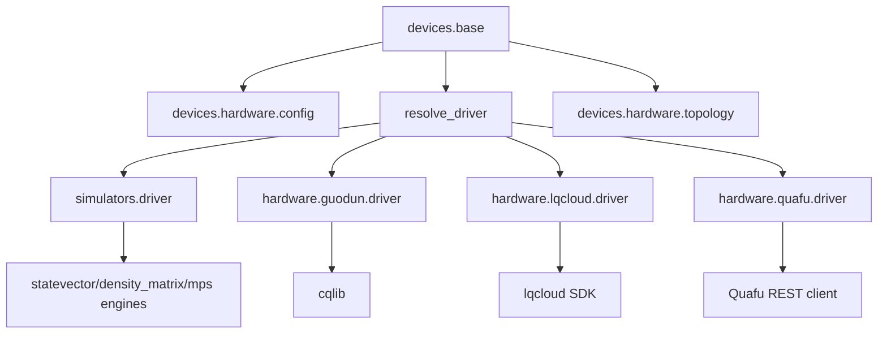

# 设备架构设计

<cite>
**本文引用的文件**
- [base.py](file://src/tyxonq/devices/base.py)
- [__init__.py（devices）](file://src/tyxonq/devices/__init__.py)
- [config.py（硬件配置）](file://src/tyxonq/devices/hardware/config.py)
- [driver.py（模拟器驱动）](file://src/tyxonq/devices/simulators/driver.py)
- [topology.py（拓扑发现与缓存）](file://src/tyxonq/devices/hardware/topology.py)
- [driver.py（国盾驱动）](file://src/tyxonq/devices/hardware/guodun/driver.py)
- [driver.py（LQCloud驱动）](file://src/tyxonq/devices/hardware/lqcloud/driver.py)
- [driver.py（Quafu驱动）](file://src/tyxonq/devices/hardware/quafu/driver.py)
- [topology.py（LQCloud拓扑抓取）](file://src/tyxonq/compiler/platforms/lqcloud/topology.py)
</cite>

## 目录
1. [简介](#简介)
2. [项目结构](#项目结构)
3. [核心组件](#核心组件)
4. [架构总览](#架构总览)
5. [详细组件分析](#详细组件分析)
6. [依赖关系分析](#依赖关系分析)
7. [性能考虑](#性能考虑)
8. [故障排查指南](#故障排查指南)
9. [结论](#结论)
10. [附录](#附录)

## 简介
本文件系统性阐述 TyxonQ 的设备架构设计，重点解释统一的设备抽象层、协议定义与执行流程。文档覆盖 Device 协议、DeviceTask 封装、RunResult 标准化、设备发现机制、驱动解析流程、配置管理、provider-device 层次结构与命名约定、设备能力声明（DeviceRule）与拓扑信息处理，以及在不同执行后端（模拟器到真实硬件）之间无缝切换的策略与最佳实践。同时提供设备初始化、配置管理与错误处理的完整指南。

## 项目结构
TyxonQ 的设备子系统位于 src/tyxonq/devices 下，采用“统一入口 + 多驱动”的分层组织：
- 统一抽象与调度：devices.base 暴露 Device 协议、DeviceTask、RunResult、run/expval/list_all_devices 等统一接口，并负责 provider/device 选择与结果归一化。
- 模拟器后端：devices.simulators.driver 提供 statevector、density_matrix、matrix_product_state 三种引擎的统一封装。
- 硬件驱动：devices.hardware.* 为各云平台/硬件平台提供独立驱动，遵循 run/get_task_details/remove_task/list_devices 的契约。
- 配置管理：devices.hardware.config 集中管理默认 provider/device、token 与端点。
- 拓扑发现：devices.hardware.topology 提供跨 provider 的拓扑获取与 TTL 缓存；具体 provider 的抓取逻辑在 compiler.platforms.<provider>.topology 中实现（如 LQCloud）。

图示来源
- [base.py:146-258](file://src/tyxonq/devices/base.py#L146-L258)
- [driver.py（模拟器驱动）:20-38](file://src/tyxonq/devices/simulators/driver.py#L20-L38)
- [config.py（硬件配置）:24-65](file://src/tyxonq/devices/hardware/config.py#L24-L65)
- [topology.py（拓扑发现与缓存）:164-258](file://src/tyxonq/devices/hardware/topology.py#L164-L258)

章节来源
- [base.py:146-258](file://src/tyxonq/devices/base.py#L146-L258)
- [driver.py（模拟器驱动）:20-38](file://src/tyxonq/devices/simulators/driver.py#L20-L38)
- [config.py（硬件配置）:24-65](file://src/tyxonq/devices/hardware/config.py#L24-L65)
- [topology.py（拓扑发现与缓存）:164-258](file://src/tyxonq/devices/hardware/topology.py#L164-L258)

## 核心组件
- Device 协议：定义 name、device_rule、run、expval 的最小接口，确保不同后端具备一致的运行与期望值计算能力。
- DeviceTask：统一的任务句柄封装，屏蔽异步/同步差异，提供 get_result/cancel 等一致操作，并在内部完成结果结构的规范化。
- RunResult：标准化的运行结果字典，包含 samples、expectations、metadata 等键，便于下游后处理与聚合。
- 统一入口 run/expval：根据 provider/device 选择驱动，注入噪声配置（仅对模拟器），统一 shots 语义，返回 DeviceTask 列表。
- 设备发现 list_all_devices：聚合模拟器设备与硬件驱动提供的设备列表。
- 任务轮询 get_task_details：统一状态映射与等待/超时策略，输出统一格式。

章节来源
- [base.py:60-109](file://src/tyxonq/devices/base.py#L60-L109)
- [base.py:294-445](file://src/tyxonq/devices/base.py#L294-L445)
- [base.py:475-574](file://src/tyxonq/devices/base.py#L475-L574)

## 架构总览
下图展示从高层 API 到底层驱动的调用链路与数据流，包括模拟器与多种硬件驱动的路由与结果归一化。

图示来源
- [base.py:146-258](file://src/tyxonq/devices/base.py#L146-L258)
- [base.py:294-445](file://src/tyxonq/devices/base.py#L294-L445)
- [base.py:497-557](file://src/tyxonq/devices/base.py#L497-L557)
- [topology.py（拓扑发现与缓存）:180-258](file://src/tyxonq/devices/hardware/topology.py#L180-L258)

## 详细组件分析

### Device 协议与 DeviceTask 封装
- Device 协议定义了设备必须实现的 run 与 expval，以及设备能力描述 device_rule。
- DeviceTask 将不同驱动返回的任务对象统一包装，提供 get_result 与 cancel。get_result 内部调用 get_task_details，并对 result/result_meta/metadata/expectations/probabilities 进行规范化，保证下游一致性。
- 对于模拟器任务，async_result=False，立即返回结果；对于硬件任务，async_result=True，支持轮询等待与超时。

图示来源
- [base.py:60-109](file://src/tyxonq/devices/base.py#L60-L109)
- [base.py:13-58](file://src/tyxonq/devices/base.py#L13-L58)

章节来源
- [base.py:13-58](file://src/tyxonq/devices/base.py#L13-L58)
- [base.py:60-109](file://src/tyxonq/devices/base.py#L60-L109)

### 统一执行入口 run/expval 与噪声注入
- run 负责：
  - 解析 provider/device 默认值与 token；
  - 选择驱动（resolve_driver）；
  - 对模拟器注入噪声配置（use_noise/noise），对真机丢弃模拟器专属参数；
  - 统一 shots 语义（真机不允许 0）；
  - 支持直接提交 source（已编译程序）或传入 Circuit（仅模拟器路径）；
  - 返回 DeviceTask 列表。
- expval 针对模拟器/local 提供快速解析期望值路径（shots==0）。

图示来源
- [base.py:294-445](file://src/tyxonq/devices/base.py#L294-L445)

章节来源
- [base.py:294-445](file://src/tyxonq/devices/base.py#L294-L445)

### 模拟器驱动（statevector/density_matrix/matrix_product_state）
- 通过 _select_engine 按设备名选择对应引擎；
- run 将 QASM 字符串转换为 IR（优先使用 TyxonQ 原生 QASM3 导入器，否则回退到 Qiskit QASM2）；
- 对 shots==0 的情况，直接从引擎输出中提取 probabilities/statevector，避免重复计算；
- 返回 SimTask，其 get_result 始终立即可用。

图示来源
- [driver.py（模拟器驱动）:41-73](file://src/tyxonq/devices/simulators/driver.py#L41-L73)
- [driver.py（模拟器驱动）:86-141](file://src/tyxonq/devices/simulators/driver.py#L86-L141)

章节来源
- [driver.py（模拟器驱动）:20-38](file://src/tyxonq/devices/simulators/driver.py#L20-L38)
- [driver.py（模拟器驱动）:41-73](file://src/tyxonq/devices/simulators/driver.py#L41-L73)
- [driver.py（模拟器驱动）:86-141](file://src/tyxonq/devices/simulators/driver.py#L86-L141)

### 硬件驱动族（国盾/LQCloud/Quafu）
- 国盾驱动：
  - 登录平台、下载标定、校验拓扑与脉冲指令；
  - 提交 QCIS 源（支持批量），返回 GuodunTask；
  - get_task_details 将平台结果映射为统一结构，处理查询异常与转态。
- LQCloud 驱动：
  - 基于官方 SDK，提交 QuantumCircuit，返回 LQCloudTask；
  - get_task_details 使用 Result 解析 counts/probabilities，映射状态。
- Quafu 驱动：
  - 要求 OpenQASM 2.0 源，支持批量化提交；
  - 严格验证 shots 倍数与源格式；
  - get_task_details 映射服务器状态至统一 uni_status。

图示来源
- [driver.py（国盾驱动）:310-357](file://src/tyxonq/devices/hardware/guodun/driver.py#L310-L357)
- [driver.py（国盾驱动）:403-471](file://src/tyxonq/devices/hardware/guodun/driver.py#L403-L471)
- [driver.py（LQCloud驱动）:56-92](file://src/tyxonq/devices/hardware/lqcloud/driver.py#L56-L92)
- [driver.py（LQCloud驱动）:119-180](file://src/tyxonq/devices/hardware/lqcloud/driver.py#L119-L180)
- [driver.py（Quafu驱动）:103-180](file://src/tyxonq/devices/hardware/quafu/driver.py#L103-L180)
- [driver.py（Quafu驱动）:203-236](file://src/tyxonq/devices/hardware/quafu/driver.py#L203-L236)

章节来源
- [driver.py（国盾驱动）:310-357](file://src/tyxonq/devices/hardware/guodun/driver.py#L310-L357)
- [driver.py（国盾驱动）:403-471](file://src/tyxonq/devices/hardware/guodun/driver.py#L403-L471)
- [driver.py（LQCloud驱动）:56-92](file://src/tyxonq/devices/hardware/lqcloud/driver.py#L56-L92)
- [driver.py（LQCloud驱动）:119-180](file://src/tyxonq/devices/hardware/lqcloud/driver.py#L119-L180)
- [driver.py（Quafu驱动）:103-180](file://src/tyxonq/devices/hardware/quafu/driver.py#L103-L180)
- [driver.py（Quafu驱动）:203-236](file://src/tyxonq/devices/hardware/quafu/driver.py#L203-L236)

### 设备发现机制与驱动解析流程
- 设备发现：list_all_devices 聚合模拟器设备与硬件驱动 list_devices 的结果；各硬件驱动在无凭证或网络失败时安全降级为空列表。
- 驱动解析：resolve_driver 根据 provider 动态导入对应驱动模块，屏蔽底层差异；未支持的 provider 抛出 ValueError。

图示来源
- [base.py:475-493](file://src/tyxonq/devices/base.py#L475-L493)
- [base.py:146-258](file://src/tyxonq/devices/base.py#L146-L258)

章节来源
- [base.py:475-493](file://src/tyxonq/devices/base.py#L475-L493)
- [base.py:146-258](file://src/tyxonq/devices/base.py#L146-L258)

### 配置管理系统（默认 provider/device、Token、端点）
- 默认值：默认 provider 为 tyxonq，默认设备为 tyxonq::simulator:mps；可通过 set_default 修改。
- Token 管理：set_token 支持设备级与 provider 级存储；get_token 优先内存 token，其次环境变量（可配置是否回退）。
- 端点：ENDPOINTS 记录各 provider 的基础 URL 与版本（如 tyxonq、qcos）。

图示来源
- [config.py（硬件配置）:24-65](file://src/tyxonq/devices/hardware/config.py#L24-L65)

章节来源
- [config.py（硬件配置）:24-65](file://src/tyxonq/devices/hardware/config.py#L24-L65)

### 设备能力声明（DeviceRule）与拓扑信息处理
- DeviceRule：声明式设备能力描述，包含 native_gates、max_qubits、connectivity、supports_shots/supports_batch、coupling_map、initial_layout、num_qubits 等字段。
- 拓扑发现：get_device_rule 提供跨 provider 的统一入口，按优先级从内存缓存→磁盘TTL缓存→联网抓取；若失败则降级沿用过期缓存或返回空规则，确保编译/提交不中断。
- LQCloud 拓扑抓取：从 backend.config 提取 coupling_map、native_gates、num_qubits 等，并进行双向去重与大字段裁剪以控制缓存体积。

图示来源
- [topology.py（拓扑发现与缓存）:180-258](file://src/tyxonq/devices/hardware/topology.py#L180-L258)
- [topology.py（LQCloud拓扑抓取）:108-151](file://src/tyxonq/compiler/platforms/lqcloud/topology.py#L108-L151)

章节来源
- [topology.py（拓扑发现与缓存）:180-258](file://src/tyxonq/devices/hardware/topology.py#L180-L258)
- [topology.py（LQCloud拓扑抓取）:108-151](file://src/tyxonq/compiler/platforms/lqcloud/topology.py#L108-L151)

### provider-device 层次结构与命名约定
- 名称解析：device_descriptor 支持 “provider::device”、“provider.device” 或直接设备名；对模拟器设备提供别名映射（如 mps、statevector、density_matrix）。
- 命名约定：
  - 模拟器：simulator::statevector、simulator::density_matrix、simulator::matrix_product_state；
  - 硬件：guodun::<machine>、lqcloud::<backend>、quafu::<chip>、tyxonq::<device>。
- 列表发现：各驱动 list_devices 返回带 provider 前缀的设备名，便于统一展示与选择。

章节来源
- [base.py:112-143](file://src/tyxonq/devices/base.py#L112-L143)
- [driver.py（模拟器驱动）:33-38](file://src/tyxonq/devices/simulators/driver.py#L33-L38)
- [driver.py（国盾驱动）:493-510](file://src/tyxonq/devices/hardware/guodun/driver.py#L493-L510)
- [driver.py（LQCloud驱动）:190-213](file://src/tyxonq/devices/hardware/lqcloud/driver.py#L190-L213)
- [driver.py（Quafu驱动）:242-266](file://src/tyxonq/devices/hardware/quafu/driver.py#L242-L266)

### 在不同执行后端间无缝切换（模拟器到真实硬件）
- 切换策略：
  - 保持同一调用入口 run(expval)，通过 provider/device 参数切换后端；
  - 模拟器路径支持 circuit 直接运行与噪声注入；硬件路径要求 caller 先编译为 source；
  - 统一返回 DeviceTask，后续 get_result 行为一致（wait/poll/timeout）。
- 迁移建议：
  - 开发阶段使用模拟器（mps/statevector/density_matrix）快速验证；
  - 上线前切换到目标硬件 provider（如 lqcloud/guodun/quafu），确保 source 格式与 shots 约束满足驱动要求；
  - 利用拓扑发现与路由（耦合图）减少 SWAP 插入，提升成功率。

章节来源
- [base.py:294-445](file://src/tyxonq/devices/base.py#L294-L445)
- [driver.py（模拟器驱动）:86-141](file://src/tyxonq/devices/simulators/driver.py#L86-L141)
- [driver.py（LQCloud驱动）:56-92](file://src/tyxonq/devices/hardware/lqcloud/driver.py#L56-L92)
- [driver.py（国盾驱动）:310-357](file://src/tyxonq/devices/hardware/guodun/driver.py#L310-L357)
- [driver.py（Quafu驱动）:103-180](file://src/tyxonq/devices/hardware/quafu/driver.py#L103-L180)

### 设备选择最佳实践与性能考虑
- 模拟器选择：
  - statevector：适合小比特数精确模拟；
  - density_matrix：适合噪声建模与退相干研究；
  - matrix_product_state（mps）：适合中等规模、低纠缠度电路。
- 硬件选择：
  - 关注 coupling_map 与 num_qubits，结合拓扑发现结果优化布局；
  - 注意各驱动对 shots 的限制（如 Quafu 要求 1024 的倍数）；
  - 合理设置 wait/poll/timeout，避免长时间阻塞。
- 性能优化：
  - 使用拓扑发现减少不必要的 SWAP；
  - 对模拟器启用噪声模型时，谨慎选择噪声强度与类型；
  - 批量化提交（如 Guodun）可减少网络往返开销。

章节来源
- [driver.py（模拟器驱动）:20-38](file://src/tyxonq/devices/simulators/driver.py#L20-L38)
- [driver.py（Quafu驱动）:147-156](file://src/tyxonq/devices/hardware/quafu/driver.py#L147-L156)
- [topology.py（拓扑发现与缓存）:180-258](file://src/tyxonq/devices/hardware/topology.py#L180-L258)

## 依赖关系分析
- 统一设备层依赖：
  - 硬件配置（hardware.config）：默认 provider/device、token、端点；
  - 驱动解析（resolve_driver）：动态导入模拟器与各硬件驱动；
  - 拓扑发现（hardware.topology）：按需获取设备拓扑，供编译器路由使用。
- 模拟器驱动依赖：
  - 引擎选择（_select_engine）：statevector/density_matrix/mps；
  - QASM 导入：优先 TyxonQ 原生 QASM3，回退 Qiskit QASM2。
- 硬件驱动依赖：
  - 各自 SDK/REST 客户端（cqlib、lqcloud、Quafu 私有库）；
  - 拓扑校验（如国盾的脉冲拓扑与禁用比特/耦合器检查）。

图示来源
- [base.py:146-258](file://src/tyxonq/devices/base.py#L146-L258)
- [driver.py（模拟器驱动）:20-38](file://src/tyxonq/devices/simulators/driver.py#L20-L38)
- [driver.py（国盾驱动）:30-53](file://src/tyxonq/devices/hardware/guodun/driver.py#L30-L53)
- [driver.py（LQCloud驱动）:24-30](file://src/tyxonq/devices/hardware/lqcloud/driver.py#L24-L30)
- [driver.py（Quafu驱动）:1-15](file://src/tyxonq/devices/hardware/quafu/driver.py#L1-L15)

章节来源
- [base.py:146-258](file://src/tyxonq/devices/base.py#L146-L258)
- [driver.py（模拟器驱动）:20-38](file://src/tyxonq/devices/simulators/driver.py#L20-L38)
- [driver.py（国盾驱动）:30-53](file://src/tyxonq/devices/hardware/guodun/driver.py#L30-L53)
- [driver.py（LQCloud驱动）:24-30](file://src/tyxonq/devices/hardware/lqcloud/driver.py#L24-L30)
- [driver.py（Quafu驱动）:1-15](file://src/tyxonq/devices/hardware/quafu/driver.py#L1-L15)

## 性能考虑
- 模拟器性能：
  - statevector 指数增长，适用于小规模；density_matrix 更慢但支持噪声；mps 适合低纠缠度中等规模。
- 硬件性能：
  - 批量化提交（如 Guodun）减少网络开销；
  - 合理设置 shots 与并行度，避免队列拥塞；
  - 利用拓扑发现与路由减少 SWAP，降低门深度与误差累积。
- 通用优化：
  - 复用拓扑缓存（TTL）减少重复网络请求；
  - 对模拟器噪声注入仅在需要时开启，避免额外开销。

[本节为通用指导，不直接分析具体文件]

## 故障排查指南
- 任务等待超时：
  - get_task_details 在 wait=True 且超过 timeout 时会发出 RuntimeWarning，提示可能因排队或执行耗时导致结果不完整；建议增大超时并重试。
- 拓扑抓取失败：
  - 无网络/无凭证/SDK缺失时，若存在过期缓存则降级沿用并发出警告；若无缓存则返回空 DeviceRule，编译器跳过路由。
- 驱动特定错误：
  - 国盾：缺少 cqlib 或版本不匹配会抛出运行时错误；脉冲指令需通过 GetPulse 校验；
  - LQCloud：缺少 API key 或 SDK 未安装会报错；
  - Quafu：OpenQASM 2.0 头缺失或 shots 非 1024 倍数会警告/报错。
- Token 问题：
  - 各驱动有独立的 token 解析链，避免误用全局 TYXONQ_API_KEY；必要时显式传入 token=... 或通过 set_token(provider=...) 设置。

章节来源
- [base.py:497-557](file://src/tyxonq/devices/base.py#L497-L557)
- [topology.py（拓扑发现与缓存）:224-258](file://src/tyxonq/devices/hardware/topology.py#L224-L258)
- [driver.py（国盾驱动）:30-67](file://src/tyxonq/devices/hardware/guodun/driver.py#L30-L67)
- [driver.py（LQCloud驱动）:33-42](file://src/tyxonq/devices/hardware/lqcloud/driver.py#L33-L42)
- [driver.py（Quafu驱动）:28-45](file://src/tyxonq/devices/hardware/quafu/driver.py#L28-L45)

## 结论
TyxonQ 的设备架构通过统一的 Device 协议、DeviceTask 封装与 RunResult 标准化，屏蔽了模拟器与多种硬件平台的差异，提供了稳定可靠的执行入口。配合配置管理、设备发现与拓扑缓存机制，开发者可以在不同后端间无缝切换，并获得一致的编程体验。实际使用中，应充分利用拓扑发现与路由优化线路质量，并根据场景选择合适的模拟器与硬件后端，以获得最佳性能与可靠性。

[本节为总结性内容，不直接分析具体文件]

## 附录
- 常用命令与用法要点：
  - 初始化默认 provider/device：调用 base.init(provider, device)；
  - 设置 token：调用 hardware.config.set_token(token, provider, device)；
  - 列出可用设备：调用 base.list_all_devices(provider, token)；
  - 提交运行：调用 base.run(provider, device, circuit/source, shots, **opts)；
  - 获取结果：调用 DeviceTask.get_result(wait=True, poll_interval, timeout)。

[本节为补充说明，不直接分析具体文件]