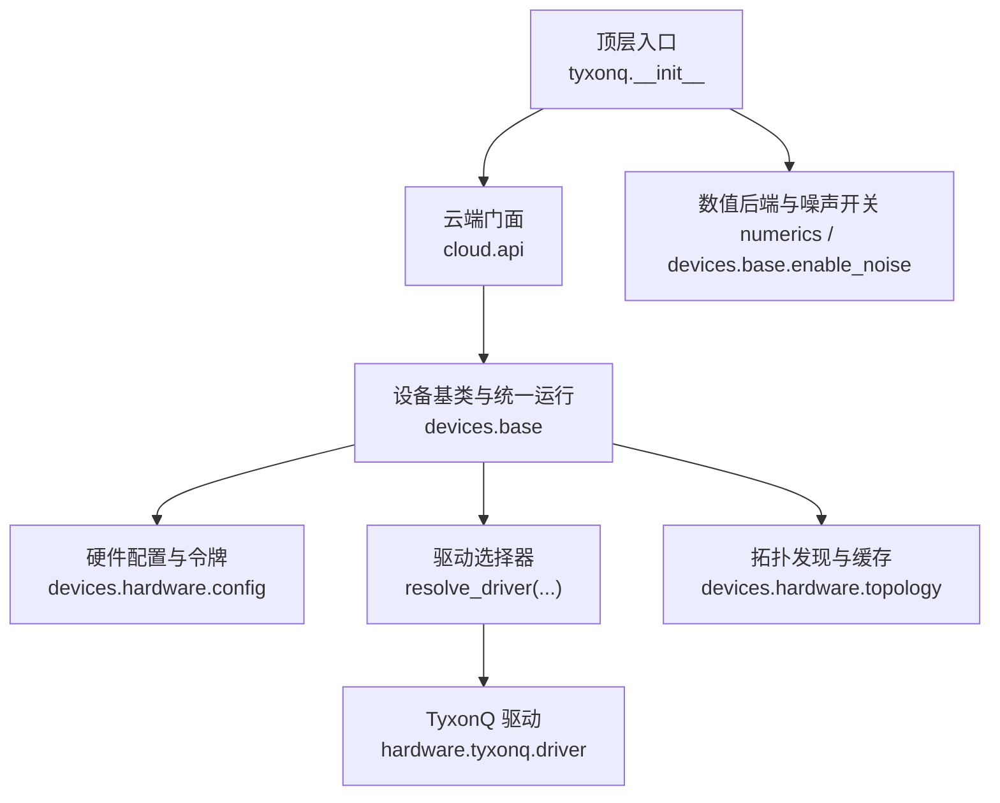
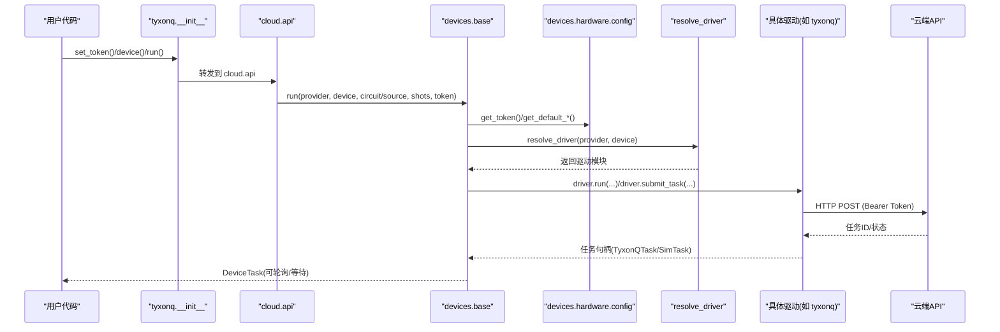
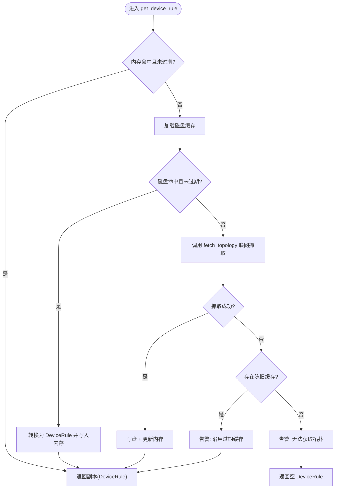
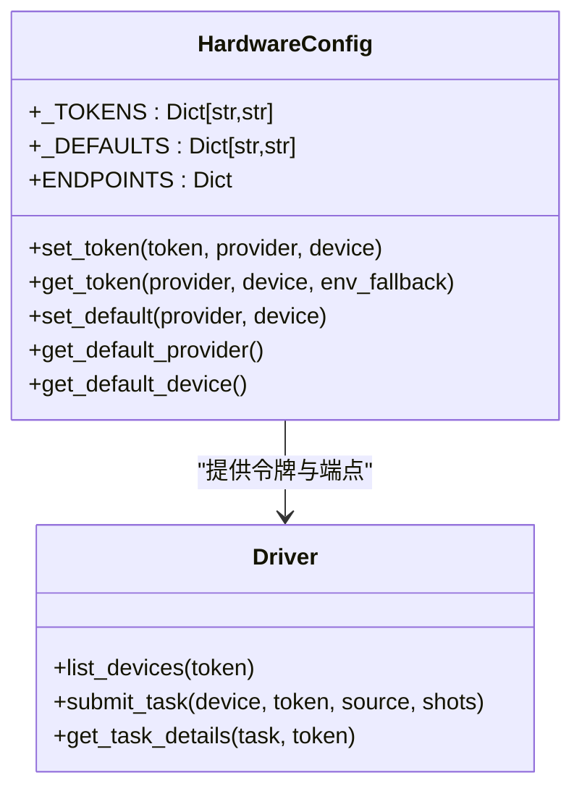
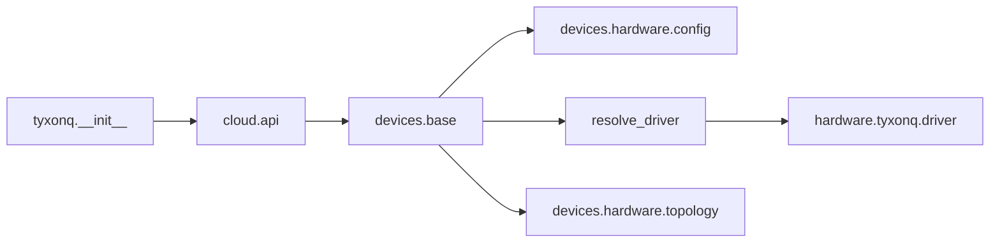

# 设备配置与管理

<cite>
**本文引用的文件**
- [src/tyxonq/config.py](file://src/tyxonq/config.py)
- [src/tyxonq/devices/base.py](file://src/tyxonq/devices/base.py)
- [src/tyxonq/devices/hardware/config.py](file://src/tyxonq/devices/hardware/config.py)
- [src/tyxonq/cloud/api.py](file://src/tyxonq/cloud/api.py)
- [src/tyxonq/__init__.py](file://src/tyxonq/__init__.py)
- [src/tyxonq/devices/hardware/topology.py](file://src/tyxonq/devices/hardware/topology.py)
- [src/tyxonq/devices/hardware/tyxonq/driver.py](file://src/tyxonq/devices/hardware/tyxonq/driver.py)
- [examples/cloud_api_devices.py](file://examples/cloud_api_devices.py)
- [tests_core_module/test_hwconfig_get_token.py](file://tests_core_module/test_hwconfig_get_token.py)
- [tests_core_module/test_device_topology_cache.py](file://tests_core_module/test_device_topology_cache.py)
- [src/tyxonq/core/errors.py](file://src/tyxonq/core/errors.py)
- [docs/tyxonq_cloud_api.md](file://docs/tyxonq_cloud_api.md)
</cite>

## 目录
1. [简介](#简介)
2. [项目结构](#项目结构)
3. [核心组件](#核心组件)
4. [架构总览](#架构总览)
5. [详细组件分析](#详细组件分析)
6. [依赖关系分析](#依赖关系分析)
7. [性能考虑](#性能考虑)
8. [故障排查指南](#故障排查指南)
9. [结论](#结论)
10. [附录](#附录)

## 简介
本文件面向 TyxonQ 的设备配置与管理系统，系统性说明：
- 配置文件格式、环境变量与运行时选项
- 设备发现机制、拓扑信息获取与能力查询
- 认证令牌管理、多账户支持与权限控制
- 动态切换设备与配置项的方法
- 配置验证、错误处理与调试工具使用
- 拓扑缓存机制与优化策略
- 企业级部署的设备管理与监控告警建议

## 项目结构
TyxonQ 将“设备抽象、驱动实现、云端 API 门面、拓扑缓存”分层解耦，便于扩展新厂商与模拟器。

图表来源
- [src/tyxonq/__init__.py:25-126](file://src/tyxonq/__init__.py#L25-L126)
- [src/tyxonq/cloud/api.py:18-72](file://src/tyxonq/cloud/api.py#L18-L72)
- [src/tyxonq/devices/base.py:111-258](file://src/tyxonq/devices/base.py#L111-L258)
- [src/tyxonq/devices/hardware/config.py:7-19](file://src/tyxonq/devices/hardware/config.py#L7-L19)
- [src/tyxonq/devices/hardware/topology.py:1-29](file://src/tyxonq/devices/hardware/topology.py#L1-L29)

章节来源
- [src/tyxonq/__init__.py:25-126](file://src/tyxonq/__init__.py#L25-L126)
- [src/tyxonq/cloud/api.py:18-72](file://src/tyxonq/cloud/api.py#L18-L72)
- [src/tyxonq/devices/base.py:111-258](file://src/tyxonq/devices/base.py#L111-L258)
- [src/tyxonq/devices/hardware/config.py:7-19](file://src/tyxonq/devices/hardware/config.py#L7-L19)
- [src/tyxonq/devices/hardware/topology.py:1-29](file://src/tyxonq/devices/hardware/topology.py#L1-L29)

## 核心组件
- 全局配置与类型归一化：提供后端名称归一、默认 dtype、向量策略校验等轻量工具，供 core/numerics/devices 早期导入。
- 设备抽象与统一运行：Device 协议、DeviceTask 封装、run/expval/list_all_devices、任务轮询与结果规范化。
- 硬件配置与令牌：内存令牌表、默认 provider/device、ENDPOINTS、环境变量回退。
- 云端门面：set_token/set_default/device/list_devices/submit_task/get_task_details/run/cancel。
- 拓扑发现与 TTL 缓存：两级缓存（会话内存 + 磁盘 JSON），TTL 过期刷新，抓取失败降级与告警。
- 驱动实现（以 TyxonQ 为例）：设备列表、任务提交、详情查询、状态标准化。

章节来源
- [src/tyxonq/config.py:17-94](file://src/tyxonq/config.py#L17-L94)
- [src/tyxonq/devices/base.py:12-109](file://src/tyxonq/devices/base.py#L12-L109)
- [src/tyxonq/devices/hardware/config.py:7-75](file://src/tyxonq/devices/hardware/config.py#L7-L75)
- [src/tyxonq/cloud/api.py:22-72](file://src/tyxonq/cloud/api.py#L22-L72)
- [src/tyxonq/devices/hardware/topology.py:46-299](file://src/tyxonq/devices/hardware/topology.py#L46-L299)
- [src/tyxonq/devices/hardware/tyxonq/driver.py:56-222](file://src/tyxonq/devices/hardware/tyxonq/driver.py#L56-L222)

## 架构总览
TyxonQ 通过“门面 → 设备层 → 驱动层”的分层设计，屏蔽不同后端差异；同时以“拓扑缓存”降低网络开销并增强离线韧性。

图表来源
- [src/tyxonq/__init__.py:46-118](file://src/tyxonq/__init__.py#L46-L118)
- [src/tyxonq/cloud/api.py:42-72](file://src/tyxonq/cloud/api.py#L42-L72)
- [src/tyxonq/devices/base.py:294-445](file://src/tyxonq/devices/base.py#L294-L445)
- [src/tyxonq/devices/hardware/config.py:24-50](file://src/tyxonq/devices/hardware/config.py#L24-L50)
- [src/tyxonq/devices/hardware/tyxonq/driver.py:83-141](file://src/tyxonq/devices/hardware/tyxonq/driver.py#L83-L141)

## 详细组件分析

### 配置系统与运行时选项
- 全局常量与类型：后端名归一化、默认 dtype、向量策略校验。
- 设备默认与令牌：
  - 默认 provider/device 在内存中维护，可通过 set_default 设置。
  - 令牌支持按 provider 或 provider::device 维度存储，读取时优先内存，其次可选环境变量回退。
  - ENDPOINTS 支持通过环境变量覆盖 base_url 与 api_version。
- 顶层便捷接口：
  - tyxonq.set_token(token, provider, device)
  - tyxonq.device(**options) 设置全局设备默认
  - tyxonq.postprocessing()/compile() 设置后处理与编译默认
  - tyxonq.enable_noise()/is_noise_enabled()/get_noise_config() 控制模拟器噪声

章节来源
- [src/tyxonq/config.py:17-94](file://src/tyxonq/config.py#L17-L94)
- [src/tyxonq/devices/hardware/config.py:7-75](file://src/tyxonq/devices/hardware/config.py#L7-L75)
- [src/tyxonq/__init__.py:46-173](file://src/tyxonq/__init__.py#L46-L173)
- [src/tyxonq/__init__.py:335-356](file://src/tyxonq/__init__.py#L335-L356)

### 设备发现、拓扑与能力查询
- 设备发现：
  - list_all_devices 聚合模拟器与 provider 硬件列表；TyxonQ 驱动调用 /api/v1/devices/list。
- 拓扑发现与缓存：
  - get_device_rule 提供两级缓存：会话内存 + 磁盘 JSON（按 provider 隔离）。
  - TTL 规则：fetched_at 时间戳控制有效期，默认 1 天；可传入 max_age_days 收紧；force_refresh 强制刷新。
  - 抓取失败降级：若存在陈旧缓存则沿用并发 RuntimeWarning；若无缓存则返回空 DeviceRule，不中断编译。
  - 清理缓存：clear_topology_cache 支持清空内存与磁盘条目。
- 能力字段：
  - DeviceRule 包含 coupling_map、num_qubits/max_qubits、native_gates、initial_layout 等，供编译器路由使用。

图表来源
- [src/tyxonq/devices/hardware/topology.py:180-258](file://src/tyxonq/devices/hardware/topology.py#L180-L258)
- [src/tyxonq/devices/hardware/topology.py:92-117](file://src/tyxonq/devices/hardware/topology.py#L92-L117)
- [src/tyxonq/devices/hardware/topology.py:261-291](file://src/tyxonq/devices/hardware/topology.py#L261-L291)

章节来源
- [src/tyxonq/devices/base.py:475-493](file://src/tyxonq/devices/base.py#L475-L493)
- [src/tyxonq/devices/hardware/topology.py:180-299](file://src/tyxonq/devices/hardware/topology.py#L180-L299)
- [src/tyxonq/devices/hardware/tyxonq/driver.py:56-77](file://src/tyxonq/devices/hardware/tyxonq/driver.py#L56-L77)

### 认证令牌管理、多账户支持与权限控制
- 令牌存储：
  - 内存字典 _TOKENS，键为 provider 或 provider::device。
  - 读取顺序：内存 > 环境变量（可配置 env_fallback）。
- 多账户支持：
  - 通过 set_token(provider, device) 为不同 provider/device 设置独立令牌。
  - 示例：quafu 可禁用 env 回退，避免误用全局密钥。
- 权限控制：
  - 驱动层通过 Authorization: Bearer <token> 发送请求。
  - 云端 API 文档要求所有请求携带 Bearer token。

图表来源
- [src/tyxonq/devices/hardware/config.py:7-75](file://src/tyxonq/devices/hardware/config.py#L7-L75)
- [src/tyxonq/devices/hardware/tyxonq/driver.py:51-53](file://src/tyxonq/devices/hardware/tyxonq/driver.py#L51-L53)

章节来源
- [src/tyxonq/devices/hardware/config.py:24-50](file://src/tyxonq/devices/hardware/config.py#L24-L50)
- [tests_core_module/test_hwconfig_get_token.py:15-50](file://tests_core_module/test_hwconfig_get_token.py#L15-L50)
- [docs/tyxonq_cloud_api.md:16-22](file://docs/tyxonq_cloud_api.md#L16-L22)

### 动态切换设备与配置选项
- 设置默认设备：
  - tyxonq.device(provider=..., device=...) 或 cloud.api.set_default(...)
- 临时指定设备执行：
  - cloud.api.run(provider=..., device=..., circuit/source, shots, token)
- 列出可用设备：
  - cloud.api.list_devices(provider=...) 或 examples/cloud_api_devices.py
- 模拟器噪声开关：
  - tyxonq.enable_noise(True, config={...}) 影响后续模拟器执行

章节来源
- [src/tyxonq/__init__.py:145-173](file://src/tyxonq/__init__.py#L145-L173)
- [src/tyxonq/cloud/api.py:22-39](file://src/tyxonq/cloud/api.py#L22-L39)
- [examples/cloud_api_devices.py:16-21](file://examples/cloud_api_devices.py#L16-L21)
- [src/tyxonq/__init__.py:335-356](file://src/tyxonq/__init__.py#L335-L356)

### 配置验证、错误处理与调试
- 配置验证：
  - 后端名归一化、向量策略校验、shots 规范化（真机不允许 0）。
  - QASM2 源校验（homebrew_s2/s3 必须包含 qreg/creg）。
- 错误处理：
  - 统一异常体系：CompilationError、DeviceExecutionError。
  - 任务轮询超时：get_task_details 在 wait=True 且超时返回警告并继续返回部分结果。
  - 拓扑抓取失败：降级沿用陈旧缓存或返回空规则，不中断编译。
- 调试工具：
  - 日志与告警：拓扑模块记录读写失败、降级告警。
  - 测试用例：test_device_topology_cache 覆盖缓存行为与边界条件。

章节来源
- [src/tyxonq/config.py:50-75](file://src/tyxonq/config.py#L50-L75)
- [src/tyxonq/devices/base.py:358-445](file://src/tyxonq/devices/base.py#L358-L445)
- [src/tyxonq/devices/hardware/tyxonq/driver.py:95-107](file://src/tyxonq/devices/hardware/tyxonq/driver.py#L95-L107)
- [src/tyxonq/core/errors.py:1-17](file://src/tyxonq/core/errors.py#L1-L17)
- [src/tyxonq/devices/base.py:497-557](file://src/tyxonq/devices/base.py#L497-L557)
- [src/tyxonq/devices/hardware/topology.py:224-258](file://src/tyxonq/devices/hardware/topology.py#L224-L258)
- [tests_core_module/test_device_topology_cache.py:168-201](file://tests_core_module/test_device_topology_cache.py#L168-L201)

### 企业级部署的设备管理与监控告警建议
- 令牌管理：
  - 使用 CI/CD 注入环境变量 TYXONQ_API_KEY，或通过 set_token 在进程内注入，避免落盘。
- 设备发现与拓扑：
  - 生产环境建议开启磁盘缓存并合理设置 max_age_days；运维变更拓扑后调用 clear_topology_cache 刷新。
- 任务监控：
  - 基于 get_task_details 的 uni_status 与 error 字段构建健康检查与告警阈值（排队时长、失败率）。
- 多账户与权限：
  - 按 provider/device 维度隔离令牌；对敏感 provider 关闭 env 回退，仅允许显式注入。
- 容错与降级：
  - 拓扑抓取失败时允许沿用陈旧缓存并告警；任务轮询超时时提示并允许重试。

[本节为通用实践建议，不直接分析具体文件]

## 依赖关系分析
- 顶层入口暴露云 API 与设备默认设置，内部委托至 cloud.api。
- cloud.api 委托 devices.base 进行统一运行与任务管理。
- devices.base 根据 provider 选择对应驱动，并使用 hardware.config 获取令牌与默认值。
- topology 模块独立于驱动，负责跨 provider 的拓扑发现与缓存。

图表来源
- [src/tyxonq/__init__.py:25-126](file://src/tyxonq/__init__.py#L25-L126)
- [src/tyxonq/cloud/api.py:18-72](file://src/tyxonq/cloud/api.py#L18-L72)
- [src/tyxonq/devices/base.py:146-258](file://src/tyxonq/devices/base.py#L146-L258)
- [src/tyxonq/devices/hardware/topology.py:164-177](file://src/tyxonq/devices/hardware/topology.py#L164-L177)

章节来源
- [src/tyxonq/__init__.py:25-126](file://src/tyxonq/__init__.py#L25-L126)
- [src/tyxonq/cloud/api.py:18-72](file://src/tyxonq/cloud/api.py#L18-L72)
- [src/tyxonq/devices/base.py:146-258](file://src/tyxonq/devices/base.py#L146-L258)
- [src/tyxonq/devices/hardware/topology.py:164-177](file://src/tyxonq/devices/hardware/topology.py#L164-L177)

## 性能考虑
- 拓扑缓存：
  - 会话内存缓存避免重复读盘/联网；磁盘 TTL 减少频繁网络请求。
  - 可配置 max_age_days 平衡新鲜度与性能；force_refresh 用于强制刷新。
- 任务轮询：
  - get_task_details 支持 poll_interval 与 timeout，避免忙轮询；超时返回警告以便上层区分错误与排队。
- 模拟器噪声注入：
  - 仅在模拟器路径注入 noise/use_noise，真机路径丢弃无关参数，减少无效传输。

章节来源
- [src/tyxonq/devices/hardware/topology.py:180-258](file://src/tyxonq/devices/hardware/topology.py#L180-L258)
- [src/tyxonq/devices/base.py:497-557](file://src/tyxonq/devices/base.py#L497-L557)
- [src/tyxonq/devices/base.py:344-382](file://src/tyxonq/devices/base.py#L344-L382)

## 故障排查指南
- 令牌问题：
  - 确认 set_token 是否按 provider/device 正确设置；必要时禁用 env 回退避免冲突。
- 设备不可用：
  - 使用 list_devices 检查可用设备；查看驱动返回的错误信息与设备状态。
- 拓扑缺失导致路由失败：
  - 检查缓存文件是否存在且可读；必要时调用 clear_topology_cache 并重新抓取。
- 任务超时或无结果：
  - 增大 get_task_details 的 timeout；关注 uni_status 与 error 字段；必要时重试。
- 参考单测：
  - test_device_topology_cache 覆盖缓存失效、损坏、只读目录等场景。
  - test_hwconfig_get_token 覆盖 env 回退与多账户场景。

章节来源
- [tests_core_module/test_device_topology_cache.py:168-314](file://tests_core_module/test_device_topology_cache.py#L168-L314)
- [tests_core_module/test_hwconfig_get_token.py:15-50](file://tests_core_module/test_hwconfig_get_token.py#L15-L50)
- [src/tyxonq/devices/base.py:497-557](file://src/tyxonq/devices/base.py#L497-L557)
- [src/tyxonq/devices/hardware/tyxonq/driver.py:145-214](file://src/tyxonq/devices/hardware/tyxonq/driver.py#L145-L214)

## 结论
TyxonQ 的设备配置与管理通过清晰的分层与统一的抽象，实现了跨提供商的一致体验；结合两级拓扑缓存与健壮的错误降级策略，既提升了性能又增强了离线韧性。配合灵活的令牌管理与多账户支持，可满足从个人开发到企业级部署的多场景需求。

[本节为总结性内容，不直接分析具体文件]

## 附录

### 环境变量与端点配置
- TYXONQ_API_KEY：全局令牌回退（可按 provider 禁用）。
- TYXONQ_BASE_URL / TYXONQ_API_VERSION：覆盖 TyxonQ 云端端点。
- TYXONQ_TOPOLOGY_CACHE_DIR：重定向拓扑缓存目录（适合只读安装或测试隔离）。

章节来源
- [src/tyxonq/devices/hardware/config.py:7-19](file://src/tyxonq/devices/hardware/config.py#L7-L19)
- [src/tyxonq/devices/hardware/topology.py:46-65](file://src/tyxonq/devices/hardware/topology.py#L46-L65)

### 云端 API 要点
- 认证：Authorization: Bearer <token>
- 设备列表：POST /api/v1/devices/list
- 任务提交：POST /api/v1/tasks/submit_task（支持 device 优化标志 o=...）
- 任务详情：POST /api/v1/tasks/detail

章节来源
- [docs/tyxonq_cloud_api.md:16-22](file://docs/tyxonq_cloud_api.md#L16-L22)
- [docs/tyxonq_cloud_api.md:28-60](file://docs/tyxonq_cloud_api.md#L28-L60)
- [docs/tyxonq_cloud_api.md:91-158](file://docs/tyxonq_cloud_api.md#L91-L158)
- [docs/tyxonq_cloud_api.md:201-258](file://docs/tyxonq_cloud_api.md#L201-L258)