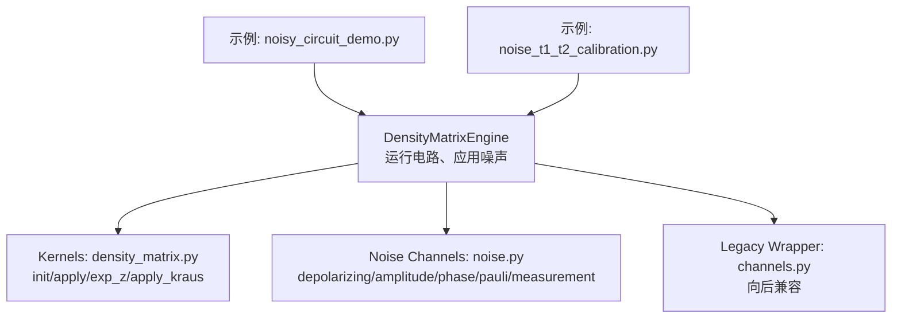
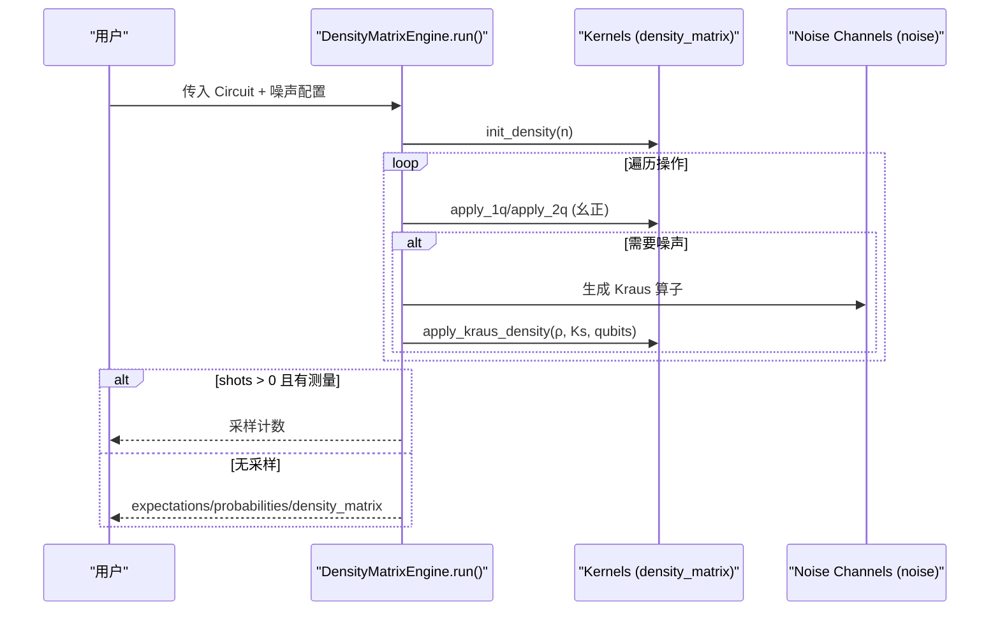
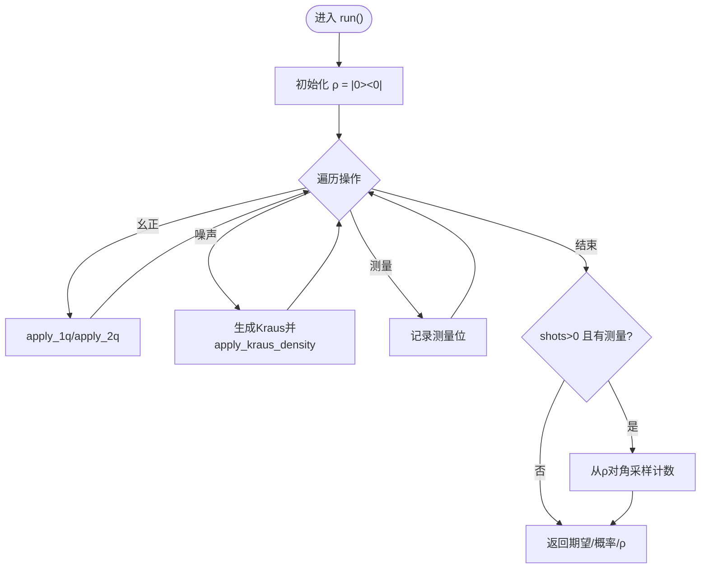
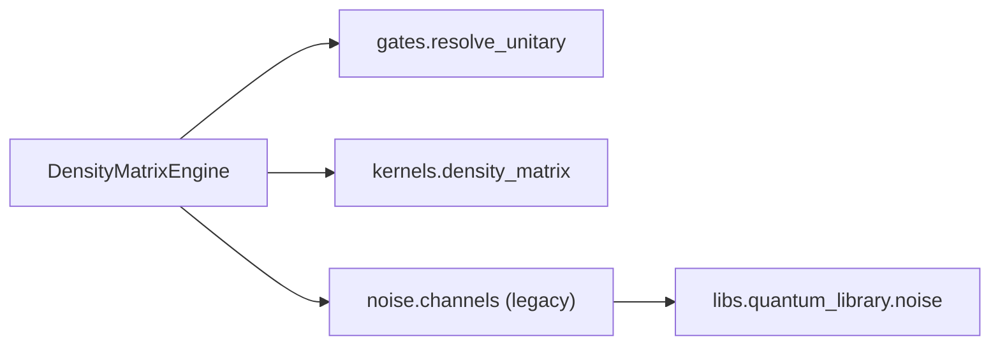

# 密度矩阵模拟器

<cite>
**本文引用的文件**
- [engine.py](file://src/tyxonq/devices/simulators/density_matrix/engine.py)
- [channels.py](file://src/tyxonq/devices/simulators/noise/channels.py)
- [noise.py](file://src/tyxonq/libs/quantum_library/noise.py)
- [density_matrix.py](file://src/tyxonq/libs/quantum_library/kernels/density_matrix.py)
- [__init__.py](file://src/tyxonq/devices/simulators/noise/__init__.py)
- [noise_t1_t2_calibration.py](file://examples/noise_t1_t2_calibration.py)
- [noisy_circuit_demo.py](file://examples/noisy_circuit_demo.py)
</cite>

## 目录
1. [简介](#简介)
2. [项目结构](#项目结构)
3. [核心组件](#核心组件)
4. [架构总览](#架构总览)
5. [详细组件分析](#详细组件分析)
6. [依赖关系分析](#依赖关系分析)
7. [性能与内存优化](#性能与内存优化)
8. [故障排查指南](#故障排查指南)
9. [结论](#结论)
10. [附录：噪声参数与配置速查](#附录噪声参数与配置速查)

## 简介
本文件系统性说明 TyxonQ 中的密度矩阵模拟器，覆盖混合态的数学基础（密度算符定义与演化）、DensityMatrixEngine 的核心功能（混合态初始化、量子通道操作、噪声建模与退相干模拟），并重点文档化常见噪声通道（T1 弛豫、T2 退相位、退极化等）的参数配置、信道组合方法与时间演化模拟。同时给出噪声强度对计算结果影响的示例路径，说明该模拟器在开放量子系统、退相干研究与噪声鲁棒性测试中的适用场景，并提供内存使用优化策略与性能调优建议，以及在量子化学计算中集成噪声模型的方法。

## 项目结构
密度矩阵模拟相关代码主要分布在以下模块：
- 引擎层：devices/simulators/density_matrix/engine.py 提供 DensityMatrixEngine，负责混合态演化、测量与采样。
- 内核层：libs/quantum_library/kernels/density_matrix.py 提供密度矩阵初始化、幺正作用、期望值计算与 Kraus 通道应用的高效实现。
- 噪声通道层：libs/quantum_library/noise.py 提供标准噪声通道的 Kraus 算子；devices/simulators/noise/channels.py 提供向后兼容接口；devices/simulators/noise/__init__.py 统一导出。
- 示例：examples/noise_t1_t2_calibration.py 与 examples/noisy_circuit_demo.py 展示 T1/T2 标定与多种噪声模型的对比。

图表来源
- [engine.py:36-167](file://src/tyxonq/devices/simulators/density_matrix/engine.py#L36-L167)
- [density_matrix.py:9-173](file://src/tyxonq/libs/quantum_library/kernels/density_matrix.py#L9-L173)
- [noise.py:29-252](file://src/tyxonq/libs/quantum_library/noise.py#L29-L252)
- [channels.py:23-41](file://src/tyxonq/devices/simulators/noise/channels.py#L23-L41)

章节来源
- [engine.py:36-167](file://src/tyxonq/devices/simulators/density_matrix/engine.py#L36-L167)
- [density_matrix.py:9-173](file://src/tyxonq/libs/quantum_library/kernels/density_matrix.py#L9-L173)
- [noise.py:29-252](file://src/tyxonq/libs/quantum_library/noise.py#L29-L252)
- [channels.py:23-41](file://src/tyxonq/devices/simulators/noise/channels.py#L23-L41)

## 核心组件
- DensityMatrixEngine：以 2^n × 2^n 稠密矩阵表示混合态 ρ，支持幺正门（h/rz/rx/cx 等通过统一门表解析）、测量 Z 期望、投影与重置、以及 Kraus 通道噪声。run() 返回期望、概率分布、密度矩阵或采样计数；state()/probabilities() 为便捷接口。
- Kernels：提供 init_density、apply_1q_density、apply_2q_density、exp_z_density、apply_kraus_density 等高效内核，基于 einsum 张量收缩实现精确混合态演化。
- Noise Channels：提供 depolarizing_channel、amplitude_damping_channel、phase_damping_channel、pauli_channel、measurement_channel 等标准 Kraus 算子集合，满足完备性 ∑ K†K = I。
- Legacy Wrapper：devices/simulators/noise/channels.py 将旧 API 映射到标准通道，便于历史代码迁移。

章节来源
- [engine.py:36-167](file://src/tyxonq/devices/simulators/density_matrix/engine.py#L36-L167)
- [density_matrix.py:9-173](file://src/tyxonq/libs/quantum_library/kernels/density_matrix.py#L9-L173)
- [noise.py:29-252](file://src/tyxonq/libs/quantum_library/noise.py#L29-L252)
- [channels.py:23-41](file://src/tyxonq/devices/simulators/noise/channels.py#L23-L41)

## 架构总览
密度矩阵模拟器的数据流与控制流如下：
- 输入：Circuit 对象（包含操作序列）。
- 状态：初始化为 |0...0><0...0| 的密度矩阵 ρ。
- 处理：逐操作执行幺正演化（ρ → U ρ U†），并在单/双量子比特上按需应用噪声通道（ρ → ∑ K_i ρ K_i†）。
- 输出：若 shots > 0 且存在测量，则从 ρ 的对角采样得到计数；否则返回期望、概率分布与 ρ。

图表来源
- [engine.py:43-167](file://src/tyxonq/devices/simulators/density_matrix/engine.py#L43-L167)
- [density_matrix.py:9-173](file://src/tyxonq/libs/quantum_library/kernels/density_matrix.py#L9-L173)
- [noise.py:29-252](file://src/tyxonq/libs/quantum_library/noise.py#L29-L252)

## 详细组件分析

### 数学基础：密度算符与演化
- 密度算符 ρ 描述混合态，归一化 tr(ρ)=1。纯态 |ψ⟩ 对应 ρ=|ψ⟩⟨ψ|。
- 幺正演化：ρ → U ρ U†。
- 量子通道（完全正定保迹映射）：ρ → ∑_i K_i ρ K_i†，其中 ∑_i K_i† K_i = I。
- 期望值：⟨Z_q⟩ = tr(ρ Z_q)，可通过对角元素快速计算。

章节来源
- [density_matrix.py:9-74](file://src/tyxonq/libs/quantum_library/kernels/density_matrix.py#L9-L74)
- [noise.py:29-252](file://src/tyxonq/libs/quantum_library/noise.py#L29-L252)

### DensityMatrixEngine 核心功能
- 混合态初始化：init_density 构造 |0...0><0...0|。
- 幺正门应用：通过统一门表 resolve_unitary 解析为 (arity, qubits, matrix)，调用 apply_1q_density/apply_2q_density。
- 测量与投影：measure_z 收集目标量子比特；project_z/reset 实现投影与归一化。
- 噪声通道：_apply_noise_if_any 根据噪声类型生成 Kraus 算子并应用。
- 采样：shots > 0 时从 ρ 的对角按概率采样，支持读噪与退极化后处理。

图表来源
- [engine.py:43-167](file://src/tyxonq/devices/simulators/density_matrix/engine.py#L43-L167)
- [density_matrix.py:9-173](file://src/tyxonq/libs/quantum_library/kernels/density_matrix.py#L9-L173)

章节来源
- [engine.py:43-167](file://src/tyxonq/devices/simulators/density_matrix/engine.py#L43-L167)

### 噪声通道实现与参数
- 退极化噪声（Depolarizing）：K0=√(1-p)I，K1..3=√(p/3){X,Y,Z}。参数 p ∈ [0,1]。
- 振幅阻尼（T1 弛豫）：K0=[[1,0],[0,√(1-γ)]]，K1=[[0,√γ],[0,0]]。参数 γ ∈ [0,1]，物理上近似 1 - exp(-t_gate/T1)。
- 相位阻尼（T2 退相位）：K0=[[1,0],[0,√(1-λ)]]，K1=[[0,0],[0,√λ]]。参数 λ ∈ [0,1]，物理上近似 1 - exp(-t_gate/T2)。
- Pauli 通道：K0=√(1-px-py-pz)I，K1..3=√{px·X, py·Y, pz·Z}。约束 px+py+pz ≤ 1。
- 测量通道：用于 MIPT 等研究，K0=√p|0⟩⟨0|，K1=√p|1⟩⟨1|，K2=√(1-p)I。

章节来源
- [noise.py:29-252](file://src/tyxonq/libs/quantum_library/noise.py#L29-L252)
- [channels.py:23-41](file://src/tyxonq/devices/simulators/noise/channels.py#L23-L41)

### 噪声参数配置与信道组合
- 配置方式：在 device(..., use_noise=True, noise={type, ...}) 中指定噪声类型与参数。
- 组合方法：
  - 多门级联：每个幺正门后可自动注入噪声（如退极化、振幅/相位阻尼）。
  - 显式 Kraus 通道：通过 ("kraus", qubit, kraus_key) 直接应用自定义通道。
  - 读噪与后处理：shots>0 时可叠加 readout 校准矩阵或 depolarizing 后处理。
- 时间演化模拟：通过多次重复相同噪声通道（例如 Trotter 步或门序列）累积效应；也可用 ZZ 交叉耦合哈密顿量进行连续时间演化（需结合其他后端）。

章节来源
- [engine.py:43-167](file://src/tyxonq/devices/simulators/density_matrix/engine.py#L43-L167)
- [noise.py:29-252](file://src/tyxonq/libs/quantum_library/noise.py#L29-L252)

### 噪声强度对结果的影响（示例）
- 退极化噪声：随 p 增大，理想纠缠态保真度下降，分布趋向均匀。
- 振幅阻尼：随 γ 增大，|1⟩ 布居衰减至 |0⟩，适合模拟 T1 弛豫。
- 相位阻尼：随 λ 增大，非对角元衰减，保持布居不变，适合模拟 T2 退相位。
- Pauli 通道：可设置不对称误差（如 pz >> px, py）模拟退相干主导的硬件。

参考示例路径：
- [noisy_circuit_demo.py:62-232](file://examples/noisy_circuit_demo.py#L62-L232)
- [noise_t1_t2_calibration.py:75-194](file://examples/noise_t1_t2_calibration.py#L75-L194)

章节来源
- [noisy_circuit_demo.py:62-232](file://examples/noisy_circuit_demo.py#L62-L232)
- [noise_t1_t2_calibration.py:75-194](file://examples/noise_t1_t2_calibration.py#L75-L194)

### 适用场景
- 开放量子系统：通过 Kraus 通道精确模拟系统与环境的相互作用。
- 退相干研究：T1/T2 标定与衰减曲线拟合，评估算法鲁棒性。
- 噪声鲁棒性测试：比较不同噪声模型对 VQE/QAOA 等算法的影响。

章节来源
- [noise_t1_t2_calibration.py:1-48](file://examples/noise_t1_t2_calibration.py#L1-L48)
- [noisy_circuit_demo.py:1-11](file://examples/noisy_circuit_demo.py#L1-L11)

## 依赖关系分析
- DensityMatrixEngine 依赖：
  - 门矩阵与权威 op 词汇表：resolve_unitary（来自 gates kernels）。
  - 密度矩阵内核：init_density、apply_1q/2q_density、exp_z_density、apply_kraus_density。
  - 噪声通道：通过 devices.simulators.noise.channels 或直接 libs.quantum_library.noise。
- 向后兼容：devices/simulators/noise/channels.py 将旧函数名映射到新通道。

图表来源
- [engine.py:17-30](file://src/tyxonq/devices/simulators/density_matrix/engine.py#L17-L30)
- [channels.py:14-41](file://src/tyxonq/devices/simulators/noise/channels.py#L14-L41)
- [noise.py:19-26](file://src/tyxonq/libs/quantum_library/noise.py#L19-L26)

章节来源
- [engine.py:17-30](file://src/tyxonq/devices/simulators/density_matrix/engine.py#L17-L30)
- [channels.py:14-41](file://src/tyxonq/devices/simulators/noise/channels.py#L14-L41)
- [noise.py:19-26](file://src/tyxonq/libs/quantum_library/noise.py#L19-L26)

## 性能与内存优化
- 复杂度与内存：
  - 内存 O(4^n)：n 量子比特密度矩阵维度为 2^n × 2^n。
  - 时间 ~O(poly(gates)·4^n)：每门操作涉及张量收缩与矩阵乘法。
- 优化建议：
  - 使用高效内核：apply_1q/2q_density 与 apply_kraus_density 基于 einsum 避免中间大矩阵。
  - 减少噪声通道次数：仅在必要时启用噪声，或在关键门后注入。
  - 控制 shots：shots=0 时仅计算期望与概率，避免采样开销。
  - 选择合适后端：numpy 用于调试与小规模；GPU 后端（如 cupynumeric）可用于更大规模。
  - 复用缓存：利用 circuit._unitary_cache/_kraus_cache 减少重复计算。
  - 分块与稀疏化：对于特定问题（如稳定子电路）考虑 MPS/稳定子模拟器替代。

章节来源
- [engine.py:1-9](file://src/tyxonq/devices/simulators/density_matrix/engine.py#L1-L9)
- [density_matrix.py:20-63](file://src/tyxonq/libs/quantum_library/kernels/density_matrix.py#L20-L63)
- [density_matrix.py:76-164](file://src/tyxonq/libs/quantum_library/kernels/density_matrix.py#L76-L164)

## 故障排查指南
- 不支持的操作：
  - pulse/pulse_inline：密度矩阵引擎不提供脉冲级演化，需改用 statevector 引擎或将脉冲编译为幺正门。
  - 未知 op：会抛出 ValueError，确保所有操作由 gates.resolve_unitary 支持。
- 噪声参数范围：
  - 各通道参数需在合法范围内（如 p∈[0,1]，γ,λ∈[0,1]，px+py+pz≤1），否则抛出异常。
- 数值稳定性：
  - 采样前对概率进行截断与归一化，避免负数或溢出。
- 常见问题定位：
  - 检查噪声配置键名（type、p/gamma/lambda/px/py/pz）。
  - 确认 shots 与测量位是否匹配。

章节来源
- [engine.py:97-109](file://src/tyxonq/devices/simulators/density_matrix/engine.py#L97-L109)
- [engine.py:111-152](file://src/tyxonq/devices/simulators/density_matrix/engine.py#L111-L152)
- [noise.py:56-58](file://src/tyxonq/libs/quantum_library/noise.py#L56-L58)
- [noise.py:101-103](file://src/tyxonq/libs/quantum_library/noise.py#L101-L103)
- [noise.py:140-142](file://src/tyxonq/libs/quantum_library/noise.py#L140-L142)
- [noise.py:186-191](file://src/tyxonq/libs/quantum_library/noise.py#L186-L191)

## 结论
TyxonQ 的密度矩阵模拟器以精确的 Kraus 通道实现混合态演化，适用于开放量子系统、退相干研究与噪声鲁棒性测试。其核心优势在于统一的门表分发、高效的张量收缩内核与灵活的噪声配置。通过合理选择噪声模型与参数，并结合示例中的标定流程，可在量子化学计算中有效评估噪声影响并优化算法性能。

## 附录：噪声参数与配置速查
- 退极化噪声：
  - type="depolarizing"，参数 p ∈ [0,1]。
- 振幅阻尼（T1）：
  - type="amplitude_damping"，参数 gamma ∈ [0,1]。
- 相位阻尼（T2）：
  - type="phase_damping"，参数 lambda ∈ [0,1]。
- Pauli 通道：
  - type="pauli"，参数 px, py, pz ≥ 0 且 px+py+pz ≤ 1。
- 测量通道：
  - type="measurement"，参数 p ∈ [0,1]。
- 组合与时间演化：
  - 在门序列中多次应用同一通道以模拟累积效应；或使用 ZZ 交叉耦合哈密顿量进行连续演化（需结合其他后端）。

章节来源
- [engine.py:196-227](file://src/tyxonq/devices/simulators/density_matrix/engine.py#L196-L227)
- [noise.py:29-252](file://src/tyxonq/libs/quantum_library/noise.py#L29-L252)
- [noisy_circuit_demo.py:62-232](file://examples/noisy_circuit_demo.py#L62-L232)
- [noise_t1_t2_calibration.py:75-194](file://examples/noise_t1_t2_calibration.py#L75-L194)