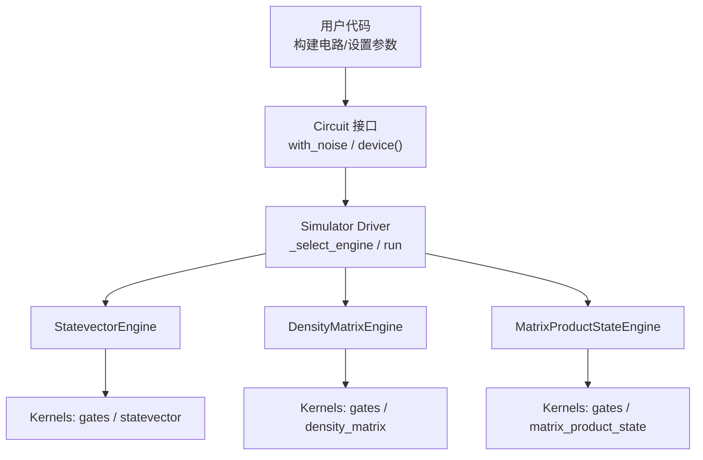
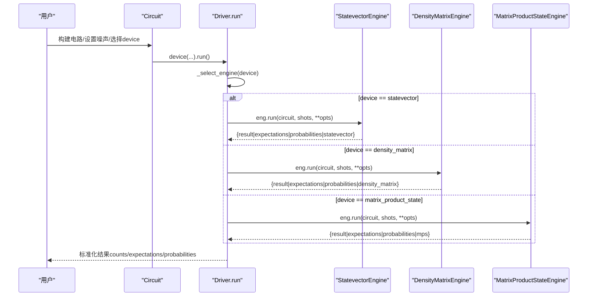
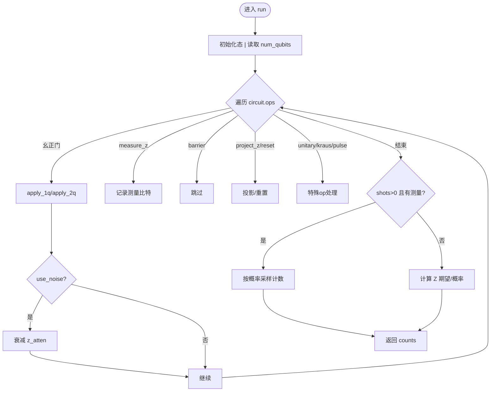
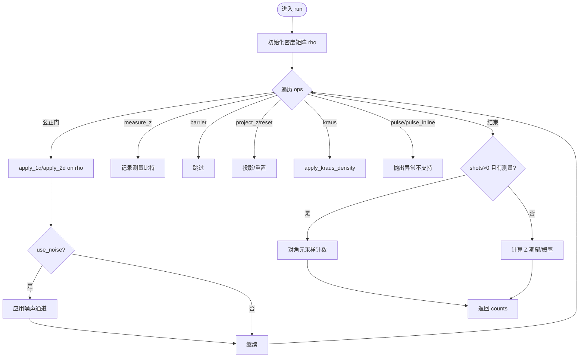
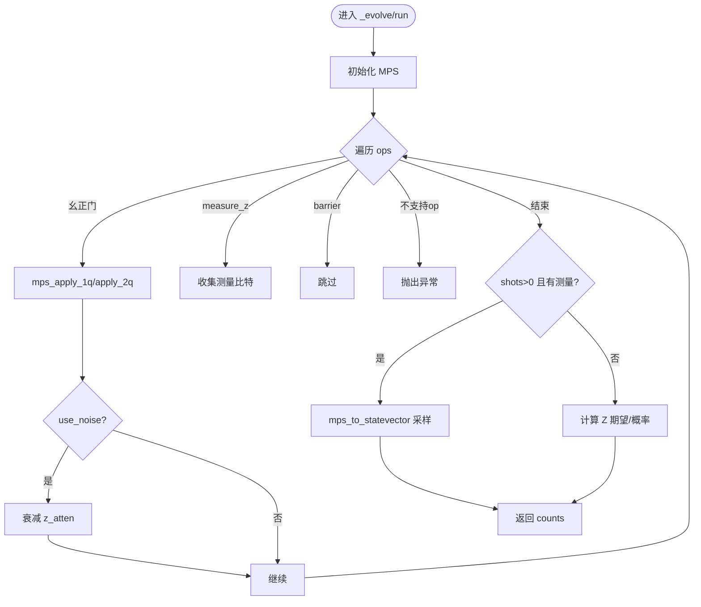
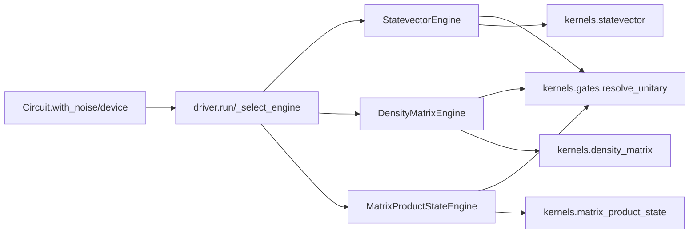

# 模拟器选择指南

<cite>
**本文引用的文件**
- [src/tyxonq/devices/simulators/statevector/engine.py](file://src/tyxonq/devices/simulators/statevector/engine.py)
- [src/tyxonq/devices/simulators/density_matrix/engine.py](file://src/tyxonq/devices/simulators/density_matrix/engine.py)
- [src/tyxonq/devices/simulators/matrix_product_state/engine.py](file://src/tyxonq/devices/simulators/matrix_product_state/engine.py)
- [src/tyxonq/devices/simulators/driver.py](file://src/tyxonq/devices/simulators/driver.py)
- [src/tyxonq/core/ir/circuit.py](file://src/tyxonq/core/ir/circuit.py)
- [examples/noise_controls_demo.py](file://examples/noise_controls_demo.py)
- [examples/mps_approximation_benchmark.py](file://examples/mps_approximation_benchmark.py)
- [examples/sample_benchmark.py](file://examples/sample_benchmark.py)
- [examples/vqe_memory_scaling_demo.py](file://examples/vqe_memory_scaling_demo.py)
</cite>

## 目录
1. [简介](#简介)
2. [项目结构](#项目结构)
3. [核心组件](#核心组件)
4. [架构总览](#架构总览)
5. [详细组件分析](#详细组件分析)
6. [依赖关系分析](#依赖关系分析)
7. [性能考量与基准](#性能考量与基准)
8. [故障排除指南](#故障排除指南)
9. [结论](#结论)
10. [附录：API与迁移策略](#附录api与迁移策略)

## 简介
本指南面向需要在 TyxonQ 中为不同问题选择合适的量子模拟器（状态向量、密度矩阵、矩阵乘积态）的工程师与研究人员。文档基于仓库中的实现，系统比较三种模拟器的能力边界、复杂度特征与适用场景，并提供决策树、基准参考、切换 API 与平滑迁移策略，以及典型应用推荐与故障排除建议。

## 项目结构
TyxonQ 将三种核心模拟器分别实现为独立引擎，并通过统一的驱动层进行设备选择与任务提交；Circuit 提供高层接口以配置噪声与后端。关键路径如下：
- 状态向量引擎：statevector/engine.py
- 密度矩阵引擎：density_matrix/engine.py
- 矩阵乘积态引擎：matrix_product_state/engine.py
- 统一驱动：devices/simulators/driver.py
- Circuit 噪声与设备配置：core/ir/circuit.py

图表来源
- [src/tyxonq/devices/simulators/driver.py:20-38](file://src/tyxonq/devices/simulators/driver.py#L20-L38)
- [src/tyxonq/devices/simulators/statevector/engine.py:1-10](file://src/tyxonq/devices/simulators/statevector/engine.py#L1-L10)
- [src/tyxonq/devices/simulators/density_matrix/engine.py:1-10](file://src/tyxonq/devices/simulators/density_matrix/engine.py#L1-L10)
- [src/tyxonq/devices/simulators/matrix_product_state/engine.py:1-12](file://src/tyxonq/devices/simulators/matrix_product_state/engine.py#L1-L12)

章节来源
- [src/tyxonq/devices/simulators/driver.py:20-38](file://src/tyxonq/devices/simulators/driver.py#L20-L38)
- [src/tyxonq/core/ir/circuit.py:241-299](file://src/tyxonq/core/ir/circuit.py#L241-L299)

## 核心组件
- 状态向量模拟器（StatevectorEngine）
  - 内存复杂度 O(2^n)，时间近似 O(poly(gates)·2^n)
  - 支持 shots 采样、Z 期望、概率分布与态矢量输出
  - 可选噪声衰减（use_noise + noise），对 Z 期望做去极化衰减
  - 支持脉冲操作与三能级泄漏建模（three_level）
  - 通过权威门表 resolve_unitary 统一分发幺正门
- 密度矩阵模拟器（DensityMatrixEngine）
  - 内存复杂度 O(4^n)，时间近似 O(poly(gates)·4^n)
  - 原生 Kraus 通道应用，适合噪声研究
  - 支持 depolarizing、amplitude_damping、phase_damping、pauli 等噪声
  - 不支持脉冲级演化（会抛出异常）
- 矩阵乘积态模拟器（MatrixProductStateEngine）
  - 内存/时间与键维 χ 相关，适合低纠缠大系统
  - 支持 1q/2q 幺正门与 measure_z/barrier
  - 不支持 unitary/kraus/project_z/reset/pulse 等特殊 op（会抛出异常）
  - 可通过 max_bond 控制截断，平衡精度与内存

章节来源
- [src/tyxonq/devices/simulators/statevector/engine.py:1-10](file://src/tyxonq/devices/simulators/statevector/engine.py#L1-L10)
- [src/tyxonq/devices/simulators/density_matrix/engine.py:1-10](file://src/tyxonq/devices/simulators/density_matrix/engine.py#L1-L10)
- [src/tyxonq/devices/simulators/matrix_product_state/engine.py:1-12](file://src/tyxonq/devices/simulators/matrix_product_state/engine.py#L1-L12)

## 架构总览
下图展示从 Circuit 到具体引擎的选择与执行流程，以及各引擎内部的关键调用链。

图表来源
- [src/tyxonq/devices/simulators/driver.py:86-141](file://src/tyxonq/devices/simulators/driver.py#L86-L141)
- [src/tyxonq/devices/simulators/statevector/engine.py:46-451](file://src/tyxonq/devices/simulators/statevector/engine.py#L46-L451)
- [src/tyxonq/devices/simulators/density_matrix/engine.py:43-167](file://src/tyxonq/devices/simulators/density_matrix/engine.py#L43-L167)
- [src/tyxonq/devices/simulators/matrix_product_state/engine.py:137-218](file://src/tyxonq/devices/simulators/matrix_product_state/engine.py#L137-L218)

## 详细组件分析

### 状态向量模拟器（StatevectorEngine）
- 特点
  - 高精度纯态模拟，适合小规模系统与 VQE 等变分算法
  - 支持 shots 采样与精确概率分布；shots=0 时返回期望值与概率
  - 可选 use_noise 对 Z 期望做衰减；支持 readout 与 depolarizing 混合
  - 支持脉冲操作与三能级泄漏建模（three_level=True）
- 关键流程
  - 使用权威门表 resolve_unitary 解析幺正门并应用
  - 测量后根据概率采样计数或计算 Z 期望
  - 可返回 probabilities/statevector 供 driver 统一消费

图表来源
- [src/tyxonq/devices/simulators/statevector/engine.py:46-451](file://src/tyxonq/devices/simulators/statevector/engine.py#L46-L451)

章节来源
- [src/tyxonq/devices/simulators/statevector/engine.py:46-451](file://src/tyxonq/devices/simulators/statevector/engine.py#L46-L451)

### 密度矩阵模拟器（DensityMatrixEngine）
- 特点
  - 原生 Kraus 通道，适合噪声建模与研究
  - 内存 O(4^n)，时间更昂贵，适用于小系统噪声实验
  - 不支持脉冲级演化（遇到 pulse/pulse_inline 会抛出异常）
- 关键流程
  - 使用权威门表 resolve_unitary 解析幺正门并作用到 ρ
  - 每步幺正后可应用噪声通道（depolarizing/amplitude_damping/phase_damping/pauli）
  - shots>0 时对对角元采样计数；shots=0 返回期望与概率

图表来源
- [src/tyxonq/devices/simulators/density_matrix/engine.py:43-167](file://src/tyxonq/devices/simulators/density_matrix/engine.py#L43-L167)

章节来源
- [src/tyxonq/devices/simulators/density_matrix/engine.py:43-167](file://src/tyxonq/devices/simulators/density_matrix/engine.py#L43-L167)

### 矩阵乘积态模拟器（MatrixProductStateEngine）
- 特点
  - 以键维 χ 控制复杂度，适合低纠缠大规模系统
  - 仅支持 1q/2q 幺正门与 measure_z/barrier
  - 不支持 unitary/kraus/project_z/reset/pulse/pulse_inline（会抛出异常）
  - 可通过 max_bond 限制键维，权衡精度与内存
- 关键流程
  - 唯一分发循环 _evolve 统一处理所有幺正门与测量
  - shots>0 时重构态矢采样计数；shots=0 返回期望与概率
  - 提供 expectation_pauli 原生 MPS 计算（避免全态矢展开）

图表来源
- [src/tyxonq/devices/simulators/matrix_product_state/engine.py:74-135](file://src/tyxonq/devices/simulators/matrix_product_state/engine.py#L74-L135)
- [src/tyxonq/devices/simulators/matrix_product_state/engine.py:137-218](file://src/tyxonq/devices/simulators/matrix_product_state/engine.py#L137-L218)

章节来源
- [src/tyxonq/devices/simulators/matrix_product_state/engine.py:74-135](file://src/tyxonq/devices/simulators/matrix_product_state/engine.py#L74-L135)
- [src/tyxonq/devices/simulators/matrix_product_state/engine.py:137-218](file://src/tyxonq/devices/simulators/matrix_product_state/engine.py#L137-L218)

## 依赖关系分析
- 统一门表：三个引擎均通过 resolve_unitary 获取幺正矩阵，保证一致性
- 数值后端：通过 get_backend 抽象数组运算，支持 numpy/pytorch/cupynumeric
- Driver 路由：根据 device 字符串选择对应引擎，统一返回标准化结果
- Circuit 集成：with_noise 自动切换到 density_matrix 并启用噪声；device() 可指定 provider/device 及参数（如 max_bond）

图表来源
- [src/tyxonq/devices/simulators/statevector/engine.py:17-32](file://src/tyxonq/devices/simulators/statevector/engine.py#L17-L32)
- [src/tyxonq/devices/simulators/density_matrix/engine.py:17-30](file://src/tyxonq/devices/simulators/density_matrix/engine.py#L17-L30)
- [src/tyxonq/devices/simulators/matrix_product_state/engine.py:19-33](file://src/tyxonq/devices/simulators/matrix_product_state/engine.py#L19-L33)
- [src/tyxonq/devices/simulators/driver.py:20-38](file://src/tyxonq/devices/simulators/driver.py#L20-L38)
- [src/tyxonq/core/ir/circuit.py:241-299](file://src/tyxonq/core/ir/circuit.py#L241-L299)

章节来源
- [src/tyxonq/devices/simulators/driver.py:20-38](file://src/tyxonq/devices/simulators/driver.py#L20-L38)
- [src/tyxonq/core/ir/circuit.py:241-299](file://src/tyxonq/core/ir/circuit.py#L241-L299)

## 性能考量与基准
- 复杂度与内存
  - 状态向量：内存 O(2^n)，适合小规模高精度计算
  - 密度矩阵：内存 O(4^n)，适合噪声研究但规模受限
  - MPS：内存与键维 χ 相关，适合低纠缠大规模系统
- 基准参考
  - 采样基准：sample_benchmark.py 对比不同后端在相同电路下的耗时
  - MPS 近似：mps_approximation_benchmark.py 评估键维对能量误差与保真度的影响
  - 内存缩放：vqe_memory_scaling_demo.py 展示状态向量随 qubit 数的内存增长
- 实践建议
  - 小规模（≤12 qubits）且需要高精度：优先状态向量
  - 噪声研究（T1/T2/退相干/Pauli 错误）：密度矩阵
  - 大规模低纠缠（如一维自旋链、TFI 基态搜索）：MPS，调节 max_bond 平衡精度与内存

章节来源
- [examples/sample_benchmark.py:16-91](file://examples/sample_benchmark.py#L16-L91)
- [examples/mps_approximation_benchmark.py:17-184](file://examples/mps_approximation_benchmark.py#L17-L184)
- [examples/vqe_memory_scaling_demo.py:111-143](file://examples/vqe_memory_scaling_demo.py#L111-L143)

## 故障排除指南
- 内存不足
  - 降级策略：从状态向量切换到 MPS，并降低 max_bond；或减少 qubit 数/电路深度
  - 观测分解：利用 Pauli 字符串中恒等项对应的可追踪 qubit 减少有效维度
- 精度验证
  - 使用状态向量作为“黄金标准”，对比 MPS 的能量误差与保真度
  - 对噪声场景，使用密度矩阵与状态向量+衰减（use_noise）交叉验证期望值变化趋势
- 常见异常
  - DensityMatrixEngine 遇到 pulse/pulse_inline：抛出异常，需改用状态向量或将脉冲编译为幺正
  - MatrixProductStateEngine 遇到 unitary/kraus/project_z/reset/pulse/pulse_inline：抛出异常，需改用其他引擎
- 噪声开关
  - 全局噪声开关与配置可通过 tq.enable_noise/get_noise_config 查看；示例见 noise_controls_demo.py
  - 设备级覆盖：c.device(..., use_noise=True/False, noise={...}) 可在单次运行中覆盖全局设置

章节来源
- [src/tyxonq/devices/simulators/density_matrix/engine.py:97-109](file://src/tyxonq/devices/simulators/density_matrix/engine.py#L97-L109)
- [src/tyxonq/devices/simulators/matrix_product_state/engine.py:121-134](file://src/tyxonq/devices/simulators/matrix_product_state/engine.py#L121-L134)
- [examples/noise_controls_demo.py:4-50](file://examples/noise_controls_demo.py#L4-L50)

## 结论
- 状态向量模拟器：高精度、小规模首选，适合 VQE 与快速原型
- 密度矩阵模拟器：噪声建模能力强，适合 T1/T2/退相干/Pauli 错误研究
- 矩阵乘积态模拟器：大规模低纠缠系统首选，通过键维控制精度与内存
- 实际项目中可根据问题特征动态选择引擎，并结合噪声开关与数值后端优化性能

## 附录：API与迁移策略
- 动态选择与切换
  - 通过 Circuit.device(provider="simulator", device="statevector"/"density_matrix"/"matrix_product_state", ...) 选择引擎
  - 使用 with_noise("depolarizing"/"amplitude_damping"/"phase_damping"/"pauli", ...) 快速配置噪声（自动切换到 density_matrix）
  - 对于 MPS，可通过 device(max_bond=...) 控制键维上限
- 平滑迁移策略
  - 先以状态向量验证正确性与收敛性
  - 针对噪声研究切换到密度矩阵，保持电路一致
  - 针对大规模低纠缠系统切换到 MPS，逐步增大 max_bond 直至收敛
- 典型应用场景推荐
  - VQE 计算：状态向量（高精度、快速）
  - 噪声研究：密度矩阵（原生 Kraus 通道）
  - 量子多体物理：MPS（低纠缠大系统）
- 同一项目内动态选择示例
  - 根据问题规模与需求，在运行时选择 engine；必要时结合数值后端（numpy/pytorch/cupynumeric）提升性能

章节来源
- [src/tyxonq/core/ir/circuit.py:241-299](file://src/tyxonq/core/ir/circuit.py#L241-L299)
- [src/tyxonq/devices/simulators/driver.py:20-38](file://src/tyxonq/devices/simulators/driver.py#L20-L38)
- [examples/mps_approximation_benchmark.py:56-84](file://examples/mps_approximation_benchmark.py#L56-L84)
- [examples/noise_controls_demo.py:4-50](file://examples/noise_controls_demo.py#L4-L50)