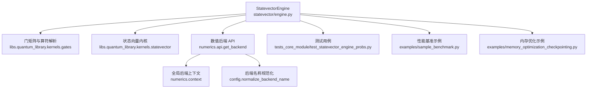
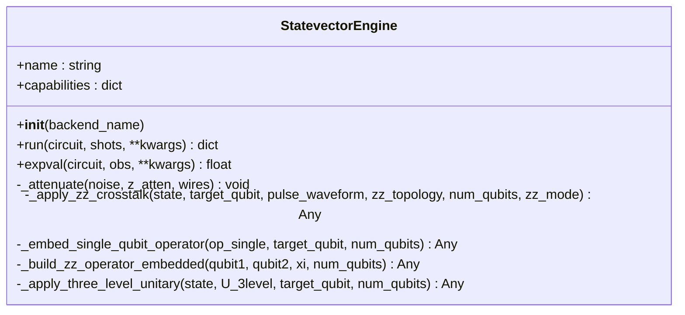
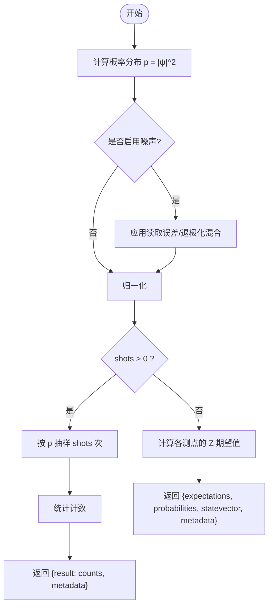
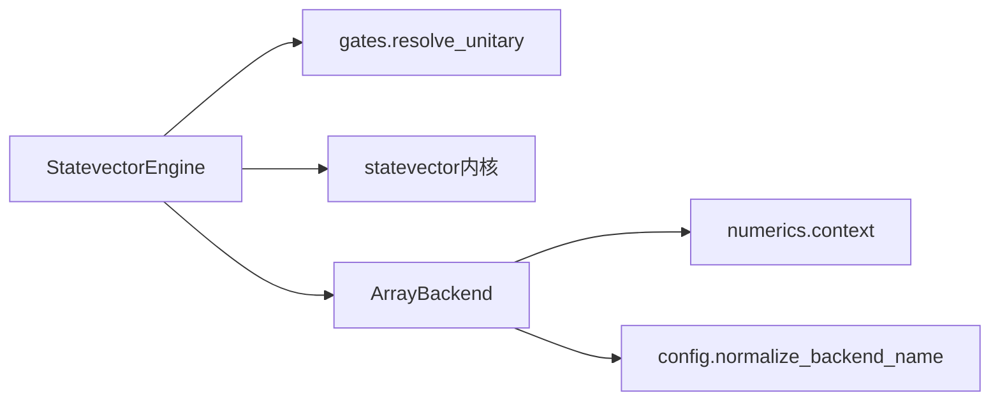

# 状态向量模拟器

<cite>
**本文引用的文件**
- [engine.py](file://src/tyxonq/devices/simulators/statevector/engine.py)
- [__init__.py](file://src/tyxonq/devices/simulators/statevector/__init__.py)
- [test_statevector_engine_probs.py](file://tests_core_module/test_statevector_engine_probs.py)
- [sample_benchmark.py](file://examples/sample_benchmark.py)
- [memory_optimization_checkpointing.py](file://examples/memory_optimization_checkpointing.py)
- [context.py](file://src/tyxonq/numerics/context.py)
- [__init__.py](file://src/tyxonq/numerics/__init__.py)
- [config.py](file://src/tyxonq/config.py)
- [evolution.py](file://src/tyxonq/applications/chem/dynamics/evolution.py)
</cite>

## 目录
1. [简介](#简介)
2. [项目结构](#项目结构)
3. [核心组件](#核心组件)
4. [架构总览](#架构总览)
5. [详细组件分析](#详细组件分析)
6. [依赖关系分析](#依赖关系分析)
7. [性能考量](#性能考量)
8. [故障排查指南](#故障排查指南)
9. [结论](#结论)
10. [附录](#附录)

## 简介
本文件面向 TyxonQ 框架中的“状态向量模拟器”，系统性阐述其数学原理、实现细节与使用方式。该模拟器以稠密复数态矢量表示量子纯态，适用于小规模量子系统（通常≤20个量子比特）的高精度计算，支持幺正演化、测量、期望值计算、采样以及噪声近似处理。文档同时覆盖配置选项（数值后端、并行/向量化策略、精度）、性能基准、扩展方法以及与框架其他组件的集成方式。

## 项目结构
状态向量模拟器的核心位于 devices/simulators/statevector 模块，对外暴露 StatevectorEngine；数值后端通过 numerics 模块统一抽象；测试与示例提供了行为验证与性能基准。



图表来源
- [engine.py:38-451](file://src/tyxonq/devices/simulators/statevector/engine.py#L38-L451)
- [__init__.py:1-11](file://src/tyxonq/devices/simulators/statevector/__init__.py#L1-L11)
- [context.py:1-38](file://src/tyxonq/numerics/context.py#L1-L38)
- [__init__.py:1-473](file://src/tyxonq/numerics/__init__.py#L1-L473)
- [config.py:48-94](file://src/tyxonq/config.py#L48-L94)

章节来源
- [engine.py:1-1002](file://src/tyxonq/devices/simulators/statevector/engine.py#L1-L1002)
- [__init__.py:1-11](file://src/tyxonq/devices/simulators/statevector/__init__.py#L1-L11)

## 核心组件
- StatevectorEngine：状态向量模拟引擎，负责初始化态、电路执行、测量与期望值计算、采样、噪声近似与脉冲仿真等。
- 数值后端：通过 get_backend 获取统一的 ArrayBackend，支持 numpy/pytorch/cupynumeric 等，提供数组、随机数、线性代数等能力。
- 门与内核：统一从 kernels.gates 解析门矩阵，调用 statevector 内核进行高效应用。
- 配置与上下文：全局后端选择、别名归一化、默认数据类型等。

章节来源
- [engine.py:38-120](file://src/tyxonq/devices/simulators/statevector/engine.py#L38-L120)
- [__init__.py:1-473](file://src/tyxonq/numerics/__init__.py#L1-L473)
- [context.py:1-38](file://src/tyxonq/numerics/context.py#L1-L38)
- [config.py:48-94](file://src/tyxonq/config.py#L48-L94)

## 架构总览
状态向量模拟器的执行流程如下：
- 初始化：根据电路或自定义初态创建复数态矢量。
- 操作分发：对每个操作，统一通过 resolve_unitary 解析为幺正矩阵并调用 apply_1q/apply_2q/apply_kqubit 内核。
- 测量与期望值：收集 measure_z 目标，最终计算 Z 期望值与概率分布；若请求 shots，则按概率采样返回计数。
- 噪声与脉冲：可选地应用衰减、读取误差、退极化噪声；支持脉冲到幺正编译与 ZZ 串扰近似/精确演化；支持三能级泄漏建模。

```mermaid
sequenceDiagram
participant U as "用户"
participant E as "StatevectorEngine"
participant G as "gates.resolve_unitary"
participant K as "statevector内核"
participant N as "数值后端"
U->>E : run(circuit, shots, kwargs)
E->>E : 初始化态(初始态或|0...0>)
loop 遍历电路操作
E->>G : 解析门矩阵
G-->>E : (arity, qubits, matrix)
E->>K : 应用单/双/多量子比特幺正
K-->>E : 更新态矢量
alt 噪声模式
E->>E : _attenuate / 读取误差 / 退极化
end
alt 脉冲
E->>E : 编译脉冲到幺正 / 应用ZZ串扰 / 三能级演化
end
end
opt shots>0 且存在测量
E->>N : 计算概率分布
E->>N : 抽样得到计数
E-->>U : {result : counts, metadata}
else 无shots
E->>K : 计算Z期望值
E-->>U : {expectations, probabilities, statevector, metadata}
end
```

图表来源
- [engine.py:46-451](file://src/tyxonq/devices/simulators/statevector/engine.py#L46-L451)

章节来源
- [engine.py:46-451](file://src/tyxonq/devices/simulators/statevector/engine.py#L46-L451)

## 详细组件分析

### 数学原理：复数态矢量与演化
- 态表示：n 量子比特的纯态由 2^n 维复数向量 |ψ⟩ 表示，满足归一化 ⟨ψ|ψ⟩=1。
- 幺正演化：每个门对应一个幺正矩阵 U，作用为 |ψ'⟩ = U|ψ⟩。对于多体门，通过张量积嵌入到全空间后相乘。
- 测量：在计算基下测量，得到结果 i 的概率为 p_i = |⟨i|ψ⟩|^2；期望值 ⟨Z_q⟩ 可通过专用内核高效计算。
- 时间演化：对小规模系统可直接用密集矩阵指数或固定步长积分求解薛定谔方程。

章节来源
- [engine.py:1-10](file://src/tyxonq/devices/simulators/statevector/engine.py#L1-L10)
- [evolution.py:55-127](file://src/tyxonq/libs/quantum_library/dynamics.py#L55-L127)

### StatevectorEngine 类详解
- 初始化
  - 通过 get_backend 选择数值后端，支持 CPU/GPU/自动微分后端。
  - 支持传入 backend_name 或全局设置。
- 电路执行 run
  - 初态：优先使用 circuit._initial_state，否则初始化 |0…0⟩。
  - 操作分发：统一通过 resolve_unitary 解析幺正门，调用 apply_* 内核；支持 measure_z、barrier、project_z、reset、unitary、kraus、pulse/pulse_inline。
  - 噪声：可选 use_noise 开关；支持 depolarizing、readout 校准矩阵混合；对 Z 期望值进行衰减。
  - 脉冲：支持两能级与三能级模型；可启用 ZZ 串扰的局部近似或全局精确演化。
  - 输出：shots>0 时返回采样计数；否则返回期望值、概率分布与态矢量。
- 期望值 expval
  - 借助 openfermion 将观测算子转为稀疏矩阵，计算 ⟨ψ|H|ψ⟩。
- 辅助方法
  - _attenuate：对 depolarizing 噪声进行 Z 期望值衰减。
  - _apply_zz_crosstalk：两种 ZZ 串扰模式（local/global）。
  - _embed_single_qubit_operator/_build_zz_operator_embedded：构建嵌入算子。
  - _apply_three_level_unitary：三能级幺正应用（当前简化实现）。



图表来源
- [engine.py:38-800](file://src/tyxonq/devices/simulators/statevector/engine.py#L38-L800)

章节来源
- [engine.py:38-800](file://src/tyxonq/devices/simulators/statevector/engine.py#L38-L800)

### 测量与采样
- 概率计算：p_i = |ψ_i|^2，归一化后用于抽样。
- 采样：基于后端随机数生成器按概率抽取比特串索引，统计计数。
- 噪声影响：readout 校准矩阵混合、depolarizing 噪声使分布趋向均匀。



图表来源
- [engine.py:344-451](file://src/tyxonq/devices/simulators/statevector/engine.py#L344-L451)

章节来源
- [engine.py:344-451](file://src/tyxonq/devices/simulators/statevector/engine.py#L344-L451)

### 噪声模型集成与限制
- 支持类型
  - depolarizing：对 Z 期望值进行因子衰减；对概率分布进行混合。
  - readout：按每量子比特校准矩阵 A 的全张量积 A = ⊗A_q 混合概率。
- 限制
  - 状态向量模拟器主要模拟纯态；密度矩阵通道更完整，但此处通过近似与混合实现常用噪声效果。
  - 三能级泄漏建模目前针对单量子比特较完善，多量子比特场景为简化近似。

章节来源
- [engine.py:466-473](file://src/tyxonq/devices/simulators/statevector/engine.py#L466-L473)
- [engine.py:357-379](file://src/tyxonq/devices/simulators/statevector/engine.py#L357-L379)
- [engine.py:137-173](file://src/tyxonq/devices/simulators/statevector/engine.py#L137-L173)

### 与 TyxonQ 其他组件的集成
- 数值后端：通过 set_backend/get_backend 切换 numpy/pytorch/cupynumeric，影响数组运算、随机数与自动微分。
- 化学动力学：在分子动力学中回退到状态向量引擎获取初态波函数。
- 编译器与设备：Circuit 可通过 device(provider="simulator", device="statevector") 接入。

章节来源
- [__init__.py:1-473](file://src/tyxonq/numerics/__init__.py#L1-L473)
- [context.py:1-38](file://src/tyxonq/numerics/context.py#L1-L38)
- [evolution.py:115-123](file://src/tyxonq/applications/chem/dynamics/evolution.py#L115-L123)

## 依赖关系分析
- StatevectorEngine 依赖 gates.resolve_unitary 作为单一真相源，避免 run()/state() 分支不一致。
- 状态向量内核来自 libs.quantum_library.kernels.statevector，提供高效 apply_* 与 expect_z。
- 数值后端抽象屏蔽底层实现差异，便于 GPU/自动微分加速。
- 配置层提供后端名称归一化与默认数据类型。



图表来源
- [engine.py:17-32](file://src/tyxonq/devices/simulators/statevector/engine.py#L17-L32)
- [__init__.py:1-473](file://src/tyxonq/numerics/__init__.py#L1-L473)
- [context.py:1-38](file://src/tyxonq/numerics/context.py#L1-L38)
- [config.py:48-94](file://src/tyxonq/config.py#L48-L94)

章节来源
- [engine.py:17-32](file://src/tyxonq/devices/simulators/statevector/engine.py#L17-L32)
- [__init__.py:1-473](file://src/tyxonq/numerics/__init__.py#L1-L473)
- [context.py:1-38](file://src/tyxonq/numerics/context.py#L1-L38)
- [config.py:48-94](file://src/tyxonq/config.py#L48-L94)

## 性能考量
- 复杂度与内存
  - 内存：O(2^n)，n 为量子比特数；典型 ≤20 量子比特可在常规机器上运行。
  - 时间：每次门操作约 O(2^n) 或 O(k·2^n)（k 为门涉及的量子比特数），总体 ~O(poly(gates)·2^n)。
- 后端选择
  - numpy：稳定通用；pytorch：可结合自动微分与GPU；cupynumeric：GPU 加速。
- 采样基准
  - 示例 sample_benchmark.py 对比不同后端在不同 n、layers、shots 下的耗时。
- 内存优化
  - 梯度检查点：对深层电路，通过 checkpoint 减少中间态存储，代价是反向传播重计算。
  - 建议：浅电路直接 backprop；深电路（>50层）或大系统（>15量子比特）考虑检查点或张量网络方法。

章节来源
- [engine.py:1-10](file://src/tyxonq/devices/simulators/statevector/engine.py#L1-L10)
- [sample_benchmark.py:1-91](file://examples/sample_benchmark.py#L1-L91)
- [memory_optimization_checkpointing.py:1-280](file://examples/memory_optimization_checkpointing.py#L1-L280)

## 故障排查指南
- 未知操作被拒绝
  - 现象：遇到未识别的门名时报错，不会静默跳过。
  - 原因：统一分发要求所有门必须在 gates.resolve_unitary 中定义。
  - 解决：确保使用支持的门或通过 unitary 注入矩阵。
- cry 门一致性回归
  - 现象：state() 与 run() 曾存在分发不一致导致 cry 被忽略。
  - 验证：参考测试用例，确保 |01> 经 cry(π/2) 得到正确叠加态。
- 噪声参数无效
  - 现象：use_noise=True 但未生效。
  - 排查：确认 noise.type 为 depolarizing/readout，并提供必要参数（如 p、cals）。
- 三能级模式警告
  - 现象：多量子比特三能级模拟发出实验性警告。
  - 说明：当前仅单量子比特完全支持；多量子比特为简化近似。

章节来源
- [engine.py:335-342](file://src/tyxonq/devices/simulators/statevector/engine.py#L335-L342)
- [test_statevector_engine_probs.py:30-38](file://tests_core_module/test_statevector_engine_probs.py#L30-L38)
- [engine.py:137-173](file://src/tyxonq/devices/simulators/statevector/engine.py#L137-L173)

## 结论
状态向量模拟器在 TyxonQ 中提供高精度、可扩展的小规模量子系统仿真能力。通过统一门解析与内核应用、灵活的数值后端与噪声近似、以及脉冲与三能级扩展，它既适合算法验证与基准测试，也可与化学动力学、编译器与设备链无缝集成。对于更大规模系统，建议结合 MPS/张量网络等方法或切换到密度矩阵模拟器以获得更完整的噪声建模。

## 附录

### 配置选项速查
- 数值后端
  - 设置：tq.set_backend("numpy"/"pytorch"/"cupynumeric") 或 per-instance 传入 backend_name。
  - 别名：cpu→numpy，gpu→cupynumeric，torch/pt→pytorch。
- 精度
  - 默认复数/实数 dtype 由 config.default_dtypes 提供；后端支持 complex128/float64 等。
- 噪声
  - use_noise=True 开启；noise.type 可为 depolarizing/readout；readout 需提供 cals。
- 脉冲与串扰
  - three_level=True 启用三能级泄漏建模；zz_topology 与 zz_mode 控制 ZZ 串扰近似/精确。

章节来源
- [__init__.py:1-473](file://src/tyxonq/numerics/__init__.py#L1-L473)
- [context.py:1-38](file://src/tyxonq/numerics/context.py#L1-L38)
- [config.py:48-94](file://src/tyxonq/config.py#L48-L94)
- [engine.py:137-204](file://src/tyxonq/devices/simulators/statevector/engine.py#L137-L204)

### 使用场景建议
- 小规模高精度：≤20 量子比特，纯态演化、精确概率分布、期望值计算。
- 算法原型验证：快速迭代、噪声近似评估、脉冲波形设计。
- 教学与演示：直观展示量子态演化与测量统计。
- 与框架集成：配合 Circuit、Compiler、Devices、Numerics 完成端到端工作流。

[本节为概念性内容，不直接分析具体文件]