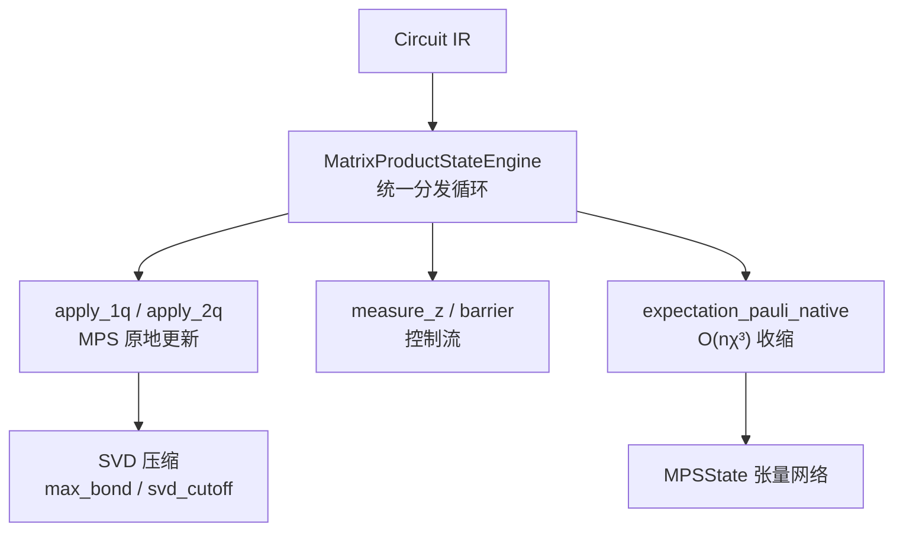
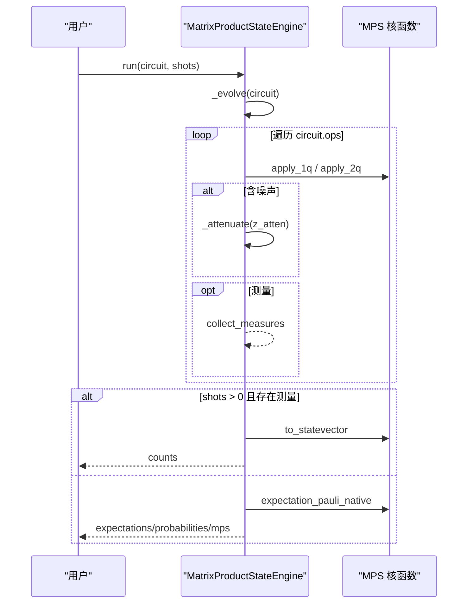
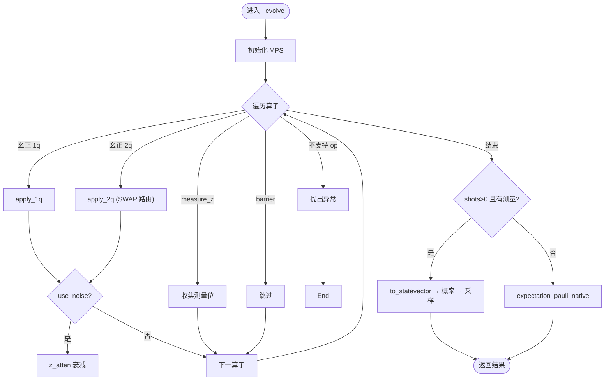
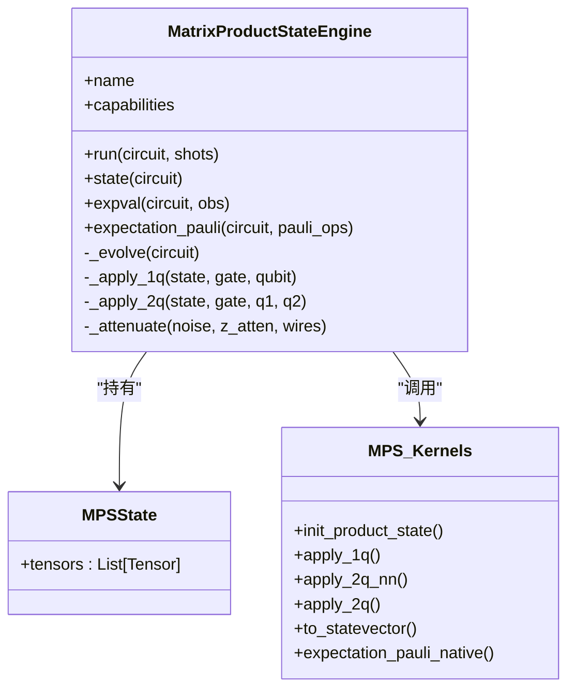
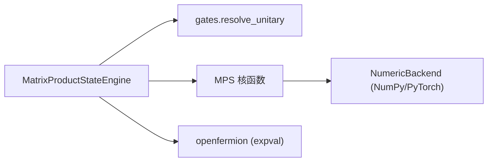

# 矩阵乘积态模拟器

<cite>
**本文引用的文件**
- [engine.py](file://src/tyxonq/devices/simulators/matrix_product_state/engine.py)
- [matrix_product_state.py](file://src/tyxonq/libs/quantum_library/kernels/matrix_product_state.py)
- [__init__.py](file://src/tyxonq/devices/simulators/matrix_product_state/__init__.py)
- [mps_approximation_benchmark.py](file://examples/mps_approximation_benchmark.py)
- [index.rst](file://docs/source/libraries/quantum_library/index.rst)
</cite>

## 目录
1. [简介](#简介)
2. [项目结构](#项目结构)
3. [核心组件](#核心组件)
4. [架构总览](#架构总览)
5. [详细组件分析](#详细组件分析)
6. [依赖关系分析](#依赖关系分析)
7. [性能考量](#性能考量)
8. [故障排查指南](#故障排查指南)
9. [结论](#结论)
10. [附录](#附录)

## 简介
本文件系统性文档化 TyxonQ 中的矩阵乘积态（MPS）模拟器，覆盖理论基础、实现机制与使用实践。MPS 将多体量子态以张量网络形式表示，通过“键维”（bond dimension）控制纠缠的刻画能力；在低纠缠系统中，MPS 能以远低于指数级的内存和时间复杂度模拟量子电路演化，适用于一维系统、浅层电路及局域哈密顿量的时间演化等场景。

## 项目结构
TyxonQ 的 MPS 模拟器由设备引擎与底层张量核函数组成：
- 设备引擎：MatrixProductStateEngine，负责电路分发、门应用、测量与期望值计算。
- 张量核：MPSState、apply_1q/apply_2q、to_statevector、expectation_pauli_native 等，提供高效的张量收缩与 SVD 压缩。
- 示例与文档：基准脚本与库文档说明键维权衡与适用场景。

图表来源
- [engine.py:74-135](file://src/tyxonq/devices/simulators/matrix_product_state/engine.py#L74-L135)
- [matrix_product_state.py:63-149](file://src/tyxonq/libs/quantum_library/kernels/matrix_product_state.py#L63-L149)
- [matrix_product_state.py:236-316](file://src/tyxonq/libs/quantum_library/kernels/matrix_product_state.py#L236-L316)

章节来源
- [engine.py:39-135](file://src/tyxonq/devices/simulators/matrix_product_state/engine.py#L39-L135)
- [matrix_product_state.py:36-149](file://src/tyxonq/libs/quantum_library/kernels/matrix_product_state.py#L36-L149)
- [index.rst:380-411](file://docs/source/libraries/quantum_library/index.rst#L380-L411)

## 核心组件
- MatrixProductStateEngine：封装 MPS 模拟器的运行接口，包括 run、state、expval、expectation_pauli 等，统一通过 _evolve 分发所有算子。
- MPSState：保存每个位点的三指标张量 (Dl, 2, Dr)，表征 MPS 链。
- 张量核函数：
  - init_product_state：构造直积初态 |0…0⟩ 或 |1…1⟩。
  - apply_1q：单比特幺正原地作用。
  - apply_2q_nn：相邻两比特幺正作用 + SVD 重压缩。
  - apply_2q：非相邻两比特通过 SWAP 路由后调用 apply_2q_nn。
  - to_statevector：用于小系统验证的重构。
  - expectation_pauli_native：直接在 MPS 上计算 Pauli 期望值，避免全态矢展开。

章节来源
- [engine.py:39-135](file://src/tyxonq/devices/simulators/matrix_product_state/engine.py#L39-L135)
- [matrix_product_state.py:47-149](file://src/tyxonq/libs/quantum_library/kernels/matrix_product_state.py#L47-L149)
- [matrix_product_state.py:236-316](file://src/tyxonq/libs/quantum_library/kernels/matrix_product_state.py#L236-L316)

## 架构总览
MPS 模拟器的数据流与控制流如下：
- 输入：Circuit IR（包含门序列）。
- 状态：MPSState（n 个位点张量）。
- 处理：统一分发循环解析权威门表，对 1q/2q 幺正调用 MPS 原地更新；支持 measure_z/barrier；不支持的特殊算子直接报错。
- 输出：MPS 对象、概率分布、采样计数、期望值。

图表来源
- [engine.py:74-218](file://src/tyxonq/devices/simulators/matrix_product_state/engine.py#L74-L218)
- [matrix_product_state.py:204-224](file://src/tyxonq/libs/quantum_library/kernels/matrix_product_state.py#L204-L224)
- [matrix_product_state.py:236-316](file://src/tyxonq/libs/quantum_library/kernels/matrix_product_state.py#L236-L316)

## 详细组件分析

### 理论基础：MPS 与纠缠熵约束
- MPS 将 n 比特态写为一系列张量 A^{[i]}_{α_{i-1}, s_i, α_i} 的缩并，其中 α 为键维 χ。键维越大，能表达的纠缠越多；对于面积律的一维基态或浅层电路，通常较小的 χ 即可高精度近似。
- 纠缠熵 S_A = -Tr(ρ_A log ρ_A) 受键维限制：截断后的最大纠缠熵约为 log χ。因此，当系统切分处的纠缠熵远大于 log χ 时，MPS 近似误差增大。
- 实践中通过 max_bond（硬上限）与可选的 svd_cutoff（奇异值阈值）控制压缩精度与效率。

章节来源
- [matrix_product_state.py:36-45](file://src/tyxonq/libs/quantum_library/kernels/matrix_product_state.py#L36-L45)
- [matrix_product_state.py:73-99](file://src/tyxonq/libs/quantum_library/kernels/matrix_product_state.py#L73-L99)
- [index.rst:380-411](file://docs/source/libraries/quantum_library/index.rst#L380-L411)

### MatrixProductStateEngine 实现机制
- 初始化：_init_state 调用 init_product_state 构建 |0…0⟩ 或 |1…1⟩ 的 MPS。
- 门操作：
  - 1q 门：apply_1q 原地更新目标位点张量。
  - 2q 门：apply_2q 自动路由（SWAP）到相邻位点后调用 apply_2q_nn，并进行 SVD 压缩。
- 收缩算法：
  - 期望值：expectation_pauli_native 在 MPS 上直接进行张量网络收缩，复杂度 O(n χ^3)。
  - 小系统回退：当 n ≤ 15 时可选择重构态矢路径以便调试。
- 观测值计算：
  - run 中若请求 shots 且存在测量，则通过 to_statevector 得到概率分布并采样。
  - expval 借助 openfermion 将观测算符转为稀疏矩阵，再与态矢内积求期望（当前实现会重构态矢）。
- 噪声接口：
  - 支持 depolarizing 噪声的 z_atten 衰减；readout 噪声在采样阶段混合概率分布。

图表来源
- [engine.py:74-218](file://src/tyxonq/devices/simulators/matrix_product_state/engine.py#L74-L218)
- [matrix_product_state.py:176-202](file://src/tyxonq/libs/quantum_library/kernels/matrix_product_state.py#L176-L202)
- [matrix_product_state.py:236-316](file://src/tyxonq/libs/quantum_library/kernels/matrix_product_state.py#L236-L316)

章节来源
- [engine.py:43-135](file://src/tyxonq/devices/simulators/matrix_product_state/engine.py#L43-L135)
- [engine.py:137-218](file://src/tyxonq/devices/simulators/matrix_product_state/engine.py#L137-L218)
- [engine.py:220-308](file://src/tyxonq/devices/simulators/matrix_product_state/engine.py#L220-L308)

### 关键参数与截断策略
- 最大维数（max_bond）：在 apply_2q_nn 的 SVD 步骤中进行硬上限截断，控制键维增长，从而控制内存与计算开销。
- 截断阈值（svd_cutoff）：按奇异值绝对阈值保留分量，进一步降低秩，提高压缩比。
- 收缩顺序优化：
  - 2q 门通过 SWAP 路由到相邻位点，保证每次仅合并两个相邻位点张量，再进行 SVD 重压缩，避免全局膨胀。
  - 期望值计算采用从左到右的收缩顺序，维持 O(n χ^3) 复杂度。

图表来源
- [engine.py:39-135](file://src/tyxonq/devices/simulators/matrix_product_state/engine.py#L39-L135)
- [matrix_product_state.py:36-149](file://src/tyxonq/libs/quantum_library/kernels/matrix_product_state.py#L36-L149)
- [matrix_product_state.py:236-316](file://src/tyxonq/libs/quantum_library/kernels/matrix_product_state.py#L236-L316)

章节来源
- [matrix_product_state.py:73-149](file://src/tyxonq/libs/quantum_library/kernels/matrix_product_state.py#L73-L149)
- [matrix_product_state.py:176-202](file://src/tyxonq/libs/quantum_library/kernels/matrix_product_state.py#L176-L202)
- [matrix_product_state.py:236-316](file://src/tyxonq/libs/quantum_library/kernels/matrix_product_state.py#L236-L316)

### 边界条件与周期性边界
- 当前实现为开边界 MPS（OBC），位点张量首尾键维为 1。
- 非相邻两比特门通过 SWAP 路由到相邻位置后再应用，保持 OBC 拓扑下的正确性。
- 周期性边界条件（PBC）未在 MPS 核中实现；如需 PBC，需扩展路由与收缩逻辑。

章节来源
- [matrix_product_state.py:176-202](file://src/tyxonq/libs/quantum_library/kernels/matrix_product_state.py#L176-L202)

### 不同纠缠结构下的性能对比
- 低纠缠（如 GHZ、短程相互作用基态）：较小 max_bond 即可获得高保真度，内存与时间接近 O(n χ^k)。
- 中等纠缠（变分电路、浅层随机电路）：适当增大 max_bond 可提升精度，但成本上升。
- 高纠缠（深度随机电路、全连接）：MPS 近似误差显著，建议改用 statevector/density_matrix 或其他方法。

参考基准脚本展示了不同键维下的能量相对误差与保真度变化，可用于指导参数选择。

章节来源
- [mps_approximation_benchmark.py:111-179](file://examples/mps_approximation_benchmark.py#L111-L179)
- [index.rst:380-411](file://docs/source/libraries/quantum_library/index.rst#L380-L411)

### 应用场景：量子多体物理与拓扑序
- 一维自旋链（如横向场 Ising 模型）：MPS 天然适合描述面积律基态与低能激发。
- 拓扑序研究：可通过长程关联与纠缠谱分析识别拓扑序特征；MPS 在小键维下仍可捕捉部分拓扑信息。
- 时间演化：Trotter 分解局域项，逐步应用 2q 门并结合 SVD 压缩，适合 1D 系统长时间演化。

章节来源
- [index.rst:404-411](file://docs/source/libraries/quantum_library/index.rst#L404-L411)

### 与其他模拟器的精度-效率权衡
- Statevector：精确但内存 O(2^n)，适用于小系统或高纠缠场景。
- Density matrix：可处理噪声与混合态，内存 O(4^n)。
- MPS：近似但可扩展至大系统，适合低纠缠、一维系统；通过 max_bond 与 svd_cutoff 调节精度-效率。

章节来源
- [index.rst:380-411](file://docs/source/libraries/quantum_library/index.rst#L380-L411)

## 依赖关系分析
- 引擎依赖：
  - 门矩阵与权威算子表：resolve_unitary 提供统一的幺正门解析。
  - MPS 核：apply_1q/apply_2q、to_statevector、expectation_pauli_native。
  - 数值后端：ArrayBackend/NumericBackend 抽象数组运算与 SVD。
- 外部依赖：
  - openfermion.linalg.get_sparse_operator：用于 expval 中将观测算符转为稀疏矩阵。

图表来源
- [engine.py:18-33](file://src/tyxonq/devices/simulators/matrix_product_state/engine.py#L18-L33)
- [engine.py:220-233](file://src/tyxonq/devices/simulators/matrix_product_state/engine.py#L220-L233)
- [matrix_product_state.py:5-6](file://src/tyxonq/libs/quantum_library/kernels/matrix_product_state.py#L5-L6)

章节来源
- [engine.py:18-33](file://src/tyxonq/devices/simulators/matrix_product_state/engine.py#L18-L33)
- [engine.py:220-233](file://src/tyxonq/devices/simulators/matrix_product_state/engine.py#L220-L233)

## 性能考量
- 复杂度：
  - 1q 门：O(χ^2) 每比特。
  - 2q 门（相邻）：合并张量后 SVD 压缩，约 O(χ^3)。
  - 期望值：O(n χ^3)。
- 内存：O(n χ^2) 存储张量；to_statevector 为 O(2^n)，仅用于小系统或采样。
- 优化建议：
  - 合理设置 max_bond：根据问题纠缠程度逐步增大，观察收敛。
  - 使用 svd_cutoff：在保持精度的同时减少秩。
  - 优先使用 expectation_pauli_native 避免态矢展开。
  - 门布局尽量局部化，减少 SWAP 次数。

章节来源
- [matrix_product_state.py:73-149](file://src/tyxonq/libs/quantum_library/kernels/matrix_product_state.py#L73-L149)
- [matrix_product_state.py:236-316](file://src/tyxonq/libs/quantum_library/kernels/matrix_product_state.py#L236-L316)
- [index.rst:380-411](file://docs/source/libraries/quantum_library/index.rst#L380-L411)

## 故障排查指南
- 遇到不支持的算子（unitary/kraus/project_z/reset/pulse/pulse_inline）：MPS 引擎会抛出异常，请改用 statevector 或 density_matrix 引擎。
- 未知算子：同样会抛出异常，检查电路是否包含未注册的门。
- 噪声配置：
  - depolarizing：通过 z_atten 衰减 Z 测量期望值。
  - readout：在采样阶段混合概率分布，确保校准矩阵维度匹配。
- 性能问题：
  - 若内存不足，降低 max_bond 或启用 svd_cutoff。
  - 若精度不足，增大 max_bond 或减小 svd_cutoff。
- 边界条件：
  - 当前为开边界；如需周期性边界，需扩展路由与收缩逻辑。

章节来源
- [engine.py:121-134](file://src/tyxonq/devices/simulators/matrix_product_state/engine.py#L121-L134)
- [engine.py:137-218](file://src/tyxonq/devices/simulators/matrix_product_state/engine.py#L137-L218)
- [engine.py:310-317](file://src/tyxonq/devices/simulators/matrix_product_state/engine.py#L310-L317)

## 结论
TyxonQ 的 MPS 模拟器以清晰的张量核与统一的引擎分发为核心，提供了高效、可扩展的低纠缠系统模拟能力。通过 max_bond 与 svd_cutoff 的灵活控制，可在精度与效率之间取得平衡。对于一维系统与浅层电路，MPS 是首选方法；对于高纠缠或全连接系统，应谨慎评估或使用其他模拟器。

## 附录
- 快速上手：
  - 使用 Circuit.device(provider="simulator", device="matrix_product_state", max_bond=...) 切换 MPS 后端。
  - 通过 mps_approximation_benchmark.py 练习键维选择与精度评估。
- 最佳实践：
  - 先以小 max_bond 测试，逐步增大直至收敛。
  - 优先使用 expectation_pauli_native 计算期望值。
  - 注意门布局与 SWAP 路由对性能的影响。
- 常见问题：
  - 不支持的算子：改用其他引擎。
  - 周期性边界：当前未实现，需自行扩展。

章节来源
- [mps_approximation_benchmark.py:43-84](file://examples/mps_approximation_benchmark.py#L43-L84)
- [mps_approximation_benchmark.py:111-179](file://examples/mps_approximation_benchmark.py#L111-L179)
- [index.rst:404-411](file://docs/source/libraries/quantum_library/index.rst#L404-L411)