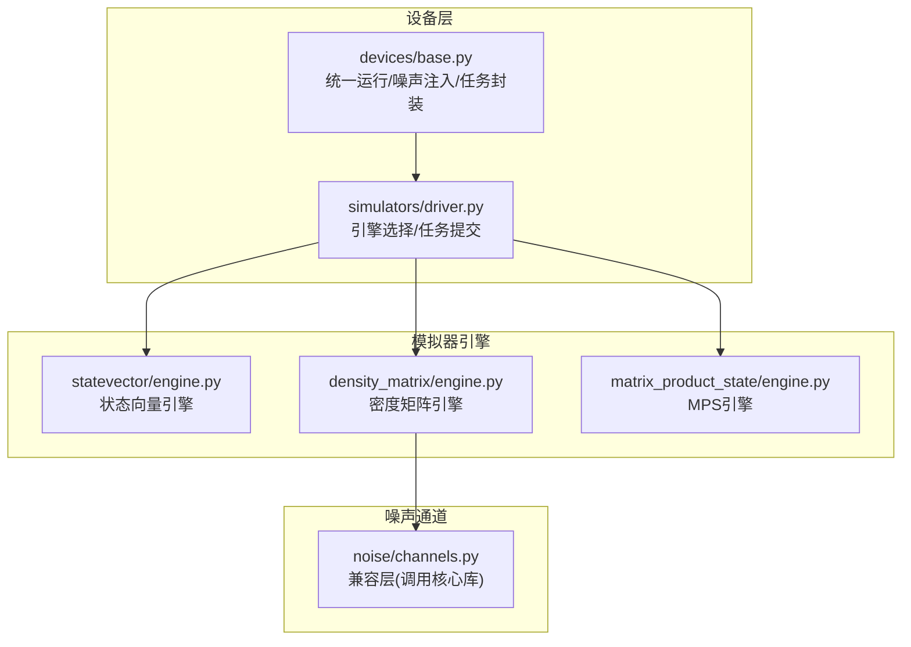
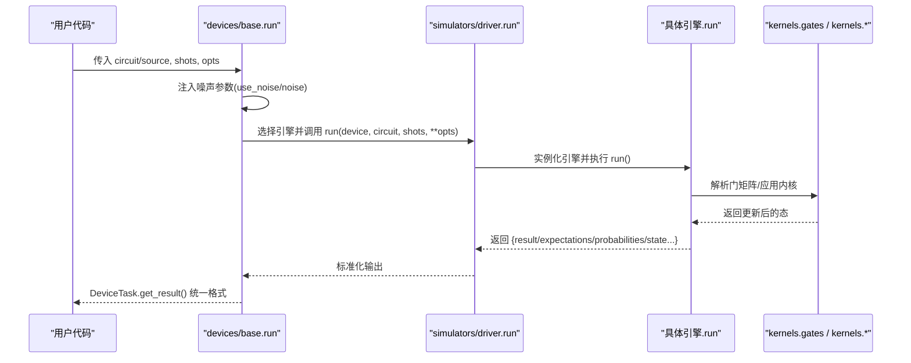
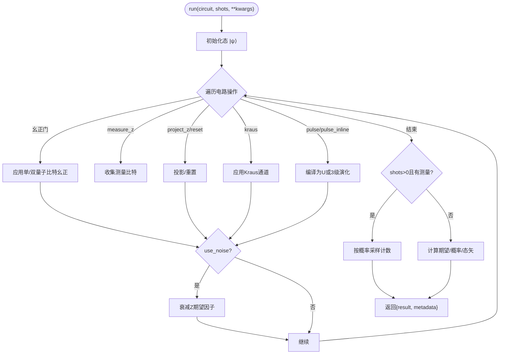
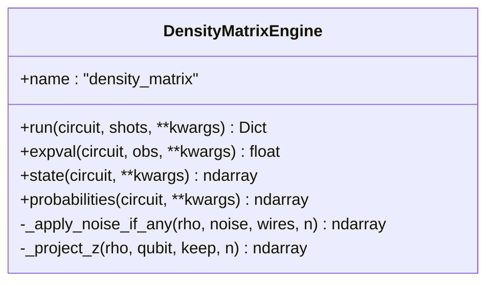
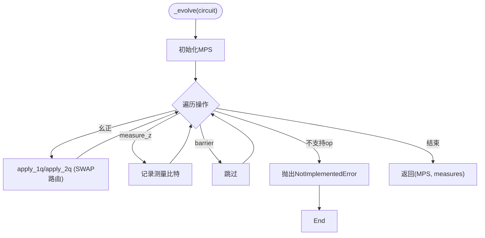
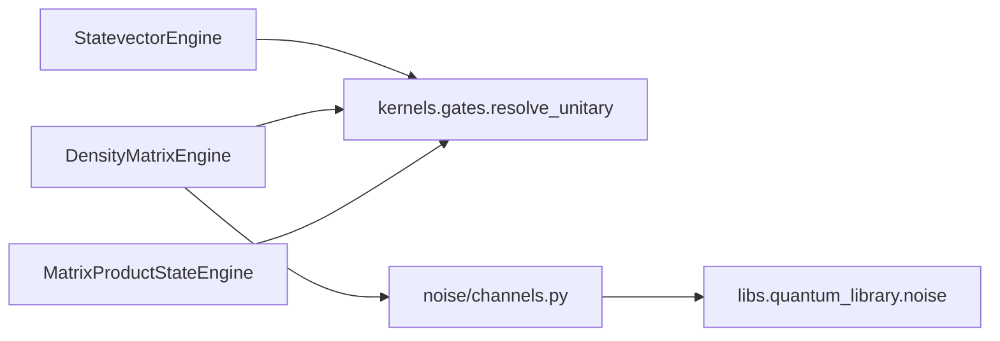
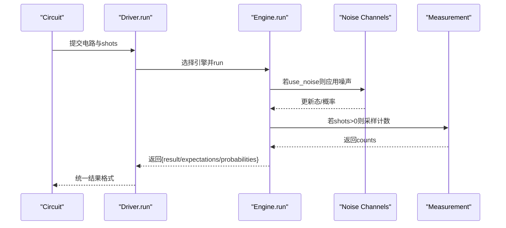

# 量子模拟器

<cite>
**本文引用的文件**
- [statevector/engine.py](file://src/tyxonq/devices/simulators/statevector/engine.py)
- [density_matrix/engine.py](file://src/tyxonq/devices/simulators/density_matrix/engine.py)
- [matrix_product_state/engine.py](file://src/tyxonq/devices/simulators/matrix_product_state/engine.py)
- [noise/channels.py](file://src/tyxonq/devices/simulators/noise/channels.py)
- [simulators/driver.py](file://src/tyxonq/devices/simulators/driver.py)
- [devices/base.py](file://src/tyxonq/devices/base.py)
- [examples/noise_controls_demo.py](file://examples/noise_controls_demo.py)
</cite>

## 目录
1. [简介](#简介)
2. [项目结构](#项目结构)
3. [核心组件](#核心组件)
4. [架构总览](#架构总览)
5. [详细组件分析](#详细组件分析)
6. [依赖关系分析](#依赖关系分析)
7. [性能与内存特性](#性能与内存特性)
8. [配置选项与并行支持](#配置选项与并行支持)
9. [噪声模型、测量与期望值计算](#噪声模型测量与期望值计算)
10. [模拟器选择指南](#模拟器选择指南)
11. [故障排查](#故障排查)
12. [结论](#结论)

## 简介
本文件系统性介绍 TyxonQ 的三类核心量子模拟器：状态向量模拟器、密度矩阵模拟器和矩阵乘积态（MPS）模拟器。内容涵盖数学原理、适用场景、性能特征、配置选项、内存管理策略、并行计算支持，以及噪声模型集成、测量处理与期望值计算的实现细节。同时提供基于代码实现的选型建议与基准测试参考路径，帮助用户根据问题规模与需求选择合适的模拟器。

## 项目结构
TyxonQ 将模拟器实现集中在 devices/simulators 下，按类型划分引擎模块，并通过统一驱动进行设备选择与任务调度；设备层提供统一的运行接口与噪声注入机制。

**图表来源**
- [devices/base.py:294-445](file://src/tyxonq/devices/base.py#L294-L445)
- [simulators/driver.py:20-38](file://src/tyxonq/devices/simulators/driver.py#L20-L38)
- [statevector/engine.py:38-451](file://src/tyxonq/devices/simulators/statevector/engine.py#L38-L451)
- [density_matrix/engine.py:36-193](file://src/tyxonq/devices/simulators/density_matrix/engine.py#L36-L193)
- [matrix_product_state/engine.py:39-250](file://src/tyxonq/devices/simulators/matrix_product_state/engine.py#L39-L250)
- [noise/channels.py:1-44](file://src/tyxonq/devices/simulators/noise/channels.py#L1-L44)

**章节来源**
- [devices/base.py:294-445](file://src/tyxonq/devices/base.py#L294-L445)
- [simulators/driver.py:20-38](file://src/tyxonq/devices/simulators/driver.py#L20-L38)

## 核心组件
- 状态向量模拟器（StatevectorEngine）
  - 以大小为 2^n 的复数向量表示纯态 |ψ⟩，适用于小规模系统的高精度计算。
  - 支持幺正门、测量、投影、重置、Kraus 噪声、脉冲演化（含三能级泄漏建模）、ZZ 串扰等。
  - 复杂度：内存 O(2^n)，时间约 O(poly(gates)·2^n)。

- 密度矩阵模拟器（DensityMatrixEngine）
  - 以 2^n × 2^n 的密度矩阵 ρ 表示混合态，原生支持 Kraus 通道，适合噪声建模与混合态演化。
  - 复杂度：内存 O(4^n)，时间约 O(poly(gates)·4^n)。

- 矩阵乘积态模拟器（MatrixProductStateEngine）
  - 以 MPS 张量网络表示态，内存/时间与键维 χ 相关，适合大规模低纠缠系统的近似计算。
  - 支持 1q/2q 幺正门与 SWAP 路由，测量通过重构态矢或原生算符期望值计算。
  - 可选最大键维截断 max_bond 控制近似精度与内存。

**章节来源**
- [statevector/engine.py:1-10](file://src/tyxonq/devices/simulators/statevector/engine.py#L1-L10)
- [density_matrix/engine.py:1-9](file://src/tyxonq/devices/simulators/density_matrix/engine.py#L1-L9)
- [matrix_product_state/engine.py:1-12](file://src/tyxonq/devices/simulators/matrix_product_state/engine.py#L1-L12)

## 架构总览
TyxonQ 采用“统一设备层 + 多后端引擎”的架构：
- 设备层（devices/base.py）负责默认 provider/device 解析、噪声全局开关注入、统一任务封装与结果归一化。
- 模拟器驱动（simulators/driver.py）根据 device 字符串选择具体引擎并执行 run/expval。
- 各引擎内部使用统一门核（kernels.gates）与各自的后端数组抽象（ArrayBackend），保证数值后端可插拔（numpy/pytorch/cupynumeric）。

**图表来源**
- [devices/base.py:294-445](file://src/tyxonq/devices/base.py#L294-L445)
- [simulators/driver.py:86-141](file://src/tyxonq/devices/simulators/driver.py#L86-L141)
- [statevector/engine.py:46-451](file://src/tyxonq/devices/simulators/statevector/engine.py#L46-L451)
- [density_matrix/engine.py:43-193](file://src/tyxonq/devices/simulators/density_matrix/engine.py#L43-L193)
- [matrix_product_state/engine.py:137-250](file://src/tyxonq/devices/simulators/matrix_product_state/engine.py#L137-L250)

## 详细组件分析

### 状态向量模拟器（StatevectorEngine）
- 数学原理
  - 用 2^n 维复向量表示纯态，幺正门通过 G|ψ⟩ 作用，测量 Z 期望通过概率幅平方差得到。
- 关键能力
  - 支持 h/rz/rx/cx 等标准门，project_z/reset/unitary/kraus/pulse/pulse_inline。
  - 脉冲演化支持两能级与三能级（泄漏到 |2⟩）两种模式；支持 ZZ 串扰（局部近似与全局精确两种模式）。
  - 采样计数与精确概率/态矢返回（shots=0 时）。
- 噪声处理
  - 通过 z_atten 衰减 Z 期望（depolarizing），或在 shots>0 时对概率分布施加 readout/depolarizing 混合。
- 性能特征
  - 内存 O(2^n)，时间随门数量线性增长（每门一次内核应用）。
  - 适合 n ≤ ~25 的小规模高精度计算。

**图表来源**
- [statevector/engine.py:46-451](file://src/tyxonq/devices/simulators/statevector/engine.py#L46-L451)

**章节来源**
- [statevector/engine.py:46-451](file://src/tyxonq/devices/simulators/statevector/engine.py#L46-L451)

### 密度矩阵模拟器（DensityMatrixEngine）
- 数学原理
  - 用 2^n × 2^n 的密度矩阵 ρ 描述混合态，幺正门通过 ρ → UρU† 作用，Kraus 通道通过 ∑_k E_k ρ E_k† 演化。
- 关键能力
  - 原生支持 depolarizing/amplitude_damping/phase_damping/pauli 等 Kraus 通道。
  - 不支持脉冲级演化（需改用 statevector 引擎或将脉冲编译为幺正门）。
- 噪声处理
  - 在每次幺正后对涉及的量子比特依次应用对应 Kraus 通道。
- 性能特征
  - 内存 O(4^n)，时间约 O(poly(gates)·4^n)，适合中等规模噪声研究。

**图表来源**
- [density_matrix/engine.py:36-242](file://src/tyxonq/devices/simulators/density_matrix/engine.py#L36-L242)

**章节来源**
- [density_matrix/engine.py:36-242](file://src/tyxonq/devices/simulators/density_matrix/engine.py#L36-L242)

### 矩阵乘积态模拟器（MatrixProductStateEngine）
- 数学原理
  - 将态表示为 MPS 张量序列，幺正门通过局部更新与 SWAP 路由作用于相邻位点，键维 χ 控制纠缠容量。
- 关键能力
  - 支持 1q/2q 幺正门与 measure_z/barrier；不支持 unitary/kraus/project_z/reset/pulse/pulse_inline（会抛出异常）。
  - 提供 expectation_pauli 原生 MPS 计算（避免全态重构，保持 O(nχ^3) 复杂度）。
  - 可选 max_bond 限制键维，平衡精度与内存。
- 性能特征
  - 内存与时间随 χ 而非 2^n 增长，适合大规模低纠缠系统近似计算。

**图表来源**
- [matrix_product_state/engine.py:74-135](file://src/tyxonq/devices/simulators/matrix_product_state/engine.py#L74-L135)

**章节来源**
- [matrix_product_state/engine.py:39-319](file://src/tyxonq/devices/simulators/matrix_product_state/engine.py#L39-L319)

## 依赖关系分析
- 门矩阵与权威分发
  - 三个引擎均通过 gates.resolve_unitary 解析幺正门，确保单一真相源，避免分支遗漏。
- 数值后端
  - 通过 ArrayBackend 抽象支持 numpy/pytorch/cupynumeric，便于 GPU/加速后端切换。
- 噪声通道
  - density_matrix 引擎通过 noise/channels.py 调用核心库的标准通道；statevector/mps 通过 z_atten 或概率混合近似实现。

**图表来源**
- [statevector/engine.py:17-32](file://src/tyxonq/devices/simulators/statevector/engine.py#L17-L32)
- [density_matrix/engine.py:17-30](file://src/tyxonq/devices/simulators/density_matrix/engine.py#L17-L30)
- [matrix_product_state/engine.py:19-33](file://src/tyxonq/devices/simulators/matrix_product_state/engine.py#L19-L33)
- [noise/channels.py:14-41](file://src/tyxonq/devices/simulators/noise/channels.py#L14-L41)

**章节来源**
- [statevector/engine.py:17-32](file://src/tyxonq/devices/simulators/statevector/engine.py#L17-L32)
- [density_matrix/engine.py:17-30](file://src/tyxonq/devices/simulators/density_matrix/engine.py#L17-L30)
- [matrix_product_state/engine.py:19-33](file://src/tyxonq/devices/simulators/matrix_product_state/engine.py#L19-L33)
- [noise/channels.py:14-41](file://src/tyxonq/devices/simulators/noise/channels.py#L14-L41)

## 性能与内存特性
- 状态向量模拟器
  - 内存 O(2^n)，时间 O(poly(gates)·2^n)。适合小规模高精度计算。
  - 支持 shots=0 返回精确概率与态矢；shots>0 采样计数。
- 密度矩阵模拟器
  - 内存 O(4^n)，时间 O(poly(gates)·4^n)。适合噪声建模与混合态演化。
  - 原生 Kraus 通道，测量从对角线采样。
- 矩阵乘积态模拟器
  - 内存/时间随键维 χ 增长，适合大规模低纠缠系统近似计算。
  - 可通过 max_bond 控制近似精度；expectation_pauli 原生计算避免全态重构。

[本节为通用性能讨论，不直接分析具体文件]

## 配置选项与并行支持
- 统一设备层噪声注入
  - 通过 devices.base.enable_noise 设置全局噪声开关与配置；run 时自动注入 use_noise/noise。
  - 模拟器专属参数（noise/use_noise）在真机路径会被丢弃，保证跨 provider 一致性。
- 引擎级配置
  - StatevectorEngine/DensityMatrixEngine：backend_name 指定数值后端；shots 控制采样次数；use_noise/noise 控制噪声。
  - MatrixProductStateEngine：max_bond 控制键维上限；backend/backend_name 指定数值后端。
- 并行计算支持
  - 数值后端可切换至 pytorch/cupynumeric，利用 GPU 加速；引擎内部通过 ArrayBackend 抽象统一调用。
  - 示例中展示了 pmap 并行 VQE 等用法（参见 examples/vqe_parallel_pmap.py）。

**章节来源**
- [devices/base.py:274-356](file://src/tyxonq/devices/base.py#L274-L356)
- [statevector/engine.py:42-59](file://src/tyxonq/devices/simulators/statevector/engine.py#L42-L59)
- [density_matrix/engine.py:40-47](file://src/tyxonq/devices/simulators/density_matrix/engine.py#L40-L47)
- [matrix_product_state/engine.py:43-47](file://src/tyxonq/devices/simulators/matrix_product_state/engine.py#L43-L47)

## 噪声模型、测量与期望值计算
- 噪声模型集成
  - 密度矩阵引擎：原生 Kraus 通道（depolarizing/amplitude_damping/phase_damping/pauli），通过 apply_kraus_density 应用。
  - 状态向量/MPS：通过 z_atten 衰减 Z 期望（depolarizing），或在采样时对概率分布施加 readout/depolarizing 混合。
  - 兼容层：noise/channels.py 提供旧接口，实际调用 libs.quantum_library.noise。
- 测量处理
  - 状态向量：shots>0 时按概率采样计数；shots=0 返回精确概率与态矢。
  - 密度矩阵：shots>0 时从对角线采样；shots=0 返回对角概率。
  - MPS：shots>0 时先重构态矢再采样；expectation_pauli 支持原生 MPS 计算。
- 期望值计算
  - 状态向量：expval 通过 openfermion 稀疏算符与态矢内积计算。
  - 密度矩阵：expval 通过 trace(ρH) 计算。
  - MPS：expval 通过重构态矢或原生 MPS 期望值计算。

**图表来源**
- [simulators/driver.py:86-141](file://src/tyxonq/devices/simulators/driver.py#L86-L141)
- [statevector/engine.py:46-451](file://src/tyxonq/devices/simulators/statevector/engine.py#L46-L451)
- [density_matrix/engine.py:43-193](file://src/tyxonq/devices/simulators/density_matrix/engine.py#L43-L193)
- [matrix_product_state/engine.py:137-250](file://src/tyxonq/devices/simulators/matrix_product_state/engine.py#L137-L250)
- [noise/channels.py:14-41](file://src/tyxonq/devices/simulators/noise/channels.py#L14-L41)

**章节来源**
- [density_matrix/engine.py:196-227](file://src/tyxonq/devices/simulators/density_matrix/engine.py#L196-L227)
- [statevector/engine.py:466-473](file://src/tyxonq/devices/simulators/statevector/engine.py#L466-L473)
- [matrix_product_state/engine.py:310-317](file://src/tyxonq/devices/simulators/matrix_product_state/engine.py#L310-L317)
- [noise/channels.py:14-41](file://src/tyxonq/devices/simulators/noise/channels.py#L14-L41)

## 模拟器选择指南
- 小规模高精度计算（n ≤ ~25）
  - 首选状态向量模拟器：内存 O(2^n)，支持完整门集、脉冲演化、三能级泄漏与 ZZ 串扰。
- 噪声建模与混合态演化
  - 首选密度矩阵模拟器：原生 Kraus 通道，精确混合态演化；注意 O(4^n) 内存开销。
- 大规模低纠缠系统近似
  - 首选 MPS 模拟器：通过键维 χ 控制复杂度，支持 max_bond 截断；避免全态重构，适合大 n。
- 脉冲级仿真与硬件感知
  - 使用状态向量模拟器：支持 pulse/pulse_inline、三能级泄漏、ZZ 串扰（local/global 模式）。
- 并行与加速
  - 通过 backend_name 切换至 pytorch/cupynumeric 以获得 GPU 加速；结合 pmap 等并行工具。

[本节为概念性指导，不直接分析具体文件]

## 故障排查
- 未知操作被拒绝
  - 所有引擎对未知 op 都会抛出 ValueError，避免静默跳过导致错误结果。
- MPS 不支持的操作
  - MPS 引擎对 unitary/kraus/project_z/reset/pulse/pulse_inline 抛出 NotImplementedError，应改用其他引擎。
- 密度矩阵不支持脉冲级演化
  - 密度矩阵引擎对 pulse/pulse_inline 抛出 NotImplementedError，需改用状态向量引擎或先将脉冲编译为幺正门。
- 噪声未生效
  - 检查是否启用 use_noise/noise；确认设备层已注入噪声参数；对于 MPS/状态向量，噪声通过 z_atten 或概率混合实现。
- 期望值为零或异常
  - 检查 expval 路径是否正确（openfermion 依赖）；确认观测算符维度与量子比特数匹配。

**章节来源**
- [statevector/engine.py:335-342](file://src/tyxonq/devices/simulators/statevector/engine.py#L335-L342)
- [density_matrix/engine.py:97-109](file://src/tyxonq/devices/simulators/density_matrix/engine.py#L97-L109)
- [matrix_product_state/engine.py:121-134](file://src/tyxonq/devices/simulators/matrix_product_state/engine.py#L121-L134)
- [devices/base.py:344-356](file://src/tyxonq/devices/base.py#L344-L356)

## 结论
TyxonQ 提供了三种互补的量子模拟器：状态向量模拟器用于小规模高精度计算，密度矩阵模拟器用于噪声建模与混合态演化，MPS 模拟器用于大规模低纠缠系统近似。通过统一设备层与驱动，用户可便捷地切换后端、注入噪声、获取测量与期望值。根据问题规模与需求选择合适的模拟器，并结合数值后端与并行工具，可获得最佳性能与精度。

[本节为总结性内容，不直接分析具体文件]