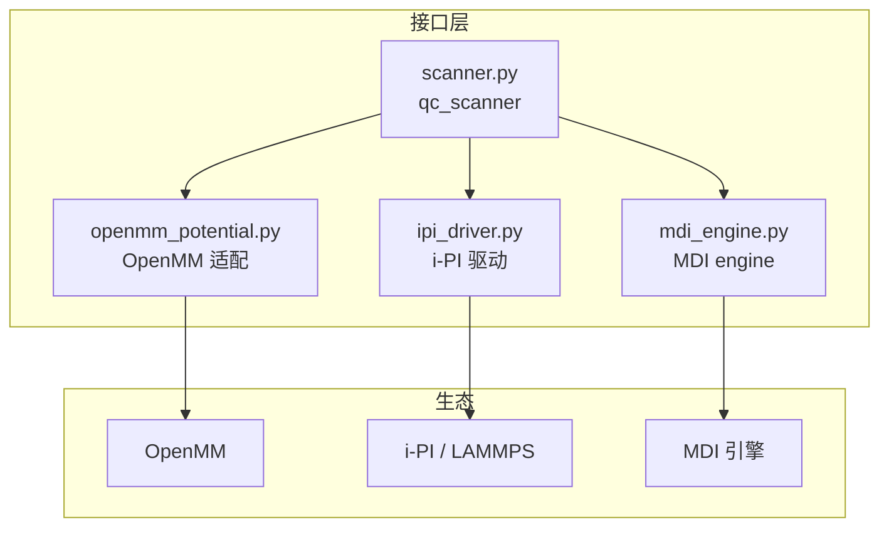
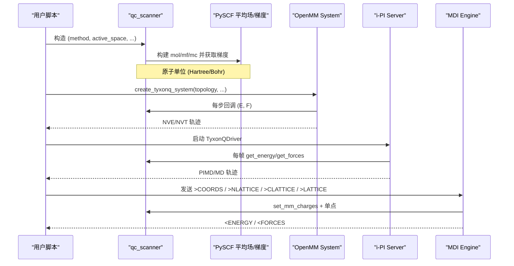
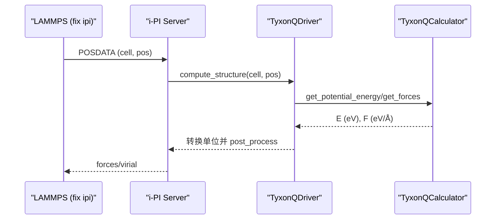
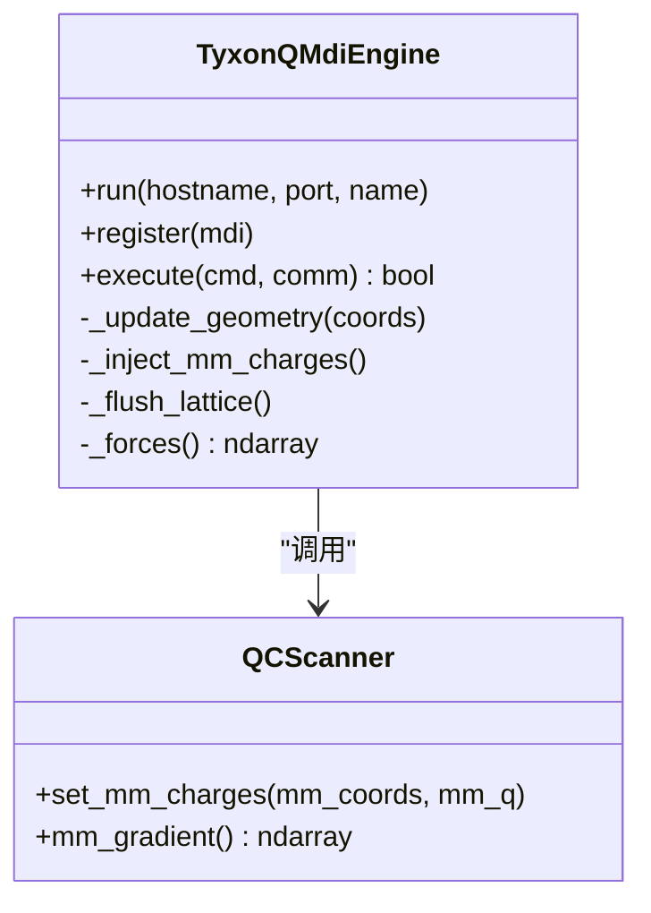
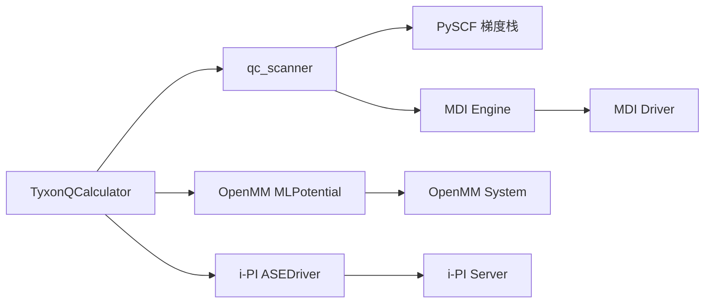

# QM/MM集成

<cite>
**本文引用的文件**
- [openmm_potential.py](file://src/tyxonq/applications/chem/interfaces/openmm_potential.py)
- [mdi_engine.py](file://src/tyxonq/applications/chem/interfaces/mdi_engine.py)
- [ipi_driver.py](file://src/tyxonq/applications/chem/interfaces/ipi_driver.py)
- [scanner.py](file://src/tyxonq/applications/chem/interfaces/scanner.py)
- [md_mdi_qmmm_embedded.py](file://examples/qmmm/md_mdi_qmmm_embedded.py)
- [md_openmm_pure_qm.py](file://examples/qmmm/md_openmm_pure_qm.py)
- [md_qmmm_device_hardware.py](file://examples/qmmm/md_qmmm_device_hardware.py)
- [md_qmmm_sqd_device.py](file://examples/qmmm/md_qmmm_sqd_device.py)
- [MD_INTEGRATION_PLAN.md](file://MD_INTEGRATION_PLAN.md)
- [MD_INTEGRATION_RESEARCH.md](file://MD_INTEGRATION_RESEARCH.md)
</cite>

## 目录
1. [简介](#简介)
2. [项目结构](#项目结构)
3. [核心组件](#核心组件)
4. [架构总览](#架构总览)
5. [详细组件分析](#详细组件分析)
6. [依赖关系分析](#依赖关系分析)
7. [性能与并行策略](#性能与并行策略)
8. [故障排查指南](#故障排查指南)
9. [结论](#结论)
10. [附录：工作流示例](#附录工作流示例)

## 简介
本文件系统性阐述 TyxonQ 的量子力学/分子力学（QM/MM）集成方案，覆盖以下目标：
- QM/MM 方法原理与 TyxonQ 实现架构
- OpenMM 势函数集成与使用方式
- 路径积分（PI）驱动的分子动力学接口（通过 i-PI）
- MDI 引擎的多体相互作用处理
- 完整 QM/MM 模拟工作流（系统设置、力场参数化、模拟执行）
- 在真实量子硬件上运行 QM/MM 计算
- 性能调优与并行策略

TyxonQ 将 PySCF 的核梯度能力作为统一后端，并通过 ASE 枢纽对接 i-PI/OpenMM/LAMMPS；同时提供 MDI 专线用于静电嵌入。所有适配层均为薄封装，核心能量/梯度由 qc_scanner 暴露给生态。

**章节来源**
- [MD_INTEGRATION_PLAN.md:25-68](file://MD_INTEGRATION_PLAN.md#L25-L68)
- [MD_INTEGRATION_RESEARCH.md:10-17](file://MD_INTEGRATION_RESEARCH.md#L10-L17)

## 项目结构
TyxonQ 的 QM/MM 相关代码集中在 applications/chem/interfaces 下，按“单一门面 + 多生态适配器”组织：
- scanner.py：qc_scanner 门面，统一输出 (E, F)，原子单位
- openmm_potential.py：OpenMM 直连（纯 QM、机械嵌入、静电嵌入簇版）
- ipi_driver.py：i-PI 驱动（支持 PIMD）
- mdi_engine.py：MDI engine（静电嵌入专线）

示例位于 examples/qmmm，覆盖 OpenMM 纯 QM、MDI 静电嵌入、设备真机链路等。



**图表来源**
- [scanner.py:1-39](file://src/tyxonq/applications/chem/interfaces/scanner.py#L1-L39)
- [openmm_potential.py:1-32](file://src/tyxonq/applications/chem/interfaces/openmm_potential.py#L1-L32)
- [ipi_driver.py:1-31](file://src/tyxonq/applications/chem/interfaces/ipi_driver.py#L1-L31)
- [mdi_engine.py:1-27](file://src/tyxonq/applications/chem/interfaces/mdi_engine.py#L1-L27)

**章节来源**
- [MD_INTEGRATION_PLAN.md:72-108](file://MD_INTEGRATION_PLAN.md#L72-L108)

## 核心组件
- qc_scanner：唯一对外入口，返回 (E, F) 原子单位；支持 SQD/UCCSD/HEA 等方法，支持静电嵌入与周期性 Ewald 嵌入
- OpenMM 适配：create_tyxonq_system（纯 QM）、create_mixed_system（机械嵌入）、create_qmmm_ee_system（簇静电嵌入）
- i-PI 驱动：继承 ASEDriver，把 TyxonQCalculator 接入 i-PI，支持 PIMD
- MDI engine：以 @DEFAULT 节点暴露命令表，支持 >NLATTICE/>CLATTICE/>LATTICE 注入 MM 点电荷，返回全原子力

关键特性：
- 单位约定：PySCF/MDI 用原子单位（Bohr/Hartree/e），ASE/i-PI/OpenMM 侧做必要换算
- 静电嵌入：通过 pyscf.qmmm 重入路径注入 MM 电荷，并返回 mm_gradient（MM 反作用力）
- 子空间策略（SQD）：默认 frozen，确保能量面光滑与解析梯度可用

**章节来源**
- [scanner.py:93-188](file://src/tyxonq/applications/chem/interfaces/scanner.py#L93-L188)
- [openmm_potential.py:73-239](file://src/tyxonq/applications/chem/interfaces/openmm_potential.py#L73-L239)
- [ipi_driver.py:90-142](file://src/tyxonq/applications/chem/interfaces/ipi_driver.py#L90-L142)
- [mdi_engine.py:52-179](file://src/tyxonq/applications/chem/interfaces/mdi_engine.py#L52-L179)

## 架构总览
TyxonQ 的 QM/MM 架构围绕 qc_scanner 构建，上层通过不同适配器接入各生态：
- OpenMM：通过 MLPotential('ase') 将 TyxonQCalculator 挂为 PythonForce，每步回调取 (E, F)
- i-PI：通过 ASEDriver 子类，把 TyxonQCalculator 暴露为 forcefield，支持 PIMD
- MDI：TyxonQMdiEngine 注册命令表，接收坐标与 MM 晶格，调用 qc_scanner 并返回能量/力



**图表来源**
- [scanner.py:280-320](file://src/tyxonq/applications/chem/interfaces/scanner.py#L280-L320)
- [openmm_potential.py:73-99](file://src/tyxonq/applications/chem/interfaces/openmm_potential.py#L73-L99)
- [ipi_driver.py:102-142](file://src/tyxonq/applications/chem/interfaces/ipi_driver.py#L102-L142)
- [mdi_engine.py:105-179](file://src/tyxonq/applications/chem/interfaces/mdi_engine.py#L105-L179)

**章节来源**
- [MD_INTEGRATION_PLAN.md:25-68](file://MD_INTEGRATION_PLAN.md#L25-L68)

## 详细组件分析

### OpenMM 势函数集成
- 纯 QM：create_tyxonq_system 通过 TyxonQCalculator + MLPotential('ase') 创建 System，内部 PythonForce 每步回调求 (E, F)
- 机械嵌入：create_mixed_system 删除 QM 子集内部键合项，QM–MM 相互作用仍由经典力场处理
- 静电嵌入（簇）：create_qmmm_ee_system 将 MM 点电荷注入 QM 哈密顿量，防双计数（QM 电荷置零、QM 内部例外清零），返回全原子力 = QM 梯度 ⊕ MM 反作用力

```mermaid
flowchart TD
Start(["开始"]) --> Build["构建 Topology/System"]
Build --> Mode{"嵌入模式"}
Mode --> |纯 QM| Pure["create_tyxonq_system"]
Mode --> |机械嵌入| Mixed["create_mixed_system"]
Mode --> |静电嵌入(簇)| EE["create_qmmm_ee_system"]
Pure --> Run["OpenMM 积分器运行"]
Mixed --> Run
EE --> Run
Run --> End(["结束"])
```

**图表来源**
- [openmm_potential.py:73-239](file://src/tyxonq/applications/chem/interfaces/openmm_potential.py#L73-L239)

**章节来源**
- [openmm_potential.py:73-239](file://src/tyxonq/applications/chem/interfaces/openmm_potential.py#L73-L239)

### i-PI 驱动的 PI 分子动力学
- TyxonQDriver 继承 ASEDriver，在 check_parameters 后装配 TyxonQCalculator
- 支持 PIMD（路径积分分子动力学），通过 i-PI server 管理环状聚合物采样
- 命令行用法通过 -o 参数串传递 TyxonQCalculator 参数（注意 active_space 空格分隔）



**图表来源**
- [ipi_driver.py:58-142](file://src/tyxonq/applications/chem/interfaces/ipi_driver.py#L58-L142)

**章节来源**
- [ipi_driver.py:58-142](file://src/tyxonq/applications/chem/interfaces/ipi_driver.py#L58-L142)

### MDI 引擎的多体相互作用处理
- 注册 @DEFAULT 节点与命令表，支持 <NATOMS/<COORDS/<ENERGY/<FORCES 等
- 静电嵌入通过 >NLATTICE/>CLATTICE/>LATTICE 推送 MM 粒子数、电荷、坐标，缓存后注入 qc_scanner.set_mm_charges
- 返回全原子力：QM 梯度（含嵌入）⊕ MM 反作用力（mm_gradient）



**图表来源**
- [mdi_engine.py:52-216](file://src/tyxonq/applications/chem/interfaces/mdi_engine.py#L52-L216)
- [scanner.py:331-411](file://src/tyxonq/applications/chem/interfaces/scanner.py#L331-L411)

**章节来源**
- [mdi_engine.py:52-216](file://src/tyxonq/applications/chem/interfaces/mdi_engine.py#L52-L216)
- [scanner.py:331-411](file://src/tyxonq/applications/chem/interfaces/scanner.py#L331-L411)

### 量子算法与子空间策略（SQD/UCCSD/HEA）
- SQD：默认 frozen 子空间，能量面光滑，解析梯度可用；refresh/adaptive 需显式允许不连续
- UCCSD/HEA：通过 solver_kwargs 穿透 device_opts（shots/provider/device），支持数值与设备档
- 设备档：UCCSD 解析档（shots=0）与 numeric 一致；HEA 采样档为真机工作形态

**章节来源**
- [scanner.py:56-90](file://src/tyxonq/applications/chem/interfaces/scanner.py#L56-L90)
- [scanner.py:121-130](file://src/tyxonq/applications/chem/interfaces/scanner.py#L121-L130)
- [md_qmmm_device_hardware.py:9-28](file://examples/qmmm/md_qmmm_device_hardware.py#L9-L28)
- [md_qmmm_sqd_device.py:17-28](file://examples/qmmm/md_qmmm_sqd_device.py#L17-L28)

## 依赖关系分析
- 惰性导入：openmm/openmmml、mdi、ipi 均惰性导入，缺失时给出安装指引
- 单位换算：ASE 侧 eV/Å ↔ Hartree/Bohr；OpenMM 侧 kJ/mol/nm；MDI/PySCF 保持原子单位
- 耦合边界：
  - OpenMM：PythonForce 回调，每步取 (E, F)
  - i-PI：ASEDriver 抽象，post_process 处理 virial/Voigt
  - MDI：命令表协议，状态由 engine 维护



**图表来源**
- [openmm_potential.py:44-57](file://src/tyxonq/applications/chem/interfaces/openmm_potential.py#L44-L57)
- [ipi_driver.py:37-55](file://src/tyxonq/applications/chem/interfaces/ipi_driver.py#L37-L55)
- [mdi_engine.py:44-49](file://src/tyxonq/applications/chem/interfaces/mdi_engine.py#L44-L49)

**章节来源**
- [MD_INTEGRATION_RESEARCH.md:557-566](file://MD_INTEGRATION_RESEARCH.md#L557-L566)

## 性能与并行策略
- 冻结 SQD 是高效 MD 引擎：成本几乎不随活性空间增长，优于 UCCSD 在大活性空间下的膨胀
- 设备档优化：
  - UCCSD：解析档（shots=0）与 numeric 一致；采样档建议 ≥2048 shots
  - HEA：采样档为真机工作形态，建议 ≥8192 shots（尤其嵌入场景）
- 并行策略：
  - OpenMM：多线程/多 GPU（取决于平台）
  - i-PI：副本交换、PIMD 天然并行
  - MDI：TCP 通信，可跨进程/机器
- 已知近似：MM 反作用力缺 post-HF 轨道响应项（~4.3e-5 Ha/Bohr），严格 NVE 守恒诊断失效，但恒温/恒压 MD 可用

**章节来源**
- [MD_INTEGRATION_RESEARCH.md:480-501](file://MD_INTEGRATION_RESEARCH.md#L480-L501)
- [md_qmmm_device_hardware.py:197-204](file://examples/qmmm/md_qmmm_device_hardware.py#L197-L204)
- [mdi_engine.py:16-19](file://src/tyxonq/applications/chem/interfaces/mdi_engine.py#L16-L19)

## 故障排查指南
- 依赖缺失：
  - OpenMM：pip install 'tyxonq[md]'（包含 ase/openmm/openmmml）
  - MDI：pip install 'pymdi>=1.4'（import 名 mdi）
  - i-PI：pip install -U ipi
- 常见错误：
  - active_space 格式：命令行中写成 "4 4" 或 "4x4"，程序传元组
  - pbc 参数：rcut_ewald < min(box edge)，rcut_hcore < half box edge
  - 非冻结 SQD：subspace="refresh"/"adaptive" 默认拒绝，需 allow_discontinuous=True
- 调试建议：
  - 对比 qc_scanner 直接结果与适配层输出
  - 检查单位换算（Bohr↔Å，Hartree↔eV/kJ/mol）
  - 验证 MM 电荷注入（能量位移应可测）

**章节来源**
- [openmm_potential.py:38-57](file://src/tyxonq/applications/chem/interfaces/openmm_potential.py#L38-L57)
- [mdi_engine.py:35-49](file://src/tyxonq/applications/chem/interfaces/mdi_engine.py#L35-L49)
- [ipi_driver.py:37-55](file://src/tyxonq/applications/chem/interfaces/ipi_driver.py#L37-L55)
- [scanner.py:121-171](file://src/tyxonq/applications/chem/interfaces/scanner.py#L121-L171)

## 结论
TyxonQ 的 QM/MM 集成以 qc_scanner 为核心，通过薄封装适配 OpenMM/i-PI/MDI，支持多种量子算法（SQD/UCCSD/HEA）与嵌入模式（机械/静电）。冻结 SQD 提供高效稳定的 MD 引擎，设备档打通真机链路。尽管存在已知近似（如 post-HF 轨道响应缺失），但在恒温/恒压场景下表现可靠。建议根据体系规模选择算法：小体系用 UCCSD，大活性空间用冻结 SQD。

## 附录：工作流示例

### 工作流 1：OpenMM 纯 QM 分子动力学
- 步骤：
  1. 构建 Topology（声明元素与键连）
  2. create_tyxonq_system(topology, basis, active_space, method)
  3. 初始化 VerletIntegrator + Context
  4. 设置初始位置/速度（剥离质心平动）
  5. 运行 NVE 短 MD，监测总能量守恒
- 参考：[md_openmm_pure_qm.py:67-159](file://examples/qmmm/md_openmm_pure_qm.py#L67-L159)

**章节来源**
- [md_openmm_pure_qm.py:67-159](file://examples/qmmm/md_openmm_pure_qm.py#L67-L159)

### 工作流 2：MDI 静电嵌入 QM/MM
- 步骤：
  1. 启动 TyxonQMdiEngine 子进程（监听 TCP 端口）
  2. 主进程作为 MDI driver，发送 >COORDS 获取裸能量
  3. 推送 >NLATTICE/>CLATTICE/>LATTICE 注入 MM 点电荷
  4. 再次发送 >COORDS，获取嵌入能量与全原子力
  5. 演示每步更新（移动 MM 水，能量跟随）
- 参考：[md_mdi_qmmm_embedded.py:51-132](file://examples/qmmm/md_mdi_qmmm_embedded.py#L51-L132)

**章节来源**
- [md_mdi_qmmm_embedded.py:51-132](file://examples/qmmm/md_mdi_qmmm_embedded.py#L51-L132)

### 工作流 3：在真实量子硬件上运行 QM/MM
- 步骤：
  1. 配置 provider/device（如 tyxonq/homebrew_s2）
  2. 通过 solver_kwargs 穿透 shots/provider/device 到设备层
  3. 使用 qc_scanner(method="uccsd"/"hea", mm_charges=(pos, charges))
  4. 验证设备档与 numeric 档一致性（解析档完全一致，采样档在统计误差内）
  5. 真机实践要点：HEA 嵌入档建议 ≥8192 shots，UCCSD ≥2048 shots
- 参考：[md_qmmm_device_hardware.py:227-251](file://examples/qmmm/md_qmmm_device_hardware.py#L227-L251)

**章节来源**
- [md_qmmm_device_hardware.py:227-251](file://examples/qmmm/md_qmmm_device_hardware.py#L227-L251)

### 工作流 4：SQD 冻结子空间 AIMD
- 步骤：
  1. 首帧采样确定冻结子空间（sampler=lucj_sampler）
  2. 使用 qc_scanner.as_pyscf_scanner() 获取 GradScanner
  3. 初始化 pyscf.md.NVE，设置 dt/steps/temperature
  4. 运行 AIMD，监测总能量漂移（冻结子空间保证光滑能量面）
  5. 可选：refreeze() 重新冻结（构型显著变化后）
- 参考：[md_qmmm_sqd_device.py:190-231](file://examples/qmmm/md_qmmm_sqd_device.py#L190-L231)

**章节来源**
- [md_qmmm_sqd_device.py:190-231](file://examples/qmmm/md_qmmm_sqd_device.py#L190-L231)