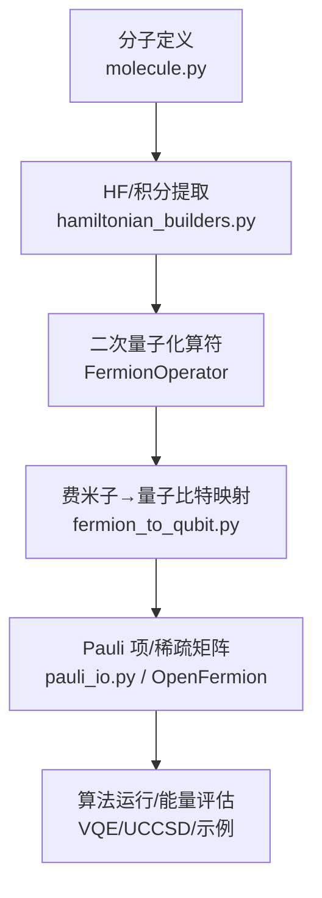
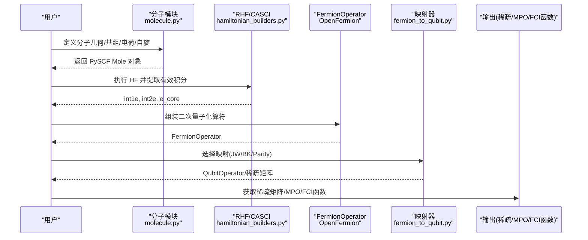
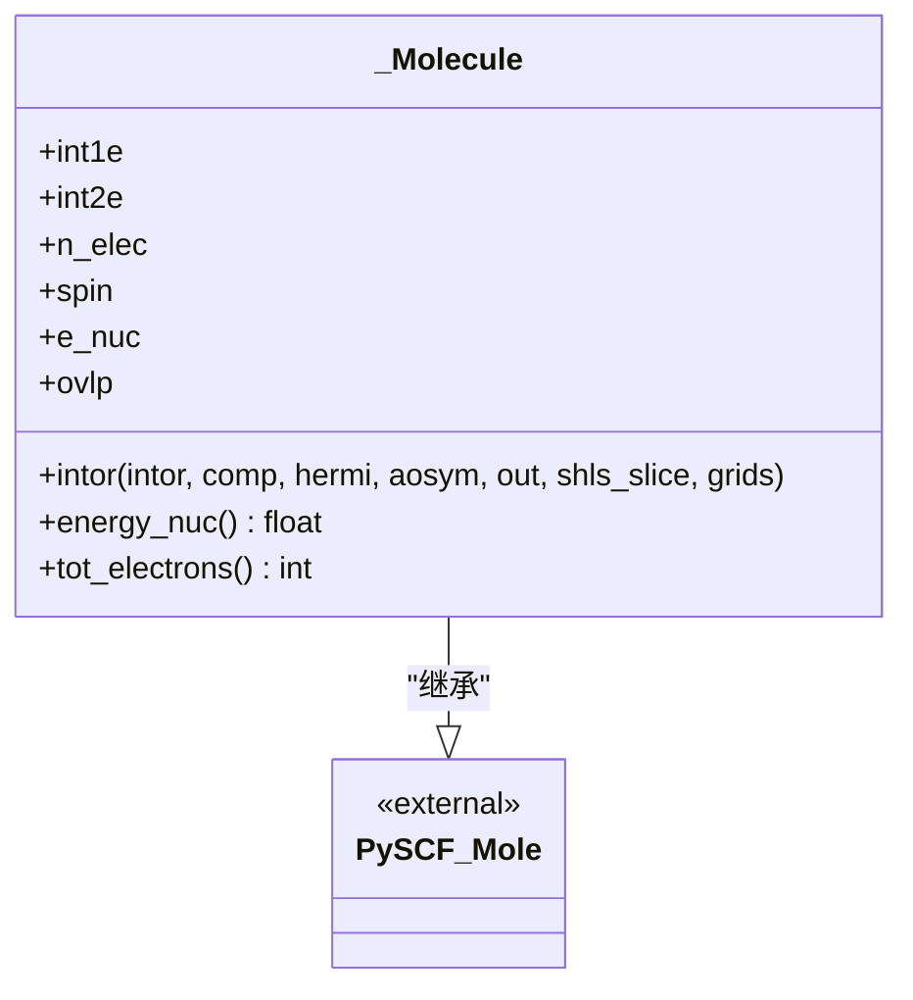
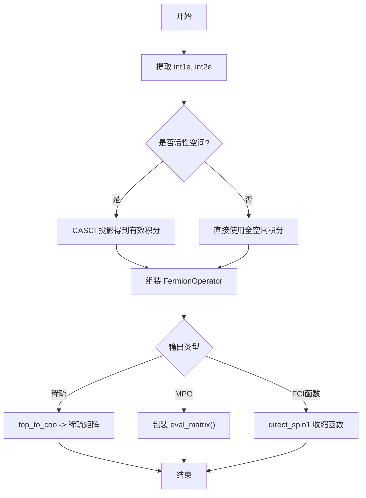
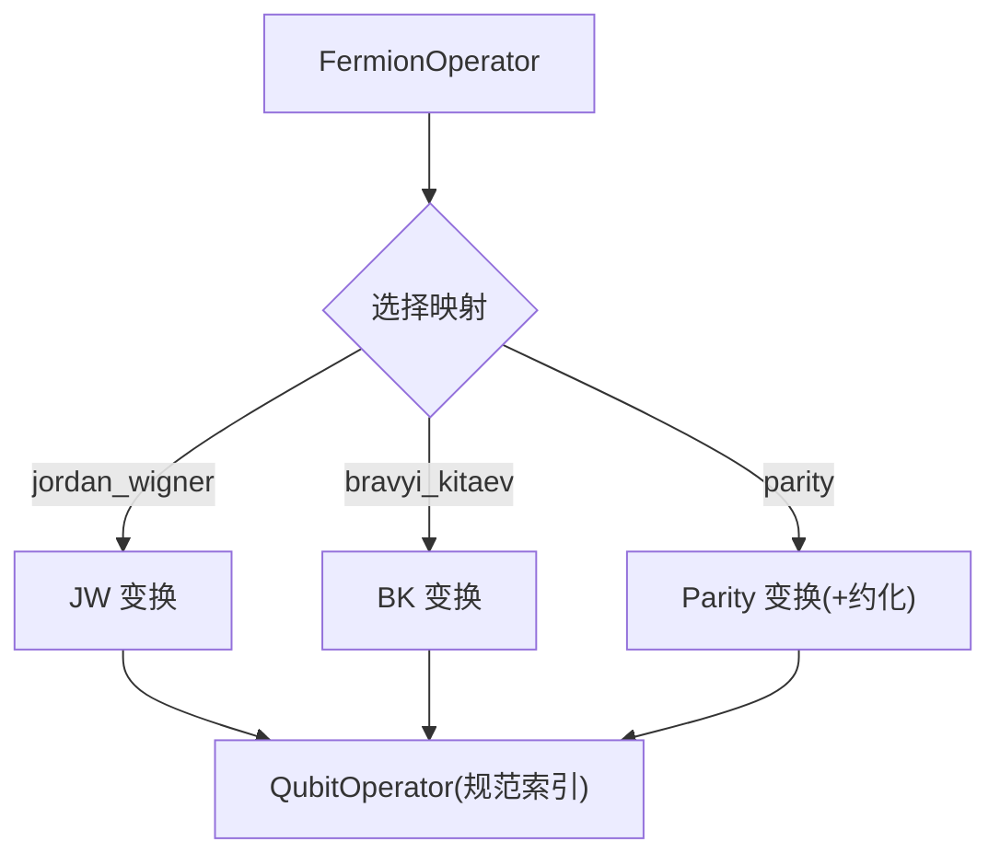
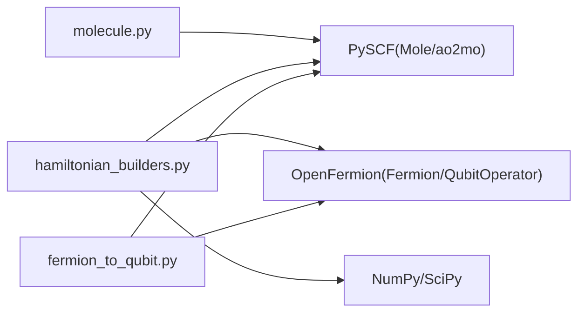

# 分子和哈密顿量

<cite>
**本文引用的文件**
- [src/tyxonq/applications/chem/molecule.py](file://src/tyxonq/applications/chem/molecule.py)
- [src/tyxonq/applications/chem/hamiltonian_builders.py](file://src/tyxonq/applications/chem/hamiltonian_builders.py)
- [src/tyxonq/libs/hamiltonian_encoding/fermion_to_qubit.py](file://src/tyxonq/libs/hamiltonian_encoding/fermion_to_qubit.py)
- [src/tyxonq/libs/hamiltonian_encoding/pauli_io.py](file://src/tyxonq/libs/hamiltonian_encoding/pauli_io.py)
- [examples/hamiltonian_building.py](file://examples/hamiltonian_building.py)
- [docs/source/getting_started/first_chemistry.rst](file://docs/source/getting_started/first_chemistry.rst)
- [docs/source/quantum_chemistry/fundamentals/index.rst](file://docs/source/quantum_chemistry/fundamentals/index.rst)
- [tests_mol_valid/test_molecule.py](file://tests_mol_valid/test_molecule.py)
- [tests_mol_valid/test_hamiltonian.py](file://tests_mol_valid/test_hamiltonian.py)
</cite>

## 目录
1. [简介](#简介)
2. [项目结构](#项目结构)
3. [核心组件](#核心组件)
4. [架构总览](#架构总览)
5. [详细组件分析](#详细组件分析)
6. [依赖关系分析](#依赖关系分析)
7. [性能考虑](#性能考虑)
8. [故障排查指南](#故障排查指南)
9. [结论](#结论)
10. [附录](#附录)

## 简介
本文件面向使用 TyxonQ 进行量子化学计算的读者，系统讲解如何定义分子、选择基组与计算参数，以及如何从分子轨道积分构建二次量子化表示的哈密顿量。文档重点覆盖：
- Molecule 类的使用方式（几何结构、基组、电荷/自旋等）
- 从 Hartree-Fock 到二次量子化算符的转换流程
- Jordan-Wigner、Bravyi-Kitaev、Parity 等编码方法的特性与适用场景
- 完整的分子定义与哈密顿量构建示例路径
- 正确性验证方法与性能优化技巧
- 常见分子的预定义模板与快速启动方法

## 项目结构
TyxonQ 的量子化学相关代码主要分布在以下位置：
- 分子与内置模板：applications/chem/molecule.py
- 哈密顿量构建与变换：applications/chem/hamiltonian_builders.py
- 费米子到量子比特映射：libs/hamiltonian_encoding/fermion_to_qubit.py、pauli_io.py
- 入门教程与示例：docs/source/getting_started/first_chemistry.rst、examples/hamiltonian_building.py
- 测试用例：tests_mol_valid/test_molecule.py、test_hamiltonian.py

**图示来源**
- [src/tyxonq/applications/chem/molecule.py:14-73](file://src/tyxonq/applications/chem/molecule.py#L14-L73)
- [src/tyxonq/applications/chem/hamiltonian_builders.py:46-153](file://src/tyxonq/applications/chem/hamiltonian_builders.py#L46-L153)
- [src/tyxonq/libs/hamiltonian_encoding/fermion_to_qubit.py:79-89](file://src/tyxonq/libs/hamiltonian_encoding/fermion_to_qubit.py#L79-L89)

**章节来源**
- [src/tyxonq/applications/chem/molecule.py:14-73](file://src/tyxonq/applications/chem/molecule.py#L14-L73)
- [src/tyxonq/applications/chem/hamiltonian_builders.py:46-153](file://src/tyxonq/applications/chem/hamiltonian_builders.py#L46-L153)
- [src/tyxonq/libs/hamiltonian_encoding/fermion_to_qubit.py:79-89](file://src/tyxonq/libs/hamiltonian_encoding/fermion_to_qubit.py#L79-L89)

## 核心组件
- 分子对象与内置模板
  - 通过 PySCF 的 Mole 接口封装，支持自定义积分输入与原子坐标构造；提供 H 链、环、正方形、立方体以及水、氨、甲烷、苯等常用分子模板。
  - 关键能力：读取/设置电子数、核能、重叠矩阵、对称性；统一 intor 接口以兼容 PySCF。
- 哈密顿量构建器
  - 从 RHF/CASCI 结果中提取有效单/双电子积分，组装为 FermionOperator，再转换为稀疏矩阵或 MPO-like 对象；支持 fermion/qubit/hcb 模式。
  - 提供 CI 空间作用函数（FCI 直接法），便于在态矢空间进行对角化或迭代求解。
- 费米子到量子比特映射
  - 支持 Jordan-Wigner、Bravyi-Kitaev、Parity 等映射；内部对索引顺序进行规范化处理，保证与下游算法一致。
- 示例与教程
  - 提供从零开始的 VQE 工作流、HOMO-LUMO 间隙计算、基于计数估计能量的演示脚本。

**章节来源**
- [src/tyxonq/applications/chem/molecule.py:80-268](file://src/tyxonq/applications/chem/molecule.py#L80-L268)
- [src/tyxonq/applications/chem/hamiltonian_builders.py:46-218](file://src/tyxonq/applications/chem/hamiltonian_builders.py#L46-L218)
- [src/tyxonq/libs/hamiltonian_encoding/fermion_to_qubit.py:79-89](file://src/tyxonq/libs/hamiltonian_encoding/fermion_to_qubit.py#L79-L89)
- [docs/source/getting_started/first_chemistry.rst:31-110](file://docs/source/getting_started/first_chemistry.rst#L31-L110)

## 架构总览
下图展示从分子几何到量子比特哈密顿量的完整数据流，包括积分提取、二次量子化、映射与输出形式。

**图示来源**
- [src/tyxonq/applications/chem/molecule.py:14-73](file://src/tyxonq/applications/chem/molecule.py#L14-L73)
- [src/tyxonq/applications/chem/hamiltonian_builders.py:46-153](file://src/tyxonq/applications/chem/hamiltonian_builders.py#L46-L153)
- [src/tyxonq/libs/hamiltonian_encoding/fermion_to_qubit.py:79-89](file://src/tyxonq/libs/hamiltonian_encoding/fermion_to_qubit.py#L79-L89)

## 详细组件分析

### 分子定义与模板（Molecule/_Molecule）
- 设计要点
  - 通过继承 PySCF 的 Mole，重载必要接口（如 intor、energy_nuc、tot_electrons），以便用“积分驱动”的方式构造分子对象，用于测试与基准。
  - 提供大量内置模板：H 链、环、正方形、立方体，以及 H2O、NH3、CH4、C2H2、苯等，便于快速实验。
- 使用建议
  - 常规任务建议使用 PySCF 原生 Mole 或通过高层 API 创建分子；当需要固定积分或复现实验时，可使用 _Molecule 直接传入 int1e/int2e。
  - 注意单位与对称性设置，确保后续 HF/CI 计算稳定收敛。

**图示来源**
- [src/tyxonq/applications/chem/molecule.py:14-73](file://src/tyxonq/applications/chem/molecule.py#L14-L73)

**章节来源**
- [src/tyxonq/applications/chem/molecule.py:14-73](file://src/tyxonq/applications/chem/molecule.py#L14-L73)
- [src/tyxonq/applications/chem/molecule.py:80-268](file://src/tyxonq/applications/chem/molecule.py#L80-L268)
- [tests_mol_valid/test_molecule.py:9-44](file://tests_mol_valid/test_molecule.py#L9-L44)

### 哈密顿量构建流程（从积分到二次量子化）
- 步骤概览
  1) 从 RHF/CASCI 获取有效单/双电子积分（含活性空间可选）。
  2) 将积分转换为 FermionOperator（包含单激发与双激发项）。
  3) 根据需求输出稀疏矩阵、MPO-like 对象或 CI 空间作用函数。
- 关键点
  - 自动恢复积分对称性，避免数值误差。
  - 支持 hcb（硬芯玻色子）模式，适用于特定模型。
  - 提供统一入口 get_h_from_integral/get_h_from_hf，便于上层算法调用。

**图示来源**
- [src/tyxonq/applications/chem/hamiltonian_builders.py:46-153](file://src/tyxonq/applications/chem/hamiltonian_builders.py#L46-L153)

**章节来源**
- [src/tyxonq/applications/chem/hamiltonian_builders.py:46-218](file://src/tyxonq/applications/chem/hamiltonian_builders.py#L46-L218)
- [tests_mol_valid/test_hamiltonian.py:18-77](file://tests_mol_valid/test_hamiltonian.py#L18-L77)

### 费米子到量子比特映射（Jordan-Wigner、Bravyi-Kitaev、Parity）
- 支持的映射
  - Jordan-Wigner：直观、实现简单，但算符支撑长度随轨道数线性增长。
  - Bravyi-Kitaev：利用二进制树结构降低部分算符的支撑，通常门深更优。
  - Parity：结合电子数守恒可进一步减少量子比特数（需满足偶数电子条件）。
- 使用方式
  - 通过 fop_to_qop 指定映射名称与轨道/电子数，返回 QubitOperator；内部会进行索引规范化。
  - 文档中提供了对比不同映射的示例路径。

**图示来源**
- [src/tyxonq/libs/hamiltonian_encoding/fermion_to_qubit.py:79-89](file://src/tyxonq/libs/hamiltonian_encoding/fermion_to_qubit.py#L79-L89)
- [docs/source/quantum_chemistry/fundamentals/index.rst:185-232](file://docs/source/quantum_chemistry/fundamentals/index.rst#L185-L232)

**章节来源**
- [src/tyxonq/libs/hamiltonian_encoding/fermion_to_qubit.py:79-89](file://src/tyxonq/libs/hamiltonian_encoding/fermion_to_qubit.py#L79-L89)
- [docs/source/quantum_chemistry/fundamentals/index.rst:185-232](file://docs/source/quantum_chemistry/fundamentals/index.rst#L185-L232)

### 完整示例与工作流（参考路径）
- 入门工作流（分子定义 → 哈密顿量 → VQE）
  - 参考：[docs/source/getting_started/first_chemistry.rst:31-110](file://docs/source/getting_started/first_chemistry.rst#L31-L110)
- 基于计数的 TFIM 哈密顿量构建与能量估计
  - 参考：[examples/hamiltonian_building.py:18-94](file://examples/hamiltonian_building.py#L18-L94)
- 多分子 HOMO-LUMO 间隙对比（HEA）
  - 参考：[examples/demo_hea_homo_lumo_gap.py:71-92](file://examples/demo_hea_homo_lumo_gap.py#L71-L92)

**章节来源**
- [docs/source/getting_started/first_chemistry.rst:31-110](file://docs/source/getting_started/first_chemistry.rst#L31-L110)
- [examples/hamiltonian_building.py:18-94](file://examples/hamiltonian_building.py#L18-L94)
- [examples/demo_hea_homo_lumo_gap.py:71-92](file://examples/demo_hea_homo_lumo_gap.py#L71-L92)

## 依赖关系分析
- 模块耦合
  - molecule.py 依赖 PySCF 的 Mole 与 ao2mo，提供统一的积分接口。
  - hamiltonian_builders.py 依赖 OpenFermion 与 PySCF 的 SCF/FCI 工具，负责积分到算符的转换与多种输出形态。
  - fermion_to_qubit.py 依赖 OpenFermion 的变换函数，并提供索引规范化。
- 外部依赖
  - PySCF：分子结构、HF/CASCI、积分与 FCI 计算。
  - OpenFermion：二次量子化算符与映射变换。
  - NumPy/SciPy：数组与稀疏矩阵操作。

**图示来源**
- [src/tyxonq/applications/chem/molecule.py:6-10](file://src/tyxonq/applications/chem/molecule.py#L6-L10)
- [src/tyxonq/applications/chem/hamiltonian_builders.py:6-17](file://src/tyxonq/applications/chem/hamiltonian_builders.py#L6-L17)
- [src/tyxonq/libs/hamiltonian_encoding/fermion_to_qubit.py:1-13](file://src/tyxonq/libs/hamiltonian_encoding/fermion_to_qubit.py#L1-L13)

**章节来源**
- [src/tyxonq/applications/chem/molecule.py:6-10](file://src/tyxonq/applications/chem/molecule.py#L6-L10)
- [src/tyxonq/applications/chem/hamiltonian_builders.py:6-17](file://src/tyxonq/applications/chem/hamiltonian_builders.py#L6-L17)
- [src/tyxonq/libs/hamiltonian_encoding/fermion_to_qubit.py:1-13](file://src/tyxonq/libs/hamiltonian_encoding/fermion_to_qubit.py#L1-L13)

## 性能考虑
- 积分与对称性
  - 使用 ao2mo.restore 恢复积分对称性，减少冗余项与数值噪声。
- 映射选择
  - JW 实现简单但门深可能较高；BK 通常在门深上更优；Parity 在电子数守恒时可减少量子比特。
- 稀疏与 MPO
  - 稀疏矩阵适合中小体系精确对角化；MPO-like 包装便于与后端交互。
- 后端与批处理
  - 使用后端抽象（NumericBackend）统一矩阵乘法，利于切换 NumPy/PyTorch；批量测量与分组可提升吞吐。
- 活性空间
  - 对大分子采用 CASCI 活性空间投影，显著降低积分规模。

[本节为通用指导，不直接分析具体文件]

## 故障排查指南
- 常见问题
  - 积分形状错误：检查 int1e 是否为方阵，int2e 是否已恢复对称性。
  - 奇数电子 Parity 映射：需以 (alpha, beta) 元组形式指定电子数。
  - 收敛问题：调整初始猜测、优化器或增加层数/迭代次数。
- 调试手段
  - 使用测试用例对比：例如 test_hamiltonian.py 中对不同模式与输出形式的断言。
  - 打印中间结果：查看 FermionOperator 项数与系数分布，定位异常项。
  - 核对核能与总能量：确保 e_nuc 被正确加回。

**章节来源**
- [tests_mol_valid/test_hamiltonian.py:18-77](file://tests_mol_valid/test_hamiltonian.py#L18-L77)
- [src/tyxonq/libs/hamiltonian_encoding/fermion_to_qubit.py:35-76](file://src/tyxonq/libs/hamiltonian_encoding/fermion_to_qubit.py#L35-L76)

## 结论
TyxonQ 提供了从分子定义到哈密顿量构建再到量子比特映射的一体化流程。借助内置模板与灵活的映射选项，用户可以快速完成小分子基准与算法验证。对于更大体系，建议结合活性空间、合适的映射与后端优化策略，以获得更好的精度与效率平衡。

[本节为总结性内容，不直接分析具体文件]

## 附录
- 常用分子模板速查
  - H 链/环/正方形/立方体、H2O、NH3、CH4、C2H2、苯等，参见：
    - [src/tyxonq/applications/chem/molecule.py:80-268](file://src/tyxonq/applications/chem/molecule.py#L80-L268)
- 快速启动
  - 入门教程与完整 VQE 流程：
    - [docs/source/getting_started/first_chemistry.rst:31-110](file://docs/source/getting_started/first_chemistry.rst#L31-L110)
- 映射对比与说明
  - 理论背景与用法：
    - [docs/source/quantum_chemistry/fundamentals/index.rst:185-232](file://docs/source/quantum_chemistry/fundamentals/index.rst#L185-L232)

[本节为补充信息，不直接分析具体文件]