# 分子性质计算

<cite>
**本文引用的文件**
- [molecule.py](file://src/tyxonq/applications/chem/molecule.py)
- [hamiltonian_builders.py](file://src/tyxonq/applications/chem/hamiltonian_builders.py)
- [scanner.py](file://src/tyxonq/applications/chem/interfaces/scanner.py)
- [demo_homo_lumo_gap.py](file://examples/demo_homo_lumo_gap.py)
- [demo_hea_homo_lumo_gap.py](file://examples/demo_hea_homo_lumo_gap.py)
- [md_qmmm_device_hardware.py](file://examples/qmmm/md_qmmm_device_hardware.py)
- [md_qmmm_sqd_device.py](file://examples/qmmm/md_qmmm_sqd_device.py)
- [riverone.py](file://src/tyxonq/applications/qml/riverone.py)
- [performance_optimization.rst](file://docs/source/technical_references/performance_optimization.rst)
</cite>

## 目录
1. [简介](#简介)
2. [项目结构](#项目结构)
3. [核心组件](#核心组件)
4. [架构总览](#架构总览)
5. [详细组件分析](#详细组件分析)
6. [依赖关系分析](#依赖关系分析)
7. [性能与精度优化](#性能与精度优化)
8. [故障排查指南](#故障排查指南)
9. [结论](#结论)
10. [附录](#附录)

## 简介
本文件面向使用 TyxonQ 进行分子性质计算的读者，系统讲解如何从分子积分出发构建哈密顿量、计算约化密度矩阵（RDM1/RDM2）、偶极矩与四极矩等物理量；详细说明 HOMO-LUMO 能隙的计算方法及其在分子稳定性分析中的应用；给出分子动力学模拟的实现要点（时间演化算符与轨迹生成）；介绍 QM/MM 接口的使用方法；展示与传统机器学习方法的结合路径；并提供精度评估与性能优化建议。

## 项目结构
TyxonQ 的量子化学能力集中在 applications/chem 子包中：
- 分子与积分：molecule.py 提供常用分子与 PySCF Mole 的适配封装，便于快速构造体系。
- 哈密顿量构建：hamiltonian_builders.py 将 RHF/CASCI 得到的单双电子积分转换为费米子/量子比特/硬芯玻色子形式的稀疏或 MPO 表示，并支持 FCI 作用函数。
- 扫描器接口：interfaces/scanner.py 提供统一的 qc_scanner 入口，屏蔽 UCCSD/ROUCCSD/HEA/SQD 的差异，统一输出能量与核梯度，并支持静电嵌入与周期性边界条件。
- 示例脚本：examples 下包含 HOMO-LUMO 能隙演示、QM/MM 设备链路、SQD 采样冻结子空间驱动 AIMD 等端到端示例。
- 机器学习集成：applications/qml/riverone.py 提供训练后变分电路到 OpenQASM 的转换，便于与传统 ML 工作流对接。
- 性能参考：docs/source/technical_references/performance_optimization.rst 汇总了测量分组、shots 调度、后端选择、活性空间等优化策略。

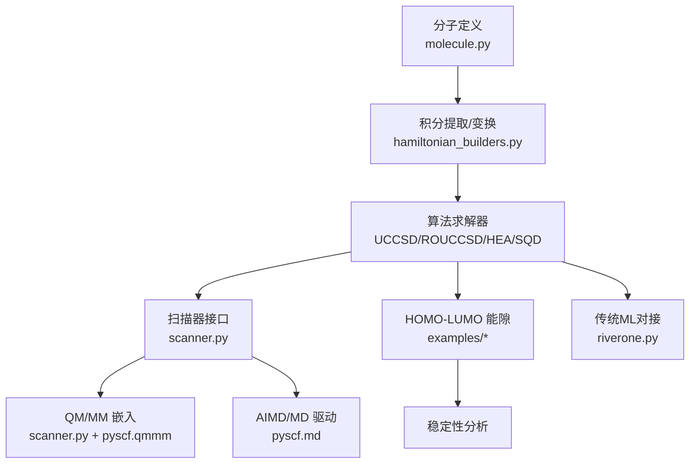

**图示来源**
- [molecule.py:14-73](file://src/tyxonq/applications/chem/molecule.py#L14-L73)
- [hamiltonian_builders.py:46-153](file://src/tyxonq/applications/chem/hamiltonian_builders.py#L46-L153)
- [scanner.py:93-320](file://src/tyxonq/applications/chem/interfaces/scanner.py#L93-L320)

**章节来源**
- [molecule.py:14-73](file://src/tyxonq/applications/chem/molecule.py#L14-L73)
- [hamiltonian_builders.py:46-153](file://src/tyxonq/applications/chem/hamiltonian_builders.py#L46-L153)
- [scanner.py:93-320](file://src/tyxonq/applications/chem/interfaces/scanner.py#L93-L320)

## 核心组件
- 分子与积分封装：通过 _Molecule 适配 PySCF Mole，暴露 int1e/int2e/ovlp/e_nuc 等属性，简化测试与基准场景。
- 哈密顿量构建：从 RHF/CASCI 有效积分出发，生成费米子算符、量子比特算符或硬芯玻色子算符，并转换为稀疏矩阵或 MPO-like 对象；同时提供 CI 空间的 Hamiltonian 作用函数。
- 扫描器：qc_scanner 统一封装不同算法（UCCSD/ROUCCSD/HEA/SQD），对外提供 (E, dE/dR) 调用契约，支持静态嵌入与周期性嵌入，返回 MM 反作用力。
- 示例与验证：HOMO-LUMO 能隙演示脚本覆盖闭壳/开壳、活性空间、与 PySCF 数值一致性校验；QM/MM 示例覆盖设备链路、采样档与真机模板。

**章节来源**
- [molecule.py:14-73](file://src/tyxonq/applications/chem/molecule.py#L14-L73)
- [hamiltonian_builders.py:46-153](file://src/tyxonq/applications/chem/hamiltonian_builders.py#L46-L153)
- [scanner.py:93-320](file://src/tyxonq/applications/chem/interfaces/scanner.py#L93-L320)

## 架构总览
下图展示了从分子到性质计算、再到 MD 与 QM/MM 的整体数据流与控制流。

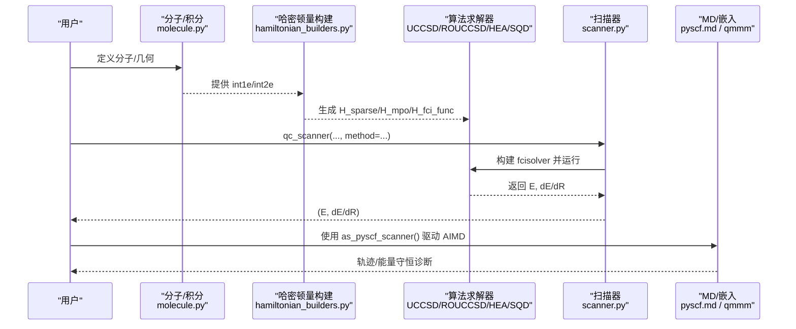

**图示来源**
- [scanner.py:93-320](file://src/tyxonq/applications/chem/interfaces/scanner.py#L93-L320)
- [hamiltonian_builders.py:46-153](file://src/tyxonq/applications/chem/hamiltonian_builders.py#L46-L153)

## 详细组件分析

### 分子与积分封装（molecule.py）
- 目标：为测试与基准提供轻量级分子对象，兼容 PySCF Mole 的接口约定，便于直接传入后续构建流程。
- 关键点：
  - 支持随机积分构造与常见分子（Hn、水、氨、甲烷等）快捷创建。
  - 暴露 intor 以按需返回动能/核吸引/重叠/两电子积分，便于下游模块复用。
  - 设置 e_nuc 与 ovlp，保证能量与积分的一致性。

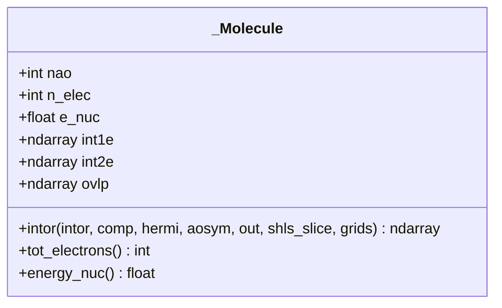

**图示来源**
- [molecule.py:14-73](file://src/tyxonq/applications/chem/molecule.py#L14-L73)

**章节来源**
- [molecule.py:14-73](file://src/tyxonq/applications/chem/molecule.py#L14-L73)

### 哈密顿量构建（hamiltonian_builders.py）
- 目标：将 RHF/CASCI 的有效单双电子积分转换为可被不同求解器使用的算符形式。
- 关键流程：
  - get_integral_from_hf：从 RHF 对象提取 CAS 有效积分（含可选活性轨道）。
  - get_hop_from_integral：将积分映射为费米子算符（保留自旋轨道对称性）。
  - get_h_sparse_from_integral：将费米子/量子比特/硬芯玻色子算符转为稀疏矩阵或 MPO-like 对象。
  - get_h_fcifunc_from_integral：返回 CI 空间的 Hamiltonian 作用函数，用于精确对角化或作为基准。
  - apply_op：后端无关的哈密顿量作用函数，支持稀疏、callable、eval_matrix 包装与稠密矩阵。

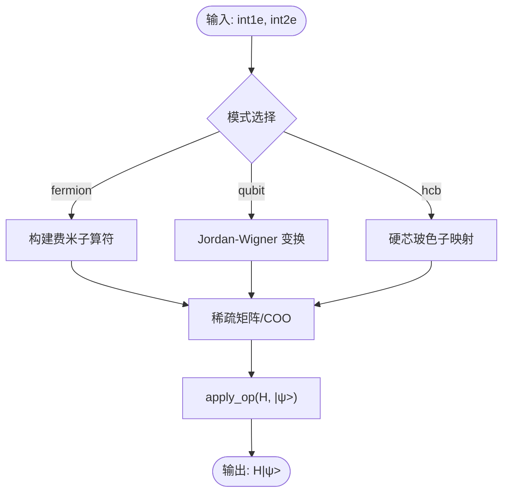

**图示来源**
- [hamiltonian_builders.py:46-153](file://src/tyxonq/applications/chem/hamiltonian_builders.py#L46-L153)
- [hamiltonian_builders.py:283-318](file://src/tyxonq/applications/chem/hamiltonian_builders.py#L283-L318)

**章节来源**
- [hamiltonian_builders.py:46-153](file://src/tyxonq/applications/chem/hamiltonian_builders.py#L46-L153)
- [hamiltonian_builders.py:283-318](file://src/tyxonq/applications/chem/hamiltonian_builders.py#L283-L318)

### 扫描器与 QM/MM 接口（scanner.py）
- 目标：提供统一的能量/梯度扫描器，屏蔽底层算法差异，支持 QM/MM 嵌入与周期性边界条件。
- 关键能力：
  - 方法注册：sqd、uccsd、rouccsd、hea 四种方法统一入口。
  - 惰性构建：首次调用时构建 mol/mf/mc/scanner，后续复用。
  - 几何解析：支持 Bohr 坐标数组、PySCF 原子规格或带 atom_coords 的对象。
  - 静电嵌入：mm_charges 支持点电荷环境；mm_gradient 返回 MM 粒子受力。
  - 周期性嵌入：mm_lattice + rcut_ewald/rcut_hcore 控制 Ewald 求和与截断。
  - MD 对接：as_pyscf_scanner() 返回标准 GradScanner，可直接交给 pyscf.md 积分器。

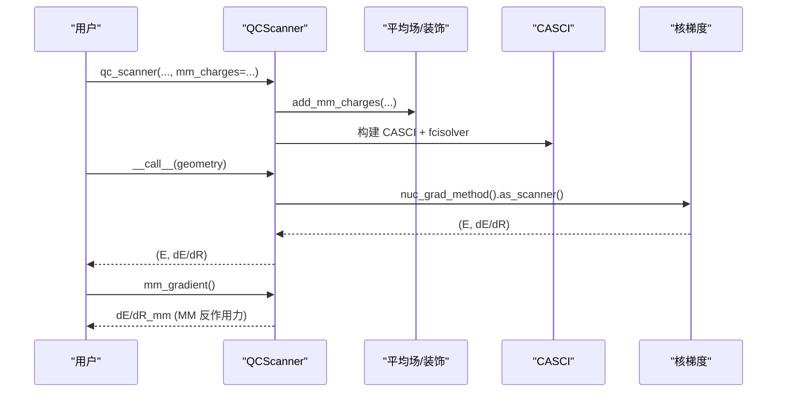

**图示来源**
- [scanner.py:93-320](file://src/tyxonq/applications/chem/interfaces/scanner.py#L93-L320)
- [scanner.py:331-411](file://src/tyxonq/applications/chem/interfaces/scanner.py#L331-L411)

**章节来源**
- [scanner.py:93-320](file://src/tyxonq/applications/chem/interfaces/scanner.py#L93-L320)
- [scanner.py:331-411](file://src/tyxonq/applications/chem/interfaces/scanner.py#L331-L411)

### HOMO-LUMO 能隙计算与稳定性分析
- 计算方法：
  - 基于 UCCSD/ROUCCSD/HEA 的分子信息（HF 轨道能量与占据数）自动识别 HOMO/LUMO 轨道索引，计算能隙。
  - 支持手动指定轨道对、活性空间、开壳/闭壳系统，以及 eV 单位转换。
  - 与 PySCF 原始数据对比验证数值一致性。
- 稳定性应用：
  - 能隙大小反映分子激发能与化学稳定性；小能隙通常对应高反应性或强关联效应。
  - 活性空间能隙可用于筛选低维有效模型。

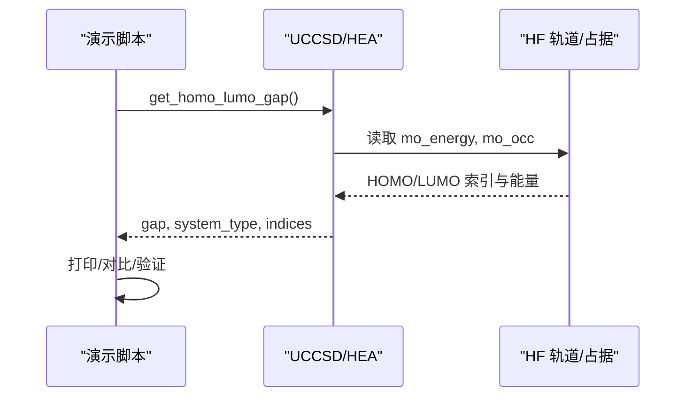

**图示来源**
- [demo_homo_lumo_gap.py:14-176](file://examples/demo_homo_lumo_gap.py#L14-L176)
- [demo_hea_homo_lumo_gap.py:11-123](file://examples/demo_hea_homo_lumo_gap.py#L11-L123)

**章节来源**
- [demo_homo_lumo_gap.py:14-176](file://examples/demo_homo_lumo_gap.py#L14-L176)
- [demo_hea_homo_lumo_gap.py:11-123](file://examples/demo_hea_homo_lumo_gap.py#L11-L123)

### 分子动力学模拟（时间演化与轨迹生成）
- 时间演化算符：
  - 通过 qc_scanner.as_pyscf_scanner() 获取标准 GradScanner，交由 pyscf.md.NVE/NVT/NPT 积分器执行时间演化。
  - SQD 模式下 subspace="frozen" 确保能量面光滑，解析梯度可用，适合 AIMD。
- 轨迹生成：
  - 初始化速度（Maxwell-Boltzmann），设定步长与温度，回调收集势能与动能，诊断总能量漂移。
  - 示例展示了冻结子空间驱动的 NVE 模拟与能量守恒特性。

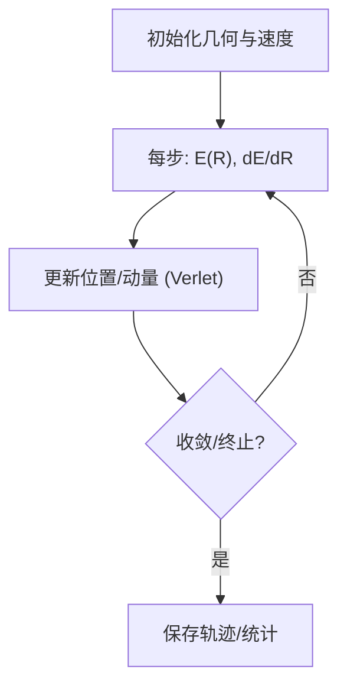

**图示来源**
- [md_qmmm_sqd_device.py:190-230](file://examples/qmmm/md_qmmm_sqd_device.py#L190-L230)

**章节来源**
- [md_qmmm_sqd_device.py:190-230](file://examples/qmmm/md_qmmm_sqd_device.py#L190-L230)

### QM/MM 接口使用方法
- 静电嵌入：
  - 构造时传入 mm_charges=(坐标, 电荷)，支持 Å 或 Bohr 单位；扫描器内部按 unit 处理。
  - 每步可通过 set_mm_charges 更新 MM 环境，避免重建平均场。
  - mm_gradient 返回 MM 粒子的反作用力，供双向耦合 MD 使用。
- 周期性嵌入：
  - 提供 mm_lattice、rcut_ewald、rcut_hcore，启用 Ewald 求和与截断保护。
  - pbc 模式下需重跑 SCF 以保证轨道一致性。
- 设备链路：
  - 通过 solver_kwargs 穿透 shots/provider/device 到设备提交层；模拟器与真机走同一代码路径。

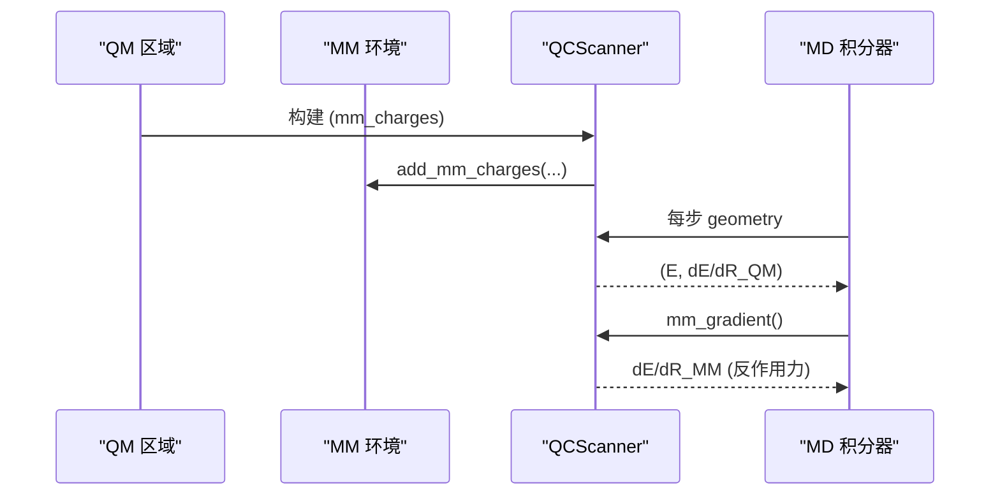

**图示来源**
- [scanner.py:226-260](file://src/tyxonq/applications/chem/interfaces/scanner.py#L226-L260)
- [scanner.py:331-411](file://src/tyxonq/applications/chem/interfaces/scanner.py#L331-L411)
- [md_qmmm_device_hardware.py:163-223](file://examples/qmmm/md_qmmm_device_hardware.py#L163-L223)

**章节来源**
- [scanner.py:226-260](file://src/tyxonq/applications/chem/interfaces/scanner.py#L226-L260)
- [scanner.py:331-411](file://src/tyxonq/applications/chem/interfaces/scanner.py#L331-L411)
- [md_qmmm_device_hardware.py:163-223](file://examples/qmmm/md_qmmm_device_hardware.py#L163-L223)

### 与传统机器学习方法的结合
- RiverONE 适配器：
  - 从训练后的 checkpoint 加载变分门参数，生成振幅编码、数据重新上传语义与 X/Y/Z 测量的 OpenQASM 2 电路。
  - 支持将训练好的量子变分电路与传统 ML 工作流对接，便于在硬件或模拟器上评估预测性能。
- 典型用法：
  - 加载 RiverONEVQCSpec，归一化振幅，附加变分层，编译为 QASM2，并在目标平台执行。

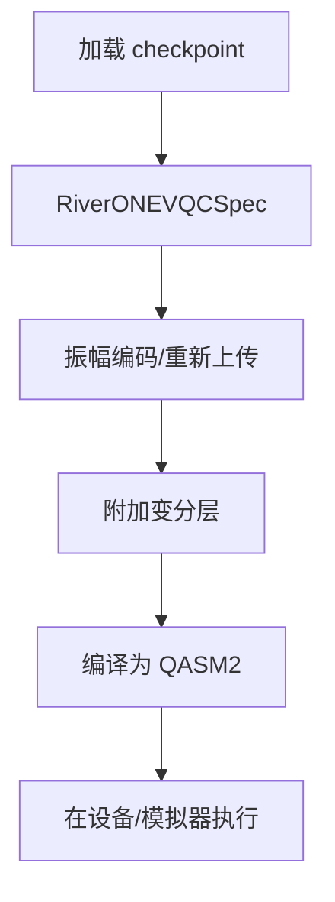

**图示来源**
- [riverone.py:152-308](file://src/tyxonq/applications/qml/riverone.py#L152-L308)

**章节来源**
- [riverone.py:152-308](file://src/tyxonq/applications/qml/riverone.py#L152-L308)

## 依赖关系分析
- 模块耦合：
  - molecule.py 与 hamiltonian_builders.py 松耦合，后者仅消费 int1e/int2e。
  - scanner.py 聚合多种算法（UCCSD/ROUCCSD/HEA/SQD），通过 _make_fcisolver 动态导入，降低启动开销。
  - examples 依赖 scanner 与算法类，提供端到端验证与演示。
- 外部依赖：
  - PySCF：分子构建、平均场、CASCI、qmmm、md。
  - OpenFermion：费米子/量子比特算符与稀疏表示。
  - Qiskit（可选）：OpenQASM 2 生成与转译。

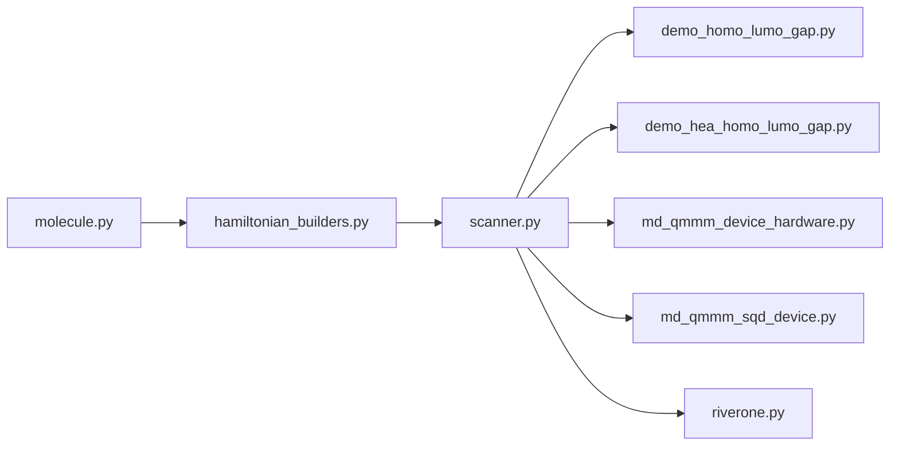

**图示来源**
- [scanner.py:56-90](file://src/tyxonq/applications/chem/interfaces/scanner.py#L56-L90)
- [hamiltonian_builders.py:46-153](file://src/tyxonq/applications/chem/hamiltonian_builders.py#L46-L153)

**章节来源**
- [scanner.py:56-90](file://src/tyxonq/applications/chem/interfaces/scanner.py#L56-L90)
- [hamiltonian_builders.py:46-153](file://src/tyxonq/applications/chem/hamiltonian_builders.py#L46-L153)

## 性能与精度优化
- 测量分组与 shots 调度：
  - 编译器对对易项分组，减少电路执行次数；按方差分配 shots，提升效率。
- 后端选择：
  - NumPy（开发/小规模）、PyTorch（梯度/ML）、CuPyNumeric（GPU 大规模）。
- 活性空间近似：
  - 选取化学重要轨道，显著降低 qubit 数量与计算成本。
- 内存管理：
  - 状态向量内存随 2^n 增长；大体系使用 MPS 或批处理清理缓存。
- 并行与云卸载：
  - 电路级并行、shots 级并行、参数优化并行；经典核可卸载至云端 GPU。

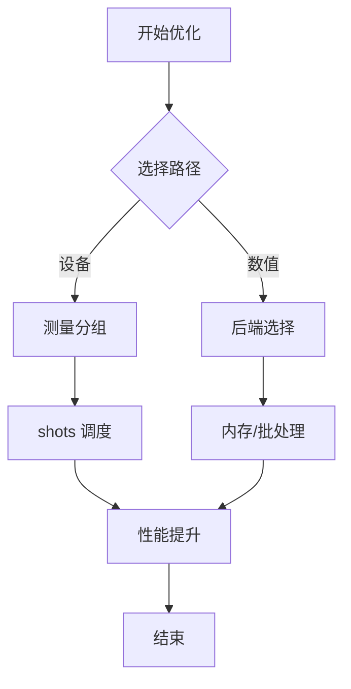

**图示来源**
- [performance_optimization.rst:19-100](file://docs/source/technical_references/performance_optimization.rst#L19-L100)
- [performance_optimization.rst:100-172](file://docs/source/technical_references/performance_optimization.rst#L100-L172)
- [performance_optimization.rst:173-278](file://docs/source/technical_references/performance_optimization.rst#L173-L278)
- [performance_optimization.rst:279-371](file://docs/source/technical_references/performance_optimization.rst#L279-L371)

**章节来源**
- [performance_optimization.rst:19-100](file://docs/source/technical_references/performance_optimization.rst#L19-L100)
- [performance_optimization.rst:100-172](file://docs/source/technical_references/performance_optimization.rst#L100-L172)
- [performance_optimization.rst:173-278](file://docs/source/technical_references/performance_optimization.rst#L173-L278)
- [performance_optimization.rst:279-371](file://docs/source/technical_references/performance_optimization.rst#L279-L371)

## 故障排查指南
- 子空间策略错误：
  - subspace="refresh"/"adaptive" 在非冻结模式下默认拒绝，因能量面不光滑导致解析梯度无定义；如需使用请显式 allow_discontinuous=True。
- 周期性嵌入参数缺失：
  - 使用 mm_lattice 时必须提供 rcut_ewald 与 rcut_hcore，且满足盒边与半盒边约束。
- 首次嵌入未生效：
  - 裸建 scanner 首次 set_mm_charges 会返回新对象而非原地装饰，需整体重建以确保嵌入生效。
- 设备链路选项穿透：
  - UCCSD/HEA 通过 solver_kwargs 中的 shots/provider/device 透传；SQD 则挂在 lucj_sampler 上。
- 采样档偏差：
  - HEA 嵌入建议 shots≥8192；UCCSD 可从 2048 起步；注意统计噪声与优化收敛损失共同影响总偏差。

**章节来源**
- [scanner.py:121-130](file://src/tyxonq/applications/chem/interfaces/scanner.py#L121-L130)
- [scanner.py:138-171](file://src/tyxonq/applications/chem/interfaces/scanner.py#L138-L171)
- [scanner.py:331-380](file://src/tyxonq/applications/chem/interfaces/scanner.py#L331-L380)
- [md_qmmm_device_hardware.py:196-223](file://examples/qmmm/md_qmmm_device_hardware.py#L196-L223)
- [md_qmmm_sqd_device.py:126-187](file://examples/qmmm/md_qmmm_sqd_device.py#L126-L187)

## 结论
TyxonQ 提供了从分子积分到性质计算、从静态能隙到动态轨迹、从 QM/MM 嵌入到设备链路的完整能力。通过统一的扫描器接口与灵活的算法选择，用户可在高精度与高效率之间取得平衡；结合性能优化策略与精度评估手段，可实现稳定可靠的分子性质预测与动力学模拟。

## 附录
- 快速上手：
  - 使用 qc_scanner 构造扫描器，传入 active_space 与方法，调用 (E, dE/dR)。
  - 通过 as_pyscf_scanner() 接入 pyscf.md 进行 AIMD。
- 扩展阅读：
  - 参考 performance_optimization.rst 获取更多优化技巧与最佳实践。
  - 查看 examples 下的端到端脚本，理解设备链路、采样档与真机模板的使用方法。