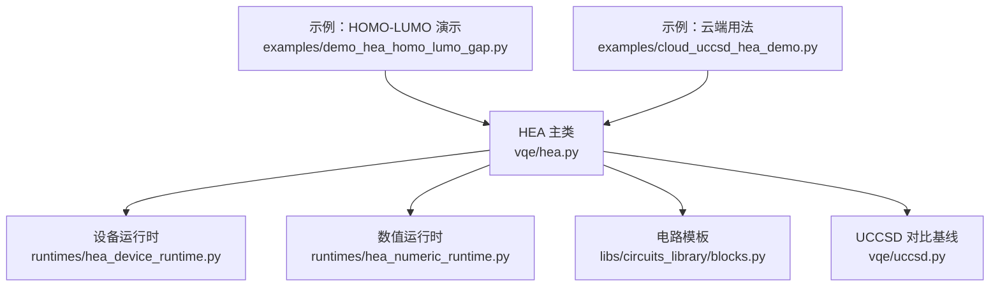
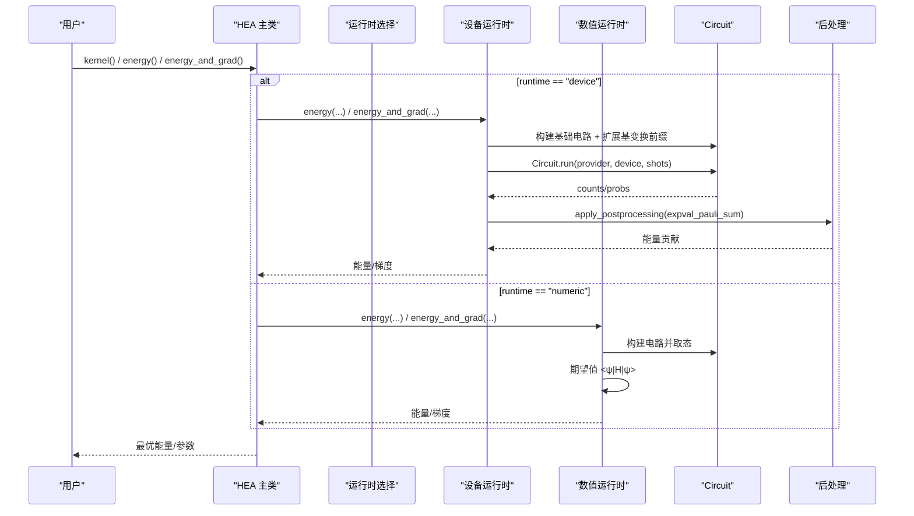
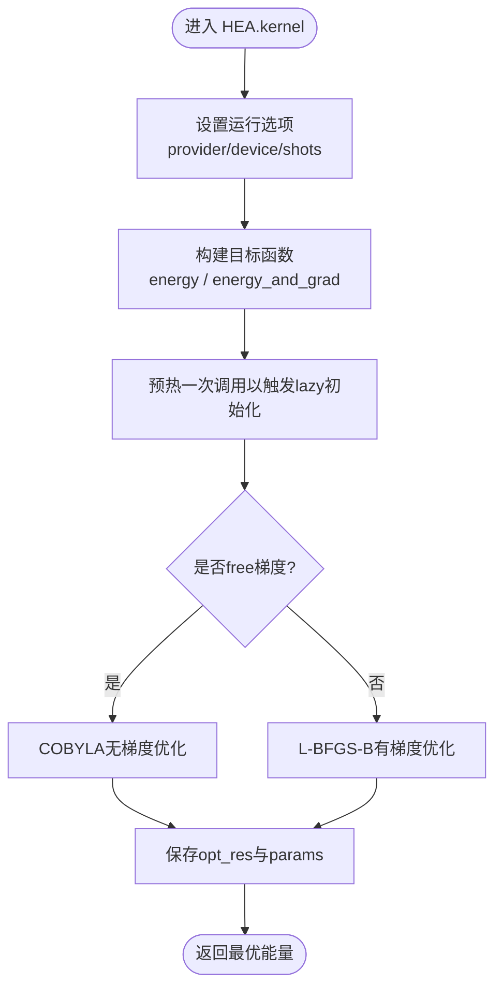
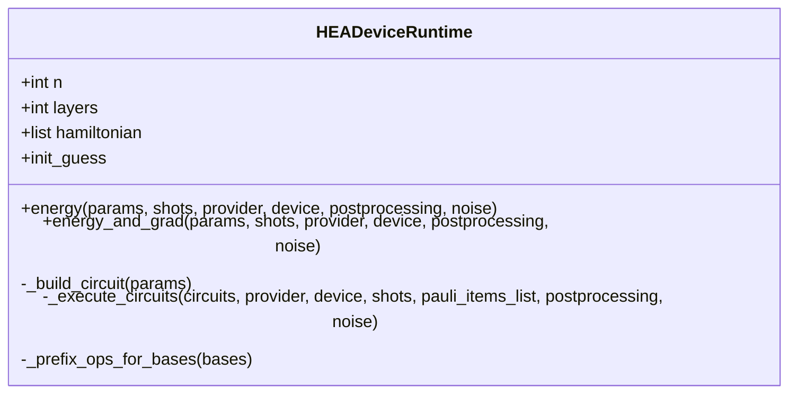
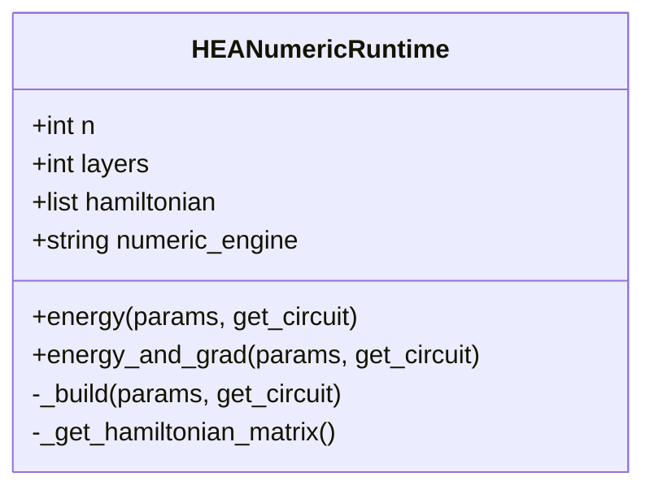
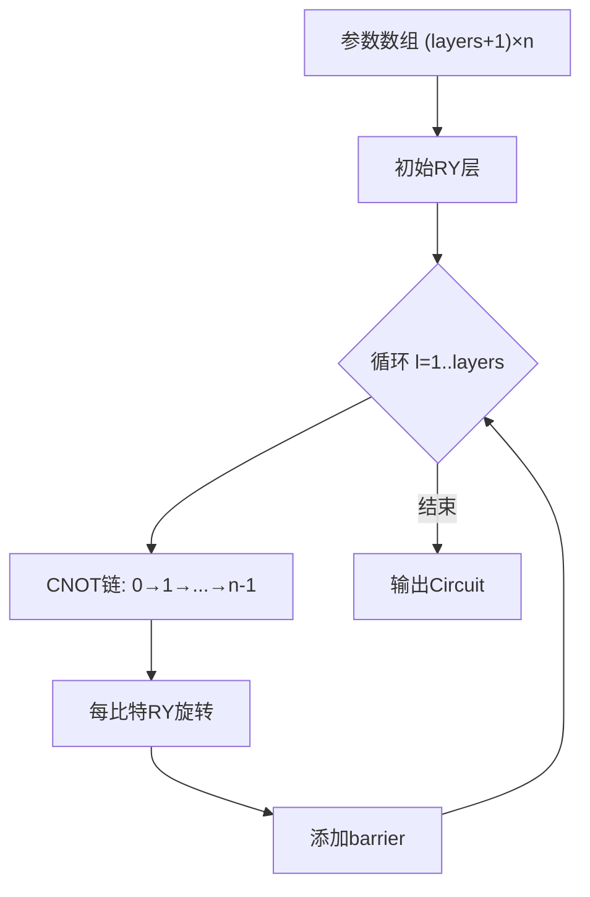
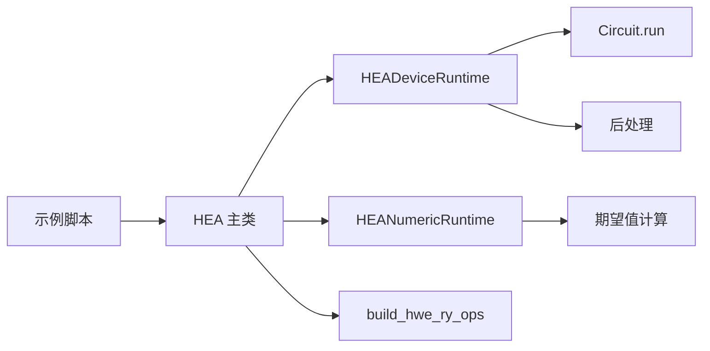

# HEA方法

<cite>
**本文引用的文件**
- [hea.py](file://src/tyxonq/applications/chem/algorithms/vqe/hea.py)
- [hea_device_runtime.py](file://src/tyxonq/applications/chem/algorithms/vqe/runtimes/hea_device_runtime.py)
- [hea_numeric_runtime.py](file://src/tyxonq/applications/chem/algorithms/vqe/runtimes/hea_numeric_runtime.py)
- [uccsd.py](file://src/tyxonq/applications/chem/algorithms/vqe/uccsd.py)
- [blocks.py](file://src/tyxonq/libs/circuits_library/blocks.py)
- [demo_hea_homo_lumo_gap.py](file://examples/demo_hea_homo_lumo_gap.py)
- [cloud_uccsd_hea_demo.py](file://examples/cloud_uccsd_hea_demo.py)
</cite>

## 目录
1. [简介](#简介)
2. [项目结构](#项目结构)
3. [核心组件](#核心组件)
4. [架构总览](#架构总览)
5. [详细组件分析](#详细组件分析)
6. [依赖关系分析](#依赖关系分析)
7. [性能考量](#性能考量)
8. [故障排查指南](#故障排查指南)
9. [结论](#结论)
10. [附录](#附录)

## 简介
本文件系统性阐述硬件高效变分量子电路（Hardware-Efficient Ansatz，简称HEA）在TyxonQ中的设计与实现。内容涵盖：
- 设计理念与结构特点：参数化门排列、层数选择、连接拓扑
- 在不同量子硬件平台上的适配与优化策略
- 完整的HEA-VQE工作流：电路构建、参数初始化、梯度优化
- 与UCCSD方法的对比分析：电路深度、参数数量、收敛速度
- 实际应用场景与最佳实践建议

## 项目结构
围绕HEA的关键代码分布在应用算法、运行时、电路库和示例中：
- 算法层：HEA主类、UCCSD对比基线
- 运行层：设备端与数值后端两种执行路径
- 电路库：RY-only HWE模板函数
- 示例：HOMO-LUMO能隙演示与云端使用示例

**图表来源**
- [hea.py:28-230](file://src/tyxonq/applications/chem/algorithms/vqe/hea.py#L28-L230)
- [hea_device_runtime.py:21-176](file://src/tyxonq/applications/chem/algorithms/vqe/runtimes/hea_device_runtime.py#L21-L176)
- [hea_numeric_runtime.py:15-103](file://src/tyxonq/applications/chem/algorithms/vqe/runtimes/hea_numeric_runtime.py#L15-L103)
- [blocks.py:59-85](file://src/tyxonq/libs/circuits_library/blocks.py#L59-L85)
- [uccsd.py:18-154](file://src/tyxonq/applications/chem/algorithms/vqe/uccsd.py#L18-L154)
- [demo_hea_homo_lumo_gap.py:11-124](file://examples/demo_hea_homo_lumo_gap.py#L11-L124)
- [cloud_uccsd_hea_demo.py:28-50](file://examples/cloud_uccsd_hea_demo.py#L28-L50)

**章节来源**
- [hea.py:28-230](file://src/tyxonq/applications/chem/algorithms/vqe/hea.py#L28-L230)
- [blocks.py:59-85](file://src/tyxonq/libs/circuits_library/blocks.py#L59-L85)

## 核心组件
- HEA主类：提供从分子或积分构建、电路构建、能量与梯度计算、优化求解、RDM计算等能力
- HEADeviceRuntime：面向设备的统一执行链（编译→提交→后处理），支持批量测量分组与参数移位梯度
- HEANumericRuntime：基于状态向量/张量后端的数值模拟，支持自动微分
- 电路模板：RY-only HWE模板，包含初始RY层与交替的CNOT链+RY层
- UCCSD：作为化学精度参考与对比基线

关键特性：
- 参数计数：(layers + 1) × n_qubits
- 硬件高效：仅用单比特旋转与线性CNOT链，适合NISQ设备
- 梯度支持：参数移位规则（PSR）精确梯度
- 多后端：设备/数值双路径，兼容不同量子平台
- 化学集成：从PySCF分子直接构建哈密顿量与映射

**章节来源**
- [hea.py:28-124](file://src/tyxonq/applications/chem/algorithms/vqe/hea.py#L28-L124)
- [hea_device_runtime.py:21-176](file://src/tyxonq/applications/chem/algorithms/vqe/runtimes/hea_device_runtime.py#L21-L176)
- [hea_numeric_runtime.py:15-103](file://src/tyxonq/applications/chem/algorithms/vqe/runtimes/hea_numeric_runtime.py#L15-L103)
- [blocks.py:59-85](file://src/tyxonq/libs/circuits_library/blocks.py#L59-L85)

## 架构总览
HEA采用“问题→哈密顿量→电路→编译→执行→后处理”的统一流水线。设备路径通过HEADeviceRuntime将Hamiltonian按Pauli项分组，为每组生成带基变换的前缀操作，批量提交并聚合结果；数值路径通过HEANumericRuntime构建矩阵并在状态向量上求期望值。

**图表来源**
- [hea.py:231-337](file://src/tyxonq/applications/chem/algorithms/vqe/hea.py#L231-L337)
- [hea_device_runtime.py:121-263](file://src/tyxonq/applications/chem/algorithms/vqe/runtimes/hea_device_runtime.py#L121-L263)
- [hea_numeric_runtime.py:71-103](file://src/tyxonq/applications/chem/algorithms/vqe/runtimes/hea_numeric_runtime.py#L71-L103)

## 详细组件分析

### HEA主类：电路构建与优化流程
- 电路构建：默认使用RY-only HWE模板；也支持外部模板（如RealAmplitudes转换）
- 参数初始化：确定性随机种子，避免零梯度平台
- 能量与梯度：根据runtime路由到设备或数值后端；设备路径支持shots控制与批量化测量
- 优化：封装SciPy最小化，支持自由梯度或参数移位梯度；自动设置maxiter与shots策略
- 化学接口：from_molecule/from_integral构建，支持parity/JW/BK映射；可计算RDM与HOMO-LUMO能隙

**图表来源**
- [hea.py:294-337](file://src/tyxonq/applications/chem/algorithms/vqe/hea.py#L294-L337)

**章节来源**
- [hea.py:125-230](file://src/tyxonq/applications/chem/algorithms/vqe/hea.py#L125-L230)
- [hea.py:231-337](file://src/tyxonq/applications/chem/algorithms/vqe/hea.py#L231-L337)
- [hea.py:379-494](file://src/tyxonq/applications/chem/algorithms/vqe/hea.py#L379-L494)

### 设备运行时：HEADeviceRuntime
- 功能：统一Circuit.run链路，支持simulator与真机；对Hamiltonian进行Pauli分组，批量提交测量
- 基变换缓存：X/Y/Z基的前缀操作缓存，减少重复开销
- 参数移位梯度：一次性构建base与±π/2位移的所有电路变体，批量执行并聚合梯度
- 后处理：通过apply_postprocessing提取expval_pauli_sum结果

**图表来源**
- [hea_device_runtime.py:21-176](file://src/tyxonq/applications/chem/algorithms/vqe/runtimes/hea_device_runtime.py#L21-L176)
- [hea_device_runtime.py:178-263](file://src/tyxonq/applications/chem/algorithms/vqe/runtimes/hea_device_runtime.py#L178-L263)
- [hea_device_runtime.py:265-297](file://src/tyxonq/applications/chem/algorithms/vqe/runtimes/hea_device_runtime.py#L265-L297)

**章节来源**
- [hea_device_runtime.py:21-176](file://src/tyxonq/applications/chem/algorithms/vqe/runtimes/hea_device_runtime.py#L21-L176)
- [hea_device_runtime.py:178-263](file://src/tyxonq/applications/chem/algorithms/vqe/runtimes/hea_device_runtime.py#L178-L263)

### 数值运行时：HEANumericRuntime
- 功能：基于状态向量或张量后端计算期望值；支持自动微分（PyTorch）或数值差分（NumPy）
- 哈密顿量矩阵缓存：按(n_qubits, terms)键缓存，避免重复构造
- 能量与梯度：统一energy函数，value_and_grad包装自动微分

**图表来源**
- [hea_numeric_runtime.py:15-103](file://src/tyxonq/applications/chem/algorithms/vqe/runtimes/hea_numeric_runtime.py#L15-L103)

**章节来源**
- [hea_numeric_runtime.py:15-103](file://src/tyxonq/applications/chem/algorithms/vqe/runtimes/hea_numeric_runtime.py#L15-L103)

### 电路模板：RY-only HWE
- 结构：初始RY层 + 多层“CNOT链 + RY层”，层间插入barrier便于可视化与编译控制
- 参数布局：(layers + 1) × n_qubits，逐层分配角度
- 适用性：线性耦合拓扑，适合多数近场设备；可通过替换模板适配其他拓扑

**图表来源**
- [blocks.py:59-85](file://src/tyxonq/libs/circuits_library/blocks.py#L59-L85)

**章节来源**
- [blocks.py:59-85](file://src/tyxonq/libs/circuits_library/blocks.py#L59-L85)

### 与UCCSD的对比
- UCCSD：基于物理激发的变分方法，参数由单激发与双激发构成，通常参数更多但具有化学意义
- HEA：参数更少、电路更浅，训练更快，但在化学精度上可能不及UCCSD
- 对比维度：
  - 电路深度：HEA通常为O(layers·n)，UCCSD取决于激子数量与映射
  - 参数数量：HEA为(l+1)n；UCCSD随系统增大显著增长
  - 收敛速度：HEA常更快收敛，但可能陷入局部极小；UCCSD更稳健但成本更高

**章节来源**
- [uccsd.py:18-154](file://src/tyxonq/applications/chem/algorithms/vqe/uccsd.py#L18-L154)
- [demo_hea_homo_lumo_gap.py:36-69](file://examples/demo_hea_homo_lumo_gap.py#L36-L69)

## 依赖关系分析
- HEA主类依赖：
  - 运行时：HEADeviceRuntime、HEANumericRuntime
  - 电路库：build_hwe_ry_ops
  - 化学工具：哈密顿量构建、费米子到量子算符映射
- 运行时依赖：
  - 设备路径：Circuit.run、后处理模块、Hamiltonian分组
  - 数值路径：状态向量/张量后端、期望值计算
- 示例依赖：
  - 演示HOMO-LUMO能隙与云端使用流程

**图表来源**
- [hea.py:231-337](file://src/tyxonq/applications/chem/algorithms/vqe/hea.py#L231-L337)
- [hea_device_runtime.py:121-176](file://src/tyxonq/applications/chem/algorithms/vqe/runtimes/hea_device_runtime.py#L121-L176)
- [hea_numeric_runtime.py:71-103](file://src/tyxonq/applications/chem/algorithms/vqe/runtimes/hea_numeric_runtime.py#L71-L103)
- [demo_hea_homo_lumo_gap.py:11-124](file://examples/demo_hea_homo_lumo_gap.py#L11-L124)

**章节来源**
- [hea.py:231-337](file://src/tyxonq/applications/chem/algorithms/vqe/hea.py#L231-L337)
- [hea_device_runtime.py:121-176](file://src/tyxonq/applications/chem/algorithms/vqe/runtimes/hea_device_runtime.py#L121-L176)
- [hea_numeric_runtime.py:71-103](file://src/tyxonq/applications/chem/algorithms/vqe/runtimes/hea_numeric_runtime.py#L71-L103)

## 性能考量
- 电路深度与连通性：
  - RY-only HWE使用线性CNOT链，深度与层数成正比；可通过增加层数提升表达能力
  - 对于非直连拓扑，需额外SWAP或路由，会增加深度与误差
- 参数数量与训练：
  - 参数较少有利于训练，但可能欠拟合；层数选择需在表达能力与噪声之间权衡
- 梯度计算：
  - 设备路径使用参数移位规则，每个参数两次额外评估；批量化提交降低开销
  - 数值路径支持自动微分，GPU加速潜力大
- 采样噪声：
  - 真机模式默认shots=2048；模拟器默认shots=0走解析路径，避免噪声影响优化与RDM
- 后处理与分组：
  - Hamiltonian按Pauli项分组，减少重复基变换；缓存前缀操作提升效率

[本节为通用指导，不直接分析具体文件]

## 故障排查指南
- 参数长度不匹配：
  - 现象：传入参数长度与(n_layers+1)×n不一致
  - 解决：检查layers与n_qubits设置，或使用外部模板时跳过长度校验
- 未携带化学元数据：
  - 现象：RDM计算报错，提示需要mapping与电子数信息
  - 解决：通过from_molecule/from_integral构建，确保携带mapping与电子数
- 真机异步等待：
  - 现象：立即读取counts为空导致能量为0
  - 解决：设备路径已内置wait_async_result逻辑；必要时显式设置device_kwargs
- 梯度方法选择：
  - 现象：优化器选择不当导致收敛慢或不稳定
  - 解决：根据问题规模选择free梯度（COBYLA）或参数移位梯度（L-BFGS-B）

**章节来源**
- [hea_device_runtime.py:143-147](file://src/tyxonq/applications/chem/algorithms/vqe/runtimes/hea_device_runtime.py#L143-L147)
- [hea.py:623-705](file://src/tyxonq/applications/chem/algorithms/vqe/hea.py#L623-L705)
- [hea_device_runtime.py:81-89](file://src/tyxonq/applications/chem/algorithms/vqe/runtimes/hea_device_runtime.py#L81-L89)
- [hea.py:324-327](file://src/tyxonq/applications/chem/algorithms/vqe/hea.py#L324-L327)

## 结论
HEA在TyxonQ中提供了轻量、可扩展且硬件友好的变分电路方案。其RY-only结构与线性纠缠拓扑适合当前NISQ设备；设备与数值双路径保证了灵活性与准确性。通过与UCCSD的对比，可在电路深度、参数数量与收敛速度之间做出工程权衡。结合示例与最佳实践，用户可快速搭建HEA-VQE工作流并适配不同量子平台。

[本节为总结性内容，不直接分析具体文件]

## 附录

### HEA-VQE完整工作流程
- 电路构建：
  - 默认RY-only HWE模板；也可传入外部模板
- 参数初始化：
  - 确定性随机种子，避免零梯度平台
- 能量与梯度：
  - 设备路径：分组测量+参数移位梯度
  - 数值路径：状态向量期望值+自动微分
- 优化：
  - SciPy最小化，自动选择方法与迭代次数
- 分析与输出：
  - RDM计算、HOMO-LUMO能隙、电路摘要

**章节来源**
- [hea.py:209-337](file://src/tyxonq/applications/chem/algorithms/vqe/hea.py#L209-L337)
- [demo_hea_homo_lumo_gap.py:11-124](file://examples/demo_hea_homo_lumo_gap.py#L11-L124)

### 与UCCSD的性能对比要点
- 电路深度：HEA通常更浅，训练更快
- 参数数量：HEA更少，易于优化；UCCSD更多但具化学意义
- 收敛速度：HEA常更快，但可能受噪声影响；UCCSD更稳健
- 精度：UCCSD在化学精度上更具优势；HEA适合快速探索与硬件演示

**章节来源**
- [uccsd.py:18-154](file://src/tyxonq/applications/chem/algorithms/vqe/uccsd.py#L18-L154)
- [demo_hea_homo_lumo_gap.py:36-69](file://examples/demo_hea_homo_lumo_gap.py#L36-L69)

### 实际应用场景与最佳实践
- 场景：
  - 分子基态能量估计、能隙计算、快速原型验证
- 最佳实践：
  - 层数选择：从小层数开始，逐步增加至收敛
  - 映射选择：parity节省比特，JW/BK更通用
  - 运行模式：模拟器优先调试，真机注意shots与异步等待
  - 后处理：利用分组与缓存提升效率

**章节来源**
- [cloud_uccsd_hea_demo.py:28-50](file://examples/cloud_uccsd_hea_demo.py#L28-L50)
- [hea_device_runtime.py:121-176](file://src/tyxonq/applications/chem/algorithms/vqe/runtimes/hea_device_runtime.py#L121-L176)