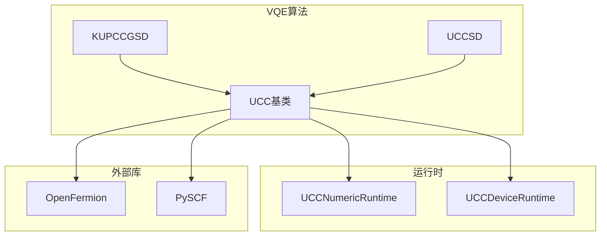
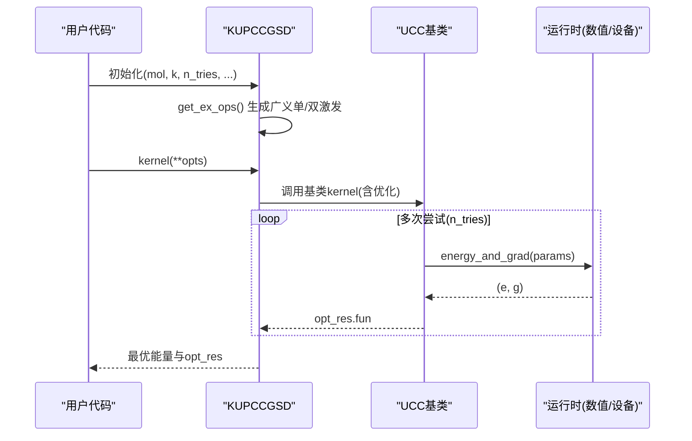
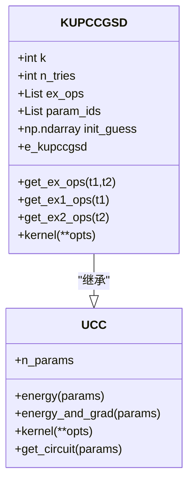
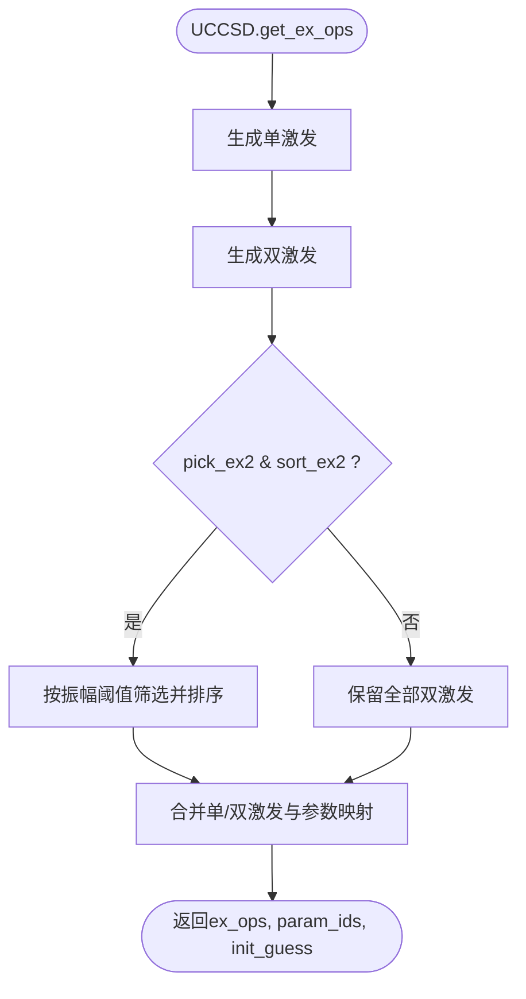
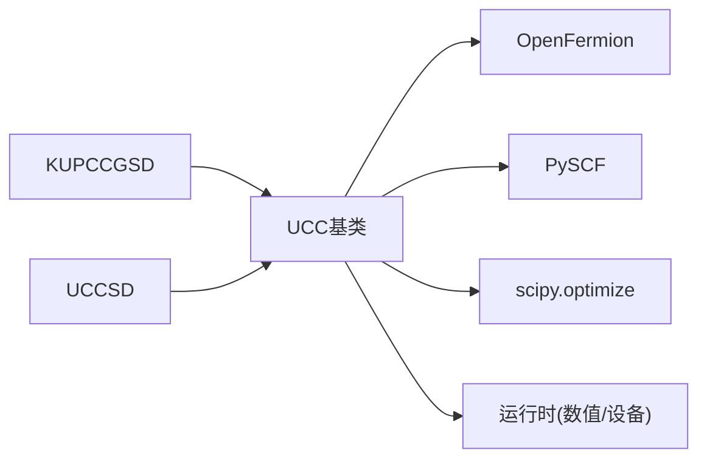

# KUPCCGSD方法

<cite>
**本文引用的文件**
- [kupccgsd.py](file://src/tyxonq/applications/chem/algorithms/vqe/kupccgsd.py)
- [ucc_base.py](file://src/tyxonq/applications/chem/algorithms/vqe/ucc_base.py)
- [uccsd.py](file://src/tyxonq/applications/chem/algorithms/vqe/uccsd.py)
- [__init__.py（vqe）](file://src/tyxonq/applications/chem/algorithms/vqe/__init__.py)
- [test_mol_construct.py](file://tests_mol_valid/test_mol_construct.py)
</cite>

## 目录
1. [简介](#简介)
2. [项目结构](#项目结构)
3. [核心组件](#核心组件)
4. [架构总览](#架构总览)
5. [详细组件分析](#详细组件分析)
6. [依赖关系分析](#依赖关系分析)
7. [性能与数值稳定性](#性能与数值稳定性)
8. [故障排查指南](#故障排查指南)
9. [结论](#结论)
10. [附录：参数选择与实践建议](#附录参数选择与实践建议)

## 简介
本文件系统性阐述KUPCCGSD（k-UpCCGSD）方法的实现、原理与应用。KUPCCGSD在标准UCCSD基础上引入“广义激发算符”与“多层堆叠”的ansatz设计，通过限制双激发的配对形式并重复k层单/双激发门，增强变分表达能力，同时保持可实现的电路规模。文档重点包括：
- k-UpCCGSD相对于标准UCCSD的改进点与优势
- 广义激发算符的概念与实现细节
- k值选择策略对精度与效率的影响
- 不同k值的波函数展开能力与收敛行为
- 具体应用示例与对比
- 与传统UCCSD的适用场景差异
- 参数优化策略与数值稳定性分析

## 项目结构
KUPCCGSD位于量子化学VQE算法模块中，继承自UCC基类，复用统一的哈密顿量构建、运行时调度与优化流程；UCCSD作为对照实现，提供标准单双激发的筛选与排序逻辑。测试用例覆盖从分子到积分输入的多路径验证。

图表来源
- [ucc_base.py:52-58](file://src/tyxonq/applications/chem/algorithms/vqe/ucc_base.py#L52-L58)
- [ucc_base.py:416-461](file://src/tyxonq/applications/chem/algorithms/vqe/ucc_base.py#L416-L461)
- [ucc_base.py:463-510](file://src/tyxonq/applications/chem/algorithms/vqe/ucc_base.py#L463-L510)
- [ucc_base.py:521-581](file://src/tyxonq/applications/chem/algorithms/vqe/ucc_base.py#L521-L581)
- [ucc_base.py:584-616](file://src/tyxonq/applications/chem/algorithms/vqe/ucc_base.py#L584-L616)
- [uccsd.py:18-154](file://src/tyxonq/applications/chem/algorithms/vqe/uccsd.py#L18-L154)
- [uccsd.py:268-341](file://src/tyxonq/applications/chem/algorithms/vqe/uccsd.py#L268-L341)
- [kupccgsd.py:15-203](file://src/tyxonq/applications/chem/algorithms/vqe/kupccgsd.py#L15-L203)

章节来源
- [ucc_base.py:52-58](file://src/tyxonq/applications/chem/algorithms/vqe/ucc_base.py#L52-L58)
- [uccsd.py:18-154](file://src/tyxonq/applications/chem/algorithms/vqe/uccsd.py#L18-L154)
- [kupccgsd.py:15-203](file://src/tyxonq/applications/chem/algorithms/vqe/kupccgsd.py#L15-L203)

## 核心组件
- KUPCCGSD类：定义k层广义UpCCGSD ansatz，生成广义单/双激发算符，支持多初始点尝试与结果排序。
- UCC基类：统一处理分子/HF、活性空间、哈密顿量构建、能量/梯度计算、优化循环与缓存。
- UCCSD类：标准UCCSD实现，包含单/双激发生成、振幅筛选与排序，便于对比。
- 运行时：UCCNumericRuntime（解析数值路径）与UCCDeviceRuntime（设备/模拟器路径）。

章节来源
- [kupccgsd.py:15-203](file://src/tyxonq/applications/chem/algorithms/vqe/kupccgsd.py#L15-L203)
- [ucc_base.py:52-58](file://src/tyxonq/applications/chem/algorithms/vqe/ucc_base.py#L52-L58)
- [ucc_base.py:416-510](file://src/tyxonq/applications/chem/algorithms/vqe/ucc_base.py#L416-L510)
- [uccsd.py:18-154](file://src/tyxonq/applications/chem/algorithms/vqe/uccsd.py#L18-L154)
- [uccsd.py:268-341](file://src/tyxonq/applications/chem/algorithms/vqe/uccsd.py#L268-L341)

## 架构总览
KUPCCGSD通过继承UCC基类复用能量评估与优化流程，自身专注于ansatz构造：
- 初始化：设置k层数、多次尝试次数、获取广义激发算符与参数映射、准备初始猜测列表。
- 执行：调用基类kernel进行优化，记录每次尝试的能量与结果，最终返回最优解。
- 算符构造：分别生成广义单激发与受限配对双激发，并按层重复拼接。

图表来源
- [kupccgsd.py:121-151](file://src/tyxonq/applications/chem/algorithms/vqe/kupccgsd.py#L121-L151)
- [ucc_base.py:521-581](file://src/tyxonq/applications/chem/algorithms/vqe/ucc_base.py#L521-L581)
- [ucc_base.py:416-510](file://src/tyxonq/applications/chem/algorithms/vqe/ucc_base.py#L416-L510)

## 详细组件分析

### KUPCCGSD类
- 关键属性
  - k：ansatz层数，控制重复堆叠次数
  - n_tries：不同初始点的尝试次数，用于缓解局部极小与噪声影响
  - ex_ops/param_ids/init_guess：由get_ex_ops生成，表示广义激发与参数映射
- 关键方法
  - get_ex_ops：组合广义单/双激发，按k层重复拼接，生成参数ID映射与随机初始猜测
  - get_ex1_ops：生成广义单激发（α→α与β→β），共享参数ID
  - get_ex2_ops：生成受限配对双激发（i,j→a,b且满足配对约束）
  - kernel：多次尝试优化，记录能量与结果，返回最优能量
- 设计要点
  - 双激发限制为配对形式，降低参数数量与电路复杂度
  - 多层堆叠提升表达力，但需权衡k带来的参数增长与优化难度
  - 多初始点策略提高鲁棒性

图表来源
- [ucc_base.py:52-58](file://src/tyxonq/applications/chem/algorithms/vqe/ucc_base.py#L52-L58)
- [ucc_base.py:416-510](file://src/tyxonq/applications/chem/algorithms/vqe/ucc_base.py#L416-L510)
- [ucc_base.py:521-581](file://src/tyxonq/applications/chem/algorithms/vqe/ucc_base.py#L521-L581)
- [kupccgsd.py:15-203](file://src/tyxonq/applications/chem/algorithms/vqe/kupccgsd.py#L15-L203)
- [kupccgsd.py:288-293](file://src/tyxonq/applications/chem/algorithms/vqe/kupccgsd.py#L288-L293)

章节来源
- [kupccgsd.py:15-203](file://src/tyxonq/applications/chem/algorithms/vqe/kupccgsd.py#L15-L203)
- [kupccgsd.py:205-286](file://src/tyxonq/applications/chem/algorithms/vqe/kupccgsd.py#L205-L286)
- [kupccgsd.py:121-151](file://src/tyxonq/applications/chem/algorithms/vqe/kupccgsd.py#L121-L151)

### UCCSD类（对照）
- 关键特性
  - 标准单/双激发生成，支持振幅筛选与排序
  - pick_ex2/sort_ex2控制是否基于初始振幅剔除弱贡献项
  - 提供as_pyscf_solver接口以兼容PySCF求解器
- 与KUPCCGSD的差异
  - 无多层堆叠，单层即完整UCCSD
  - 双激发不强制配对，允许更丰富的关联效应
  - 通过筛选减少参数规模，适合较大体系

图表来源
- [uccsd.py:268-341](file://src/tyxonq/applications/chem/algorithms/vqe/uccsd.py#L268-L341)

章节来源
- [uccsd.py:18-154](file://src/tyxonq/applications/chem/algorithms/vqe/uccsd.py#L18-L154)
- [uccsd.py:268-341](file://src/tyxonq/applications/chem/algorithms/vqe/uccsd.py#L268-L341)

### UCC基类（通用流程）
- 分子与HF处理：支持直接分子或已有RHF/ROHF对象，自动完成HF计算与轨道规范
- 活性空间：支持active_space与active_orbital_indices，减少问题规模
- 哈密顿量：根据numeric_engine选择合适形式（FCI函数或稀疏矩阵）
- 能量与梯度：统一封装数值与设备路径，支持shots=0解析路径
- 优化：默认L-BFGS-B，支持自由梯度模式；内置同点缓存避免重复采样
- 兼容性：提供from_integral、as_pyscf_solver等便捷接口

章节来源
- [ucc_base.py:52-58](file://src/tyxonq/applications/chem/algorithms/vqe/ucc_base.py#L52-L58)
- [ucc_base.py:60-360](file://src/tyxonq/applications/chem/algorithms/vqe/ucc_base.py#L60-L360)
- [ucc_base.py:370-392](file://src/tyxonq/applications/chem/algorithms/vqe/ucc_base.py#L370-L392)
- [ucc_base.py:416-510](file://src/tyxonq/applications/chem/algorithms/vqe/ucc_base.py#L416-L510)
- [ucc_base.py:521-581](file://src/tyxonq/applications/chem/algorithms/vqe/ucc_base.py#L521-L581)
- [ucc_base.py:584-616](file://src/tyxonq/applications/chem/algorithms/vqe/ucc_base.py#L584-L616)

## 依赖关系分析
- 内部依赖
  - KUPCCGSD依赖UCC基类的能量/梯度与优化流程
  - UCCSD与KUPCCGSD均依赖openfermion进行费米子到量子比特变换
  - 运行时依赖statevector/civector等数值后端或真实设备
- 外部依赖
  - PySCF用于HF、MP2、CCSD、FCI参考与积分计算
  - scipy.optimize用于经典优化

图表来源
- [ucc_base.py:5-44](file://src/tyxonq/applications/chem/algorithms/vqe/ucc_base.py#L5-L44)
- [ucc_base.py:416-510](file://src/tyxonq/applications/chem/algorithms/vqe/ucc_base.py#L416-L510)
- [ucc_base.py:521-581](file://src/tyxonq/applications/chem/algorithms/vqe/ucc_base.py#L521-L581)

章节来源
- [ucc_base.py:5-44](file://src/tyxonq/applications/chem/algorithms/vqe/ucc_base.py#L5-L44)
- [ucc_base.py:416-510](file://src/tyxonq/applications/chem/algorithms/vqe/ucc_base.py#L416-L510)
- [ucc_base.py:521-581](file://src/tyxonq/applications/chem/algorithms/vqe/ucc_base.py#L521-L581)

## 性能与数值稳定性
- 参数规模与电路深度
  - KUPCCGSD每层包含广义单/双激发，k层将线性增加参数数量与门深度
  - 双激发限制为配对形式，相比全双激发显著降低参数量
- 优化收敛
  - 多层堆叠可能带来更复杂的能面，需更多初始点（n_tries）与更大迭代次数
  - 基类内置同点缓存减少重复采样成本，提升L-BFGS-B线搜索一致性
- 数值稳定性
  - 使用解析路径（shots=0）可获得稳定梯度与能量，避免采样噪声
  - 设备路径默认shots=2048，可通过opts覆盖；对于小规模体系推荐解析路径做基准
- 活性空间
  - 通过active_space与active_orbital_indices裁剪问题规模，提升可扩展性
- 参考能量
  - 支持run_fci=True获取FCI参考，便于评估误差与收敛质量

章节来源
- [ucc_base.py:416-510](file://src/tyxonq/applications/chem/algorithms/vqe/ucc_base.py#L416-L510)
- [ucc_base.py:521-581](file://src/tyxonq/applications/chem/algorithms/vqe/ucc_base.py#L521-L581)
- [ucc_base.py:584-616](file://src/tyxonq/applications/chem/algorithms/vqe/ucc_base.py#L584-L616)
- [kupccgsd.py:121-151](file://src/tyxonq/applications/chem/algorithms/vqe/kupccgsd.py#L121-L151)

## 故障排查指南
- 优化失败
  - 检查opt_res.success标志与日志；必要时增大maxiter或调整ftol/gtol
  - 增加n_tries以跨越局部极小
- 参数不一致
  - 确保ex_ops与param_ids长度一致；基类提供sanity check
- 运行时报错
  - 确认runtime与numeric_engine匹配；shots=0走解析路径，真机需非零shots
- 能量异常
  - 核对active_space与active_orbital_indices是否与分子匹配
  - 使用run_fci=True对比FCI参考能量定位偏差

章节来源
- [ucc_base.py:400-414](file://src/tyxonq/applications/chem/algorithms/vqe/ucc_base.py#L400-L414)
- [ucc_base.py:521-581](file://src/tyxonq/applications/chem/algorithms/vqe/ucc_base.py#L521-L581)
- [kupccgsd.py:121-151](file://src/tyxonq/applications/chem/algorithms/vqe/kupccgsd.py#L121-L151)

## 结论
KUPCCGSD通过“广义单激发+受限配对双激发”的ansatz设计与k层堆叠，在保持可实现性的前提下增强了变分表达能力。相较于标准UCCSD，它在特定体系（如强关联或需要更高阶相关）中可能以更少的参数达到相近精度，但需权衡k带来的优化难度与电路开销。结合多初始点策略与解析路径优化，可在中小体系上获得稳定可靠的能量估计。

## 附录：参数选择与实践建议
- k值选择策略
  - 小体系（≤4 qubits）：k=1~2通常足够，优先保证收敛与稳定性
  - 中等体系（活性空间4~8）：可从k=2起步，逐步增加至k=3~4，观察能量改善与收敛情况
  - 大体系：谨慎增加k，优先采用活性空间裁剪与振幅筛选（UCCSD路径）
- 初始点与优化
  - 使用n_tries≥3提升鲁棒性；解析路径（shots=0）用于基准与调试
  - 若出现平坦能面或震荡，可增加maxiter或切换优化器（如COBYLA）
- 与UCCSD的对比
  - UCCSD更适合需要丰富双激发贡献的体系；KUPCCGSD在受限双激发下更高效
  - 同一体系下比较不同k与UCCSD的能量与RDM，评估方法适用性
- 验证与基准
  - 使用run_fci=True获取FCI参考；测试用例覆盖从分子到积分输入的多路径
  - 参考测试中的容差设置，合理评估误差范围

章节来源
- [test_mol_construct.py:40-65](file://tests_mol_valid/test_mol_construct.py#L40-L65)
- [ucc_base.py:416-510](file://src/tyxonq/applications/chem/algorithms/vqe/ucc_base.py#L416-L510)
- [ucc_base.py:521-581](file://src/tyxonq/applications/chem/algorithms/vqe/ucc_base.py#L521-L581)
- [uccsd.py:268-341](file://src/tyxonq/applications/chem/algorithms/vqe/uccsd.py#L268-L341)
- [kupccgsd.py:15-203](file://src/tyxonq/applications/chem/algorithms/vqe/kupccgsd.py#L15-L203)