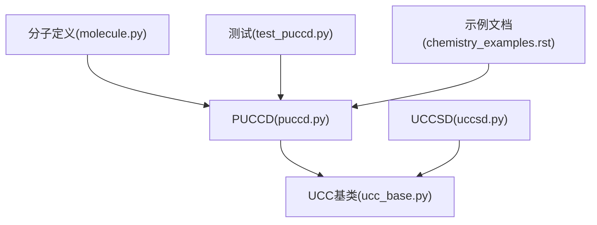
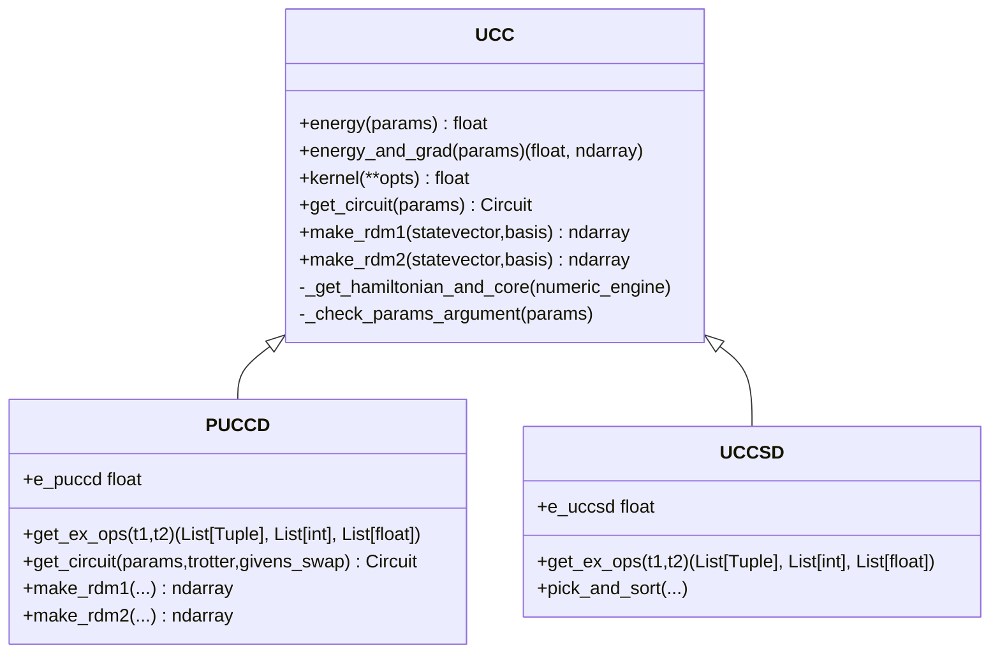
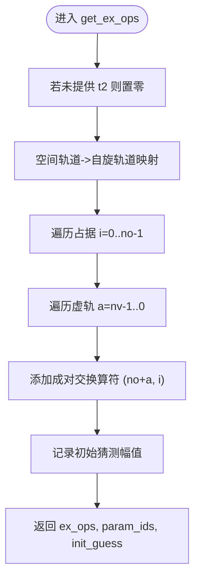
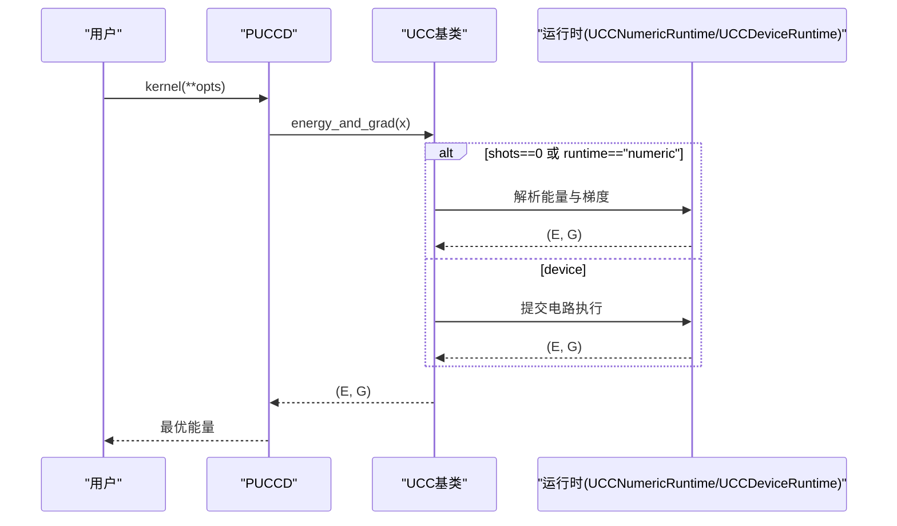
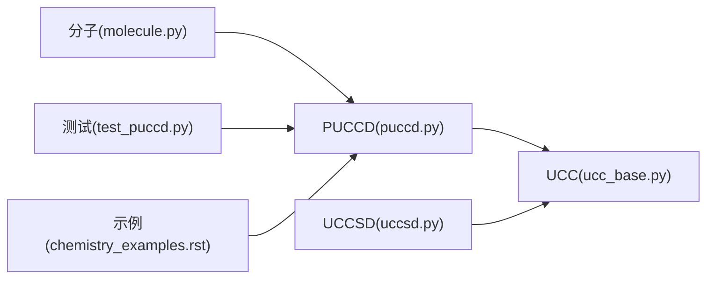

# PUCCD方法

<cite>
**本文引用的文件**
- [puccd.py](file://src/tyxonq/applications/chem/algorithms/vqe/puccd.py)
- [ucc_base.py](file://src/tyxonq/applications/chem/algorithms/vqe/ucc_base.py)
- [uccsd.py](file://src/tyxonq/applications/chem/algorithms/vqe/uccsd.py)
- [test_puccd.py](file://tests_mol_valid/test_puccd.py)
- [molecule.py](file://src/tyxonq/applications/chem/molecule.py)
- [chemistry_examples.rst](file://docs/source/examples/chemistry_examples.rst)
</cite>

## 目录
1. [简介](#简介)
2. [项目结构](#项目结构)
3. [核心组件](#核心组件)
4. [架构总览](#架构总览)
5. [详细组件分析](#详细组件分析)
6. [依赖关系分析](#依赖关系分析)
7. [性能与效率](#性能与效率)
8. [故障排查指南](#故障排查指南)
9. [结论](#结论)
10. [附录](#附录)

## 简介
本文件系统性阐述PUCCD（Pair-Unitary Coupled Cluster Doubles，配对耦合簇双激子）方法的物理动机、数学表述、实现要点与使用方式。重点包括：
- 仅考虑“电子对”激发的物理意义与适用场景（强关联、键解离等）
- 选择规则与对称性约束（硬芯玻色子HCB映射下的自旋配对激发）
- 在强关联体系中的优势与计算效率
- 与UCCSD的系统性对比（精度、成本、适用范围）
- 典型分子案例（H₂链、H₄、H₅⁺等）
- 参数优化技巧与收敛加速策略

## 项目结构
本项目将PUCCD作为VQE类量子化学算法的一个具体Ansatz实现，位于化学应用模块的vqe子包中，并继承统一的UCC基类以复用能量评估、梯度计算、优化流程与运行时调度。

图表来源
- [puccd.py:20-188](file://src/tyxonq/applications/chem/algorithms/vqe/puccd.py#L20-L188)
- [ucc_base.py:52-580](file://src/tyxonq/applications/chem/algorithms/vqe/ucc_base.py#L52-L580)
- [uccsd.py:18-355](file://src/tyxonq/applications/chem/algorithms/vqe/uccsd.py#L18-L355)
- [molecule.py:80-137](file://src/tyxonq/applications/chem/molecule.py#L80-L137)
- [test_puccd.py:21-73](file://tests_mol_valid/test_puccd.py#L21-L73)
- [chemistry_examples.rst:186-201](file://docs/source/examples/chemistry_examples.rst#L186-L201)

章节来源
- [puccd.py:20-188](file://src/tyxonq/applications/chem/algorithms/vqe/puccd.py#L20-L188)
- [ucc_base.py:52-580](file://src/tyxonq/applications/chem/algorithms/vqe/ucc_base.py#L52-L580)
- [uccsd.py:18-355](file://src/tyxonq/applications/chem/algorithms/vqe/uccsd.py#L18-L355)
- [molecule.py:80-137](file://src/tyxonq/applications/chem/molecule.py#L80-L137)
- [test_puccd.py:21-73](file://tests_mol_valid/test_puccd.py#L21-L73)
- [chemistry_examples.rst:186-201](file://docs/source/examples/chemistry_examples.rst#L186-L201)

## 核心组件
- PUCCD类：基于UCC基类的配对双激子Ansatz实现，采用硬芯玻色子（HCB）模式，仅包含成对轨道间的交换型双激子，显著降低参数量与电路深度。
- UCC基类：统一封装HF/MP2/CCSD参考、哈密顿量构建、数值/设备运行、能量与梯度计算、优化器调用、RDM后处理等通用能力。
- UCCSD类：全单+双激子的UCC实现，用于与PUCCD进行精度与成本对比。
- 分子库：提供H₂链、H₄、H₅⁺等强关联测试体系。

章节来源
- [puccd.py:20-188](file://src/tyxonq/applications/chem/algorithms/vqe/puccd.py#L20-L188)
- [ucc_base.py:52-580](file://src/tyxonq/applications/chem/algorithms/vqe/ucc_base.py#L52-L580)
- [uccsd.py:18-355](file://src/tyxonq/applications/chem/algorithms/vqe/uccsd.py#L18-L355)
- [molecule.py:80-137](file://src/tyxonq/applications/chem/molecule.py#L80-L137)

## 架构总览
PUCCD通过继承UCC基类，复用其初始化、积分与哈密顿量构建、数值/设备执行、优化与RDM计算等能力；自身专注于“配对双激子”的选择规则与算符生成。

图表来源
- [ucc_base.py:52-580](file://src/tyxonq/applications/chem/algorithms/vqe/ucc_base.py#L52-L580)
- [puccd.py:20-188](file://src/tyxonq/applications/chem/algorithms/vqe/puccd.py#L20-L188)
- [uccsd.py:18-355](file://src/tyxonq/applications/chem/algorithms/vqe/uccsd.py#L18-L355)

## 详细组件分析

### PUCCD：配对双激子Ansatz
- 物理动机：在闭壳或自旋配对的体系中，强关联主要来源于成对电子的关联效应。限制为“成对轨道间”的双激子可大幅压缩变分空间，同时保留关键关联能。
- 数学表述（概念性）：波函数近似为|Ψ⟩ = exp(T̂_pair − T̂†_pair)|Φ₀⟩，其中T̂_pair仅包含成对轨道(i,i')→(a,a')的交换型双激子算符。该形式天然保持粒子数与自旋对称性。
- 选择规则与对称性：
  - 仅允许成对占据轨道到成对虚轨道的交换型双激子，保证自旋单态与粒子数守恒。
  - 代码中以HCB模式组织轨道索引，并通过遍历i∈[0,no)、a∈[nv−1..0]构造(ex_ops)，对应于成对轨道间的交换。
- RDM计算：针对HCB映射给出高效的1RDM/2RDM构造，利用CI字符串掩码快速求期望值，并支持AO/MO基转换。
- 电路生成：默认返回标准UCC电路；可选trotter化或Givens-Swap模板路径。

图表来源
- [puccd.py:83-96](file://src/tyxonq/applications/chem/algorithms/vqe/puccd.py#L83-L96)

章节来源
- [puccd.py:20-188](file://src/tyxonq/applications/chem/algorithms/vqe/puccd.py#L20-L188)

### UCC基类：统一运行与优化框架
- 初始化：支持从PySCF分子或预计算HF结果构建；自动完成HF/MP2/CCSD/FCI参考计算（按需），并缓存哈密顿量。
- 能量与梯度：
  - 数值路径（shots=0）：解析计算，避免采样噪声，利于优化与RDM。
  - 设备路径：支持模拟器与真机，默认shots=2048（真机）或0（模拟器）。
- 优化：默认L-BFGS-B，支持自由梯度（COBYLA）；内置同点缓存以减少重复开销。
- RDM：提供MO/AO基的1RDM/2RDM接口，便于性质计算。

图表来源
- [ucc_base.py:416-510](file://src/tyxonq/applications/chem/algorithms/vqe/ucc_base.py#L416-L510)
- [ucc_base.py:521-580](file://src/tyxonq/applications/chem/algorithms/vqe/ucc_base.py#L521-L580)

章节来源
- [ucc_base.py:52-580](file://src/tyxonq/applications/chem/algorithms/vqe/ucc_base.py#L52-L580)

### UCCSD：全单+双激子对照
- 包含所有单激子与双激子，可通过振幅筛选与排序控制复杂度。
- 提供pick_and_sort机制，按初始振幅大小筛选与排序双激子，减少参数规模。
- 与PUCCD在同一框架下运行，便于公平对比。

章节来源
- [uccsd.py:18-355](file://src/tyxonq/applications/chem/algorithms/vqe/uccsd.py#L18-L355)

### 分子与案例
- H₂链、H₄、H₅⁺等一维氢链是典型的强关联体系，适合验证PUCCD在键解离区域的稳定性与精度。
- 测试用例覆盖不同数值后端（statevector/civector/civector-large），并验证RDM一致性。

章节来源
- [molecule.py:80-137](file://src/tyxonq/applications/chem/molecule.py#L80-L137)
- [test_puccd.py:21-73](file://tests_mol_valid/test_puccd.py#L21-L73)

## 依赖关系分析
- PUCCD依赖UCC基类提供的通用能力，自身专注配对双激子算符生成与HCB模式下的RDM。
- UCCSD与PUCCD共享同一优化与运行框架，确保对比的一致性。
- 分子库提供多种强关联测试体系，便于复现实验。

图表来源
- [puccd.py:20-188](file://src/tyxonq/applications/chem/algorithms/vqe/puccd.py#L20-L188)
- [ucc_base.py:52-580](file://src/tyxonq/applications/chem/algorithms/vqe/ucc_base.py#L52-L580)
- [uccsd.py:18-355](file://src/tyxonq/applications/chem/algorithms/vqe/uccsd.py#L18-L355)
- [molecule.py:80-137](file://src/tyxonq/applications/chem/molecule.py#L80-L137)
- [test_puccd.py:21-73](file://tests_mol_valid/test_puccd.py#L21-L73)
- [chemistry_examples.rst:186-201](file://docs/source/examples/chemistry_examples.rst#L186-L201)

章节来源
- [puccd.py:20-188](file://src/tyxonq/applications/chem/algorithms/vqe/puccd.py#L20-L188)
- [ucc_base.py:52-580](file://src/tyxonq/applications/chem/algorithms/vqe/ucc_base.py#L52-L580)
- [uccsd.py:18-355](file://src/tyxonq/applications/chem/algorithms/vqe/uccsd.py#L18-L355)
- [molecule.py:80-137](file://src/tyxonq/applications/chem/molecule.py#L80-L137)
- [test_puccd.py:21-73](file://tests_mol_valid/test_puccd.py#L21-L73)
- [chemistry_examples.rst:186-201](file://docs/source/examples/chemistry_examples.rst#L186-L201)

## 性能与效率
- 参数规模：PUCCD仅包含成对双激子，参数数量远少于UCCSD，尤其在较大体系中优势明显。
- 电路深度：配对激子结构更规整，易于分解为浅层门序列，有利于NISQ设备。
- 收敛性：在强关联区域（如H₂拉伸、H₄解离）通常比UCCSD更快收敛且更稳定。
- 数值路径：默认shots=0时走解析路径，避免采样噪声，提升优化效率与RDM精度。
- 设备路径：真机默认2048 shots，可根据需求调整；模拟器建议shots=0以获得确定性结果。

章节来源
- [ucc_base.py:416-510](file://src/tyxonq/applications/chem/algorithms/vqe/ucc_base.py#L416-L510)
- [ucc_base.py:521-580](file://src/tyxonq/applications/chem/algorithms/vqe/ucc_base.py#L521-L580)
- [chemistry_examples.rst:186-201](file://docs/source/examples/chemistry_examples.rst#L186-L201)

## 故障排查指南
- 优化失败提示：当优化器返回失败时，检查opt_res详情；必要时增大maxiter或放宽容差。
- 参数维度不匹配：ex_ops与param_ids长度需一致；自定义ex_ops时需同步更新param_ids。
- 数值后端选择：小系统可用civector，大系统用civector-large；statevector适合小规模精确验证。
- RDM不一致：确认MO/AO基转换正确；比较UCC与PUCCD的RDM时应注意优化最小值的微小差异。
- Trotter近似：trotter化仅在角度较小时近似等价，严格比较建议使用默认门级电路。

章节来源
- [ucc_base.py:521-580](file://src/tyxonq/applications/chem/algorithms/vqe/ucc_base.py#L521-L580)
- [test_puccd.py:21-73](file://tests_mol_valid/test_puccd.py#L21-L73)

## 结论
PUCCD通过限制为“成对双激子”，在强关联体系中实现了高精度与高效率的平衡。其HCB映射与配对选择规则保证了自旋与粒子数对称性，同时显著降低变分空间与电路复杂度。与UCCSD相比，PUCCD在强关联场景更具鲁棒性与可扩展性，适合NISQ时代的量子化学计算。

## 附录

### 与UCCSD的系统性对比
- 精度：在强关联体系（如H₂拉伸、H₄解离）中，PUCCD常接近FCI；UCCSD在全相关极限下更精确但代价更高。
- 成本：PUCCD参数更少、电路更浅，优化更快；UCCSD参数随体系增长更快。
- 适用范围：PUCCD适用于闭壳或自旋配对主导的强关联体系；UCCSD更通用但需要更多资源。

章节来源
- [uccsd.py:18-355](file://src/tyxonq/applications/chem/algorithms/vqe/uccsd.py#L18-L355)
- [chemistry_examples.rst:186-201](file://docs/source/examples/chemistry_examples.rst#L186-L201)

### 参数优化技巧与收敛加速
- 初始猜测：优先使用MP2或CCSD初始振幅；对于PUCCD，配对双激子初始值有助于快速收敛。
- 数值路径：优化阶段使用shots=0解析路径，避免采样噪声；真机执行再切换至有限shots。
- 缓存与分组：基类已内置同点缓存，减少重复计算；可按需启用分组梯度。
- 容差设置：适当放宽ftol/gtol以提升速度；追求高精度时可收紧。

章节来源
- [ucc_base.py:416-510](file://src/tyxonq/applications/chem/algorithms/vqe/ucc_base.py#L416-L510)
- [ucc_base.py:521-580](file://src/tyxonq/applications/chem/algorithms/vqe/ucc_base.py#L521-L580)

### 典型分子案例
- H₂链：调节键长研究解离曲线，验证PUCCD在强关联区的稳定性。
- H₄/H₅⁺：多体强关联测试，检验RDM与能量一致性。
- 水分子：非强关联体系，可作为基准对比。

章节来源
- [molecule.py:80-137](file://src/tyxonq/applications/chem/molecule.py#L80-L137)
- [test_puccd.py:21-73](file://tests_mol_valid/test_puccd.py#L21-L73)