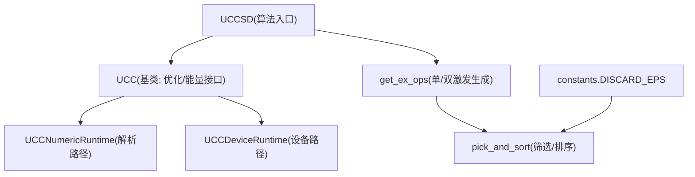
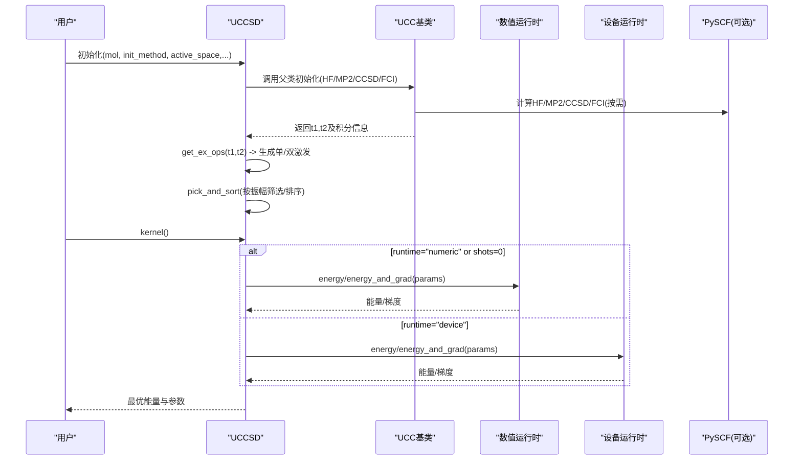
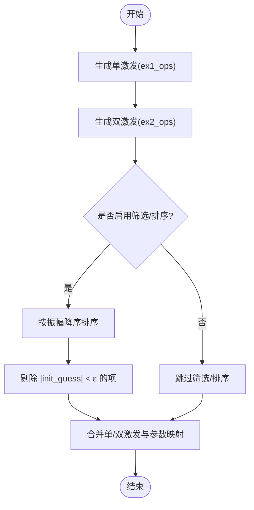
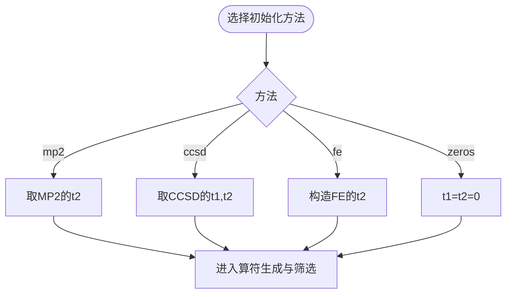
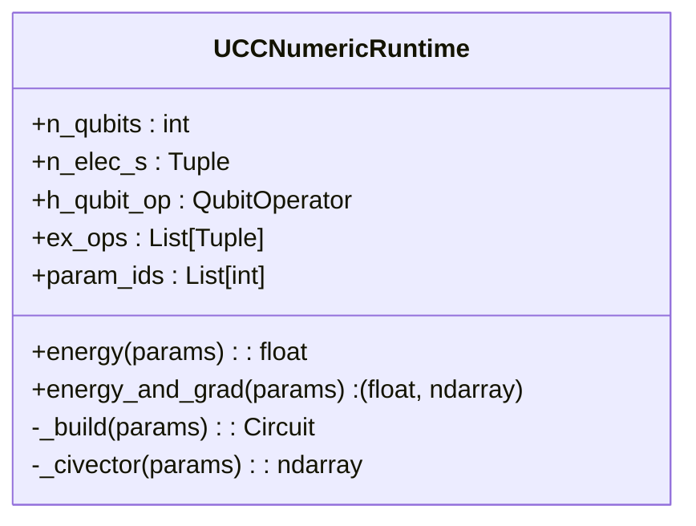
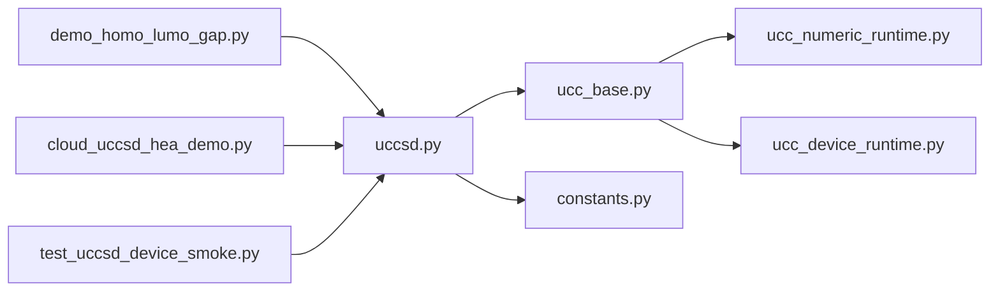
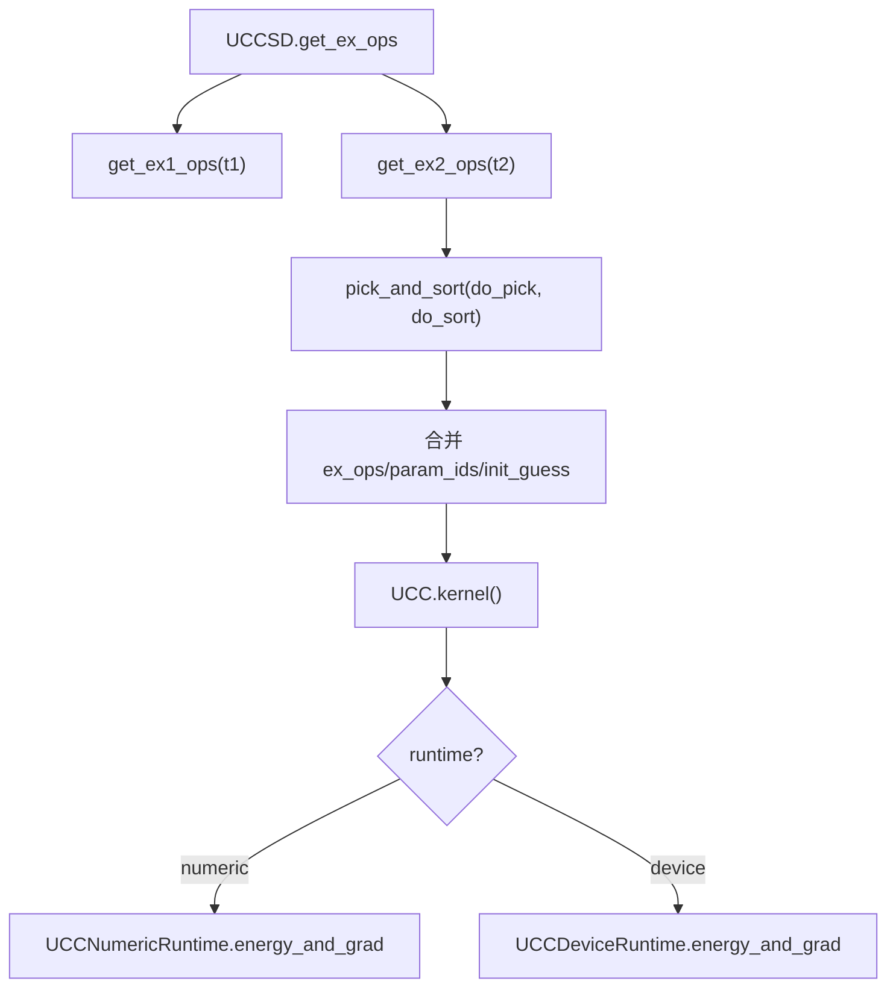

# UCCSD方法

<cite>
**本文引用的文件**
- [uccsd.py](file://src/tyxonq/applications/chem/algorithms/vqe/uccsd.py)
- [ucc_base.py](file://src/tyxonq/applications/chem/algorithms/vqe/ucc_base.py)
- [ucc_numeric_runtime.py](file://src/tyxonq/applications/chem/algorithms/vqe/runtimes/ucc_numeric_runtime.py)
- [ucc_device_runtime.py](file://src/tyxonq/applications/chem/algorithms/vqe/runtimes/ucc_device_runtime.py)
- [constants.py](file://src/tyxonq/applications/chem/constants.py)
- [__init__.py](file://src/tyxonq/applications/chem/algorithms/vqe/__init__.py)
- [demo_homo_lumo_gap.py](file://examples/demo_homo_lumo_gap.py)
- [cloud_uccsd_hea_demo.py](file://examples/cloud_uccsd_hea_demo.py)
- [test_uccsd_device_smoke.py](file://tests_applications_chem/test_uccsd_device_smoke.py)
</cite>

## 目录
1. [简介](#简介)
2. [项目结构](#项目结构)
3. [核心组件](#核心组件)
4. [架构总览](#架构总览)
5. [详细组件分析](#详细组件分析)
6. [依赖关系分析](#依赖关系分析)
7. [性能考量](#性能考量)
8. [故障排查指南](#故障排查指南)
9. [结论](#结论)
10. [附录](#附录)

## 简介
本文件系统性阐述 TyxonQ 中 UCCSD（Unitary Coupled Cluster Singles and Doubles）方法的实现与使用。内容涵盖：
- 数学基础：单激发与双激发算符构造、指数映射的量子线路实现
- 参数初始化策略：MP2、CCSD、FE（冻结自然轨道）、zeros
- 振幅筛选与排序机制，以及收敛控制
- 完整计算流程：从分子轨道到能量优化收敛
- 活性空间近似的使用与精度-效率权衡
- 不同分子系统（H₂、H₂O等）的实际应用示例
- 收敛性分析与误差估计方法

## 项目结构
UCCSD 位于 VQE 算法族下，采用“基类 + 具体实现 + 运行时”的分层组织：
- 算法入口与变分循环：UCC 基类提供统一的 energy/energy_and_grad/kernel 接口
- UCCSD 具体实现：负责生成单/双激发算符、振幅筛选与排序
- 数值与设备运行时：分别支持解析态矢量/CI 向量路径与真机/模拟器计数路径
- 常量与工具：如丢弃阈值 DISCARD_EPS



图表来源
- [uccsd.py:155-319](file://src/tyxonq/applications/chem/algorithms/vqe/uccsd.py#L155-L319)
- [ucc_base.py:52-581](file://src/tyxonq/applications/chem/algorithms/vqe/ucc_base.py#L52-L581)
- [ucc_numeric_runtime.py:42-329](file://src/tyxonq/applications/chem/algorithms/vqe/runtimes/ucc_numeric_runtime.py#L42-L329)
- [ucc_device_runtime.py:25-448](file://src/tyxonq/applications/chem/algorithms/vqe/runtimes/ucc_device_runtime.py#L25-L448)
- [constants.py:1-18](file://src/tyxonq/applications/chem/constants.py#L1-L18)

章节来源
- [uccsd.py:155-319](file://src/tyxonq/applications/chem/algorithms/vqe/uccsd.py#L155-L319)
- [ucc_base.py:52-581](file://src/tyxonq/applications/chem/algorithms/vqe/ucc_base.py#L52-L581)
- [ucc_numeric_runtime.py:42-329](file://src/tyxonq/applications/chem/algorithms/vqe/runtimes/ucc_numeric_runtime.py#L42-L329)
- [ucc_device_runtime.py:25-448](file://src/tyxonq/applications/chem/algorithms/vqe/runtimes/ucc_device_runtime.py#L25-L448)
- [constants.py:1-18](file://src/tyxonq/applications/chem/constants.py#L1-L18)

## 核心组件
- UCC 基类
  - 统一封装 HF/MP2/CCSD/FCI 参考计算、活性空间处理、哈密顿量构建、优化器调用（L-BFGS-B/COBYLA）
  - 提供 energy/energy_and_grad/kernel 接口，自动选择 numeric/device 路径
- UCCSD
  - 基于 t1/t2 生成单/双激发算符，执行筛选与排序，得到 ex_ops/param_ids/init_guess
- 数值运行时（UCCNumericRuntime）
  - 在 statevector/civector/pyscf 后端上解析计算能量与梯度，支持缓存与高效 CI 向量操作
- 设备运行时（UCCDeviceRuntime）
  - 通过参数平移（两偏移规则）计算梯度，批量提交电路并聚合期望值

章节来源
- [ucc_base.py:52-581](file://src/tyxonq/applications/chem/algorithms/vqe/ucc_base.py#L52-L581)
- [uccsd.py:155-319](file://src/tyxonq/applications/chem/algorithms/vqe/uccsd.py#L155-L319)
- [ucc_numeric_runtime.py:42-329](file://src/tyxonq/applications/chem/algorithms/vqe/runtimes/ucc_numeric_runtime.py#L42-L329)
- [ucc_device_runtime.py:25-448](file://src/tyxonq/applications/chem/algorithms/vqe/runtimes/ucc_device_runtime.py#L25-L448)

## 架构总览
下图展示从分子输入到能量优化的端到端流程，包括经典化学前置计算、UCCSD 算符生成、筛选排序、以及两种运行时的能量/梯度评估。



图表来源
- [ucc_base.py:170-327](file://src/tyxonq/applications/chem/algorithms/vqe/ucc_base.py#L170-L327)
- [uccsd.py:268-319](file://src/tyxonq/applications/chem/algorithms/vqe/uccsd.py#L268-L319)
- [ucc_numeric_runtime.py:277-329](file://src/tyxonq/applications/chem/algorithms/vqe/runtimes/ucc_numeric_runtime.py#L277-L329)
- [ucc_device_runtime.py:293-448](file://src/tyxonq/applications/chem/algorithms/vqe/runtimes/ucc_device_runtime.py#L293-L448)

## 详细组件分析

### UCCSD 类与激发算符生成
- 单激发（singles）：由 t1 张量生成，包含 α→α 与 β→β 跃迁
- 双激发（doubles）：由 t2 张量生成，包含 αα、ββ、αβ 等类型
- 筛选与排序：依据初始振幅大小进行截断，默认使用 DISCARD_EPS 阈值；可按振幅降序排列以优先保留重要项
- 参数映射：将每个激发映射到一个或多个共享参数，去重后形成最终参数集



图表来源
- [uccsd.py:268-341](file://src/tyxonq/applications/chem/algorithms/vqe/uccsd.py#L268-L341)
- [constants.py:1-18](file://src/tyxonq/applications/chem/constants.py#L1-L18)

章节来源
- [uccsd.py:268-341](file://src/tyxonq/applications/chem/algorithms/vqe/uccsd.py#L268-L341)
- [constants.py:1-18](file://src/tyxonq/applications/chem/constants.py#L1-L18)

### 参数初始化策略
- MP2：利用二阶微扰理论获得 t2 初值，适合弱关联体系
- CCSD：使用经典 CCSD 的 t1/t2 作为初值，通常收敛更快
- FE（冻结自然轨道）：通过特定变换构造 t2 初值，适用于特定场景
- zeros：全零初值，关闭筛选与排序，便于探索或调试



图表来源
- [ucc_base.py:314-327](file://src/tyxonq/applications/chem/algorithms/vqe/ucc_base.py#L314-L327)

章节来源
- [ucc_base.py:314-327](file://src/tyxonq/applications/chem/algorithms/vqe/ucc_base.py#L314-L327)

### 数值运行时（解析路径）
- 支持 statevector、civector、civector-large、pyscf 等多种后端
- 通过 CI 字符串缓存与算子张量缓存加速重复计算
- 提供能量与解析梯度（analytic gradient），用于快速优化



图表来源
- [ucc_numeric_runtime.py:42-329](file://src/tyxonq/applications/chem/algorithms/vqe/runtimes/ucc_numeric_runtime.py#L42-L329)

章节来源
- [ucc_numeric_runtime.py:42-329](file://src/tyxonq/applications/chem/algorithms/vqe/runtimes/ucc_numeric_runtime.py#L42-L329)

### 设备运行时（计数路径）
- 通过分组测量与批处理电路减少开销
- 梯度采用“两偏移参数平移”规则，针对 UCC 能量表面偶次谐波精确求导
- 支持本地模拟器与云端设备统一执行链

```mermaid
sequenceDiagram
participant Opt as "优化器"
participant Dev as "UCCDeviceRuntime"
participant Circ as "Circuit"
participant Post as "后处理"
Opt->>Dev : energy_and_grad(params)
Dev->>Dev : 构建基电路与分组前缀
loop 每个参数 i
Dev->>Circ : 构建 θ±s_j 的电路
Circ-->>Dev : 执行并返回计数
Dev->>Post : 按组聚合期望值
end
Dev-->>Opt : 能量与梯度
```

图表来源
- [ucc_device_runtime.py:293-448](file://src/tyxonq/applications/chem/algorithms/vqe/runtimes/ucc_device_runtime.py#L293-L448)

章节来源
- [ucc_device_runtime.py:293-448](file://src/tyxonq/applications/chem/algorithms/vqe/runtimes/ucc_device_runtime.py#L293-L448)

### 活性空间近似
- 通过 active_space=(n_electrons, n_orbitals) 限制变分空间，显著降低复杂度
- inactive_occ/inactive_vir 自动推导冻结轨道数，active_orbital_indices 可手动指定轨道
- 对 H₂O 等中等体系，活性空间可在保持精度的同时大幅减少参数数量

章节来源
- [ucc_base.py:141-153](file://src/tyxonq/applications/chem/algorithms/vqe/ucc_base.py#L141-L153)
- [demo_homo_lumo_gap.py:110-133](file://examples/demo_homo_lumo_gap.py#L110-L133)

### 收敛性与误差估计
- 优化器默认 L-BFGS-B，ftol=1e-9、gtol=1e-6，最大迭代次数根据路径自适应调整
- 数值路径默认 shots=0 走解析梯度，避免采样噪声影响收敛
- 设备路径默认 shots=1024（模拟器）或 2048（真机），可通过参数覆盖
- 误差估计：对比 HF、MP2、CCSD、FCI 参考能量，评估相关能恢复程度

章节来源
- [ucc_base.py:521-581](file://src/tyxonq/applications/chem/algorithms/vqe/ucc_base.py#L521-L581)

## 依赖关系分析
UCCSD 与其运行时、常量与示例之间的依赖如下：



图表来源
- [uccsd.py:155-319](file://src/tyxonq/applications/chem/algorithms/vqe/uccsd.py#L155-L319)
- [ucc_base.py:52-581](file://src/tyxonq/applications/chem/algorithms/vqe/ucc_base.py#L52-L581)
- [ucc_numeric_runtime.py:42-329](file://src/tyxonq/applications/chem/algorithms/vqe/runtimes/ucc_numeric_runtime.py#L42-L329)
- [ucc_device_runtime.py:25-448](file://src/tyxonq/applications/chem/algorithms/vqe/runtimes/ucc_device_runtime.py#L25-L448)
- [constants.py:1-18](file://src/tyxonq/applications/chem/constants.py#L1-L18)
- [demo_homo_lumo_gap.py:1-201](file://examples/demo_homo_lumo_gap.py#L1-L201)
- [cloud_uccsd_hea_demo.py:1-57](file://examples/cloud_uccsd_hea_demo.py#L1-L57)
- [test_uccsd_device_smoke.py:1-41](file://tests_applications_chem/test_uccsd_device_smoke.py#L1-L41)

章节来源
- [uccsd.py:155-319](file://src/tyxonq/applications/chem/algorithms/vqe/uccsd.py#L155-L319)
- [ucc_base.py:52-581](file://src/tyxonq/applications/chem/algorithms/vqe/ucc_base.py#L52-L581)
- [ucc_numeric_runtime.py:42-329](file://src/tyxonq/applications/chem/algorithms/vqe/runtimes/ucc_numeric_runtime.py#L42-L329)
- [ucc_device_runtime.py:25-448](file://src/tyxonq/applications/chem/algorithms/vqe/runtimes/ucc_device_runtime.py#L25-L448)
- [constants.py:1-18](file://src/tyxonq/applications/chem/constants.py#L1-L18)
- [demo_homo_lumo_gap.py:1-201](file://examples/demo_homo_lumo_gap.py#L1-L201)
- [cloud_uccsd_hea_demo.py:1-57](file://examples/cloud_uccsd_hea_demo.py#L1-L57)
- [test_uccsd_device_smoke.py:1-41](file://tests_applications_chem/test_uccsd_device_smoke.py#L1-L41)

## 性能考量
- 激活空间：合理选择 (n_e, n_o) 可显著降低参数量与电路深度
- 振幅筛选：开启 pick_ex2/sort_ex2 可减少无效激发，提高优化效率
- 数值后端：小体系用 civector/statevector，大体系可用 civector-large 或 pyscf 路径
- 设备路径：批处理分组测量与两偏移梯度规则减少电路提交次数
- 缓存：CI 字符串与算子张量全局缓存，避免重复计算

[本节为通用指导，不直接分析具体文件]

## 故障排查指南
- 参数维度不匹配：检查 ex_ops 与 param_ids 长度一致性
- 优化失败：查看 opt_res.success 与日志，适当增大 maxiter 或调整 ftol/gtol
- 设备路径梯度为零：确认使用两偏移规则而非传统 ±π/2；检查硬件/模拟器配置
- 活性空间错误：核对 active_orbital_indices 长度与 active_space[1] 一致
- 数值不一致：确保 mode 与映射一致（fermion/qubit/hcb），必要时切换 numeric_engine

章节来源
- [ucc_base.py:400-414](file://src/tyxonq/applications/chem/algorithms/vqe/ucc_base.py#L400-L414)
- [ucc_base.py:521-581](file://src/tyxonq/applications/chem/algorithms/vqe/ucc_base.py#L521-L581)
- [ucc_device_runtime.py:315-448](file://src/tyxonq/applications/chem/algorithms/vqe/runtimes/ucc_device_runtime.py#L315-L448)

## 结论
TyxonQ 的 UCCSD 实现了从经典化学前置计算到量子变分优化的完整闭环，具备灵活的初始化、高效的筛选排序、多后端支持与活性空间近似能力。通过数值与设备双路径，既保证高精度基准验证，也面向真实量子设备部署。结合合理的活性空间与振幅筛选，可在精度与效率之间取得良好平衡。

[本节为总结性内容，不直接分析具体文件]

## 附录

### 实际应用示例
- H₂ 分子：基本用法与 HOMO-LUMO 能隙计算
- H₂O 分子：活性空间下的能隙对比与 PySCF 一致性验证
- 云端/本地混合：使用 classical_provider 获取 HF/积分，本地执行优化

章节来源
- [demo_homo_lumo_gap.py:14-176](file://examples/demo_homo_lumo_gap.py#L14-L176)
- [cloud_uccsd_hea_demo.py:28-50](file://examples/cloud_uccsd_hea_demo.py#L28-L50)
- [test_uccsd_device_smoke.py:13-38](file://tests_applications_chem/test_uccsd_device_smoke.py#L13-L38)

### 关键流程图（代码级）


图表来源
- [uccsd.py:268-319](file://src/tyxonq/applications/chem/algorithms/vqe/uccsd.py#L268-L319)
- [ucc_base.py:521-581](file://src/tyxonq/applications/chem/algorithms/vqe/ucc_base.py#L521-L581)
- [ucc_numeric_runtime.py:277-329](file://src/tyxonq/applications/chem/algorithms/vqe/runtimes/ucc_numeric_runtime.py#L277-L329)
- [ucc_device_runtime.py:315-448](file://src/tyxonq/applications/chem/algorithms/vqe/runtimes/ucc_device_runtime.py#L315-L448)