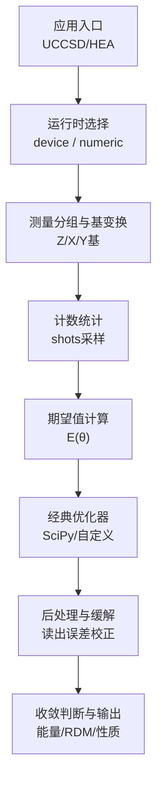
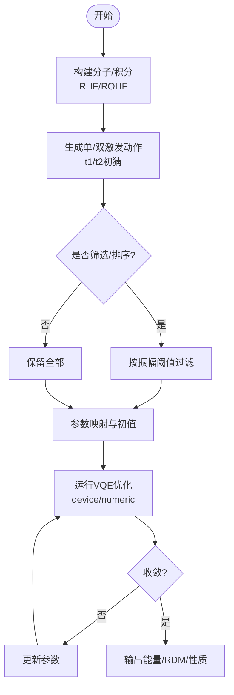
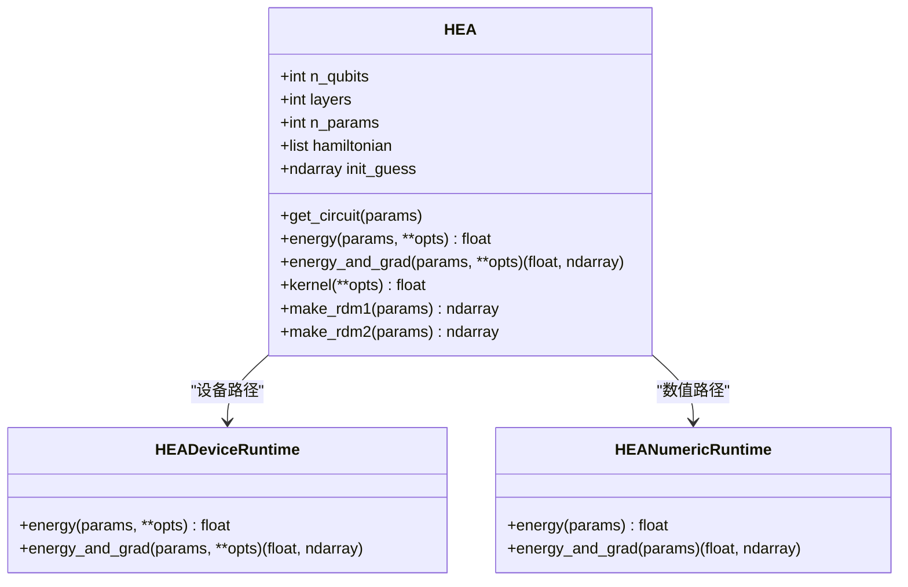
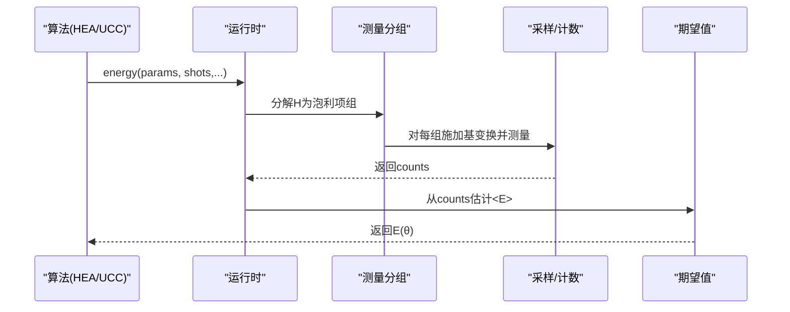
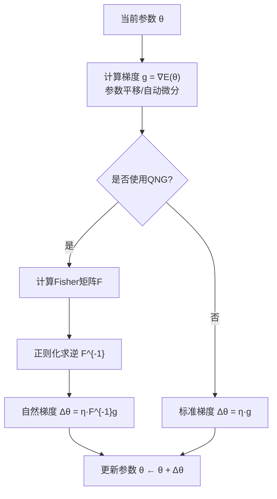
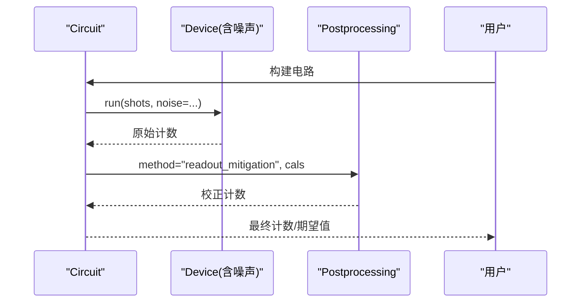
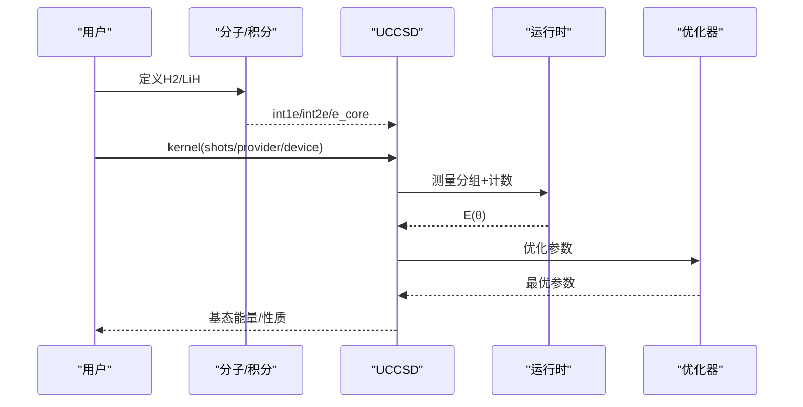
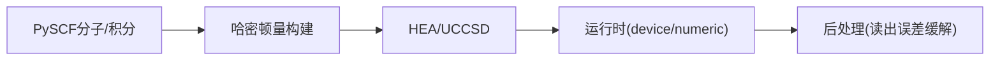

# VQE工作流程

<cite>
**本文引用的文件**
- [README.md](file://README.md)
- [vqe/__init__.py](file://src/tyxonq/applications/chem/algorithms/vqe/__init__.py)
- [uccsd.py](file://src/tyxonq/applications/chem/algorithms/vqe/uccsd.py)
- [hea.py](file://src/tyxonq/applications/chem/algorithms/vqe/hea.py)
- [hea_device_runtime.py](file://src/tyxonq/applications/chem/algorithms/vqe/runtimes/hea_device_runtime.py)
- [ucc_device_runtime.py](file://src/tyxonq/applications/chem/algorithms/vqe/runtimes/ucc_device_runtime.py)
- [hamiltonian_builders.py](file://src/tyxonq/applications/chem/hamiltonian_builders.py)
- [quantum_natural_gradient_optimization.py](file://examples/quantum_natural_gradient_optimization.py)
- [readout_mitigation.py](file://examples/readout_mitigation.py)
- [vqe_simple_hamiltonian.py](file://examples/vqe_simple_hamiltonian.py)
- [hamiltonian_building.py](file://examples/hamiltonian_building.py)
</cite>

## 目录
1. [简介](#简介)
2. [项目结构](#项目结构)
3. [核心组件](#核心组件)
4. [架构总览](#架构总览)
5. [详细组件分析](#详细组件分析)
6. [依赖关系分析](#依赖关系分析)
7. [性能考量](#性能考量)
8. [故障排查指南](#故障排查指南)
9. [结论](#结论)
10. [附录](#附录)

## 简介
本指南面向从“分子定义”到“能量收敛”的完整VQE（变分量子本征求解器）工作流，覆盖：
- 哈密顿量构建与编码（含化学积分→费米子算符→泡利项列表）
- 初始态准备（UCC/UCCSD、HEA等）
- 变分优化（梯度方法、参数平移、自然梯度）
- 后处理与错误缓解（读出误差校正、噪声建模）
- 性能监控、收敛诊断与结果验证
- 实际化学问题端到端案例（H2/LiH等）

TyxonQ提供统一的链式API与双路径执行（设备/数值），在真实量子硬件与模拟器之间无缝切换。

**章节来源**
- [README.md:14-21](file://README.md#L14-L21)
- [README.md:191-206](file://README.md#L191-L206)

## 项目结构
围绕VQE的关键模块分布如下：
- 算法层：UCC家族（UCCSD、ROUCCSD、KUPCCGSD、PUCCD）与HEA
- 运行时：device/numeric两类后端，负责测量分组、计数统计与期望值估计
- 化学工具：从PySCF分子/积分构建哈密顿量，支持多种费米子-量子比特映射
- 示例：TFIM/VQE入门、读出误差缓解、量子自然梯度对比



**图示来源**
- [hea.py:231-337](file://src/tyxonq/applications/chem/algorithms/vqe/hea.py#L231-L337)
- [uccsd.py:268-341](file://src/tyxonq/applications/chem/algorithms/vqe/uccsd.py#L268-L341)
- [readout_mitigation.py:82-133](file://examples/readout_mitigation.py#L82-L133)

**章节来源**
- [vqe/__init__.py:1-49](file://src/tyxonq/applications/chem/algorithms/vqe/__init__.py#L1-L49)
- [README.md:191-206](file://README.md#L191-L206)

## 核心组件
- UCC/UCCSD：基于单双激发的变分波函数，支持活性空间、振幅筛选与多初始化策略
- HEA：硬件高效 Ansatz（RY旋转+CNOT纠缠层），可从分子积分或任意泡利哈密顿量构建
- 运行时：HEADeviceRuntime/HEANumericRuntime、UCCDeviceRuntime/UCCNumericRuntime，统一封装测量分组与期望值计算
- 化学构建：从PySCF RHF/ROHF得到积分，构造费米子算符并映射为量子比特泡利项
- 优化与梯度：默认使用SciPy L-BFGS-B/COBYLA；支持参数平移梯度；示例展示量子自然梯度（QNG）

**章节来源**
- [uccsd.py:18-154](file://src/tyxonq/applications/chem/algorithms/vqe/uccsd.py#L18-L154)
- [hea.py:28-124](file://src/tyxonq/applications/chem/algorithms/vqe/hea.py#L28-L124)
- [hea.py:231-337](file://src/tyxonq/applications/chem/algorithms/vqe/hea.py#L231-L337)
- [hamiltonian_builders.py](file://src/tyxonq/applications/chem/hamiltonian_builders.py)

## 架构总览
下图展示了从分子到能量的端到端流程，包括两种典型Ansatz（UCCSD与HEA）、运行时选择、测量分组、优化与后处理。

```mermaid
sequenceDiagram
participant User as "用户"
participant Chem as "化学构建<br/>hamiltonian_builders"
participant Algo as "算法层<br/>UCCSD/HEA"
participant RT as "运行时<br/>device/numeric"
participant Opt as "优化器<br/>SciPy/QNG"
participant Post as "后处理<br/>读出误差缓解"
User->>Chem : 输入分子/积分
Chem-->>Algo : 泡利哈密顿量项列表
User->>Algo : 选择Ansatz(UCCSD/HEA)
Algo->>RT : energy(params, shots/provider/device)
RT-->>Algo : 期望值E(θ)
loop 优化迭代
Algo->>Opt : 目标函数(可带梯度)
Opt-->>Algo : 更新参数
end
Algo->>Post : 可选读出误差校正/噪声分析
Post-->>User : 收敛能量/RDM/性质
```

**图示来源**
- [hea.py:231-337](file://src/tyxonq/applications/chem/algorithms/vqe/hea.py#L231-L337)
- [uccsd.py:268-341](file://src/tyxonq/applications/chem/algorithms/vqe/uccsd.py#L268-L341)
- [readout_mitigation.py:82-133](file://examples/readout_mitigation.py#L82-L133)

## 详细组件分析

### UCCSD（单位耦合簇单双激发）
- 作用：以|ψ⟩=exp(T−T†)|HF⟩形式近似基态，包含单/双激发算符
- 关键能力：活性空间、振幅筛选、MP2/CCSD/零初值、对称性处理、设备/数值双路径
- 典型调用：构造UCCSD实例→设置运行选项→调用kernel()进行优化



**图示来源**
- [uccsd.py:268-341](file://src/tyxonq/applications/chem/algorithms/vqe/uccsd.py#L268-L341)

**章节来源**
- [uccsd.py:18-154](file://src/tyxonq/applications/chem/algorithms/vqe/uccsd.py#L18-L154)
- [uccsd.py:268-341](file://src/tyxonq/applications/chem/algorithms/vqe/uccsd.py#L268-L341)

### HEA（硬件高效 Ansatz）
- 电路结构：初始RY层 + 多层“CNOT链 + RY旋转”，参数规模 (layers+1)×n
- 构建方式：from_molecule/from_integral/from_qiskit_circuit，支持parity/JW/BK映射
- 能量与梯度：energy()/energy_and_grad()，设备路径采用计数估计，数值路径解析计算
- 优化：默认SciPy L-BFGS-B/COBYLA；支持将shots/provider/device透传到运行时



**图示来源**
- [hea.py:28-124](file://src/tyxonq/applications/chem/algorithms/vqe/hea.py#L28-L124)
- [hea.py:231-337](file://src/tyxonq/applications/chem/algorithms/vqe/hea.py#L231-L337)

**章节来源**
- [hea.py:125-208](file://src/tyxonq/applications/chem/algorithms/vqe/hea.py#L125-L208)
- [hea.py:231-337](file://src/tyxonq/applications/chem/algorithms/vqe/hea.py#L231-L337)

### 运行时与测量分组
- device运行时：对哈密顿量进行按基分组（Z/X/Y），执行基变换与Z基测量，统计计数估计期望值
- numeric运行时：直接statevector/MPS计算精确期望值，避免采样噪声
- 通过HEADeviceRuntime/UCCDeviceRuntime统一接口，屏蔽底层差异



**图示来源**
- [hea.py:231-266](file://src/tyxonq/applications/chem/algorithms/vqe/hea.py#L231-L266)
- [ucc_device_runtime.py](file://src/tyxonq/applications/chem/algorithms/vqe/runtimes/ucc_device_runtime.py)
- [hea_device_runtime.py](file://src/tyxonq/applications/chem/algorithms/vqe/runtimes/hea_device_runtime.py)

**章节来源**
- [hea.py:231-266](file://src/tyxonq/applications/chem/algorithms/vqe/hea.py#L231-L266)

### 梯度计算方法
- 参数平移（Parameter Shift）：对每个参数θ_k，g_k = 0.5[E(θ_k+s) − E(θ_k−s)]，适用于可微门
- 量子自然梯度（QNG）：利用量子Fisher信息矩阵F预条件梯度方向，提升收敛性与几何不变性
- TyxonQ中：HEA默认参数平移；示例演示QNG实现与对比



**图示来源**
- [hea.py:249-266](file://src/tyxonq/applications/chem/algorithms/vqe/hea.py#L249-L266)
- [quantum_natural_gradient_optimization.py:230-316](file://examples/quantum_natural_gradient_optimization.py#L230-L316)

**章节来源**
- [hea.py:249-266](file://src/tyxonq/applications/chem/algorithms/vqe/hea.py#L249-L266)
- [quantum_natural_gradient_optimization.py:230-316](file://examples/quantum_natural_gradient_optimization.py#L230-L316)

### 错误缓解与噪声处理
- 读出误差缓解：通过单比特校准矩阵A，对计数进行反卷积校正，恢复理想分布
- 噪声模拟：设备层注入读噪/T1/T2/退极化等，便于评估与调参
- 链式API：Circuit.device(...).postprocessing(method="readout_mitigation", ...).run()



**图示来源**
- [readout_mitigation.py:82-133](file://examples/readout_mitigation.py#L82-L133)

**章节来源**
- [readout_mitigation.py:82-133](file://examples/readout_mitigation.py#L82-L133)

### 实际化学问题案例（H2/LiH）
- 快速上手：通过UCCSD(mol)一键完成HF→积分→UCCSD→VQE优化
- 设备路径：simulator或真实硬件（provider/device/shots）
- 参考能量：可与FCI/CCSD/HF对比，评估误差与收敛质量



**图示来源**
- [README.md:89-106](file://README.md#L89-L106)
- [uccsd.py:155-264](file://src/tyxonq/applications/chem/algorithms/vqe/uccsd.py#L155-L264)

**章节来源**
- [README.md:89-106](file://README.md#L89-L106)
- [uccsd.py:155-264](file://src/tyxonq/applications/chem/algorithms/vqe/uccsd.py#L155-L264)

## 依赖关系分析
- 算法层依赖运行时：HEA/UCCSD通过HEADeviceRuntime/UCCDeviceRuntime访问设备/数值后端
- 化学构建依赖PySCF：从分子/积分构造哈密顿量，再映射为泡利项
- 后处理依赖校准数据：读出误差缓解需要单比特校准矩阵



**图示来源**
- [hea.py:379-433](file://src/tyxonq/applications/chem/algorithms/vqe/hea.py#L379-L433)
- [hamiltonian_builders.py](file://src/tyxonq/applications/chem/hamiltonian_builders.py)
- [readout_mitigation.py:82-133](file://examples/readout_mitigation.py#L82-L133)

**章节来源**
- [hea.py:379-433](file://src/tyxonq/applications/chem/algorithms/vqe/hea.py#L379-L433)
- [hamiltonian_builders.py](file://src/tyxonq/applications/chem/hamiltonian_builders.py)

## 性能考量
- 梯度效率：PyTorch Autograd与参数平移结合，显著降低每步时间
- 测量开销：按基分组减少重复测量；合理shots分配平衡精度与成本
- 数值路径：statevector/MPS用于无噪声基准与RDM计算
- 优化器选择：小系统可用QNG加速收敛；大系统优先L-BFGS-B/COBYLA

[本节为通用指导，不直接分析具体文件]

## 故障排查指南
- 能量不收敛
  - 检查初值与活性空间设置（UCCSD）
  - 调整学习率/最大迭代次数（SciPy options）
  - 增加shots或使用数值路径验证
- 梯度异常
  - 确认门可移位（参数平移适用）
  - QNG需正则化Fisher矩阵，避免奇异
- 读出误差影响大
  - 校准单比特矩阵，使用“inverse”等方法校正
  - 在设备层注入噪声进行压力测试

**章节来源**
- [hea.py:294-337](file://src/tyxonq/applications/chem/algorithms/vqe/hea.py#L294-L337)
- [quantum_natural_gradient_optimization.py:283-295](file://examples/quantum_natural_gradient_optimization.py#L283-L295)
- [readout_mitigation.py:82-133](file://examples/readout_mitigation.py#L82-L133)

## 结论
TyxonQ提供了从分子到能量的完整VQE工作流：灵活的Ansatz（UCCSD/HEA）、统一的运行时抽象、高效的梯度方法与完善的后处理能力。借助链式API与双路径执行，用户可在模拟器与真实硬件间无缝切换，获得稳定、可扩展且贴近硬件的量子化学计算体验。

[本节为总结性内容，不直接分析具体文件]

## 附录
- 入门示例：TFIM VQE、计数法能量估计、读出误差缓解
- 进阶主题：量子自然梯度、活性空间与筛选、噪声建模与校准

**章节来源**
- [vqe_simple_hamiltonian.py:157-255](file://examples/vqe_simple_hamiltonian.py#L157-L255)
- [hamiltonian_building.py:18-93](file://examples/hamiltonian_building.py#L18-L93)
- [quantum_natural_gradient_optimization.py:321-390](file://examples/quantum_natural_gradient_optimization.py#L321-L390)
- [readout_mitigation.py:82-133](file://examples/readout_mitigation.py#L82-L133)