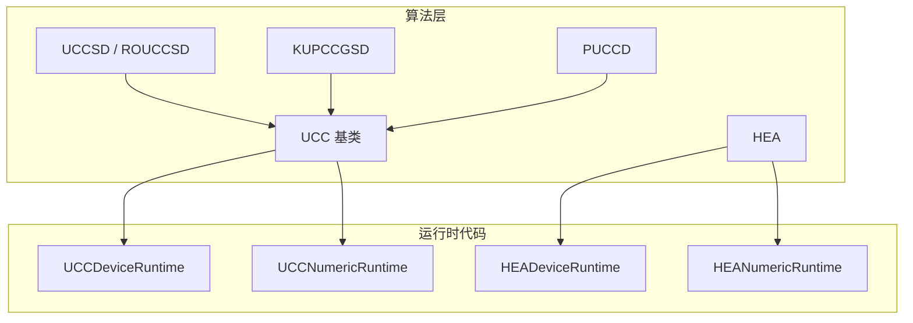
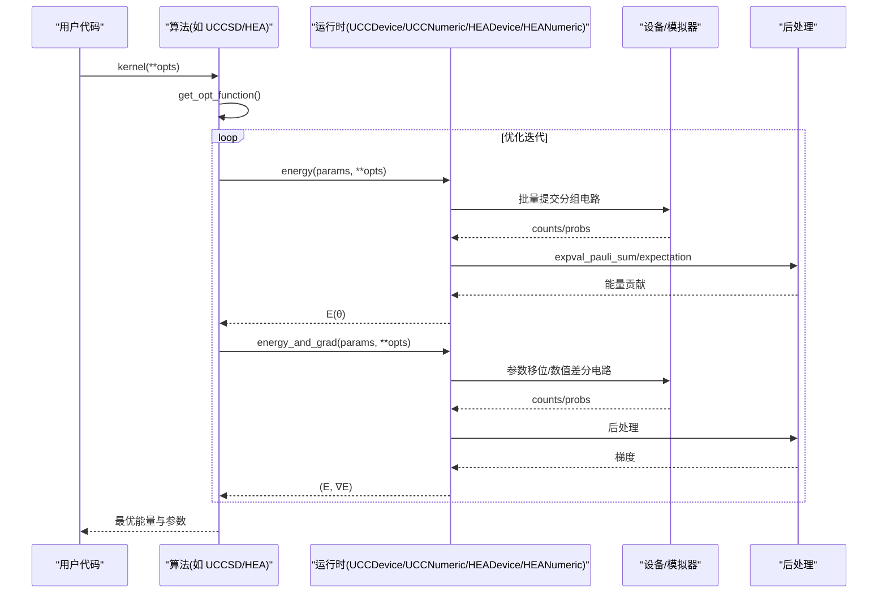
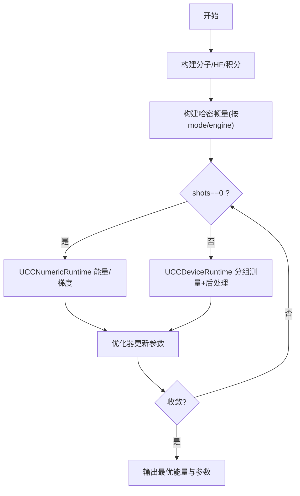
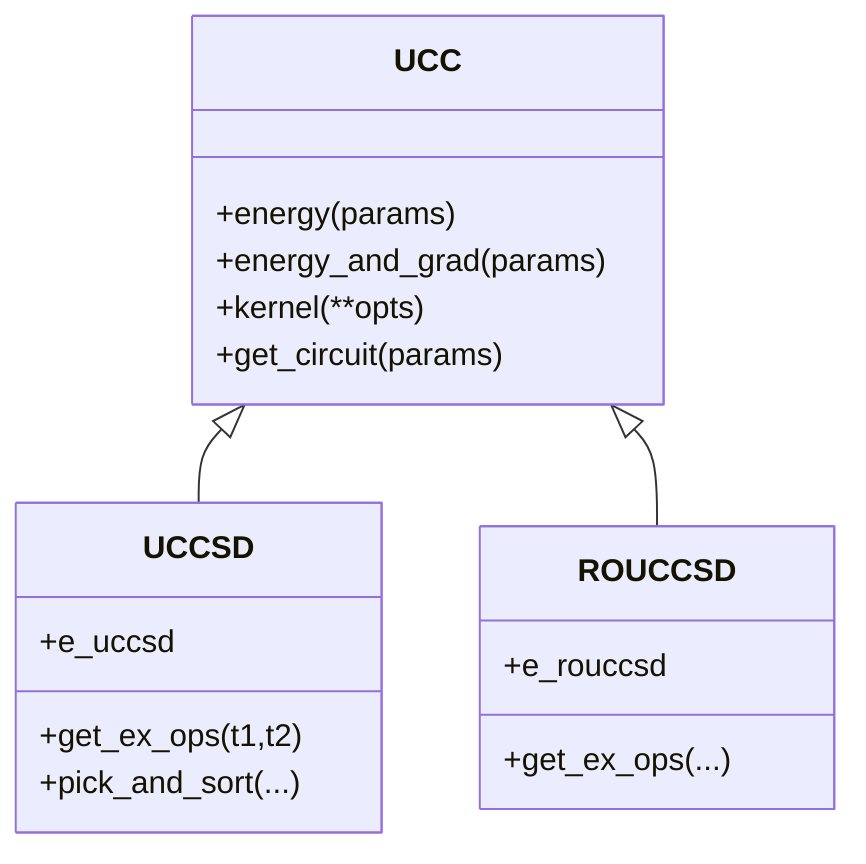
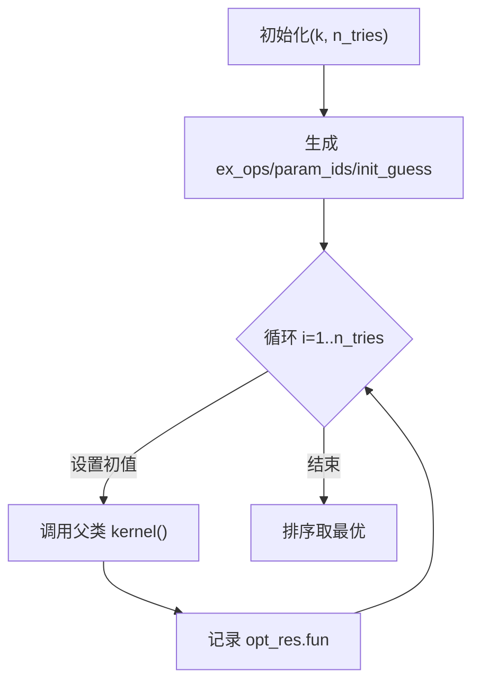
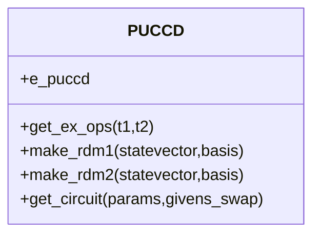
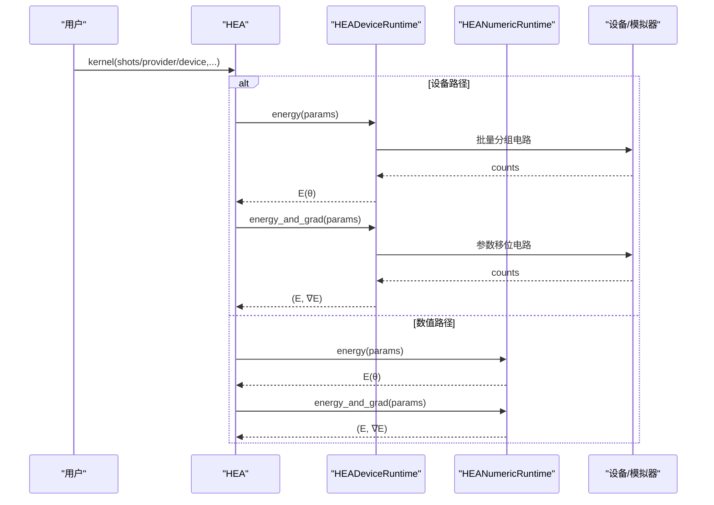
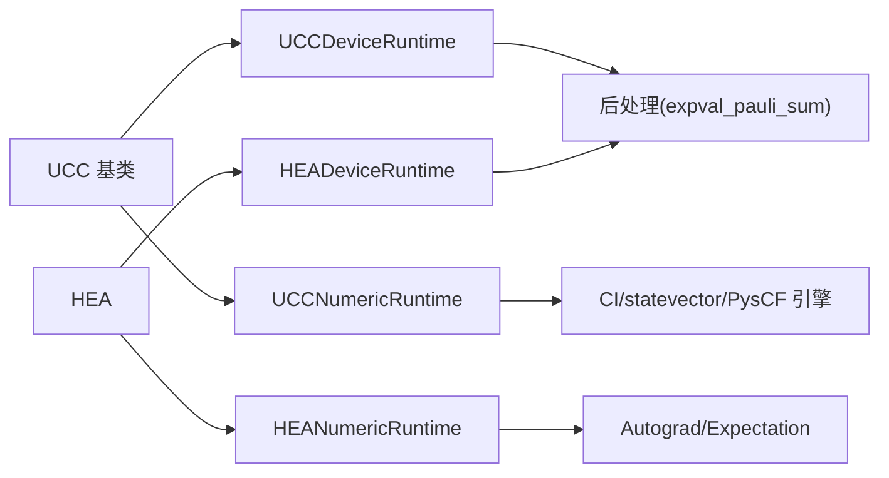

# 变分量子算法

<cite>
**本文引用的文件**
- [ucc_base.py](file://src/tyxonq/applications/chem/algorithms/vqe/ucc_base.py)
- [uccsd.py](file://src/tyxonq/applications/chem/algorithms/vqe/uccsd.py)
- [hea.py](file://src/tyxonq/applications/chem/algorithms/vqe/hea.py)
- [kupccgsd.py](file://src/tyxonq/applications/chem/algorithms/vqe/kupccgsd.py)
- [puccd.py](file://src/tyxonq/applications/chem/algorithms/vqe/puccd.py)
- [ucc_device_runtime.py](file://src/tyxonq/applications/chem/algorithms/vqe/runtimes/ucc_device_runtime.py)
- [ucc_numeric_runtime.py](file://src/tyxonq/applications/chem/algorithms/vqe/runtimes/ucc_numeric_runtime.py)
- [hea_device_runtime.py](file://src/tyxonq/applications/chem/algorithms/vqe/runtimes/hea_device_runtime.py)
- [hea_numeric_runtime.py](file://src/tyxonq/applications/chem/algorithms/vqe/runtimes/hea_numeric_runtime.py)
- [__init__.py](file://src/tyxonq/applications/chem/algorithms/vqe/__init__.py)
- [cloud_uccsd_hea_demo.py](file://examples/cloud_uccsd_hea_demo.py)
</cite>

## 目录
1. [简介](#简介)
2. [项目结构](#项目结构)
3. [核心组件](#核心组件)
4. [架构总览](#架构总览)
5. [详细组件分析](#详细组件分析)
6. [依赖关系分析](#依赖关系分析)
7. [性能考量](#性能考量)
8. [故障排查指南](#故障排查指南)
9. [结论](#结论)
10. [附录](#附录)

## 简介
本文件系统性梳理 TyxonQ 中变分量子本征求解器（VQE）的实现，重点覆盖：
- UCCSD（含 ROUCCSD）、KUPCCGSD、PUCCD 等波函数 ansatz 的原理与实现要点
- HEA（硬件高效 Ansatz）的设计、参数化电路与在不同后端上的执行路径
- VQE 完整工作流：初始态准备、哈密顿量编码、能量计算、梯度计算、参数优化
- 设备端与数值后端的统一接口、分组测量与后处理、并行批处理策略
- 收敛性、误差估计与性能对比建议

## 项目结构
TyxonQ 的 VQE 模块位于 applications/chem/algorithms/vqe 下，按“算法 + 运行时”分层组织：
- 算法层：UCC 基类及具体 ansatz（UCCSD、ROUCCSD、KUPCCGSD、PUCCD），以及 HEA
- 运行时代码：设备端（device）与数值端（numeric）两套 runtime，屏蔽底层差异
- 工具与集成：CI 向量映射、哈密顿量构建、PySCF 求解器适配、云/本地经典计算

**图表来源**
- [ucc_base.py:52-360](file://src/tyxonq/applications/chem/algorithms/vqe/ucc_base.py#L52-L360)
- [ucc_device_runtime.py:25-95](file://src/tyxonq/applications/chem/algorithms/vqe/runtimes/ucc_device_runtime.py#L25-L95)
- [ucc_numeric_runtime.py:42-84](file://src/tyxonq/applications/chem/algorithms/vqe/runtimes/ucc_numeric_runtime.py#L42-L84)
- [hea_device_runtime.py:21-45](file://src/tyxonq/applications/chem/algorithms/vqe/runtimes/hea_device_runtime.py#L21-L45)
- [hea_numeric_runtime.py:15-24](file://src/tyxonq/applications/chem/algorithms/vqe/runtimes/hea_numeric_runtime.py#L15-L24)

**章节来源**
- [__init__.py:1-49](file://src/tyxonq/applications/chem/algorithms/vqe/__init__.py#L1-L49)

## 核心组件
- UCC 基类：提供分子/HF 初始化、活性空间、哈密顿量构建、energy/energy_and_grad 的统一入口、优化流程（默认 L-BFGS-B）与 PySCF 兼容接口。支持 device/numeric 双后端与 shots=0 解析快径。
- UCCSD/ROUCCSD：基于单/双激发算符的参数化 ansatz；支持 MP2/CCSD/FE/零初值；可筛选与排序双激发项；提供 e_uccsd/e_rouccsd 便捷属性。
- KUPCCGSD：k-UpCCGSD，重复 k 层广义单/双激发（配对双激发），多初值尝试并取最优。
- PUCCD：配对 UCCD，仅考虑自旋配对的双激发，支持 Givens-Swap 电路与 MO/AO 基 RDM。
- HEA：RY-only 硬件高效 ansatz，支持从积分/分子直接构建、外部模板电路、parity/JW/BK 映射、RDM 计算与 PySCF FCI 兼容求解器包装。

**章节来源**
- [ucc_base.py:52-360](file://src/tyxonq/applications/chem/algorithms/vqe/ucc_base.py#L52-L360)
- [uccsd.py:18-355](file://src/tyxonq/applications/chem/algorithms/vqe/uccsd.py#L18-L355)
- [uccsd.py:360-470](file://src/tyxonq/applications/chem/algorithms/vqe/uccsd.py#L360-L470)
- [kupccgsd.py:15-152](file://src/tyxonq/applications/chem/algorithms/vqe/kupccgsd.py#L15-L152)
- [puccd.py:20-188](file://src/tyxonq/applications/chem/algorithms/vqe/puccd.py#L20-L188)
- [hea.py:28-124](file://src/tyxonq/applications/chem/algorithms/vqe/hea.py#L28-L124)

## 架构总览
VQE 在 TyxonQ 中的典型调用链如下：用户选择算法（UCCSD/KUPCCGSD/PUCCD/HEA）→ 构造哈密顿量 → energy/energy_and_grad → 优化器更新参数 → 收敛判定。设备端通过分组测量与统一后处理聚合期望值；数值端使用 CI/statevector/PysCF 引擎进行精确或近似计算。

**图表来源**
- [ucc_base.py:521-581](file://src/tyxonq/applications/chem/algorithms/vqe/ucc_base.py#L521-L581)
- [ucc_device_runtime.py:293-448](file://src/tyxonq/applications/chem/algorithms/vqe/runtimes/ucc_device_runtime.py#L293-L448)
- [ucc_numeric_runtime.py:277-329](file://src/tyxonq/applications/chem/algorithms/vqe/runtimes/ucc_numeric_runtime.py#L277-L329)
- [hea_device_runtime.py:121-263](file://src/tyxonq/applications/chem/algorithms/vqe/runtimes/hea_device_runtime.py#L121-L263)
- [hea_numeric_runtime.py:71-103](file://src/tyxonq/applications/chem/algorithms/vqe/runtimes/hea_numeric_runtime.py#L71-L103)

## 详细组件分析

### UCC 基类与通用工作流
- 分子与 HF：自动运行 RHF/ROHF，获取积分与 e_core；支持活性空间与轨道选择；可选云端经典计算。
- 哈密顿量：根据 mode（fermion/qubit/hcb）与 numeric_engine 选择合适形式（FCI 函数/稀疏矩阵）。
- 能量与梯度：
  - shots=0 走解析数值路径（UCCNumericRuntime），否则走设备路径（UCCDeviceRuntime）。
  - 设备端采用分组测量与前缀旋转缓存，统一后处理聚合能量。
  - 梯度：UCC 设备端对 UCC 能量表面偶次谐波特性采用两移位 PSR（π/8, π/4），避免传统 ±π/2 为零的问题；HEA 设备端使用标准 ±π/2。
- 优化：默认 L-BFGS-B，支持 free-gradient（COBYLA）；内置同点缓存减少重复采样成本。

**图表来源**
- [ucc_base.py:370-461](file://src/tyxonq/applications/chem/algorithms/vqe/ucc_base.py#L370-L461)
- [ucc_base.py:463-510](file://src/tyxonq/applications/chem/algorithms/vqe/ucc_base.py#L463-L510)
- [ucc_base.py:521-581](file://src/tyxonq/applications/chem/algorithms/vqe/ucc_base.py#L521-L581)
- [ucc_device_runtime.py:293-448](file://src/tyxonq/applications/chem/algorithms/vqe/runtimes/ucc_device_runtime.py#L293-L448)
- [ucc_numeric_runtime.py:277-329](file://src/tyxonq/applications/chem/algorithms/vqe/runtimes/ucc_numeric_runtime.py#L277-L329)

**章节来源**
- [ucc_base.py:52-360](file://src/tyxonq/applications/chem/algorithms/vqe/ucc_base.py#L52-L360)
- [ucc_base.py:416-510](file://src/tyxonq/applications/chem/algorithms/vqe/ucc_base.py#L416-L510)
- [ucc_base.py:521-581](file://src/tyxonq/applications/chem/algorithms/vqe/ucc_base.py#L521-L581)

### UCCSD 与 ROUCCSD
- UCCSD：单/双激发算符组合，支持 MP2/CCSD/FE/零初值；可筛选与排序双激发项；e_uccsd 便捷访问。
- ROUCCSD：针对开壳层，显式构造 α/β 单/双激发，参数与初值对齐。

**图表来源**
- [ucc_base.py:52-360](file://src/tyxonq/applications/chem/algorithms/vqe/ucc_base.py#L52-L360)
- [uccsd.py:18-355](file://src/tyxonq/applications/chem/algorithms/vqe/uccsd.py#L18-L355)
- [uccsd.py:360-470](file://src/tyxonq/applications/chem/algorithms/vqe/uccsd.py#L360-L470)

**章节来源**
- [uccsd.py:18-355](file://src/tyxonq/applications/chem/algorithms/vqe/uccsd.py#L18-L355)
- [uccsd.py:360-470](file://src/tyxonq/applications/chem/algorithms/vqe/uccsd.py#L360-L470)

### KUPCCGSD（k-UpCCGSD）
- 特点：重复 k 层广义单/双激发（配对双激发），随机多初值尝试，取最优结果；适合需要更强表达能力的场景。
- 工作流：继承 UCC 基类，重写 get_ex_ops 生成层级结构，并在 kernel 中循环多次优化。

**图表来源**
- [kupccgsd.py:121-152](file://src/tyxonq/applications/chem/algorithms/vqe/kupccgsd.py#L121-L152)
- [kupccgsd.py:153-204](file://src/tyxonq/applications/chem/algorithms/vqe/kupccgsd.py#L153-L204)

**章节来源**
- [kupccgsd.py:15-152](file://src/tyxonq/applications/chem/algorithms/vqe/kupccgsd.py#L15-L152)
- [kupccgsd.py:153-293](file://src/tyxonq/applications/chem/algorithms/vqe/kupccgsd.py#L153-L293)

### PUCCD（配对 UCCD）
- 特点：仅考虑自旋配对的双激发，参数更少、电路更浅；支持 Givens-Swap 电路与 MO/AO 基 RDM。
- 适用场景：闭壳层或强关联受限系统，追求效率与可解释性。

**图表来源**
- [puccd.py:20-188](file://src/tyxonq/applications/chem/algorithms/vqe/puccd.py#L20-L188)

**章节来源**
- [puccd.py:20-188](file://src/tyxonq/applications/chem/algorithms/vqe/puccd.py#L20-L188)

### HEA（硬件高效 Ansatz）
- 设计理念：RY-only 层叠 + CNOT 链，参数规模 (layers+1)×n_qubits；天然适配 NISQ 约束。
- 构建方式：可从分子/积分直接构建，支持 parity/JW/BK 映射；支持外部模板电路（如 Qiskit RealAmplitudes）。
- 运行路径：设备端 HEADeviceRuntime 分组测量 + 后处理；数值端 HEANumericRuntime 使用 statevector/autograd 路径。
- RDM：支持 spin-traced 1RDM/2RDM 计算（需 from_integral/from_molecule 携带 mapping 与电子数信息）。

**图表来源**
- [hea.py:231-266](file://src/tyxonq/applications/chem/algorithms/vqe/hea.py#L231-L266)
- [hea_device_runtime.py:121-263](file://src/tyxonq/applications/chem/algorithms/vqe/runtimes/hea_device_runtime.py#L121-L263)
- [hea_numeric_runtime.py:71-103](file://src/tyxonq/applications/chem/algorithms/vqe/runtimes/hea_numeric_runtime.py#L71-L103)

**章节来源**
- [hea.py:28-124](file://src/tyxonq/applications/chem/algorithms/vqe/hea.py#L28-L124)
- [hea.py:209-337](file://src/tyxonq/applications/chem/algorithms/vqe/hea.py#L209-L337)
- [hea.py:379-494](file://src/tyxonq/applications/chem/algorithms/vqe/hea.py#L379-L494)
- [hea.py:608-705](file://src/tyxonq/applications/chem/algorithms/vqe/hea.py#L608-L705)

## 依赖关系分析
- 算法到运行时：UCC 族通过 runtime 选项路由至 UCCDeviceRuntime/UCCNumericRuntime；HEA 路由至 HEADeviceRuntime/HEANumericRuntime。
- 运行时内部：
  - 设备端：Hamiltonian 分组 → 前缀旋转缓存 → 统一 Circuit.run() 批量执行 → 后处理聚合。
  - 数值端：CI/statevector/PysCF 引擎选择，缓存 CI strings 与算子张量，解析梯度。
- 外部依赖：OpenFermion（QubitOperator/FermionOperator）、PySCF（HF/MP2/CCSD/FCI）、SciPy 优化器。

**图表来源**
- [ucc_base.py:416-510](file://src/tyxonq/applications/chem/algorithms/vqe/ucc_base.py#L416-L510)
- [ucc_device_runtime.py:293-448](file://src/tyxonq/applications/chem/algorithms/vqe/runtimes/ucc_device_runtime.py#L293-L448)
- [ucc_numeric_runtime.py:277-329](file://src/tyxonq/applications/chem/algorithms/vqe/runtimes/ucc_numeric_runtime.py#L277-L329)
- [hea_device_runtime.py:121-263](file://src/tyxonq/applications/chem/algorithms/vqe/runtimes/hea_device_runtime.py#L121-L263)
- [hea_numeric_runtime.py:71-103](file://src/tyxonq/applications/chem/algorithms/vqe/runtimes/hea_numeric_runtime.py#L71-L103)

**章节来源**
- [ucc_base.py:416-510](file://src/tyxonq/applications/chem/algorithms/vqe/ucc_base.py#L416-L510)
- [ucc_device_runtime.py:293-448](file://src/tyxonq/applications/chem/algorithms/vqe/runtimes/ucc_device_runtime.py#L293-L448)
- [ucc_numeric_runtime.py:277-329](file://src/tyxonq/applications/chem/algorithms/vqe/runtimes/ucc_numeric_runtime.py#L277-L329)
- [hea_device_runtime.py:121-263](file://src/tyxonq/applications/chem/algorithms/vqe/runtimes/hea_device_runtime.py#L121-L263)
- [hea_numeric_runtime.py:71-103](file://src/tyxonq/applications/chem/algorithms/vqe/runtimes/hea_numeric_runtime.py#L71-L103)

## 性能考量
- 设备端测量成本：
  - 分组测量与 prefix 缓存显著降低重复开销；batch 提交减少通信轮次。
  - 真机模式默认 shots=2048；模拟器默认 shots=0 走解析路径，避免噪声影响优化与 RDM。
- 梯度计算：
  - UCC 设备端采用两移位 PSR（π/8, π/4），匹配偶次谐波能量面，避免梯度为零。
  - HEA 设备端使用标准 ±π/2（RY 半角约定正确）。
- 数值端加速：
  - CI/statevector/PysCF 引擎选择；CI strings 与算子张量全局缓存；实例级 init_state 转换缓存。
- 优化器：
  - 默认 L-BFGS-B；free-gradient 时回退 COBYLA；同点缓存减少 f(x) 与 jac(x) 重复采样。

[本节为通用指导，不直接分析具体文件]

## 故障排查指南
- 常见错误与定位：
  - 参数长度不匹配：检查 ex_ops/param_ids 与 params 长度一致性（UCC 基类会校验）。
  - 未知 runtime/mode：确认传入 runtime="device"/"numeric" 与 mode="fermion"/"qubit"/"hcb"。
  - 真机异步等待：设备端 run() 默认在非模拟器 provider 下等待异步结果，避免空 counts。
  - 梯度为零：UCC 设备端已修正两移位规则；若仍为零，检查是否误用 ±π/2。
- 调试建议：
  - 先以 shots=0 验证数值路径能量/梯度一致性，再切换设备路径。
  - 打印电路摘要与优化结果，确认层数、参数规模与收敛状态。
  - 使用示例脚本快速复现：例如 cloud_uccsd_hea_demo.py 演示本地/云端 HF 与 HEA/UCCSD 的等价性。

**章节来源**
- [ucc_base.py:400-415](file://src/tyxonq/applications/chem/algorithms/vqe/ucc_base.py#L400-L415)
- [ucc_device_runtime.py:132-185](file://src/tyxonq/applications/chem/algorithms/vqe/runtimes/ucc_device_runtime.py#L132-L185)
- [hea_device_runtime.py:53-106](file://src/tyxonq/applications/chem/algorithms/vqe/runtimes/hea_device_runtime.py#L53-L106)
- [cloud_uccsd_hea_demo.py:28-54](file://examples/cloud_uccsd_hea_demo.py#L28-L54)

## 结论
TyxonQ 的 VQE 实现了统一的算法-运行时抽象，既支持物理启发的 UCC 族（UCCSD/KUPCCGSD/PUCCD），也支持硬件高效的 HEA。设备端通过分组测量与后处理实现高效能量/梯度估计，数值端提供高精度参考与加速。结合 PySCF 生态与云端经典计算，可在不同硬件平台上灵活部署。推荐：
- 小体系/高精度：优先 UCCSD/PUCCD，配合数值路径验证。
- 大体系/硬件限制：HEA 或 KUPCCGSD，结合 active space 与筛选策略。
- 真机实验：合理设置 shots 与优化器，利用分组测量与缓存降低开销。

[本节为总结，不直接分析具体文件]

## 附录
- 快速上手示例：参见 examples/cloud_uccsd_hea_demo.py，展示 UCCSD 与 HEA 在本地/云端 HF 下的等价性与易用性。
- 相关文档：开发者指南、技术参考与性能优化文档可进一步查阅仓库 docs 目录。

**章节来源**
- [cloud_uccsd_hea_demo.py:28-54](file://examples/cloud_uccsd_hea_demo.py#L28-L54)