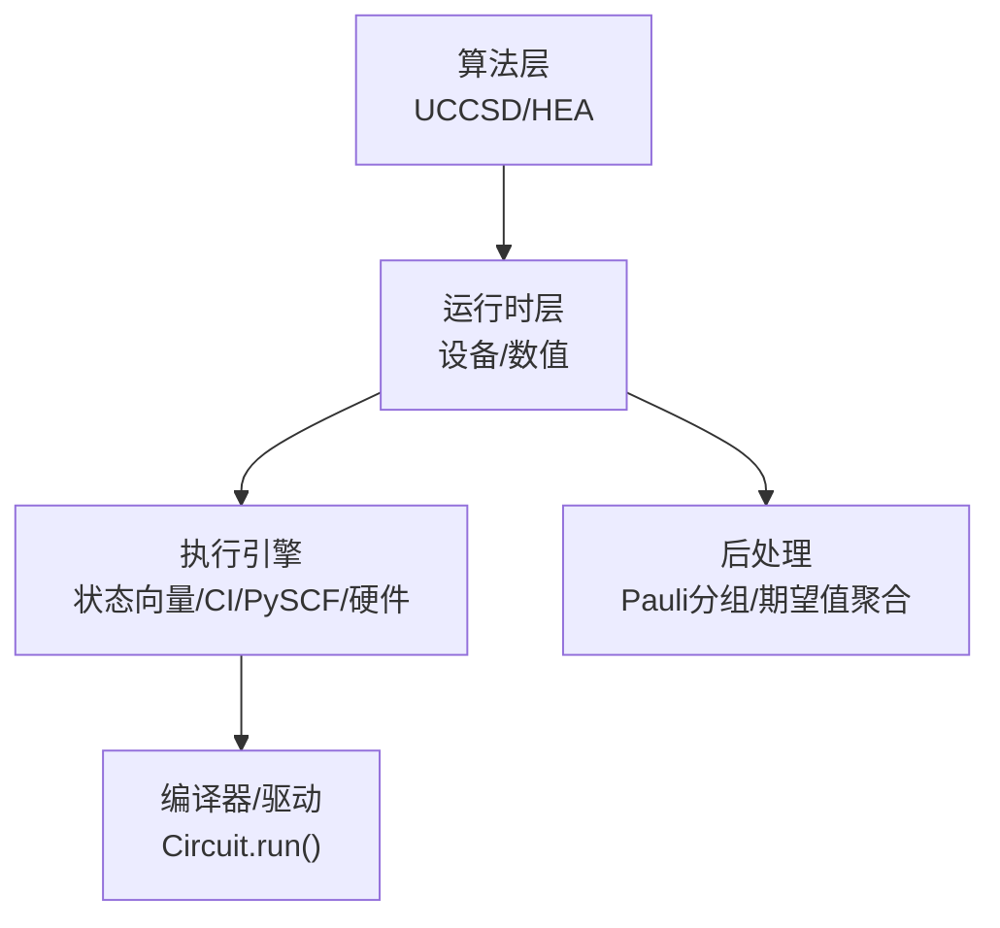
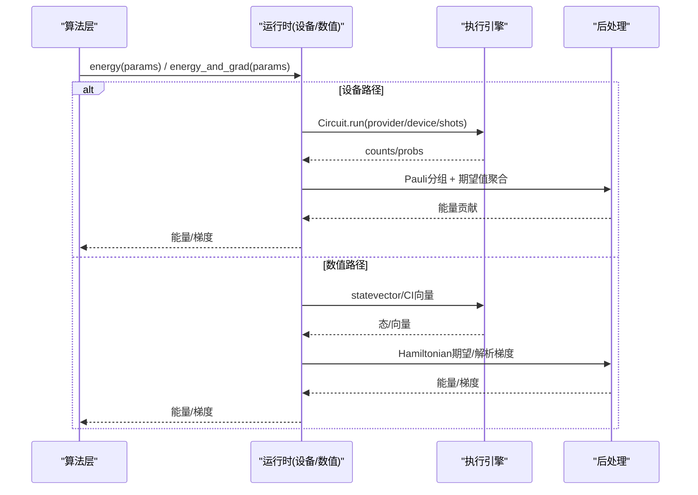
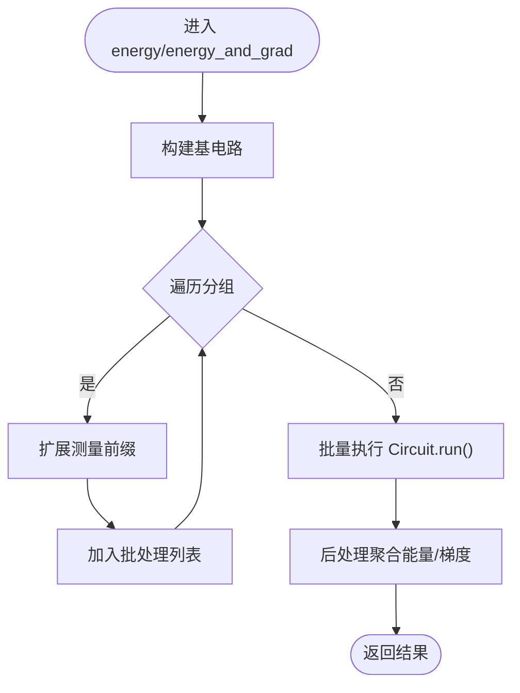
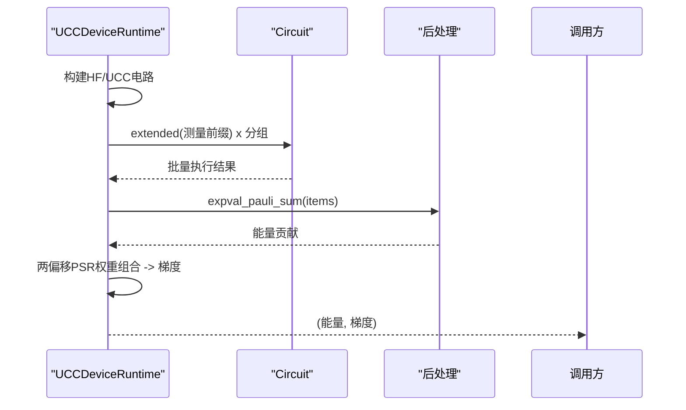
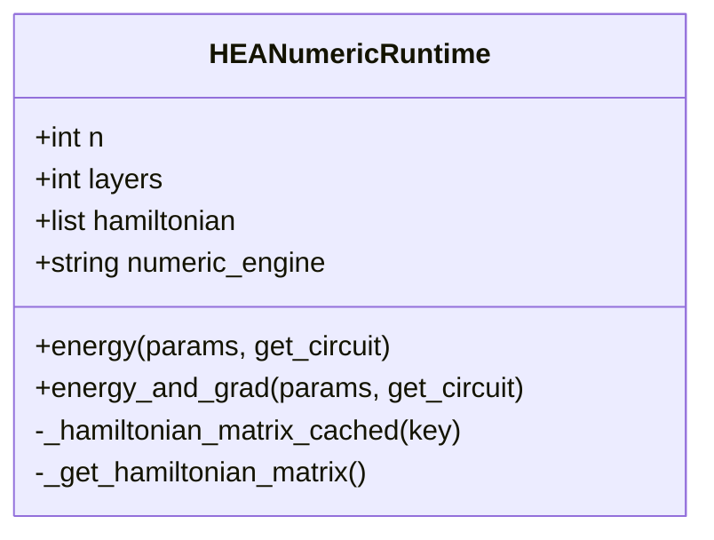
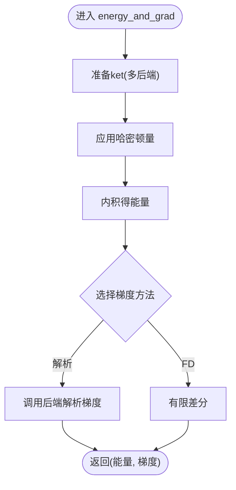
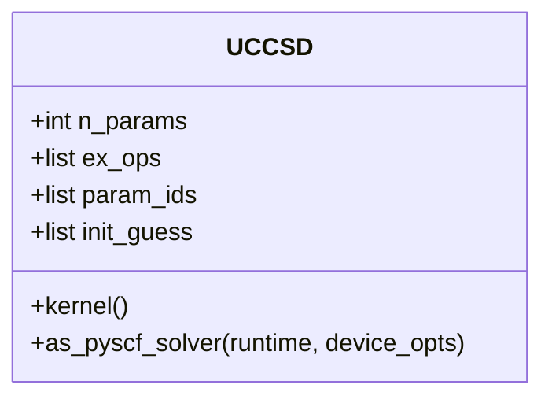
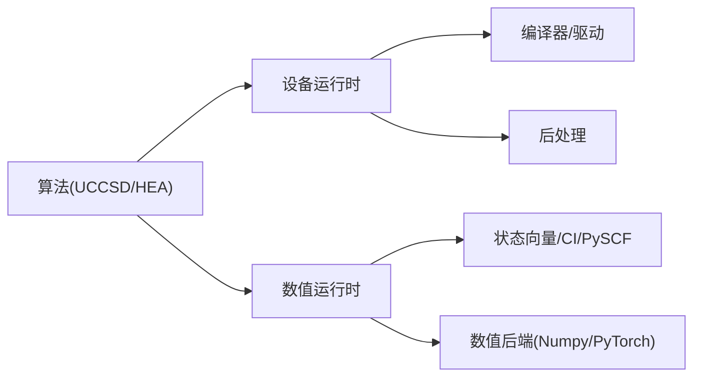

# 运行时和优化

<cite>
**本文引用的文件**
- [hea_device_runtime.py](file://src/tyxonq/applications/chem/algorithms/vqe/runtimes/hea_device_runtime.py)
- [ucc_device_runtime.py](file://src/tyxonq/applications/chem/algorithms/vqe/runtimes/ucc_device_runtime.py)
- [hea_numeric_runtime.py](file://src/tyxonq/applications/chem/algorithms/vqe/runtimes/hea_numeric_runtime.py)
- [ucc_numeric_runtime.py](file://src/tyxonq/applications/chem/algorithms/vqe/runtimes/ucc_numeric_runtime.py)
- [uccsd.py](file://src/tyxonq/applications/chem/algorithms/vqe/uccsd.py)
- [runtime_optimization.rst](file://docs/source/quantum_chemistry/runtimes/runtime_optimization.rst)
- [performance_optimization_tips.md](file://examples/performance_optimization_tips.md)
- [gradient_benchmark.py](file://examples/gradient_benchmark.py)
- [vqeh2o_benchmark.py](file://examples/vqeh2o_benchmark.py)
</cite>

## 目录
1. [简介](#简介)
2. [项目结构](#项目结构)
3. [核心组件](#核心组件)
4. [架构总览](#架构总览)
5. [详细组件分析](#详细组件分析)
6. [依赖关系分析](#依赖关系分析)
7. [性能考量](#性能考量)
8. [故障排查指南](#故障排查指南)
9. [结论](#结论)
10. [附录](#附录)

## 简介
本文件面向TyxonQ量子化学运行时与优化系统，聚焦以下目标：
- 解释设备运行时与数值运行时的区别、选择策略与一致性保障。
- 详解HEA与UCC在不同后端上的优化实现（批处理执行、测量分组、梯度计算）。
- 说明批处理执行、内存管理与并行计算策略。
- 提供性能基准测试结果与优化建议。
- 展示如何自定义运行时配置以满足特定需求。
- 包含错误处理与调试技巧。
- 解释如何将量子化学计算与经典优化器高效集成。

## 项目结构
TyxonQ在量子化学路径中通过“算法层—运行时层—执行引擎”的分层设计，将问题建模、电路构建、测量后处理与优化循环解耦。关键目录与职责如下：
- 算法层：VQE相关算法（如UCCSD）封装分子、活性空间、算符生成与求解器适配。
- 运行时层：按“设备/数值”双路径提供能量与梯度接口，统一批处理执行与后处理。
- 执行引擎：状态向量、CI向量、PySCF等数值后端；模拟器与硬件驱动。
- 文档与示例：性能优化指南、基准脚本与最佳实践。

图表来源
- [uccsd.py:155-255](file://src/tyxonq/applications/chem/algorithms/vqe/uccsd.py#L155-L255)
- [hea_device_runtime.py:21-45](file://src/tyxonq/applications/chem/algorithms/vqe/runtimes/hea_device_runtime.py#L21-L45)
- [ucc_device_runtime.py:25-70](file://src/tyxonq/applications/chem/algorithms/vqe/runtimes/ucc_device_runtime.py#L25-L70)
- [ucc_numeric_runtime.py:42-84](file://src/tyxonq/applications/chem/algorithms/vqe/runtimes/ucc_numeric_runtime.py#L42-L84)

章节来源
- [uccsd.py:155-255](file://src/tyxonq/applications/chem/algorithms/vqe/uccsd.py#L155-L255)
- [runtime_optimization.rst:22-48](file://docs/source/quantum_chemistry/runtimes/runtime_optimization.rst#L22-L48)

## 核心组件
- HEA设备运行时：基于RY ansatz或外部模板，统一批处理测量与Pauli分组，支持参数平移梯度。
- UCC设备运行时：HF初态+可参量化激发，采用两偏移PSR或中心差分梯度，统一批处理执行。
- HEA数值运行时：通过Circuit.state()与Hamiltonian矩阵求期望，支持自动微分（PyTorch）或数值梯度。
- UCC数值运行时：多后端（statevector/civector/pyscf），解析梯度与缓存CI字符串/算子张量，兼容NumPy 2.0。
- UCCSD算法：活性空间、筛选排序、初始猜测、PySCF求解器适配。

章节来源
- [hea_device_runtime.py:21-176](file://src/tyxonq/applications/chem/algorithms/vqe/runtimes/hea_device_runtime.py#L21-L176)
- [ucc_device_runtime.py:25-448](file://src/tyxonq/applications/chem/algorithms/vqe/runtimes/ucc_device_runtime.py#L25-L448)
- [hea_numeric_runtime.py:15-103](file://src/tyxonq/applications/chem/algorithms/vqe/runtimes/hea_numeric_runtime.py#L15-L103)
- [ucc_numeric_runtime.py:42-329](file://src/tyxonq/applications/chem/algorithms/vqe/runtimes/ucc_numeric_runtime.py#L42-L329)
- [uccsd.py:155-355](file://src/tyxonq/applications/chem/algorithms/vqe/uccsd.py#L155-L355)

## 架构总览
TyxonQ的运行时架构强调“双路径一致性”：同一API在设备与数值路径下语义一致，便于开发与生产切换。

图表来源
- [hea_device_runtime.py:53-106](file://src/tyxonq/applications/chem/algorithms/vqe/runtimes/hea_device_runtime.py#L53-L106)
- [ucc_device_runtime.py:132-185](file://src/tyxonq/applications/chem/algorithms/vqe/runtimes/ucc_device_runtime.py#L132-L185)
- [hea_numeric_runtime.py:71-103](file://src/tyxonq/applications/chem/algorithms/vqe/runtimes/hea_numeric_runtime.py#L71-L103)
- [ucc_numeric_runtime.py:277-329](file://src/tyxonq/applications/chem/algorithms/vqe/runtimes/ucc_numeric_runtime.py#L277-L329)

## 详细组件分析

### HEA设备运行时
- 功能要点
  - 支持RY ansatz或外部模板构造电路。
  - 预分组Hamiltonian并缓存测量前缀操作，减少重复构建。
  - 统一批处理执行：一次构建基电路，扩展为各分组电路批量提交。
  - 参数平移梯度：对每个参数构造±π/2变体，合并批次执行。
- 关键流程
  - 能量计算：基电路 + 各分组扩展 → 批量run → 后处理聚合。
  - 梯度计算：基电路 + 每个参数的±偏移电路 → 批量run → 组合梯度。
- 优化点
  - 前缀操作缓存、分组复用、统一链式run避免分支逻辑。

图表来源
- [hea_device_runtime.py:121-176](file://src/tyxonq/applications/chem/algorithms/vqe/runtimes/hea_device_runtime.py#L121-L176)
- [hea_device_runtime.py:178-263](file://src/tyxonq/applications/chem/algorithms/vqe/runtimes/hea_device_runtime.py#L178-L263)

章节来源
- [hea_device_runtime.py:21-299](file://src/tyxonq/applications/chem/algorithms/vqe/runtimes/hea_device_runtime.py#L21-L299)

### UCC设备运行时
- 功能要点
  - HF初态 + 可参量化激发，支持多种模式（fermion/qubit/hcb）。
  - 两偏移PSR梯度：针对UCC能量表面偶次谐波特性，使用π/8与π/4偏移加权组合，避免传统±π/2为零的问题。
  - 可选小步长中心差分梯度，适用于任意谐波但噪声放大。
  - 统一批处理执行与后处理。
- 关键流程
  - 能量：HF/UCC电路 → 分组扩展 → 批量run → 聚合。
  - 梯度：基电路 + 多偏移变体 → 批量run → 权重组合得到梯度。
- 优化点
  - 前缀缓存、分组复用、参数偏移批处理、异步等待控制。

图表来源
- [ucc_device_runtime.py:200-238](file://src/tyxonq/applications/chem/algorithms/vqe/runtimes/ucc_device_runtime.py#L200-L238)
- [ucc_device_runtime.py:293-313](file://src/tyxonq/applications/chem/algorithms/vqe/runtimes/ucc_device_runtime.py#L293-L313)
- [ucc_device_runtime.py:315-448](file://src/tyxonq/applications/chem/algorithms/vqe/runtimes/ucc_device_runtime.py#L315-L448)

章节来源
- [ucc_device_runtime.py:25-448](file://src/tyxonq/applications/chem/algorithms/vqe/runtimes/ucc_device_runtime.py#L25-L448)

### HEA数值运行时
- 功能要点
  - 通过Circuit.state()获取态，结合Hamiltonian矩阵求期望。
  - 支持PyTorch后端自动微分或NumPy数值梯度。
  - Hamiltonian矩阵构建缓存，避免重复开销。
- 关键流程
  - 能量：构建电路 → state() → expectation(H)。
  - 梯度：value_and_grad包装能量函数，自动选择后端机制。

图表来源
- [hea_numeric_runtime.py:15-103](file://src/tyxonq/applications/chem/algorithms/vqe/runtimes/hea_numeric_runtime.py#L15-L103)

章节来源
- [hea_numeric_runtime.py:15-103](file://src/tyxonq/applications/chem/algorithms/vqe/runtimes/hea_numeric_runtime.py#L15-L103)

### UCC数值运行时
- 功能要点
  - 多后端：statevector、civector、civector-large、pyscf。
  - 解析梯度：针对不同后端调用相应解析梯度实现。
  - 缓存：全局LRU缓存CI字符串与算子张量，属性懒加载。
  - NumPy 2.0兼容：显式数组转换避免__array__问题。
- 关键流程
  - 能量：准备ket → 应用哈密顿量 → 内积得能量。
  - 梯度：根据numeric_engine选择解析或有限差分。

图表来源
- [ucc_numeric_runtime.py:277-329](file://src/tyxonq/applications/chem/algorithms/vqe/runtimes/ucc_numeric_runtime.py#L277-L329)
- [ucc_numeric_runtime.py:331-355](file://src/tyxonq/applications/chem/algorithms/vqe/runtimes/ucc_numeric_runtime.py#L331-L355)

章节来源
- [ucc_numeric_runtime.py:42-411](file://src/tyxonq/applications/chem/algorithms/vqe/runtimes/ucc_numeric_runtime.py#L42-L411)

### UCCSD算法与运行时选择
- 功能要点
  - 活性空间、筛选排序、初始猜测（MP2/CCSD/zeros）。
  - PySCF求解器适配：默认numeric以保证精度，可切换device用于噪声研究。
  - 运行时注入：设备/数值路径通过运行时层统一接口。
- 关键流程
  - 初始化：分子/HF → 生成单/双激发算符 → 筛选排序 → 参数映射。
  - 求解：选择runtime（device/numeric）→ 调用对应运行时 → 优化循环。

图表来源
- [uccsd.py:155-355](file://src/tyxonq/applications/chem/algorithms/vqe/uccsd.py#L155-L355)

章节来源
- [uccsd.py:155-355](file://src/tyxonq/applications/chem/algorithms/vqe/uccsd.py#L155-L355)

## 依赖关系分析
- 模块耦合
  - 算法层依赖运行时层提供的能量/梯度接口。
  - 运行时层依赖编译器与驱动（Circuit.run）、后处理模块、数值库。
  - 数值运行时依赖状态向量/CI向量/PySCF后端。
- 外部依赖
  - OpenFermion QubitOperator用于哈密顿量表示。
  - PySCF用于分子与参考计算。
  - NumPy/PyTorch作为数值后端。

图表来源
- [ucc_device_runtime.py:9-15](file://src/tyxonq/applications/chem/algorithms/vqe/runtimes/ucc_device_runtime.py#L9-L15)
- [ucc_numeric_runtime.py:10-39](file://src/tyxonq/applications/chem/algorithms/vqe/runtimes/ucc_numeric_runtime.py#L10-L39)
- [hea_device_runtime.py:9-15](file://src/tyxonq/applications/chem/algorithms/vqe/runtimes/hea_device_runtime.py#L9-L15)
- [hea_numeric_runtime.py:7-12](file://src/tyxonq/applications/chem/algorithms/vqe/runtimes/hea_numeric_runtime.py#L7-L12)

章节来源
- [ucc_device_runtime.py:9-15](file://src/tyxonq/applications/chem/algorithms/vqe/runtimes/ucc_device_runtime.py#L9-L15)
- [ucc_numeric_runtime.py:10-39](file://src/tyxonq/applications/chem/algorithms/vqe/runtimes/ucc_numeric_runtime.py#L10-L39)
- [hea_device_runtime.py:9-15](file://src/tyxonq/applications/chem/algorithms/vqe/runtimes/hea_device_runtime.py#L9-L15)
- [hea_numeric_runtime.py:7-12](file://src/tyxonq/applications/chem/algorithms/vqe/runtimes/hea_numeric_runtime.py#L7-L12)

## 性能考量
- 批处理执行
  - 设备路径：统一Circuit.run()批量提交，减少通信与编译开销。
  - 数值路径：一次性构建Hamiltonian矩阵或复用状态向量，避免重复执行。
- 测量分组与前缀缓存
  - 按测量基分组，复用前缀操作，显著降低重复构建成本。
- 梯度计算优化
  - UCC设备路径：两偏移PSR针对偶次谐波精确计算，避免零梯度。
  - HEA设备路径：标准±π/2参数平移。
  - 数值路径：解析梯度优先，有限差分为备选。
- 内存管理
  - LRU缓存CI字符串与算子张量，属性懒加载，避免不必要开销。
  - NumPy 2.0兼容：显式数组转换避免__array__异常。
- 并行计算
  - 批处理天然并行化提交；数值后端可利用PyTorch vmap/jit加速。
- 基准与对比
  - 梯度评估基准脚本展示了counts路径与状态路径的性能差异。
  - H2O VQE基准演示了直接状态路径的高效性。

章节来源
- [runtime_optimization.rst:50-128](file://docs/source/quantum_chemistry/runtimes/runtime_optimization.rst#L50-L128)
- [performance_optimization_tips.md:1-223](file://examples/performance_optimization_tips.md#L1-L223)
- [gradient_benchmark.py:1-320](file://examples/gradient_benchmark.py#L1-L320)
- [vqeh2o_benchmark.py:1-163](file://examples/vqeh2o_benchmark.py#L1-L163)

## 故障排查指南
- 常见问题
  - 参数长度不匹配：确保params长度与n_params一致。
  - 真机异步结果：设置wait_async_result以确保计数就绪。
  - NumPy 2.0 __array__异常：显式转换为np.asarray(dtype=float)。
  - RDM计算错误：使用关键字参数传递statevector。
- 调试技巧
  - 启用后处理日志，检查items与identity_const。
  - 逐步验证分组与前缀操作是否正确。
  - 对比设备与数值路径结果，定位偏差来源。
- 错误处理
  - 参数校验：长度、类型检查。
  - 异常捕获：后端不可用或驱动失败时给出明确提示。

章节来源
- [ucc_device_runtime.py:220-238](file://src/tyxonq/applications/chem/algorithms/vqe/runtimes/ucc_device_runtime.py#L220-L238)
- [ucc_device_runtime.py:132-185](file://src/tyxonq/applications/chem/algorithms/vqe/runtimes/ucc_device_runtime.py#L132-L185)
- [ucc_numeric_runtime.py:277-284](file://src/tyxonq/applications/chem/algorithms/vqe/runtimes/ucc_numeric_runtime.py#L277-L284)
- [runtime_optimization.rst:186-218](file://docs/source/quantum_chemistry/runtimes/runtime_optimization.rst#L186-L218)

## 结论
TyxonQ的量子化学运行时通过设备与数值双路径实现了高性能、可扩展且一致的VQE计算框架。其核心优势包括：
- 统一的批处理执行与后处理，简化开发并提升吞吐。
- 针对UCC与HEA的专用梯度优化，兼顾准确性与效率。
- 丰富的数值后端与缓存策略，支持从开发到生产的平滑迁移。
- 完善的性能指南与基准工具，帮助用户获得最佳实践。

## 附录
- 自定义运行时配置
  - 选择runtime="device"或"numeric"以切换执行路径。
  - 配置shots/provider/device以适配不同后端。
  - 启用或禁用缓存以平衡内存与速度。
- 与经典优化器集成
  - 使用数值路径进行快速迭代，再将参数转移到设备路径验证。
  - 利用解析梯度与批处理提高收敛速度与稳定性。