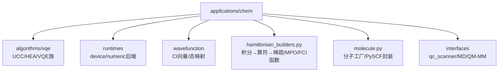
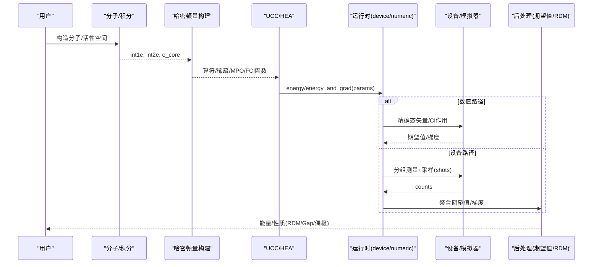
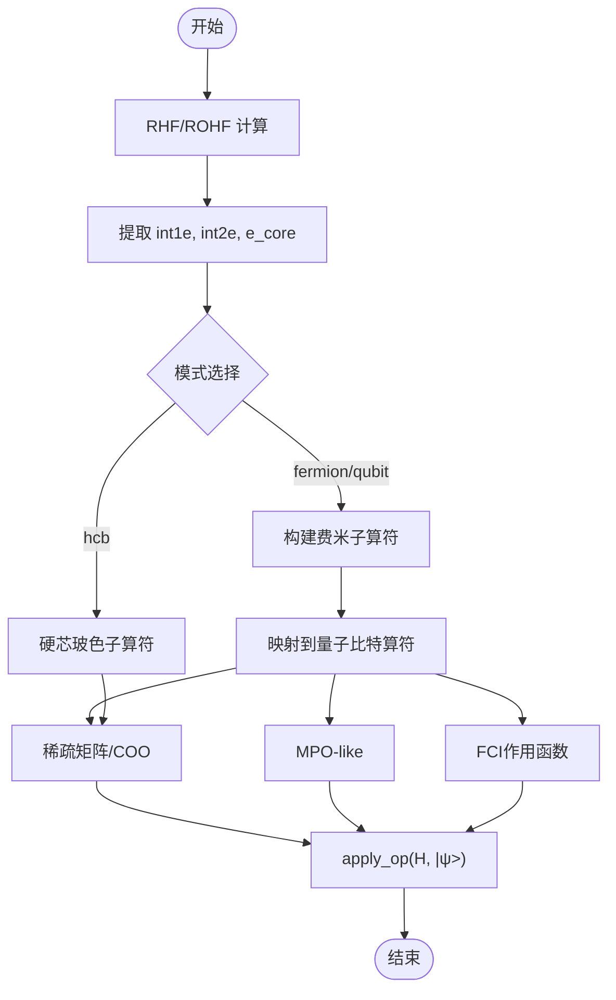
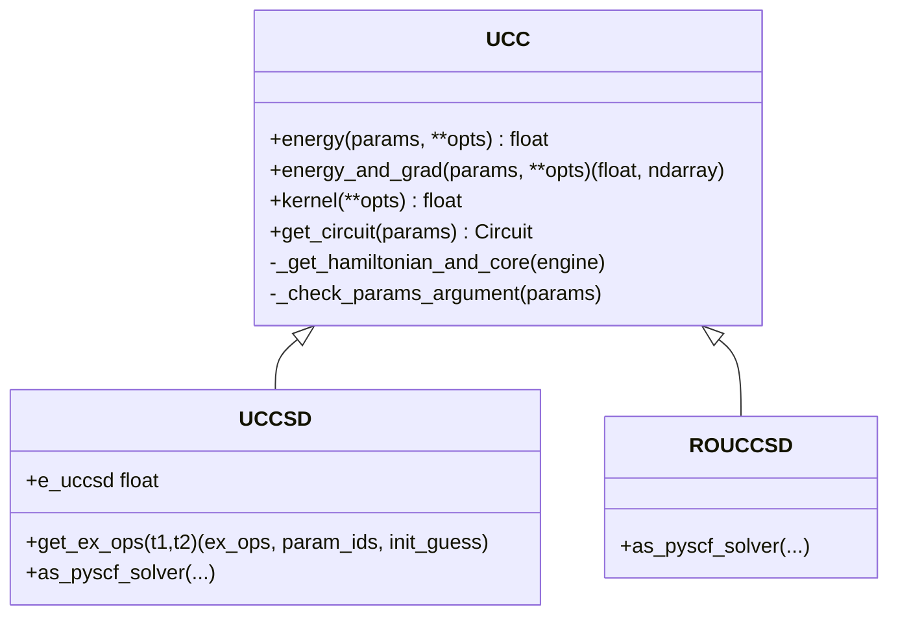
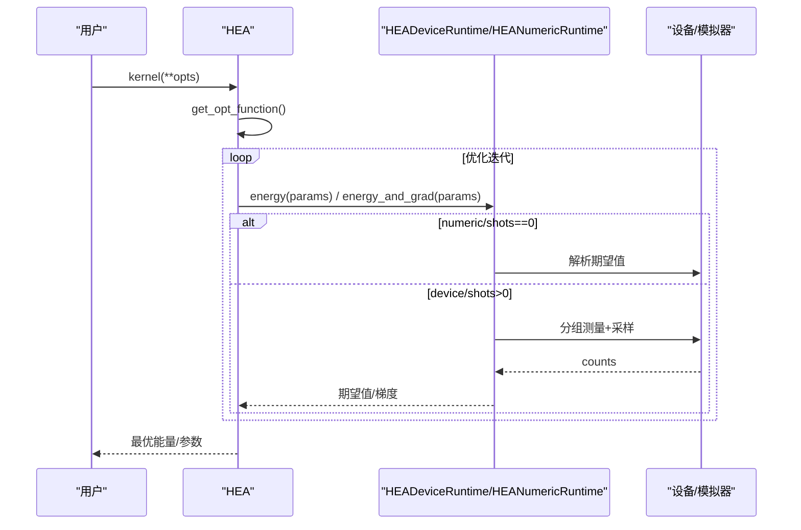
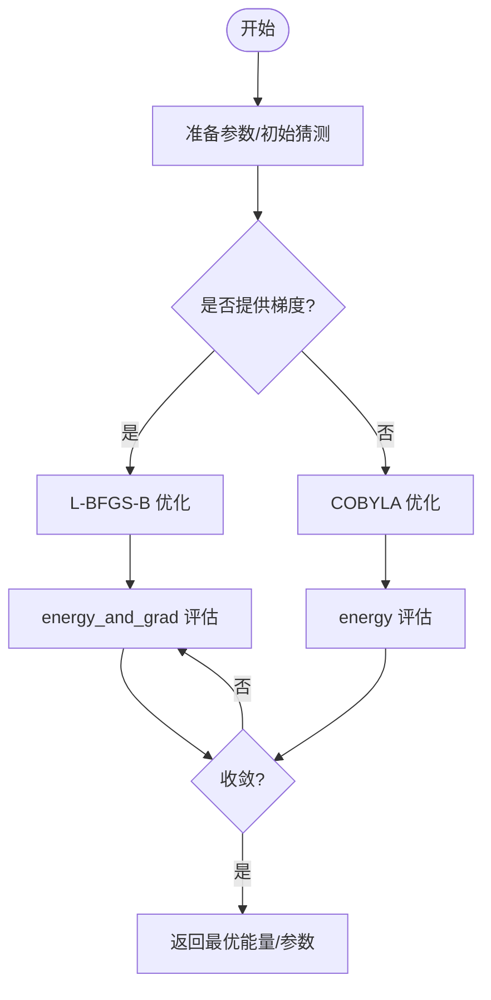
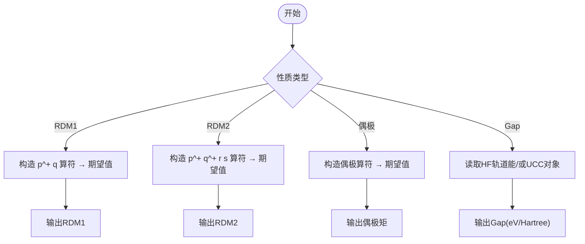
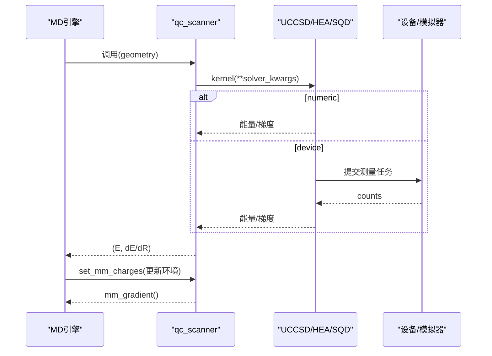
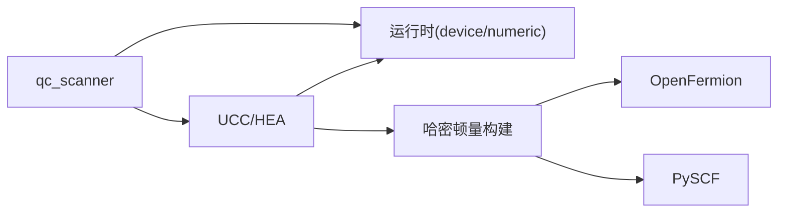

# 量子化学应用

<cite>
**本文引用的文件**
- [README.md](file://README.md)
- [src/tyxonq/applications/chem/__init__.py](file://src/tyxonq/applications/chem/__init__.py)
- [src/tyxonq/applications/chem/molecule.py](file://src/tyxonq/applications/chem/molecule.py)
- [src/tyxonq/applications/chem/hamiltonian_builders.py](file://src/tyxonq/applications/chem/hamiltonian_builders.py)
- [src/tyxonq/applications/chem/algorithms/vqe/__init__.py](file://src/tyxonq/applications/chem/algorithms/vqe/__init__.py)
- [src/tyxonq/applications/chem/algorithms/vqe/ucc_base.py](file://src/tyxonq/applications/chem/algorithms/vqe/ucc_base.py)
- [src/tyxonq/applications/chem/algorithms/vqe/uccsd.py](file://src/tyxonq/applications/chem/algorithms/vqe/uccsd.py)
- [src/tyxonq/applications/chem/algorithms/vqe/hea.py](file://src/tyxonq/applications/chem/algorithms/vqe/hea.py)
- [src/tyxonq/applications/chem/algorithms/vqe/runtimes/__init__.py](file://src/tyxonq/applications/chem/algorithms/vqe/runtimes/__init__.py)
- [src/tyxonq/applications/chem/interfaces/__init__.py](file://src/tyxonq/applications/chem/interfaces/__init__.py)
- [src/tyxonq/applications/chem/interfaces/scanner.py](file://src/tyxonq/applications/chem/interfaces/scanner.py)
- [examples/demo_homo_lumo_gap.py](file://examples/demo_homo_lumo_gap.py)
- [examples/qmmm/md_qmmm_device_hardware.py](file://examples/qmmm/md_qmmm_device_hardware.py)
</cite>

## 目录
1. [简介](#简介)
2. [项目结构](#项目结构)
3. [核心组件](#核心组件)
4. [架构总览](#架构总览)
5. [详细组件分析](#详细组件分析)
6. [依赖关系分析](#依赖关系分析)
7. [性能考量](#性能考量)
8. [故障排查指南](#故障排查指南)
9. [结论](#结论)
10. [附录](#附录)

## 简介
本文件面向AI药物设计中的量子化学计算，系统性阐述TyxonQ在分子定义、哈密顿量构建、UCCSD/UCC/k-UpCCGSD/pUCCD与HEA方法、变分量子本征求解器（VQE）工作流、分子性质（RDM1/2、偶极矩、HOMO-LUMO能隙）、QM/MM与分子动力学集成、端到端工作流示例、性能优化与误差分析，以及与机器学习结合的实践要点。文档以代码级事实为依据，辅以可视化图示，帮助不同背景的读者快速上手并深入理解。

## 项目结构
TyxonQ的量子化学模块位于 applications/chem，按领域分层组织：算法（algorithms/vqe）、运行时（runtimes）、波函数/CI库（wavefunction）、哈密顿量构建（hamiltonian_builders.py）、分子工厂（molecule.py）、接口层（interfaces）用于对接MD/QM-MM生态。顶层 README 提供整体能力概览与快速入门。

**图表来源**
- [README.md:17-21](file://README.md#L17-L21)
- [src/tyxonq/applications/chem/__init__.py:29-58](file://src/tyxonq/applications/chem/__init__.py#L29-L58)

**章节来源**
- [README.md:17-21](file://README.md#L17-L21)
- [src/tyxonq/applications/chem/__init__.py:29-58](file://src/tyxonq/applications/chem/__init__.py#L29-L58)

## 核心组件
- 分子与积分：通过 PySCF 获取分子轨道与积分，支持活性空间与对称性处理。
- 哈密顿量构建：从积分生成费米子/量子比特算符、稀疏矩阵、MPO或FCI作用函数，统一对外接口。
- VQE族算法：UCC（基类）、UCCSD/ROUCCSD、k-UpCCGSD、pUCCD；以及硬件高效Ansatz HEA。
- 运行时：设备运行时（计数估计、分组测量、真机/模拟器）与数值运行时（解析态矢量/CI）。
- 性质计算：RDM1/2、偶极矩、HOMO-LUMO能隙等。
- QM/MM与MD：qc_scanner作为唯一门面，支持静电嵌入、周期性Ewald、MM反作用力梯度。

**章节来源**
- [src/tyxonq/applications/chem/hamiltonian_builders.py:46-118](file://src/tyxonq/applications/chem/hamiltonian_builders.py#L46-L118)
- [src/tyxonq/applications/chem/algorithms/vqe/__init__.py:1-49](file://src/tyxonq/applications/chem/algorithms/vqe/__init__.py#L1-L49)
- [src/tyxonq/applications/chem/interfaces/scanner.py:1-39](file://src/tyxonq/applications/chem/interfaces/scanner.py#L1-L39)

## 架构总览
下图展示从分子到能量/性质的完整数据流，包括UCC与HEA两条路径，以及设备/数值两种执行后端。

**图表来源**
- [src/tyxonq/applications/chem/hamiltonian_builders.py:142-176](file://src/tyxonq/applications/chem/hamiltonian_builders.py#L142-L176)
- [src/tyxonq/applications/chem/algorithms/vqe/ucc_base.py:416-510](file://src/tyxonq/applications/chem/algorithms/vqe/ucc_base.py#L416-L510)
- [src/tyxonq/applications/chem/algorithms/vqe/hea.py:231-266](file://src/tyxonq/applications/chem/algorithms/vqe/hea.py#L231-L266)

## 详细组件分析

### 分子定义与哈密顿量构建
- 分子工厂：提供常见分子（H2、水、NH3、苯等）与随机分子，兼容PySCF Mole对象。
- 积分提取：从RHF/ROHF得到int1e/int2e，支持活性空间与轨道排序。
- 算符转换：将积分转为费米子算符，再映射为量子比特算符（JW/BK/parity），输出稀疏矩阵、MPO或FCI作用函数。
- 通用应用：apply_op对多种输入（稀疏、callable、eval_matrix）进行后端无关的矩阵-向量乘法。

**图表来源**
- [src/tyxonq/applications/chem/molecule.py:14-73](file://src/tyxonq/applications/chem/molecule.py#L14-L73)
- [src/tyxonq/applications/chem/hamiltonian_builders.py:46-118](file://src/tyxonq/applications/chem/hamiltonian_builders.py#L46-L118)
- [src/tyxonq/applications/chem/hamiltonian_builders.py:142-176](file://src/tyxonq/applications/chem/hamiltonian_builders.py#L142-L176)
- [src/tyxonq/applications/chem/hamiltonian_builders.py:283-318](file://src/tyxonq/applications/chem/hamiltonian_builders.py#L283-L318)

**章节来源**
- [src/tyxonq/applications/chem/molecule.py:14-73](file://src/tyxonq/applications/chem/molecule.py#L14-L73)
- [src/tyxonq/applications/chem/hamiltonian_builders.py:46-118](file://src/tyxonq/applications/chem/hamiltonian_builders.py#L46-L118)
- [src/tyxonq/applications/chem/hamiltonian_builders.py:142-176](file://src/tyxonq/applications/chem/hamiltonian_builders.py#L142-L176)
- [src/tyxonq/applications/chem/hamiltonian_builders.py:283-318](file://src/tyxonq/applications/chem/hamiltonian_builders.py#L283-L318)

### UCCSD（含UCC/k-UpCCGSD/pUCCD）实现与配置
- UCC基类：统一处理分子/HF、活性空间、初始化（MP2/CCSD/FE/zeros）、哈密顿量缓存、设备/数值路径切换、参数校验与优化。
- UCCSD：基于单双激发算符，支持振幅筛选与排序，减少参数规模；提供as_pyscf_solver适配PySCF求解器。
- ROUCCSD：开壳层扩展，显式构造α/β单双激发。
- 运行选项：runtime="device"/"numeric"，shots控制采样；provider/device用于设备提交；numeric_engine选择statevector/civector等。

**图表来源**
- [src/tyxonq/applications/chem/algorithms/vqe/ucc_base.py:52-360](file://src/tyxonq/applications/chem/algorithms/vqe/ucc_base.py#L52-L360)
- [src/tyxonq/applications/chem/algorithms/vqe/uccsd.py:18-154](file://src/tyxonq/applications/chem/algorithms/vqe/uccsd.py#L18-L154)
- [src/tyxonq/applications/chem/algorithms/vqe/uccsd.py:360-470](file://src/tyxonq/applications/chem/algorithms/vqe/uccsd.py#L360-L470)

**章节来源**
- [src/tyxonq/applications/chem/algorithms/vqe/ucc_base.py:52-360](file://src/tyxonq/applications/chem/algorithms/vqe/ucc_base.py#L52-L360)
- [src/tyxonq/applications/chem/algorithms/vqe/ucc_base.py:416-510](file://src/tyxonq/applications/chem/algorithms/vqe/ucc_base.py#L416-L510)
- [src/tyxonq/applications/chem/algorithms/vqe/uccsd.py:18-154](file://src/tyxonq/applications/chem/algorithms/vqe/uccsd.py#L18-L154)
- [src/tyxonq/applications/chem/algorithms/vqe/uccsd.py:268-341](file://src/tyxonq/applications/chem/algorithms/vqe/uccsd.py#L268-L341)
- [src/tyxonq/applications/chem/algorithms/vqe/uccsd.py:360-470](file://src/tyxonq/applications/chem/algorithms/vqe/uccsd.py#L360-L470)

### HEA（硬件高效Ansatz）设计与使用
- 电路结构：初始RY层 + L层“CNOT链 + RY”交替，参数规模 (layers+1)×n_qubits。
- 构建方式：from_molecule/from_integral 自动从积分构建QubitOperator项列表；支持外部模板（如RealAmplitudes转换）。
- 能量与梯度：energy/energy_and_grad支持数值与设备路径；默认shots=0走解析快径，真机默认shots=2048。
- 性质：make_rdm1/make_rdm2基于期望值估计；HOMO-LUMO能隙委托内部UCC对象。

**图表来源**
- [src/tyxonq/applications/chem/algorithms/vqe/hea.py:28-124](file://src/tyxonq/applications/chem/algorithms/vqe/hea.py#L28-L124)
- [src/tyxonq/applications/chem/algorithms/vqe/hea.py:231-266](file://src/tyxonq/applications/chem/algorithms/vqe/hea.py#L231-L266)
- [src/tyxonq/applications/chem/algorithms/vqe/hea.py:269-337](file://src/tyxonq/applications/chem/algorithms/vqe/hea.py#L269-L337)

**章节来源**
- [src/tyxonq/applications/chem/algorithms/vqe/hea.py:28-124](file://src/tyxonq/applications/chem/algorithms/vqe/hea.py#L28-L124)
- [src/tyxonq/applications/chem/algorithms/vqe/hea.py:231-266](file://src/tyxonq/applications/chem/algorithms/vqe/hea.py#L231-L266)
- [src/tyxonq/applications/chem/algorithms/vqe/hea.py:269-337](file://src/tyxonq/applications/chem/algorithms/vqe/hea.py#L269-L337)
- [src/tyxonq/applications/chem/algorithms/vqe/hea.py:623-705](file://src/tyxonq/applications/chem/algorithms/vqe/hea.py#L623-L705)

### 变分量子本征求解器（VQE）工作流程与优化策略
- 目标函数：energy(params) 返回期望值；energy_and_grad(params) 返回梯度（参数移位法）。
- 优化器：SciPy L-BFGS-B（有梯度）或 COBYLA（无梯度）；内置缓存避免重复评估。
- 运行模式：
  - shots=0：解析路径（statevector/CI），确定性结果。
  - shots>0：设备路径，分组测量+计数聚合，带统计噪声。
- 设备选项：provider/device/shots 穿透至底层运行器，支持模拟器与真机。

**图表来源**
- [src/tyxonq/applications/chem/algorithms/vqe/ucc_base.py:521-581](file://src/tyxonq/applications/chem/algorithms/vqe/ucc_base.py#L521-L581)
- [src/tyxonq/applications/chem/algorithms/vqe/ucc_base.py:584-616](file://src/tyxonq/applications/chem/algorithms/vqe/ucc_base.py#L584-L616)
- [src/tyxonq/applications/chem/algorithms/vqe/hea.py:269-337](file://src/tyxonq/applications/chem/algorithms/vqe/hea.py#L269-L337)

**章节来源**
- [src/tyxonq/applications/chem/algorithms/vqe/ucc_base.py:521-581](file://src/tyxonq/applications/chem/algorithms/vqe/ucc_base.py#L521-L581)
- [src/tyxonq/applications/chem/algorithms/vqe/ucc_base.py:584-616](file://src/tyxonq/applications/chem/algorithms/vqe/ucc_base.py#L584-L616)
- [src/tyxonq/applications/chem/algorithms/vqe/hea.py:269-337](file://src/tyxonq/applications/chem/algorithms/vqe/hea.py#L269-L337)

### 分子性质计算（RDM1/2、偶极矩、HOMO-LUMO能隙）
- RDM1/2：HEA通过构造对应费米子算符并求期望值得到自旋约化RDM；UCC路径可通过CI/态矢量直接获得。
- 偶极矩：由一阶算符期望值计算（可复用RDM1）。
- HOMO-LUMO能隙：从HF轨道能级或UCC对象中读取，支持闭壳/开壳与活性空间。

**图表来源**
- [src/tyxonq/applications/chem/algorithms/vqe/hea.py:623-705](file://src/tyxonq/applications/chem/algorithms/vqe/hea.py#L623-L705)
- [examples/demo_homo_lumo_gap.py:14-33](file://examples/demo_homo_lumo_gap.py#L14-L33)
- [examples/demo_homo_lumo_gap.py:136-176](file://examples/demo_homo_lumo_gap.py#L136-L176)

**章节来源**
- [src/tyxonq/applications/chem/algorithms/vqe/hea.py:623-705](file://src/tyxonq/applications/chem/algorithms/vqe/hea.py#L623-L705)
- [examples/demo_homo_lumo_gap.py:14-33](file://examples/demo_homo_lumo_gap.py#L14-L33)
- [examples/demo_homo_lumo_gap.py:136-176](file://examples/demo_homo_lumo_gap.py#L136-L176)

### QM/MM接口与分子动力学集成
- qc_scanner：统一入口，惰性构建几何与平均场，支持方法注册（sqd/uccsd/rouccsd/hea）。
- 静电嵌入：mm_charges=(坐标, 电荷)，每步更新环境；周期性Ewald支持（需rcut_ewald/rcut_hcore）。
- MM反作用力：mm_gradient返回对MM粒子的梯度（电子+核部分），用于MD耦合。
- 设备链路：solver_kwargs穿透shots/provider/device，支持模拟器与真机提交。

**图表来源**
- [src/tyxonq/applications/chem/interfaces/scanner.py:56-90](file://src/tyxonq/applications/chem/interfaces/scanner.py#L56-L90)
- [src/tyxonq/applications/chem/interfaces/scanner.py:191-267](file://src/tyxonq/applications/chem/interfaces/scanner.py#L191-L267)
- [src/tyxonq/applications/chem/interfaces/scanner.py:331-411](file://src/tyxonq/applications/chem/interfaces/scanner.py#L331-L411)
- [examples/qmmm/md_qmmm_device_hardware.py:90-159](file://examples/qmmm/md_qmmm_device_hardware.py#L90-L159)

**章节来源**
- [src/tyxonq/applications/chem/interfaces/scanner.py:56-90](file://src/tyxonq/applications/chem/interfaces/scanner.py#L56-L90)
- [src/tyxonq/applications/chem/interfaces/scanner.py:191-267](file://src/tyxonq/applications/chem/interfaces/scanner.py#L191-L267)
- [src/tyxonq/applications/chem/interfaces/scanner.py:331-411](file://src/tyxonq/applications/chem/interfaces/scanner.py#L331-L411)
- [examples/qmmm/md_qmmm_device_hardware.py:90-159](file://examples/qmmm/md_qmmm_device_hardware.py#L90-L159)

## 依赖关系分析
- 算法与运行时：UCC/HEA强依赖各自device/numeric运行时；运行时负责测量分组、计数聚合与后端调度。
- 哈密顿量构建：依赖OpenFermion与PySCF，提供多格式输出供不同后端消费。
- 接口层：qc_scanner惰性导入具体求解器，避免仅用SQD的用户拉起全栈。

**图表来源**
- [src/tyxonq/applications/chem/algorithms/vqe/runtimes/__init__.py:1-15](file://src/tyxonq/applications/chem/algorithms/vqe/runtimes/__init__.py#L1-L15)
- [src/tyxonq/applications/chem/interfaces/__init__.py:1-9](file://src/tyxonq/applications/chem/interfaces/__init__.py#L1-L9)
- [src/tyxonq/applications/chem/interfaces/scanner.py:56-90](file://src/tyxonq/applications/chem/interfaces/scanner.py#L56-L90)

**章节来源**
- [src/tyxonq/applications/chem/algorithms/vqe/runtimes/__init__.py:1-15](file://src/tyxonq/applications/chem/algorithms/vqe/runtimes/__init__.py#L1-L15)
- [src/tyxonq/applications/chem/interfaces/__init__.py:1-9](file://src/tyxonq/applications/chem/interfaces/__init__.py#L1-L9)
- [src/tyxonq/applications/chem/interfaces/scanner.py:56-90](file://src/tyxonq/applications/chem/interfaces/scanner.py#L56-L90)

## 性能考量
- 解析快径：shots=0时走statevector/CI解析路径，避免采样噪声与开销，适合优化预热与回归测试。
- 分组测量与缓存：设备路径对哈密顿量分组测量；UCC优化器内对同点f(x)/jac(x)缓存，降低重复提交成本。
- 活性空间与振幅筛选：UCCSD通过t2阈值筛选双激发，显著减少参数与电路深度。
- HEA浅电路：天然适合NISQ设备；建议较高shots（≥8192）以获得稳定优化收敛。
- 数值后端：支持NumPy/PyTorch/CuPyNumeric，便于GPU加速与自动微分。

[本节为通用指导，不直接分析具体文件]

## 故障排查指南
- 参数形状不匹配：检查ex_ops与param_ids长度一致；UCC会做sanity check。
- 未设置active_space或轨道索引错误：确保active_orbital_indices长度与active_space一致。
- 设备选项未生效：确认solver_kwargs中的shots/provider/device正确穿透；HEA会持久化这些属性便于自检。
- 非光滑能量面：SQD非冻结子空间导致解析梯度无定义；MD请使用subspace="frozen"或允许不连续。
- 周期性嵌入参数：rcut_ewald/rcut_hcore必须满足上游约束，否则报错。

**章节来源**
- [src/tyxonq/applications/chem/algorithms/vqe/ucc_base.py:401-414](file://src/tyxonq/applications/chem/algorithms/vqe/ucc_base.py#L401-L414)
- [src/tyxonq/applications/chem/interfaces/scanner.py:121-171](file://src/tyxonq/applications/chem/interfaces/scanner.py#L121-L171)
- [examples/qmmm/md_qmmm_device_hardware.py:155-159](file://examples/qmmm/md_qmmm_device_hardware.py#L155-L159)

## 结论
TyxonQ为AI药物设计提供了从分子定义、哈密顿量构建、UCCSD/HEA变分算法、性质计算到QM/MM与MD集成的完整量子化学工具链。其统一的设备/数值双路径、灵活的运行时与丰富的接口，使得同一套代码可在模拟器与真实量子设备上无缝切换，兼顾精度与效率。结合性能优化技巧与误差分析方法，用户可高效开展量子化学驱动的药物发现研究。

[本节为总结性内容，不直接分析具体文件]

## 附录
- 端到端工作流示例：
  - 基础UCCSD/HOMO-LUMO能隙：参考演示脚本。
  - QM/MM设备链路：包含数值参考、设备解析档与采样档、静电嵌入与MM反作用力、真机模板。
- 与传统机器学习结合：
  - 使用QC输出的能量、RDM、Gap等特征训练ML模型（如GPT/Transformer），示例见仓库examples下的gqe_drug_design与SMILES-TyxonQ。
  - 标准化数据导出与批量计算，便于大规模数据集构建与迁移学习。

**章节来源**
- [examples/demo_homo_lumo_gap.py:14-33](file://examples/demo_homo_lumo_gap.py#L14-L33)
- [examples/qmmm/md_qmmm_device_hardware.py:90-159](file://examples/qmmm/md_qmmm_device_hardware.py#L90-L159)
- [README.md:477-490](file://README.md#L477-L490)