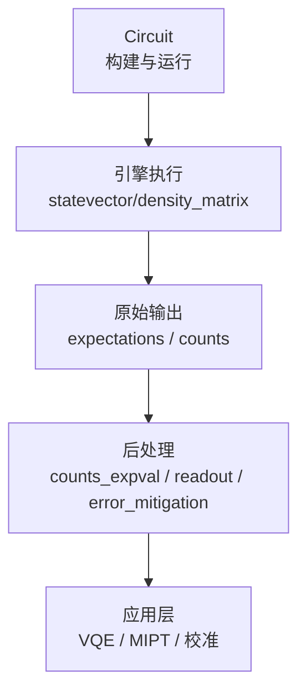
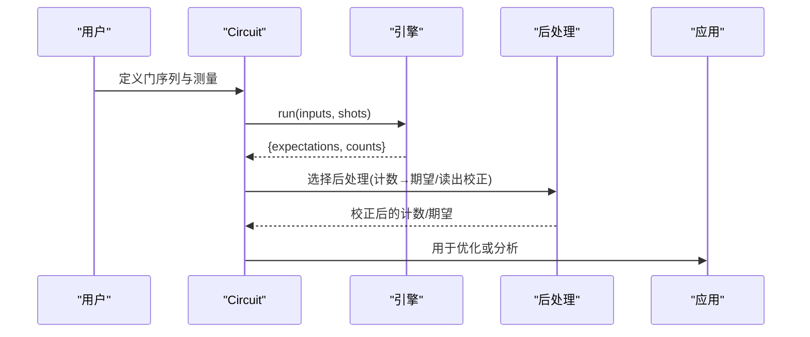
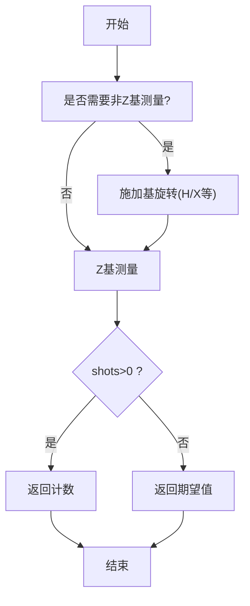
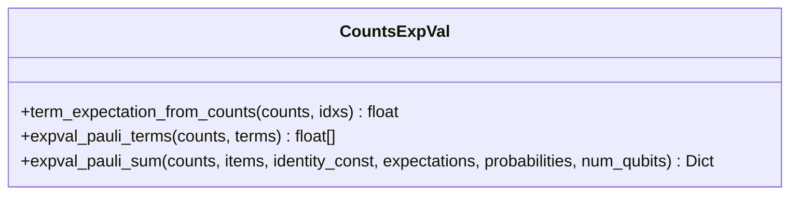
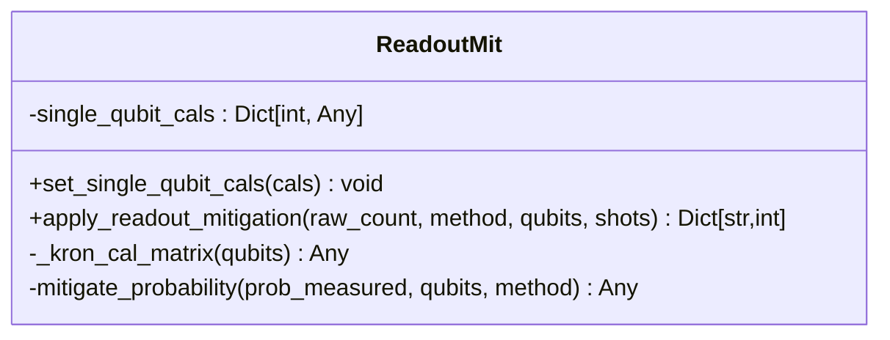
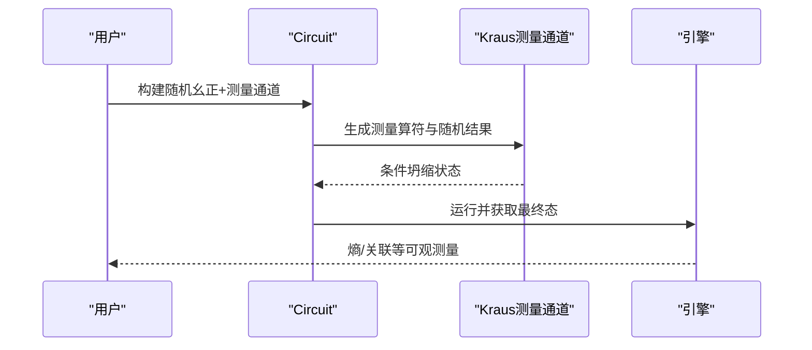
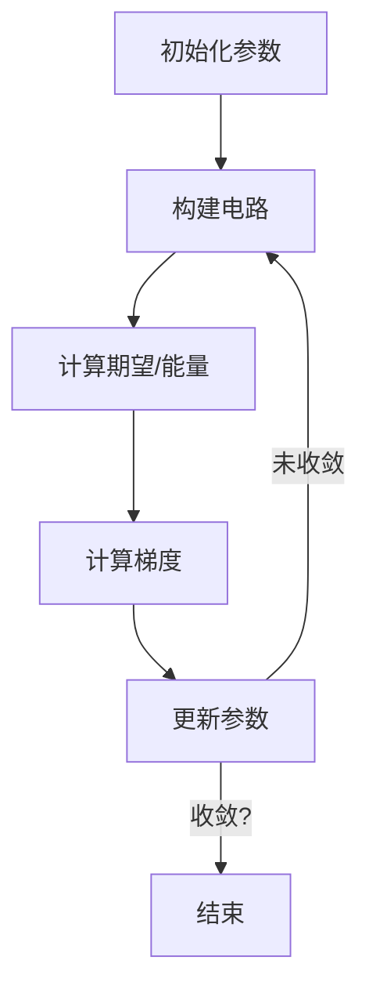
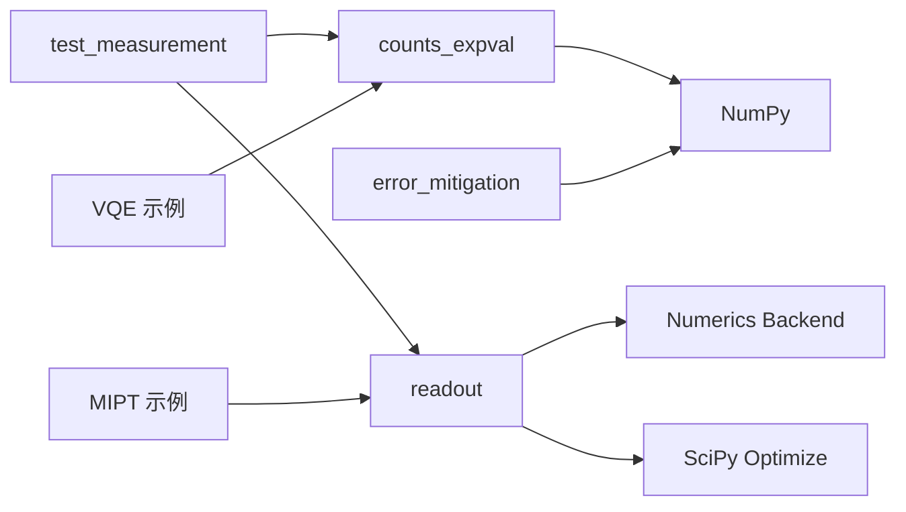

# 测量操作

<cite>
**本文引用的文件**
- [measurement.py](file://src/tyxonq/libs/quantum_library/measurement.py)
- [counts_expval.py](file://src/tyxonq/postprocessing/counts_expval.py)
- [readout.py](file://src/tyxonq/postprocessing/readout.py)
- [error_mitigation.py](file://src/tyxonq/postprocessing/error_mitigation.py)
- [test_measurement.py](file://tests_core_module/test_measurement.py)
- [measurement_induced_phase_transition.py](file://examples/measurement_induced_phase_transition.py)
- [vqe_simple_hamiltonian.py](file://examples/vqe_simple_hamiltonian.py)
- [readout_mitigation.py](file://examples/readout_mitigation.py)
</cite>

## 目录
1. [简介](#简介)
2. [项目结构](#项目结构)
3. [核心组件](#核心组件)
4. [架构总览](#架构总览)
5. [详细组件分析](#详细组件分析)
6. [依赖关系分析](#依赖关系分析)
7. [性能考量](#性能考量)
8. [故障排查指南](#故障排查指南)
9. [结论](#结论)
10. [附录](#附录)

## 简介
本文件系统性梳理 TyxonQ 中的量子测量实现与使用方式，覆盖以下主题：
- 不同测量基的选择与配置（计算基、X/Y 基等）
- 测量结果的获取与处理（计数统计、概率分布、期望值聚合）
- 批量测量与条件测量（含中途测量、投影与重置）
- 在变分算法中利用测量结果进行优化
- 实际应用示例（量子态层析思路、贝尔态验证）
- 测量误差分析与后处理技术（读出误差校正、退相干抑制占位实现）

## 项目结构
围绕“测量”的关键代码分布在如下模块：
- 量子库测量工具与分组（兼容旧接口）
- 后处理：计数到期望值、读出误差校正、通用误差缓解占位
- 测试：验证中途测量、投影与重置行为
- 示例：测量诱导相变（MIPT）、VQE 能量估计、读出误差校正演示

图表来源
- [test_measurement.py:11-33](file://tests_core_module/test_measurement.py#L11-L33)
- [counts_expval.py:7-112](file://src/tyxonq/postprocessing/counts_expval.py#L7-L112)
- [readout.py:15-137](file://src/tyxonq/postprocessing/readout.py#L15-L137)
- [error_mitigation.py:7-76](file://src/tyxonq/postprocessing/error_mitigation.py#L7-L76)

章节来源
- [test_measurement.py:1-33](file://tests_core_module/test_measurement.py#L1-L33)
- [counts_expval.py:1-115](file://src/tyxonq/postprocessing/counts_expval.py#L1-L115)
- [readout.py:1-143](file://src/tyxonq/postprocessing/readout.py#L1-L143)
- [error_mitigation.py:1-82](file://src/tyxonq/postprocessing/error_mitigation.py#L1-L82)

## 核心组件
- 计数到期望值聚合：从比特串计数计算 Pauli-Z 乘积的期望值，支持解析路径（shots=0 时）与采样路径。
- 读出误差校正：基于单量子比特标定矩阵的 Kronecker 积构造全局标定矩阵，提供逆矩阵法与约束最小二乘法两种校正策略。
- 误差缓解占位：ZNE/DD/RC 的轻量占位实现，便于后续集成完整方案。
- 测量相关工具：兼容旧接口的项分组与期望值计算入口。

章节来源
- [counts_expval.py:7-112](file://src/tyxonq/postprocessing/counts_expval.py#L7-L112)
- [readout.py:15-137](file://src/tyxonq/postprocessing/readout.py#L15-L137)
- [error_mitigation.py:7-76](file://src/tyxonq/postprocessing/error_mitigation.py#L7-L76)
- [measurement.py:6-49](file://src/tyxonq/libs/quantum_library/measurement.py#L6-L49)

## 架构总览
TyxonQ 的测量流程可抽象为：电路构建 → 引擎执行 → 原始结果 → 后处理 → 应用。

图表来源
- [test_measurement.py:11-33](file://tests_core_module/test_measurement.py#L11-L33)
- [counts_expval.py:7-112](file://src/tyxonq/postprocessing/counts_expval.py#L7-L112)
- [readout.py:15-137](file://src/tyxonq/postprocessing/readout.py#L15-L137)

## 详细组件分析

### 测量基与测量指令
- 计算基测量：通过 measure_z 在 Z 基上采样，得到计数；若未显式设置 shots，statevector 引擎返回期望值。
- X/Y 基测量：需在测量前施加相应的基旋转（如 H 将 X 基转到 Z 基），再执行 Z 基测量。
- 中途测量与投影：支持 project_z 与 reset 等操作，可在中间步骤坍缩并重置量子态，影响后续演化。

图表来源
- [test_measurement.py:11-33](file://tests_core_module/test_measurement.py#L11-L33)

章节来源
- [test_measurement.py:11-33](file://tests_core_module/test_measurement.py#L11-L33)

### 计数统计与期望值聚合
- 单张量期望：从计数中按指定 qubit 索引计算 Z^⊗k 的期望。
- 多张量求和：对多个 Pauli 项求和，支持解析路径（shots=0 时直接使用 per-qubit 期望或全概率分布）。
- 兼容性导出：保留旧接口以兼容历史调用。

图表来源
- [counts_expval.py:7-112](file://src/tyxonq/postprocessing/counts_expval.py#L7-L112)

章节来源
- [counts_expval.py:7-112](file://src/tyxonq/postprocessing/counts_expval.py#L7-L112)
- [measurement.py:6-49](file://src/tyxonq/libs/quantum_library/measurement.py#L6-L49)

### 读出误差校正
- 标定矩阵：每个量子比特提供 2×2 矩阵，描述真实概率到测量概率的映射。
- 全局矩阵：按升序线序对各比特矩阵做 Kronecker 积。
- 校正方法：逆矩阵法（数值稳定）与约束最小二乘（概率单纯形约束）。
- 输入输出：接受原始计数向量，输出校正后的计数字典。

图表来源
- [readout.py:15-137](file://src/tyxonq/postprocessing/readout.py#L15-L137)

章节来源
- [readout.py:15-137](file://src/tyxonq/postprocessing/readout.py#L15-L137)

### 批量测量与条件测量
- 批量测量：通过多次运行同一电路或并行批处理（结合后端向量化）收集统计。
- 条件测量：使用中途测量与投影控制后续演化，例如 MIPT 中以概率 p 对每个量子比特施加测量通道。

图表来源
- [measurement_induced_phase_transition.py:137-206](file://examples/measurement_induced_phase_transition.py#L137-L206)

章节来源
- [measurement_induced_phase_transition.py:137-206](file://examples/measurement_induced_phase_transition.py#L137-L206)

### 在变分算法中使用测量结果
- VQE 能量估计：可通过 state() 获取态矢量并直接计算期望，或使用计数路径经后处理聚合。
- 梯度优化：结合自动微分与优化器迭代参数，收敛至近似基态能量。

图表来源
- [vqe_simple_hamiltonian.py:130-232](file://examples/vqe_simple_hamiltonian.py#L130-L232)

章节来源
- [vqe_simple_hamiltonian.py:130-232](file://examples/vqe_simple_hamiltonian.py#L130-L232)

### 实际应用示例
- 贝尔态验证：构建 |Φ+⟩ 并在 Z 基测量，理想计数应为 00 与 11 各半；可叠加读出噪声并校正。
- 量子态层析思路：在不同基下测量并重建密度矩阵（需多组基测量数据与经典重构算法）。
- 测量诱导相变（MIPT）：随机幺正与概率测量竞争，观察纠缠熵随测量率的相变。

章节来源
- [readout_mitigation.py:16-118](file://examples/readout_mitigation.py#L16-L118)
- [measurement_induced_phase_transition.py:137-243](file://examples/measurement_induced_phase_transition.py#L137-L243)

## 依赖关系分析
- 后处理模块内部依赖：
  - counts_expval 不依赖外部复杂库，仅用 NumPy 进行基础运算。
  - readout 依赖后端 API 与 SciPy 优化器进行矩阵求逆与约束优化。
  - error_mitigation 提供占位函数，便于未来集成 mitiq 等库。
- 示例与测试：
  - test_measurement 验证中途测量与重置行为。
  - measurement_induced_phase_transition 展示 Kraus 测量通道与熵计算。
  - vqe_simple_hamiltonian 展示如何在变分循环中使用测量结果。

图表来源
- [counts_expval.py:1-115](file://src/tyxonq/postprocessing/counts_expval.py#L1-L115)
- [readout.py:1-143](file://src/tyxonq/postprocessing/readout.py#L1-L143)
- [error_mitigation.py:1-82](file://src/tyxonq/postprocessing/error_mitigation.py#L1-L82)
- [test_measurement.py:1-33](file://tests_core_module/test_measurement.py#L1-L33)
- [measurement_induced_phase_transition.py:92-243](file://examples/measurement_induced_phase_transition.py#L92-L243)
- [vqe_simple_hamiltonian.py:130-232](file://examples/vqe_simple_hamiltonian.py#L130-L232)

章节来源
- [counts_expval.py:1-115](file://src/tyxonq/postprocessing/counts_expval.py#L1-L115)
- [readout.py:1-143](file://src/tyxonq/postprocessing/readout.py#L1-L143)
- [error_mitigation.py:1-82](file://src/tyxonq/postprocessing/error_mitigation.py#L1-L82)
- [test_measurement.py:1-33](file://tests_core_module/test_measurement.py#L1-L33)
- [measurement_induced_phase_transition.py:92-243](file://examples/measurement_induced_phase_transition.py#L92-L243)
- [vqe_simple_hamiltonian.py:130-232](file://examples/vqe_simple_hamiltonian.py#L130-L232)

## 性能考量
- 采样开销：shot 数越大，统计误差越小但计算成本越高；建议根据精度需求折中选择。
- 解析路径：当 shots=0 时，statevector 引擎可直接给出 per-qubit 期望或全概率分布，避免采样噪声。
- 矩阵规模：读出校正的全局矩阵大小为 2^n × 2^n，n 增大时内存与计算压力显著上升；优先使用单比特标定与局部校正。
- JIT/编译：示例显示首次运行包含编译开销，后续运行速度显著提升。

[本节为通用指导，不直接分析具体文件]

## 故障排查指南
- 中途测量与重置异常：检查 project_z 与 reset 的顺序与目标量子比特索引，确保投影与重置符合预期。
- 读出校正失败：确认标定矩阵维度为 2×2，且所有涉及量子比特均已提供标定；必要时切换校正方法（inverse vs constrained least squares）。
- 期望值聚合错误：核对 term 的 qubit 索引顺序与比特串编码约定（大端序），确保与计数键一致。
- 性能瓶颈：减少 shot 数、使用解析路径、限制系统规模或采用分层/分区策略。

章节来源
- [test_measurement.py:11-33](file://tests_core_module/test_measurement.py#L11-L33)
- [readout.py:33-137](file://src/tyxonq/postprocessing/readout.py#L33-L137)
- [counts_expval.py:55-112](file://src/tyxonq/postprocessing/counts_expval.py#L55-L112)

## 结论
TyxonQ 提供了完整的测量与后处理工具链：从不同测量基的实现、计数统计与期望值聚合，到读出误差校正与误差缓解占位，再到在变分算法与物理模拟中的应用。通过合理选择测量基、控制 shot 数、使用解析路径与后处理技术，可以在保证精度的同时提升效率。示例展示了从基础的贝尔态验证到复杂的 MIPT 研究，覆盖了多种典型场景。

[本节为总结性内容，不直接分析具体文件]

## 附录
- 常用测量基转换提示：
  - X 基：H 门后再测 Z
  - Y 基：先施放特定相位门再测 Z（依实现而定）
- 读取与处理计数：
  - 使用 counts_expval 的聚合函数快速获得期望值
  - 使用 readout 的校正类恢复理想计数
- 参考示例路径：
  - 读出误差校正演示：[readout_mitigation.py](file://examples/readout_mitigation.py)
  - MIPT 示例：[measurement_induced_phase_transition.py](file://examples/measurement_induced_phase_transition.py)
  - VQE 示例：[vqe_simple_hamiltonian.py](file://examples/vqe_simple_hamiltonian.py)

[本节为补充信息，不直接分析具体文件]