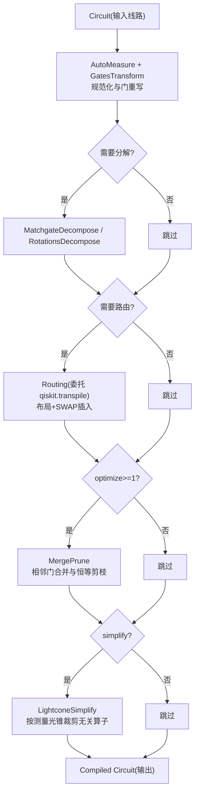
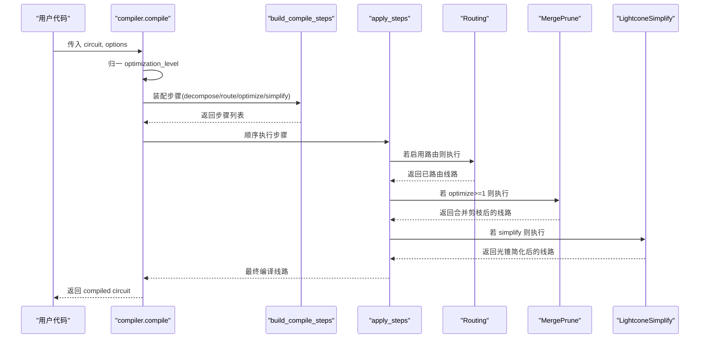
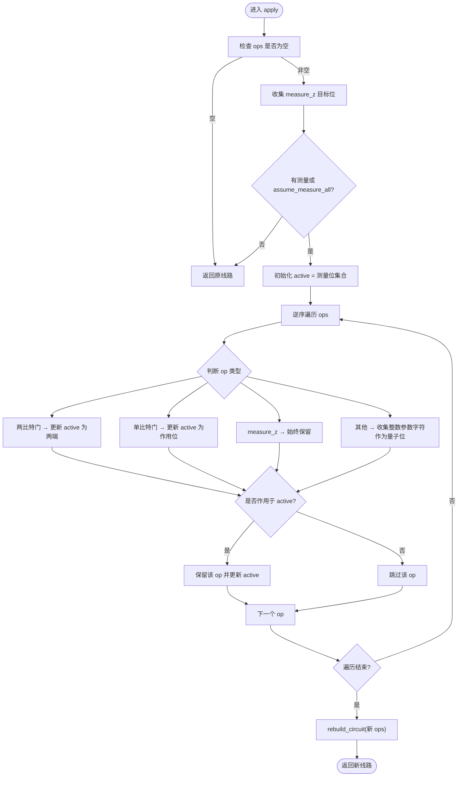
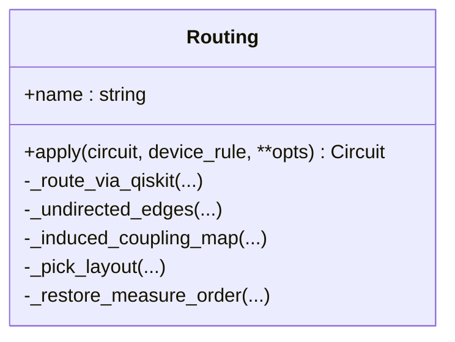
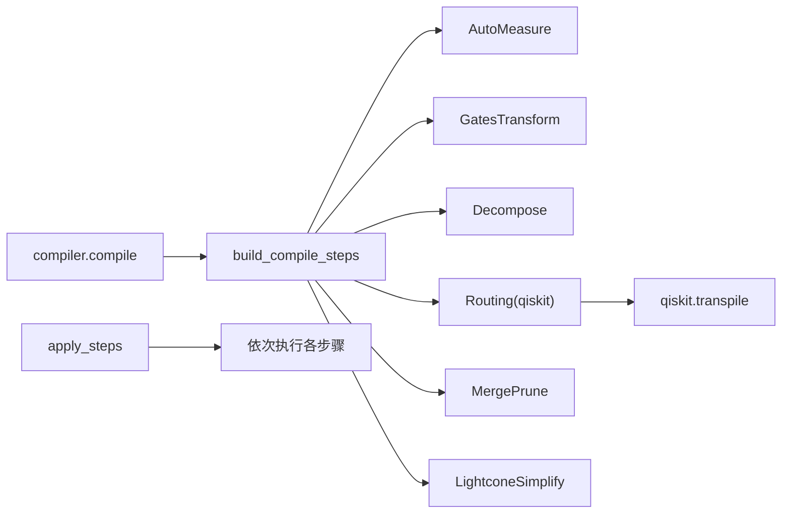

# 电路优化

<cite>
**本文引用的文件**
- [compiler.py](file://src/tyxonq/compiler/gate_compiler/compiler.py)
- [steps.py](file://src/tyxonq/compiler/gate_compiler/steps.py)
- [lightcone.py](file://src/tyxonq/compiler/gate_compiler/stages/simplify/lightcone.py)
- [merge_prune.py](file://src/tyxonq/compiler/gate_compiler/stages/rewrite/merge_prune.py)
- [routing.py](file://src/tyxonq/compiler/gate_compiler/stages/layout/routing.py)
- [index.rst（编译器用户指南）](file://docs/source/user_guide/compiler/index.rst)
- [performance_optimization.rst（性能优化参考）](file://docs/source/technical_references/performance_optimization.rst)
- [extending_tyxonq.rst（扩展开发指南）](file://docs/source/developer_guide/extending_tyxonq.rst)
- [api.py（数值后端）](file://src/tyxonq/numerics/api.py)
- [context.py（后端上下文）](file://src/tyxonq/numerics/context.py)
- [config.py（后端名称规范化）](file://src/tyxonq/config.py)
- [compiler_lightcone_optimization.py（光锥优化示例）](file://examples/compiler_lightcone_optimization.py)
- [performance_layerwise_optimization.py（分层状态计算示例）](file://examples/performance_layerwise_optimization.py)
- [test_compiler_simplify_lightcone.py（光锥简化单测）](file://tests_core_module/test_compiler_simplify_lightcone.py)
</cite>

## 目录
1. [简介](#简介)
2. [项目结构](#项目结构)
3. [核心组件](#核心组件)
4. [架构总览](#架构总览)
5. [详细组件分析](#详细组件分析)
6. [依赖关系分析](#依赖关系分析)
7. [性能考量](#性能考量)
8. [故障排查指南](#故障排查指南)
9. [结论](#结论)
10. [附录](#附录)

## 简介
本指南面向需要在 TyxonQ 中进行量子电路优化的工程师与研究人员，系统讲解编译器的优化选项与配置方法、不同后端的特定优化策略与限制、电路深度与宽度的优化技巧、等价变换与简化方法、性能基准测试方法，以及自动优化与手动优化结合的实践策略。内容基于仓库中的编译器实现、示例与文档，确保可复现与可验证。

## 项目结构
TyxonQ 的电路优化围绕“编译步骤流水线”组织：先规范化与分解，再按需路由，随后进行门合并与剪枝，最后执行光锥化简。该流水线通过类型化参数装配，避免不必要的依赖与开销。

图表来源
- [steps.py:27-91](file://src/tyxonq/compiler/gate_compiler/steps.py#L27-L91)
- [compiler.py:57-74](file://src/tyxonq/compiler/gate_compiler/compiler.py#L57-L74)

章节来源
- [steps.py:27-91](file://src/tyxonq/compiler/gate_compiler/steps.py#L27-L91)
- [compiler.py:57-74](file://src/tyxonq/compiler/gate_compiler/compiler.py#L57-L74)

## 核心组件
- 编译步骤装配器：根据 decompose、route、optimize、simplify 等参数动态组装步骤序列，保证固定顺序与最小依赖。
- 路由模块：在设备耦合约束下完成布局与 SWAP 插入，并保留测量逻辑序；失败时回退到保守门集合重试。
- 门合并与剪枝：对相邻同线门应用代数恒等式合并，移除恒等操作。
- 光锥简化：从测量位反向追踪依赖，仅保留影响测量结果的操作，显著减少仿真与运行成本。
- 数值后端：支持 numpy、pytorch、cupynumeric 三种后端，便于在不同场景选择 CPU/GPU/分布式加速。

章节来源
- [steps.py:27-91](file://src/tyxonq/compiler/gate_compiler/steps.py#L27-L91)
- [routing.py:289-539](file://src/tyxonq/compiler/gate_compiler/stages/layout/routing.py#L289-L539)
- [merge_prune.py:27-86](file://src/tyxonq/compiler/gate_compiler/stages/rewrite/merge_prune.py#L27-L86)
- [lightcone.py:12-97](file://src/tyxonq/compiler/gate_compiler/stages/simplify/lightcone.py#L12-L97)
- [api.py:236-252](file://src/tyxonq/numerics/api.py#L236-L252)

## 架构总览
下图展示从用户调用 compile 到最终产出编译后线路的关键路径，包括优化级别归一、步骤装配与顺序执行。

图表来源
- [compiler.py:57-74](file://src/tyxonq/compiler/gate_compiler/compiler.py#L57-L74)
- [steps.py:27-105](file://src/tyxonq/compiler/gate_compiler/steps.py#L27-L105)

## 详细组件分析

### 光锥简化（LightconeSimplify）
- 功能：收集显式测量或按 assume_measure_all 假设全部测量，反向扫描操作序列，维护活跃量子位集合，仅保留会影响测量的操作。
- 关键点：
  - 两比特门会传播依赖（如 cx/cz/swap/rxx/ryy/rzz）。
  - 保持 reset/project/measure_z 等关键指令语义。
  - 使用 rebuild_circuit 重建线路以保留元数据与缓存。
- 适用场景：部分测量期望值计算、VQE 梯度评估、浅层观测集。

图表来源
- [lightcone.py:15-97](file://src/tyxonq/compiler/gate_compiler/stages/simplify/lightcone.py#L15-L97)

章节来源
- [lightcone.py:15-97](file://src/tyxonq/compiler/gate_compiler/stages/simplify/lightcone.py#L15-L97)
- [test_compiler_simplify_lightcone.py:8-75](file://tests_core_module/test_compiler_simplify_lightcone.py#L8-L75)

### 门合并与剪枝（MergePrune）
- 功能：对相邻同线门应用规则表合并（如 s·s→z、x·x→i），并删除恒等操作。
- 特点：轻量级、快速迭代；适合在路由之后进一步压缩门数与深度。
- 可扩展性：可通过 rules 参数注入自定义合并规则。

章节来源
- [merge_prune.py:27-86](file://src/tyxonq/compiler/gate_compiler/stages/rewrite/merge_prune.py#L27-L86)

### 路由（Routing）
- 功能：将线路映射到设备物理比特，插入必要的 SWAP，并保持测量逻辑序。
- 设计要点：
  - 仅在存在耦合约束且确实不相邻时触发。
  - 在“本地下标空间”内路由，避免产物膨胀至设备全比特。
  - 自由路由失败时回退到保守门集合重试。
  - 固定 seed 保证可复现。
  - 后置校验：确保产物满足相邻性，否则抛出明确错误。
- 输出元信息：metadata["routing"] 包含算法、seed、initial_layout、final_layout、swaps_inserted 等。

图表来源
- [routing.py:289-539](file://src/tyxonq/compiler/gate_compiler/stages/layout/routing.py#L289-L539)

章节来源
- [routing.py:289-539](file://src/tyxonq/compiler/gate_compiler/stages/layout/routing.py#L289-L539)

### 编译步骤装配与执行
- 固定顺序：规范化 → 分解 → 路由 → 优化 → 化简。
- 控制开关：
  - decompose：是否分解 matchgate/旋转门。
  - route：是否路由（默认 False）。
  - optimize：优化级别（≥1 启用 MergePrune）。
  - simplify：是否启用 LightconeSimplify。
- 执行器：apply_steps 顺序调用每个步骤的 apply。

章节来源
- [steps.py:27-105](file://src/tyxonq/compiler/gate_compiler/steps.py#L27-L105)
- [compiler.py:57-74](file://src/tyxonq/compiler/gate_compiler/compiler.py#L57-L74)

### 数值后端与性能路径
- 后端选择：numpy（CPU 开发）、pytorch（GPU/自动微分）、cupynumeric（分布式 GPU）。
- 全局设置：通过 set_backend 指定默认后端，get_backend 获取实例。
- 建议：小系统/开发用 numpy；梯度优化用 pytorch；大规模并行用 cupynumeric。

章节来源
- [api.py:236-252](file://src/tyxonq/numerics/api.py#L236-L252)
- [context.py:18-38](file://src/tyxonq/numerics/context.py#L18-L38)
- [config.py:50-69](file://src/tyxonq/config.py#L50-L69)

## 依赖关系分析
- 编译步骤之间松耦合：每个步骤实现统一接口 apply，由 steps.apply_steps 串联。
- 路由依赖 qiskit.transpile，但通过保守门集合兜底降低失败风险。
- 光锥简化依赖 IR 操作语义识别，不改变未涉及测量位的等价性。
- 数值后端与编译器解耦，可在不同执行路径中切换。

图表来源
- [steps.py:27-105](file://src/tyxonq/compiler/gate_compiler/steps.py#L27-L105)
- [routing.py:312-375](file://src/tyxonq/compiler/gate_compiler/stages/layout/routing.py#L312-L375)

章节来源
- [steps.py:27-105](file://src/tyxonq/compiler/gate_compiler/steps.py#L27-L105)
- [routing.py:312-375](file://src/tyxonq/compiler/gate_compiler/stages/layout/routing.py#L312-L375)

## 性能考量
- 光锥简化：在部分测量场景下可带来指数级加速，且数学精确无误差。
- 门合并与剪枝：减少门数与深度，提升硬件执行效率。
- 路由优化：在设备拓扑受限情况下，合理布局与 SWAP 插入是关键；必要时调整 initial_layout 或 basis_gates。
- 后端选择：根据问题规模与任务类型选择合适的数值后端，以获得最佳吞吐与内存占用。
- 分层状态计算：对于极深电路或大量噪声通道，逐层强制状态计算可显著缩短 JIT 编译时间与内存占用。

章节来源
- [performance_optimization.rst:19-99](file://docs/source/technical_references/performance_optimization.rst#L19-L99)
- [performance_layerwise_optimization.py:62-139](file://examples/performance_layerwise_optimization.py#L62-L139)
- [performance_layerwise_optimization.py:230-269](file://examples/performance_layerwise_optimization.py#L230-L269)

## 故障排查指南
- 路由失败：
  - 检查设备耦合图与初始布局是否连通且覆盖所有比特。
  - 若自由路由报方向错误或产物含不支持门，允许回退到保守门集合重试。
  - 若产物仍存在不相邻两比特门，尝试提高 optimization_level 或显式指定 basis_gates。
- 光锥简化无效：
  - 确认是否存在显式 measure_z 或开启 assume_measure_all。
  - 检查两比特门是否正确传播依赖。
- 后端相关：
  - 确保请求的后端可用（如 pytorch 未安装时会报错）。
  - 使用 normalize_backend_name 处理别名。

章节来源
- [routing.py:431-495](file://src/tyxonq/compiler/gate_compiler/stages/layout/routing.py#L431-L495)
- [lightcone.py:24-37](file://src/tyxonq/compiler/gate_compiler/stages/simplify/lightcone.py#L24-L37)
- [api.py:236-252](file://src/tyxonq/numerics/api.py#L236-L252)
- [config.py:50-69](file://src/tyxonq/config.py#L50-L69)

## 结论
TyxonQ 的电路优化以“可插拔的编译步骤”为核心，提供从门级等价变换到设备感知的路由与光锥裁剪的全栈能力。通过合理配置 decompose、route、optimize、simplify 等选项，并结合后端选择与分层状态计算，可在不同硬件与仿真环境下获得稳定且高效的性能。示例与单测提供了可复现的基准与正确性验证，便于在实际项目中落地。

## 附录

### 编译器优化选项与配置方法
- 分解（decompose）：matchgate/rotations，用于将高层门降至原生门集合。
- 路由（route）：启用后将委托 qiskit.transpile 进行布局与 SWAP 插入；可设置 coupling_map、initial_layout、optimization_level、seed。
- 优化（optimize）：级别≥1 启用 MergePrune 进行相邻门合并与恒等剪枝。
- 化简（simplify）：启用 LightconeSimplify 进行光锥裁剪；支持 assume_measure_all。

章节来源
- [steps.py:27-91](file://src/tyxonq/compiler/gate_compiler/steps.py#L27-L91)
- [index.rst:97-143](file://docs/source/user_guide/compiler/index.rst#L97-L143)

### 不同后端设备的特定优化策略与限制
- 设备拓扑受限：优先选择连通块内的物理比特作为 initial_layout；避免跨连通块的两比特门。
- 门集合限制：自由路由失败时回退到保守门集合；必要时显式指定 basis_gates。
- 测量逻辑序：路由后需恢复测量顺序，确保计数键与逻辑比特一致。

章节来源
- [routing.py:128-157](file://src/tyxonq/compiler/gate_compiler/stages/layout/routing.py#L128-L157)
- [routing.py:265-286](file://src/tyxonq/compiler/gate_compiler/stages/layout/routing.py#L265-L286)
- [routing.py:459-495](file://src/tyxonq/compiler/gate_compiler/stages/layout/routing.py#L459-L495)

### 电路深度与宽度优化技巧
- 门合并与剪枝：减少冗余门，降低深度与门数。
- 光锥裁剪：仅保留影响测量的操作，显著降低仿真与运行成本。
- 分层状态计算：对极深电路逐层截断计算图，降低 JIT 编译时间与内存占用。

章节来源
- [merge_prune.py:40-86](file://src/tyxonq/compiler/gate_compiler/stages/rewrite/merge_prune.py#L40-L86)
- [lightcone.py:15-97](file://src/tyxonq/compiler/gate_compiler/stages/simplify/lightcone.py#L15-L97)
- [performance_layerwise_optimization.py:108-139](file://examples/performance_layerwise_optimization.py#L108-L139)

### 电路等价变换与简化
- 相邻门合并：利用代数恒等式合并同线相邻门（如 s·s→z、x·x→i）。
- 恒等剪枝：移除恒等操作 i。
- 光锥等价：在不影响测量结果的前提下裁剪无关操作。

章节来源
- [merge_prune.py:12-24](file://src/tyxonq/compiler/gate_compiler/stages/rewrite/merge_prune.py#L12-L24)
- [merge_prune.py:84-86](file://src/tyxonq/compiler/gate_compiler/stages/rewrite/merge_prune.py#L84-L86)
- [lightcone.py:38-97](file://src/tyxonq/compiler/gate_compiler/stages/simplify/lightcone.py#L38-L97)

### 性能基准测试方法
- 使用 utils.benchmark 对比不同优化策略的时间与结果一致性。
- 分离 staging 与 execution 时间，分别评估编译与运行开销。
- 对比不同后端（numpy/pytorch/cupynumeric）的性能差异。

章节来源
- [compiler_lightcone_optimization.py:97-159](file://examples/compiler_lightcone_optimization.py#L97-L159)
- [performance_optimization.rst:372-432](file://docs/source/technical_references/performance_optimization.rst#L372-L432)
- [numeric_backend_switching.py:187-236](file://examples/numeric_backend_switching.py#L187-L236)

### 实际案例研究：光锥优化前后对比
- 全测量场景：assume_measure_all=True 时不进行裁剪，结果与关闭光锥完全一致，验证数学等价性。
- 部分测量场景：仅测量少量量子位时，光锥裁剪大幅减少门数与仿真时间，速度提升可达 10-100x。

章节来源
- [compiler_lightcone_optimization.py:85-94](file://examples/compiler_lightcone_optimization.py#L85-L94)
- [compiler_lightcone_optimization.py:201-255](file://examples/compiler_lightcone_optimization.py#L201-L255)

### 自动优化与手动优化结合策略
- 自动优化：启用 decompose、route、optimize、simplify，让编译器自动完成大部分工作。
- 手动优化：针对特定设备或算法，显式设置 initial_layout、basis_gates、assumptions（如 assume_measure_all），或在关键位置插入状态截断以控制图大小。
- 扩展点：开发者可在自定义流程中集成设备感知优化（如原生门优化、路由优化、恒等门移除）。

章节来源
- [steps.py:27-91](file://src/tyxonq/compiler/gate_compiler/steps.py#L27-L91)
- [routing.py:410-449](file://src/tyxonq/compiler/gate_compiler/stages/layout/routing.py#L410-L449)
- [extending_tyxonq.rst:550-569](file://docs/source/developer_guide/extending_tyxonq.rst#L550-L569)