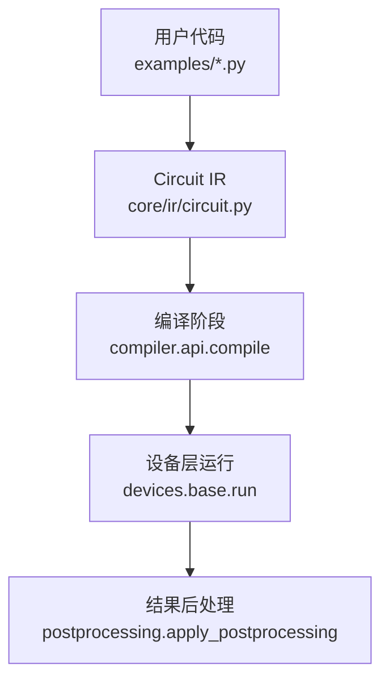
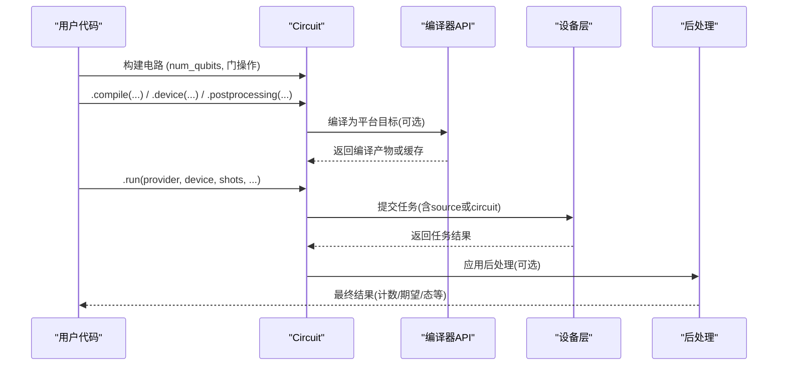
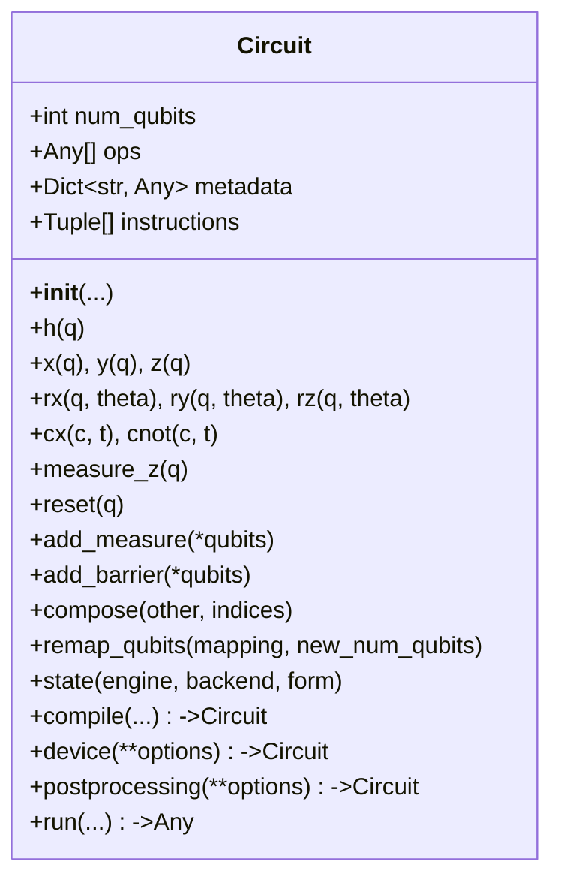
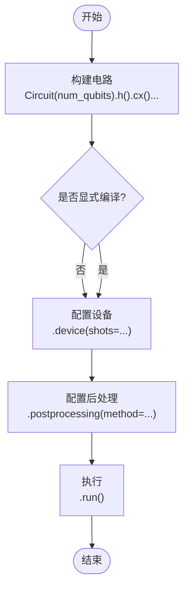
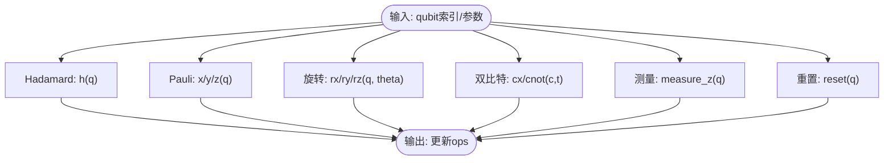
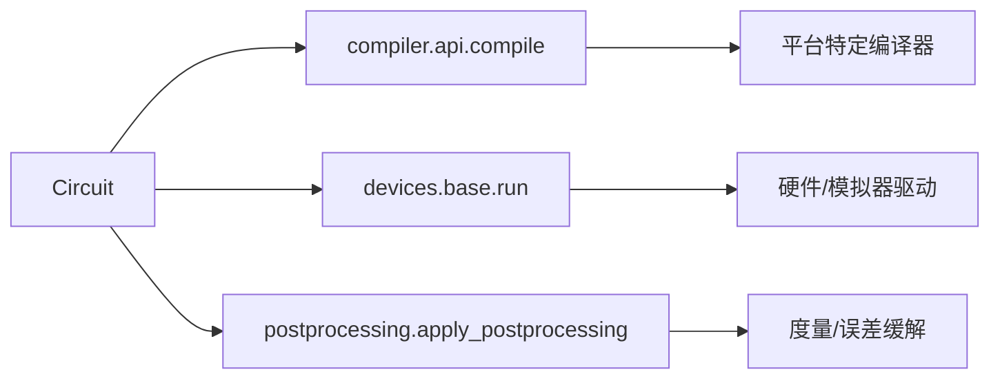

# 量子电路基础

<cite>
**本文引用的文件**
- [src/tyxonq/core/ir/circuit.py](file://src/tyxonq/core/ir/circuit.py)
- [examples/basic_chain_api.py](file://examples/basic_chain_api.py)
- [examples/circuit_chain_demo.py](file://examples/circuit_chain_demo.py)
- [tests_core_module/test_core_ir.py](file://tests_core_module/test_core_ir.py)
</cite>

## 目录
1. [简介](#简介)
2. [项目结构](#项目结构)
3. [核心组件](#核心组件)
4. [架构总览](#架构总览)
5. [详细组件分析](#详细组件分析)
6. [依赖关系分析](#依赖关系分析)
7. [性能考量](#性能考量)
8. [故障排查指南](#故障排查指南)
9. [结论](#结论)
10. [附录：快速上手示例路径](#附录快速上手示例路径)

## 简介
本指南面向初学者，系统讲解 TyxonQ 中 Circuit 类的基础概念与使用方法。你将学会如何创建和初始化量子电路对象、理解链式 API 的设计思想与优势、掌握常用量子门（Hadamard、Pauli、CNOT 等）的添加方式，并通过循序渐进的示例从最基础的电路开始构建。同时，文档包含错误处理与调试技巧，帮助你快速定位问题并高效开发。

## 项目结构
TyxonQ 将量子电路的核心中间表示（IR）定义在 core/ir 模块中，Circuit 类位于该模块下；示例代码位于 examples 目录，用于演示链式 API、全局配置、多后端执行等常见用法；测试用例位于 tests_core_module，覆盖基本构造、校验、组合与序列化等场景。

图表来源
- [src/tyxonq/core/ir/circuit.py:783-850](file://src/tyxonq/core/ir/circuit.py#L783-L850)
- [src/tyxonq/core/ir/circuit.py:853-1042](file://src/tyxonq/core/ir/circuit.py#L853-L1042)

章节来源
- [src/tyxonq/core/ir/circuit.py:48-141](file://src/tyxonq/core/ir/circuit.py#L48-L141)
- [examples/basic_chain_api.py:22-41](file://examples/basic_chain_api.py#L22-L41)
- [examples/circuit_chain_demo.py:27-68](file://examples/circuit_chain_demo.py#L27-L68)

## 核心组件
- Circuit 类：量子电路的轻量级中间表示，封装量子比特数、操作序列、元数据与指令列表，并提供丰富的链式接口用于构建、配置和执行电路。
- 链式配置三阶段：compile（编译）、device（设备与采样参数）、postprocessing（结果后处理），最终通过 run() 统一执行。
- 全局默认配置：可通过顶层 API 设置 compile/device/postprocessing 的全局默认值，简化重复配置。
- 数值模拟与状态获取：支持 statevector、MPS、密度矩阵等多种模拟器引擎，并可获取波函数或密度矩阵。

章节来源
- [src/tyxonq/core/ir/circuit.py:48-141](file://src/tyxonq/core/ir/circuit.py#L48-L141)
- [src/tyxonq/core/ir/circuit.py:190-239](file://src/tyxonq/core/ir/circuit.py#L190-L239)
- [src/tyxonq/core/ir/circuit.py:427-541](file://src/tyxonq/core/ir/circuit.py#L427-L541)

## 架构总览
下图展示了从电路构建到执行的完整流程，包括链式 API 各阶段的职责与数据流向。

图表来源
- [src/tyxonq/core/ir/circuit.py:783-850](file://src/tyxonq/core/ir/circuit.py#L783-L850)
- [src/tyxonq/core/ir/circuit.py:853-1042](file://src/tyxonq/core/ir/circuit.py#L853-L1042)

## 详细组件分析

### Circuit 类：创建与初始化
- num_qubits：量子比特数量，必须为非负整数。
- ops：操作序列，每个元素为元组/列表，首项为门名称，后续为量子比特索引与参数。
- metadata/instructions：元数据与指令列表，便于可视化、调度与测量映射。
- inputs：初始量子态（仅数值模拟），可传入态矢量或密度矩阵。
- 链式阶段默认值：compile_engine/output/target、device_provider/device/shots、postprocessing_method 等均可通过构造函数或全局默认注入。

图表来源
- [src/tyxonq/core/ir/circuit.py:48-141](file://src/tyxonq/core/ir/circuit.py#L48-L141)
- [src/tyxonq/core/ir/circuit.py:1102-1195](file://src/tyxonq/core/ir/circuit.py#L1102-L1195)
- [src/tyxonq/core/ir/circuit.py:1351-1495](file://src/tyxonq/core/ir/circuit.py#L1351-L1495)
- [src/tyxonq/core/ir/circuit.py:671-710](file://src/tyxonq/core/ir/circuit.py#L671-L710)
- [src/tyxonq/core/ir/circuit.py:783-850](file://src/tyxonq/core/ir/circuit.py#L783-L850)
- [src/tyxonq/core/ir/circuit.py:853-1042](file://src/tyxonq/core/ir/circuit.py#L853-L1042)

章节来源
- [src/tyxonq/core/ir/circuit.py:65-141](file://src/tyxonq/core/ir/circuit.py#L65-L141)

### 链式 API 的设计理念与优势
- 设计理念：将“编译-设备-后处理-执行”四步抽象为可组合的链式方法，减少样板代码，提升可读性与可维护性。
- 优势：
  - 声明式风格：以流畅接口描述意图，降低心智负担。
  - 自动补全：未显式设置的选项会按全局默认智能补齐。
  - 灵活切换：同一电路可在模拟器与云端硬件之间无缝切换。
  - 可测试性：链式调用易于拆分与单元测试。

图表来源
- [examples/basic_chain_api.py:22-41](file://examples/basic_chain_api.py#L22-L41)
- [examples/circuit_chain_demo.py:46-68](file://examples/circuit_chain_demo.py#L46-L68)
- [src/tyxonq/core/ir/circuit.py:783-850](file://src/tyxonq/core/ir/circuit.py#L783-L850)
- [src/tyxonq/core/ir/circuit.py:853-1042](file://src/tyxonq/core/ir/circuit.py#L853-L1042)

章节来源
- [examples/basic_chain_api.py:22-41](file://examples/basic_chain_api.py#L22-L41)
- [examples/circuit_chain_demo.py:46-68](file://examples/circuit_chain_demo.py#L46-L68)

### 基本量子门操作
- Hadamard 门：h(q)，创建叠加态。
- Pauli 门：x(q)、y(q)、z(q)。
- 旋转门：rx(q, theta)、ry(q, theta)、rz(q, theta)。
- 双量子比特门：cx(c, t)/cnot(c, t)、cz、cy、rxx/ryy/rzz、iswap 等。
- 测量与重置：measure_z(q)、reset(q)、add_measure/add_barrier。

图表来源
- [src/tyxonq/core/ir/circuit.py:1102-1195](file://src/tyxonq/core/ir/circuit.py#L1102-L1195)
- [src/tyxonq/core/ir/circuit.py:1500-1595](file://src/tyxonq/core/ir/circuit.py#L1500-L1595)
- [src/tyxonq/core/ir/circuit.py:1351-1495](file://src/tyxonq/core/ir/circuit.py#L1351-L1495)

章节来源
- [src/tyxonq/core/ir/circuit.py:1102-1195](file://src/tyxonq/core/ir/circuit.py#L1102-L1195)
- [src/tyxonq/core/ir/circuit.py:1500-1595](file://src/tyxonq/core/ir/circuit.py#L1500-L1595)
- [src/tyxonq/core/ir/circuit.py:1351-1495](file://src/tyxonq/core/ir/circuit.py#L1351-L1495)

### 从基础到进阶：电路构建过程示例
以下示例路径展示了从最简单的 Bell 态到带参数的复杂电路构建过程，涵盖链式 API、全局默认、多后端与高级门操作。

- 基础链式 API 与 Bell 态
  - 参考路径：[examples/basic_chain_api.py:22-41](file://examples/basic_chain_api.py#L22-L41)
- 全面演示：链式配置、自动补全、全局默认、多后端、高级门、组合与重映射、JSON 序列化、QASM 编译、Hamiltonian、脉冲支持
  - 参考路径：[examples/circuit_chain_demo.py:27-276](file://examples/circuit_chain_demo.py#L27-L276)

章节来源
- [examples/basic_chain_api.py:22-41](file://examples/basic_chain_api.py#L22-L41)
- [examples/circuit_chain_demo.py:27-276](file://examples/circuit_chain_demo.py#L27-L276)

### 错误处理与调试技巧
- 构造期校验：
  - num_qubits 必须非负。
  - ops 中每个操作的量子比特索引必须在 [0, num_qubits) 范围内。
  - instructions 的索引同样需合法。
- 运行时异常：
  - unitary 门要求矩阵维度与量子比特数匹配。
  - Kraus 通道要求合法的算子集合。
  - 非法后端或引擎类型会抛出 ValueError。
- 调试建议：
  - 使用 gate_summary()/gate_count() 检查门统计。
  - 使用 extended/compose/remap_qubits 进行电路组合与重映射，逐步验证。
  - 使用 to_json_str()/from_json_str() 序列化与反序列化，便于版本对比与复现。
  - 使用 state() 获取波函数或密度矩阵，结合后端张量进行可视化与梯度分析。

章节来源
- [src/tyxonq/core/ir/circuit.py:155-183](file://src/tyxonq/core/ir/circuit.py#L155-L183)
- [src/tyxonq/core/ir/circuit.py:1241-1277](file://src/tyxonq/core/ir/circuit.py#L1241-L1277)
- [src/tyxonq/core/ir/circuit.py:1279-1349](file://src/tyxonq/core/ir/circuit.py#L1279-L1349)
- [src/tyxonq/core/ir/circuit.py:575-621](file://src/tyxonq/core/ir/circuit.py#L575-L621)
- [tests_core_module/test_core_ir.py:22-45](file://tests_core_module/test_core_ir.py#L22-L45)

## 依赖关系分析
Circuit 在执行时依赖编译器 API、设备层与后处理模块，形成清晰的解耦分层。

图表来源
- [src/tyxonq/core/ir/circuit.py:783-850](file://src/tyxonq/core/ir/circuit.py#L783-L850)
- [src/tyxonq/core/ir/circuit.py:853-1042](file://src/tyxonq/core/ir/circuit.py#L853-L1042)

章节来源
- [src/tyxonq/core/ir/circuit.py:783-850](file://src/tyxonq/core/ir/circuit.py#L783-L850)
- [src/tyxonq/core/ir/circuit.py:853-1042](file://src/tyxonq/core/ir/circuit.py#L853-L1042)

## 性能考量
- 模拟器选择：
  - statevector：适合中小规模精确模拟，内存随 2^n 增长。
  - MPS：适合低纠缠态的大规模模拟，控制最大键维以平衡精度与内存。
  - density_matrix：支持噪声与混合态，但内存开销更大。
- 门复杂度估算：count_flop() 提供粗略 FLOP 估计，帮助评估 statevector 模拟成本。
- 编译优化：合理设置 decompose/route/optimize/simplify，避免不必要的分解与路由。
- 采样次数：shots 越大统计越稳定，但耗时增加；根据需求权衡。

章节来源
- [src/tyxonq/core/ir/circuit.py:623-644](file://src/tyxonq/core/ir/circuit.py#L623-L644)
- [src/tyxonq/core/ir/circuit.py:427-541](file://src/tyxonq/core/ir/circuit.py#L427-L541)

## 故障排查指南
- 常见问题
  - 量子比特索引越界：确保所有 op 中的索引在 [0, num_qubits) 内。
  - unitary 矩阵维度不匹配：1 量子比特对应 2×2，2 量子比特对应 4×4。
  - 后端不可用：如 PyTorch 未安装时切换回 NumPy。
  - 拓扑发现失败：云端提交时若无法获取耦合图，将退回直译模式。
- 调试步骤
  - 打印 gate_summary() 与 gate_count() 确认门序列。
  - 使用 compose/remap_qubits 逐步组合与重映射，定位错误位置。
  - 使用 state() 获取态并检查概率分布是否符合预期。
  - 使用 to_json_str() 保存电路快照，便于对比不同版本的差异。

章节来源
- [src/tyxonq/core/ir/circuit.py:155-183](file://src/tyxonq/core/ir/circuit.py#L155-L183)
- [src/tyxonq/core/ir/circuit.py:1241-1277](file://src/tyxonq/core/ir/circuit.py#L1241-L1277)
- [src/tyxonq/core/ir/circuit.py:895-944](file://src/tyxonq/core/ir/circuit.py#L895-L944)
- [tests_core_module/test_core_ir.py:22-45](file://tests_core_module/test_core_ir.py#L22-L45)

## 结论
TyxonQ 的 Circuit 类提供了简洁而强大的量子电路构建与执行能力。通过链式 API 与全局默认配置，用户可以以声明式风格快速搭建电路并在模拟器与云端硬件间无缝切换。丰富的量子门、测量与重置操作，以及完善的错误处理与调试工具，使得初学者也能高效上手。建议在实践中结合 gate_summary/state/序列化等手段进行迭代开发与问题定位。

## 附录：快速上手示例路径
- 基础链式 API 与 Bell 态
  - [examples/basic_chain_api.py:22-41](file://examples/basic_chain_api.py#L22-L41)
- 全面演示（链式配置、自动补全、全局默认、多后端、高级门、组合与重映射、JSON、QASM、Hamiltonian、脉冲）
  - [examples/circuit_chain_demo.py:27-276](file://examples/circuit_chain_demo.py#L27-L276)
- 核心 IR 测试（构造、校验、组合、序列化）
  - [tests_core_module/test_core_ir.py:22-45](file://tests_core_module/test_core_ir.py#L22-L45)