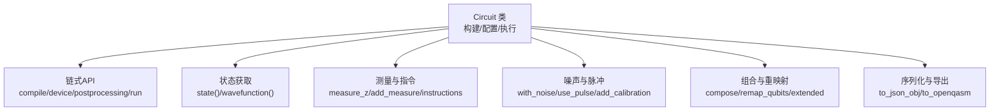
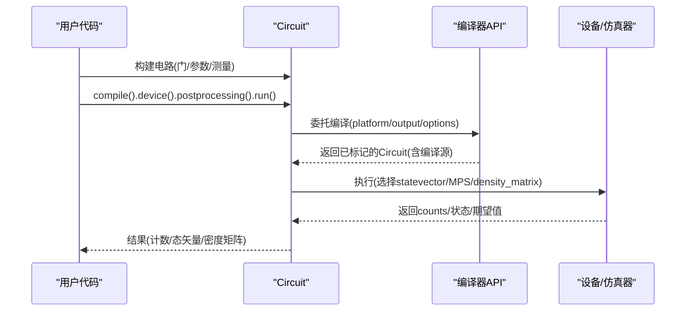
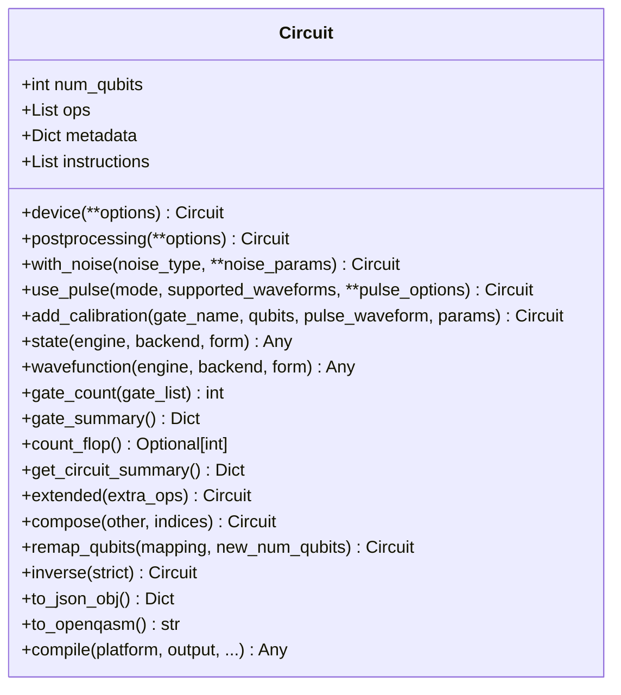
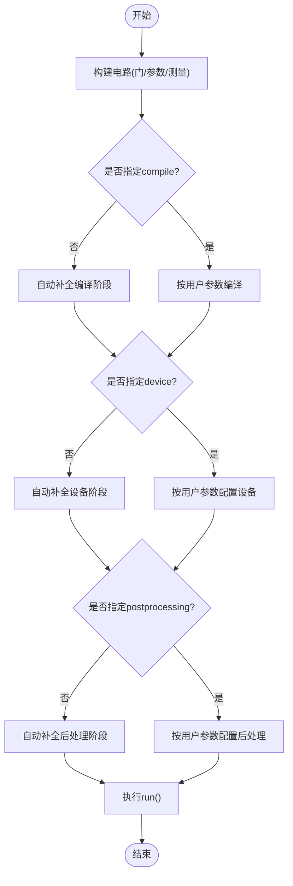
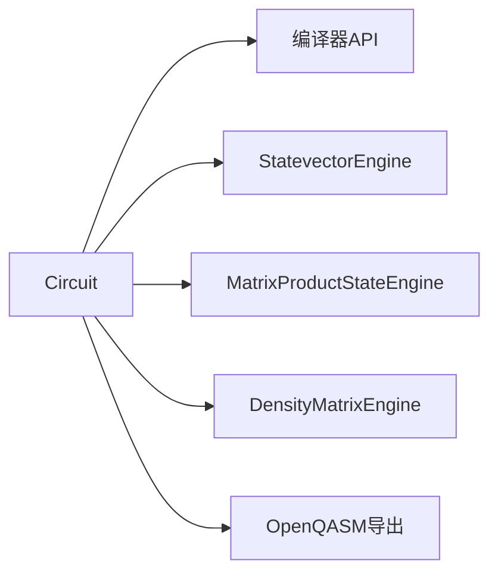

# 量子电路编程

<cite>
**本文引用的文件**
- [src/tyxonq/core/ir/circuit.py](file://src/tyxonq/core/ir/circuit.py)
- [examples/basic_chain_api.py](file://examples/basic_chain_api.py)
- [examples/circuit_chain_demo.py](file://examples/circuit_chain_demo.py)
- [examples/simple_qaoa.py](file://examples/simple_qaoa.py)
- [examples/vqe_simple_hamiltonian.py](file://examples/vqe_simple_hamiltonian.py)
- [examples/custom_unitary_gates.py](file://examples/custom_unitary_gates.py)
</cite>

## 目录
1. [简介](#简介)
2. [项目结构](#项目结构)
3. [核心组件](#核心组件)
4. [架构总览](#架构总览)
5. [详细组件分析](#详细组件分析)
6. [依赖关系分析](#依赖关系分析)
7. [性能考虑](#性能考虑)
8. [故障排查指南](#故障排查指南)
9. [结论](#结论)
10. [附录](#附录)

## 简介
本指南面向使用 TyxonQ 进行量子电路编程的开发者，聚焦于 Circuit 类的构建、操作与优化，覆盖链式 API 的设计优势与最佳实践；展示如何构建复杂电路（如变分量子算法、量子傅里叶变换、QAOA/Grover 等）；介绍自定义量子门的使用；说明编译与优化选项、不同后端兼容性以及调试与性能优化技巧。文档以仓库中的实际实现为依据，提供可追溯的代码片段路径与图示。

## 项目结构
TyxonQ 将量子电路的核心 IR 定义在 core/ir 中，并通过示例演示链式 API、编译、噪声、脉冲与算法应用。Circuit 类位于 core/ir/circuit.py，提供了从电路构建、配置到执行的一体化接口；示例展示了如何在不同后端与设备上运行电路，以及如何组合、序列化与导出。

**图表来源**
- [src/tyxonq/core/ir/circuit.py:48-800](file://src/tyxonq/core/ir/circuit.py#L48-L800)

**章节来源**
- [src/tyxonq/core/ir/circuit.py:48-800](file://src/tyxonq/core/ir/circuit.py#L48-L800)
- [examples/circuit_chain_demo.py:27-227](file://examples/circuit_chain_demo.py#L27-L227)

## 核心组件
- Circuit：最小化的量子电路 IR，支持链式配置、状态获取、测量、噪声、脉冲、组合、序列化与编译导出。
- 链式 API：通过 compile().device().postprocessing().run() 完成“编译→设备→后处理→执行”的完整流程，并具备自动补全能力。
- 状态与波函数：state()/wavefunction() 支持 statevector、MPS、密度矩阵三种引擎，并可切换数值后端。
- 噪声模型：with_noise() 便捷配置退相干/去极化等噪声，自动切换到密度矩阵模拟器。
- 脉冲编程：use_pulse() 配置脉冲编译模式，add_calibration() 添加自定义校准。
- 组合与重映射：compose()/remap_qubits()/extended() 支持电路拼接与量子位映射。
- 序列化与导出：to_json_obj()/to_openqasm() 用于跨平台交换与兼容。

**章节来源**
- [src/tyxonq/core/ir/circuit.py:48-800](file://src/tyxonq/core/ir/circuit.py#L48-L800)
- [examples/basic_chain_api.py:22-124](file://examples/basic_chain_api.py#L22-L124)
- [examples/circuit_chain_demo.py:27-227](file://examples/circuit_chain_demo.py#L27-L227)

## 架构总览
下图展示了从用户代码到执行结果的典型调用链：用户通过链式 API 配置电路，Circuit 委托编译器生成目标 IR，再交由设备驱动执行，最后返回结果或状态。

**图表来源**
- [src/tyxonq/core/ir/circuit.py:780-800](file://src/tyxonq/core/ir/circuit.py#L780-L800)
- [examples/basic_chain_api.py:22-41](file://examples/basic_chain_api.py#L22-L41)

**章节来源**
- [src/tyxonq/core/ir/circuit.py:780-800](file://src/tyxonq/core/ir/circuit.py#L780-L800)
- [examples/basic_chain_api.py:22-41](file://examples/basic_chain_api.py#L22-L41)

## 详细组件分析

### Circuit 类方法与属性
- 构造与校验
  - 初始化 num_qubits、ops、metadata、instructions，并支持初始态 inputs（仅数值仿真）。
  - __post_init__ 对 qubit 索引范围、op 类型等进行轻量级结构校验。
- 链式配置
  - device(**options)：设置 provider/device/shots 等执行选项。
  - postprocessing(**options)：设置测量后处理方法（如读误校正）。
  - with_noise(noise_type, **params)：便捷配置噪声模型，自动切换到密度矩阵仿真。
  - use_pulse(mode, supported_waveforms, **pulse_options)：启用脉冲编译模式与约束。
  - add_calibration(gate_name, qubits, pulse_waveform, params)：为特定门添加脉冲校准。
- 状态与波函数
  - state(engine, backend, form)：根据设备配置或显式 engine 选择仿真器，返回态矢量/MPS重构态/密度矩阵。
  - wavefunction(...)：state() 的语义别名。
- 分析与工具
  - gate_count/gate_summary/count_flop/get_circuit_summary：统计门数、复杂度估计。
  - extended/compose/remap_qubits：扩展、组合、重映射。
  - inverse：对支持的门求逆（非幺正门默认跳过）。
- 序列化与导出
  - to_json_obj/to_json_str：JSON 序列化。
  - to_openqasm：通过编译器导出 OpenQASM 2。
- 编译接口
  - compile(platform, output, basis_gates, decompose, route, optimize, simplify, device_rule, target, options, compile_engine)：委托 compiler.api.compile，无参时作为链式 no-op 标记意图。

**图表来源**
- [src/tyxonq/core/ir/circuit.py:48-800](file://src/tyxonq/core/ir/circuit.py#L48-L800)

**章节来源**
- [src/tyxonq/core/ir/circuit.py:48-800](file://src/tyxonq/core/ir/circuit.py#L48-L800)

### 链式 API 设计与最佳实践
- 设计优势
  - 可读性高：compile().device().postprocessing().run() 表达清晰。
  - 自动补全：未指定的阶段会智能补齐默认值，减少样板代码。
  - 全局默认：可通过 tq.device()/tq.compile() 设置全局默认，简化批量任务。
- 最佳实践
  - 明确 shots 与 device 类型，避免隐式行为。
  - 在需要梯度/可微时使用 state() 获取后端张量，结合参数移位或后端 AD。
  - 对硬件提交，优先使用 QASM 导出或平台特定的编译输出。

**图表来源**
- [examples/basic_chain_api.py:22-75](file://examples/basic_chain_api.py#L22-L75)
- [examples/circuit_chain_demo.py:46-100](file://examples/circuit_chain_demo.py#L46-L100)

**章节来源**
- [examples/basic_chain_api.py:22-75](file://examples/basic_chain_api.py#L22-L75)
- [examples/circuit_chain_demo.py:46-100](file://examples/circuit_chain_demo.py#L46-L100)

### 复杂量子电路构建与算法示例
- 变分量子算法（VQE）
  - 使用硬件高效 Ansatz 构建电路，通过 state() 获取态矢量计算期望能量，配合数值后端进行梯度优化。
  - 参考路径：[vqe_simple_hamiltonian.py:87-152](file://examples/vqe_simple_hamiltonian.py#L87-L152)
- QAOA（最大割问题）
  - 通过 CX-RZ-CX 实现 ZZ 相互作用，循环多层参数化旋转，测量后基于 counts 计算目标函数。
  - 参考路径：[simple_qaoa.py:48-83](file://examples/simple_qaoa.py#L48-L83)
- 量子傅里叶变换（QFT）
  - 使用 unitary() 插入受控相位旋转门，构建 QFT 电路。
  - 参考路径：[custom_unitary_gates.py:155-183](file://examples/custom_unitary_gates.py#L155-L183)
- Grover 搜索
  - 可使用标准门（H、CX、RZ）与扩散算子（多控制反射）组合实现；在 TyxonQ 中可通过 unitary() 直接注入任意酉矩阵或使用库内核实现。
  - 建议参考 QFT 的 unitary 用法与 VQE 的参数化层结构进行扩展。

**章节来源**
- [examples/vqe_simple_hamiltonian.py:87-152](file://examples/vqe_simple_hamiltonian.py#L87-L152)
- [examples/simple_qaoa.py:48-83](file://examples/simple_qaoa.py#L48-L83)
- [examples/custom_unitary_gates.py:155-183](file://examples/custom_unitary_gates.py#L155-L183)

### 自定义量子门的创建与使用
- 单/双量子位自定义酉门：通过 Circuit.unitary(qubits, matrix=...) 直接注入任意酉矩阵。
- 参数化门：结合 gates 库内核（如 gate_rx/ry/rz）与 unitary() 构建可变参电路。
- 随机酉基准测试：利用 QR 分解生成随机酉矩阵，评估电路深度与保真度。
- 参考路径：
  - 单量子位 √X：[custom_unitary_gates.py:35-52](file://examples/custom_unitary_gates.py#L35-L52)
  - iSWAP 双量子位：[custom_unitary_gates.py:59-78](file://examples/custom_unitary_gates.py#L59-L78)
  - 参数化旋转：[custom_unitary_gates.py:88-104](file://examples/custom_unitary_gates.py#L88-L104)
  - 随机酉基准：[custom_unitary_gates.py:114-145](file://examples/custom_unitary_gates.py#L114-L145)

**章节来源**
- [examples/custom_unitary_gates.py:35-145](file://examples/custom_unitary_gates.py#L35-L145)

### 电路优化选项与编译策略
- 编译阶段
  - compile() 支持 platform、output、basis_gates、decompose、route、optimize、simplify、device_rule、target、options、compile_engine 等参数，委托编译器 API 完成具体转换。
  - 无参 compile() 作为链式 no-op，仅标记意图，便于后续自动补全。
- 优化策略
  - 光锥简化（lightcone）、门合并/剪枝、路由与分解等由编译器内部阶段实现。
  - 通过 device_rule/target 适配不同硬件拓扑与基集。
- 参考路径：[src/tyxonq/core/ir/circuit.py:780-800](file://src/tyxonq/core/ir/circuit.py#L780-L800)

**章节来源**
- [src/tyxonq/core/ir/circuit.py:780-800](file://src/tyxonq/core/ir/circuit.py#L780-L800)

### 噪声建模与脉冲编程
- 噪声建模
  - with_noise() 支持 depolarizing、amplitude_damping、phase_damping、pauli 等模型，自动切换到密度矩阵仿真器。
  - 参考路径：[src/tyxonq/core/ir/circuit.py:241-297](file://src/tyxonq/core/ir/circuit.py#L241-L297)
- 脉冲编程
  - use_pulse() 配置混合/纯脉冲/自动降级模式，支持波形约束与 inline_pulses 选项。
  - add_calibration() 为特定门添加脉冲校准，提升硬件适配精度。
  - 参考路径：[src/tyxonq/core/ir/circuit.py:300-425](file://src/tyxonq/core/ir/circuit.py#L300-L425)

**章节来源**
- [src/tyxonq/core/ir/circuit.py:241-425](file://src/tyxonq/core/ir/circuit.py#L241-L425)

### 测量与指令
- 测量操作
  - measure_z() 与 add_measure() 支持显式指令记录，便于结果解析与映射。
  - 参考路径：[examples/circuit_chain_demo.py:146-160](file://examples/circuit_chain_demo.py#L146-L160)
- 指令解析
  - positional_logical_mapping() 可从 instructions 或 measure_z 推断位置到逻辑量子位的映射。
  - 参考路径：[src/tyxonq/core/ir/circuit.py:711-730](file://src/tyxonq/core/ir/circuit.py#L711-L730)

**章节来源**
- [examples/circuit_chain_demo.py:146-160](file://examples/circuit_chain_demo.py#L146-L160)
- [src/tyxonq/core/ir/circuit.py:711-730](file://src/tyxonq/core/ir/circuit.py#L711-L730)

## 依赖关系分析
- 模块耦合
  - Circuit 依赖编译器 API（compiler.api.compile）进行目标 IR 生成与导出。
  - 状态获取依赖具体仿真器引擎（statevector/matrix_product_state/density_matrix），按需懒加载。
- 外部集成
  - 支持 QASM 导出（OpenQASM 2/3），便于与其他生态互操作。
  - 支持多种数值后端（numpy/pytorch/CuPyNumeric），通过 set_backend 切换。

**图表来源**
- [src/tyxonq/core/ir/circuit.py:427-541](file://src/tyxonq/core/ir/circuit.py#L427-L541)
- [src/tyxonq/core/ir/circuit.py:771-778](file://src/tyxonq/core/ir/circuit.py#L771-L778)

**章节来源**
- [src/tyxonq/core/ir/circuit.py:427-541](file://src/tyxonq/core/ir/circuit.py#L427-L541)
- [src/tyxonq/core/ir/circuit.py:771-778](file://src/tyxonq/core/ir/circuit.py#L771-L778)

## 性能考虑
- 仿真器选择
  - 小系统/高精度：statevector（O(2^n) 内存）。
  - 低纠缠大系统：MPS（可控键维 max_bond）。
  - 噪声模拟：density_matrix（支持退相干/去极化）。
- 复杂度估算
  - count_flop() 提供启发式 FLOP 估计，辅助评估 statevector 仿真成本。
- 优化建议
  - 合理设置 shots，平衡精度与耗时。
  - 使用 compose/remap_qubits 减少冗余门与布局开销。
  - 利用 compile() 的 optimize/simplify 与平台规则降低门深与双量子位门数量。
  - 脉冲模式下 inline_pulses=False 保留可微性，True 提高云兼容性。

**章节来源**
- [src/tyxonq/core/ir/circuit.py:623-644](file://src/tyxonq/core/ir/circuit.py#L623-L644)
- [src/tyxonq/core/ir/circuit.py:427-541](file://src/tyxonq/core/ir/circuit.py#L427-L541)
- [src/tyxonq/core/ir/circuit.py:300-372](file://src/tyxonq/core/ir/circuit.py#L300-L372)

## 故障排查指南
- 常见错误
  - qubit 索引越界：__post_init__ 会校验 op 与 instructions 中的 qubit 索引范围。
  - 未知 engine：state() 仅支持 statevector/mps/density_matrix，传入非法值将报错。
  - 非幺正门求逆：inverse(strict=True) 遇到 measure/reset/barrier 将抛出异常。
- 调试方法
  - 使用 gate_summary() 检查门分布与数量。
  - 使用 get_circuit_summary() 获取 #qubits/#gates/#CNOT/depth/#FLOP 等概览。
  - 逐步启用 with_noise/use_pulse 定位噪声或脉冲相关的问题。
  - 通过 to_json_obj() 序列化电路，检查 ops 与 instructions 是否符合预期。

**章节来源**
- [src/tyxonq/core/ir/circuit.py:155-183](file://src/tyxonq/core/ir/circuit.py#L155-L183)
- [src/tyxonq/core/ir/circuit.py:538-541](file://src/tyxonq/core/ir/circuit.py#L538-L541)
- [src/tyxonq/core/ir/circuit.py:732-755](file://src/tyxonq/core/ir/circuit.py#L732-L755)
- [src/tyxonq/core/ir/circuit.py:605-664](file://src/tyxonq/core/ir/circuit.py#L605-L664)
- [src/tyxonq/core/ir/circuit.py:758-767](file://src/tyxonq/core/ir/circuit.py#L758-L767)

## 结论
TyxonQ 的 Circuit 类提供了统一而强大的量子电路编程接口：链式 API 让配置与执行简洁直观；丰富的状态获取、噪声与脉冲支持覆盖了从仿真到硬件的多场景需求；组合与重映射、序列化与导出增强了可复用性与互操作性。结合示例中的 VQE、QAOA、QFT 等算法，开发者可以快速构建并优化复杂量子电路，并在不同后端与平台上稳定运行。

## 附录
- 快速上手
  - 基础链式 API：参考 [examples/basic_chain_api.py:22-75](file://examples/basic_chain_api.py#L22-L75)
  - 全面演示：参考 [examples/circuit_chain_demo.py:27-227](file://examples/circuit_chain_demo.py#L27-L227)
- 算法参考
  - VQE：参考 [examples/vqe_simple_hamiltonian.py:87-152](file://examples/vqe_simple_hamiltonian.py#L87-L152)
  - QAOA：参考 [examples/simple_qaoa.py:48-83](file://examples/simple_qaoa.py#L48-L83)
  - QFT：参考 [examples/custom_unitary_gates.py:155-183](file://examples/custom_unitary_gates.py#L155-L183)
- 自定义门与基准
  - 自定义酉门：参考 [examples/custom_unitary_gates.py:35-145](file://examples/custom_unitary_gates.py#L35-L145)