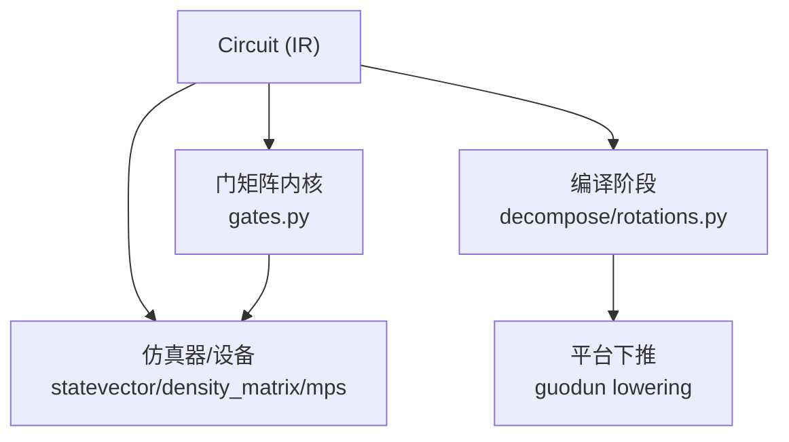
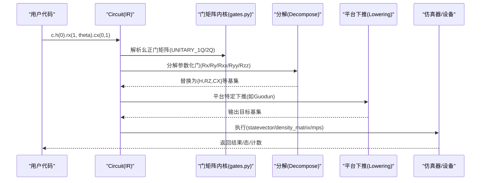
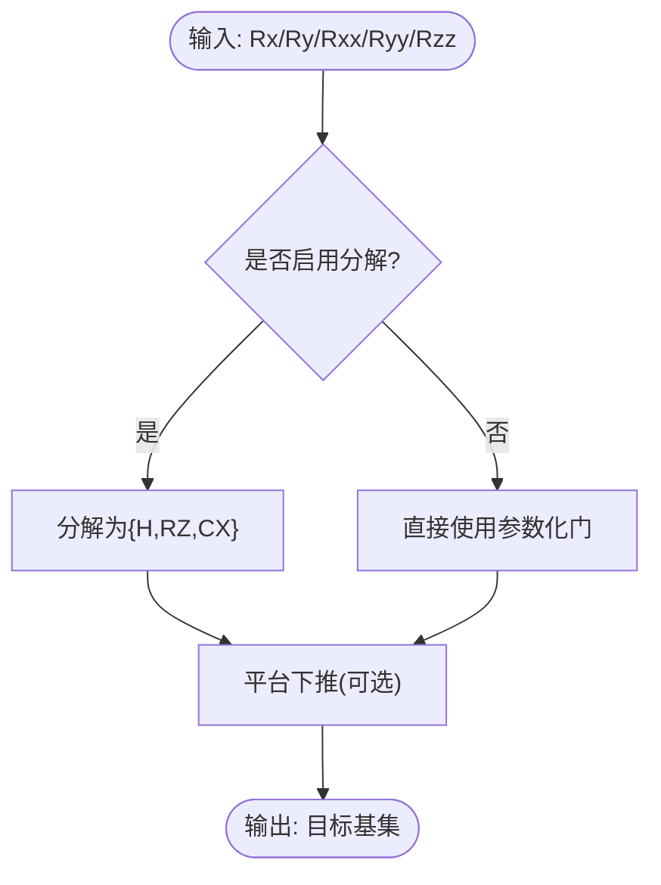
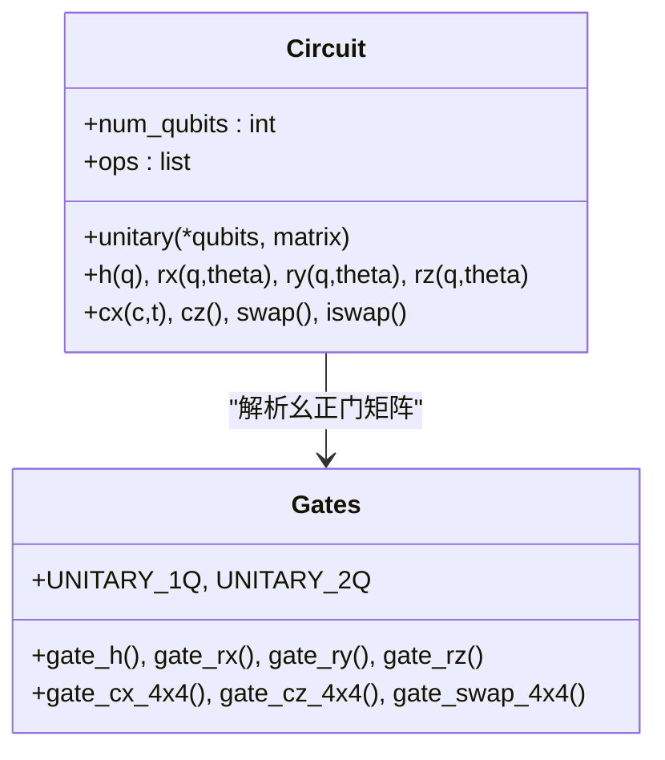
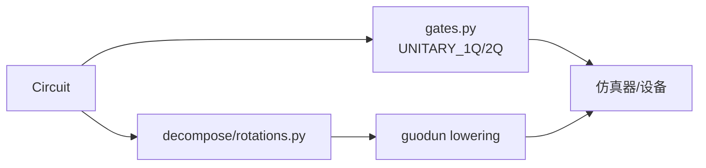

# 量子门操作

<cite>
**本文引用的文件**
- [src/tyxonq/core/ir/circuit.py](file://src/tyxonq/core/ir/circuit.py)
- [src/tyxonq/libs/quantum_library/kernels/gates.py](file://src/tyxonq/libs/quantum_library/kernels/gates.py)
- [examples/custom_unitary_gates.py](file://examples/custom_unitary_gates.py)
- [examples/basic_chain_api.py](file://examples/basic_chain_api.py)
- [src/tyxonq/compiler/gate_compiler/stages/decompose/rotations.py](file://src/tyxonq/compiler/gate_compiler/stages/decompose/rotations.py)
- [src/tyxonq/compiler/platforms/guodun/lowering.py](file://src/tyxonq/compiler/platforms/guodun/lowering.py)
- [examples/performance_optimization_tips.md](file://examples/performance_optimization_tips.md)
</cite>

## 目录
1. [简介](#简介)
2. [项目结构](#项目结构)
3. [核心组件](#核心组件)
4. [架构总览](#架构总览)
5. [详细组件分析](#详细组件分析)
6. [依赖关系分析](#依赖关系分析)
7. [性能考量](#性能考量)
8. [故障排查指南](#故障排查指南)
9. [结论](#结论)
10. [附录：常用门与参数速查](#附录：常用门与参数速查)

## 简介
本指南面向在 TyxonQ 中构建、组合与优化量子电路的工程师与研究者，系统介绍支持的量子门类型与使用方法，覆盖单量子比特门（H、X、Y、Z、Ry、Rx、Rz、S、T 等）、多量子比特门（CNOT/CX、CZ、SWAP、iSWAP、CRy、RXX/RYY/RZZ 等），以及参数化门的实现原理与应用。同时说明如何创建自定义 Unitary 门、如何在复杂电路中组合不同门、并提供从基础到进阶的代码示例路径与性能优化建议。

## 项目结构
TyxonQ 将“电路 IR”“门矩阵内核”“编译与分解”“设备执行”分层组织：
- 电路 IR：Circuit 类负责记录操作序列、链式配置与执行入口。
- 门矩阵内核：集中定义各门矩阵与解析规则，作为模拟器引擎的统一真相源。
- 编译与分解：将高级门（如旋转门）分解为硬件基集（如 H、RZ、CX）。
- 设备执行：状态向量、密度矩阵、MPS 等仿真器或真实设备驱动。

图表来源
- [src/tyxonq/core/ir/circuit.py:1102-1277](file://src/tyxonq/core/ir/circuit.py#L1102-L1277)
- [src/tyxonq/libs/quantum_library/kernels/gates.py:355-396](file://src/tyxonq/libs/quantum_library/kernels/gates.py#L355-L396)
- [src/tyxonq/compiler/gate_compiler/stages/decompose/rotations.py:13-41](file://src/tyxonq/compiler/gate_compiler/stages/decompose/rotations.py#L13-L41)
- [src/tyxonq/compiler/platforms/guodun/lowering.py:61-85](file://src/tyxonq/compiler/platforms/guodun/lowering.py#L61-L85)

章节来源
- [src/tyxonq/core/ir/circuit.py:1102-1277](file://src/tyxonq/core/ir/circuit.py#L1102-L1277)
- [src/tyxonq/libs/quantum_library/kernels/gates.py:355-396](file://src/tyxonq/libs/quantum_library/kernels/gates.py#L355-L396)

## 核心组件
- Circuit 类：提供链式 API（h、rx、ry、rz、cx、unitary、measure_z 等），维护 ops 列表与全局默认配置，支持 compile().device().postprocessing().run() 流水线。
- 门矩阵内核：集中定义所有幺正门矩阵与解析表（UNITARY_1Q/UNITARY_2Q），保证模拟器引擎对门的一致解释。
- 分解与下推：将 Rx/Ry/Rxx/Ryy/Rzz 等参数化门分解为标准基集；特定平台（如 Guodun）进一步将部分单比特门下推到 RZ/X。
- 自定义 Unitary：通过 Circuit.unitary(qubits, matrix=...) 注入任意幺正矩阵，并缓存于 _unitary_cache。

章节来源
- [src/tyxonq/core/ir/circuit.py:1102-1277](file://src/tyxonq/core/ir/circuit.py#L1102-L1277)
- [src/tyxonq/libs/quantum_library/kernels/gates.py:355-396](file://src/tyxonq/libs/quantum_library/kernels/gates.py#L355-L396)
- [src/tyxonq/compiler/gate_compiler/stages/decompose/rotations.py:13-41](file://src/tyxonq/compiler/gate_compiler/stages/decompose/rotations.py#L13-L41)
- [src/tyxonq/compiler/platforms/guodun/lowering.py:61-85](file://src/tyxonq/compiler/platforms/guodun/lowering.py#L61-L85)

## 架构总览
下图展示从用户调用到最终执行的端到端流程，包括参数化门分解与平台下推。

图表来源
- [src/tyxonq/core/ir/circuit.py:1102-1277](file://src/tyxonq/core/ir/circuit.py#L1102-L1277)
- [src/tyxonq/libs/quantum_library/kernels/gates.py:355-396](file://src/tyxonq/libs/quantum_library/kernels/gates.py#L355-L396)
- [src/tyxonq/compiler/gate_compiler/stages/decompose/rotations.py:13-41](file://src/tyxonq/compiler/gate_compiler/stages/decompose/rotations.py#L13-L41)
- [src/tyxonq/compiler/platforms/guodun/lowering.py:61-85](file://src/tyxonq/compiler/platforms/guodun/lowering.py#L61-L85)

## 详细组件分析

### 单量子比特门
- 支持门：H、X、Y、Z、S、SDG、T、TDG、Rx(θ)、Ry(θ)、Rz(θ)。
- 实现要点：
  - 矩阵由 gates.py 中的 gate_h/gate_x/gate_y/gate_z/gate_phase 等函数生成，使用后端原生数组以保持自动微分链。
  - 参数化旋转门（Rx/Ry/Rz）将角度转换为后端张量，并通过 cos/sin 构造矩阵，确保梯度可回传。
  - 统一解析表 UNITARY_1Q 将 op 名映射到 builder，供模拟器引擎一致处理。
- 典型用法路径：
  - 链式添加：c.h(0); c.rx(1, theta); c.rz(2, theta)
  - 参考示例：[examples/basic_chain_api.py:22-41](file://examples/basic_chain_api.py#L22-L41)

章节来源
- [src/tyxonq/libs/quantum_library/kernels/gates.py:11-65](file://src/tyxonq/libs/quantum_library/kernels/gates.py#L11-L65)
- [src/tyxonq/core/ir/circuit.py:1102-1158](file://src/tyxonq/core/ir/circuit.py#L1102-L1158)
- [examples/basic_chain_api.py:22-41](file://examples/basic_chain_api.py#L22-L41)

### 多量子比特门
- 支持门：CNOT/CX、CY、CZ、SWAP、iSWAP、CRy(θ)、RXX(θ)、RYY(θ)、RZZ(θ)。
- 实现要点：
  - 矩阵由 gates.py 中 gate_cx_4x4/gate_cy_4x4/gate_cz_4x4/gate_swap_4x4/gate_iswap_4x4/gate_cry_4x4/gate_rxx/gate_ryy/gate_rzz 等函数定义。
  - 统一解析表 UNITARY_2Q 将 op 名映射到 builder，供引擎一致处理。
  - 控制位约定：两比特门以第一个 qubit 为高位（控制位），与模拟器基序一致。
- 典型用法路径：
  - 纠缠与路由：c.cx(0,1); c.swap(i,i+1); c.iswap(i,j)
  - 参考示例：[examples/pulse_iswap_swap_decomposition.py:177-203](file://examples/pulse_iswap_swap_decomposition.py#L177-L203)

章节来源
- [src/tyxonq/libs/quantum_library/kernels/gates.py:82-180](file://src/tyxonq/libs/quantum_library/kernels/gates.py#L82-L180)
- [src/tyxonq/libs/quantum_library/kernels/gates.py:284-383](file://src/tyxonq/libs/quantum_library/kernels/gates.py#L284-L383)
- [examples/pulse_iswap_swap_decomposition.py:177-203](file://examples/pulse_iswap_swap_decomposition.py#L177-L203)

### 参数化门与分解
- 参数化门：Rx(θ)、Ry(θ)、Rz(θ)、CRy(θ)、RXX(θ)、RYY(θ)、RZZ(θ)。
- 分解策略：
  - RotationsDecompose 将 Rx/Ry/Rxx/Ryy/Rzz 分解为标准基集 {H, RZ, CX}，便于硬件基集受限的设备执行。
  - 平台下推（如 Guodun）进一步将 Y/Z/S/T 等单比特门下推到 RZ/X 的组合，减少门集复杂度。
- 应用场景：
  - 在硬件基集受限或需要最小深度时，优先使用分解后的基集。
  - 在数值模拟中可直接使用参数化门以获得更简洁的表达式与梯度流。

图表来源
- [src/tyxonq/compiler/gate_compiler/stages/decompose/rotations.py:13-41](file://src/tyxonq/compiler/gate_compiler/stages/decompose/rotations.py#L13-L41)
- [src/tyxonq/compiler/platforms/guodun/lowering.py:61-85](file://src/tyxonq/compiler/platforms/guodun/lowering.py#L61-L85)

章节来源
- [src/tyxonq/compiler/gate_compiler/stages/decompose/rotations.py:13-41](file://src/tyxonq/compiler/gate_compiler/stages/decompose/rotations.py#L13-L41)
- [src/tyxonq/compiler/platforms/guodun/lowering.py:61-85](file://src/tyxonq/compiler/platforms/guodun/lowering.py#L61-L85)

### 自定义 Unitary 门
- 接口：Circuit.unitary(*qubits, matrix=...)
- 功能：
  - 支持 1 或 2 个量子比特的任意幺正矩阵（2×2 或 4×4）。
  - 矩阵会被存入 _unitary_cache，并以键引用形式写入 ops，避免重复存储。
  - 可与标准门混用，适合实验性门、随机电路基准、变分算法等场景。
- 示例路径：
  - 单比特 √X、两比特 iSWAP、随机 Unitary 基准、QFT 实现、VQE Ansatz 集成等。
  - 参考示例：[examples/custom_unitary_gates.py:31-255](file://examples/custom_unitary_gates.py#L31-L255)

图表来源
- [src/tyxonq/core/ir/circuit.py:1197-1277](file://src/tyxonq/core/ir/circuit.py#L1197-L1277)
- [src/tyxonq/libs/quantum_library/kernels/gates.py:355-396](file://src/tyxonq/libs/quantum_library/kernels/gates.py#L355-L396)

章节来源
- [src/tyxonq/core/ir/circuit.py:1197-1277](file://src/tyxonq/core/ir/circuit.py#L1197-L1277)
- [examples/custom_unitary_gates.py:31-255](file://examples/custom_unitary_gates.py#L31-L255)

### 复杂电路中的门组合
- 链式 API：c.h(0).cx(0,1).rx(1, theta) 等，保持可读性与可组合性。
- 组合模式：
  - 层叠：重复应用旋转层与纠缠层（如硬件高效 Ansatz）。
  - 路由：使用 SWAP/iSWAP 满足拓扑约束。
  - 测量与投影：measure_z、mid_measurement、reset 等用于中间测量与后选择。
- 示例路径：
  - 基础链式 API：[examples/basic_chain_api.py:22-41](file://examples/basic_chain_api.py#L22-L41)
  - 路由与交互：[examples/pulse_iswap_swap_decomposition.py:177-203](file://examples/pulse_iswap_swap_decomposition.py#L177-L203)

章节来源
- [examples/basic_chain_api.py:22-41](file://examples/basic_chain_api.py#L22-L41)
- [examples/pulse_iswap_swap_decomposition.py:177-203](file://examples/pulse_iswap_swap_decomposition.py#L177-L203)

## 依赖关系分析
- Circuit 依赖 gates.py 的幺正门解析表与矩阵生成函数，确保模拟器引擎对门的一致解释。
- 分解阶段（RotationsDecompose）将参数化门转换为基集，降低设备兼容性问题。
- 平台下推（如 Guodun）进一步将单比特门映射到 RZ/X 组合，适配硬件基集。
- 仿真器/设备根据 op 名称与矩阵进行演化，非幺正/特殊 op（如 measure_z、kraus、project_z、reset、pulse）由引擎显式处理。

图表来源
- [src/tyxonq/core/ir/circuit.py:1102-1277](file://src/tyxonq/core/ir/circuit.py#L1102-L1277)
- [src/tyxonq/libs/quantum_library/kernels/gates.py:355-396](file://src/tyxonq/libs/quantum_library/kernels/gates.py#L355-L396)
- [src/tyxonq/compiler/gate_compiler/stages/decompose/rotations.py:13-41](file://src/tyxonq/compiler/gate_compiler/stages/decompose/rotations.py#L13-L41)
- [src/tyxonq/compiler/platforms/guodun/lowering.py:61-85](file://src/tyxonq/compiler/platforms/guodun/lowering.py#L61-L85)

章节来源
- [src/tyxonq/core/ir/circuit.py:1102-1277](file://src/tyxonq/core/ir/circuit.py#L1102-L1277)
- [src/tyxonq/libs/quantum_library/kernels/gates.py:355-396](file://src/tyxonq/libs/quantum_library/kernels/gates.py#L355-L396)

## 性能考量
- 避免重复电路执行：多次 expectation 会重复执行电路，应缓存状态向量或使用 Hamiltonian 一次性计算。
- 推荐做法：
  - 先获取 psi = circuit.state()，再批量计算期望值。
  - 使用模板函数或 Hamiltonian 对象聚合观测项。
- 参考文档：[examples/performance_optimization_tips.md:1-223](file://examples/performance_optimization_tips.md#L1-L223)

章节来源
- [examples/performance_optimization_tips.md:1-223](file://examples/performance_optimization_tips.md#L1-L223)

## 故障排查指南
- 常见错误：
  - unitary 矩阵维度不匹配：需确保 1 量子比特为 2×2，2 量子比特为 4×4。
  - 未知 op：非幺正/特殊 op 必须由引擎显式处理，否则可能报错或被静默丢弃（新版本已改为严格 raise）。
  - 参数化门未分解：若目标设备不支持 Rx/Ry/Rxx/Ryy/Rzz，需在编译阶段启用分解。
- 定位方法：
  - 检查 Circuit.ops 与 _unitary_cache 内容。
  - 查看分解与下推日志，确认最终基集。
  - 使用 gate_summary 统计门类型与数量。

章节来源
- [src/tyxonq/core/ir/circuit.py:1197-1277](file://src/tyxonq/core/ir/circuit.py#L1197-L1277)
- [src/tyxonq/libs/quantum_library/kernels/gates.py:355-396](file://src/tyxonq/libs/quantum_library/kernels/gates.py#L355-L396)

## 结论
TyxonQ 提供了完整的量子门体系与灵活的电路 IR，支持从基础门到参数化门、自定义 Unitary 的全栈能力。通过统一的门矩阵内核与分解/下推机制，可在多种仿真器与硬件平台上稳定执行。结合链式 API 与性能优化实践，能够高效构建与运行复杂量子电路。

## 附录：常用门与参数速查
- 单比特门：H、X、Y、Z、S、SDG、T、TDG、Rx(θ)、Ry(θ)、Rz(θ)
- 多比特门：CNOT/CX、CY、CZ、SWAP、iSWAP、CRy(θ)、RXX(θ)、RYY(θ)、RZZ(θ)
- 自定义门：Circuit.unitary(*qubits, matrix=...)
- 测量与投影：measure_z、mid_measurement、reset
- 示例路径：
  - 基础链式 API：[examples/basic_chain_api.py:22-41](file://examples/basic_chain_api.py#L22-L41)
  - 自定义 Unitary：[examples/custom_unitary_gates.py:31-255](file://examples/custom_unitary_gates.py#L31-L255)
  - 路由与交互：[examples/pulse_iswap_swap_decomposition.py:177-203](file://examples/pulse_iswap_swap_decomposition.py#L177-L203)