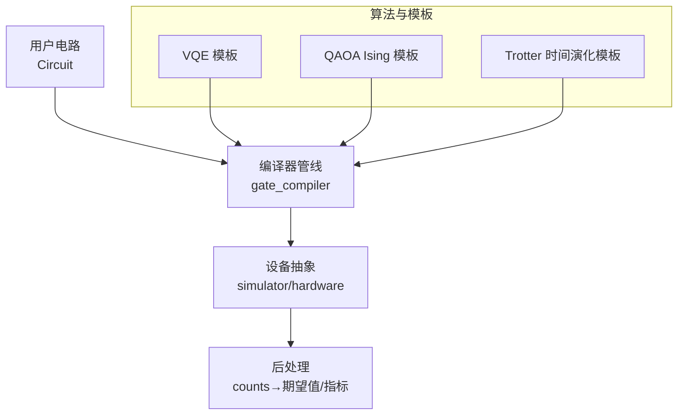
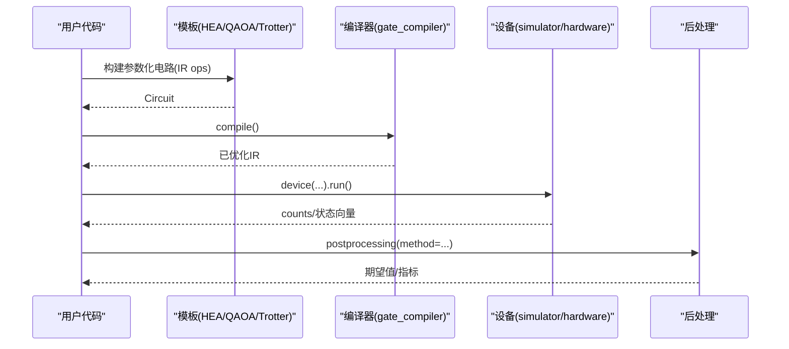
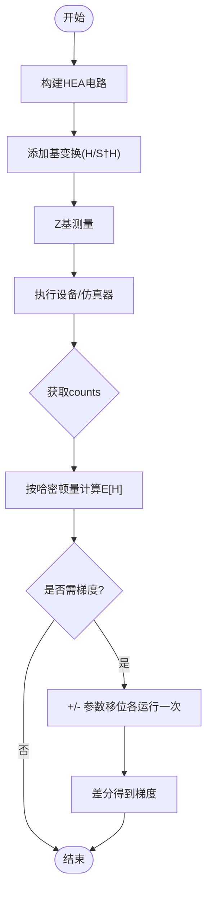
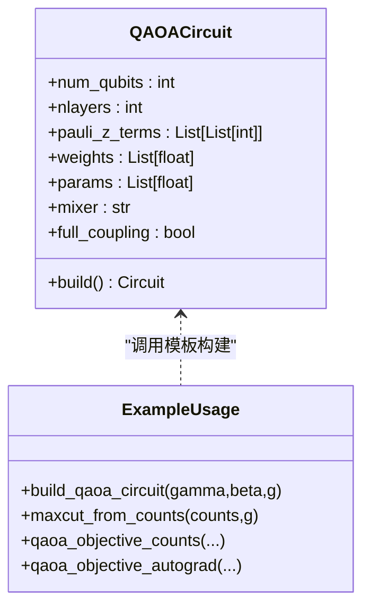
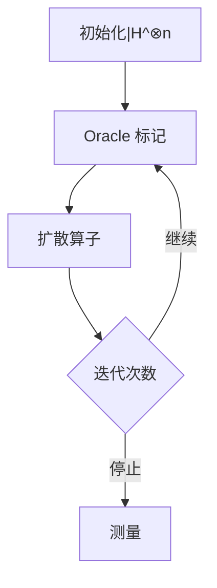
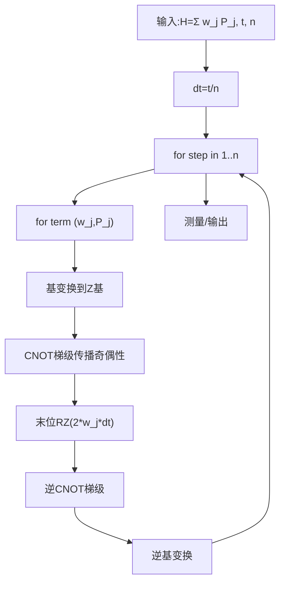
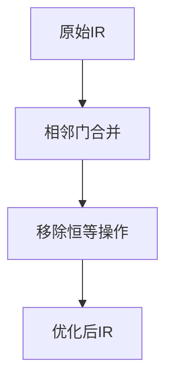
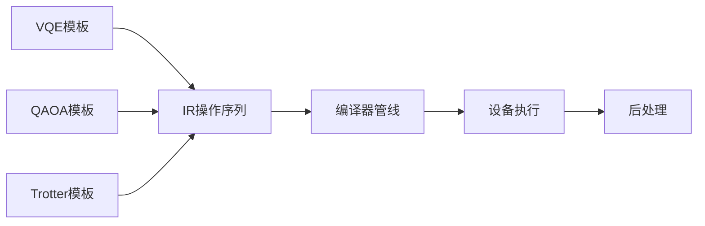

# 高级电路构建

<cite>
**本文引用的文件**
- [README.md](file://README.md)
- [vqe.py](file://src/tyxonq/libs/circuits_library/vqe.py)
- [qaoa_ising.py](file://src/tyxonq/libs/circuits_library/qaoa_ising.py)
- [trotter_circuit.py](file://src/tyxonq/libs/circuits_library/trotter_circuit.py)
- [simple_qaoa.py](file://examples/simple_qaoa.py)
- [timeevolution_trotter.py](file://examples/timeevolution_trotter.py)
- [merge_prune.py](file://src/tyxonq/compiler/gate_compiler/stages/rewrite/merge_prune.py)
- [compiler.py](file://src/tyxonq/compiler/gate_compiler/compiler.py)
- [basic_examples.rst](file://docs/source/examples/basic_examples.rst)
- [advanced_examples.rst](file://docs/source/examples/advanced_examples.rst)
- [circuits_library_index.rst](file://docs/source/libraries/circuits_library/index.rst)
- [user_guide_core_index.rst](file://docs/source/user_guide/core/index.rst)
</cite>

## 目录
1. [简介](#简介)
2. [项目结构](#项目结构)
3. [核心组件](#核心组件)
4. [架构总览](#架构总览)
5. [详细组件分析](#详细组件分析)
6. [依赖关系分析](#依赖关系分析)
7. [性能考量](#性能考量)
8. [故障排查指南](#故障排查指南)
9. [结论](#结论)
10. [附录](#附录)

## 简介
本指南面向希望在 TyxonQ 上构建复杂量子电路的工程师与研究者，系统讲解变分量子算法（VQE、QAOA）的参数化电路设计与优化策略，经典量子算法（如量子傅里叶变换、Grover 搜索思路）的实现要点，以及基于 Trotter 分解的时间演化模拟。同时提供大规模电路构建技巧（多比特纠缠态制备）、性能优化方法（深度优化、门合并等）与调试验证流程，帮助你在仿真器与真实硬件之间稳定交付高质量电路。

## 项目结构
TyxonQ 采用“稳定 IR + 链式编译执行”的分层架构：上层提供电路模板与算法库，中间是设备无关的门级编译器与平台方言，底层对接多种模拟器与真实硬件驱动。典型链路为：Circuit → compile() → device(...) → postprocessing(...) → run()。

图表来源
- [compiler.py:57-74](file://src/tyxonq/compiler/gate_compiler/compiler.py#L57-L74)
- [README.md:191-206](file://README.md#L191-L206)

章节来源
- [README.md:191-206](file://README.md#L191-L206)
- [compiler.py:57-74](file://src/tyxonq/compiler/gate_compiler/compiler.py#L57-L74)

## 核心组件
- 参数化电路模板
  - VQE：硬件高效 Ansatz（HEA），支持从 counts 计算能量与参数移位梯度。
  - QAOA：Ising 模型 ansatz，支持 X/XY/ZZ 混频器与全连接或近邻耦合。
  - Trotter：将 H = Σ w_j P_j 的一阶分解转换为可执行的门序列。
- 编译器与优化
  - 标准化 → 分解 → 路由 → 优化 → 化简 的流水线；包含相邻门合并与恒等门剪枝。
- 设备与执行
  - 统一链式 API：compile().device(...).postprocessing(...).run()，兼容 statevector/density_matrix/MPS 与真实硬件。
- 示例与文档
  - 基础与进阶示例涵盖 QFT、随机采样、Trotter 演化等；用户指南提供电路校验与最佳实践。

章节来源
- [vqe.py:23-150](file://src/tyxonq/libs/circuits_library/vqe.py#L23-L150)
- [qaoa_ising.py:8-66](file://src/tyxonq/libs/circuits_library/qaoa_ising.py#L8-L66)
- [trotter_circuit.py:8-122](file://src/tyxonq/libs/circuits_library/trotter_circuit.py#L8-L122)
- [compiler.py:57-74](file://src/tyxonq/compiler/gate_compiler/compiler.py#L57-L74)
- [merge_prune.py:12-46](file://src/tyxonq/compiler/gate_compiler/stages/rewrite/merge_prune.py#L12-L46)
- [README.md:191-206](file://README.md#L191-L206)

## 架构总览
下图展示从高层算法到具体实现的映射关系：VQE/QAOA/Trotter 模板生成 IR 操作序列，经编译器降阶至目标基集并优化，最终在设备端执行并输出计数结果，由后处理模块计算期望值或指标。

图表来源
- [vqe.py:133-150](file://src/tyxonq/libs/circuits_library/vqe.py#L133-L150)
- [qaoa_ising.py:8-66](file://src/tyxonq/libs/circuits_library/qaoa_ising.py#L8-L66)
- [trotter_circuit.py:75-122](file://src/tyxonq/libs/circuits_library/trotter_circuit.py#L75-L122)
- [compiler.py:57-74](file://src/tyxonq/compiler/gate_compiler/compiler.py#L57-L74)

## 详细组件分析

### 变分量子算法：VQE
- 设计要点
  - 使用硬件高效 Ansatz（HEA）：每层包含 CX 链与 RX/RZ 旋转，参数线性展开便于梯度计算。
  - 能量估计：对 Z 项直接统计，X/Y 项需在电路端做基变换后再测量。
  - 梯度：通过参数移位规则对每个可微门进行 ±π/2 偏移，分别运行电路并差分得到梯度。
- 数据流
  - 构造 HEA → 添加基变换与测量 → 执行获取 counts → 按哈密顿量求和得能量 → 参数移位求梯度。

图表来源
- [vqe.py:23-66](file://src/tyxonq/libs/circuits_library/vqe.py#L23-L66)
- [vqe.py:85-130](file://src/tyxonq/libs/circuits_library/vqe.py#L85-L130)
- [vqe.py:133-150](file://src/tyxonq/libs/circuits_library/vqe.py#L133-L150)

章节来源
- [vqe.py:23-150](file://src/tyxonq/libs/circuits_library/vqe.py#L23-L150)

### 变分量子算法：QAOA（Ising）
- 设计要点
  - Cost 层：对单 Z 项与 ZZ 项施加 RZ/RZZ 旋转，权重乘以 γ。
  - Mixer 层：支持 X（全局 RX）、XY（RXX+RYY）、ZZ（RZZ）混频器，可按近邻或全连接配对。
  - 输出：可直接用 counts 评估 MaxCut 目标，也可走数值后端自动微分路径。
- 实现路径
  - 模板 qaoa_ising 生成 IR ops；示例 simple_qaoa 演示 counts 目标与 autograd 两种路径。

图表来源
- [qaoa_ising.py:8-66](file://src/tyxonq/libs/circuits_library/qaoa_ising.py#L8-L66)
- [simple_qaoa.py:48-83](file://examples/simple_qaoa.py#L48-L83)
- [simple_qaoa.py:88-149](file://examples/simple_qaoa.py#L88-L149)

章节来源
- [qaoa_ising.py:8-66](file://src/tyxonq/libs/circuits_library/qaoa_ising.py#L8-L66)
- [simple_qaoa.py:48-149](file://examples/simple_qaoa.py#L48-L149)

### 量子傅里叶变换（QFT）与 Grover 搜索
- QFT
  - 简化实现：对每个量子比特应用 Hadamard，并对后续比特施加相位旋转（或使用受控相位门）。
  - 参考示例展示了 n 比特的 QFT 电路构建方式。
- Grover 搜索
  - 标准步骤：初始叠加 → Oracle 标记 → Diffusion 算子 → 迭代放大目标概率。
  - 在 TyxonQ 中可用基本门（H、CNOT、相位旋转）组合实现 Oracle 与扩散算子，并通过多次迭代提升目标态概率。

图表来源
- [basic_examples.rst:119-147](file://docs/source/examples/basic_examples.rst#L119-L147)

章节来源
- [basic_examples.rst:119-147](file://docs/source/examples/basic_examples.rst#L119-L147)

### 量子模拟：Trotter 分解与时间演化
- 原理
  - 将 e^{-iHt} 分解为若干小步 Δt = t/n 的乘积，每项 exp(-i w_j P_j Δt) 通过基变换与 CNOT 梯级实现。
- 实现
  - 模板 build_trotter_circuit 接受 Pauli 项编码与权重，循环 steps 次，逐项应用单/多体演化。
  - 示例 timeevolution_trotter 演示 Heisenberg 链的 Trotter 演化与测量。

图表来源
- [trotter_circuit.py:8-72](file://src/tyxonq/libs/circuits_library/trotter_circuit.py#L8-L72)
- [trotter_circuit.py:75-122](file://src/tyxonq/libs/circuits_library/trotter_circuit.py#L75-L122)
- [timeevolution_trotter.py:13-53](file://examples/timeevolution_trotter.py#L13-L53)

章节来源
- [trotter_circuit.py:8-122](file://src/tyxonq/libs/circuits_library/trotter_circuit.py#L8-L122)
- [timeevolution_trotter.py:13-53](file://examples/timeevolution_trotter.py#L13-L53)

### 大规模电路与多比特纠缠态
- 多比特纠缠态制备
  - 常用模式：Hadamard 叠加 + CNOT 链（GHZ 态），或通过 iSWAP/CZ 族门构建更复杂的纠缠结构。
  - 在 TyxonQ 中，可通过链式 API 快速拼接门序列，并利用编译器进行路由与优化。
- 注意事项
  - 控制两比特门数量与拓扑约束，必要时启用编译器路由以插入 SWAP。
  - 结合测量分组与 shot 规划减少执行开销。

章节来源
- [README.md:191-206](file://README.md#L191-L206)
- [advanced_examples.rst:424-474](file://docs/source/examples/advanced_examples.rst#L424-L474)

### 性能优化：电路深度优化与门合并
- 门合并与恒等剪枝
  - 编译器内置相邻门合并规则（如连续 S 合并为 Z，连续 H 消去为恒等），并移除恒等操作。
  - 适用于 RZ/RX/RY 等旋转门的相位累加与抵消。
- 虚拟 Z 优化
  - 连续 RZ 可合并为单次相位更新，降低实际调度开销。
- 建议
  - 优先使用模板（HEA/QAOA/Trotter）以获得良好结构；再开启编译器优化级别以提升吞吐。

图表来源
- [merge_prune.py:12-46](file://src/tyxonq/compiler/gate_compiler/stages/rewrite/merge_prune.py#L12-L46)

章节来源
- [merge_prune.py:12-46](file://src/tyxonq/compiler/gate_compiler/stages/rewrite/merge_prune.py#L12-L46)

## 依赖关系分析
- 模板与 IR
  - VQE/QAOA/Trotter 模板均返回 IR 操作序列，供编译器统一处理。
- 编译器与优化
  - 编译器装配标准化、分解、路由、优化、化简步骤；优化阶段包含门合并与恒等剪枝。
- 设备与后处理
  - 设备抽象屏蔽仿真器/硬件差异；后处理将 counts 转为期望值或指标。

图表来源
- [vqe.py:23-150](file://src/tyxonq/libs/circuits_library/vqe.py#L23-L150)
- [qaoa_ising.py:8-66](file://src/tyxonq/libs/circuits_library/qaoa_ising.py#L8-L66)
- [trotter_circuit.py:75-122](file://src/tyxonq/libs/circuits_library/trotter_circuit.py#L75-L122)
- [compiler.py:57-74](file://src/tyxonq/compiler/gate_compiler/compiler.py#L57-L74)

章节来源
- [compiler.py:57-74](file://src/tyxonq/compiler/gate_compiler/compiler.py#L57-L74)

## 性能考量
- 选择合适模板与深度
  - VQE：HEA 浅层结构适合 NISQ；QAOA 层数 p 影响质量与深度。
  - Trotter：步数 n 越大误差越小但深度增加，需权衡精度与资源。
- 利用编译器优化
  - 提高 optimization_level，启用门合并与虚拟 Z 优化，减少实际门数与调度开销。
- 执行与采样
  - 合理设置 shots；对仅需要期望值的任务，优先使用 statevector 仿真器进行验证。
- 数值后端
  - 使用 PyTorch/NumPy 后端进行无采样梯度验证；设备路径则通过参数移位或数值差分获取梯度。

[本节为通用指导，不直接分析具体文件]

## 故障排查指南
- 电路校验
  - 创建时自动校验量子比特索引与门参数类型；捕获越界与类型错误。
- 常见错误
  - 索引越界：检查 circuit.h/qubit 索引是否在范围内。
  - 参数类型错误：确保传入浮点数而非字符串。
- 执行异常
  - 设备执行失败时可回退到仿真器；记录 job_id 与 raw_data 以便定位问题。
- 建议实践
  - 使用链式 API 与 metadata 标注电路用途与版本，便于复现与调试。

章节来源
- [user_guide_core_index.rst:303-367](file://docs/source/user_guide/core/index.rst#L303-L367)

## 结论
TyxonQ 提供了从算法模板到设备执行的完整闭环：VQE/QAOA/Trotter 等模板覆盖主流变分与模拟场景；编译器保障跨设备的一致性与性能；链式 API 简化了从仿真到硬件的部署流程。遵循本文的结构化方法与优化策略，可在保证正确性的前提下，高效构建与优化大规模量子电路。

## 附录
- 快速参考
  - 链式 API：c.compile().device(...).postprocessing(...).run()
  - 模板入口：VQE（vqe.py）、QAOA（qaoa_ising.py）、Trotter（trotter_circuit.py）
  - 示例：QFT（basic_examples.rst）、Trotter 演化（timeevolution_trotter.py）
- 进一步阅读
  - 技术白皮书与架构图（README.md）
  - 开发者指南与自定义设备（docs/source/developer_guide/*）

[本节为补充信息，不直接分析具体文件]