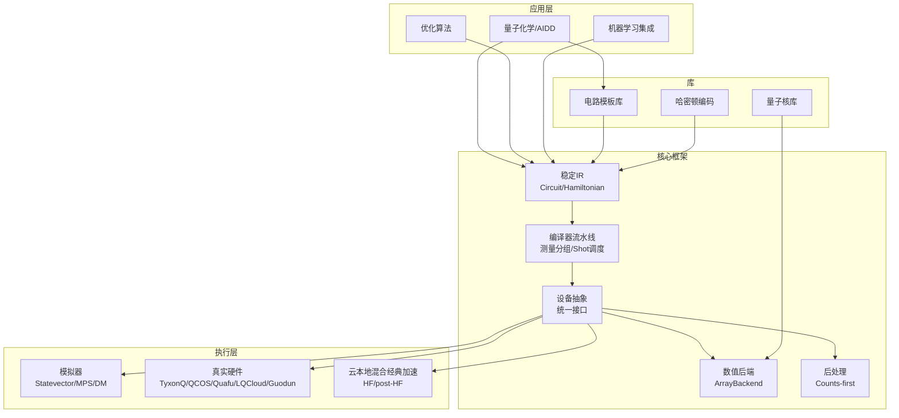
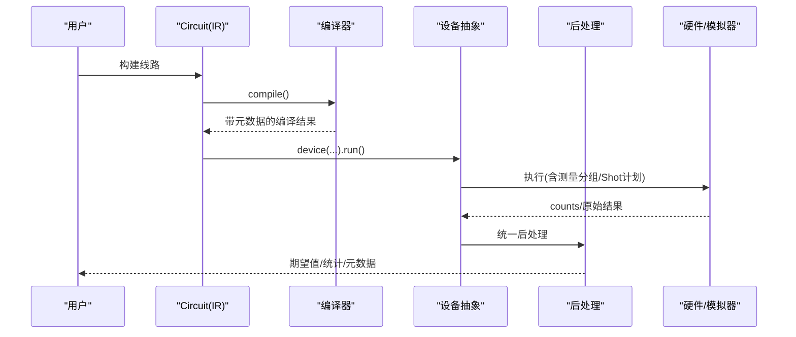
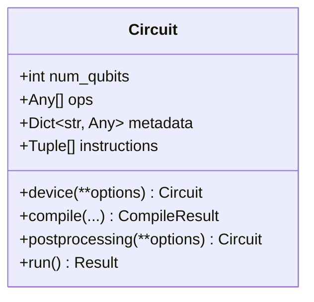
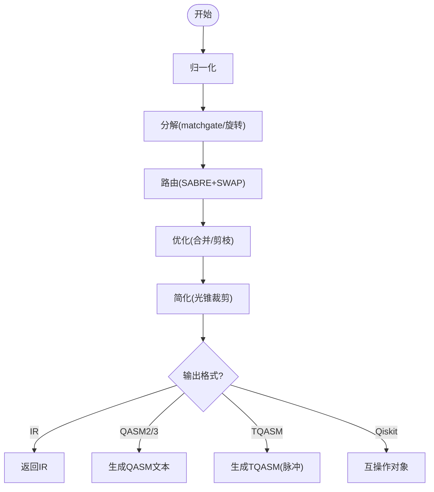
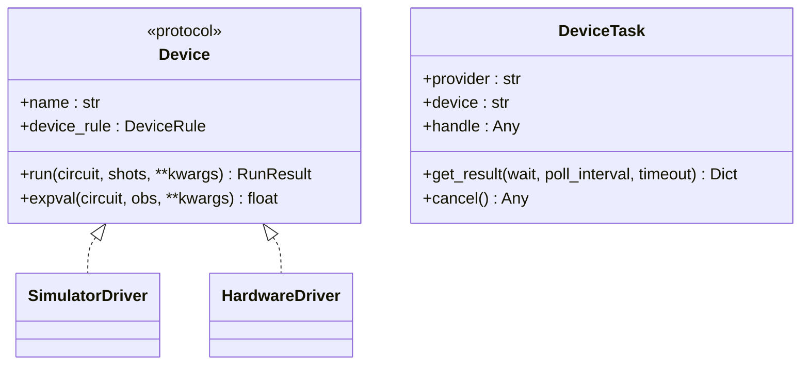
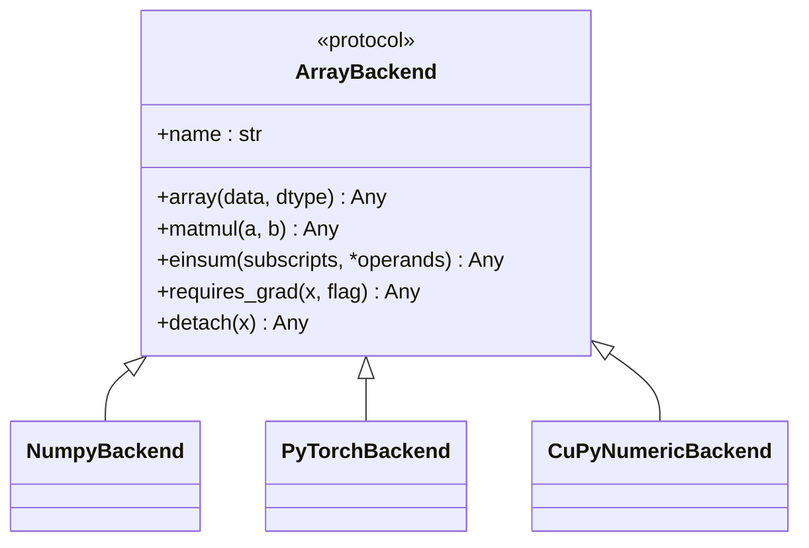
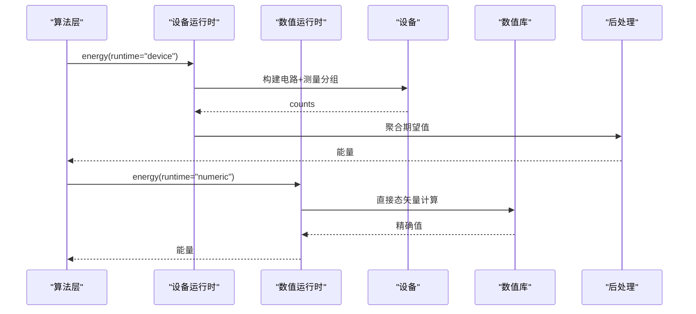
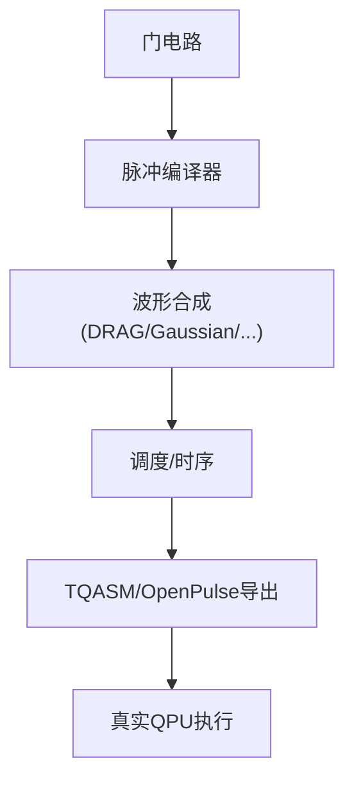
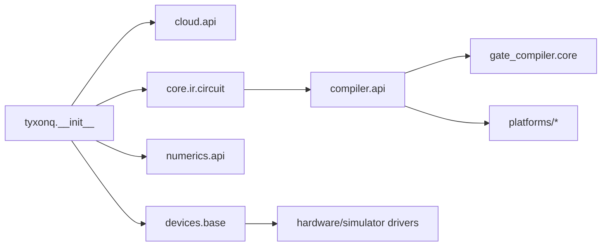

# 项目概述

<cite>
**本文引用的文件**
- [README.md](file://README.md)
- [TYXONQ_TECHNICAL_WHITEPAPER.md](file://TYXONQ_TECHNICAL_WHITEPAPER.md)
- [src/tyxonq/__init__.py](file://src/tyxonq/__init__.py)
- [src/tyxonq/config.py](file://src/tyxonq/config.py)
- [src/tyxonq/core/ir/circuit.py](file://src/tyxonq/core/ir/circuit.py)
- [src/tyxonq/devices/base.py](file://src/tyxonq/devices/base.py)
- [src/tyxonq/numerics/api.py](file://src/tyxonq/numerics/api.py)
- [src/tyxonq/compiler/api.py](file://src/tyxonq/compiler/api.py)
- [src/tyxonq/applications/chem/__init__.py](file://src/tyxonq/applications/chem/__init__.py)
- [docs/source/getting_started/basic_concepts.rst](file://docs/source/getting_started/basic_concepts.rst)
- [examples/pulse_basic_tutorial.py](file://examples/pulse_basic_tutorial.py)
</cite>

## 目录
1. [简介](#简介)
2. [项目结构](#项目结构)
3. [核心组件](#核心组件)
4. [架构总览](#架构总览)
5. [详细组件分析](#详细组件分析)
6. [依赖关系分析](#依赖关系分析)
7. [性能考量](#性能考量)
8. [故障排查指南](#故障排查指南)
9. [结论](#结论)
10. [附录](#附录)

## 简介
TyxonQ 是一个面向生产的模块化量子软件框架，提供稳定的中间表示（IR）、可插拔编译器、统一设备抽象（模拟器与真实硬件）、单一数值后端接口（NumPy/PyTorch/CuPyNumeric），以及设备友好的后处理流程。其核心价值在于：
- 以“计数优先”的统一结果语义和编译器驱动的测量分组/Shot调度，提升跨厂商可移植性与可复现性。
- 双路径执行模型：哈密顿量→测量分组→设备执行（含噪声）与精确数值计算（态矢量/MPS）共享一致语义，便于算法开发与验证。
- 脉冲级控制能力：从门电路到物理脉冲的完整链路，支持多种波形、三能级系统、TQASM/OpenPulse导出，直达真实量子处理器。
- 云平台集成与多硬件提供商支持：TyxonQ自有硬件、中国移动QCOS、Quafu、LQCloud、Guodun等，统一接入。
- 量子化学（Quantum AIDD）专业栈：面向AI药物设计的高性能VQE/UCC/HEA算法、分子动力学/QM-MM集成、PySCF桥接与云本地混合加速。

本概述为初学者提供清晰定位与价值主张，为资深开发者提供技术深度与实现要点。

**章节来源**
- [README.md:12-24](file://README.md#L12-L24)
- [TYXONQ_TECHNICAL_WHITEPAPER.md:23-77](file://TYXONQ_TECHNICAL_WHITEPAPER.md#L23-L77)

## 项目结构
TyxonQ采用分层解耦的模块化架构，按职责划分模块：
- core：稳定IR与链式API（Circuit/Hamiltonian）
- compiler：两阶段编译（设备无关核心 + 平台方言），测量分组与Shot调度
- devices：统一设备抽象（模拟器/硬件驱动）
- numerics：单一ArrayBackend协议（NumPy/PyTorch/CuPyNumeric）
- postprocessing：统一后处理（counts-first、误差缓解）
- applications：领域专用（量子化学、QM/MM、动力学）
- libs：通用库（电路模板、量子核、哈密顿编码）

**图表来源**
- [TYXONQ_TECHNICAL_WHITEPAPER.md:84-140](file://TYXONQ_TECHNICAL_WHITEPAPER.md#L84-L140)

**章节来源**
- [TYXONQ_TECHNICAL_WHITEPAPER.md:314-387](file://TYXONQ_TECHNICAL_WHITEPAPER.md#L314-L387)
- [docs/source/getting_started/basic_concepts.rst:99-167](file://docs/source/getting_started/basic_concepts.rst#L99-L167)

## 核心组件
- 稳定IR与链式API：Circuit作为最小IR，支持metadata、instructions与链式配置（compile/device/postprocessing/run）。
- 两阶段编译器：gate_compiler核心负责分解、路由、优化、简化；platforms/*方言将编译结果翻译为目标格式（QASM/TQASM等）。
- 统一设备抽象：Device协议定义run/expval与能力描述，屏蔽不同硬件差异。
- 单一数值后端：ArrayBackend协议统一数组操作与可选自动微分，支持NumPy/PyTorch/CuPyNumeric无缝切换。
- 统一后处理：counts-first语义，聚合期望值、误差缓解策略标准化。
- 量子化学栈：HEA/UCC系列算法、运行时（device/numeric）、波函数库、分子构建器、QM/MM接口。

**章节来源**
- [src/tyxonq/core/ir/circuit.py:48-138](file://src/tyxonq/core/ir/circuit.py#L48-L138)
- [src/tyxonq/compiler/api.py:39-98](file://src/tyxonq/compiler/api.py#L39-L98)
- [src/tyxonq/devices/base.py:97-143](file://src/tyxonq/devices/base.py#L97-L143)
- [src/tyxonq/numerics/api.py:19-122](file://src/tyxonq/numerics/api.py#L19-L122)
- [src/tyxonq/applications/chem/__init__.py:29-102](file://src/tyxonq/applications/chem/__init__.py#L29-L102)

## 架构总览
TyxonQ通过稳定IR作为系统契约，将应用、编译器、设备、数值后端与后处理解耦，形成线性数据流：构建IR→编译→设备→后处理。关键创新包括：
- 稳定IR：仅保留num_qubits与ops核心字段，开放类型ops允许不同后端解释。
- 编译器驱动测量优化：测量分组元数据上移至IR层，确定性Shot计划。
- 双路径执行：设备路径（shots/noise）与数值路径（exact）语义一致。
- Counts-first后处理：跨厂商一致性，插件化误差缓解。
- 单一数值后端：ArrayBackend协议支撑梯度与向量化。

**图表来源**
- [TYXONQ_TECHNICAL_WHITEPAPER.md:486-508](file://TYXONQ_TECHNICAL_WHITEPAPER.md#L486-L508)
- [src/tyxonq/compiler/api.py:39-98](file://src/tyxonq/compiler/api.py#L39-L98)
- [src/tyxonq/devices/base.py:97-143](file://src/tyxonq/devices/base.py#L97-L143)

**章节来源**
- [TYXONQ_TECHNICAL_WHITEPAPER.md:41-77](file://TYXONQ_TECHNICAL_WHITEPAPER.md#L41-L77)
- [README.md:195-214](file://README.md#L195-L214)

## 详细组件分析

### 稳定IR与链式API
- Circuit包含num_qubits、ops、metadata、instructions，支持初始状态输入与链式配置（compile/device/postprocessing/run）。
- 全局默认项（compile/device/postprocessing）可通过顶层API设置，降低样板代码。
- 链式API使执行流程透明、可调试、可组合。

**图表来源**
- [src/tyxonq/core/ir/circuit.py:48-138](file://src/tyxonq/core/ir/circuit.py#L48-L138)

**章节来源**
- [src/tyxonq/core/ir/circuit.py:48-138](file://src/tyxonq/core/ir/circuit.py#L48-L138)
- [src/tyxonq/__init__.py:145-183](file://src/tyxonq/__init__.py#L145-L183)

### 两阶段编译器与测量优化
- gate_compiler核心装配类型化步骤（DecomposeSpec/RoutingSpec），顺序执行：归一化→分解→路由→优化→简化。
- 平台方言（tyxonq/lqcloud/guodun）委托核心后再翻译为目标格式，避免重复逻辑。
- 测量分组与Shot调度在编译器层完成，确保跨设备一致性与可复现性。

**图表来源**
- [TYXONQ_TECHNICAL_WHITEPAPER.md:178-223](file://TYXONQ_TECHNICAL_WHITEPAPER.md#L178-L223)
- [src/tyxonq/compiler/api.py:39-98](file://src/tyxonq/compiler/api.py#L39-L98)

**章节来源**
- [TYXONQ_TECHNICAL_WHITEPAPER.md:174-223](file://TYXONQ_TECHNICAL_WHITEPAPER.md#L174-L223)
- [src/tyxonq/compiler/api.py:149-200](file://src/tyxonq/compiler/api.py#L149-L200)

### 统一设备抽象与多云/多硬件支持
- Device协议定义run/expval与capabilities，屏蔽底层差异。
- resolve_driver支持simulator、tyxonq、ibm、qcos、quafu、lqcloud、guodun等。
- 任务封装DeviceTask统一获取结果、取消任务、提升元数据。

**图表来源**
- [src/tyxonq/devices/base.py:97-143](file://src/tyxonq/devices/base.py#L97-L143)
- [src/tyxonq/devices/base.py:12-58](file://src/tyxonq/devices/base.py#L12-L58)

**章节来源**
- [src/tyxonq/devices/base.py:97-200](file://src/tyxonq/devices/base.py#L97-L200)
- [README.md:147-156](file://README.md#L147-L156)

### 单一数值后端与自动微分
- ArrayBackend协议统一数组创建、代数运算、随机数、可选requires_grad/detach。
- 支持numpy/pytorch/cupynumeric，自动向量化策略与回退机制。
- PyTorch后端原生autograd，保持梯度链完整性。

**图表来源**
- [src/tyxonq/numerics/api.py:19-122](file://src/tyxonq/numerics/api.py#L19-L122)

**章节来源**
- [src/tyxonq/numerics/api.py:179-200](file://src/tyxonq/numerics/api.py#L179-L200)
- [src/tyxonq/config.py:26-28](file://src/tyxonq/config.py#L26-L28)

### 双路径执行模型（设备 vs 数值）
- 设备路径：哈密顿量→测量分组→Shot计划→设备执行→后处理聚合期望值。
- 数值路径：直接态矢量/MPS计算，支持PyTorch autograd，用于快速迭代与基准验证。
- 两者共享相同Hamiltonian表示与测量语义，便于对比与迁移。

**图表来源**
- [TYXONQ_TECHNICAL_WHITEPAPER.md:486-508](file://TYXONQ_TECHNICAL_WHITEPAPER.md#L486-L508)

**章节来源**
- [TYXONQ_TECHNICAL_WHITEPAPER.md:482-555](file://TYXONQ_TECHNICAL_WHITEPAPER.md#L482-L555)

### 脉冲级控制能力
- 双模式：链式编译（Gate→Pulse→TQASM）与直接哈密顿演化。
- 波形库：DRAG、Gaussian、Hermite、Blackman等，支持三能级系统与交叉共振CX。
- 导出：TQASM 0.2 + OpenPulse defcal，云端部署就绪。
- 示例：基础教程演示Hello World、参数扫描、门到脉冲转换、TQASM导出。

**图表来源**
- [examples/pulse_basic_tutorial.py:32-200](file://examples/pulse_basic_tutorial.py#L32-L200)
- [README.md:208-214](file://README.md#L208-L214)

**章节来源**
- [examples/pulse_basic_tutorial.py:32-200](file://examples/pulse_basic_tutorial.py#L32-L200)
- [README.md:208-214](file://README.md#L208-L214)

### 量子化学（AI药物设计）专业优势
- 算法族：HEA/UCC/UCCSD/k-UpCCGSD/pUCCD，统一energy/gradient/kernel API。
- 运行时：device runtime转发分组测量至后处理；numeric runtime提供精确态矢量/CI向量（支持autograd）。
- 哈密顿量：统一稀疏/MPO/FCI函数输出；分子工厂便捷构建。
- 测量与Shot：编译器驱动分组与调度，确定性强、跨供应商一致。
- 属性与动力学：RDM1/2、基本性质算符；时间演化缓存MPO/项矩阵避免重建。
- 桥接：OpenFermion I/O、PySCF参考与积分；QM/MM生态（ASE/i-PI/OpenMM/MDI）。
- 云本地混合：HF/post-HF核可卸载至云端（GPU优先，CPU回退），通过chkfile恢复本地VQE控制。

**章节来源**
- [src/tyxonq/applications/chem/__init__.py:29-102](file://src/tyxonq/applications/chem/__init__.py#L29-L102)
- [TYXONQ_TECHNICAL_WHITEPAPER.md:602-783](file://TYXONQ_TECHNICAL_WHITEPAPER.md#L602-L783)
- [README.md:460-468](file://README.md#L460-L468)

## 依赖关系分析
- 顶层入口暴露云API别名、全局默认项、数值后端选择与噪声控制。
- 配置模块集中常量、后端名规范化、默认dtype。
- 编译器API检测脉冲操作并自动切换输出格式（homebrew_s2强制qasm2或tqasm）。
- 设备基类提供任务封装与结果规范化，提升跨驱动一致性。

**图表来源**
- [src/tyxonq/__init__.py:25-128](file://src/tyxonq/__init__.py#L25-L128)
- [src/tyxonq/config.py:17-28](file://src/tyxonq/config.py#L17-L28)
- [src/tyxonq/compiler/api.py:149-200](file://src/tyxonq/compiler/api.py#L149-L200)
- [src/tyxonq/devices/base.py:12-58](file://src/tyxonq/devices/base.py#L12-L58)

**章节来源**
- [src/tyxonq/__init__.py:25-128](file://src/tyxonq/__init__.py#L25-L128)
- [src/tyxonq/config.py:17-28](file://src/tyxonq/config.py#L17-L28)
- [src/tyxonq/compiler/api.py:149-200](file://src/tyxonq/compiler/api.py#L149-L200)
- [src/tyxonq/devices/base.py:12-58](file://src/tyxonq/devices/base.py#L12-L58)

## 性能考量
- 自动微分与梯度：PyTorch后端原生autograd，保持梯度链，减少有限差分开销。
- 向量化策略：vmap优先，失败回退到逐元素执行，兼顾兼容性与性能。
- 编译器优化：相邻门合并、恒等剪枝、光锥简化，减少无效操作。
- 测量优化：分组与Shot分配基于方差权重，提高估计精度与效率。
- 后端选择：NumPy（CPU）、PyTorch（梯度）、CuPyNumeric（GPU）按需切换。

[本节为通用指导，不直接分析具体文件]

## 故障排查指南
- 后端不可用：当cupynumeric未安装时，自动回退到numpy并警告。
- 脉冲模式识别：编译器自动检测pulse/pulse_inline/play等操作，切换到脉冲编译。
- homebrew_s2限制：门电路强制qasm2输出，脉冲电路强制tyxonq_homebrew_tqasm输出。
- 结果规范化：DeviceTask.get_result提升内层metadata，确保expectations/probabilities键存在。
- 噪声控制：顶层enable_noise可全局开关模拟器噪声与默认配置。

**章节来源**
- [src/tyxonq/__init__.py:214-230](file://src/tyxonq/__init__.py#L214-L230)
- [src/tyxonq/compiler/api.py:149-186](file://src/tyxonq/compiler/api.py#L149-L186)
- [src/tyxonq/devices/base.py:20-54](file://src/tyxonq/devices/base.py#L20-L54)
- [src/tyxonq/__init__.py:335-356](file://src/tyxonq/__init__.py#L335-L356)

## 结论
TyxonQ以稳定IR为核心契约，结合编译器驱动的测量优化、统一设备抽象、单一数值后端与counts-first后处理，构建了生产级量子编程框架。其双路径执行模型与脉冲级控制能力，为量子化学（AI药物设计）提供了高性能、可扩展且贴近硬件的解决方案。通过多云/多硬件支持与云本地混合加速，TyxonQ在算法开发、验证与部署之间建立了高效闭环。

[本节为总结，不直接分析具体文件]

## 附录
- 快速入门：参考基础概念文档与示例，体验链式API与设备选择。
- 脉冲编程：从Hello World到TQASM导出，掌握门到脉冲的完整链路。
- 量子化学：使用HEA/UCC系列算法进行分子性质计算，结合QM/MM生态进行动力学模拟。

**章节来源**
- [docs/source/getting_started/basic_concepts.rst:196-263](file://docs/source/getting_started/basic_concepts.rst#L196-L263)
- [examples/pulse_basic_tutorial.py:32-200](file://examples/pulse_basic_tutorial.py#L32-L200)
- [README.md:27-106](file://README.md#L27-L106)